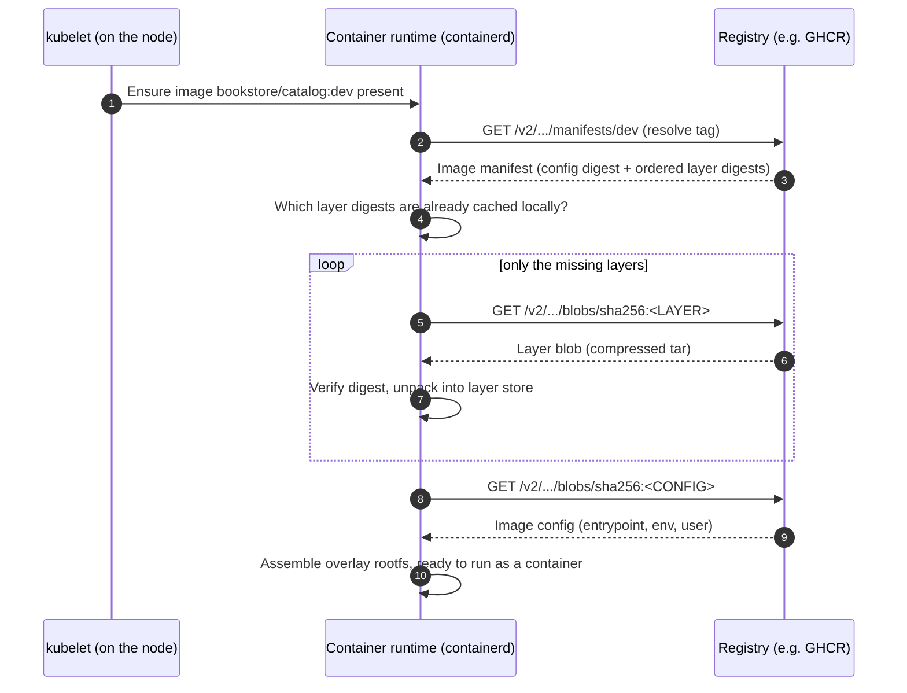

# 02 — Containers and images

> What a container actually is (Linux kernel features, not magic), how an
> image is built, addressed, and pulled — taught by building the real
> Bookstore `catalog` image.

**Estimated time:** ~15 min read · ~30 min hands-on
**Prerequisites:** [Part 00 ch.01](01-why-kubernetes.md) — why Kubernetes runs containers
**You'll know after this:** • explain what a Linux container actually is (namespaces + cgroups, not a VM) · • read and write a small multi-stage `Dockerfile` · • understand image references (registry/repo:tag@digest) and the image-pull flow · • build and push the Bookstore `catalog` image · • recognize the layers, OCI standard, and distroless/non-root patterns

<!-- tags: foundations, containers, images, dockerfile, oci -->

## Why this exists

Kubernetes runs **containers**. Every Pod is one or more containers; every
deploy ships **images**. If "container" and "image" are fuzzy, everything above
them (Pods, probes, registries, image pull policy, supply-chain security) is
fuzzy too. The errors you will hit most as a beginner — `ImagePullBackOff`,
`CrashLoopBackOff`, "works locally, fails in the cluster", a 900 MB image that
takes forever to pull, "why is it running as root?" — are *all* container/image
problems, not Kubernetes problems. This chapter makes the foundation concrete so
the rest of the guide stands on rock.

We do it the way the whole guide works: by building the **actual** image for
the Bookstore `catalog` service (a real Go API you'll deploy in
[chapter 06](06-declarative-api-model.md) and
[chapter 07](07-local-cluster-setup.md)) and explaining every line of its real
`Dockerfile`.

## Mental model

An **image** is a read-only, content-addressed *filesystem + metadata* — a
frozen template of "everything this program needs to run". A **container** is
*a normal Linux process* (or a few) started from that image, then **isolated**
(it sees its own filesystem, process tree, network, hostname) and
**constrained** (capped CPU/memory) by the Linux kernel. There is no
"lightweight VM" inside — same kernel as the host, just fenced off. Build once
→ an immutable image; run that image many times → many identical, disposable
containers. That immutability + identicality is exactly what makes the
"cattle" model and reproducible rollouts of
[chapter 01](01-why-kubernetes.md) possible.

## Threats and controls

This chapter owns the image-level threats below. Each row names the control
the chapter teaches and where the topic goes deeper. The Pod field that
enforces a non-root user, `runAsNonRoot`, is taught in
[01.01](../01-core-workloads/01-pods.md#baseline).

| Threat | Control taught here | Goes deeper |
|---|---|---|
| Every container on a node shares one host kernel | Named only. The hardening flags in the hands-on narrow what a process can reach | [Pod security](../05-security/02-pod-security.md) |
| A bloated image gives an attacker a shell, a package manager and tools | Multi-stage build on a distroless static base, which has no shell | [Pod security](../05-security/02-pod-security.md) |
| The process runs as root | The image declares `USER 65532:65532` | [Pod security](../05-security/02-pod-security.md) |
| A secret ends up in a layer, where a later delete does not remove it | No secrets in build arguments or copied files; check `docker history` and scan | [Supply chain](../05-security/03-supply-chain.md) |
| A mutable tag changes what runs without any manifest change | Digest pin on third-party base images; the local build keeps its build tag | [Supply chain](../05-security/03-supply-chain.md) |
| A known CVE ships in a dependency the image contains | The first Trivy scan, read as a finding with its fixed version | [Supply chain](../05-security/03-supply-chain.md) |

## Containers vs. VMs

```
   VIRTUAL MACHINES                     CONTAINERS
   ┌───────────┐ ┌───────────┐          ┌───────────┐ ┌───────────┐
   │   App A   │ │   App B   │          │   App A   │ │   App B   │
   │  bins/libs│ │  bins/libs│          │  bins/libs│ │  bins/libs│
   │ Guest OS  │ │ Guest OS  │  <- full ├───────────┴─┴───────────┤
   │ (kernel)  │ │ (kernel)  │     OS   │   Container runtime     │
   ├───────────┴─┴───────────┤    each  ├─────────────────────────┤
   │       Hypervisor        │          │    Host OS (one kernel) │  <- shared
   ├─────────────────────────┤          ├─────────────────────────┤
   │       Host hardware     │          │      Host hardware      │
   └─────────────────────────┘          └─────────────────────────┘
   Isolation: strong (own kernel)       Isolation: process-level (shared kernel)
   Start: tens of seconds               Start: milliseconds
   Size: GBs (whole OS per VM)          Size: MBs (just app + libs)
```

A VM virtualizes *hardware* and runs a whole guest OS per instance — strong
isolation, heavy. A container virtualizes the *OS*: all containers on a host
share that host's single kernel and are merely isolated from each other by
kernel features. That's why a container starts in milliseconds and is
megabytes: there's no second OS to boot or carry. The trade is a weaker
isolation boundary (a shared kernel is a shared attack surface) — which is why
[Pod security](../05-security/02-pod-security.md) and not running as root
matter, and why some platforms add a thin VM around containers (gVisor, Kata)
when stronger isolation is required.

## How it works under the hood

### A container is namespaces + cgroups (+ a root filesystem)

There is no single "container" object in Linux. A container is the combination
of three kernel mechanisms applied to a process:

1. **Namespaces — what the process can *see* (isolation).** Each namespace type
   gives the process its own private view of one kind of global resource:

   | Namespace | Isolates | Effect inside the container |
   |---|---|---|
   | `pid` | Process IDs | Its own PID tree; the entrypoint is PID 1 |
   | `net` | Network stack | Own interfaces, IPs, routing, ports |
   | `mnt` | Mount points | Its own filesystem tree (the image's rootfs) |
   | `uts` | Hostname/domain | Its own hostname |
   | `ipc` | SysV IPC / shm | Isolated shared-memory & semaphores |
   | `user` | UID/GID mapping | Can map container-root → unprivileged host UID |
   | `cgroup` | cgroup root view | Hides the host's cgroup hierarchy |

   This is *why a container "feels like" its own machine* — it has its own
   process list, network, and filesystem — while actually being host processes.

2. **cgroups (control groups) — what the process can *use* (limits).** cgroups
   account for and cap CPU, memory, I/O, and PIDs for a group of processes.
   This is the kernel feature behind Kubernetes resource
   `requests`/`limits` ([resources & QoS](../01-core-workloads/03-resources-and-qos.md)):
   a memory limit is a cgroup limit; exceed it and the kernel OOM-kills the
   process — which surfaces as a restart in Kubernetes.

3. **A root filesystem** unpacked from the image and mounted (typically via an
   overlay filesystem — see layers below), so the process sees the image's
   `/usr`, `/bin`, app binary, etc., not the host's.

```
 HOST KERNEL (one, shared)
 ├── cgroup: catalog  (cpu.max=… , memory.max=512Mi)   ← limits (what it can USE)
 │   └── namespaces { pid, net, mnt, uts, ipc, user }  ← isolation (what it can SEE)
 │       └── PID 1: /catalog            (the Go process; its own /, own net)
 └── cgroup: redis
     └── namespaces { … }
         └── PID 1: redis-server
 (Same kernel underneath both. "Container" = process + its namespaces + its cgroup + its rootfs)
```

Kubernetes does not call these syscalls itself. The kubelet asks a **container
runtime** (containerd via the CRI) to do it; the runtime (through `runc`)
creates the namespaces and cgroups. That chain is
[chapter 05](05-node-components.md).

### Images: the OCI spec, layers, content addressing

An image is standardized by the **OCI Image Specification**. It is *not* a
single blob; it is:

- a **manifest** (JSON) listing the config + the ordered layers,
- a **config** (JSON: entrypoint, env, user, working dir, architecture),
- one or more **layer** tarballs (the filesystem, in diffs).

**Layers.** Each build instruction that changes the filesystem produces a
layer — a *diff* over the layer below. At run time the layers are stacked
read-only via an overlay filesystem, plus a thin writable layer on top for that
container instance (discarded when the container is removed — this is why
in-container writes are ephemeral and why state must go to
[volumes](../03-config-and-storage/03-volumes.md)).

**Content addressing.** Every layer and the config are referenced by the SHA-256
**digest** of their content (e.g. `sha256:9b2a…`). Identical content ⇒ identical
digest ⇒ stored and pulled **once** and shared across images and nodes. This is
why a small base layer shared by many services is cheap, and why image **digests
are immutable** (the name is the hash of the bytes; change a byte → different
digest).

**Tags vs. digests.**

- A **tag** (`bookstore/catalog:dev`, `nginx:1.27`) is a *mutable human label*
  that points at a digest *today*. It can be re-pointed tomorrow — `:latest`
  especially is a moving target.
- A **digest** (`bookstore/catalog@sha256:…`) names *exact* bytes, forever.

> **In production:** pin by **digest** (or an immutable, never-reused tag) so a
> rollout is byte-for-byte reproducible and a rollback returns to the *exact*
> prior image. Never deploy `:latest` to production — two nodes can pull two
> different images under the same name, and `imagePullPolicy` interacts badly
> with it. ([Supply chain](../05-security/03-supply-chain.md) goes deeper:
> signing and provenance.)

### Registries and the pull flow

A **registry** (Docker Hub, GHCR, ECR/GCR/ACR, Harbor) is content-addressed
storage for images, speaking the OCI Distribution API. When a node needs an
image it does **not** download one big file — it fetches the manifest, then
only the layers it doesn't already have cached:



Consequences you will rely on later: layer caching makes redeploys of a changed
top layer fast even if the base is huge; a private registry needs an
`imagePullSecret`; `imagePullPolicy` (`IfNotPresent` / `Always` / `Never`)
decides whether step 2 even contacts the registry — central to the local
`kind load` trick in [chapter 07](07-local-cluster-setup.md).

### Building minimal images: multi-stage and distroless

Two ideas make images small, fast to pull, and safe — and the `catalog`
Dockerfile uses both:

- **Multi-stage build.** Use a big toolchain image to *compile*, then `COPY`
  only the resulting artifact into a tiny final image. The compiler, source,
  and module cache never reach the shipped image.
- **Minimal / distroless base.** `gcr.io/distroless/static` contains *no shell,
  no package manager, no busybox* — essentially just CA certs and the
  files needed to run a static binary. Smaller (faster pulls, less storage),
  and a drastically smaller attack surface (no `sh` for an attacker to use, far
  fewer CVEs to patch). The `nonroot` variant additionally bakes in an
  unprivileged user.

## Hands-on with the Bookstore: build & run `catalog`

We now containerize the first real Bookstore service. The source lives at
[`examples/bookstore/app/catalog/`](../examples/bookstore/app/catalog/) and is
a tiny Go HTTP API: it serves `GET /books` (in-memory sample unless `DB_DSN` is
set), and exposes `GET /healthz`, `GET /readyz`, `GET /metrics`. It reads the
port from `PORT` (default `8080`) and shuts down gracefully on `SIGTERM`.

### The real Dockerfile, line by line

This is the **actual** file at
[`examples/bookstore/app/catalog/Dockerfile`](../examples/bookstore/app/catalog/Dockerfile)
(read it yourself — it is intentionally short):

```dockerfile
# syntax=docker/dockerfile:1@sha256:4edf897a3ffa55b89f906fc8cc78afdb3f1834cc9c7083565e611a8a7d5fe99e
# Multi-stage build -> single static binary on distroless (nonroot).
# Built and referenced by chapters as: bookstore/catalog:dev

FROM golang:1.26.10-alpine@sha256:a2012b4a1d1f9f7e9f44e0d39b805a901e856b1dd80b4e6ee4338db547050308 AS build
WORKDIR /src

# Cache module downloads separately from source for faster rebuilds.
COPY go.mod go.sum* ./
RUN go mod download

COPY . .
# CGO disabled => fully static binary that runs on scratch/distroless-static.
RUN CGO_ENABLED=0 GOOS=linux go build -trimpath -ldflags="-s -w" -o /out/catalog .

FROM gcr.io/distroless/static:nonroot@sha256:18f4cc26c9ffa7f20a359298be7deadac5c607c8e03a02b8119f1a5fc2f82c99
WORKDIR /
COPY --from=build /out/catalog /catalog
# 65532 is the "nonroot" UID/GID in distroless images.
USER 65532:65532
EXPOSE 8080
ENTRYPOINT ["/catalog"]
```

What each line does and *why it is written this way*:

- **`# syntax=docker/dockerfile:1@sha256:…`**: selects the BuildKit Dockerfile
  frontend (stable v1 line), enabling modern build features regardless of the
  local Docker version. The digest pins that frontend image, so the parser that
  reads this file is the same bytes on every build.
- **`FROM golang:1.26.10-alpine@sha256:… AS build`**: stage 1, named `build`. A
  full Go toolchain (on small Alpine) used *only to compile*. Nothing in this
  stage ships. The tag names an exact patch release, not `1.26`: the Go standard
  library is compiled *into* the binary, so the toolchain patch decides which
  stdlib CVEs ship. The digest pins the same bytes as the tag, so a re-pushed
  tag cannot change the toolchain. CI's `go-toolchain-matches-scan` job checks
  that the tag matches the version `govulncheck` scans with.
- **`WORKDIR /src`** — sets/creates the working directory for subsequent
  commands in this stage.
- **`COPY go.mod go.sum* ./` then `RUN go mod download`** — copy *only* the
  dependency manifests first and download modules. This is deliberate **layer
  cache** engineering: dependencies change rarely, so as long as `go.mod`/
  `go.sum` are unchanged, Docker reuses the cached "download" layer and skips
  re-fetching modules on every code edit. (`go.sum*` — the `*` tolerates the
  file being absent.)
- **`COPY . .`** — now copy the rest of the source. This layer invalidates on
  any code change, but the expensive module layer above it stays cached.
- **`RUN CGO_ENABLED=0 GOOS=linux go build -trimpath -ldflags="-s -w" -o /out/catalog .`**
  — compile. `CGO_ENABLED=0` produces a **fully static** binary (no libc
  dependency) so it can run on a base with *no* shared libraries.
  `GOOS=linux` targets the container OS. `-trimpath` strips local filesystem
  paths (reproducibility/privacy). `-ldflags="-s -w"` drops the symbol table
  and DWARF debug info (smaller binary). Output goes to `/out/catalog`.
- **`FROM gcr.io/distroless/static:nonroot@sha256:…`** — stage 2 starts a
  brand-new, tiny final image: distroless static (just CA certs + the minimum
  to run a static binary), `nonroot` variant (a built-in unprivileged user,
  UID 65532). The digest pins the exact base bytes, so a new push under the
  same tag cannot change what this image is built on. The tag before it names
  the variant for a reader.
- **`WORKDIR /`** — final image working directory.
- **`COPY --from=build /out/catalog /catalog`** — copy *only* the compiled
  binary out of the `build` stage. The toolchain, source, and module cache are
  all left behind. The shipped image is essentially `{CA certs} + {one binary}`.
- **`USER 65532:65532`** — run as the non-root `nonroot` UID/GID. The
  container does not run as root even before Kubernetes adds its own
  [security context](../05-security/02-pod-security.md). The baseline's
  `runAsUser` and `runAsGroup` repeat these numbers
  ([01.01](../01-core-workloads/01-pods.md#baseline)).
- **`EXPOSE 8080`** — documents the listening port (metadata; does not publish
  anything by itself). Matches the app's default `PORT`.
- **`ENTRYPOINT ["/catalog"]`** — exec form: PID 1 in the container *is* the Go
  binary directly (no shell wrapper), so it receives `SIGTERM` and runs its
  graceful-shutdown path — which is exactly what Kubernetes needs for clean
  rollouts and Pod termination ([health & lifecycle](../01-core-workloads/02-health-and-lifecycle.md)).

The result: a tiny, static, non-root, single-process image — textbook input
for Kubernetes.

### Build and run it locally

> Prerequisites: a running Docker-compatible daemon (Docker Engine, or
> Rancher Desktop/Podman/etc.). If `docker …` reports "Cannot connect to the
> Docker daemon", start your engine first. If your engine does not expose the
> default `/var/run/docker.sock`, point Docker at its socket via `DOCKER_HOST`
> (see your engine's docs for the socket path).

The steps below run in the order the chapter's evidence transcript records
them. Run each command against your own engine. The transcript was captured on
a remote engine host, which is why its timestamps and host names differ.

### Lint the Dockerfile first

Lint before the build, the way a pipeline does. Hadolint v2.15.1 runs from
its image, pinned by digest. A clean run prints nothing, so the control
below shows the linter reading its input.

```sh
# hadolint v2.15.1, pinned by digest
docker run --rm -i ghcr.io/hadolint/hadolint@sha256:32dac94127fd60b7b7e3fbfc65e1383b9b5e25c9bfd7b8536de7a539fe68a12d < catalog/Dockerfile
```

The lint of `catalog/Dockerfile` prints nothing and exits zero. A silent
linter proves nothing by itself, so run it on a Dockerfile with known problems:

```sh
printf 'FROM alpine:latest\nRUN apk add curl\nUSER root\n' | docker run --rm -i ghcr.io/hadolint/hadolint@sha256:32dac94127fd60b7b7e3fbfc65e1383b9b5e25c9bfd7b8536de7a539fe68a12d /bin/hadolint --no-color -
```

<!-- gate: output -->
```text
-:1 DL3007 warning: Using latest is prone to errors if the image will ever update. Pin the version explicitly to a release tag
-:2 DL3019 info: Use the `--no-cache` switch to avoid the need to use `--update` and remove `/var/cache/apk/*` when done installing packages
-:2 DL3018 warning: Pin versions in apk add. Instead of `apk add <package>` use `apk add <package>=<version>`
-:3 DL3002 warning: Last USER should not be root
-:3 DL3066 info: Non-numeric user-id may not be resolvable by host system
```

Each finding prints the line, the rule, and the message. The control has five
findings: an unpinned `latest` tag, apk packages installed without pinned
versions or a cache cleanup, a final `USER root`, and a non-numeric user ID.

### Build the image

```sh
# from the repo root
cd full-guide/examples/bookstore/app

# Build the image (tag it exactly as later chapters expect)
docker build -t bookstore/catalog:dev ./catalog

# How small is it?
docker image ls bookstore/catalog:dev
```

<!-- gate: output -->
```text
IMAGE                   ID             DISK USAGE   CONTENT SIZE   EXTRA
bookstore/catalog:dev   13d7f0b70505       29.1MB         6.86MB   U    
```

Most of the layers come from the distroless base: CA certificates, the passwd
and group files, time zone data and a few system files. The catalog adds one
layer, the binary.

The image's baked-in metadata matches the spec:

```sh
docker image inspect bookstore/catalog:dev --format 'Entrypoint={{.Config.Entrypoint}} User={{.Config.User}} Exposed={{.Config.ExposedPorts}}'
```

<!-- gate: output -->
```text
Entrypoint=[/catalog] User=65532:65532 Exposed=map[8080/tcp:{}]
```

### Check the image before it ships

The history and the scan each run on the built image. Each check gets a
control: the same command runs on a throwaway image with a planted secret. A
clean result on the catalog then means the tool read its input and found
nothing.

**Read the layers for secrets.** A secret passed as a build argument, or copied
into a layer and deleted later, stays in the image history. Read the history,
then grep it for secret-looking words:

```sh
docker history --no-trunc --format '{{.CreatedBy}}' bookstore/catalog:dev
docker history --no-trunc --format '{{.CreatedBy}}' bookstore/catalog:dev | grep -c -i -E 'secret|token|password|api.?key'
```

<!-- gate: output -->
```text
ENTRYPOINT ["/catalog"]
EXPOSE [8080/tcp]
USER 65532:65532
COPY /out/catalog /catalog # buildkit
WORKDIR /
# ...
bazel build @trixie//base-files/amd64:data_statusd
```

<!-- gate: output -->
```text
0
```

The history shows the catalog's own steps at the top, then the base layers.
Nothing in the build instructions matches a secret word.

A zero means something only if the same grep finds a planted secret. Build a
control image on your engine: a throwaway with a build argument named
`API_TOKEN`, and a private key generated at build time, so no key is written
into the repository. The image is never shipped:

```sh
openssl genpkey -algorithm RSA -pkeyopt rsa_keygen_bits:2048 -out key.pem
cat > Dockerfile <<'EOF'
# busybox:1.36, pinned by digest
FROM busybox@sha256:73aaf090f3d85aa34ee199857f03fa3a95c8ede2ffd4cc2cdb5b94e566b11662
ARG API_TOKEN=control-value
COPY key.pem /etc/control/key.pem
EOF
docker build -q -t control/secret:dev .
docker history --no-trunc --format '{{.CreatedBy}}' control/secret:dev | grep -i -E 'secret|token|password|api.?key'
docker history --no-trunc --format '{{.CreatedBy}}' control/secret:dev | grep -c -i -E 'secret|token|password|api.?key'
```

<!-- gate: output -->
```text
ARG API_TOKEN=control-value
```

<!-- gate: output -->
```text
1
```

The grep finds the build argument in the control, so the catalog's 0 means the
history holds no secret-looking step.

**Scan the image** with Trivy 0.76.1, the version this guide's CI pins. Save the
image to a tar file first, so Trivy reads the same bytes whether the engine is
local or remote:

```sh
docker save bookstore/catalog:dev > catalog-dev.tar
trivy image --input catalog-dev.tar
```

<!-- gate: output -->
```text
# ...
Report Summary

┌───────────────────────────────┬──────────┬─────────────────┬─────────┐
│            Target             │   Type   │ Vulnerabilities │ Secrets │
├───────────────────────────────┼──────────┼─────────────────┼─────────┤
│ catalog-dev.tar (debian 13.7) │  debian  │        0        │    -    │
├───────────────────────────────┼──────────┼─────────────────┼─────────┤
│ catalog                       │ gobinary │        1        │    -    │
└───────────────────────────────┴──────────┴─────────────────┴─────────┘
Legend:
- '-': Not scanned
- '0': Clean (no security findings detected)


catalog (gobinary)
==================
Total: 1 (UNKNOWN: 1, LOW: 0, MEDIUM: 0, HIGH: 0, CRITICAL: 0)

┌──────────────────┬────────────────┬──────────┬────────┬───────────────────┬───────────────┬────────────────────────────────────────────────────┐
│     Library      │ Vulnerability  │ Severity │ Status │ Installed Version │ Fixed Version │                       Title                        │
├──────────────────┼────────────────┼──────────┼────────┼───────────────────┼───────────────┼────────────────────────────────────────────────────┤
│ golang.org/x/sys │ CVE-2026-39824 │ UNKNOWN  │ fixed  │ v0.34.0           │ 0.44.0        │ Invoking integer overflow in NewNTUnicodeString in │
│                  │                │          │        │                   │               │ golang.org/x/sys/windows                           │
│                  │                │          │        │                   │               │ https://avd.aquasec.com/nvd/cve-2026-39824         │
└──────────────────┴────────────────┴──────────┴────────┴───────────────────┴───────────────┴────────────────────────────────────────────────────┘
```

The OS packages have no findings. The one finding is in `golang.org/x/sys`
v0.34.0, a module compiled into the Go binary, and Trivy lists 0.44.0 as
the fixed version. Trivy matches module versions, so it cannot tell whether the
binary calls the affected Windows code. govulncheck, which this guide's CI runs,
checks reachability. The fix is to raise that module in `go.mod` and rebuild.
This chapter leaves the example at its current version, so the scan here matches
what the guide ships.

The scan's log lines, which the block elides, include `[secret] Secret scanning
is enabled`, so the scanner was on. The Secrets column reads `-` with no secret
section below it. Trivy's legend calls `-` "not
scanned", which does not settle what happened, so check the scanner against a
control. Scan the control image, which holds a planted key, with the same
scanner:

```sh
docker save control/secret:dev > control-secret.tar
trivy image --input control-secret.tar --scanners secret --report summary | sed '/^\/etc\/control\/key.pem (secrets)/,$d'
```

The `sed` cuts the output at the detail section for the control's key, which
repeats the key's first lines (masked) under a header. The summary is enough
for this check.

<!-- gate: output -->
```text
# ...
Report Summary

┌──────────────────────┬──────┬─────────┐
│        Target        │ Type │ Secrets │
├──────────────────────┼──────┼─────────┤
│ /etc/control/key.pem │ text │    1    │
└──────────────────────┴──────┴─────────┘
Legend:
- '-': Not scanned
- '0': Clean (no security findings detected)
```

The control's layer holds a private key. Trivy's detail section, which the
`sed` cuts, reports it as an `AsymmetricPrivateKey` at HIGH severity. The
scanner read that file from the layer and counted it in the Secrets column. The
catalog's `-` therefore means the scanner produced no secret result for its
image, and the scan's detail sections list no secret.

### Run it with the hardening flags

Run the image in the foreground. Each of the three hardening flags first appears
here, and each maps to a field in the
[security baseline](../01-core-workloads/01-pods.md#baseline), which sets the
same control on a Pod:

```sh
docker run --rm --name catalog -p 8080:8080 -e PORT=8080 --read-only --cap-drop=ALL --security-opt=no-new-privileges bookstore/catalog:dev
```

- **`--read-only`** mounts the root filesystem read-only. The baseline's
  `readOnlyRootFilesystem: true` does the same, and writable paths come from
  an `emptyDir`.
- **`--cap-drop=ALL`** removes every Linux capability. A Go server on port 8080
  needs none. The baseline's `capabilities: drop: ["ALL"]` does the same.
- **`--security-opt=no-new-privileges`** stops a process from gaining privileges
  through a setuid binary or file capabilities. The baseline's
  `allowPrivilegeEscalation: false` sets the same flag.

Call the endpoints Kubernetes uses as probes from a second terminal on the
machine where the container runs. The port is published there, so `localhost`
reaches it.

```sh
curl -s localhost:8080/healthz
```

<!-- gate: output -->
```text
{"status":"ok"}
```

```sh
curl -s localhost:8080/readyz
```

<!-- gate: output -->
```text
{"status":"ready"}
```

```sh
curl -s localhost:8080/books | head -c 110; echo
```

<!-- gate: output -->
```text
[{"id":1,"title":"The Go Programming Language","author":"Donovan \u0026 Kernighan","price":39.99},{"id":2,"tit
```

Read the settings back from the running container:

```sh
docker top catalog -o uid,pid,args
docker inspect --format 'ReadonlyRootfs={{.HostConfig.ReadonlyRootfs}} CapDrop={{.HostConfig.CapDrop}} SecurityOpt={{.HostConfig.SecurityOpt}} User={{.Config.User}}' catalog
```

<!-- gate: output -->
```text
UID                 PID                 COMMAND
65532               3531486             /catalog
```

<!-- gate: output -->
```text
ReadonlyRootfs=true CapDrop=[ALL] SecurityOpt=[no-new-privileges] User=65532:65532
```

The process runs as UID 65532, the user the image declares. The flags are
applied as written.

Stop the container from the second terminal with `docker stop catalog`. That
sends SIGTERM, then SIGKILL if the process has not exited within the grace
period. Ctrl-C in the foreground terminal sends SIGINT instead. The entrypoint
is exec form, so the Go binary is PID 1 and receives the signal itself:

```sh
docker stop catalog
```

<!-- gate: output -->
```text
catalog
```

The stop command prints only the container name. The handler's log lines appear
in the foreground terminal where the container ran. The captured run saved that
terminal's output to `catalog-run.log`, and it reads:

<!-- gate: output -->
```text
{"time":"2026-10-30T23:16:27.289502108Z","level":"INFO","msg":"DB_DSN unset; serving in-memory sample books"}
{"time":"2026-10-30T23:16:27.289953855Z","level":"INFO","msg":"catalog listening","addr":":8080"}
{"time":"2026-10-30T23:16:30.261914713Z","level":"INFO","msg":"shutdown signal received","signal":"terminated"}
{"time":"2026-10-30T23:16:30.262030119Z","level":"INFO","msg":"shutdown complete"}
```

### Deliberate failures

Two of the runs below fail on purpose, and each shows a control working. The
busybox run without flags is a contrast, not a failure: it succeeds, and it
shows what the flags change.

**No shell.** Override the entrypoint with a shell. The image has none, so the
container never starts. This is the no-shell property from the threats table:

```sh
docker run --rm --entrypoint sh bookstore/catalog:dev -c 'echo hi'
```

<!-- gate: output -->
```text
docker: Error response from daemon: failed to create task for container: failed to create shim task: OCI runtime create failed: runc create failed: unable to start container process: error during container init: exec: "sh": executable file not found in $PATH
```

**Read-only root and dropped capabilities.** The catalog image has no shell to
run a write, so this check uses busybox, a small image that has one. The
digest is the busybox 1.36 image. The `tr` only replaces tabs in the output
with spaces, so the lines read as plain text.

```sh
# busybox:1.36, pinned by digest
docker run --rm busybox@sha256:73aaf090f3d85aa34ee199857f03fa3a95c8ede2ffd4cc2cdb5b94e566b11662 sh -c 'touch /probe && echo wrote-probe; grep -E "CapEff|NoNewPrivs" /proc/self/status' | tr '\t' ' '
```

<!-- gate: output -->
```text
wrote-probe
CapEff: 00000000a80425fb
NoNewPrivs: 0
```

That contrast run, with no flags, shows the write succeeding, the capability set
full, and `no-new-privileges` off. Now the same command with the three flags.
This run fails on purpose:

```sh
# busybox:1.36, pinned by digest
docker run --rm --read-only --cap-drop=ALL --security-opt=no-new-privileges busybox@sha256:73aaf090f3d85aa34ee199857f03fa3a95c8ede2ffd4cc2cdb5b94e566b11662 sh -c 'touch /probe && echo wrote-probe; grep -E "CapEff|NoNewPrivs" /proc/self/status' | tr '\t' ' '
```

<!-- gate: output -->
```text
touch: /probe: Read-only file system
CapEff: 0000000000000000
NoNewPrivs: 1
```

The write is denied, the capability set is empty, and `NoNewPrivs` is 1. The
three flags changed the three things the contrast run showed: the writable root,
the capability set and `NoNewPrivs`.

## Production notes

> **In production:** build images in **CI**, not on a laptop, so what runs
> traces back to a commit. The scan from this chapter belongs in that pipeline,
> and Kubernetes will not vet an image for you. Signing and provenance are in
> [supply chain](../05-security/03-supply-chain.md) and
> [CI/CD](../07-delivery/03-cicd-pipeline.md).

> **In production:** match the image **architecture** to your nodes (e.g.
> `arm64` vs `amd64`) or publish a multi-arch manifest list — a frequent cause
> of `exec format error` `CrashLoopBackOff` when a laptop-built `arm64` image
> lands on `amd64` nodes.

## Quick Reference

Core image/container commands (Docker; `nerdctl`/`podman` are near-identical):

```sh
docker build -t name:tag ./context        # build an image from a Dockerfile
docker image ls                            # list local images (+ sizes)
docker image inspect name:tag              # entrypoint, user, env, layers, digest
docker history --no-trunc name:tag        # layers and the instruction behind each
docker run --rm -p 8080:8080 -e PORT=8080 --read-only --cap-drop=ALL --security-opt=no-new-privileges name:tag
docker top <name> -o uid,pid,args          # processes and their UID inside
docker save name:tag > name.tar            # write the image to a tar for a scanner
trivy image --input name.tar               # scan the image for CVEs and secrets
docker run --rm -i <hadolint-digest> < Dockerfile   # lint a Dockerfile
docker ps                                  # running containers
docker stop <ID> / docker rm <ID>          # stop / remove (sends SIGTERM then SIGKILL)
docker pull / docker push name:tag         # registry round-trip
# After `docker push`, read the immutable digest the registry assigned:
docker inspect --format '{{index .RepoDigests 0}}' name:tag   # -> name@sha256:<DIGEST>
# You then reference that name@sha256:<DIGEST> form in manifests (NOT via
# `docker tag`, which can only create another *tag*, never a digest).
```

Minimal production-shaped Dockerfile skeleton (multi-stage, non-root, static):

```dockerfile
# syntax=docker/dockerfile:1@sha256:<DIGEST>
FROM golang:<GO_VERSION>-alpine@sha256:<DIGEST> AS build
WORKDIR /src
COPY <DEPS-MANIFEST> ./          # copy dep manifests first → cache deps
RUN <FETCH-DEPS>
COPY . .
RUN <build -> /out/app>          # produce a single, ideally static, artifact

FROM gcr.io/distroless/static:nonroot@sha256:<DIGEST>   # tiny, no shell, nonroot user
COPY --from=build /out/app /app          # ship ONLY the artifact
USER 65532:65532
EXPOSE 8080
ENTRYPOINT ["/app"]              # exec form → app is PID 1, receives SIGTERM
```

Image checklist before it goes near a cluster:

- [ ] Multi-stage: no compiler/source/secrets in the final image
- [ ] Minimal base (distroless/scratch) where feasible
- [ ] Runs as a non-root user; no unnecessary capabilities; run with
      `--read-only`, `--cap-drop=ALL` and `--security-opt=no-new-privileges`
- [ ] `ENTRYPOINT` in exec form (PID 1 gets signals → graceful shutdown)
- [ ] Tagged immutably / referenced by digest in deployment manifests
- [ ] Correct target architecture (or multi-arch manifest)
- [ ] Linted with hadolint, scanned with Trivy, and no secrets in
      `docker history`
- [ ] Built in CI, scanned, and ideally signed

## Test your understanding

> Try each before opening the answer drawer. The act of trying is the exercise; the answer is the check.

1. **Why are containers said to have a *weaker* isolation boundary than VMs, and what concrete Kubernetes defaults exist to compensate?**
   <details><summary>Show answer</summary>

   Containers on a node share one host kernel: a kernel CVE is a cross-container escape vector, whereas each VM has its own kernel. To compensate, Kubernetes pushes non-root users, dropped capabilities, read-only rootfs, seccomp, and (for very sensitive workloads) sandboxed runtimes like gVisor/Kata via RuntimeClass (see §Containers vs. VMs).

   </details>

2. **A teammate's Pod uses `image: bookstore/catalog:latest` and deploys two replicas. They report that one replica behaves differently from the other. What's the likely cause, and what's the fix?**
   <details><summary>Show answer</summary>

   `:latest` is a *mutable* tag: the two nodes pulled the image at different times and got different bytes under the same name. Default `imagePullPolicy` for `:latest` is `Always`, so each pull may see the registry at a different revision. Fix: pin by digest (`image@sha256:…`) or an immutable, never-reused tag so a name maps to exactly one set of bytes (see §Tags vs. digests).

   </details>

3. **The `catalog` Dockerfile copies `go.mod`/`go.sum` and runs `go mod download` *before* `COPY . .`. Explain the layer-cache reasoning. What would change if these two lines were swapped?**
   <details><summary>Show answer</summary>

   Docker invalidates a layer when its input changes, and every layer below the invalidation rebuilds. By copying dependency manifests first and downloading modules in a dedicated layer, that expensive layer stays cached as long as `go.mod`/`go.sum` are unchanged. Swapping the lines would invalidate `go mod download` on *any* source edit — every code change re-downloads modules from scratch (see §Hands-on: line-by-line, the `COPY go.mod` step).

   </details>

4. **The catalog image has no shell. What does `docker run --entrypoint sh bookstore/catalog:dev` show, and why does that matter if an attacker gets code execution in the process?**
   <details><summary>Show answer</summary>

   The run fails with `executable file not found in $PATH`, the deliberate failure in the hands-on. An attacker who gets code execution in the process still has to bring every tool with them. The read-only root refuses writes except to volumes you mount, so the foothold is much harder to use (see §Hands-on: Deliberate failures and §Threats and controls).

   </details>

## Further reading

- **Poulton, _The Kubernetes Book_** — containers and images as the unit
  Kubernetes schedules; building and running them.
- **Lukša, _Kubernetes in Action_, 2nd edition** — "Understanding containers":
  Linux namespaces and cgroups, images and layers, the OCI model, from first
  principles.
- **Ibryam & Huß, _Kubernetes Patterns_, 2nd edition** — the "Image Builder"
  pattern: image build strategies and in-cluster builds.
- Official: <https://kubernetes.io/docs/concepts/containers/images/> covers
  images, tags, digests, and pull policy as Kubernetes consumes them. OCI
  specs: <https://github.com/opencontainers/image-spec>.
- Docker: <https://docs.docker.com/reference/cli/docker/container/run/> lists
  `--read-only`, `--cap-drop` and `--security-opt`, including
  `no-new-privileges`.
- Distroless: <https://github.com/GoogleContainerTools/distroless> describes
  the static base and its `:debug` variants, which add a shell.
- Hadolint: <https://github.com/hadolint/hadolint> documents the linter and
  the stdin form used in this chapter.
