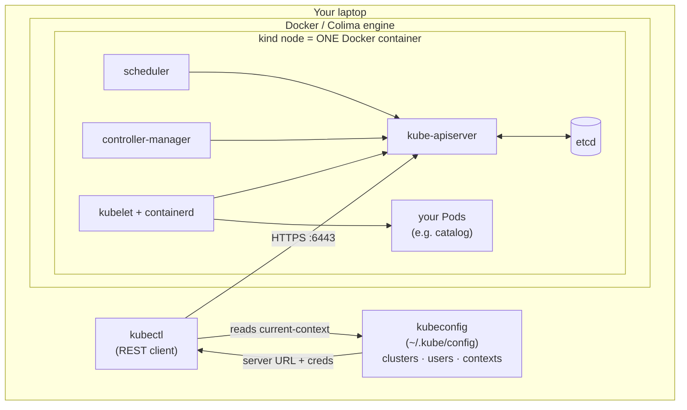

# 07 — Local cluster setup

> Install `kubectl`, stand up a real (local) cluster with kind, understand
> kubeconfig and contexts, learn the everyday `kubectl` verbs — and run the
> first Bookstore Pod from [ch.06](06-declarative-api-model.md) for real.

**Estimated time:** ~15 min read · ~60 min hands-on
**Prerequisites:** [Part 00 ch.02](02-containers-and-images.md) — container/image basics · [Part 00 ch.06](06-declarative-api-model.md) — the manifest you'll apply
**You'll know after this:** • install `kubectl` and bring up a local kind cluster · • understand `kubeconfig`, contexts, and namespaces · • use the everyday `kubectl` verbs (get, describe, logs, apply, exec, port-forward) · • apply the Bookstore Pod and watch reconciliation move it · • prove a NetworkPolicy is enforced with a connection that is denied · • troubleshoot a Pod that fails to start on a real cluster

<!-- tags: foundations, kubectl, kind, kubeconfig, local-cluster -->

## Why this exists

Part 00 has been concepts and one validated-but-unrun manifest. Concepts only
stick once you've watched the reconciliation loop move *your* object on a *real*
cluster. You need a cluster that is **free, local, disposable, and identical in
API to production** so every later chapter's hands-on works the same on your
laptop as on EKS. This chapter gives you that environment and the small set of
`kubectl` verbs you'll use in literally every chapter after this — then closes
the Part 00 arc by deploying `bookstore/catalog:dev` and curling its
`/healthz`, exactly the lifecycle you traced in
[ch.03](03-architecture-overview.md) and [ch.05](05-node-components.md).

## Mental model

A local cluster tool **fakes the machines, not the API**. kind ("Kubernetes IN
Docker") runs each Kubernetes *node as a Docker container* and a real control
plane inside it. The objects, the API server pipeline
([ch.04](04-control-plane-deep-dive.md)), the kubelet/CRI flow
([ch.05](05-node-components.md)) are the genuine Kubernetes code — only the
"hardware" is containers. So everything you learn transfers; what differs is
purely the substrate (no cloud load balancers, local image loading, single
node) — flagged by `> **In production:**` callouts. `kubectl` is just a REST
client; **kubeconfig** is the file telling it *which* API server and *as whom*.

## Threats and controls

| Threat | Control taught here | Goes deeper in |
|---|---|---|
| A NetworkPolicy the API server accepts but the network plugin does not enforce, so traffic still flows | Prove enforcement with a request that is denied, in the NetworkPolicy step below | [02.06](../02-networking/06-network-policies.md) |
| A kubeconfig holds a client key or a token, so whoever reads the file acts as you | Keep the file private and out of version control | [05.01](../05-security/01-authn-authz-rbac.md) |
| A change reaches the wrong cluster because the current context is not the one you meant | Read `kubectl config current-context` before each change | [05.01](../05-security/01-authn-authz-rbac.md) |

These are the only threats this chapter owns. The Pod's own threats come with
the Pod in [01.01](../01-core-workloads/01-pods.md#baseline). The threat model
for the whole Bookstore is in Part 00 ch.08 <!-- link-later: 00.08 -->.

## Tooling diagram



A "node" here is a container; a multi-node kind cluster is just multiple
containers on the same Docker engine. That's the only illusion — the
Kubernetes inside is real.

## Why kind

kind is the one local cluster this guide verifies. It runs upstream
Kubernetes, so the API server, scheduler and kubelet are the real components,
and each node is a container you can inspect with `docker exec` (see
[ch.05](05-node-components.md)). Other distributions exist, k3d and minikube
among them. This guide does not test them, and nothing later depends on them.

## Hands-on with the Bookstore

This is the payoff of Part 00: a running cluster and the first Bookstore Pod.

### 1. Install `kubectl`

```sh
# macOS (Homebrew)
brew install kubectl
# Linux: the release this guide ran against, checked against the checksum
# file that dl.k8s.io publishes for it
curl -LO "https://dl.k8s.io/release/v1.37.2/bin/linux/amd64/kubectl"
curl -LO "https://dl.k8s.io/release/v1.37.2/bin/linux/amd64/kubectl.sha256"
echo "$(cat kubectl.sha256)  kubectl" | sha256sum --check
sudo install -m 0755 kubectl /usr/local/bin/kubectl

kubectl version --client      # confirm it runs (server check comes after cluster up)
```

<!-- gate: output -->
```text
Client Version: v1.37.2
Kustomize Version: v5.8.1
```

> Keep `kubectl` within one minor version of the cluster (the supported skew is
> ±1 minor). Mismatched skew is a common source of odd errors.

### 2. Install a cluster tool and create a cluster

```sh
# kind v0.33.0 uses Kubernetes v1.37.0 as its default node image. The --image
# flag pins that image by digest, so every reader gets the same node.
go install sigs.k8s.io/kind@v0.33.0     # or `brew install kind`, then check:
kind version                            # expect v0.33.0
kind create cluster --name bookstore \
  --image kindest/node:v1.37.0@sha256:a1ed56cfb0e7b93589bdf97c8cd566405a265939e3620fc4f5de89adff580ae5
```

The digest is the default node image that kind v0.33.0 names in its own
[source](https://github.com/kubernetes-sigs/kind/blob/v0.33.0/pkg/apis/config/defaults/image.go).
Pinning it makes every reader's node the same.

`kind create cluster` also **merges a context into your kubeconfig and switches
to it** — so `kubectl` immediately points at the new cluster.

> A Docker-compatible engine must be running (Docker Engine, or
> Rancher Desktop/Podman/etc.). If you see "Cannot connect to the Docker
> daemon", start your engine first, then re-run `kind create cluster`. If your
> engine does not expose the default `/var/run/docker.sock`, point Docker at
> its socket via `DOCKER_HOST` (see your engine's docs for the socket path).

### 3. Verify the control plane and nodes

You're now looking at the real architecture from
[ch.03](03-architecture-overview.md):

```sh
kubectl cluster-info                       # API server endpoint (the only door, ch.04)
kubectl get nodes -o wide                  # the node container(s); STATUS should be Ready
kubectl -n kube-system get pods            # control plane + CoreDNS + kube-proxy as Pods
kubectl get --raw='/readyz?verbose'        # API server health gates (ch.04 pipeline)
```

`kubectl get nodes` showing `Ready` means the kubelet ([ch.05](05-node-components.md))
in the node container has registered and is healthy.

### 4. kubeconfig & contexts

`kubectl` itself is stateless; **kubeconfig** (`~/.kube/config`, or
`$KUBECONFIG`) tells it where and as whom to connect. Three lists plus a
pointer:

```
kubeconfig (~/.kube/config)
├── clusters:   [ { name, server: https://…:6443, certificate-authority } , … ]
├── users:      [ { name, client-cert / token / exec-plugin (cloud auth) }  , … ]
├── contexts:   [ { name, cluster: <CLUSTERS.NAME>, user: <USERS.NAME>, namespace } , … ]
└── current-context: <CONTEXTS.NAME>     ← the (cluster + user + ns) kubectl uses NOW
```

A **context** binds a cluster + a user + a default namespace. Switching
clusters/identities is switching context — *no flags on every command*:

```sh
kubectl config get-contexts                       # all contexts; * marks current
kubectl config current-context                    # → kind-bookstore
kubectl config use-context kind-bookstore         # switch the active context
kubectl config set-context --current --namespace=default   # set default ns for this context
```

The kubeconfig is a credential. It holds the client certificate and key, or
the token, that identify you to the API server. The
[kubeconfig docs](https://kubernetes.io/docs/concepts/configuration/organize-cluster-access-kubeconfig/)
list both forms. Anyone who can read the file acts as you, so keep it private
(`chmod 600 ~/.kube/config`) and out of version control. A managed cluster can
issue a short-lived token through an exec plugin, such as `aws eks get-token`,
rather than a static key.

The context is the other half of the risk. Before a command that changes state,
run `kubectl config current-context` and read the answer. A shell prompt, or a
tool such as [kubectx](https://github.com/ahmetb/kubectx), shows the context on
every line, so the check does not depend on memory.

> **In production:** one kubeconfig typically holds *many* contexts (dev,
> staging, prod, several clouds), so the check matters more with each one.
> [Part 07](../07-delivery/04-gitops-argocd.md) replaces hand-run `apply` with
> changes reviewed in Git.

### 5. `kubectl` basics (the everyday verbs)

These are ~90% of daily use; you'll repeat them in every later chapter:

```sh
kubectl get <KIND> [name] [-o wide|yaml|json]   # list/show (spec+status)
kubectl describe <KIND> <NAME>                  # human view + Events (debug start here)
kubectl logs <POD> [-c <CTR>] [-f] [--previous] # stdout/stderr (--previous = crashed ctr)
kubectl exec -it <POD> [-c <CTR>] -- sh         # needs a shell in the image
kubectl apply -f <file|dir>                     # declarative create/update (ch.06)
kubectl delete -f <FILE>                        # delete what a manifest declared
kubectl port-forward <pod|svc> <LOCAL>:<REMOTE> # tunnel to a Pod/Service from your laptop
kubectl get events --sort-by=.lastTimestamp     # the reconciliation loop, narrated
kubectl explain <KIND>.spec                     # authoritative schema (ch.06)
```

The catalog image has no shell, so `exec -- sh` fails on it. It is built on a
[distroless](https://github.com/GoogleContainerTools/distroless) base, which ships
no shell by default. The probe Pod in step 7 is where you run commands from
inside the cluster.

`describe` + `logs` + `events` are the troubleshooting trident — internalize
them now ([Part 08 ch.03](../08-day-2-operations/03-troubleshooting-playbook.md)
goes deep).

### 6. Create the namespace, load the image, and deploy the first Bookstore Pod

The Pod needs two things the cluster does not have yet. The first is a
`bookstore` namespace that enforces Pod Security `restricted`, so the API
server refuses a Pod that drops the baseline. The second is the `catalog-sa`
ServiceAccount the Pod runs as. Create both first. This step runs from the
`full-guide/` directory, which the paths below assume.

```sh
kubectl apply -f - <<'EOF'
apiVersion: v1
kind: Namespace
metadata:
  name: bookstore
  labels:
    app.kubernetes.io/part-of: bookstore
    pod-security.kubernetes.io/enforce: restricted
    pod-security.kubernetes.io/warn: restricted
---
apiVersion: v1
kind: ServiceAccount
metadata:
  name: catalog-sa
  namespace: bookstore
  labels:
    app: catalog
    app.kubernetes.io/part-of: bookstore
automountServiceAccountToken: false
EOF
```

<!-- gate: output -->
```text
# ...
serviceaccount/catalog-sa created
```

- **`pod-security.kubernetes.io/enforce: restricted`** makes the API server
  refuse any Pod in the namespace that lacks the fields `restricted` requires.
  `warn` prints the same findings to the client. The
  [namespace control](../01-core-workloads/01-pods.md#baseline-namespace)
  explains the levels.
- **`automountServiceAccountToken: false`** keeps the API token out of the Pod,
  so a compromised process has no token to present to the API server. The
  [ServiceAccount baseline](../01-core-workloads/01-pods.md#baseline-service-account)
  has the rest of the reasoning.
- **The Pod's `securityContext`, `resources` and `emptyDir` fields** complete
  the baseline. [01.01](../01-core-workloads/01-pods.md#baseline) explains each
  one against the threat it answers.

The Pod manifest was written and validated in
[ch.06](06-declarative-api-model.md):
[`raw-manifests/01-catalog-pod.yaml`](../examples/bookstore/raw-manifests/01-catalog-pod.yaml).
It uses `image: bookstore/catalog:dev` with `imagePullPolicy: IfNotPresent`.
That image lives only on your laptop ([ch.02](02-containers-and-images.md)),
not in any registry, so you must **load it into the kind node**. Without it,
the kubelet fails with `ImagePullBackOff`.

```sh
# Build the image if you haven't (ch.02).
docker build -t bookstore/catalog:dev examples/bookstore/app/catalog

# Make the image available INSIDE the kind node container.
kind load docker-image bookstore/catalog:dev --name bookstore
docker exec bookstore-control-plane crictl images | grep bookstore/catalog

# (Optional) re-validate the manifest client-side before applying (ch.06)
kubectl apply --dry-run=client -n bookstore \
  -f examples/bookstore/raw-manifests/01-catalog-pod.yaml

# Declare the desired state for real → triggers the ch.03/ch.05 lifecycle
kubectl apply -n bookstore -f examples/bookstore/raw-manifests/01-catalog-pod.yaml

# Watch the reconciliation loop converge: Pending → ContainerCreating → Running
kubectl get pod catalog -n bookstore -w
```

The node lists the image. The `dev` line is the one you need:

<!-- gate: output -->
```text
# ...
docker.io/bookstore/catalog                     dev                  1fd7038d36fd7       7MB
```

Once the Pod shows `Running`, it reports the state below:

<!-- gate: output -->
```text
NAME      READY   STATUS    RESTARTS   AGE
catalog   1/1     Running   0          26s
```

When `STATUS` is `Running` and `READY` is `1/1`, reach the app the way you did
with plain `docker run` in [ch.02](02-containers-and-images.md), but now it is a
real Pod scheduled by Kubernetes:

```sh
# Tunnel local :8080 → the Pod's container :8080
kubectl port-forward -n bookstore pod/catalog 8080:8080
```

In another terminal, ask the app for its health:

```sh
curl -s localhost:8080/healthz ; echo
```

<!-- gate: output -->
```text
{"status":"ok"}
```

```sh
curl -s localhost:8080/readyz ; echo
```

<!-- gate: output -->
```text
{"status":"ready"}
```

`/readyz` reports ready because `DB_DSN` is unset. The app then serves an
in-memory catalog and has no database to ping, as its log says in the next
block. The `/books` endpoint returns that catalog:

```sh
curl -s localhost:8080/books | head -c 160; echo
```

Now connect it to the internals you learned:

```sh
kubectl get pod catalog -n bookstore -o wide    # which node (kubelet, ch.05) runs it
kubectl describe pod catalog -n bookstore       # Events: scheduled → pulled → created → started
kubectl logs catalog -n bookstore | head -2     # the first lines of the Go app's JSON logs

# Peek at the data plane directly: kind nodes ARE containers (ch.05)
docker exec -it bookstore-control-plane crictl pods   # the catalog Pod + its pause sandbox
docker exec -it bookstore-control-plane crictl ps     # the running app container
```

<!-- gate: output -->
```text
{"time":"2026-10-30T22:12:29.402356908Z","level":"INFO","msg":"DB_DSN unset; serving in-memory sample books"}
{"time":"2026-10-30T22:12:29.404990035Z","level":"INFO","msg":"catalog listening","addr":":8080"}
```

You've now executed the *entire Part 00 arc against a real cluster*:
declarative `spec` ([ch.06](06-declarative-api-model.md)) → API server pipeline
→ etcd ([ch.04](04-control-plane-deep-dive.md)) → scheduler bind
([ch.04](04-control-plane-deep-dive.md)) → kubelet/CRI sandbox+container
([ch.05](05-node-components.md)) → status reported → traffic served. Everything
after this *adds* to this Pod.

### 7. Prove a NetworkPolicy is enforced

The API server stores a NetworkPolicy without checking that anything enforces
it. The [Kubernetes docs](https://kubernetes.io/docs/concepts/services-networking/network-policies/)
say a policy has no effect unless a controller implements it. A cluster whose
network plugin ignores policies therefore fails open: the object exists, and
traffic flows anyway. The reliable check is a connection, so this step makes
one before the policy, under it, and after it is removed.

kind v0.33.0 enforces NetworkPolicy out of the box. Its default CNI, kindnetd,
has carried that support since
[kind v0.24.0](https://github.com/kubernetes-sigs/kind/releases/tag/v0.24.0),
so this cluster needs no plugin swap. Allow rules and the default-deny pattern
are the subject of [02.06](../02-networking/06-network-policies.md).

First, a probe: a second Pod with its own ServiceAccount and the same baseline
as the catalog. Its image is pinned by digest, with the tag in the comment. The
image declares no user, so the baseline sets UID 65534 explicitly.

```sh
kubectl apply -f - <<'EOF'
apiVersion: v1
kind: ServiceAccount
metadata:
  name: probe-sa
  namespace: bookstore
automountServiceAccountToken: false
---
apiVersion: v1
kind: Pod
metadata:
  name: probe
  namespace: bookstore
  labels:
    app: probe
spec:
  serviceAccountName: probe-sa
  automountServiceAccountToken: false
  securityContext:
    runAsNonRoot: true
    runAsUser: 65534
    runAsGroup: 65534
    seccompProfile:
      type: RuntimeDefault
  containers:
    - name: probe
      image: busybox@sha256:a7dbc319b1438115a207e11930dc4bb3e643dcb3ec0bdd694bb36cd8fad289ec  # busybox:1.37
      command: ["sleep", "3600"]
      securityContext:
        allowPrivilegeEscalation: false
        readOnlyRootFilesystem: true
        capabilities:
          drop: ["ALL"]
      resources:
        requests:
          cpu: 10m
          memory: 16Mi
        limits:
          memory: 32Mi
      volumeMounts:
        - name: tmp
          mountPath: /tmp
  volumes:
    - name: tmp
      emptyDir: {}
EOF
kubectl wait --for=condition=Ready pod/probe -n bookstore --timeout=120s
CATALOG_IP=$(kubectl get pod catalog -n bookstore -o jsonpath='{.status.podIP}')
kubectl exec -n bookstore probe -- wget -qO- -T 3 "http://$CATALOG_IP:8080/healthz"
```

Without a policy, the request succeeds:

<!-- gate: output -->
```text
{"status":"ok"}
```

Next, a default-deny policy. It selects every Pod in the namespace and allows
no ingress to any of them:

```sh
kubectl apply -f - <<'EOF'
apiVersion: networking.k8s.io/v1
kind: NetworkPolicy
metadata:
  name: default-deny-ingress
  namespace: bookstore
spec:
  podSelector: {}
  policyTypes: ["Ingress"]
EOF
```

<!-- gate: output -->
```text
networkpolicy.networking.k8s.io/default-deny-ingress created
```

Now repeat the request. This failure is deliberate: the policy is meant to deny
it.

```sh
kubectl exec -n bookstore probe -- wget -qO- -T 3 "http://$CATALOG_IP:8080/healthz"
```

<!-- gate: output -->
```text
wget: download timed out
command terminated with exit code 1
```

A plugin that ignored the policy would have printed the same JSON as before, so
the timeout is the evidence. Remove the policy:

```sh
kubectl delete networkpolicy default-deny-ingress -n bookstore
```

Now the same request works again:

```sh
kubectl exec -n bookstore probe -- wget -qO- -T 3 "http://$CATALOG_IP:8080/healthz"
```

<!-- gate: output -->
```text
{"status":"ok"}
```

Then remove the probe:

```sh
kubectl delete pod probe -n bookstore
```

### 8. Tear down (and reset any time)

A local cluster is disposable — deleting and recreating is the normal way to
get a clean slate:

```sh
kind delete cluster --name bookstore
```

(Deleting the cluster also removes its kubeconfig context.)

## How it works under the hood

- **`kind create cluster` = run node container(s) + bootstrap real Kubernetes
  in them.** kind uses a prebuilt node image containing kubelet, containerd,
  and the control-plane components, then runs `kubeadm` *inside* to bring up
  etcd, the API server, controller-manager, and scheduler — the genuine
  binaries from [ch.03](03-architecture-overview.md)/[ch.04](04-control-plane-deep-dive.md).
- **`kubectl` is a pure REST client.** It reads kubeconfig to find the API
  server URL and credentials, then makes the same HTTPS calls any controller
  makes (and gets the same authN→authZ→admission→validation pipeline,
  [ch.04](04-control-plane-deep-dive.md)). `kubectl apply` is client logic on
  top of that REST API ([ch.06](06-declarative-api-model.md)).
- **`kind load` exists because there's no shared registry.** Normally the
  kubelet pulls images from a registry ([ch.02](02-containers-and-images.md)
  pull flow). Locally, your image is only in your laptop's Docker engine, so
  `kind load` copies it *into the node container's containerd image store*;
  `imagePullPolicy: IfNotPresent` ([ch.06](06-declarative-api-model.md)) then
  makes the kubelet use that local copy instead of contacting a registry.
- **`port-forward` is a tunnel through the API server**, not a Service. The API
  server proxies a connection to the kubelet, which forwards to the Pod's
  port. It's a debugging convenience; real exposure uses Services/Ingress
  ([Part 02](../02-networking/02-services.md)) — which is why this works even
  with no cloud load balancer.

## Production notes

> **In production:** you do **not** run `kind`. The cluster is provisioned by a
> managed service (EKS/GKE/AKS) or a tool like kubeadm/Cluster API on real
> machines ([Part 08 ch.01](../08-day-2-operations/01-cluster-lifecycle.md)).
> kind is for *local dev and CI*: it is excellent in CI, with ephemeral
> clusters per pipeline run. The **API and objects are identical**; only
> provisioning and substrate differ.

> **In production:** `Service` type `LoadBalancer` and dynamic `PersistentVolume`
> provisioning **don't work on bare kind** (no
> [cloud-controller-manager](04-control-plane-deep-dive.md), no cloud CSI). You
> use `port-forward`/NodePort and local-path storage locally; the cloud
> provides real LBs and disks. Every chapter's `In production:` callouts flag
> these substrate gaps — the manifests themselves stay the same.

> **In production:** a bare Pod like this one is **not** what you deploy — it
> isn't rescheduled on node loss or recreated on permanent crash. It's a Part
> 00 teaching artifact; [Part
> 01](../01-core-workloads/04-replicasets-and-deployments.md) replaces it with
> a self-healing Deployment.

## Quick Reference

```sh
# cluster lifecycle (local)
kind create cluster --name bookstore \
  --image kindest/node:v1.37.0@sha256:a1ed56cfb0e7b93589bdf97c8cd566405a265939e3620fc4f5de89adff580ae5
kind delete cluster --name bookstore
kind load docker-image  --name bookstore

# context / kubeconfig
kubectl config get-contexts                  # list contexts (* = current)
kubectl config current-context               # which cluster/user am I on?
kubectl config use-context <NAME>            # switch context
kubectl config set-context --current --namespace=<NS>   # default namespace

# verify
kubectl cluster-info ; kubectl get nodes -o wide ; kubectl get --raw=/readyz

# everyday verbs
kubectl apply -f <F> ; kubectl get <K> ; kubectl describe <K> <N>
kubectl logs <POD> [-f|--previous] ; kubectl exec -it <POD> -- sh
kubectl port-forward pod/<P> 8080:8080 ; kubectl delete -f <F>
```

Smallest end-to-end loop (the thing to remember):

```
# run from the guide directory (full-guide/)
docker build -t bookstore/catalog:dev examples/bookstore/app/catalog   # ch.02 image
kind create cluster --name bookstore \
  --image kindest/node:v1.37.0@sha256:a1ed56cfb0e7b93589bdf97c8cd566405a265939e3620fc4f5de89adff580ae5
kind load docker-image bookstore/catalog:dev --name bookstore   # no registry locally
# step 6: create the bookstore namespace and catalog-sa first (heredoc)
kubectl apply -n bookstore -f examples/bookstore/raw-manifests/01-catalog-pod.yaml   # declare (ch.06)
kubectl get pod catalog -n bookstore -w                  # watch the loop converge
kubectl port-forward -n bookstore pod/catalog 8080:8080 && curl localhost:8080/healthz
```

Setup checklist:

- [ ] `kubectl` installed, within ±1 minor of the cluster
- [ ] Docker/Colima engine running before `kind create cluster`
- [ ] Cluster up; all nodes `Ready`; kube-system Pods running
- [ ] You confirm `current-context` before any mutating command
- [ ] Namespace `bookstore` enforces `restricted`; `catalog-sa` exists
- [ ] Local image `kind load`ed (matches `imagePullPolicy: IfNotPresent`)
- [ ] `catalog` Pod `Running 1/1`; `/healthz` returns `{"status":"ok"}`
- [ ] A probe's request was denied under the default-deny policy, and
  worked again once the policy was deleted
- [ ] You can tear down and recreate from scratch (cluster is disposable)

## Test your understanding

> Try each before opening the answer drawer. The act of trying is the exercise; the answer is the check.

1. **Why does the `catalog` manifest use `imagePullPolicy: IfNotPresent` for local kind use, and what would go wrong with `Always`?**
   <details><summary>Show answer</summary>

   `bookstore/catalog:dev` only exists in your laptop's Docker engine and `kind load` copies it into the node container's containerd image store. With `Always`, the kubelet would contact a registry every time — but there is none for `bookstore/catalog:dev`, so it fails `ImagePullBackOff`. `IfNotPresent` makes the kubelet use the loaded local copy and skip the registry round-trip (see §Hands-on step 6, and §How it works under the hood, `kind load`).

   </details>

2. **A teammate runs `kubectl apply` and accidentally targets the production cluster instead of dev. What single shell-level habit could have prevented this, and what's the deeper architectural reason a stronger mechanism (GitOps) is preferable?**
   <details><summary>Show answer</summary>

   Always confirm `kubectl config current-context` before any mutating command, or use a shell prompt segment / kubectx to make context visible. The deeper fix is GitOps: changes go through a reviewed pull request, and an Argo CD/Flux controller running *in* the target cluster reconciles from Git — there is no human typing apply at prod (see §kubeconfig & contexts, §Production notes).

   </details>

3. **You run `kubectl port-forward pod/catalog 8080:8080` on a brand-new kind cluster with no `Service` and no cloud load balancer. Why does this work, and why is it explicitly not how you'd expose the Pod in production?**
   <details><summary>Show answer</summary>

   `port-forward` is a tunnel through the API server: kubectl opens an HTTPS connection to the API server, which proxies to the kubelet, which forwards to the Pod's container port. It needs no Service or LB. In production you don't want every user holding open an API-server tunnel — you use Services and Ingress so traffic flows through the data plane, not the control plane (see §How it works under the hood, port-forward).

   </details>

4. **A teammate says, "We applied a NetworkPolicy, so the Pods are isolated." The API server accepted it without complaint. What do you check before you believe them?**
   <details><summary>Show answer</summary>

   The API server stores a NetworkPolicy whether or not the cluster's network
   plugin enforces it, so acceptance proves nothing. The Kubernetes docs say a
   policy has no effect without a controller that implements it. Check with a
   connection, as step 7 does: a probe's request should succeed before the
   policy and be denied under it. A request that still succeeds under the
   policy means the plugin ignores the policy, and the cluster fails open (see
   §Threats and controls).

   </details>

5. **Hands-on extension: bring up the cluster, deploy the catalog Pod, then `kind delete cluster --name bookstore` and `kind create cluster --name bookstore` again. Re-run `kubectl get pod catalog -n bookstore`. What's gone, and what's the point of this exercise?**
   <details><summary>What you should see</summary>

   Everything the cluster held is gone: the catalog Pod, the namespace, the
   ServiceAccount, and the etcd data behind them. `kubectl get pod catalog -n
   bookstore` returns `NotFound`, because the namespace no longer exists. The
   point: local clusters are cattle, not pets. Treating "reset to clean" as a
   one-command operation is a deliberate workflow that mirrors how production
   clusters should be reproducible from manifests in Git, not by accumulated
   hand-applied state (see §Tear down (and reset any time), §Production
   notes).

   </details>

## Further reading

- **Poulton, _The Kubernetes Book_, ch.3 (and its setup appendix)** — getting a
  local cluster and `kubectl` working, first deployment.
- **Lukša, _Kubernetes in Action_ 2e, ch.3 — "Deploying your first
  application"** — kubeconfig/contexts, the core `kubectl` verbs, and watching
  the first workload come up.
- Official: kind <https://kind.sigs.k8s.io/docs/user/quick-start/>,
  `kubectl` install <https://kubernetes.io/docs/tasks/tools/>, and the kubectl
  cheatsheet <https://kubernetes.io/docs/reference/kubectl/cheatsheet/>.
- NetworkPolicy: the kind v0.24.0 release notes for out-of-the-box support
  <https://github.com/kubernetes-sigs/kind/releases/tag/v0.24.0>, and the
  Kubernetes docs <https://kubernetes.io/docs/concepts/services-networking/network-policies/>.
