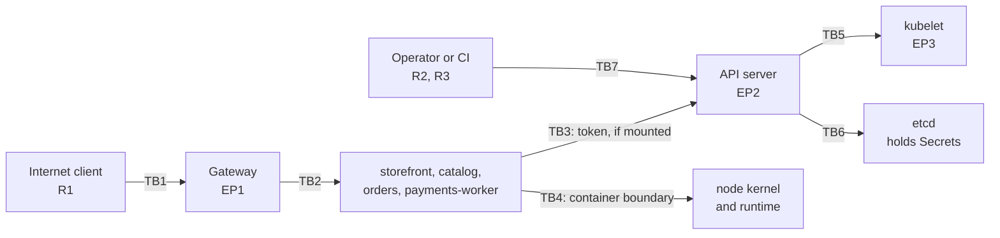

# 08: Security foundations

> The bookstore's threat model in one place: what it protects, who might
> attack it, where trust changes hands, and which control answers each
> threat. Then one Pod that the baseline refuses to let through.

**Estimated time:** ~20 min read · ~15 min hands-on
**Prerequisites:** [Part 00 ch.07](07-local-cluster-setup.md) (a kind
cluster with `bookstore/catalog:dev` loaded)
**You'll know after this:** • list the bookstore's assets, actors, trust
boundaries and entry points · • run a STRIDE pass over one boundary and name
the control for each threat · • read the Kubernetes threat matrix as a
map of attacker goals · • say which baseline field answers which threat
· • mark an insecure example and register an exception the way the guide
requires

<!-- tags: foundations, security, threat-model, stride, baseline, exceptions -->

## Why this exists

Chapters 00.02 to 00.07 each named a threat. A shared host kernel. An etcd
that holds every Secret. A kubelet API that answers the network. A runtime
socket that gives root to whoever writes to it. Each was one finding, in
its own chapter. A reader who finishes Part 00 has the findings but not the
map: which asset each one puts at risk, which actor can reach it, and which
control is supposed to answer it.

This chapter draws that map once. It also sets the rules the guide uses to
keep the map honest: how an insecure example is marked, and how an
exception is registered. The model itself lives in the repository at
`examples/bookstore/THREAT-MODEL.md`, and every later Part changes it when
it changes the system.

Kubernetes does not secure the workload for you. It gives you authentication,
authorization, admission and isolation. Which of them protect the bookstore,
and how well, is a decision you make and record. This chapter is where the
record starts.

## Mental model

A threat model answers four questions:

1. **What do we protect?** The assets.
2. **Who might attack, and from where?** The actors.
3. **Where does trust change hands?** The trust boundaries.
4. **How does an attacker get in?** The entry points.

For each boundary a request crosses, you ask what could go wrong. STRIDE
(section below) gives the questions. The answer is either a control, or an
open row that says no control exists yet. An open row is still useful: it is
a decision someone can see and argue with.



Every arrow crosses a line where a different party is in charge. That line is
the trust boundary. Part 00 has already shown most of these arrows from the
inside: the request pipeline in 00.04, the node in 00.05.

## Threats and controls

Only threats specific to threat modelling and to this guide's own process
appear here. The system threats each have their own chapter.

| Threat | Control taught here | Goes deeper |
|---|---|---|
| A threat model written once and never updated describes a cluster that no longer exists. | The model is a file in the repository. A change to a workload changes the model in the same pull request. | `examples/bookstore/THREAT-MODEL.md`, and 05.00 <!-- link-later: 05.00 --> |
| An insecure example copied into a real namespace. | Insecure blocks appear only in Part 05 labs and the capstone overlay. The gates fail any other placement, in both directions. | 05.00 <!-- link-later: 05.00 --> |
| A control listed in the model that nothing enforces. | Each row states a status: `baseline`, `cluster` or `open`. The baseline fields are the ones admission and the static gate test. | Section "The baseline answers specific threats" |
| An exception with no reason and no expiry lives forever. | One registry. Each entry records a reason, the chapter that explains it, and an expiry within 12 months. | 05.09 <!-- link-later: 05.09 --> |

## What the bookstore protects

The bookstore has four services under `examples/bookstore/app/`: storefront,
catalog, orders and payments-worker. Postgres holds the data. The manifests
under `examples/bookstore/raw-manifests/` place them in one namespace behind
a Gateway. Each row below is an asset the model protects.

| ID | Asset | Why it matters |
|---|---|---|
| A1 | Order and customer records | Lost or altered records are the business. |
| A2 | Database credentials | Whoever holds them reads A1. |
| A3 | Credentials the payments worker uses with its provider | Misuse costs money and trust. |
| A4 | Cluster credentials: kubeconfigs and ServiceAccount tokens | Each one speaks to the API server as someone. |
| A5 | Declared state: manifests in Git | Whatever is in Git is what runs. |
| A6 | Container images and their digests | An image is code that runs with your identity. |
| A7 | Storefront availability | An outage is the product being unavailable. |
| A8 | Audit records of API requests | Without them, nobody can say who changed what. |

Six actors can reach these assets. An anonymous client reaches the Gateway
and the public routes behind it, and nothing else. An operator with a kubeconfig reaches the API server with
whatever RBAC grants. CI reaches the API server, the registry and Git. Code
inside a Pod, after a dependency is compromised, reaches the Pod's filesystem,
its network and, if a token is mounted, the API. Someone with root on a worker
node reaches the kubelet, the runtime socket and every Pod on that node. A
supplier of an upstream image reaches every cluster that pulls it.

## Entry points

An entry point is a place where a request from outside can start. The model
lists each one and says what stands in front of it.

| ID | Entry point | What stands in front of it |
|---|---|---|
| EP1 | Gateway HTTP and HTTPS | The edge. Rate limiting is not in the baseline (D2). |
| EP2 | kube-apiserver on port 6443 | Authentication, RBAC, admission. |
| EP3 | kubelet API on port 10250 | Anonymous auth off, webhook authorization (I3, E5). |
| EP4 | Container runtime socket, when a Pod mounts it | Refused by Pod Security `restricted` (E4). |
| EP5 | Image pulls from a registry | Digest pins (T2). |
| EP6 | Git push and CI apply | Review and `kubectl diff` before apply (T3). |
| EP7 | kubeconfig on a workstation or CI runner | Short-lived credentials (S2). |
| EP8 | Pod-to-Pod traffic | Default-deny NetworkPolicy, added in 02.06 (S3). |

## STRIDE pass

STRIDE is a set of six questions, one per kind of harm: Spoofing, Tampering,
Repudiation, Information disclosure, Denial of service and Elevation of
privilege. Asking each question about each boundary finds most of the
threats a model needs. The table gives one bookstore example per letter. The
full list, with IDs, is in `THREAT-MODEL.md`.

| Letter | Category | Bookstore example | Control | Status |
|---|---|---|---|---|
| S | Spoofing | A Pod calls the API as another identity (S1) | Its own ServiceAccount, `automountServiceAccountToken: false` | baseline |
| T | Tampering | A process rewrites its own image (T1) | `readOnlyRootFilesystem: true`, writable `emptyDir` for `/tmp` | baseline |
| R | Repudiation | An apply leaves no record of who made it (R-1) | API server audit policy | open until 05.08 <!-- link-later: 05.08 --> |
| I | Information disclosure | A Secret read straight from etcd (I1) | Encryption at rest, and only the API server reaches etcd | cluster |
| D | Denial of service | One Pod exhausts a node's memory (D1) | Requests and a memory limit | baseline |
| E | Elevation of privilege | A root process reaches host resources (E1) | `runAsNonRoot: true`, UID 65532 | baseline |

The Denial of service row for traffic floods (D2) has no control yet, and the
model says so.

## The Kubernetes threat matrix as a map of attacker goals

The threat matrix for Kubernetes began as Microsoft's ATT&CK-style map of
container attacks in 2020. It grew into the MITRE ATT&CK for Containers
matrix, a joint effort with MITRE. Its tactics run from left to right, from
getting in to causing impact. Read them as a set of goals, not a checklist of
techniques. Each goal tells you what an attacker wants, and the model tells
you which row answers it.

| Goal (tactic) | How it could show up in the bookstore | Threats |
|---|---|---|
| Initial Access | A route exposed at the Gateway, or a vulnerable dependency in an image | EP1, R6, T2 |
| Execution | A new workload or a shell started in a Pod (T1610, Deploy Container) | T1, E3 |
| Persistence | A dropped binary, or a changed spec that survives a restart | T1, T3 |
| Privilege Escalation | Root in a container, a setuid binary, a capability, a privileged Pod, or escape to the host (T1611, Escape to Host) | E1 to E5 |
| Stealth | A change that leaves no audit record or avoids review | R-1, T3 |
| Defense Impairment | A policy, gate or NetworkPolicy switched off | T3, S3, E4 |
| Credential Access | A Secret, a mounted token or etcd read directly | I1, I2, I4, S2 |
| Discovery | Listing Pods or reaching the kubelet from inside | I3, S1 |
| Lateral Movement | Pod to Pod, or namespace to namespace | S3, TB9 |
| Impact | Corrupted or deleted records, exhausted resources | A1, D1, D2 |

Sources: [the MITRE ATT&CK for Containers matrix](https://attack.mitre.org/matrices/enterprise/containers/),
and [Microsoft's 2020 threat matrix for Kubernetes](https://www.microsoft.com/en-us/security/blog/2020/04/02/attack-matrix-kubernetes/),
where the matrix began.

## The baseline answers specific threats

Every workload in the guide carries the same baseline, field by field, from
01.01 onward. Each field answers one or more threats from the model. The
table pairs them. Each link goes to the field's own explanation in 01.01.

| Baseline field | Threat it answers | Explained at |
|---|---|---|
| `runAsNonRoot: true`, `runAsUser: 65532` | E1: root reaches host resources | [01.01](../01-core-workloads/01-pods.md#baseline-run-as) |
| `allowPrivilegeEscalation: false` | E2: a setuid binary gains privileges | [01.01](../01-core-workloads/01-pods.md#baseline-privilege-escalation) |
| `capabilities.drop: ["ALL"]` | E3: a capability reaches the kernel | [01.01](../01-core-workloads/01-pods.md#baseline-capabilities) |
| `seccompProfile: RuntimeDefault` | E3: a syscall reaches the kernel | [01.01](../01-core-workloads/01-pods.md#baseline-seccomp) |
| `readOnlyRootFilesystem: true` with an `emptyDir` | T1: a process rewrites its image | [01.01](../01-core-workloads/01-pods.md#baseline-read-only-root) |
| Image pinned by digest | T2: an image is replaced under the same tag | [01.01](../01-core-workloads/01-pods.md#baseline-image-digest) |
| `automountServiceAccountToken: false` and a ServiceAccount of its own | S1, I4: a token speaks for the Pod | [01.01](../01-core-workloads/01-pods.md#baseline-service-account) |
| Requests and a memory limit | D1: one Pod exhausts a node | [01.01](../01-core-workloads/01-pods.md#baseline-resources) |
| `restricted` labels on the namespace | E4: privileged mode, host namespaces or `hostPath` | [01.01](../01-core-workloads/01-pods.md#baseline-namespace) |

The namespace label is a control the API server enforces for every Pod in the
namespace, whatever its author intended. Pod Security Admission at the
`restricted` level checks:

- `allowPrivilegeEscalation` is `false`;
- `runAsNonRoot` is `true`, set on the Pod or on each container;
- `runAsUser`, if set, is non-zero;
- `seccompProfile.type` is `RuntimeDefault` or `Localhost`;
- `capabilities.drop` includes `ALL`, and `add` is empty or only
  `NET_BIND_SERVICE`;
- every volume is one of a short list of types, such as `emptyDir`,
  `configMap` and `secret`.

`readOnlyRootFilesystem` and `automountServiceAccountToken` are not part of
the `restricted` level. Admission does not refuse a Pod that omits them. The
baseline sets them anyway, because T1 and S1 need them, and the static gate
checks `readOnlyRootFilesystem` among its five core checks. Knowing which
control enforces which field is what keeps a baseline from being a wish list.

## How the guide marks insecure examples and registers exceptions

The guide teaches attacks. Part 05 shows a Pod that escapes its container, a
Role that reads Secrets, a Pod that mounts the runtime socket. Those examples
have to run somewhere, and the rules below keep them from running anywhere
else.

### Marking an insecure example

An insecure block must be labelled in two places. The first is the Markdown:
one HTML comment line naming the rule `insecure-on-purpose`, placed on the
nearest non-blank line above the code fence. The second is the YAML itself:
its first line is a comment that starts `INSECURE ON PURPOSE:`, names what
the block shows, and ends with `Lab cluster only.`

Three placement rules apply:

- Insecure blocks appear only in the Part 05 chapters and the capstone
  overlay.
- The lab creates and labels its own namespace for the privilege it needs.
- Never in the `bookstore` namespace or in `default`.

The gates check both directions. A marked block outside those chapters
fails. A marked workload in `bookstore`, `default` or no namespace fails. A
marked block that stops failing also fails, so a stale marker cannot pretend
an example is still dangerous. An unmarked block that fails fails too.

### Marking captured output

Captured output carries a different marker: one HTML comment line naming the
rule `output`, on the line above the fence. The evidence gate checks each line
of the block against the lab transcript, in order and consecutively. A line
you leave out is replaced by a line reading `# ...`. Output shown in a
chapter must come from a command that ran, and the transcript that holds it
is committed under `examples/security-lab/evidence/`.

### Registering an exception

An exception is any namespace above `restricted`, and any scanner finding the
guide suppresses. Each one gets an entry in one registry file, which records:

- what is excepted;
- the reason, with an upstream citation where the privilege is demanded
  upstream;
- the chapter that explains it;
- an expiry date no more than 12 months out.

The registry file is not in the repository yet. Its gate is not built. Until
both exist, this chapter does not claim that an exception is enforced. The
rule still applies: a pull request that adds a namespace above `restricted`
or a suppressed finding must add the entry in the same change.

The gates already keep one allowlist of their own,
`.github/scripts/gates/not-evaluated.allow`. It lists manifests no scanner
could judge, so the reviewer knows how each one was checked. It is a record of
gate blind spots, not a policy exception.

## Hands-on with the Bookstore: the baseline refuses a Pod

This walk-through creates a namespace that enforces `restricted`, shows the
admission controller refusing a Pod that drops one guard, and then admits the
baseline Pod. Run it from the repository root (`full-guide/`) against the
cluster from 00.07. Check the context before any mutating command.

### 1. Confirm the context

```sh
kubectl config current-context    # expect the kind context from 00.07
```

### 2. Create a namespace that enforces `restricted`

The namespace label makes the API server enforce the `restricted` level on
every Pod in it. The version label pins the rules to Kubernetes 1.37, so an
upgrade cannot quietly change them.

```sh
kubectl apply -f - <<'EOF'
apiVersion: v1
kind: Namespace
metadata:
  name: threat-demo
  labels:
    pod-security.kubernetes.io/enforce: restricted
    pod-security.kubernetes.io/enforce-version: v1.37
EOF
```

### 3. Create the ServiceAccount the Pod uses

The Pod uses its own ServiceAccount. That ServiceAccount sets
`automountServiceAccountToken: false`, so a Pod that uses it gets no token
unless the Pod asks for one. Nothing in this namespace uses `default`.

```sh
kubectl apply -n threat-demo -f - <<'EOF'
apiVersion: v1
kind: ServiceAccount
metadata:
  name: catalog-sa
automountServiceAccountToken: false
EOF
```

### 4. Deliberate action: drop one guard and watch it refused

This step shows a failure on purpose. It copies the baseline Pod from
`examples/bookstore/raw-manifests/01-catalog-pod.yaml`, deletes the one line
that sets `allowPrivilegeEscalation: false`, and applies the result. The
command does not write a file, so the broken copy never enters the repository.

```sh
sed '/allowPrivilegeEscalation: false/d' \
  examples/bookstore/raw-manifests/01-catalog-pod.yaml \
  | kubectl apply -n threat-demo -f -
```

The server refuses the Pod. The field is the one that answers E2.

<!-- gate: output -->
```text
Error from server (Forbidden): error when creating "STDIN": pods "catalog" is forbidden: violates PodSecurity "restricted:v1.37": allowPrivilegeEscalation != false (container "catalog" must set securityContext.allowPrivilegeEscalation=false)
```

The refusal came from admission, before the Pod was written to etcd. No
kubelet ever saw it, and no container started.

### 5. Apply the baseline Pod

Now apply the Pod the guide ships. The file is
`examples/bookstore/raw-manifests/01-catalog-pod.yaml`, and this is its full
content, with each guard annotated by the threat it answers. Nothing is
omitted: every field the baseline needs is here.

```yaml
apiVersion: v1
kind: Pod
metadata:
  name: catalog
  labels:
    app: catalog
    component: backend
spec:
  serviceAccountName: catalog-sa          # its own identity (S1)
  automountServiceAccountToken: false     # no token mounted (S1, I4)
  securityContext:
    runAsNonRoot: true                    # refuses to start as root (E1)
    runAsUser: 65532                      # the UID the image declares (E1)
    runAsGroup: 65532
    seccompProfile:
      type: RuntimeDefault                # syscall filter (E3)
  containers:
    - name: catalog
      image: bookstore/catalog:dev
      imagePullPolicy: IfNotPresent       # the image loaded in 00.07
      ports:
        - name: http
          containerPort: 8080
      env:
        - name: PORT
          value: "8080"
      securityContext:
        allowPrivilegeEscalation: false   # no setuid gain (E2)
        readOnlyRootFilesystem: true      # the image cannot be rewritten (T1)
        capabilities:
          drop: ["ALL"]                   # no capabilities (E3)
      resources:
        requests:
          cpu: 50m
          memory: 64Mi
        limits:
          memory: 128Mi                   # bounded memory (D1)
      volumeMounts:
        - name: tmp
          mountPath: /tmp                 # the only writable path (T1)
  volumes:
    - name: tmp
      emptyDir: {}
```

```sh
kubectl apply -n threat-demo -f examples/bookstore/raw-manifests/01-catalog-pod.yaml
kubectl wait --for=condition=Ready pod/catalog -n threat-demo --timeout=90s
kubectl get pod catalog -n threat-demo
```

<!-- gate: output -->
```text
pod/catalog created
```

<!-- gate: output -->
```text
pod/catalog condition met
```

<!-- gate: output -->
```text
NAME      READY   STATUS    RESTARTS   AGE
catalog   1/1     Running   0          43s
```

The Pod is admitted. The namespace refused the broken copy only because a
guard was missing. With every guard present, the same admission check passes,
and the rest of the baseline is the set of checks that let the Pod through.

### 6. Clean up

Deleting the namespace removes the Pod and the ServiceAccount with it.

```sh
kubectl delete namespace threat-demo
```

## How it works under the hood

Every request to the API server passes through the same steps in order:
authentication, authorization, admission (mutating then validating), schema
validation, and storage. Pod Security Admission is a validating admission
plugin. It reads the namespace labels when the request arrives and evaluates
the Pod against the level and version in those labels. A refused request is
never stored. That is why the Pod in step 4 never existed as an object, and
why no kubelet saw it.

The error names the first failing check and the container it failed on. The
same check runs in `--dry-run=server`, which is the reason the server dry run
in 00.06 catches what a client dry run misses.

The guide's gates check a chapter in four steps:

- **Extraction.** Every manifest the reader applies is pulled out of YAML
  fences, shell heredocs, and any other fence that shows a bare `kind:` line,
  so a manifest in an unexpected fence is still checked.
- **Static checks.** Trivy runs the five core checks. A second check reads the
  parsed YAML, because Trivy reads a null `securityContext` as clean.
- **Admission.** Each manifest is server-side dry-run in a throwaway
  namespace that enforces `restricted`, on a kind cluster only.
- **Evidence.** Each output block is matched line by line against the lab
  transcript for its chapter.

No gate reads `THREAT-MODEL.md` yet. The model is for people. Part 05 is the
first place it is checked against the manifests.

## Production notes

Treat the threat model as a reviewed artifact that sits next to the code it
describes. When both live in one repository, one pull request can change a
workload and the model that describes it, and a reviewer sees both at once.

The cloud parts (Part 10 onward) add the threats that a managed control plane
and cloud identity introduce. They do not replace this model. Their rows point
back here for the cluster-level controls.

## Quick Reference

The forms below are the secure ones. Each one is a rule the baseline keeps.

```sh
# Namespace enforces the restricted level, pinned to a version
kubectl label namespace <NS> \
  pod-security.kubernetes.io/enforce=restricted \
  pod-security.kubernetes.io/enforce-version=v1.37
kubectl get namespace <NS> --show-labels

# Ask admission before you apply: server-side, not the client
kubectl apply --dry-run=server -n <NS> -f <FILE>

# Confirm a Pod's security fields
kubectl get pod <POD> -n <NS> -o jsonpath='{.spec.securityContext}{"\n"}'
```

The baseline, field by field, is in [01.01](../01-core-workloads/01-pods.md#baseline).

```text
Pod baseline (see 01.01 for each field):
  spec.automountServiceAccountToken: false
  spec.securityContext: runAsNonRoot true, runAsUser (image UID),
                        runAsGroup, seccompProfile RuntimeDefault
  container securityContext: allowPrivilegeEscalation false,
                        readOnlyRootFilesystem true,
                        capabilities drop [ALL]
  resources: requests and a memory limit
  volumes: emptyDir for every writable path
Namespace labels: pod-security.kubernetes.io/enforce: restricted
```

Setup checklist:

- [ ] `examples/bookstore/THREAT-MODEL.md` read, with every row's status noted
- [ ] You can name the asset and the actor behind each threat you choose
- [ ] Namespace labelled `restricted`, with the version pinned
- [ ] A Pod that drops one guard is refused, and you can name the refused field
- [ ] The baseline Pod is admitted and reaches `Running`

## Test your understanding

> Try each before opening the answer drawer. The act of trying is the exercise;
> the answer is the check.

1. **Step 4 removed `allowPrivilegeEscalation`, and admission refused the
   Pod. Which STRIDE letter and threat ID does that field answer, and why is
   the refusal at admission rather than at runtime?**
   <details><summary>Show answer</summary>

   Elevation of privilege, threat E2: a setuid binary gains privileges. The
   refusal happens at admission because Pod Security Admission runs before the
   object is stored. A Pod that fails the check never reaches etcd, the
   scheduler or the kubelet, so nothing ever runs with the privilege.

   </details>

2. **Pod Security `restricted` does not require `readOnlyRootFilesystem`.
   What covers that field in the guide, and which threat does it answer?**
   <details><summary>Show answer</summary>

   The static gate checks it among its five core checks, as KSV-0014. The
   field answers T1: a process rewrites its image or drops a binary. The
   baseline sets it, and `restricted` does not require it, so the gate is the
   control that keeps it set.

   </details>

3. **A reviewer finds an insecure block in a Part 02 chapter with the marker
   in place. What does the gate do, and why does it also fail a marked block
   that stops failing?**
   <details><summary>Show answer</summary>

   It fails. Insecure blocks are allowed only in the Part 05 labs and the
   capstone overlay, so a marked block elsewhere is misplaced. The check runs
   both ways because a marker that outlives its example would let a harmless
   block look dangerous, and a reader would stop trusting the labels. A stale
   marker is as misleading as a missing one.

   </details>

4. **Which of the bookstore's assets would an attacker reach through an
   unmounted ServiceAccount token, and why does the baseline still set
   `automountServiceAccountToken: false`?**
   <details><summary>Show answer</summary>

   With no token mounted, the Pod has no API credential to abuse, so the
   attacker cannot reach A4 through this route. The baseline sets the field
   explicitly anyway, because the default is to mount a token, and a later
   edit to the Pod or the ServiceAccount could turn it back on silently.
   Setting it to `false` makes the decision visible in the manifest.

   </details>

## Further reading

- Kubernetes, [Pod Security Standards](https://kubernetes.io/docs/concepts/security/pod-security-standards/):
  the `restricted` controls and their required settings.
- MITRE, [ATT&CK for Containers](https://attack.mitre.org/matrices/enterprise/containers/):
  the matrix behind the attacker-goal table.
- Microsoft, [Threat matrix for Kubernetes](https://www.microsoft.com/en-us/security/blog/2020/04/02/attack-matrix-kubernetes/)
  (2020): where the matrix began.
- Adam Shostack, *Threat Modeling: Designing for Security* (Wiley, 2014): the
  source of the STRIDE questions.
