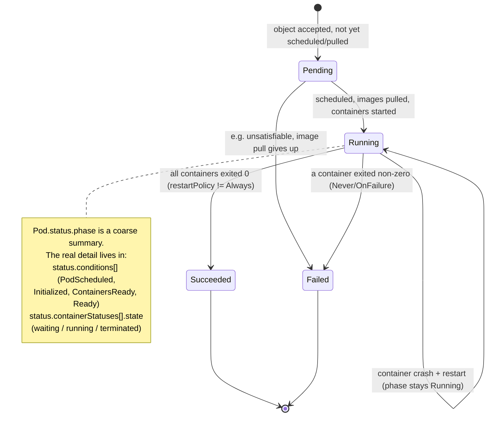

# 01 — Pods

> The Pod is Kubernetes' atom of scheduling and the unit of co-location: one or
> more containers that share a network, IPC, and UTS namespace plus volumes,
> always on one node. Phases, conditions, multi-container patterns, init and
> ephemeral containers — and why you almost never create a bare Pod yourself.

**Estimated time:** ~25 min read · ~45 min hands-on
**Prerequisites:** [Part 00 ch.06](../00-foundations/06-declarative-api-model.md) — the spec/status object model · [Part 00 ch.07](../00-foundations/07-local-cluster-setup.md) — a kind cluster to apply to
**You'll know after this:** • articulate why the Pod (not the container) is the unit of scheduling · • read a PodSpec and identify shared namespaces and volumes · • interpret Pod phases (Pending/Running/Succeeded/Failed/Unknown) and conditions · • choose between init, sidecar, and ephemeral containers for a real scenario · • explain why you almost never create a bare Pod in production · • write the security baseline into a Pod and name the threat each field answers

<!-- tags: core-objects, pods, multi-container, init-containers, ephemeral-containers, security, pod-security -->

## Why this exists

[Part 00](../00-foundations/06-declarative-api-model.md) ended with one object:
`catalog` as a bare Pod, applied to a real cluster in
[ch.07](../00-foundations/07-local-cluster-setup.md). That worked, but it raised
questions the rest of Part 01 answers: *what exactly is a Pod, why is it a Pod
and not "a container", and why is running a bare one an anti-pattern?*

A container is one isolated process tree. Real workloads frequently need **two
processes that must share fate and locality**: an app plus a log shipper that
tails its files, an app plus a proxy that holds its outbound connections, a
data store plus a one-shot schema loader that must finish *before* the store
accepts traffic. Scheduling those independently (two containers that *might*
land on different machines, *might* start in any order, *can't* see each other's
filesystem or `localhost`) breaks them. Kubernetes' answer is the **Pod**: a
group of containers guaranteed to be co-scheduled on one node, sharing selected
Linux namespaces and storage, with a single lifecycle. The Pod — not the
container — is therefore the smallest thing Kubernetes schedules, addresses
(one IP), and reports status for. Every higher workload (Deployment,
StatefulSet, Job…) ultimately produces Pods; understanding the Pod is
understanding all of them.

## Mental model

A Pod is a **shared execution context**, modeled on a single (virtual) host:
the containers in it behave like processes on one machine. They share:

- **Network namespace** — one IP, one port space. Containers reach each other
  over `localhost`; two containers cannot both bind `:8080`.
- **IPC namespace** — they can use SysV IPC / POSIX shared memory between them.
- **UTS namespace** — they share a hostname.
- **Volumes** — any volume the Pod declares can be mounted into multiple
  containers, the basis of "sidecar writes a file, app reads it".

They do **not** share a PID namespace by default (each container sees only its
own processes unless `shareProcessNamespace: true`) and do **not** share mount
namespaces (each has its own root filesystem; only declared volumes are shared).
The Pod itself is "the box": Kubernetes schedules, networks, and reports on the
box; the containers are processes inside it. A Pod is normally **ephemeral and
cattle, not a pet** — it is never moved; if its node dies it is gone and a
controller must create a *new* one. That single fact is why bare Pods are a
teaching device, not a deployment unit.

## Threats and controls

A Pod is where an attacker's code ends up running, so the threats that
belong to it are about what a compromised process can reach from inside one
container. Each control below is a field in the Pod spec. The
[baseline section](#baseline) explains the fields one by one. Write every
manifest of your own with them.

| Threat | Control taught here | Goes deeper |
|---|---|---|
| A compromised process runs as root inside the container | [`runAsNonRoot`, `runAsUser`, `runAsGroup`](#baseline-run-as) | [05.02](../05-security/02-pod-security.md) |
| It gains more privilege than it started with: a setuid binary, a kernel capability the app never needed | [`allowPrivilegeEscalation: false`](#baseline-privilege-escalation) and [`capabilities.drop`](#baseline-capabilities) | [05.02](../05-security/02-pod-security.md) |
| It rewrites the image's own files or drops a tool next to them | [`readOnlyRootFilesystem: true`](#baseline-read-only-root), with an `emptyDir` for each writable path | [05.02](../05-security/02-pod-security.md) |
| It calls a rarely used system call to attack the kernel | [`seccompProfile: RuntimeDefault`](#baseline-seccomp) | [05.02](../05-security/02-pod-security.md) |
| It reads the mounted ServiceAccount token and calls the API server | [`automountServiceAccountToken: false` and a dedicated ServiceAccount](#baseline-service-account) | [05.01](../05-security/01-authn-authz-rbac.md) |
| A tag is moved to different content after you reviewed it | [Pin third-party images by digest](#baseline-image-digest) | [05.03](../05-security/03-supply-chain.md) |
| A runaway or hostile process takes the node's memory | [A memory limit](#baseline-resources) | [01.03](03-resources-and-qos.md) |
| A Pod spec with none of the above is admitted | [Pod Security labels on the namespace](#baseline-namespace) | [05.02](../05-security/02-pod-security.md) |
| A helper or debug container becomes a way in to the app | [One concern per Pod, and a debug container carries the baseline too](#debug-containers) | [05.01](../05-security/01-authn-authz-rbac.md) |

The Pod, not the container, is the trust boundary. Containers in one Pod
share a network namespace and any volume that more than one of them mounts
(see the [mental model](#mental-model)), so a compromised sidecar sees what
the app sees over `localhost` and on a shared volume. A volume only the app
mounts stays out of its reach. Add a second container only when it earns its
place, and give it the same baseline as the app.

## Diagrams

### Shared-namespace structure of a Pod (ASCII)

```
                       Pod  "catalog"   (one IP: 10.244.1.7)
 ┌───────────────────────────────────────────────────────────────────────┐
 │  shared:  NET namespace (1 IP, 1 port space) · IPC · UTS (hostname)   │
 │                                                                       │
 │   ┌───────────────────┐   localhost    ┌──────────────────────────┐   │
 │   │ container: catalog│◄──────────────►│ container: log-sidecar   │   │
 │   │  app proc :8080   │                │  tails /var/log/app/*.log│   │
 │   │  own rootfs (img) │                │  own rootfs (img)        │   │
 │   └─────────┬─────────┘                └──────────────┬───────────┘   │
 │             │       both mount the SAME emptyDir      │               │
 │             ▼                                         ▼               │
 │         ┌─────────────────────────────────────────────────────┐       │
 │         │  volume: varlog (emptyDir)  →  /var/log/app         │       │
 │         └─────────────────────────────────────────────────────┘       │
 │                                                                       │
 │   (pause/sandbox container holds the namespaces; not user-visible)    │
 └───────────────────────────────────────────────────────────────────────┘
   NOT shared by default: PID namespace, mount namespace (rootfs per ctr)
```

### Pod lifecycle state machine (Mermaid)



## The security baseline, field by field {#baseline}

Write every workload with the fields below. As later chapters adopt them they
link here and do not explain them again. The values are the Bookstore's: the
catalog image declares user and group 65532, the `nonroot` user of its
distroless base image.

```yaml
spec:
  serviceAccountName: catalog-sa
  automountServiceAccountToken: false
  securityContext:
    runAsNonRoot: true
    runAsUser: 65532
    runAsGroup: 65532
    seccompProfile:
      type: RuntimeDefault
  containers:
    - name: catalog
      image: bookstore/catalog:dev
      securityContext:
        allowPrivilegeEscalation: false
        readOnlyRootFilesystem: true
        capabilities:
          drop: ["ALL"]
      resources:
        requests: { cpu: 50m, memory: 64Mi }
        limits: { memory: 128Mi }
      volumeMounts:
        - name: tmp
          mountPath: /tmp
  volumes:
    - name: tmp
      emptyDir: {}
```

The Pod-level `securityContext` applies to every container in the Pod, init
containers included. The container-level one is set per container and wins
where both set the same field. `allowPrivilegeEscalation`,
`readOnlyRootFilesystem` and `capabilities` exist only at container level.

Each field below names the threat it answers. The hands-on steps that follow
show the fields working on a running Pod.

### Run as a non-root user, by number {#baseline-run-as}

Without user namespaces, UID 0 in a container is UID 0 on the host, held back
only by the other controls in this section (the Kubernetes docs on
[user namespaces](https://kubernetes.io/docs/concepts/workloads/pods/user-namespaces/)
describe the remapping). A process running as root can rewrite any file the
container can see. The baseline never runs as root.

- `runAsUser` and `runAsGroup` set the numeric UID and GID of the container's
  processes. Use the numbers the image declares: `USER 65532:65532` in the
  catalog's Dockerfile.
- `runAsNonRoot: true` makes the kubelet refuse to start a container that
  would run as UID 0. It is a check, not a setting, and it does not change
  the user. [Step 6](#refusals) shows it stopping an image that runs as root.
- Set both. `runAsUser` makes the Pod start as the intended user, whatever
  user the image declares. With it set, the kubelet checks that number and
  does not consult the image. `runAsNonRoot` fails loudly if a later edit
  sets `runAsUser` to 0 or removes it, and then the image's own user decides.
  The busybox sidecar declares no user and would run as root, so the
  Pod-level `runAsUser` is what lets it start.

User namespaces (`hostUsers: false`) go a step further by remapping UID 0.
They are not in the baseline yet: [05.02](../05-security/02-pod-security.md)
teaches them, and they join the baseline once they have been verified on kind
for both Linux and macOS hosts.

### `fsGroup`, only when a volume needs it {#baseline-fsgroup}

`fsGroup` makes the kubelet give a volume's files a group owner and adds that
group to the container's processes. You need it when the UID you run as
cannot otherwise write to a volume, which can happen with a PersistentVolume
([03.04](../03-config-and-storage/04-persistent-storage.md)). Set it to the
same GID as `runAsGroup`. Nothing in this chapter needs it: an `emptyDir` is
writable by any user, and step 4 lists the shared directory as `drwxrwxrwx`.

### `seccompProfile: RuntimeDefault` {#baseline-seccomp}

Every system call an app can make is kernel code an attacker can try to
exploit, and an app uses a small part of what Linux offers. seccomp filters
the calls a process may make. `RuntimeDefault` applies the container
runtime's default profile, which blocks a set of calls that ordinary software
does not use. A Pod with no profile runs unconfined unless the cluster sets a
default. Step 5 reads `Seccomp: 2` from the app's process, where 2 means
filter mode (see `proc(5)`). The Kubernetes
[seccomp tutorial](https://kubernetes.io/docs/tutorials/security/seccomp/)
covers custom profiles.

### `allowPrivilegeEscalation: false` {#baseline-privilege-escalation}

This sets the Linux `no_new_privs` flag on the container's processes, so
executing a program can no longer give a process more privilege than it
already has ([kernel documentation](https://docs.kernel.org/userspace-api/no_new_privs.html)).
A setuid-root binary in the image becomes an ordinary program. Step 5 reads
`NoNewPrivs: 1` from the app's process.

### `capabilities.drop: ["ALL"]` {#baseline-capabilities}

Linux splits root's power into capabilities, such as changing file owners or
opening raw sockets, and the runtime grants every container a default set.
`drop: ["ALL"]` removes all of them. Step 5 reads `CapEff` and `CapBnd`, the
capabilities the process holds and the most it could ever gain, as all
zeros. If an app truly needs one, add back that one by name. The
`restricted` level allows only `NET_BIND_SERVICE` to be added back, as the
[Pod Security Standards](https://kubernetes.io/docs/concepts/security/pod-security-standards/)
state. The Kubernetes task page shows how to
[set capabilities for a container](https://kubernetes.io/docs/tasks/configure-pod-container/security-context/#set-capabilities-for-a-container).

### `readOnlyRootFilesystem: true`, with an `emptyDir` for each writable path {#baseline-read-only-root}

This mounts the container's root filesystem read-only. A compromised process
can no longer overwrite the app binary, plant a tool next to it or edit
files inside the image. Step 5 shows `touch` failing with `Read-only file
system` on the running app. Anything the app must write gets its own
`emptyDir`, a scratch volume that lives and dies with the Pod: `/tmp` in
every manifest here, and `/var/log/app` for the sidecar. An `emptyDir` is
still writable, so an attacker can leave files there. The field protects the
image's own files, not the volume.

Admission cannot tell whether the app survives a read-only root. A manifest
can pass every policy and crash on its first write. The catalog writes
nothing to disk today and still gets `/tmp`, because that is the first place
most software looks for scratch space. Whenever you add this field to
something new, run it and wait for Ready, as step 2 does.

### `automountServiceAccountToken: false` and a ServiceAccount of its own {#baseline-service-account}

Every Pod runs as a ServiceAccount, `default` if you name none. By default
the kubelet mounts a credential for it into every container, under
`/var/run/secrets/kubernetes.io/serviceaccount`. Code running in the
container can read it and call the API server as that identity. The catalog
never calls the API, so it gets no token: step 5 finds the directory missing.

The dedicated `catalog-sa`, created in step 1, is there so that nothing in
this guide runs as `default`. A permission granted later attaches to the
catalog alone, and `default` never accumulates rights. A workload that does
call the API sets `automountServiceAccountToken: true`, and only together
with its own ServiceAccount and a least-privilege Role
([05.01](../05-security/01-authn-authz-rbac.md)). The ServiceAccount carries
`false` too. When the two differ the Pod's own value wins, as the Kubernetes
docs on
[configuring ServiceAccounts](https://kubernetes.io/docs/tasks/configure-pod-container/configure-service-account/)
state.

### Pin third-party images by digest {#baseline-image-digest}

A tag is a pointer its publisher can move. A digest names one exact image.
Pin every third-party image by digest from its first appearance and keep the
tag in a comment so a person can read it. The Kubernetes docs on
[image names](https://kubernetes.io/docs/concepts/containers/images/#image-names)
show the `name@sha256:...` form, and step 5 shows where the digest comes
from. The digest in this chapter is that of the image index, which lists
amd64 and arm64 among other platforms, so the same line pulls on either.

The guide's own images are the exception. `bookstore/catalog:dev` is built on
your machine and loaded into kind, so it uses the tag the build produced.

### Requests and a memory limit {#baseline-resources}

`requests` are what the scheduler reserves for the container. The memory
`limit` is a ceiling the kernel enforces with out-of-memory kills: a
container that uses more than its limit may be terminated, but only once the
kernel detects memory pressure, so the limit is enforced reactively. The
Kubernetes docs on
[requests and limits](https://kubernetes.io/docs/concepts/configuration/manage-resources-containers/#requests-and-limits)
state this. Without a limit nothing bounds how much of the node's memory a
runaway process can take from its neighbours. The baseline sets requests and
a memory limit, and [01.03](03-resources-and-qos.md) explains how to choose
the numbers.

### Pod Security labels on the namespace {#baseline-namespace}

Fields in a manifest are only as good as the care of whoever wrote them. Pod
Security admission, built into the API server, makes the cluster check.
Label a namespace with the `restricted` level in `enforce` mode and the API
server rejects any Pod in it that lacks the fields that level requires.
`warn` mode prints the same findings to the client. It also covers workload
objects such as a Deployment, which `enforce` cannot refuse because the API
server accepts the Deployment and only the Pods it creates later are
rejected, as the
[Pod Security admission](https://kubernetes.io/docs/concepts/security/pod-security-admission/)
docs describe. Step 1 creates the `bookstore` namespace with both labels, and
step 6 shows a Pod refused.

`restricted` asks for a subset of this baseline. It does not ask for a
read-only root, a digest pin, a memory limit or a dedicated ServiceAccount,
so a manifest can pass `restricted` and still fall short of the baseline.
The [Pod Security Standards](https://kubernetes.io/docs/concepts/security/pod-security-standards/)
page lists what each level requires.

## Hands-on with the Bookstore

**Assumed working directory: the guide repo root (`full-guide/`).** All paths
are relative to it. Have a cluster from
[Part 00 ch.07](../00-foundations/07-local-cluster-setup.md)
(`kind create cluster --name bookstore`) and the catalog image loaded.

We continue the manifest from
[Part 00 ch.06](../00-foundations/06-declarative-api-model.md)
([`raw-manifests/01-catalog-pod.yaml`](../examples/bookstore/raw-manifests/01-catalog-pod.yaml)),
now carrying the baseline, and grow it by **one idea**: add a **logging
sidecar**. The catalog app already
logs structured JSON to stdout (correct 12-factor behavior — `kubectl logs`
reads that directly), so we leave the app container *unmodified* and add a
second, long-lived container that *owns the shared log directory and would ship
it* — the canonical "co-located helper sharing a volume with the app" pattern.
Keeping the app container untouched also keeps the Pod runnable as-is (the
Bookstore image is distroless and has no shell).

Every manifest here carries the baseline and runs in a namespace that
enforces it. The captured output comes from a kind cluster running
Kubernetes v1.37.0, recorded in
[`evidence/01-01.txt`](../examples/security-lab/evidence/01-01.txt).

### 1. A namespace that enforces `restricted` {#restricted-namespace}

The [namespace labels](#baseline-namespace) decide what the API server
accepts. Create `bookstore` with `enforce` and `warn` at `restricted`, plus
the `catalog-sa` ServiceAccount from the
[baseline](#baseline-service-account). Then make `bookstore` the default
namespace of your kubectl context, so the commands below need no `-n`:

```sh
kubectl apply -f - <<'EOF'
apiVersion: v1
kind: Namespace
metadata:
  name: bookstore
  labels:
    app.kubernetes.io/part-of: bookstore
    pod-security.kubernetes.io/enforce: restricted
    pod-security.kubernetes.io/warn: restricted
---
apiVersion: v1
kind: ServiceAccount
metadata:
  name: catalog-sa
  namespace: bookstore
  labels:
    app: catalog
    app.kubernetes.io/part-of: bookstore
automountServiceAccountToken: false
EOF
```

<!-- gate: output -->
```text
namespace/bookstore created
serviceaccount/catalog-sa created
```

```sh
kubectl config set-context --current --namespace=bookstore
```

<!-- gate: output -->
```text
Context "kind-bookstore" modified.
```

[Ch.03](03-resources-and-qos.md) later applies `00-namespace.yaml`, which adds
a quota and default limits to this same namespace.

### 2. Run the bare Pod (recap)

[Part 00](../00-foundations/07-local-cluster-setup.md) ended with `catalog` as
a bare Pod, and the seed now carries the baseline. If you still have the old
one in `default`, remove it with
`kubectl delete pod catalog -n default --ignore-not-found`. Apply the seed
into `bookstore` and wait for `Ready`. The wait is the runtime check. A
manifest can pass every admission policy and still crash on its first write
to a read-only root filesystem, and only a running Pod tells you.

```sh
kubectl apply -f examples/bookstore/raw-manifests/01-catalog-pod.yaml &&
  kubectl wait --for=condition=Ready pod/catalog --timeout=90s
```

<!-- gate: output -->
```text
pod/catalog created
pod/catalog condition met
```

```sh
kubectl get pod catalog
```

<!-- gate: output -->
```text
NAME      READY   STATUS    RESTARTS   AGE
catalog   1/1     Running   0          2s
```

```sh
kubectl get pod catalog \
  -o jsonpath='{range .status.conditions[*]}{.type}={.status}{"\n"}{end}'
```

<!-- gate: output -->
```text
PodReadyToStartContainers=True
Initialized=True
Ready=True
ContainersReady=True
PodScheduled=True
```

`phase` is the coarse summary from the state machine above; the **conditions**
are the truth the Service (next Part) and controllers actually gate on.

### 3. Add a logging sidecar, the modern way (native sidecar)

The file
[`examples/bookstore/raw-manifests/02-catalog-pod-sidecar.yaml`](../examples/bookstore/raw-manifests/02-catalog-pod-sidecar.yaml)
is already in the repo. It is the same Pod as the seed, still named `catalog`
and labelled `app: catalog`, so selectors in later chapters still match. The
listing below is a fragment of its `spec` and shows this chapter's increment,
the second container and the volume it shares. The file also holds the probes
and shutdown hook that [ch.02](02-health-and-lifecycle.md) explains, and they
change nothing about the baseline. The command after the listing applies the
file from the repo, not the fragment.

```yaml
spec:
  serviceAccountName: catalog-sa
  automountServiceAccountToken: false
  securityContext:              # Pod level: every container, init containers too
    runAsNonRoot: true
    runAsUser: 65532
    runAsGroup: 65532
    seccompProfile:
      type: RuntimeDefault
  # initContainers with restartPolicy: Always == a "native sidecar" (GA 1.33).
  # It starts BEFORE the app, stays running ALONGSIDE it, and is guaranteed to
  # be shut down AFTER the app — exactly the sidecar lifecycle you want for a
  # log shipper, without the legacy pitfalls (see "under the hood").
  initContainers:
    - name: log-sidecar
      # busybox:1.36, pinned by digest: a tag can be moved, a digest cannot
      image: busybox@sha256:73aaf090f3d85aa34ee199857f03fa3a95c8ede2ffd4cc2cdb5b94e566b11662
      restartPolicy: Always     # <-- this is what makes it a NATIVE SIDECAR
      command: ["/bin/sh", "-c"]
      args:
        - |
          echo "log-sidecar: shipping from /var/log/app";
          while true; do
            echo "$(date -u +%FT%TZ) log-sidecar: tail/ship tick";
            sleep 30;
          done
      securityContext:
        allowPrivilegeEscalation: false
        readOnlyRootFilesystem: true
        capabilities:
          drop: ["ALL"]
      resources:
        requests:
          cpu: 10m
          memory: 8Mi
        limits:
          memory: 32Mi
      volumeMounts:
        - name: varlog
          mountPath: /var/log/app
  containers:
    - name: catalog
      image: bookstore/catalog:dev
      imagePullPolicy: IfNotPresent     # locally loaded image (ch.07)
      ports:
        - name: http
          containerPort: 8080
      env:
        - name: PORT
          value: "8080"
      # App container UNMODIFIED: it logs JSON to stdout (kubectl logs reads it).
      securityContext:
        allowPrivilegeEscalation: false
        readOnlyRootFilesystem: true
        capabilities:
          drop: ["ALL"]
      resources:
        requests:
          cpu: 50m
          memory: 64Mi
        limits:
          memory: 128Mi
      # (probes and a preStop hook: ch.02; they are in the repo file)
      volumeMounts:
        - name: tmp
          mountPath: /tmp
        - name: varlog
          mountPath: /var/log/app
  volumes:
    - name: tmp
      emptyDir: {}
    - name: varlog
      emptyDir: {}              # shared scratch dir, lives & dies with the Pod
```

> Why the sidecar only heartbeats here: a real log shipper (Fluent Bit, Vector)
> would `tail -F /var/log/app/*.log` and forward it. We keep the app container
> **unmodified** (distroless, no shell — it logs to stdout, which is correct)
> so the **shape** is what you learn: a long-lived helper container in the same
> Pod, sharing a volume, with native-sidecar start/stop ordering. Swapping the
> busybox loop for `fluent-bit` reading `/var/log/app` is the only change to
> make this production-shaped, and it keeps the same baseline.

Apply and observe both containers in one Pod:

```sh
# from the repo root (full-guide/)
kubectl delete pod catalog --ignore-not-found &&   # replace the bare Pod
  kubectl apply -f examples/bookstore/raw-manifests/02-catalog-pod-sidecar.yaml &&
  kubectl wait --for=condition=Ready pod/catalog --timeout=120s
```

<!-- gate: output -->
```text
pod "catalog" deleted from bookstore namespace
pod/catalog created
pod/catalog condition met
```

```sh
kubectl get pod catalog                              # READY shows 2/2 once both up
```

<!-- gate: output -->
```text
NAME      READY   STATUS    RESTARTS   AGE
catalog   2/2     Running   0          7s
```

```sh
kubectl logs catalog -c catalog --tail=3             # the Go app's JSON logs
kubectl logs catalog -c log-sidecar --tail=3         # the sidecar tailing the file
```

### 4. Demonstrate the shared namespaces

The sidecar reaches the app over `localhost`: one shared network namespace,
one IP.

```sh
kubectl exec catalog -c log-sidecar -- wget -qO- http://localhost:8080/healthz ; echo
```

<!-- gate: output -->
```text
{"status":"ok"}
```

The sidecar and the app also share the `varlog` volume. Write a file from the
sidecar and list the directory. The directory is `drwxrwxrwx`, which is why
no [`fsGroup`](#baseline-fsgroup) is needed:

```sh
kubectl exec catalog -c log-sidecar -- \
  sh -c 'echo hi > /var/log/app/x; ls -l /var/log/app; ls -ld /var/log/app'
```

<!-- gate: output -->
```text
total 4
-rw-r--r--    1 65532    65532            3 Oct 30 16:01 x
drwxrwxrwx    2 root     root            15 Oct 30 16:01 /var/log/app
```

The app container is distroless, so `kubectl exec catalog -c catalog -- ...`
fails: there is no shell. Step 5 looks at it from the outside, which is
exactly why `kubectl debug` exists.

### 5. Ephemeral (debug) container: debugging, and checking the baseline {#debug-containers}

The catalog image is distroless (no shell, no `curl`). You still need to look
inside it. `kubectl debug` injects an **ephemeral container** that shares
the target's namespaces. A debug container is a way into a workload, so it
must not be a way around the baseline. Pod Security admission checks an
ephemeral container like any other, and it inherits the Pod's user and
seccomp profile.

Pin the debug image by digest too. `docker pull` prints the digest of the
tag; copy it into a variable for the commands below:

```sh
docker pull busybox:1.36 | grep Digest
```

<!-- gate: output -->
```text
Digest: sha256:73aaf090f3d85aa34ee199857f03fa3a95c8ede2ffd4cc2cdb5b94e566b11662
```

```sh
export BUSYBOX=busybox@sha256:73aaf090f3d85aa34ee199857f03fa3a95c8ede2ffd4cc2cdb5b94e566b11662
```

**Deliberate failure.** The default debug profile does not set the fields
`restricted` requires, so the API server refuses it. Only the start of the
error is kept here:

```sh
kubectl debug catalog --image=$BUSYBOX --target=catalog --container=probe \
  --attach=false -- sleep 3600 2>&1 |
  grep -o 'pods "catalog" is forbidden: violates PodSecurity "restricted:latest"'
```

<!-- gate: output -->
```text
pods "catalog" is forbidden: violates PodSecurity "restricted:latest"
```

Ask for the `restricted` profile instead, the one the debugging guide's
[profiles section](https://kubernetes.io/docs/tasks/debug/debug-application/debug-running-pod/#debugging-profiles)
lists as compatible with the `restricted` Pod Security Standard.
`--target=catalog` shares that container's process namespace, so the app is
PID 1 in the debug container's view and `/proc/1/root` is the app's own
filesystem:

```sh
kubectl debug catalog --image=$BUSYBOX --target=catalog \
  --profile=restricted --container=inspect --attach=false -- sleep 3600 &&
  kubectl wait pod/catalog --timeout=30s \
  --for=jsonpath='{.status.ephemeralContainerStatuses[?(@.name=="inspect")].state.running.startedAt}'
```

<!-- gate: output -->
```text
Targeting container "catalog". If you don't see processes from this container it may be because the container runtime doesn't support this feature.
pod/catalog condition met
```

Now read the baseline off the running app. In an interactive session you
would use `-it` and `sh`; the one-shot form below runs the same commands and
merges their errors into the output:

```sh
kubectl exec catalog -c inspect -- sh -c '
exec 2>&1
id
ps -o pid,user,comm
grep -E "NoNewPrivs|Seccomp:|CapEff|CapBnd" /proc/1/status | tr -s "\t" " "
ls /proc/1/root/var/run/secrets/kubernetes.io/serviceaccount
touch /proc/1/root/etc/x
ls /proc/1/root/var/log/app'
```

<!-- gate: output -->
```text
uid=65532 gid=65532 groups=65532
PID   USER     COMMAND
    1 65532    catalog
   21 65532    sleep
   34 65532    sh
   42 65532    ps
CapEff: 0000000000000000
CapBnd: 0000000000000000
NoNewPrivs: 1
Seccomp: 2
ls: /proc/1/root/var/run/secrets/kubernetes.io/serviceaccount: No such file or directory
touch: /proc/1/root/etc/x: Read-only file system
x
```

Read it top to bottom:

- The app, PID 1, runs as `65532`, not root
  ([`runAsUser`](#baseline-run-as)).
- `CapEff` and `CapBnd` are zero: no capabilities
  ([`drop: ["ALL"]`](#baseline-capabilities)).
- `NoNewPrivs: 1`:
  [`allowPrivilegeEscalation: false`](#baseline-privilege-escalation) took
  effect.
- `Seccomp: 2`: the [runtime default profile](#baseline-seccomp) filters its
  system calls.
- There is no ServiceAccount token directory
  ([`automountServiceAccountToken: false`](#baseline-service-account)).
- `touch` fails with `Read-only file system`
  ([`readOnlyRootFilesystem`](#baseline-read-only-root)).
- The last line, `x`, is the file the sidecar wrote in step 4: one volume,
  two containers.

Ephemeral containers are never restarted and cannot have probes, ports or
resources. You also cannot change or remove one once it is added, as the
[ephemeral containers](https://kubernetes.io/docs/concepts/workloads/pods/ephemeral-containers/)
page states. The `inspect` container stays in `spec.ephemeralContainers`
until the Pod is deleted, and step 7 does that. They exist purely for live
debugging of an existing Pod. Creating one needs RBAC on the
`pods/ephemeralcontainers` subresource, as the
[debugging guide](https://kubernetes.io/docs/tasks/debug/debug-application/debug-running-pod/)
describes, so grant it as carefully as `pods/exec`.

### 6. Make the controls refuse (deliberate failures) {#refusals}

Both commands below fail on purpose, so that you recognise the refusals when
they happen by accident. Neither leaves anything running.

**The API server refuses a Pod with no `securityContext`.** `kubectl run`
builds a Pod with none, and `--dry-run=server` runs it through admission
without creating anything:

```sh
kubectl run probe --image=$BUSYBOX --dry-run=server -- sleep 1
```

<!-- gate: output -->
```text
Error from server (Forbidden): pods "probe" is forbidden: violates PodSecurity "restricted:latest": allowPrivilegeEscalation != false (container "probe" must set securityContext.allowPrivilegeEscalation=false), unrestricted capabilities (container "probe" must set securityContext.capabilities.drop=["ALL"]), runAsNonRoot != true (pod or container "probe" must set securityContext.runAsNonRoot=true), seccompProfile (pod or container "probe" must set securityContext.seccompProfile.type to "RuntimeDefault" or "Localhost")
```

The message names every missing field. It is the list from the
[baseline](#baseline) that `restricted` requires.

**The kubelet refuses a root image under `runAsNonRoot`.** This Pod has every
field `restricted` asks for, so admission accepts it. It sets
`runAsNonRoot` and no `runAsUser`, and busybox declares no user:

```sh
kubectl run rootcheck --image=$BUSYBOX --restart=Never --overrides='{
  "spec": {
    "securityContext": {"runAsNonRoot": true, "seccompProfile": {"type": "RuntimeDefault"}},
    "containers": [{
      "name": "rootcheck", "image": "'"$BUSYBOX"'", "command": ["sleep", "60"],
      "securityContext": {"allowPrivilegeEscalation": false, "capabilities": {"drop": ["ALL"]}}
    }]
  }
}' &&
  kubectl wait pod/rootcheck --timeout=60s \
  --for=jsonpath='{.status.containerStatuses[0].state.waiting.reason}'=CreateContainerConfigError
```

<!-- gate: output -->
```text
pod/rootcheck created
pod/rootcheck condition met
```

```sh
kubectl get pod rootcheck
kubectl get pod rootcheck \
  -o jsonpath='{.status.containerStatuses[0].state.waiting.message}' |
  sed 's/ (pod:.*//'; echo
```

<!-- gate: output -->
```text
NAME        READY   STATUS                       RESTARTS   AGE
rootcheck   0/1     CreateContainerConfigError   0          1s
```

<!-- gate: output -->
```text
container has runAsNonRoot and image will run as root
```

Admission cannot see inside the image, so the kubelet checks at start. This
is why the baseline sets `runAsUser` next to `runAsNonRoot`. Clean up:

```sh
kubectl delete pod rootcheck --now
```

### 7. Why you will not keep doing this

This is still a **bare Pod**: delete it and nothing brings it back; if its node
dies it is gone forever.

```sh
kubectl delete pod catalog && kubectl get pod catalog
```

<!-- gate: output -->
```text
pod "catalog" deleted from bookstore namespace
Error from server (NotFound): pods "catalog" not found
```

That is the cliff-edge motivating [ch.04](04-replicasets-and-deployments.md).
For now, re-apply it so later chapters in this Part have a Pod to evolve:

```sh
kubectl apply -f examples/bookstore/raw-manifests/02-catalog-pod-sidecar.yaml &&
  kubectl wait --for=condition=Ready pod/catalog --timeout=120s
```

<!-- gate: output -->
```text
pod/catalog created
pod/catalog condition met
```

> **Manifest lineage.** `01-catalog-pod.yaml` (bare Pod, Part 00) is the
> teaching seed and is **kept**; it carries the same baseline as every
> manifest after it. `02-catalog-pod-sidecar.yaml` is the same `catalog`
> object plus the sidecar concept. Chapter 02 adds probes and a shutdown hook
> to the *Pod template*, chapter 03 explains the `resources` block the
> baseline already carries, and ch.04 lifts that template into a Deployment
> under the `bookstore` namespace. Each numbered file is a snapshot of one
> increment; nothing is deleted, so you can always diff "before vs. after a
> concept".

## Multi-container patterns

A Pod with more than one container is justified only when the containers must
share **fate + locality + a namespace/volume**. Three named patterns (the
[Kubernetes Patterns](#further-reading) structural patterns) cover almost all
legitimate uses:

| Pattern | Helper container's job | Bookstore example |
|---|---|---|
| **Sidecar** | Augments the main container (logging, sync, proxy) for the *whole* lifetime | log shipper tailing `/var/log/app` (above); later, a metrics or mesh proxy |
| **Adapter** | Normalizes the main container's output to a standard the outside expects | exposing app metrics in Prometheus format if the app spoke a different one |
| **Ambassador** | Proxies the main container's *outbound* connections to the outside world | a local proxy so `catalog` connects to `localhost:6379` while the ambassador handles real Redis discovery/TLS |

### Sidecars: legacy vs. native (GA since 1.33)

Historically a sidecar was just an extra entry in `containers:`. That had two
real defects:

1. **Startup ordering.** Regular containers start in parallel; the app could
   begin serving before the proxy/log sidecar was ready.
2. **Shutdown ordering & Job completion.** On termination all containers get
   `SIGTERM` together, so a sidecar could die while the app still needed it; and
   in a Job a never-exiting sidecar kept the Job from ever completing.

The fix, on by default since Kubernetes 1.29 and **GA since 1.33** (target
here is **v1.37**, where the `SidecarContainers` feature gate is removed
because the feature can no longer be turned off): declare the sidecar as an
**init container with `restartPolicy: Always`** — a *native sidecar*. The
kubelet then gives it sidecar lifecycle semantics:

- It **starts and becomes ready before** the regular `containers[]` start.
- It **runs concurrently** with them for the Pod's life (unlike a normal init
  container, which must exit before the next one).
- It is **terminated after** the regular containers on Pod shutdown.
- It **does not block Job completion** (Job finishes when the regular
  containers finish; native sidecars are then stopped).

This is why the Bookstore sidecar above is under `initContainers:` with
`restartPolicy: Always`, not under `containers:`. New designs should prefer
native sidecars; the legacy "extra `containers[]` entry" still works and you
will see it in older manifests.

### Init containers

`initContainers` (without `restartPolicy: Always`) run **to completion, in
order, before any app container starts**. Each must exit 0 before the next
runs; any failure restarts the init sequence (subject to `restartPolicy`). Uses:
wait for a dependency, run a schema migration, fetch a config/secret: work
that must finish *before* the app starts. An init container carries the same
[baseline](#baseline) as the app. One that needs privilege, such as setting a
kernel parameter, is refused in a `restricted` namespace, so that work belongs
elsewhere ([05.02](../05-security/02-pod-security.md)). The
Bookstore uses a real init pattern later (the DB-migration Job in
[ch.07](07-jobs-and-cronjobs.md) is the run-once-before form; an init container
that waits for Postgres is a common companion).

## How it works under the hood

- **The pause (sandbox) container holds the namespaces.** When the kubelet
  ([Part 00 ch.05](../00-foundations/05-node-components.md)) starts a Pod it
  first creates an almost-empty **sandbox** ("pause") container
  (`registry.k8s.io/pause`). That process does nothing but hold the Pod's
  network/IPC/UTS namespaces open. Every other container in the Pod is created
  by the CRI runtime to **join the sandbox's namespaces** (`--net=container:…`).
  That is *mechanically* how containers in a Pod get one IP and a shared
  `localhost`: they are all attached to the pause container's network
  namespace. The pause container also reaps zombies if PID sharing is on. It is
  why a Pod survives an app-container restart with the **same IP** — the
  sandbox (and its IP) outlives individual container restarts.
- **Pod IP comes from the CNI plugin, once, for the sandbox.** The kubelet asks
  the CNI plugin to wire the sandbox's netns and assign an IP; all containers
  inherit it. (Networking internals are [Part 02](../02-networking/01-networking-model.md).)
- **`phase` is derived; `conditions` are computed by the kubelet.** The kubelet
  reports each container's state (`waiting`/`running`/`terminated` with reason,
  e.g. `CrashLoopBackOff`, `OOMKilled`) and computes `PodScheduled`,
  `Initialized`, `ContainersReady`, `Ready`. `Ready` (gated by readiness
  probes, [ch.02](02-health-and-lifecycle.md)) is what the EndpointSlice
  controller uses to decide if a Pod receives Service traffic — the link
  between Pod internals and the rest of the system.
- **`restartPolicy` is Pod-wide** (`Always` default | `OnFailure` | `Never`)
  and applies to app containers. It is the field a Job flips to `OnFailure`/
  `Never` ([ch.07](07-jobs-and-cronjobs.md)). Native sidecars get their own
  `restartPolicy: Always` *per init container*, independent of the Pod's.
- **Restarts are exponential-backoff, in place.** A crashed container is
  restarted by the kubelet *on the same node, in the same Pod, same IP*, with
  backoff capped at 5 minutes (`CrashLoopBackOff`). Rescheduling to another node
  is **not** a Pod feature — that requires a controller making a *new* Pod.

## Production notes

> **In production:** never run a **bare Pod** for a real workload. It is not
> rescheduled if the node dies and not recreated if it is deleted or crashes
> unrecoverably. Always use a controller (Deployment/StatefulSet/DaemonSet/Job,
> [ch.04](04-replicasets-and-deployments.md)+). The only legitimate bare Pods
> are short-lived debug/one-shot Pods you create and delete by hand.

> **In production:** keep Pods **single-responsibility**. A second container is
> justified only by shared fate+locality (logging/proxy/adapter). Do not stuff
> an app and its database into one Pod to "keep them together" — they have
> different scaling, lifecycle, and failure domains. Co-location is a coupling,
> not a convenience.

> **In production:** adopt **native sidecars** (`initContainers` +
> `restartPolicy: Always`) on clusters ≥1.29 for log shippers, service-mesh
> proxies, and config reloaders — it fixes the start/stop ordering and the
> "sidecar keeps a Job alive forever" bug that plagued the legacy pattern. EKS/
> GKE/AKS all support it on supported (1.29+) control planes; verify the node
> kubelet version, not just the control plane.

> **In production:** ephemeral/debug containers require the
> `EphemeralContainers` feature (on by default in supported releases) and are
> **checked by Pod Security admission** like any other container
> ([Part 05](../05-security/02-pod-security.md)) because they can target a
> running workload. The default `kubectl debug` profile is refused in a
> `restricted` namespace (step 5), so use `--profile=restricted` and a
> digest-pinned image. Expect to need RBAC for `pods/ephemeralcontainers`;
> grant it as carefully as `pods/exec`.

> **In production:** distroless/static images (like the Bookstore services)
> have **no shell** — `kubectl exec … -- sh` fails. Standardize on
> `kubectl debug --profile=restricted --image=<digest-pinned toolbox> …`
> with a debug toolbox image; bake this into the
> troubleshooting runbook ([Part 08 ch.03](../08-day-2-operations/03-troubleshooting-playbook.md)).

## Quick Reference

```sh
kubectl get pod <P> -o wide                       # node, IP, READY count
kubectl get pod <P> -o jsonpath='{.status.phase}' # coarse phase
kubectl describe pod <P>                          # conditions + Events (start here)
kubectl logs <P> -c <CTR> [-f] [--previous]       # per-container logs
kubectl exec -it <P> -c <CTR> -- sh               # shell (if the image has one)
kubectl debug -it <P> --image=<IMAGE>@sha256:<DIGEST> --target=<CTR> \
  --profile=restricted -- sh                      # ephemeral debug ctr, baseline kept
kubectl get pod <P> -o jsonpath='{.spec.initContainers[*].name}'   # incl. native sidecars
```

Pod spec skeleton with the baseline (native sidecar + shared volume). It is a
fragment: the fields are explained in [the baseline](#baseline).

```yaml
spec:
  serviceAccountName: <APP>-sa
  automountServiceAccountToken: false
  securityContext:
    runAsNonRoot: true
    runAsUser: <UID>                 # the numeric UID the image declares
    runAsGroup: <GID>
    seccompProfile:
      type: RuntimeDefault
  initContainers:
    - name: <SIDECAR>
      image: <HELPER-IMAGE>@sha256:<DIGEST>   # tag in a comment
      restartPolicy: Always          # => native sidecar (1.29+)
      securityContext:
        allowPrivilegeEscalation: false
        readOnlyRootFilesystem: true
        capabilities:
          drop: ["ALL"]
      resources:
        requests: { cpu: 10m, memory: 8Mi }
        limits: { memory: 32Mi }
      volumeMounts: [ { name: shared, mountPath: /shared } ]
  containers:
    - name: <APP>
      image: <APP-IMAGE>
      imagePullPolicy: IfNotPresent  # if image is kind-loaded, not in a registry
      ports: [ { name: http, containerPort: 8080 } ]
      securityContext:
        allowPrivilegeEscalation: false
        readOnlyRootFilesystem: true
        capabilities:
          drop: ["ALL"]
      resources:
        requests: { cpu: 50m, memory: 64Mi }
        limits: { memory: 128Mi }
      volumeMounts:
        - { name: shared, mountPath: /shared }
        - { name: tmp, mountPath: /tmp }
  volumes:
    - name: shared
      emptyDir: {}
    - name: tmp
      emptyDir: {}
```

Checklist:

- [ ] One concern per container; extra containers justified by shared fate
- [ ] Sidecars on 1.29+ use `initContainers` + `restartPolicy: Always`
- [ ] `initContainers` (no `Always`) for must-finish-first setup
- [ ] Shared data via a `volumes:` entry mounted into each container
- [ ] `imagePullPolicy` matches how the image reaches the node
- [ ] Real workload → behind a controller, never a bare Pod
- [ ] Distroless images debugged via `kubectl debug --profile=restricted`,
  not `exec … sh`
- [ ] Every container carries the baseline: non-root by number, no privilege
  escalation, capabilities dropped, read-only root, seccomp `RuntimeDefault`
- [ ] Each writable path comes from an `emptyDir`, and the Pod reaches Ready
- [ ] Its own ServiceAccount, with no token unless the app calls the API
- [ ] Third-party images pinned by digest, tag in a comment
- [ ] The namespace enforces `restricted`

## Test your understanding

> Try each before opening the answer drawer. The act of trying is the exercise; the answer is the check.

1. **Why is the Pod — not the container — the unit Kubernetes schedules and addresses? Give one concrete pattern that doesn't work if every container were independently scheduled.**
   <details><summary>Show answer</summary>

   Pods are the unit because two containers often need shared fate, locality, network namespace, and a volume — independent scheduling could land them on different nodes, start in arbitrary order, or fail to share `localhost`. A log sidecar that tails the app's `/var/log/app/*.log` via a shared `emptyDir` only works if both containers are co-scheduled on one node and share the volume mount — exactly what a Pod guarantees (see §Mental model and §Multi-container patterns).

   </details>

2. **What's the difference between adding a sidecar in `containers:` versus as an `initContainers` entry with `restartPolicy: Always`, and which two bugs does the native sidecar form fix?**
   <details><summary>Show answer</summary>

   Native sidecars (initContainer + `restartPolicy: Always`, on by default since 1.29, GA 1.33) start *before* and shut down *after* the app, and don't block Job completion. The legacy form starts in parallel (app may serve before the proxy is ready) and gets SIGTERM together with the app (the sidecar can die mid-drain). In Jobs, a never-exiting legacy sidecar prevents the Job from ever completing (see §Sidecars: legacy vs. native).

   </details>

3. **You see a `catalog` Pod in `CrashLoopBackOff` and `kubectl get pod` shows the same IP across restarts. Why doesn't the IP change, and how does this connect to the pause container?**
   <details><summary>Show answer</summary>

   The pause container holds the Pod's network namespace and the CNI plugin runs only once per Pod, at sandbox creation. App containers join the sandbox's namespaces, so when an app container crashes and is restarted in place, the sandbox (and its IP) persists. The IP only changes when the *Pod itself* is recreated (different Pod, fresh sandbox) — see §How it works under the hood.

   </details>

4. **A teammate's distroless app Pod won't let them `kubectl exec -it … -- sh` to debug a misbehaving request. What's the right approach, and what RBAC/PSA caveat should they expect?**
   <details><summary>Show answer</summary>

   Use `kubectl debug -it <pod> --image=<digest-pinned image> --target=<container> --profile=restricted -- sh`. This injects an ephemeral container sharing the target's namespaces. They need RBAC for `pods/ephemeralcontainers`, and in a `restricted` namespace the default profile is refused by Pod Security admission because it does not set the fields `restricted` requires, so `--profile=restricted` is required (see step 5 of the hands-on and §Production notes).

   </details>

5. **Hands-on extension: apply `02-catalog-pod-sidecar.yaml` into the `bookstore` namespace, then `kubectl exec catalog -c log-sidecar -- wget -qO- http://localhost:8080/healthz`. Why does this work without any Service, and what does it prove?**
   <details><summary>What you should see</summary>

   You should see `{"status":"ok"}`. The sidecar reaches the app over `localhost` because both containers share one network namespace held by the pause sandbox: same IP, same port space. This proves the Pod's network-namespace sharing model directly: no Service, no DNS, no kube-proxy involved, just two processes that happen to see the same network stack (see §Shared-namespace structure and step 4 of the hands-on).

   </details>

6. **A Pod passes `kubectl apply --dry-run=server` into a `restricted` namespace, yet stays in `CreateContainerConfigError`. It sets `runAsNonRoot: true` and no `runAsUser`, and its image declares no user. What is going on, and what is the fix?**
   <details><summary>Show answer</summary>

   Admission only checks that `runAsNonRoot` is present. The kubelet enforces it when it creates the container: the image would run as UID 0, so the container never starts (`container has runAsNonRoot and image will run as root`). Set a numeric `runAsUser` (and `runAsGroup`) next to `runAsNonRoot`, using the UID the image is built for, or pick an image that declares a numeric non-root user (see §Run as a non-root user and step 6).

   </details>

7. **The `log-sidecar` is compromised. What can the attacker reach from it that they could not reach if it ran in a separate Pod, and which baseline fields still limit the damage?**
   <details><summary>Show answer</summary>

   Co-location adds three things: any port an app binds only to loopback, which no other Pod could reach, the Pod's IPC namespace, and the contents of the volumes the sidecar mounts, here `varlog`. It does not add reach to the app on `:8080`. The catalog listens on all interfaces, so a separate Pod could call it by Pod IP or through a Service until the default-deny NetworkPolicy of [02.06](../02-networking/06-network-policies.md). The Pod is the trust boundary (see §Threats and controls). The sidecar carries the same baseline as the app, so it still runs as 65532 with no capabilities, no privilege escalation, a read-only root and no ServiceAccount token, and it mounts only the volume it needs: `varlog`, not `tmp`. Give a helper container the same baseline, a minimal image and only the volumes it needs.

   </details>

## Further reading

- **Lukša, _Kubernetes in Action_ 2e, ch.5 — "Running workloads in Pods"** —
  the Pod object, multi-container Pods, init containers, lifecycle and the
  shared-namespace model.
- **Ibryam & Huß, _Kubernetes Patterns_ 2e** — *Init Container* (ch.15),
  *Sidecar* (ch.16), *Adapter* (ch.17), *Ambassador* (ch.18): when and why each
  multi-container shape is the right tool.
- Official: <https://kubernetes.io/docs/concepts/workloads/pods/> and the
  native-sidecar guide
  <https://kubernetes.io/docs/concepts/workloads/pods/sidecar-containers/>.
- Official, for the baseline: the Pod Security Standards
  <https://kubernetes.io/docs/concepts/security/pod-security-standards/>, the
  security-context task
  <https://kubernetes.io/docs/tasks/configure-pod-container/security-context/>
  and the debugging guide for running Pods
  <https://kubernetes.io/docs/tasks/debug/debug-application/debug-running-pod/>.
