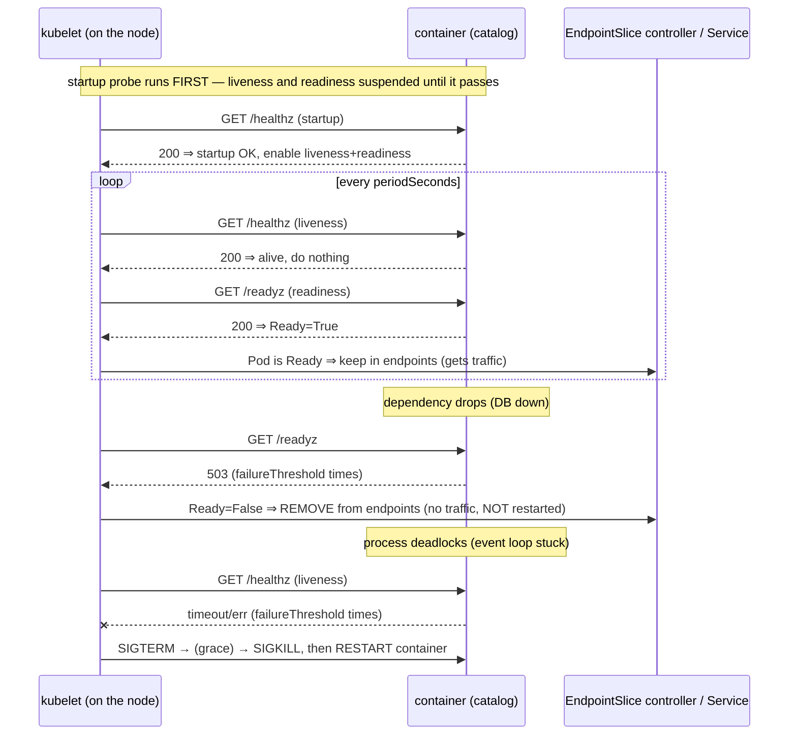
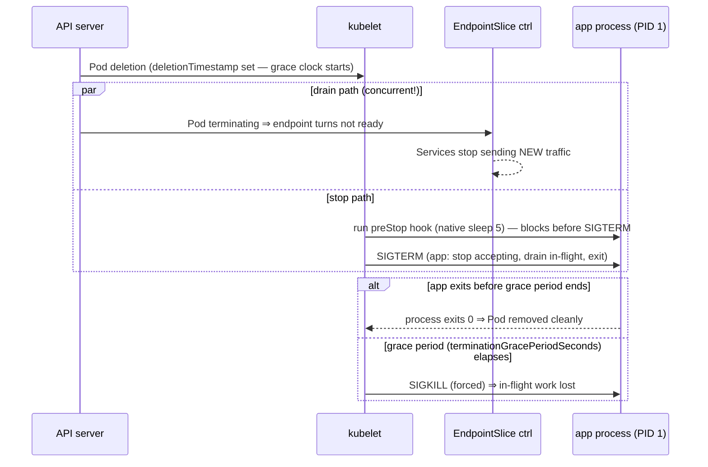

# 02 — Health and lifecycle

> Liveness, readiness, and startup probes; the four probe handlers and every
> tuning parameter; `postStart`/`preStop` hooks; `SIGTERM` +
> `terminationGracePeriodSeconds` and the graceful-shutdown contract — applied
> by making the catalog Pod self-diagnosing and shutdown-safe.

**Estimated time:** ~15 min read · ~30 min hands-on
**Prerequisites:** [Part 01 ch.01](01-pods.md) — Pod phases and conditions, and the `bookstore` namespace from [01.01 step 1](01-pods.md#restricted-namespace)
**You'll know after this:** • choose between liveness, readiness, and startup probes for a service · • configure all four probe handlers (httpGet, tcpSocket, exec, grpc) and tune timing parameters · • implement `preStop` hooks and respect `terminationGracePeriodSeconds` · • write a graceful-shutdown handler that drains connections before SIGKILL · • debug a Pod that fails or flaps on its probes · • say what unauthenticated probe endpoints expose, and how to limit it

<!-- tags: core-objects, probes, liveness, readiness, lifecycle, graceful-shutdown -->

## Why this exists

[ch.01](01-pods.md) showed a Pod's `phase` is coarse and the `Ready` condition
is what actually gates traffic. But who *sets* `Ready`, and how does Kubernetes
know a process is **alive but wedged** (deadlocked, leaked all goroutines) vs.
**alive but not yet usable** (still loading cache, DB not connected) vs. simply
**not done starting**? The container "running" tells you the *process* exists,
not that the *application* works. Without health signals Kubernetes would route
users to a hung Pod and never restart a process stuck in an infinite loop.

Equally, the *end* of a Pod's life is a contract, not an event. When Kubernetes
removes a Pod (rollout, scale-down, eviction) it must let in-flight requests
finish and the process flush state — otherwise every deploy drops connections.
This chapter is the **liveness/readiness/startup** triad plus the **termination
sequence**: the two halves that make a workload survivable in production. They
are exactly the [Health Probe](#further-reading) and [Managed
Lifecycle](#further-reading) patterns.

## Mental model

Kubernetes cannot read your app's mind, so the app must **answer three
questions on demand**, and Kubernetes acts on the answers:

- **Liveness — "are you wedged?"** Fail repeatedly → kubelet **kills and
  restarts the container** (same Pod, same node). For unrecoverable internal
  hangs only.
- **Readiness — "should you get traffic *right now*?"** Fail → the Pod is
  **removed from Service endpoints** (no traffic) but **not restarted**. For
  transient "busy / dependency down / draining" states. This is the probe that
  sets the `Ready` condition from [ch.01](01-pods.md).
- **Startup — "have you finished booting?"** While it has not yet succeeded,
  **liveness and readiness are suspended**. For slow-starting apps, so a long
  boot is not misread as a liveness failure.

Symmetrically, shutdown is a **negotiated drain**, not a `kill -9`: Kubernetes
says "please stop" (`SIGTERM`), waits up to a grace period while you finish
in-flight work and Kubernetes stops routing new traffic, and only then forces
the issue (`SIGKILL`). Healthy in production = *correctly answers the three
probes* **and** *shuts down within the grace period*.

## Threats and controls

| Threat | Control taught here | Goes deeper |
|---|---|---|
| A wedged process keeps its Pod and serves no one | Liveness on `/healthz` and readiness on `/readyz`, both `httpGet`, with the timing fields below | [06.05](../06-production-readiness/05-reliability-and-disruptions.md) |
| A probe that runs a command needs a shell or a helper binary in the image, and an attacker who gets in can use the same tools | `httpGet` probes, which need nothing in the image, and the native `sleep` hook, which needs no binary either | [05.02](../05-security/02-pod-security.md) |
| Anyone who can reach the port reads the probe endpoints, and a readiness body can name the dependency that is down | Bodies that say no more than the probe needs, and probe paths kept off public routes | [02.06](../02-networking/06-network-policies.md) |

The probe endpoints carry no authentication, because the kubelet has no
credential to send. The third row is covered in
[Probe endpoints are open to the network](#probe-endpoints).

## Diagrams

### Probe outcomes: restart vs. endpoint removal (Mermaid)



### Termination sequence: preStop → SIGTERM → grace → SIGKILL (Mermaid)



## Hands-on with the Bookstore

**Assumed working directory: the guide repo root (`full-guide/`).** Work in the
`bookstore` namespace from [01.01 step 1](01-pods.md#restricted-namespace),
where `catalog-sa` exists. The Pod is the one from [ch.01](01-pods.md),
[`02-catalog-pod-sidecar.yaml`](../examples/bookstore/raw-manifests/02-catalog-pod-sidecar.yaml).
That file already carries the probes and the `preStop` hook this chapter
explains. You will read them, apply the file and watch what they do. No step
changes a field in that file.

The catalog app implements the routes the probes call. Its source is
[`catalog/main.go`](../examples/bookstore/app/catalog/main.go). `GET /healthz`
always answers `200 {"status":"ok"}`. `GET /readyz` answers `503` with
`{"status":"db unavailable"}` or `{"status":"cache unavailable"}` when a
configured dependency is unreachable, and `200 {"status":"ready"}` otherwise.
On `SIGTERM` it stops accepting connections, waits up to 15 seconds for
in-flight requests, logs `shutdown complete` and returns.

### 1. Read the probes and the hook in the file

The `catalog` container in the file already has the probes and the lifecycle
hook. The excerpt below is copied from it with the comments removed. The file
also sets `terminationGracePeriodSeconds: 30` for the whole Pod. The file keeps
its comments, and each sentence in the sections below answers one of them.

```yaml
      startupProbe:
        httpGet: { path: /healthz, port: http }
        periodSeconds: 5
        failureThreshold: 30
      livenessProbe:
        httpGet: { path: /healthz, port: http }
        periodSeconds: 10
        timeoutSeconds: 2
        failureThreshold: 3
        successThreshold: 1
      readinessProbe:
        httpGet: { path: /readyz, port: http }
        periodSeconds: 5
        timeoutSeconds: 2
        failureThreshold: 3
        successThreshold: 1
      lifecycle:
        preStop:
          sleep:
            seconds: 5
```

The file names no namespace, so the commands below run in `bookstore`, the
default set in 01.01. Apply it, wait for `Ready` and read what the API stored:

```sh
kubectl apply -f examples/bookstore/raw-manifests/02-catalog-pod-sidecar.yaml
kubectl wait --for=condition=Ready pod/catalog --timeout=120s
kubectl describe pod catalog | grep -E '^ +(Liveness|Readiness|Startup):'
kubectl get pod catalog -o jsonpath='{range .status.conditions[*]}{.type}={.status}{"\n"}{end}'
```

<!-- gate: output -->
```text
    Liveness:   http-get http://:http/healthz delay=0s timeout=2s period=10s successThreshold=1 failureThreshold=3
    Readiness:  http-get http://:http/readyz delay=0s timeout=2s period=5s successThreshold=1 failureThreshold=3
    Startup:    http-get http://:http/healthz delay=0s timeout=1s period=5s successThreshold=1 failureThreshold=30
```

The describe lines show the timing each probe runs with. The liveness line
shows `period=10s` and `failureThreshold=3`, and the readiness line shows its
own period. `Ready` becomes true once the startup probe has passed and the
readiness probe has succeeded.

### 2. Watch readiness gate traffic (without restarting)

`/readyz` returns `200` here because no `DB_DSN` or `REDIS_ADDR` is set, so the
app serves sample data and reports ready. The conditions show the readiness
probe's decision:

```sh
kubectl get pod catalog \
  -o jsonpath='{range .status.conditions[*]}{.type}={.status}{"\n"}{end}'
#   Ready=True / ContainersReady=True  ← set by the readiness probe
kubectl describe pod catalog | grep -A2 -i 'startup\|liveness\|readiness' | head
```

<!-- gate: output -->
```text
PodReadyToStartContainers=True
Initialized=True
Ready=True
ContainersReady=True
PodScheduled=True
```

The Part 01 Deployments in [01.04](04-replicasets-and-deployments.md) set
`DB_DSN`, so their `/readyz` answers `503` until Postgres is reachable. Those
Pods run but receive no traffic, which is the readiness contract, with **no
restart**. This single Pod has no DSN, so it stays at `200`.

The failure path needs a dependency that is down. The throwaway Pod below is
the catalog container with `REDIS_ADDR` set to `127.0.0.1:1`, a port that
nothing listens on, so the cache dial is refused. It also has an `exec`
liveness probe and an `exec` `preStop` hook. The sections below explain why
those fail, so one Pod covers all three cases.

```sh
kubectl apply -f - <<'EOF'
apiVersion: v1
kind: Pod
metadata:
  name: catalog-lab
  labels:
    app: catalog-lab
spec:
  serviceAccountName: catalog-sa
  automountServiceAccountToken: false
  securityContext:
    runAsNonRoot: true
    runAsUser: 65532
    runAsGroup: 65532
    seccompProfile:
      type: RuntimeDefault
  containers:
    - name: catalog
      image: bookstore/catalog:dev
      imagePullPolicy: IfNotPresent
      ports:
        - name: http
          containerPort: 8080
      env:
        - name: REDIS_ADDR            # nothing listens on port 1: the dial is refused
          value: "127.0.0.1:1"
      securityContext:
        allowPrivilegeEscalation: false
        readOnlyRootFilesystem: true
        capabilities:
          drop: ["ALL"]
      resources:
        requests: { cpu: 50m, memory: 64Mi }
        limits: { memory: 128Mi }
      readinessProbe:
        httpGet: { path: /readyz, port: http }
        periodSeconds: 5
      livenessProbe:
        exec:
          command: ["/bin/sh", "-c", "true"]   # the image has no shell
        periodSeconds: 5
      lifecycle:
        preStop:
          exec:
            command: ["/bin/sleep", "5"]       # the image has no coreutils
      volumeMounts:
        - name: tmp
          mountPath: /tmp
  volumes:
    - name: tmp
      emptyDir: {}
EOF
kubectl get pod catalog-lab
kubectl get pod catalog-lab -o jsonpath='{range .status.conditions[*]}{.type}={.status}{"\n"}{end}'
kubectl logs catalog-lab -c catalog | grep readyz
kubectl describe pod catalog-lab | sed -n '/^Events:/,$p'
```

The Pod needs a minute or so before the probes have run, so read the results
after that:

<!-- gate: output -->
```text
NAME          READY   STATUS    RESTARTS   AGE
catalog-lab   0/1     Running   0          91s
```

<!-- gate: output -->
```text
PodReadyToStartContainers=True
Initialized=True
Ready=False
ContainersReady=False
PodScheduled=True
```

<!-- gate: output -->
```text
{"time":"2026-10-31T00:21:31.459458262Z","level":"WARN","msg":"readyz: redis not ready","err":"dial tcp 127.0.0.1:1: connect: connection refused"}
```

<!-- gate: output -->
```text
  Warning  Unhealthy  45s (x10 over 86s)  kubelet            spec.containers{catalog}: Readiness probe failed: HTTP probe failed with statuscode: 503
```


`/readyz` answers `503`, and the Pod stays `0/1` with zero restarts. The app
logs `readyz: redis not ready` with the dial error. That error goes to the log
and not into the probe's response, which is the behavior the
[probe endpoints](#probe-endpoints) section depends on. The Events record the
failing readiness probe, and the container keeps running.

Deleting this Pod runs its `preStop` hook, which the
[lifecycle section](#lifecycle-hooks) examines:

```sh
kubectl delete pod catalog-lab
```

### 3. Observe graceful termination

```sh
# In one terminal, follow the app's own logs:
kubectl logs -f catalog -c catalog &
# In the other, delete with the default grace period and time it:
time kubectl delete pod catalog
```

The app logs `shutdown signal received` about six seconds after the delete
starts, in the run recorded in
[the transcript](../examples/security-lab/evidence/01-02.txt). Five of those
seconds are the `preStop` sleep, which runs before `SIGTERM`. The app then logs
`shutdown complete` within milliseconds, because no request is in flight, and
returns from `main`. The delete does not finish there. The same run's
`kubectl delete` returned after 35 seconds, because the Pod is not gone until
every container has stopped, and the `log-sidecar` is one of them.

<!-- gate: output -->
```text
2026-10-31T00:23:34.442587502Z {"time":"2026-10-31T00:23:34.404095692Z","level":"INFO","msg":"shutdown signal received","signal":"terminated"}
2026-10-31T00:23:34.442624444Z {"time":"2026-10-31T00:23:34.404275734Z","level":"INFO","msg":"shutdown complete"}
```

The cause is the `log-sidecar`. It runs a `sh` loop as PID 1 in its own
container. Nothing in that container installs a `SIGTERM` handler, and the
kernel does not apply the default `SIGTERM` action to PID 1, so the signal does
nothing. The kubelet waits out the grace period and then kills the container.
The signal masks show it. You can read them from inside the container:

```sh
kubectl exec catalog -c log-sidecar -- grep -E 'SigIgn|SigCgt' /proc/1/status
```

<!-- gate: output -->
```text
SigIgn:	0000000000000004
SigCgt:	0000000000010002
```

Each mask is a set of bits, where bit n-1 stands for signal n. `SigCgt` has the
bits for `SIGINT` (2) and `SIGCHLD` (17), the two signals the shell catches.
`SigIgn` has the bit for `SIGQUIT` (3). Bit 14 is `SIGTERM` (15), and it is
clear in both masks, so the shell neither catches nor ignores it. A signal with
no handler and no ignore setting takes its default action, and for PID 1 the
kernel does not apply that action, so `SIGTERM` is dropped. The raw manifest
keeps this sidecar as shipped, so a delete takes the full grace period. A
container that must stop promptly needs a shell that traps `SIGTERM`, or a
binary that handles it. The rule applies to every container in the Pod, not
only the app.

`--force` is not a hard kill. `kubectl delete pod catalog --grace-period=0
--force` removes the Pod from the API at once, and the upstream docs warn that
the containers may keep running. On the node they still get a short grace
period. In the same run the command returned after one second, and the app
received `SIGTERM` about three seconds after the force delete, logged both
shutdown lines and exited. Reserve `--force` for a Pod that is stuck, and expect
its containers to be alive for a while after the command returns.

<!-- gate: output -->
```text
Warning: Immediate deletion does not wait for confirmation that the running resource has been terminated. The resource may continue to run on the cluster indefinitely.
```

<!-- gate: output -->
```text
2026-10-31T00:24:47.460567907Z {"time":"2026-10-31T00:24:47.459501804Z","level":"INFO","msg":"shutdown signal received","signal":"terminated"}
2026-10-31T00:24:47.461993099Z {"time":"2026-10-31T00:24:47.459633928Z","level":"INFO","msg":"shutdown complete"}
```

## Probe handlers and every parameter

A probe is **handler + schedule**. Four handlers:

| Handler | Succeeds when | Use for |
|---|---|---|
| `httpGet` | HTTP status 200–399 to `path:port` | HTTP servers (catalog uses this) |
| `tcpSocket` | TCP connect to `port` succeeds | non-HTTP TCP (e.g. a DB port) |
| `exec` | a command in the container exits `0` | CLI healthcheck; no HTTP server |
| `grpc` | the gRPC health service returns `SERVING` (GA 1.27+) | gRPC services |

Schedule/tuning fields (apply to all three probe *kinds*):

| Field | Meaning | Note |
|---|---|---|
| `initialDelaySeconds` | wait after container start before first probe | prefer a `startupProbe` over a large value here |
| `periodSeconds` | seconds between probes (default 10) | tighter = faster detection, more load |
| `timeoutSeconds` | per-probe timeout (default 1) | raise for slow handlers; too low = false failures |
| `failureThreshold` | consecutive failures before acting (default 3) | liveness: restart the container; readiness: remove the Pod from endpoints |
| `successThreshold` | consecutive successes to be "passing" (default 1) | **must be 1 for liveness & startup** |
| `terminationGracePeriodSeconds` (probe-level) | grace before a probe-triggered kill | only liveness and startup failures kill, so readiness ignores it |

The three probe **kinds** use the same fields but mean different things:

- **`startupProbe`** runs first; until it succeeds once, `livenessProbe` and
  `readinessProbe` do not run. Effective max boot time =
  `failureThreshold × periodSeconds`. Use it instead of a big
  `initialDelaySeconds` so a *post-boot* hang is still caught quickly.
- **`livenessProbe`** failure ⇒ kubelet kills the container; `restartPolicy`
  decides if it comes back. **Too aggressive a liveness probe is a classic
  outage cause** (a slow dependency makes every replica fail liveness and
  restart-loop simultaneously). Liveness should test *only the process itself*,
  never downstream dependencies.
- **`readinessProbe`** failure ⇒ Pod removed from all Service EndpointSlices;
  it keeps running and is re-added on success. This is the *only* probe that
  may legitimately check dependencies (DB/cache reachable), and is how rolling
  updates ([ch.04](04-replicasets-and-deployments.md)) avoid sending traffic to
  not-yet-ready new Pods.

**`exec` runs without a shell.** The API reference says the `exec` command is
run directly, and that a shell is needed for shell syntax ([Pod API
reference](https://kubernetes.io/docs/reference/kubernetes-api/workload-resources/pod-v1/)).
So an `exec` probe needs a program in the image, and a shell if it uses shell
syntax. The Bookstore image has neither. The `catalog-lab` Pod in step 2 has
an `exec` liveness probe that runs `/bin/sh`, and its Events show what the
kubelet does with it:

<!-- gate: output -->
```text
  Warning  Unhealthy  85s                 kubelet            spec.containers{catalog}: Liveness probe errored and resulted in unknown state: rpc error: code = Unknown desc = failed to exec in container: failed to start exec "52e836152a562f94d8108cb690a79eb909722ca69dcbd019ecacc77adb0c284c": OCI runtime exec failed: exec failed: unable to start container process: exec: "/bin/sh": stat /bin/sh: no such file or directory
```

The probe errors on every period, and the message ends with `no such file or
directory`. The container keeps running with no restarts. A probe that cannot
start its command is not a failed check, so it protects nothing while it stays
broken. The Bookstore uses `httpGet` for that reason.

## Probe endpoints are open to the network {#probe-endpoints}

The kubelet sends a plain `GET` to the probe path, as the
[probe task page](https://kubernetes.io/docs/tasks/configure-pod-container/configure-liveness-readiness-startup-probes/)
describes, and it sends no credentials. The `httpGet` action has fields for the
path, port, scheme, host and headers, and none for a token. A header that
carried a secret would sit in the Pod spec, where anyone who can read Pods can
see it, so the probe path stays open by design. Everything else on the same
port is open too. The catalog serves `/healthz`, `/readyz`, `/metrics` and
`/books` on `:8080` with no authentication.

A client Pod in the same namespace shows it. The client runs as
`storefront-sa`, and the namespace has no NetworkPolicy, so the client reaches
the catalog on all four routes:

```sh
kubectl apply -f - <<'EOF'
apiVersion: v1
kind: Pod
metadata:
  name: probe-client
  labels:
    app: probe-client
spec:
  serviceAccountName: storefront-sa
  automountServiceAccountToken: false
  securityContext:
    runAsNonRoot: true
    runAsUser: 65532
    runAsGroup: 65532
    seccompProfile:
      type: RuntimeDefault
  containers:
    - name: client
      image: busybox@sha256:73aaf090f3d85aa34ee199857f03fa3a95c8ede2ffd4cc2cdb5b94e566b11662
      command: ["sleep", "3600"]
      securityContext:
        allowPrivilegeEscalation: false
        readOnlyRootFilesystem: true
        capabilities:
          drop: ["ALL"]
      resources:
        requests: { cpu: 10m, memory: 16Mi }
        limits: { memory: 32Mi }
EOF
kubectl wait --for=condition=Ready pod/probe-client --timeout=120s
IP=$(kubectl get pod catalog -o jsonpath='{.status.podIP}')
kubectl exec probe-client -- sh -c "for p in /healthz /readyz /metrics /books; do wget -S -q -O /dev/null http://$IP:8080\$p 2>&1 | head -1; echo \"  \$p\"; done"
```

<!-- gate: output -->
```text
  HTTP/1.1 200 OK
  /healthz
  HTTP/1.1 200 OK
  /readyz
  HTTP/1.1 200 OK
  /metrics
  HTTP/1.1 200 OK
  /books
```

Each route answers `200`, and the client holds no credential for the catalog.

What the endpoints reveal:

- `/healthz` says only that the process answers.
- `/readyz` names the dependency that failed: `db unavailable` or
  `cache unavailable`. A reader learns which dependency the Bookstore uses and
  which one is down. The app logs the driver error, such as a dial error, but
  returns none of it, so no connection string or error text reaches the
  response.
- `/metrics` exposes per-route counters and latency histograms, labelled with
  the route names the app uses for its own instrumentation.

The controls, from the simplest to the strongest:

1. Keep probe bodies to a status word. Never return an error string or a DSN
   from a probe; log it instead. The catalog does not do this yet. Its
   `/readyz` handler returns `db unavailable` or `cache unavailable` (see
   [`catalog/main.go`](../examples/bookstore/app/catalog/main.go)), which names
   the dependency. Changing the body is an app change, and
   [question 6](#test-your-understanding) works through it.
2. Keep the probe and metrics paths off public routes. Check every Ingress or
   Gateway rule that matches a prefix, because a rule for `/` on the public host
   reaches `/healthz` too. [Part 02 ch.04](../02-networking/04-ingress.md)
   covers the rules.
3. Narrow who reaches the port with a NetworkPolicy, which
   [02.06](../02-networking/06-network-policies.md) writes. The policy must
   still admit the kubelet's probes. The NetworkPolicy API does not name the
   kubelet, so how your network plugin treats traffic from the node decides
   whether that allow rule is needed. Check it on your own plugin.
4. Serve the probes on a second container port that no Service publishes. The
   Bookstore does not do this, because its probes share the API port. It is the
   stronger option, and it is an app change, so it is not in this Part.

## Lifecycle hooks

`lifecycle.postStart` and `lifecycle.preStop` (each `exec`, `httpGet`, or
`sleep`):

- **`postStart`** runs immediately *after* the container is created, **not**
  ordered against the entrypoint (they race). It must finish before the
  container is considered `Running`/started; a failing `postStart` kills the
  container. Rarely needed (use init/native-sidecar containers for setup) — but
  useful for registering with an external system.
- **`preStop`** runs *before* `SIGTERM` is sent and **blocks** it until the
  hook returns (bounded by the grace period). The canonical use is a short
  delay (here `sleep: { seconds: 5 }`) to bridge the **race** between "Pod
  marked terminating" and "kube-proxy on every node actually stops sending it
  traffic": you want endpoint removal to propagate *before* the app stops
  accepting connections, otherwise some requests hit a closing socket. (A
  `sleep` preStop is the standard, slightly blunt, fix; a mesh/handler that
  waits for connection drain is the precise one.)

> **Why the native `sleep` handler, not `exec`.** A `preStop` can be `exec`,
> `httpGet`, or **`sleep`**. The obvious "sleep" —
> `exec: { command: ["/bin/sleep","5"] }` — **does not work on distroless/static images**: the
> Bookstore Go images are `gcr.io/distroless/static:nonroot`, which contain
> *only* the app binary — no shell **and no coreutils**, so neither `/bin/sh`
> nor `/bin/sleep` exists. An `exec` preStop pointing at a missing binary
> fails at once. In the `catalog-lab` run the app received `SIGTERM` about two
> seconds after the delete started, so the five-second hook did not delay it.
> The Events show `Stopping container catalog` and no `FailedPreStopHook`
> entry, so the missing delay is the only sign of the failed hook.
>
> The native **`lifecycle.preStop.sleep`** handler (Beta and on by default in
> 1.30, **GA in 1.34**, well before this guide's v1.37 target)
> is implemented by the kubelet itself and needs **no in-image binary**, so
> it works on distroless. Always prefer it for the "pause before SIGTERM"
> pattern.

The full shutdown order: deletion → (`deletionTimestamp` set, grace clock
starts; endpoint removal begins **in parallel**) → `preStop` runs to completion
→ `SIGTERM` to PID 1 → app drains in-flight & exits → if grace elapses first,
`SIGKILL`. **`terminationGracePeriodSeconds`** (Pod-level, default 30) must be
≥ `preStop` duration **+** the app's own drain time, or `SIGKILL` truncates the
drain. Every container in the Pod shares this one budget, sidecars included.

> The graceful-shutdown **contract** the app must uphold (the Bookstore catalog
> does): on `SIGTERM`, *stop accepting new work, finish in-flight work, release
> resources, exit 0* — all within the grace period. Kubernetes guarantees the
> signal and the window; the application must do the draining. A process that
> ignores `SIGTERM` is always `SIGKILL`ed and always drops connections on every
> deploy.

## How it works under the hood

- **The kubelet runs probes locally, not the API server.** The kubelet on the
  node executes every probe against the container directly (no network hop
  through the control plane). Probe results update
  `status.containerStatuses[].ready` and the Pod's `Ready` condition; the
  **EndpointSlice controller** ([Part 00 ch.04](../00-foundations/04-control-plane-deep-dive.md))
  watches that and adds/removes the Pod IP from Service EndpointSlices. So
  "readiness controls traffic" is two decoupled loops: kubelet writes
  readiness; endpoint controller reacts. There is inherent propagation delay
  (probe period + watch + kube-proxy program time) — the reason for the
  `preStop` sleep.
- **Restart from liveness is local and backed-off.** A liveness kill restarts
  the container *in place* (same Pod/IP) with exponential backoff capped at
  5 min (`CrashLoopBackOff`) — identical mechanism to a crash
  ([ch.01](01-pods.md)). Liveness does **not** reschedule to another node.
- **`SIGTERM` goes to PID 1 of the container.** Whether the app receives it
  depends on it being PID 1 (or a proper init forwarding signals). Distroless
  static images run your binary as PID 1, so the Go `signal.Notify` handler
  fires directly — which is why the Bookstore drains cleanly. The
  `log-sidecar` is a shell loop that is PID 1 in its own container. The shell
  has no `SIGTERM` handler, and the kernel gives PID 1 no default action for a
  signal it has no handler for, so the signal does nothing and that container
  waits out the grace period (see step 3).
- **Startup gates the other two probes.** Until the startup probe succeeds once,
  the kubelet does not run liveness or readiness for that container, so a slow
  boot cannot be mistaken for a liveness failure. After the startup probe has
  succeeded, liveness takes over, which is what makes a deadlock after boot
  quick to catch. The [probe task page](https://kubernetes.io/docs/tasks/configure-pod-container/configure-liveness-readiness-startup-probes/)
  describes the same handover.
- **Termination concurrency.** Endpoint removal and the preStop/SIGTERM path
  run **concurrently** the moment the Pod gets a `deletionTimestamp`. Nothing
  serializes "traffic fully stopped" before "SIGTERM sent" — that ordering is
  *approximated* by the `preStop` sleep, which is why it exists.

## Production notes

> **In production:** make **liveness shallow, readiness deep**. Liveness must
> probe only "is this process internally functional" (a cheap in-process
> check). If liveness transitively pings the DB, a brief DB blip restarts every
> replica at once → a self-inflicted full outage. Dependency checks belong in
> **readiness** (lose traffic, recover automatically) — never in liveness.

> **In production:** always set a **`startupProbe`** for anything with a
> non-trivial boot (JVM warmup, large cache load, migrations). Sizing liveness
> `initialDelaySeconds` for worst-case boot makes post-boot hangs slow to
> detect; a startup probe decouples the two.

> **In production:** size `terminationGracePeriodSeconds` to the **real**
> worst-case in-flight request time **plus** the `preStop` sleep, and have the
> app actually drain on `SIGTERM`. Long-running requests (uploads, streaming,
> slow DB) need a larger grace period; otherwise every rollout
> ([ch.04](04-replicasets-and-deployments.md)) and node drain
> ([Part 08](../08-day-2-operations/01-cluster-lifecycle.md)) drops them.

> **In production:** the **`preStop` sleep is load-bearing**, not cargo-cult.
> Without it, the window between "Pod terminating" and "every node's kube-proxy
> stopped routing to it" causes a burst of connection-refused errors on every
> deploy. Measure how long endpoint removal takes on your dataplane, and size
> the sleep to cover it.

> **In production:** a cloud load balancer runs **its own health checks**, with
> its own path and timing. A Pod can be Kubernetes-Ready while the cloud LB still considers the
> node unhealthy (or vice-versa). Align LB health-check path/intervals with the
> readiness probe and account for both drains on rollout (covered in
> [Part 02 ch.04](../02-networking/04-ingress.md) /
> [Part 06 ch.05](../06-production-readiness/05-reliability-and-disruptions.md)).

## Quick Reference

```sh
kubectl describe pod <P>                                   # probe results + Events
kubectl get pod <P> -o jsonpath='{.status.conditions}'     # Ready / ContainersReady
kubectl get events --field-selector involvedObject.name=<P> --sort-by=.lastTimestamp
kubectl delete pod <P>                                     # graceful (default grace)
kubectl explain pod.spec.containers.livenessProbe --recursive
```

Minimal health and lifecycle fragment. It is not applied on its own: add the
baseline from [01.01](01-pods.md#baseline) to the Pod that holds it:

```yaml
containers:
  - name: app
    image: 
    ports: [ { name: http, containerPort: 8080 } ]
    startupProbe:   { httpGet: { path: /healthz, port: http }, periodSeconds: 5,  failureThreshold: 30 }
    livenessProbe:  { httpGet: { path: /healthz, port: http }, periodSeconds: 10, failureThreshold: 3 }
    readinessProbe: { httpGet: { path: /readyz,  port: http }, periodSeconds: 5,  failureThreshold: 3 }
    lifecycle:
      preStop: { sleep: { seconds: 5 } }   # native handler (beta & default-on at 1.30, GA 1.34); works on distroless
# Pod level:
terminationGracePeriodSeconds: 30
```

Checklist:

- [ ] Liveness checks only the process; never a downstream dependency
- [ ] Readiness reflects "can serve now" incl. dependency reachability
- [ ] Probe bodies say no more than the probe needs, and probe paths are not
      routed by a public Ingress or Gateway rule
- [ ] `httpGet` probes on any image without a shell
- [ ] `startupProbe` present for any non-trivial boot time
- [ ] `successThreshold: 1` for liveness and startup (others rejected)
- [ ] `preStop` sleep to cover endpoint-removal propagation
- [ ] App handles `SIGTERM` (drain + exit 0) within the grace period, and
      every other container in the Pod that must stop promptly does too
- [ ] `terminationGracePeriodSeconds` ≥ preStop + worst-case drain

## Test your understanding

> Try each before opening the answer drawer. The act of trying is the exercise; the answer is the check.

1. **Why is "liveness checks the DB" a classic outage anti-pattern, and where should that check actually live?**
   <details><summary>Show answer</summary>

   If liveness pings the DB, a brief DB outage makes every replica fail liveness, the kubelet kills and restarts each, they restart-loop simultaneously — the cluster amplifies the DB blip into a full self-inflicted outage with no human action. Liveness must check only intra-process health (event loop alive, mutexes not deadlocked). Dependency reachability belongs in readiness, where failure drops the Pod from endpoints *without* restart (see §Production notes and §Probe handlers).

   </details>

2. **A teammate observes ~1 second of `connection refused` errors on every rollout. The app handles SIGTERM correctly. What's the most likely cause and what one-line manifest change fixes it?**
   <details><summary>Show answer</summary>

   The endpoint-removal propagation race: the Pod gets `deletionTimestamp` and SIGTERM concurrently, but kube-proxy on every node hasn't yet flushed its rules — new traffic still arrives at a closing socket. Fix with `lifecycle.preStop.sleep.seconds: 5` (native sleep handler) so endpoint removal propagates before the app stops accepting (see §Lifecycle hooks and §Production notes, "preStop sleep is load-bearing").

   </details>

3. **The catalog image is `gcr.io/distroless/static:nonroot`. Why does `lifecycle.preStop.exec: { command: ["/bin/sleep","5"] }` skip the grace delay without failing the Pod, and what's the right replacement?**
   <details><summary>Show answer</summary>

   Distroless static has no shell *and no coreutils* — there is no `/bin/sleep`. An `exec` preStop pointing at a missing binary fails, the kubelet records a `FailedPreStopHook` event, sends SIGTERM with no delay, and the drain is skipped. Use the native `lifecycle.preStop.sleep: { seconds: 5 }` handler (beta default-on in 1.30, GA 1.34) implemented by the kubelet itself — no in-image binary required (see §Why the native `sleep` handler).

   </details>

4. **The catalog Pod sets `failureThreshold: 30` and `periodSeconds: 5` on its startup probe but a much shorter liveness `failureThreshold: 3`. Explain the design — what would break if you tried to encode boot time via a large `initialDelaySeconds` on liveness instead?**
   <details><summary>Show answer</summary>

   Startup gates liveness/readiness — they don't run until startup passes (effective boot window = 5×30 = 150s here). After boot, liveness runs at its tight cadence so a post-boot hang is caught in ~30s. Encoding boot via large `initialDelaySeconds` on liveness means *post-boot* hangs also take that long to detect — slow detection of real wedges. Startup decouples slow boot from fast hang detection (see §Probe handlers and parameters).

   </details>

5. **Hands-on extension: follow the catalog's logs, delete the Pod normally, and time the delete. Then re-apply the file and repeat with `--grace-period=0 --force`. What do the logs show in each case, and why does the normal delete last longer than the app's own shutdown?**
   <details><summary>What you should see</summary>

   Normally, `shutdown signal received` comes a few seconds after the delete
   starts, after the five-second `preStop` sleep, and then `shutdown
   complete`. The delete lasts until the Pod is gone, which waits on the
   `log-sidecar`: it has no `SIGTERM` handler, so the signal does nothing, and
   the kubelet kills it when the grace period ends (see §3. Observe graceful
   termination). With `--force`, the Pod leaves the API at once, but the
   containers still get a short grace period, so the app logs both shutdown
   lines a few seconds later. The app drains because it receives `SIGTERM`,
   and `--force` is not a hard kill.

   </details>

6. **Your `/readyz` answers `{"status":"db unavailable"}` to anyone who asks, and the Ingress sends everything under `/` to the Service. What can an outside reader learn, and what two changes narrow it?**
   <details><summary>Show answer</summary>

   The reader learns that the Bookstore depends on a database and that the database is down right now, which helps someone plan an attack or time one. Two changes narrow it. First, take the probe and metrics paths off the public host: the Ingress should route only the paths the storefront needs, so `/readyz`, `/healthz` and `/metrics` are not reachable from outside. Second, keep the response to a bare status word with no dependency name, and write the dependency detail to the log only. A NetworkPolicy then limits who inside the cluster can reach the port, and it must still admit the kubelet's probes (see §Probe endpoints are open to the network).

   </details>

## Further reading

- **Lukša, _Kubernetes in Action_ 2e**, the chapter on the Pod lifecycle —
  liveness/readiness/startup probes, lifecycle hooks, and graceful shutdown.
- **Ibryam & Huß, _Kubernetes Patterns_ 2e** — *Health Probe* and
  *Managed Lifecycle*: the contract an app must implement to be a
  well-behaved Kubernetes citizen.
- Official:
  <https://kubernetes.io/docs/tasks/configure-pod-container/configure-liveness-readiness-startup-probes/>
  and
  <https://kubernetes.io/docs/concepts/containers/container-lifecycle-hooks/>
  (hooks), and
  <https://kubernetes.io/docs/concepts/workloads/pods/pod-lifecycle/#pod-termination>
  (termination, including forced deletion).
