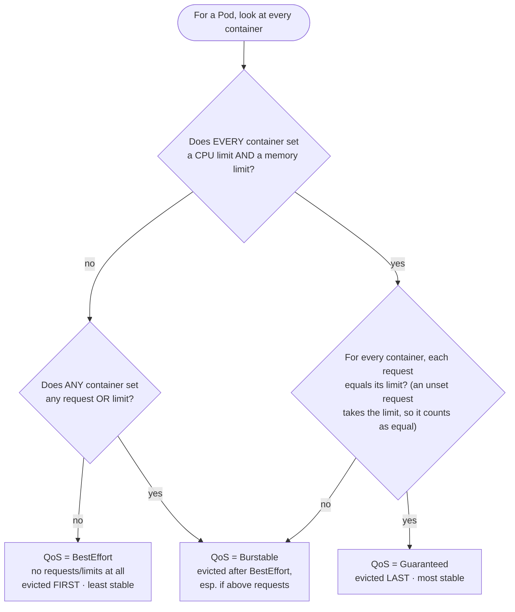

# 03 — Resources and QoS

> Limits as a denial-of-service control. `requests` vs `limits`; why a memory
> limit confines a runaway process to its own container and a CPU limit is a
> trade-off; the three QoS classes and the eviction order; `LimitRange` and
> `ResourceQuota` as the namespace-level bounds, applied to the `bookstore`
> namespace and proved with Pods that are refused or killed.

**Estimated time:** ~15 min read · ~30 min hands-on
**Prerequisites:** [Part 01 ch.01](01-pods.md#baseline-resources) — the memory request and limit the baseline sets · [Part 00 ch.05](../00-foundations/05-node-components.md) — the kubelet that enforces them
**You'll know after this:** • explain how a memory limit contains a runaway process, and why a CPU limit is a trade-off • name the control that stops one namespace taking the cluster's capacity, and the one that stops a single oversized container • map a workload to its QoS class and predict the eviction order • show a `LimitRange` filling in defaults and a `ResourceQuota` refusing a Pod • size the Bookstore services so that none can starve the others

<!-- tags: core-objects, resources, requests-limits, qos, limitrange, resourcequota, denial-of-service -->

## Why this exists

[01.01](01-pods.md#baseline-resources) gave the catalog a memory request and a
memory limit. This chapter explains what that limit protects, what it cannot
protect, and how the same idea scales from one container to a whole namespace.

The threat here needs no attacker. A leak, an unbounded cache or a request
that costs far more than usual all look the same to a node: one process takes
memory or CPU that its neighbours need. Without a limit, the kernel reclaims
memory from whichever process it picks, and a service next to the leak fails
its health checks, restarts or is evicted through no fault of its own. The
leak does not have to be malicious to deny service to the Pods beside it.

Two more problems come from the same missing numbers. The scheduler places a
Pod by its requests, so a Pod with none is packed onto a node that has no room
for it. And when a node runs short of memory anyway, the kubelet decides what
to evict from the requests and limits you set. That decision is the QoS class.

Limits therefore say how much a workload may take. Two namespace objects make
the rule hold for a whole tenant: a `ResourceQuota` caps what the namespace may
request, and a `LimitRange` bounds each container and fills in what a container
leaves out. Together they are the first multi-tenancy boundary, and the point
where the Bookstore stops being loose Pods and becomes a bounded application.

## Mental model

Two numbers per resource, per container, with different jobs:

- **`requests`** are for scheduling and fairness. The scheduler sums them to
  decide whether a Pod fits a node. Under CPU contention the kernel shares the
  CPU in proportion to requests, so a container keeps its share even when a
  neighbour spins.
- **`limits`** are the ceiling. How the ceiling is enforced depends on whether
  the resource can be given back:
  - **CPU is compressible.** Exceeding the CPU limit slows the container down
    and kills nothing. The kernel throttles it.
  - **Memory is not.** A process cannot use memory more slowly. Exceed the
    memory limit and the kernel OOM-kills the container, and only that
    container. It is fatal, but it stays inside its own box.

That difference decides which limits are denial-of-service controls. The
memory limit is the essential one: it is the only per-container bound on
memory, so it is the one that stops a leak from taking memory the neighbours
hold. The CPU limit is optional. Without it, a spinning container uses idle
CPU and gives it back when a neighbour needs it, because its request keeps its
share. A CPU limit buys a fixed ceiling at the cost of throttling, and the
Production notes weigh that cost.

From the gap between requests and limits Kubernetes derives a QoS class for
each Pod: `Guaranteed`, `Burstable` or `BestEffort`. The class decides the
eviction order under node pressure, as the diagrams and the internals below
show.

## Threats and controls

Each row is a control the Bookstore sets or proves in this chapter. The last
column says where the topic goes deeper.

| Threat | Control taught here | Goes deeper |
|---|---|---|
| A leak or loop takes the node's memory and OOM-kills its neighbours | [A memory limit](01-pods.md#baseline-resources) on every container, which confines the kill to that container | [06.01](../06-production-readiness/01-observability-metrics.md) |
| One namespace takes the cluster's CPU and memory | [`ResourceQuota`](#1-create-the-namespace-quota-and-limit-range) on requests and limits | [08.04](../08-day-2-operations/04-multi-tenancy-and-namespaces.md) |
| A controller bug creates Pods without end | `pods` in the same `ResourceQuota` | [08.04](../08-day-2-operations/04-multi-tenancy-and-namespaces.md) |
| One container asks for more than any node should give, or for nothing | [`LimitRange`](#1-create-the-namespace-quota-and-limit-range) `max`, `min` and defaults | [08.04](../08-day-2-operations/04-multi-tenancy-and-namespaces.md) |
| A process fills the node's disk through a scratch volume | `sizeLimit` on an `emptyDir` | [03.03](../03-config-and-storage/03-volumes.md) |
| A CPU loop slows its neighbours | A CPU request, which sets their shares; a CPU limit only if you accept throttling | [06.01](../06-production-readiness/01-observability-metrics.md) for throttling metrics |

Two threats sit outside the controls of this chapter. A process that forks
without end is held back by a PID limit, a kubelet setting
(`--pod-max-pids`, or `PodPidsLimit` in the kubelet configuration file). The
kind cluster configuration in this guide does not set one. The
[PID limiting page](https://kubernetes.io/docs/concepts/policy/pid-limiting/)
explains why it matters. The `sizeLimit` caps the volume, but the
[volumes page](https://kubernetes.io/docs/concepts/storage/volumes/#emptydir)
notes that the storage comes from the node's ephemeral storage, so the volume
can run out of room first if the disk fills from another source.

## Diagrams

### QoS-class decision tree (Mermaid)



### Node allocatable vs. requests vs. limits (ASCII)

```
Node capacity            = what the machine physically has
  − kube/system reserved = kubelet, runtime, OS daemons
  = Allocatable          = what Pods may actually be scheduled into
 ┌──────────────────────────────── Allocatable memory ───────────────────────────────┐
 │ catalog req │ orders req │ storefront req │  ... unreserved (free for scheduling) │
 │■■■■■■■■■■■■■│■■■■■■■■■■■■│■■■■■■■■■■■■■■■■│                                       │
 └─────────────┴────────────┴────────────────┴───────────────────────────────────────┘
   scheduler admits a Pod only if Σ(requests on the node) + new request ≤ Allocatable
   (it sums REQUESTS, never limits — limits may oversubscribe the node deliberately)

   A single container's view:
     0 ───── request (guaranteed, used for scheduling) ───── limit (hard ceiling) ──►
                         │                                        │
            below req: always fine            above limit:  CPU → THROTTLED
            req..limit:  "burst", reclaimable                memory → OOMKilled
```

## Hands-on with the Bookstore

**Assumed working directory: the guide repo root (`full-guide/`).** All paths
are relative to it. Have the cluster from
[Part 00 ch.07](../00-foundations/07-local-cluster-setup.md), and the
`bookstore` namespace and ServiceAccount `catalog-sa` from
[01.01](01-pods.md#restricted-namespace).

The steps first add the namespace's boundary, then prove each control with a
Pod that the control acts on. Two steps fail on purpose, and each is labelled.

### 1. Create the namespace, quota and limit range

[`examples/bookstore/raw-manifests/00-namespace.yaml`](../examples/bookstore/raw-manifests/00-namespace.yaml)
holds this namespace with its quota and limits. The block below is that file
without its comments. Keep the Pod Security labels in it. `kubectl apply`
removes a label that the last apply set and the new file leaves out, so a copy
without them would switch `restricted` off for the namespace. The `audit`
labels are new here. They record violations in the API server's audit log, a
mode that 01.01 leaves out.

```yaml
apiVersion: v1
kind: Namespace
metadata:
  name: bookstore
  labels:
    app.kubernetes.io/part-of: bookstore
    pod-security.kubernetes.io/enforce: restricted
    pod-security.kubernetes.io/enforce-version: latest
    pod-security.kubernetes.io/audit: restricted
    pod-security.kubernetes.io/audit-version: latest
    pod-security.kubernetes.io/warn: restricted
    pod-security.kubernetes.io/warn-version: latest
---
apiVersion: v1
kind: ResourceQuota
metadata:
  name: bookstore-quota
  namespace: bookstore
spec:
  hard:
    requests.cpu: "2"
    requests.memory: 2Gi
    limits.cpu: "4"
    limits.memory: 4Gi
    pods: "30"
---
apiVersion: v1
kind: LimitRange
metadata:
  name: bookstore-limits
  namespace: bookstore
spec:
  limits:
    - type: Container
      default:
        cpu: 500m
        memory: 256Mi
      defaultRequest:
        cpu: 100m
        memory: 128Mi
      max:
        cpu: "2"
        memory: 1Gi
      min:
        cpu: 10m
        memory: 16Mi
```

The `ResourceQuota` caps the namespace's totals. The `requests.*` and
`limits.*` keys are sums across every container, and `pods` counts Pods. The
`LimitRange` works per container. `default` becomes a container's limit when it
omits one, `defaultRequest` becomes its request, and `max` and `min` bound what
a container may ask for. With a `requests.*` or `limits.*` quota in force, the
API server also requires every container to set the matching field, because it
cannot count a container it cannot see. The defaults are what let a container
omit them without a refusal.

```sh
kubectl apply -f examples/bookstore/raw-manifests/00-namespace.yaml
kubectl describe resourcequota bookstore-quota -n bookstore
kubectl describe limitrange bookstore-limits -n bookstore
```

The single-Pod files from Part 00 and 01.01 carry no `namespace:` field, so
they run in whichever namespace your context points at, `bookstore`. From
[01.04](04-replicasets-and-deployments.md) the catalog and storefront are
Deployments born in `bookstore`. Nothing here is deleted. This file re-applies
the namespace and adds the quota and the limits.

### 2. A runaway process reaches its memory limit (deliberate failure)

The next manifest holds two Pods, and both are deliberate. `memhog` writes
400 MiB into a memory-backed volume with a 128 MiB limit, so the kernel kills
it. `cpu-fill` requests 1.5 cores and sleeps, so that half a core is left in
the namespace for anything else. Both carry the baseline and share one
dedicated ServiceAccount.

The `emptyDir` with `medium: Memory` is a tmpfs. Files written to it count
against the memory limit of the container that wrote them, so `memhog`'s
write is a memory write, not a disk write.

```sh
kubectl apply -f - <<'EOF'
apiVersion: v1
kind: ServiceAccount
metadata:
  name: demo-sa
  namespace: bookstore
automountServiceAccountToken: false
---
apiVersion: v1
kind: Pod
metadata:
  name: memhog
  namespace: bookstore
  labels:
    app: memhog
spec:
  serviceAccountName: demo-sa
  automountServiceAccountToken: false
  restartPolicy: Never              # keep the terminated state to read
  securityContext:
    runAsNonRoot: true
    runAsUser: 65534
    runAsGroup: 65534
    seccompProfile:
      type: RuntimeDefault
  containers:
    - name: hog                     # DELIBERATE: writes past its memory limit
      image: busybox@sha256:73aaf090f3d85aa34ee199857f03fa3a95c8ede2ffd4cc2cdb5b94e566b11662
      command: ["sh", "-c", "dd if=/dev/zero of=/scratch/fill bs=1M count=400; echo written; sleep 3600"]
      securityContext:
        allowPrivilegeEscalation: false
        readOnlyRootFilesystem: true
        capabilities:
          drop: ["ALL"]
      resources:
        requests: { cpu: 50m, memory: 64Mi }
        limits: { cpu: 250m, memory: 128Mi }
      volumeMounts:
        - name: scratch
          mountPath: /scratch
  volumes:
    - name: scratch
      emptyDir:
        medium: Memory              # tmpfs: its files count against the memory limit
---
apiVersion: v1
kind: Pod
metadata:
  name: cpu-fill
  namespace: bookstore
  labels:
    app: cpu-fill
spec:
  serviceAccountName: demo-sa
  automountServiceAccountToken: false
  securityContext:
    runAsNonRoot: true
    runAsUser: 65534
    runAsGroup: 65534
    seccompProfile:
      type: RuntimeDefault
  containers:
    - name: fill
      image: busybox@sha256:73aaf090f3d85aa34ee199857f03fa3a95c8ede2ffd4cc2cdb5b94e566b11662
      command: ["sleep", "3600"]
      securityContext:
        allowPrivilegeEscalation: false
        readOnlyRootFilesystem: true
        capabilities:
          drop: ["ALL"]
      resources:
        requests: { cpu: 1500m, memory: 64Mi }
        limits: { cpu: 1500m, memory: 128Mi }
EOF
```

Wait for the kill, then read what the kernel and the quota recorded:

```sh
kubectl wait -n bookstore --for=jsonpath='{.status.containerStatuses[0].state.terminated.reason}'=OOMKilled pod/memhog --timeout=120s
kubectl get pod memhog cpu-fill -n bookstore
kubectl get pod memhog -n bookstore -o jsonpath='{.status.qosClass}{"\n"}'
kubectl get pod memhog -n bookstore -o jsonpath='{.status.containerStatuses[0].state.terminated.exitCode}{"\n"}'
kubectl describe resourcequota bookstore-quota -n bookstore
```

`memhog` ends as `OOMKilled` with exit code 137, the code of a process the
kernel killed with SIGKILL. The kill took only `memhog`'s container: `cpu-fill`,
in the same namespace, kept running. `memhog` is `Burstable`, because its
requests and limits differ.
The quota now counts 1500m of `requests.cpu` for `cpu-fill`, which is
running, or pending on a small machine. Either way the quota counts it.

A container that omits `resources` is not refused. It gets the `LimitRange`
defaults instead: in this namespace, a 256Mi memory limit and a 128Mi request.
The baseline still sets the numbers in every manifest, so the defaults are a
backstop and not the plan.

### 3. Admission refuses what the namespace cannot hold (deliberate failure)

Both Pods in the next dry-run are deliberate refusals. Dry-run runs admission
without creating anything.

```sh
kubectl apply --dry-run=server -f - <<'EOF'
apiVersion: v1
kind: Pod
metadata:
  name: too-big
  namespace: bookstore
spec:
  serviceAccountName: demo-sa
  automountServiceAccountToken: false
  securityContext:
    runAsNonRoot: true
    runAsUser: 65534
    runAsGroup: 65534
    seccompProfile:
      type: RuntimeDefault
  containers:
    - name: c                       # DELIBERATE: above the 1Gi max
      image: busybox@sha256:73aaf090f3d85aa34ee199857f03fa3a95c8ede2ffd4cc2cdb5b94e566b11662
      command: ["sleep", "3600"]
      securityContext:
        allowPrivilegeEscalation: false
        readOnlyRootFilesystem: true
        capabilities:
          drop: ["ALL"]
      resources:
        requests: { cpu: 50m, memory: 1536Mi }
        limits: { cpu: 250m, memory: 1536Mi }
---
apiVersion: v1
kind: Pod
metadata:
  name: too-much
  namespace: bookstore
spec:
  serviceAccountName: demo-sa
  automountServiceAccountToken: false
  securityContext:
    runAsNonRoot: true
    runAsUser: 65534
    runAsGroup: 65534
    seccompProfile:
      type: RuntimeDefault
  containers:
    - name: c                       # DELIBERATE: pushes the namespace past 2 cores
      image: busybox@sha256:73aaf090f3d85aa34ee199857f03fa3a95c8ede2ffd4cc2cdb5b94e566b11662
      command: ["sleep", "3600"]
      securityContext:
        allowPrivilegeEscalation: false
        readOnlyRootFilesystem: true
        capabilities:
          drop: ["ALL"]
      resources:
        requests: { cpu: 800m, memory: 64Mi }
        limits: { cpu: 800m, memory: 128Mi }
EOF
```

The first Pod fails the `LimitRange`: its memory limit is above the 1Gi `max`,
and the message says `maximum memory usage per Container is 1Gi, but limit is
1536Mi`. That refusal does not depend on quota room, because the check is per
container. The second Pod fits the `LimitRange` on its own. It fails the quota
because `cpu-fill` already holds 1500m of the namespace's 2 cores, and the
message names the quota, the amount requested and the amount in use.

Clean up the two Pods. The quota and the limits stay, and the rest of the guide
runs under them.

```sh
kubectl delete pod memhog cpu-fill -n bookstore --now
```

## How it works under the hood

- **`requests` drive scheduling; `limits` drive cgroups.** The scheduler's
  `NodeResourcesFit` predicate admits a Pod only if `Σ requests` on the node
  (plus the new Pod's) ≤ the node's **Allocatable** (capacity minus
  kube/system reserved). It **never sums limits**, because limits may
  intentionally oversubscribe a node. The kubelet writes the container's limits
  into its **cgroup** (`cpu.max` and `memory.max` on cgroup v2), so the
  *kernel*, not Kubernetes, enforces them at runtime.
- **CPU is CFS bandwidth throttling.** A CPU limit becomes a CFS quota and
  period. Exceed it within a period and the kernel **deschedules** the
  container until the next period: a slowdown, never a kill. CPU `requests`
  become a cgroup CPU weight (shares on cgroup v1), so under contention each
  container gets at least its proportional share. This is why CPU is
  compressible.
- **Memory is a hard cgroup cap, and then the OOM killer.** A memory limit is a
  hard cgroup bound. The kernel cannot make a process use less memory
  gradually, so on breach the cgroup OOM killer terminates a process. The
  kubelet records `OOMKilled` and restarts the container per `restartPolicy`.
- **QoS is computed, not declared.** The kubelet derives the class from the
  requests and limits. **Guaranteed** means every container has a CPU limit and
  a memory limit, and each request equals its limit, where an unset request
  takes the limit. **Burstable** means some request or limit is set and the
  pattern is not Guaranteed. **BestEffort** means none is set.
- **Eviction order under node memory pressure.** The kubelet ranks Pods by
  three parameters, in order: whether usage exceeds requests, then Pod
  priority, then usage relative to requests. So BestEffort and Burstable Pods
  whose usage exceeds their requests go first, and Guaranteed Pods, and
  Burstable Pods within their requests, go last. The kernel's OOM score is also
  skewed by QoS, so even a raw OOM kill prefers lower-QoS containers.
- **`LimitRange` is a mutating and validating admission step.** When a Pod is
  created in the namespace, the LimitRange admission plugin injects `default` and
  `defaultRequest` for any missing field, and rejects Pods that violate `min` or
  `max`. **`ResourceQuota`** is a validating admission step that rejects a
  creation which would push the namespace's tracked totals over `hard`, and it
  requires the relevant request or limit so that it can count the container.
  Both run in the API server admission pipeline from
  [Part 00 ch.04](../00-foundations/04-control-plane-deep-dive.md).

## Production notes

> **In production:** set memory `requests` and `limits` on every container, and
> set memory `request == limit` for anything you cannot tolerate being
> OOM-killed under contention. A container with no memory limit can take the
> node's memory from its neighbours, which turns one leak into a node-wide
> failure.

> **In production:** be deliberate with CPU limits. A CPU request sets a
> container's share under contention, so an accurate request is what protects
> its neighbours. A tight CPU limit adds CFS throttling, which shows up as p99
> latency while average CPU looks low. Measure throttling before you tighten a
> limit. `container_cpu_cfs_throttled_periods_total` counts the periods in
> which a container was throttled, and divided by
> `container_cpu_cfs_periods_total` it gives the share of periods hit.

> **In production:** never run important workloads as **BestEffort**. They are
> the first to be evicted under pressure, and the scheduler assumes they need
> nothing, so it overpacks their node. BestEffort is acceptable only for truly
> sacrificial batch work.

> **In production:** put a `ResourceQuota` and a `LimitRange` on every tenant
> namespace ([Part 08 ch.04](../08-day-2-operations/04-multi-tenancy-and-namespaces.md)).
> The quota stops one team using the cluster's capacity, including through a
> controller that creates Pods without end. The `LimitRange` guarantees that no
> container is accidentally BestEffort or absurdly large. On managed clusters
> the cluster autoscaler adds nodes for pending requests, so sloppy requests
> raise the bill ([Part 06 ch.06](../06-production-readiness/06-capacity-and-cost.md)).

> **In production:** the Postgres StatefulSet in [01.05](05-statefulsets.md)
> keeps the Burstable shape of the other manifests: a 256Mi memory request and a
> 512Mi memory limit. For a stateful store, a memory request equal to its limit
> is the stronger choice, because it makes the Pod Guaranteed and so evicted
> last. The cost is the headroom that Burstable gives.

> **In production:** right-size from real data, not guesses. The
> **VerticalPodAutoscaler** in recommendation mode and historical metrics give
> requests grounded in actual usage
> ([Part 06 ch.04](../06-production-readiness/04-autoscaling.md)). Over-requesting
> wastes money, and under-requesting causes evictions and throttling.

## Quick Reference

```sh
kubectl get pod <P> -o jsonpath='{.status.qosClass}'                        # Guaranteed/Burstable/BestEffort
kubectl get pod <P> -o jsonpath='{.status.containerStatuses[0].state.terminated.reason}'  # OOMKilled?
kubectl describe node <NODE> | sed -n '/Allocated resources/,/Events/p'
kubectl describe resourcequota -n <NS>                                      # Used vs Hard
kubectl describe limitrange   -n <NS>                                       # defaults + min/max
kubectl top pod  -n <NS>                                                    # live usage (needs metrics-server)
```

Minimal resources block, per container (a fragment, applied inside a Pod):

```yaml
resources:
  requests: { cpu: 50m,  memory: 64Mi }    # scheduling + guarantee
  limits:   { cpu: 250m, memory: 128Mi }   # ceiling (cpu throttles, memory OOM-kills)
```

Namespace governance for a tenant:

```yaml
apiVersion: v1
kind: ResourceQuota
metadata: { name: tenant-quota, namespace: <NS> }
spec:
  hard:
    requests.cpu: "2"
    requests.memory: 2Gi
    limits.cpu: "4"
    limits.memory: 4Gi
    pods: "30"
---
apiVersion: v1
kind: LimitRange
metadata: { name: tenant-limits, namespace: <NS> }
spec:
  limits:
    - type: Container
      default:        { cpu: 500m, memory: 256Mi }
      defaultRequest: { cpu: 100m, memory: 128Mi }
      max:            { cpu: "2", memory: 1Gi }
      min:            { cpu: 10m, memory: 16Mi }
```

Checklist:

- [ ] Every container sets a memory `request` and a memory `limit`
- [ ] Every container sets a CPU `request`; a CPU `limit` only when
  throttling is measured and accepted
- [ ] Intended QoS chosen: `Guaranteed` for what must not be evicted,
  `Burstable` for stateless APIs
- [ ] No accidental `BestEffort` for anything that matters
- [ ] Tenant namespace has a `ResourceQuota` (requests, limits and `pods`)
  and a `LimitRange`
- [ ] Every writable `emptyDir` has a `sizeLimit`
- [ ] Requests derived from measured usage, not guessed

## Test your understanding

> Try each before opening the answer drawer. The act of trying is the exercise; the answer is the check.

1. **Why does the scheduler sum `requests` to admit a Pod onto a node, but never `limits`? What property of CPU vs. memory makes this design correct?**
   <details><summary>Show answer</summary>

   `requests` are guarantees the scheduler must respect (the workload was promised that much); `limits` are ceilings the kernel enforces and may legitimately be oversubscribed because most workloads burst rarely. CPU is compressible (throttled, not killed) so oversubscription is graceful; memory's hard limit triggers OOM on breach. Summing limits would massively under-pack nodes for no benefit (see §How it works under the hood, "requests drive scheduling; limits drive cgroups").

   </details>

2. **A service with healthy average CPU at 40% develops p99 latency spikes. Memory is fine. What is the prime suspect, and where do you look?**
   <details><summary>Show answer</summary>

   CPU CFS throttling: the CPU `limit` is hit in short bursts, so the kernel deschedules the container until the next period. The average looks low while p99 suffers. Compare `container_cpu_cfs_throttled_periods_total` with `container_cpu_cfs_periods_total` in Prometheus. The usual fix is to widen or remove the CPU limit and keep the CPU `request` accurate for scheduling (see §Production notes, "be deliberate with CPU limits").

   </details>

3. **A teammate sets `requests` equal to `limits` for memory only, and leaves CPU unset, on a critical Pod. What QoS class does that produce? What do they gain by setting CPU as well?**
   <details><summary>Show answer</summary>

   **Burstable.** Guaranteed needs a CPU and a memory limit on every container, with each request equal to its limit. Memory alone is not enough. Setting CPU as well, with requests equal to limits for both, makes the Pod Guaranteed, so it is evicted last under node pressure. The trade-off is packing density: the scheduler reserves the full amount, so fewer Pods fit per node and the headroom goes unused (see §QoS-class decision tree and §How it works under the hood).

   </details>

4. **A namespace has a `ResourceQuota` with `requests.cpu: "2"` but no `LimitRange`. A teammate's Pod with no CPU request is rejected. Why, and how does adding a `LimitRange` fix it without weakening the cap?**
   <details><summary>Show answer</summary>

   When a `requests.cpu` quota exists, the API server requires every container to *have* a CPU request, because otherwise the quota cannot count it. A Pod without one is rejected at admission. A `LimitRange` with `defaultRequest.cpu` injects a default at admission, so the Pod gets a request without every author setting one. The quota still caps the namespace total (see §1. Create the namespace, quota and limit range).

   </details>

5. **Hands-on extension: in `bookstore`, with the quota and `LimitRange` from step 1, a Pod asks for a 1536Mi memory limit. Which control refuses it, what is the message, and does room in the quota matter?**
   <details><summary>What you should see</summary>

   The `LimitRange` refuses it: `maximum memory usage per Container is 1Gi, but limit is 1536Mi`. The refusal does not depend on quota room, because the check is per container and it refuses even when the namespace has room to spare. A request of 800m CPU against 1500m already in use in a 2-core namespace is refused by the quota instead, with the message `exceeded quota`, as step 3 shows.

   </details>

6. **A teammate removes the memory limit from a Deployment because it was OOM-killing in staging. What changes on the node if the process leaks, and why was the limit the control that mattered?**
   <details><summary>Show answer</summary>

   The leak now takes memory that the neighbours need. The kernel and the kubelet decide which processes die, and the leaking container may not be the one killed. The memory limit confined the damage to its own container. The right move is to keep the limit, measure the working set, and raise the limit deliberately, or fix the leak. Removing the limit makes the leak a node-wide problem.

   </details>

## Further reading

- **Lukša, _Kubernetes in Action_ 2e, ch.20 — resource management** (requests/
  limits, QoS, eviction) — paired with the official resource-management docs.
- **Ibryam & Huß, _Kubernetes Patterns_ 2e — *Predictable Demands* (ch.2)** —
  why declaring explicit resource needs is foundational to scheduling, density,
  and reliability.
- Official:
  <https://kubernetes.io/docs/concepts/configuration/manage-resources-containers/>,
  <https://kubernetes.io/docs/tasks/configure-pod-container/quality-service-pod/>
  (QoS),
  <https://kubernetes.io/docs/concepts/policy/resource-quotas/>, and
  <https://kubernetes.io/docs/concepts/policy/pid-limiting/> (PID limits).
