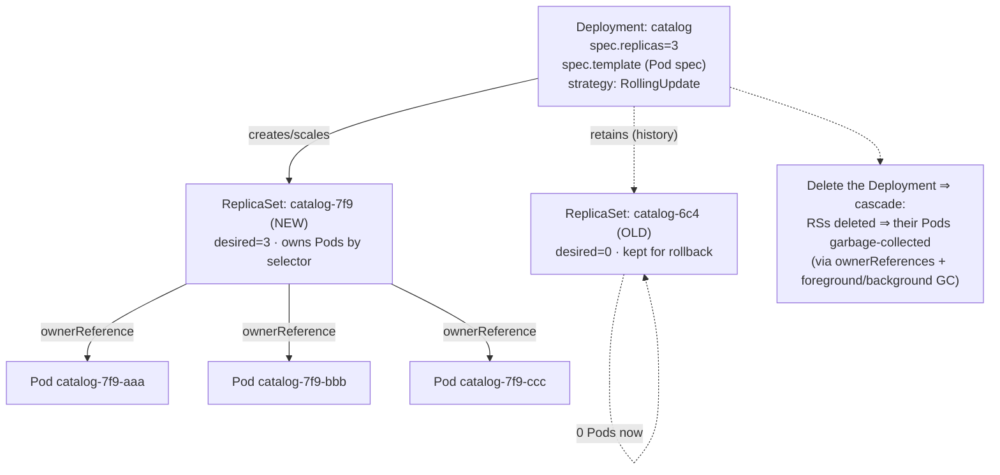
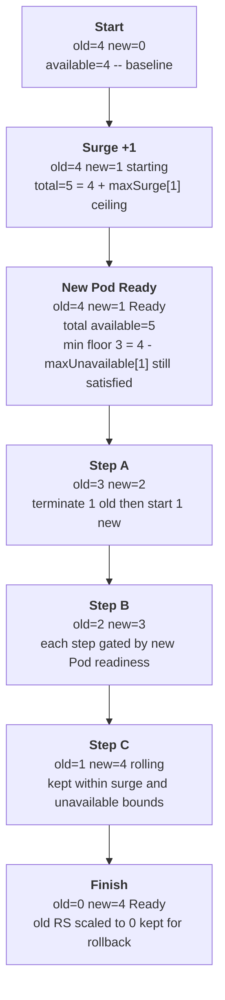

# 04 — ReplicaSets and Deployments

> ReplicaSets keep N identical Pods alive via a label selector; Deployments
> manage ReplicaSets to give you rolling updates, rollback, and revision
> history. The surge math, `recreate` vs `rollingUpdate`, ownerReferences and
> cascading delete, applied by turning catalog from a bare Pod into a
> Deployment and adding storefront as one, in the `bookstore` namespace.

**Estimated time:** ~15 min read · ~60 min hands-on
**Prerequisites:** [01.01](01-pods.md), what is being replicated, with its baseline · [01.02](02-health-and-lifecycle.md), the probes · [01.03](03-resources-and-qos.md), the namespace and its quota · [00.06](../00-foundations/06-declarative-api-model.md), selectors and labels
**You'll know after this:** • understand how a ReplicaSet keeps N Pods alive via label selector · • use a Deployment to roll out a new image and roll it back · • compute `maxSurge` and `maxUnavailable` for a rolling update · • choose between `Recreate` and `RollingUpdate` strategies · • trace `ownerReferences` and predict cascading-delete behavior · • explain why a Deployment that breaks `restricted` applies and runs no Pods

<!-- tags: core-objects, deployments, replicasets, rolling-update, rollback -->

## Why this exists

[01.01](01-pods.md) ended on the cliff-edge: a bare Pod is *not recreated* if
it dies and *not rescheduled* if its node fails — there is no controller
watching it. [00.06](../00-foundations/06-declarative-api-model.md)
taught the principle that fixes this: a controller that continuously reconciles
desired vs. actual. Apply that principle to "I want N copies of this Pod
running" and you get the **ReplicaSet**. Apply it again to "I want to *change*
the running version without downtime, and undo it if it's bad" and you get the
**Deployment**.

This is the chapter where the Bookstore becomes operable: self-healing
(crashed/lost Pods are replaced), scalable (change one number), and
**rollable** (ship a new image with zero-downtime, roll back in one command).
Almost every stateless workload you will ever run is a Deployment; this is the
[Declarative Deployment](#further-reading) pattern in its primary form.

## Mental model

Three nested controllers, each reconciling one level:

- **ReplicaSet** owns *Pods*. Its job: "the number of Pods matching my
  `selector` must equal `replicas`." Too few → create from the Pod template;
  too many → delete. It heals (a deleted Pod ⇒ observed<desired ⇒ make another)
  but **cannot change** running Pods — a template change just means future
  Pods differ from current ones.
- **Deployment** owns *ReplicaSets*. To change the app (new image, new env) it
  doesn't mutate Pods; it **creates a new ReplicaSet** for the new template and
  **shifts replicas** from the old RS to the new one according to a strategy,
  keeping the old RS (scaled to 0) around for **rollback**.
- You own the *Deployment*. You only ever edit the Deployment's `spec`; the two
  controllers below translate that into Pods.

So a rolling update is just: *Deployment scales new-RS up and old-RS down, a
few Pods at a time, gated by readiness*, until new-RS = desired and old-RS = 0.
"Rollback" is the same machinery aimed at a previous RS. Ownership is recorded
in `ownerReferences`, which is also what makes deletion cascade correctly.

The template is the Pod spec from [01.01](01-pods.md#baseline), baseline
included. A rollback does not rebuild anything. It points the Deployment back
at a template that was already applied, so a revision runs the same image and
settings it ran the first time. That is why the image of every revision
matters, as the threats below explain.

## Threats and controls

A Deployment owns no security control of its own. Every control sits in the
Pod template it wraps, so the threats here are the ones a rollout creates: a
template that changes, and a revision that comes back.

| Threat | Control taught here | Goes deeper |
|---|---|---|
| A rollback reinstates a revision whose image has since been found vulnerable | Each revision keeps its own template, and a rollback runs exactly that template. Pin third-party images by digest in every revision, and check a revision before you roll back to it. `revisionHistoryLimit` bounds how many revisions stay as targets. | [05.03](../05-security/03-supply-chain.md) |
| A Deployment that breaks `restricted` applies without error and runs no Pods, so the change looks shipped | The namespace label applies to the Pods the ReplicaSet creates, not to the Deployment. After an apply, read the ReplicaSet and its events, not only the apply output | [05.02](../05-security/02-pod-security.md) |

## Diagrams

### Deployment → ReplicaSet → Pod ownership (Mermaid)



### Rolling update timeline, replicas=4, maxSurge=1, maxUnavailable=1 (Mermaid)



## Hands-on with the Bookstore

**Assumed working directory: the guide repo root (`full-guide/`).** Work in
the `bookstore` namespace from
[01.01 step 1](01-pods.md#restricted-namespace), where `catalog-sa` exists.
Load the images into the cluster first: `kind load docker-image
bookstore/catalog:dev --name bookstore`, and the same for
`bookstore/storefront:dev`.

We now **graduate** catalog from a bare Pod to a self-healing Deployment,
carrying forward the probes ([01.02](02-health-and-lifecycle.md)) and the
resources ([01.03](03-resources-and-qos.md)). We also add the **storefront**
Deployment so the app has its UI tier. Both Deployments already exist in the
repo. The listings below are copies with the comments removed. The YAML is
otherwise identical, so apply the files, not the listings.

catalog's Deployment also carries fields from Parts 02 to 04: settings from a
ConfigMap and a Secret, a downward API volume, and scheduling fields. Those
belong to [03.01](../03-config-and-storage/01-configmaps.md),
[03.02](../03-config-and-storage/02-secrets.md),
[03.03](../03-config-and-storage/03-volumes.md),
[04.02](../04-scheduling/02-affinity-taints-topology.md) and
[04.03](../04-scheduling/03-priority-and-preemption.md). This chapter applies
them and does not teach them.

Readiness depends on more than Postgres. The app's
[`/readyz`](../examples/bookstore/app/catalog/main.go) pings the cache whenever
`REDIS_ADDR` is set, and [`15-catalog-config.yaml`](../examples/bookstore/raw-manifests/15-catalog-config.yaml)
sets it. Until the cache answers, every catalog Pod stays unready and the
rollout waits. Readiness checks the connections, not the schema. The migration
Job creates the tables, and the app does not check for them. So the chain
below starts the cache too.


### 1. catalog as a Deployment

The file is
[`examples/bookstore/raw-manifests/10-catalog-deploy.yaml`](../examples/bookstore/raw-manifests/10-catalog-deploy.yaml).
Its listing, with the comments removed:

```yaml
apiVersion: apps/v1
kind: Deployment
metadata:
  name: catalog
  namespace: bookstore
  labels:
    app: catalog
    app.kubernetes.io/part-of: bookstore
spec:
  replicas: 3
  revisionHistoryLimit: 5
  selector:
    matchLabels:
      app: catalog
  strategy:
    type: RollingUpdate
    rollingUpdate:
      maxSurge: 1
      maxUnavailable: 0
  template:
    metadata:
      labels:
        app: catalog
        component: backend
    spec:
      serviceAccountName: catalog-sa
      automountServiceAccountToken: false
      securityContext:
        runAsNonRoot: true
        runAsUser: 65532
        runAsGroup: 65532
        seccompProfile:
          type: RuntimeDefault
      priorityClassName: bookstore-critical
      topologySpreadConstraints:
        - maxSkew: 1
          topologyKey: kubernetes.io/hostname
          whenUnsatisfiable: DoNotSchedule
          labelSelector:
            matchLabels:
              app: catalog
      affinity:
        podAntiAffinity:
          preferredDuringSchedulingIgnoredDuringExecution:
            - weight: 100
              podAffinityTerm:
                topologyKey: kubernetes.io/hostname
                labelSelector:
                  matchLabels:
                    app: catalog
      containers:
        - name: catalog
          image: bookstore/catalog:dev
          imagePullPolicy: IfNotPresent
          securityContext:
            allowPrivilegeEscalation: false
            readOnlyRootFilesystem: true
            capabilities:
              drop: ["ALL"]
          ports:
            - name: http
              containerPort: 8080
          envFrom:
            - configMapRef:
                name: catalog-config
          env:
            - name: PORT
              value: "8080"
            - name: LOG_LEVEL
              valueFrom:
                configMapKeyRef:
                  name: catalog-config
                  key: LOG_LEVEL
            - name: POSTGRES_USER
              valueFrom:
                secretKeyRef: { name: db-credentials, key: POSTGRES_USER }
            - name: POSTGRES_PASSWORD
              valueFrom:
                secretKeyRef: { name: db-credentials, key: POSTGRES_PASSWORD }
            - name: POSTGRES_DB
              valueFrom:
                secretKeyRef: { name: db-credentials, key: POSTGRES_DB }
            - name: DB_DSN
              value: "host=postgres.bookstore.svc.cluster.local port=5432 user=$(POSTGRES_USER) password=$(POSTGRES_PASSWORD) dbname=$(POSTGRES_DB) sslmode=disable"
          startupProbe:
            httpGet: { path: /healthz, port: http }
            periodSeconds: 5
            failureThreshold: 30
          livenessProbe:
            httpGet: { path: /healthz, port: http }
            periodSeconds: 10
            timeoutSeconds: 2
            failureThreshold: 3
            successThreshold: 1
          readinessProbe:
            httpGet: { path: /readyz, port: http }
            periodSeconds: 5
            timeoutSeconds: 2
            failureThreshold: 3
            successThreshold: 1
          lifecycle:
            preStop:
              sleep:
                seconds: 5
          resources:
            requests:
              cpu: 50m
              memory: 64Mi
            limits:
              cpu: 250m
              memory: 128Mi
          volumeMounts:
            - name: scratch
              mountPath: /tmp/cache
            - name: podinfo
              mountPath: /etc/podinfo
              readOnly: true
      volumes:
        - name: scratch
          emptyDir:
            sizeLimit: 64Mi
        - name: podinfo
          downwardAPI:
            items:
              - path: pod_name
                fieldRef: { fieldPath: metadata.name }
              - path: pod_namespace
                fieldRef: { fieldPath: metadata.namespace }
              - path: pod_labels
                fieldRef: { fieldPath: metadata.labels }
              - path: cpu_limit
                resourceFieldRef:
                  containerName: catalog
                  resource: limits.cpu
      terminationGracePeriodSeconds: 30
```

Read the listing against the baseline. The pod and container security fields
are the [baseline](01-pods.md#baseline) from 01.01, unchanged. The three probes
and the `preStop` sleep are the ones [01.02](02-health-and-lifecycle.md)
explains. The `maxSurge` and `maxUnavailable` values are the surge math in the
sections below.

catalog's only writable path is its `scratch` volume, mounted at `/tmp/cache`,
not at the `/tmp` the baseline shows. The app source in this repo writes no
files, so the path is a named scratch directory the manifest provides. The code
does not use it yet. Storefront mounts `/tmp` instead, because nginx writes its
temporary files there, as its
[`nginx.conf`](../examples/bookstore/app/storefront/nginx.conf) sets them.

### 2. storefront as a Deployment

The file is
[`examples/bookstore/raw-manifests/11-storefront-deploy.yaml`](../examples/bookstore/raw-manifests/11-storefront-deploy.yaml).
Its listing, with the comments removed:

```yaml
apiVersion: apps/v1
kind: Deployment
metadata:
  name: storefront
  namespace: bookstore
  labels:
    app: storefront
    app.kubernetes.io/part-of: bookstore
spec:
  replicas: 2
  revisionHistoryLimit: 5
  selector:
    matchLabels:
      app: storefront
  strategy:
    type: RollingUpdate
    rollingUpdate:
      maxSurge: 1
      maxUnavailable: 0
  template:
    metadata:
      labels:
        app: storefront
        component: frontend
    spec:
      serviceAccountName: storefront-sa
      automountServiceAccountToken: false
      securityContext:
        runAsNonRoot: true
        runAsUser: 101
        runAsGroup: 101
        seccompProfile:
          type: RuntimeDefault
      priorityClassName: bookstore-critical
      topologySpreadConstraints:
        - maxSkew: 1
          topologyKey: kubernetes.io/hostname
          whenUnsatisfiable: DoNotSchedule
          labelSelector:
            matchLabels:
              app: storefront
      affinity:
        podAntiAffinity:
          preferredDuringSchedulingIgnoredDuringExecution:
            - weight: 100
              podAffinityTerm:
                topologyKey: kubernetes.io/hostname
                labelSelector:
                  matchLabels:
                    app: storefront
      containers:
        - name: storefront
          image: bookstore/storefront:dev
          imagePullPolicy: IfNotPresent
          securityContext:
            allowPrivilegeEscalation: false
            readOnlyRootFilesystem: true
            capabilities:
              drop: ["ALL"]
          ports:
            - name: http
              containerPort: 8080
          readinessProbe:
            httpGet: { path: /healthz, port: http }
            periodSeconds: 5
          livenessProbe:
            httpGet: { path: /healthz, port: http }
            periodSeconds: 10
          resources:
            requests:
              cpu: 25m
              memory: 32Mi
            limits:
              cpu: 100m
              memory: 64Mi
          volumeMounts:
            - name: tmp
              mountPath: /tmp
      volumes:
        - name: tmp
          emptyDir:
            sizeLimit: 64Mi
```

The image runs as UID 101, which its Dockerfile declares with `USER 101`, so
`runAsUser` names that number. Storefront has no `startupProbe`. It has no slow
boot to wait for, so its liveness probe runs from the start. catalog keeps one
as a boot margin, carried over from [01.02](02-health-and-lifecycle.md). Its
startup probe calls `/healthz`, which answers once the process listens, and the
catalog creates its Postgres pool without connecting, so the startup probe does
not wait for the database. Postgres gates readiness instead: `/readyz` answers
`503` until the database answers a ping, and the Pod gets no traffic until then.

Apply the chain in order, from the repo root (`full-guide/`). Each step waits
for what the next one needs.

```sh
kubectl apply -f examples/bookstore/raw-manifests/00-namespace.yaml
kubectl apply -f examples/bookstore/raw-manifests/05-serviceaccounts-rbac.yaml
kubectl apply -f examples/bookstore/raw-manifests/15-catalog-config.yaml
kubectl apply -f examples/bookstore/raw-manifests/16-db-credentials.yaml
kubectl apply -f examples/bookstore/raw-manifests/35-priorityclasses.yaml
kubectl apply -f examples/bookstore/raw-manifests/20-postgres-statefulset.yaml
kubectl rollout status statefulset/postgres -n bookstore --timeout=600s
kubectl exec -n bookstore postgres-0 -- sh -c 'until psql -U bookstore -d bookstore -tAc "select 1" >/dev/null 2>&1; do sleep 2; done; echo database bookstore is ready'
kubectl apply -f examples/bookstore/raw-manifests/21-db-migrate-job.yaml   # schema
kubectl wait --for=condition=complete job/db-migrate -n bookstore --timeout=180s
kubectl apply -f examples/bookstore/raw-manifests/12-redis.yaml
kubectl rollout status deployment/redis -n bookstore --timeout=240s
```

`40-services.yaml` holds the Services for the whole app. Part 01 applies only
the cache's Service, so that catalog can reach the cache. The rest of that file
belongs to later chapters.

```sh
kubectl apply -f - <<'EOF2'
apiVersion: v1
kind: Service
metadata:
  name: redis
  namespace: bookstore
  labels:
    app: redis
    app.kubernetes.io/part-of: bookstore
spec:
  type: ClusterIP
  selector:
    app: redis
  ports:
    - name: redis
      port: 6379
      targetPort: redis
EOF2
```

Then the two Deployments:

```sh
kubectl apply -f examples/bookstore/raw-manifests/10-catalog-deploy.yaml
kubectl apply -f examples/bookstore/raw-manifests/11-storefront-deploy.yaml
kubectl rollout status deployment/catalog -n bookstore --timeout=300s
kubectl rollout status deployment/storefront -n bookstore --timeout=300s
kubectl get deploy,rs,pod -n bookstore -l app=catalog   # Deployment→RS→3 Pods
kubectl get pod -n bookstore -l app=catalog -o custom-columns=NAME:.metadata.name,OWNER-KIND:.metadata.ownerReferences[0].kind,OWNER:.metadata.ownerReferences[0].name
```

<!-- gate: output -->
```text
NAME                      READY   UP-TO-DATE   AVAILABLE   AGE
deployment.apps/catalog   3/3     3            3           119s

NAME                                 DESIRED   CURRENT   READY   AGE
replicaset.apps/catalog-69df46d8f5   3         3         3       118s

NAME                           READY   STATUS    RESTARTS   AGE
pod/catalog-69df46d8f5-9lfxm   1/1     Running   0          117s
pod/catalog-69df46d8f5-lcpt8   1/1     Running   0          118s
pod/catalog-69df46d8f5-xbf8b   1/1     Running   0          117s
```

<!-- gate: output -->
```text
NAME                       OWNER-KIND   OWNER
catalog-69df46d8f5-9lfxm   ReplicaSet   catalog-69df46d8f5
catalog-69df46d8f5-lcpt8   ReplicaSet   catalog-69df46d8f5
catalog-69df46d8f5-xbf8b   ReplicaSet   catalog-69df46d8f5
```

Each catalog Pod names a ReplicaSet as its owner, and that ReplicaSet names the
Deployment. The chain of owners is what the self-healing below depends on.

If the catalog rollout does not finish, the Pods show why. A Pod that is
`Running` but `0/1` is waiting on a readiness probe. Its logs name the
dependency it cannot reach: `kubectl logs -n bookstore -l app=catalog`.

### 3. Self-healing (the whole point of a controller)

```sh
kubectl delete pod -n bookstore -l app=catalog --wait=false -o name   # kill the Pods
sleep 15; kubectl get pod -n bookstore -l app=catalog                 # a few seconds later
#   the ReplicaSet immediately creates replacements: observed<desired ⇒ act.
#   Add -w to watch them arrive. Contrast 01.01: deleting the BARE Pod left
#   nothing. THIS is why Deployments.
```

<!-- gate: output -->
```text
pod/catalog-69df46d8f5-9lfxm
pod/catalog-69df46d8f5-lcpt8
pod/catalog-69df46d8f5-xbf8b
```

<!-- gate: output -->
```text
NAME                       READY   STATUS              RESTARTS   AGE
catalog-69df46d8f5-dsqrr   0/1     ContainerCreating   0          17s
catalog-69df46d8f5-lcpt8   0/1     Completed           0          2m16s
catalog-69df46d8f5-qgw2d   0/1     ContainerCreating   0          15s
catalog-69df46d8f5-r95s8   0/1     ContainerCreating   0          16s
catalog-69df46d8f5-xbf8b   1/1     Terminating         0          2m15s
```

### 4. Scale, roll, and roll back

```sh
# Scale: just change the desired number (declaratively or imperatively).
kubectl scale deployment/catalog -n bookstore --replicas=5
kubectl rollout status deployment/catalog -n bookstore --timeout=300s
kubectl get rs -n bookstore -l app=catalog          # same RS, now 5 Pods
```

<!-- gate: output -->
```text
NAME                 DESIRED   CURRENT   READY   AGE
catalog-69df46d8f5   5         5         5       2m52s
```

```sh
# Roll out a change. A change to the Pod template makes a new ReplicaSet.
# Here it is an environment variable; in production it is a new image digest.
kubectl set env deployment/catalog -n bookstore LOG_LEVEL=debug
kubectl rollout status deployment/catalog -n bookstore --timeout=300s
kubectl get rs -n bookstore -l app=catalog          # NEW rs up, OLD rs scaled to 0
kubectl rollout history deployment/catalog -n bookstore
```

<!-- gate: output -->
```text
NAME                 DESIRED   CURRENT   READY   AGE
catalog-5864b48955   5         5         5       5m
catalog-69df46d8f5   0         0         0       7m53s
```

<!-- gate: output -->
```text
deployment.apps/catalog 
REVISION  CHANGE-CAUSE
1         <none>
2         <none>
```

Roll back to the previous revision. `rollout undo` re-points the Deployment at
the old ReplicaSet:

```sh
kubectl rollout undo deployment/catalog -n bookstore
```

<!-- gate: output -->
```text
Warning: resource deployments/catalog was previously managed with 'kubectl apply'. Rolling back will not update the kubectl.kubernetes.io/last-applied-configuration annotation, which may cause unexpected behavior on future 'kubectl apply' operations. Consider using 'kubectl apply' with your previous configuration file instead.
deployment.apps/catalog rolled back
```

The undo prints a warning. This Deployment was created with `kubectl apply`,
and a rollback does not update the `last-applied-configuration` annotation that
a later apply reads. A team that applies from files should roll back by
changing the files.

```sh
kubectl rollout status deployment/catalog -n bookstore --timeout=300s
kubectl get rs -n bookstore -l app=catalog -o custom-columns=NAME:.metadata.name,REPLICAS:.spec.replicas,RUNASNONROOT:.spec.template.spec.securityContext.runAsNonRoot,IMAGE:.spec.template.spec.containers[0].image
```

<!-- gate: output -->
```text
NAME                 REPLICAS   RUNASNONROOT   IMAGE
catalog-5864b48955   0          true           bookstore/catalog:dev
catalog-69df46d8f5   5          true           bookstore/catalog:dev
```

After the undo, the ReplicaSet of revision 1 is the active one again, with
five Pods. Its template is unchanged, so the image and `runAsNonRoot: true` are
the ones revision 1 applied. The rollback reuses that ReplicaSet and gives it
the next revision number, so revision 3 in the history is revision 1 again.

```sh
kubectl rollout history deployment/catalog -n bookstore

# Reset the count for the next section.
kubectl scale deployment/catalog -n bookstore --replicas=3
kubectl rollout status deployment/catalog -n bookstore --timeout=300s
```

<!-- gate: output -->
```text
deployment.apps/catalog 
REVISION  CHANGE-CAUSE
2         <none>
3         <none>
```

### 5. A Deployment that breaks `restricted` (deliberate action)

This step is deliberate. It shows what the namespace label does to a
Deployment whose template has no security fields. The namespace enforces
`restricted` from [01.01](01-pods.md#baseline-namespace), so the command below
draws a warning that readers often miss.

```sh
kubectl create deployment noctx-demo -n bookstore --image=busybox@sha256:73aaf090f3d85aa34ee199857f03fa3a95c8ede2ffd4cc2cdb5b94e566b11662 -- sleep 3600
```

<!-- gate: output -->
```text
Warning: would violate PodSecurity "restricted:latest": allowPrivilegeEscalation != false (container "busybox" must set securityContext.allowPrivilegeEscalation=false), unrestricted capabilities (container "busybox" must set securityContext.capabilities.drop=["ALL"]), runAsNonRoot != true (pod or container "busybox" must set securityContext.runAsNonRoot=true), seccompProfile (pod or container "busybox" must set securityContext.seccompProfile.type to "RuntimeDefault" or "Localhost")
deployment.apps/noctx-demo created
```

The apply succeeds with a warning. `warn` mode checks a workload's template and
prints what it would refuse, but it accepts the Deployment. The ReplicaSet then
tries to create a Pod, and the namespace refuses it. Wait a few seconds, then
read the ReplicaSet and its events:

```sh
sleep 20; kubectl get deploy,rs -n bookstore -l app=noctx-demo
kubectl get events -n bookstore --field-selector reason=FailedCreate --sort-by=.lastTimestamp
```

<!-- gate: output -->
```text
NAME                         READY   UP-TO-DATE   AVAILABLE   AGE
deployment.apps/noctx-demo   0/1     0            0           21s

NAME                                    DESIRED   CURRENT   READY   AGE
replicaset.apps/noctx-demo-5c8766f869   1         0         0       20s
```

<!-- gate: output -->
```text
LAST SEEN   TYPE      REASON         OBJECT                             MESSAGE
4m39s       Warning   FailedCreate   replicaset/noctx-demo-5c8766f869   Error creating: pods "noctx-demo-5c8766f869-jjfd2" is forbidden: violates PodSecurity "restricted:latest": allowPrivilegeEscalation != false (container "busybox" must set securityContext.allowPrivilegeEscalation=false), unrestricted capabilities (container "busybox" must set securityContext.capabilities.drop=["ALL"]), runAsNonRoot != true (pod or container "busybox" must set securityContext.runAsNonRoot=true), seccompProfile (pod or container "busybox" must set securityContext.seccompProfile.type to "RuntimeDefault" or "Localhost")
# ...
9s          Warning   FailedCreate   replicaset/noctx-demo-5c8766f869   (combined from similar events): Error creating: pods "noctx-demo-5c8766f869-jwtrx" is forbidden: violates PodSecurity "restricted:latest": allowPrivilegeEscalation != false (container "busybox" must set securityContext.allowPrivilegeEscalation=false), unrestricted capabilities (container "busybox" must set securityContext.capabilities.drop=["ALL"]), runAsNonRoot != true (pod or container "busybox" must set securityContext.runAsNonRoot=true), seccompProfile (pod or container "busybox" must set securityContext.seccompProfile.type to "RuntimeDefault" or "Localhost")
```

The Deployment reads `0/1`, and its ReplicaSet wants one Pod and has none. The
events name each rule the Pod broke. Delete the demo:

```sh
kubectl delete deployment noctx-demo -n bookstore
```

The same rule guards a real rollout. If an edit to `catalog`'s template dropped
`runAsNonRoot`, its new Pods would be refused in the same way. A rollout waits
for each new Pod to be Ready before it removes an old one, and with
`maxUnavailable: 0` the old Pods keep running, so the rollout would stall at
the new Pods rather than replace good Pods with refused ones. A Deployment that
applies is not a Deployment that runs.

> **Lineage note.** `01-catalog-pod.yaml` and `02-catalog-pod-sidecar.yaml`
> are the bare-Pod seeds from [01.01](01-pods.md) and
> [01.02](02-health-and-lifecycle.md). They carry no namespace, so you apply
> them into `bookstore`, and they are not edited. `10-catalog-deploy.yaml` is
> their successor: the same container settings under a Deployment. If the bare
> Pod is still running, delete it before you rely on the Deployment, so that
> you do not run two catalogs:
> `kubectl delete pod catalog -n bookstore --ignore-not-found`.


## How it works under the hood

- **The ReplicaSet selector is the contract — and a footgun.**
  `spec.selector` is **immutable** after creation and **must** match
  `spec.template.metadata.labels`. A RS *adopts* any Pod matching its selector
  that lacks a controller owner (and *orphans*/deletes accordingly). If two
  controllers' selectors overlap they fight over the same Pods. Almost every
  "my Deployment keeps making/deleting Pods weirdly" bug is a selector/label
  mismatch.
- **A Deployment rollout = managing two ReplicaSets.** On a template change the
  Deployment controller computes a hash of the Pod template
  (`pod-template-hash`, added to RS name and Pod labels) and creates a new RS
  with that hash. It then **scales new-RS up and old-RS down in steps**,
  honoring `maxSurge` (how many *extra* Pods over `replicas` may exist:
  ceil if %) and `maxUnavailable` (how many *below* `replicas` may be
  unavailable: floor if %). Each step waits for new Pods to become **Ready**
  (the readiness probe from [01.02](02-health-and-lifecycle.md)) before
  proceeding — readiness is what makes the rollout safe. The surge math, with
  `replicas=R`: at any instant `total Pods ≤ R + maxSurge` and
  `available Pods ≥ R − maxUnavailable`; you cannot set *both* to 0.
- **`Recreate` strategy** = scale old-RS to 0 (all Pods terminate), *then*
  scale new-RS up. Causes downtime but guarantees no two versions run at once
  (needed when versions can't coexist, e.g. an incompatible schema migration).
- **`revisionHistoryLimit`** caps how many old (scaled-to-0) ReplicaSets are
  retained. Each retained RS *is* a rollback target;
  `kubectl rollout undo --to-revision=N` simply scales that RS back up and the
  current one down. History beyond the limit is garbage-collected, so the limit
  also bounds how far back a rollback can go.
- **A rollback runs the image that revision named.** The template in each
  retained RS names one image, and a rollback runs that image again. A tag
  re-pushed since then is a different image under the same name, so pin
  third-party images by digest in every template. Then a revision names one
  image for good. The guide's local `:dev` tags are the exception that the
  [baseline](01-pods.md#baseline-image-digest) allows.
- **`ownerReferences` + garbage collection.** Each Pod has an
  `ownerReference` → its RS; each RS → its Deployment. Deleting the Deployment
  triggers **cascading deletion**: by default *background* (object deleted,
  GC removes dependents async) or *foreground* (dependents removed first).
  `--cascade=orphan` deletes only the Deployment and leaves RS/Pods running
  (their `ownerReferences` are cleared). This GC graph is the same mechanism
  behind every "delete parent ⇒ children go away" in Kubernetes.
- **Admission runs on Pods, not on the Deployment.** The API server accepts a
  Deployment and its ReplicaSet as written. Pod Security admission checks each
  Pod the ReplicaSet tries to create, and in `warn` mode it also reports the
  findings on the workload object at apply time. That is why step 5 applies
  with a warning and runs nothing. The numbers to check are the Pods that exist
  against `replicas`, and the events that say why a Pod was refused.
- **Rollout progress is tracked in `status`.** `progressDeadlineSeconds`
  bounds how long a rollout may make no progress before it is marked
  `ProgressDeadlineExceeded` (it does **not** auto-rollback by default —
  surfacing failure is the controller's job; reverting is a delivery-pipeline
  decision, [01.08](08-deployment-strategies.md) /
  [07.05](../07-delivery/05-progressive-delivery.md)).

## Production notes

> **In production:** set **`maxUnavailable: 0`** for user-facing services so a
> rollout never reduces capacity below desired (new Pods must be Ready before
> old ones go). Pair with a `maxSurge` you can afford (extra Pods cost
> resources/quota during the roll). For batch/internal tiers a small
> `maxUnavailable` is fine and rolls faster/cheaper.

> **In production:** rollout safety **is** readiness-probe quality
> ([01.02](02-health-and-lifecycle.md)). If readiness lies (returns 200 before
> the app can serve), a rolling update happily replaces every good Pod with
> broken ones "successfully". The probe is the gate; treat it as
> release-critical.

> **In production:** never `kubectl edit`/`scale` a Deployment that GitOps owns
> — it drifts and gets reverted ([00.06](../00-foundations/06-declarative-api-model.md)).
> Scaling is legitimately owned by an **HPA**
> ([06.04](../06-production-readiness/04-autoscaling.md)); when an HPA
> manages `replicas`, omit `replicas` from the manifest so you don't fight it.

> **In production:** for graceful rollouts also need a **PodDisruptionBudget**
> so voluntary disruptions (node drains, autoscaler) don't take too many
> replicas at once ([06.05](../06-production-readiness/05-reliability-and-disruptions.md)).
> A Deployment alone protects against involuntary loss, not against an operator
> draining three nodes simultaneously.

## Quick Reference

```sh
kubectl get deploy,rs,pod -n <NS> -l app=<A>          # the ownership chain
kubectl rollout status   deployment/<D> -n <NS>       # wait for a rollout
kubectl rollout history  deployment/<D> -n <NS>       # revisions
kubectl rollout undo     deployment/<D> -n <NS> [--to-revision=N]
kubectl scale deployment/<D> -n <NS> --replicas=N
kubectl set image deployment/<D> -n <NS> <CTR>=@sha256:...   # triggers a roll
kubectl delete deployment/<D> -n <NS> [--cascade=orphan]
kubectl rollout restart deployment/<D> -n <NS>        # roll Pods with no spec change
```

Deployment skeleton, the `spec` only. The Pod template is the one from
[01.01](01-pods.md#baseline), so every revision carries the baseline:

```yaml
spec:
  replicas: 3
  revisionHistoryLimit: 5
  selector: { matchLabels: { app: <APP> } }     # immutable; == template labels
  strategy:
    type: RollingUpdate
    rollingUpdate: { maxSurge: 1, maxUnavailable: 0 }
  template:
    metadata: { labels: { app: <APP> } }
    spec:
      serviceAccountName: <APP>-sa
      automountServiceAccountToken: false
      securityContext:
        runAsNonRoot: true
        runAsUser: <UID>                        # the number the image declares
        runAsGroup: <GID>
        seccompProfile: { type: RuntimeDefault }
      containers:
        - name: <APP>
          image: <REGISTRY>/<APP>@sha256:<DIGEST>   # third-party: pin by digest
          securityContext:
            allowPrivilegeEscalation: false
            readOnlyRootFilesystem: true
            capabilities: { drop: ["ALL"] }
          ports: [ { name: http, containerPort: 8080 } ]
          readinessProbe: { httpGet: { path: /readyz, port: http } }
          resources: { requests: { cpu: 50m, memory: 64Mi }, limits: { memory: 128Mi } }
          volumeMounts: [ { name: tmp, mountPath: /tmp } ]
      volumes: [ { name: tmp, emptyDir: {} } ]
```

Checklist:

- [ ] `selector.matchLabels` == `template.metadata.labels` (and immutable)
- [ ] Strategy chosen deliberately (RollingUpdate vs Recreate)
- [ ] `maxUnavailable`/`maxSurge` sized for the tier (0 unavailable for UX)
- [ ] Readiness probe trustworthy (it gates every rollout step)
- [ ] Third-party images pinned by digest in every revision
- [ ] `revisionHistoryLimit` set so rollback targets exist (but bounded)
- [ ] After an apply, the ReplicaSet has its Pods and no admission events
- [ ] `replicas` omitted if an HPA owns it; PDB added for disruptions

## Test your understanding

> Try each before opening the answer drawer. The act of trying is the exercise; the answer is the check.

1. **A teammate proposes editing the Pod template on a ReplicaSet directly to ship a new image, "since the RS already manages the Pods". Why is this wrong, and what does the Deployment add that the ReplicaSet alone doesn't?**
   <details><summary>Show answer</summary>

   A ReplicaSet's template change does *not* update running Pods — the RS only reconciles count, not template. Only by replacing the Pods (e.g., deleting them) do new templates take effect, and there's no rollout sequencing or rollback target. A Deployment creates a *new* RS for the new template, scales it up and the old down with surge/unavailable bounds, gated by readiness, and retains old RSs as rollback targets (see §Mental model and §How it works under the hood, rollout mechanics).

   </details>

2. **You roll out a new image. Pods become Ready and the rollout shows `successful`, but users report 500 errors. The readiness probe is `GET /healthz` returning 200 unconditionally. What went wrong, and what's the lesson?**
   <details><summary>Show answer</summary>

   The probe lies: it returns 200 even when the app can't actually serve. The Deployment's rolling update gates each step on readiness — if readiness says "Ready" before the app is functional, the rollout happily replaces every good Pod with broken ones "successfully". Readiness must accurately reflect "can I serve the next request" (see §Production notes, "rollout safety IS readiness-probe quality").

   </details>

3. **A teammate applies a Deployment to `bookstore`. The apply prints a
   `would violate PodSecurity "restricted:latest"` warning and reports
   `created`, but no Pod appears. Why did the apply succeed, where does the
   refusal show, and what should the teammate check before saying the change
   shipped?**
   <details><summary>Show answer</summary>

   The namespace label is enforced on Pods. The Deployment is an object the API
   server accepts, and `warn` mode only prints the findings. The ReplicaSet
   tries to create the Pod, admission refuses it, and the refusal is recorded as
   a `FailedCreate` event on the ReplicaSet. The ReplicaSet's desired count
   stays above its current count. Before calling the change shipped, the
   teammate should check the ReplicaSet, its events and the Ready count against
   `replicas`, as step 5 does (see §Threats and controls and §How it works
   under the hood).

   </details>

4. **A CVE is published for the image in revision 3 of `catalog`. The current
   revision is clean, and someone runs `kubectl rollout undo --to-revision=3`.
   What runs next, and what in this chapter decides whether that step is safe?**
   <details><summary>Show answer</summary>

   Revision 3's template comes back, so new Pods run the image that revision
   named. If that image was pinned by digest, the vulnerable image returns
   exactly, because the digest names one set of bytes and a rollback runs that
   set again. A rollback restores a template. It does not repair an image. The
   controls in this chapter give you the record: each revision keeps its
   template up to `revisionHistoryLimit`, and the digest says which image it
   ran. The decision belongs to the pipeline. Check a revision's digest against
   the advisory before you roll back to it, and block a known-bad digest at
   admission. [05.03](../05-security/03-supply-chain.md) covers supply-chain
   controls for images.

   </details>

5. **Hands-on extension: in the `bookstore` namespace, `kubectl delete pod -n bookstore -l app=catalog --wait=false` then immediately `kubectl get pod -w`. What do you observe, and what would have happened if you'd deleted the *Deployment* instead?**
   <details><summary>What you should see</summary>

   The ReplicaSet creates replacement Pods within a couple of seconds — observed<desired ⇒ create. Deleting the Deployment cascades through `ownerReferences`: ReplicaSets are deleted, and (in background/foreground GC) their Pods follow. Nothing recreates them because the desired-state object is gone. Trying `--cascade=orphan` on the Deployment delete would leave the RS+Pods running, just orphaned (see §Self-healing and §How it works under the hood, ownerReferences).

   </details>

## Further reading

- Lukša, _Kubernetes in Action_, 2nd edition: the chapters on ReplicaSets
  and on Deployments. Selectors, rolling update mechanics, rollback, ownership.
- Ibryam & Huß, _Kubernetes Patterns_, 2nd edition: *Declarative Deployment*,
  which treats rolling, recreate, blue-green and canary as declarative
  strategies that a controller drives.
- Official:
  <https://kubernetes.io/docs/concepts/workloads/controllers/deployment/> and
  <https://kubernetes.io/docs/concepts/workloads/controllers/replicaset/>.
- Pod Security admission and its modes:
  <https://kubernetes.io/docs/concepts/security/pod-security-admission/>.
