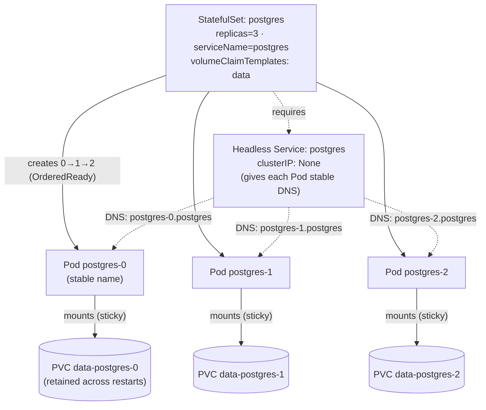

# 05 — StatefulSets

> When Pods need a **stable identity** (name, DNS, and their *own* persistent
> volume) and **ordered** lifecycle — the headless-Service requirement,
> `volumeClaimTemplates`, `podManagementPolicy`, partitioned updates, and the
> StatefulSet-vs-Deployment decision — applied by adding Postgres to the
> Bookstore.

**Estimated time:** ~15 min read · ~60 min hands-on
**Prerequisites:** [01.04](04-replicasets-and-deployments.md): the contrast with stateless workloads · [01.01](01-pods.md): Pod identity and the security baseline
**You'll know after this:** • explain why some Pods need stable identity (name, DNS, volume) · • configure the headless Service required by every StatefulSet · • use `volumeClaimTemplates` to give each replica its own PVC · • choose between `OrderedReady` and `Parallel` pod-management policies · • decide when a StatefulSet is the right answer vs. a Deployment · • keep a database's writable paths to its data and a few emptyDirs under a read-only root · • say which data outlives a Pod, a StatefulSet or a claim

<!-- tags: core-objects, statefulsets, stateful, headless-service, volumeclaimtemplates -->

## Why this exists

A Deployment ([01.04](04-replicasets-and-deployments.md)) treats its Pods as
**interchangeable, anonymous, disposable** — any replica is as good as any
other, names are random, all share (or have none of) the same storage. That is
exactly right for stateless services like catalog. It is exactly *wrong* for a
database, a message broker, or any clustered/quorum system, where each instance
is **not** interchangeable: `postgres-0` is the primary with *its own* data
volume; a replica must keep *its own* data across restarts; cluster members
must find each other by *stable* addresses, and often start/stop in a defined
**order** (initialize the primary before replicas join).

The Bookstore now needs durable storage for the catalog and orders data: a
real Postgres. Running it as a Deployment would be a data-loss bug: replicas
would share or lose volumes, identities would churn, and there'd be no ordered
bring-up. The **StatefulSet** is the controller for "Pods that are pets, not
cattle": stable identity + per-Pod storage + ordered operations. This is the
[Stateful Service](#further-reading) pattern.

## Mental model

A StatefulSet is "a ReplicaSet whose Pods are **named, ordered, and own their
disk**". For a StatefulSet named `postgres` with `replicas: 3`:

- Pods are `postgres-0`, `postgres-1`, `postgres-2` — **stable ordinal names**,
  not random hashes. A replaced `postgres-1` is *still* `postgres-1`.
- Each Pod gets a **stable DNS name** via a required **headless Service**:
  `postgres-0.postgres.<NS>.svc.cluster.local`. The address survives
  reschedule/restart — peers can hardcode it.
- Each Pod gets its **own PersistentVolumeClaim** from `volumeClaimTemplates`
  (`data-postgres-0`, `data-postgres-1`, …). The claim/volume is **not deleted**
  when the Pod is deleted and is **re-attached** to the same ordinal — that is
  how data persists across rescheduling.
- Operations are **ordered** by default (`OrderedReady`): scale-up creates
  `0`,`1`,`2` in sequence (each Ready before the next); scale-down removes them
  in reverse; rolling update goes highest-ordinal → lowest.

So identity, storage, and order are the three guarantees a Deployment cannot
give and a stateful system needs.

## Threats and controls

A StatefulSet keeps data across Pod restarts, so its threats are about that
data and the credentials that open it. The threats to the Pod itself are
covered by the [baseline](01-pods.md#baseline) and are not repeated here.

| Threat | Control taught here | Goes deeper |
|---|---|---|
| A replacement Pod or a scale-down leaves data behind, or a deleted claim takes it with it | One PVC per ordinal from `volumeClaimTemplates`, kept when the Pod or the StatefulSet is deleted. The StorageClass reclaim policy decides what deleting the claim does to the volume | [03.04](../03-config-and-storage/04-persistent-storage.md) |
| A compromised container rewrites a file in its image | A read-only root filesystem, so the image's own files cannot be written. Each writable path is an emptyDir or the data PVC | [05.02](../05-security/02-pod-security.md) |
| A compromised database writes to `PGDATA`, and the change survives every restart | None in this chapter. The controls sit around the data: who can `exec` into `postgres-0` or read its volume, what the database role may do, and backups | [03.05](../03-config-and-storage/05-stateful-data-patterns.md) |
| The database password sits in the manifest, where anyone who can read the StatefulSet sees it | `envFrom` a Secret by name, so the StatefulSet holds a reference and not the value | [03.02](../03-config-and-storage/02-secrets.md) |
| Without a NetworkPolicy, any Pod in the cluster can open a connection to port 5432 | None in this chapter. The headless Service gives names, not restrictions. Pods are non-isolated until a policy selects them ([upstream](https://kubernetes.io/docs/concepts/services-networking/network-policies/)) | [02.06](../02-networking/06-network-policies.md) |

## Diagrams

### StatefulSet: ordinal identity + PVC-per-Pod (Mermaid)



### Stable DNS per ordinal (ASCII)

```
 Headless Service "postgres" (clusterIP: None)  in namespace "bookstore"
 ────────────────────────────────────────────────────────────────────────
   postgres-0.postgres.bookstore.svc.cluster.local  ─► Pod postgres-0 ─► PVC data-postgres-0
   postgres-1.postgres.bookstore.svc.cluster.local  ─► Pod postgres-1 ─► PVC data-postgres-1
   postgres-2.postgres.bookstore.svc.cluster.local  ─► Pod postgres-2 ─► PVC data-postgres-2
        (name is STABLE: kill postgres-1, its replacement is STILL
         postgres-1 with the SAME DNS and the SAME re-attached PVC)

 vs. a Deployment:  catalog-7f9-x8k2, catalog-7f9-q1zp  (random, anonymous,
                      no per-Pod stable disk, no ordering)
```

## Why state is the hard case

The baseline assumes a read-only root and scratch space that dies with the
Pod. A stateless service loses nothing when that happens. A database loses
its data, so it needs one path that persists, and that path must be writable.
For each path the question is who writes it and whether it must survive a
restart.

| Path in the container | Volume | Survives a restart | Why it is writable |
|---|---|---|---|
| `/var/lib/postgresql/data`, where the database lives in `pgdata` | PVC `data` | Yes | The database files. This is the state. |
| `/var/run/postgresql` | emptyDir `run` | No | The socket and lock file, recreated at start |
| `/tmp` | emptyDir `tmp` | No | Scratch space, as in every chapter |
| Everything else | The image, read-only | Not applicable | Binaries and config stay as the image built them |

Writing the data path needs a matching UID or group. The official image runs
`postgres` as UID and GID 999. The manifest starts the container as that user,
so the image never needs root to change ownership of the data directory.
`fsGroup: 999` sets the group of a volume to 999 and grants group write, so
the user can create files in it. `fsGroupChangePolicy: OnRootMismatch` limits
that work: the kubelet checks the top-level directory first and skips the
recursive change when it already matches. A restart on a large data directory
does not walk every file. The [baseline](01-pods.md#baseline-fsgroup) explains
`fsGroup`. On this kind cluster the emptyDirs show the group change, and the
PVC root, already mode 777, was not re-owned.

The data path is the hard case. A read-only root protects the image, which is
what an attacker most wants to change. It cannot protect the data, because the
data is the job. Anything a compromised database writes to `PGDATA` stays
there across restarts, and a restart does not clean it up. The stateless
answer, throw away the Pod and its scratch space, does not work when the claim
outlives the Pod. This chapter adds no control for that threat. The controls
that do apply sit around the data: who can `exec` into `postgres-0` or read
its volume, what the database account is allowed to do, and backups that let
you restore to a point before the damage.

## Hands-on with the Bookstore

**Assumed working directory: the guide repo root (`full-guide/`).** The steps
need the `bookstore` namespace from [01.01](01-pods.md#restricted-namespace)
and [01.03](03-resources-and-qos.md). They also need three objects that
[01.04](04-replicasets-and-deployments.md) applies: the `postgres-sa`
ServiceAccount from `05-serviceaccounts-rbac.yaml`, the `db-credentials`
Secret from `16-db-credentials.yaml`, and the `bookstore-data` PriorityClass
from `35-priorityclasses.yaml`. The official `postgres:16` image comes from
the registry, so no `kind load` is needed. It is pinned by digest, as the
[baseline](01-pods.md#baseline-image-digest) asks, with the tag in a comment.

> **Credentials come from a Secret.** `POSTGRES_USER`, `POSTGRES_PASSWORD` and
> `POSTGRES_DB` come from `db-credentials` through `envFrom`. The StatefulSet
> names the Secret and never holds the password.
> [03.02](../03-config-and-storage/02-secrets.md) explains what a Secret does
> and does not protect. The password in this repo is a demo value. Its account
> is a superuser, as the check under *Credentials stay out of the StatefulSet*
> shows. Catalog and orders connect with the same account, and this guide does
> not call that least privilege.

The repo file is the complete manifest: a headless Service, then the
StatefulSet. Apply the file rather than copying it. The fragment below shows
the parts this chapter is about. The file also has three Part 04 scheduling
fields (`tolerations`, `affinity` and `priorityClassName`), explained in
[04.02](../04-scheduling/02-affinity-taints-topology.md) and
[04.03](../04-scheduling/03-priority-and-preemption.md). They change nothing
here.

```yaml
spec:
  serviceName: postgres
  replicas: 1
  podManagementPolicy: OrderedReady
  template:
    spec:
      serviceAccountName: postgres-sa
      automountServiceAccountToken: false
      securityContext:
        runAsNonRoot: true
        runAsUser: 999                # the UID the postgres image declares
        runAsGroup: 999
        fsGroup: 999                  # the data volume is writable by this group
        fsGroupChangePolicy: OnRootMismatch
        seccompProfile:
          type: RuntimeDefault
      containers:
        - name: postgres
          image: postgres@sha256:1beaa3084eee2676f20a9cd9928f0bf2c5bf674f8e49f81017912183d377c61c  # postgres:16
          securityContext:
            allowPrivilegeEscalation: false
            readOnlyRootFilesystem: true
            capabilities:
              drop: ["ALL"]
          envFrom:
            - secretRef:
                name: db-credentials
          env:
            - name: PGDATA
              value: /var/lib/postgresql/data/pgdata
          startupProbe:
            exec:
              command: ["pg_isready", "-U", "bookstore", "-d", "bookstore"]
            periodSeconds: 5
            failureThreshold: 60      # up to 5 minutes to start
          readinessProbe:
            exec:
              command: ["pg_isready", "-U", "bookstore", "-d", "bookstore"]
            initialDelaySeconds: 10
            periodSeconds: 5
          livenessProbe:
            exec:
              command: ["pg_isready", "-U", "bookstore", "-d", "bookstore"]
            initialDelaySeconds: 30
            periodSeconds: 10
            failureThreshold: 12      # about two minutes of stall
          resources:
            requests: { cpu: 100m, memory: 256Mi }
            limits: { cpu: 500m, memory: 512Mi }
          volumeMounts:
            - name: data
              mountPath: /var/lib/postgresql/data
            - name: run
              mountPath: /var/run/postgresql
            - name: tmp
              mountPath: /tmp
      volumes:
        - name: run
          emptyDir: { sizeLimit: 8Mi }
        - name: tmp
          emptyDir: { sizeLimit: 32Mi }
  volumeClaimTemplates:
    - metadata:
        name: data
      spec:
        accessModes: ["ReadWriteOnce"]
        resources:
          requests: { storage: 1Gi }
```

The `startupProbe` holds the liveness probe back until the first `pg_isready`
succeeds, so `initdb` and crash recovery are not taken for a hang. The longer
liveness window covers a disk that stalls for tens of seconds.

The probes are `exec` probes, not `httpGet`. [01.02](02-health-and-lifecycle.md)
prefers `httpGet` because an `exec` probe needs a program in the image, and
anyone inside the container can run that program too. Postgres has no HTTP
endpoint, so it uses `exec`. The official image already ships `pg_isready`, so
the probe adds nothing to the image. The cost is that `pg_isready` stays
available to anyone who gets a shell in the container.

### Apply, and wait for a query rather than a probe

[01.04](04-replicasets-and-deployments.md) already applied this file and waited
for the first query, so a reader who followed it in order sees `unchanged` from
the first command. The output below comes from a run that started with an empty
namespace, which is why it shows `created`. Either way, the last command waits
for the query. The first start is slow on some disks. The lab host took several
minutes, mostly in `fsync` during `initdb`. A Pod can report `Ready` a few
seconds before the `bookstore` database answers a query, so the last command in
this block waits for the query, not the probe.

```sh
kubectl apply -f examples/bookstore/raw-manifests/20-postgres-statefulset.yaml
kubectl rollout status statefulset/postgres -n bookstore --timeout=600s
kubectl exec -n bookstore postgres-0 -- sh -c 'until psql -U bookstore -d bookstore -tAc "select 1" >/dev/null 2>&1; do sleep 2; done; echo database bookstore is ready'
```

<!-- gate: output -->
```text
service/postgres created
statefulset.apps/postgres created
```

<!-- gate: output -->
```text
Waiting for statefulset spec update to be observed...
Waiting for 1 pods to be ready...
Waiting for 1 pods to be ready...
partitioned roll out complete: 1 new pods have been updated...
```

<!-- gate: output -->
```text
database bookstore is ready
```

Compare this with a Deployment. The Pod is `postgres-0`, not a hash, and its
claim, `data-postgres-0`, came from the template. The claim carries
`app=postgres`, so the same label filter finds the claim too.

```sh
kubectl get statefulset,pod,pvc -n bookstore -l app=postgres
```

<!-- gate: output -->
```text
NAME                        READY   AGE
statefulset.apps/postgres   1/1     5m17s

NAME             READY   STATUS    RESTARTS   AGE
pod/postgres-0   1/1     Running   0          5m17s

NAME                                    STATUS   VOLUME                                     CAPACITY   ACCESS MODES   STORAGECLASS   VOLUMEATTRIBUTESCLASS   AGE
persistentvolumeclaim/data-postgres-0   Bound    pvc-2eb0f1fa-584a-41e9-882c-e2302b84dcd9   1Gi        RWO            standard       <unset>                 5m18s
```

### Writable paths under a read-only root

The baseline holds for a database too. The process runs as UID 999, and the
root filesystem is read-only. The third command below fails on purpose, to
show the read-only root working. The other commands show the paths that the
table above names as writable.

```sh
kubectl exec -n bookstore postgres-0 -- id
kubectl exec -n bookstore postgres-0 -- ls -ld /var/lib/postgresql/data /var/lib/postgresql/data/pgdata /var/run/postgresql /tmp
```

<!-- gate: output -->
```text
uid=999(postgres) gid=999(postgres) groups=999(postgres),101(ssl-cert)
```

<!-- gate: output -->
```text
drwxrwsrwx  2 root     postgres    6 Oct 30 22:44 /tmp
drwxrwxrwx  3 root     root       20 Oct 30 22:45 /var/lib/postgresql/data
drwx------ 19 postgres postgres 4096 Oct 30 22:47 /var/lib/postgresql/data/pgdata
drwxrwsrwx  2 root     postgres   53 Oct 30 22:47 /var/run/postgresql
```

```sh
# A deliberate failure: the image's own files are read-only.
kubectl exec -n bookstore postgres-0 -- sh -c 'touch /usr/local/bin/planted; echo exit=$?'
kubectl exec -n bookstore postgres-0 -- sh -c 'touch /tmp/scratch /var/run/postgresql/scratch && echo emptyDir paths are writable'
kubectl exec -n bookstore postgres-0 -- sh -c 'touch /var/lib/postgresql/data/probe && echo PVC path is writable; rm -f /var/lib/postgresql/data/probe'
```

<!-- gate: output -->
```text
touch: cannot touch '/usr/local/bin/planted': Read-only file system
exit=1
```

<!-- gate: output -->
```text
emptyDir paths are writable
```

<!-- gate: output -->
```text
PVC path is writable
```

The `ls` output shows the two emptyDirs in group `postgres`, which is the
effect of `fsGroup`. The PVC root is already mode 777 on this kind volume, and
its owner did not change. `pgdata` is private to UID 999, because `initdb`
creates it with mode 700.

### Data survives a restart

Write a row, delete the Pod, and read the row back. The `wait` for `create`
comes first. The replacement Pod does not exist until the old one is gone, and
a `Ready` wait that runs before then finds nothing and fails with `NotFound`.

```sh
kubectl exec -n bookstore postgres-0 -- psql -U bookstore -d bookstore -c 'CREATE TABLE t(x int); INSERT INTO t VALUES (42);'
kubectl delete pod -n bookstore postgres-0
kubectl wait -n bookstore --for=create pod/postgres-0 --timeout=120s
kubectl wait -n bookstore --for=condition=Ready pod/postgres-0 --timeout=600s
kubectl exec -n bookstore postgres-0 -- psql -U bookstore -d bookstore -c 'SELECT * FROM t;'
```

<!-- gate: output -->
```text
CREATE TABLE
INSERT 0 1
```

<!-- gate: output -->
```text
 x  
----
 42
(1 row)
```

### Credentials stay out of the StatefulSet

The first command prints the Secret reference the container gets. The second
counts the lines in the StatefulSet that mention the demo password. `grep -c`
exits 1 when it finds none, which is why the line ends in `; true`. The third
command checks the account.

```sh
kubectl get statefulset postgres -n bookstore -o jsonpath='{.spec.template.spec.containers[0].envFrom}'; echo
kubectl get statefulset postgres -n bookstore -o yaml | grep -c devpassword; true
kubectl exec -n bookstore postgres-0 -- psql -U bookstore -d bookstore -tAc 'SELECT rolsuper FROM pg_roles WHERE rolname = current_user;'
```

<!-- gate: output -->
```text
[{"secretRef":{"name":"db-credentials"}}]
```

<!-- gate: output -->
```text
0
```

<!-- gate: output -->
```text
t
```

The count is 0, so the object holds no password. The check prints `t`: the
account that the Bookstore apps use is a superuser, and this guide does not
call that least privilege.

### Stable per-Pod DNS

```sh
kubectl exec -n bookstore postgres-0 -- getent hosts postgres-0.postgres.bookstore.svc.cluster.local | awk '{print $1}'
kubectl get pod -n bookstore postgres-0 -o jsonpath='{.status.podIP}'; echo
```

<!-- gate: output -->
```text
10.244.0.51
```

<!-- gate: output -->
```text
10.244.0.51
```

The name resolves to the Pod's own IP. The lookup ran from inside
`postgres-0`, and any Pod in the cluster resolves the same name.
[02.03](../02-networking/03-dns-and-discovery.md) covers the DNS path.

### The claim outlives the StatefulSet

Deleting the StatefulSet keeps the claim. Applying the file again brings the
StatefulSet back, the same claim goes to the same ordinal, and the row is
still there. The default `standard` class has reclaim policy `Delete`, so
deleting a claim also deletes its volume. A claim may be the only copy of the
data, so delete one only with a backup in hand.

```sh
kubectl get storageclass standard -o jsonpath='{.reclaimPolicy}'; echo
kubectl delete statefulset postgres -n bookstore
kubectl wait -n bookstore --for=delete pod/postgres-0 --timeout=120s
kubectl get pvc -n bookstore
kubectl apply -f examples/bookstore/raw-manifests/20-postgres-statefulset.yaml
kubectl wait -n bookstore --for=create pod/postgres-0 --timeout=120s
kubectl wait -n bookstore --for=condition=Ready pod/postgres-0 --timeout=600s
kubectl exec -n bookstore postgres-0 -- psql -U bookstore -d bookstore -tAc 'SELECT x FROM t;'
kubectl get pvc -n bookstore
```

<!-- gate: output -->
```text
Delete
```

<!-- gate: output -->
```text
NAME              STATUS   VOLUME                                     CAPACITY   ACCESS MODES   STORAGECLASS   VOLUMEATTRIBUTESCLASS   AGE
data-postgres-0   Bound    pvc-2eb0f1fa-584a-41e9-882c-e2302b84dcd9   1Gi        RWO            standard       <unset>                 8m10s
```

<!-- gate: output -->
```text
service/postgres unchanged
statefulset.apps/postgres created
```

<!-- gate: output -->
```text
42
```

<!-- gate: output -->
```text
NAME              STATUS   VOLUME                                     CAPACITY   ACCESS MODES   STORAGECLASS   VOLUMEATTRIBUTESCLASS   AGE
data-postgres-0   Bound    pvc-2eb0f1fa-584a-41e9-882c-e2302b84dcd9   1Gi        RWO            standard       <unset>                 9m16s
```

> **Lineage / forward refs.** This adds the data tier. The schema comes from
> the migration Job in [01.07](07-jobs-and-cronjobs.md)
> (`21-db-migrate-job.yaml`).
> `catalog` and `orders` read `DB_DSN` from the same Secret, as
> [03.02](../03-config-and-storage/02-secrets.md) explains. Production HA
> Postgres (replication, an operator) is
> [03.05](../03-config-and-storage/05-stateful-data-patterns.md).

## How it works under the hood

- **Identity is the ordinal index, and it's sticky.** The StatefulSet
  controller names Pods `<NAME>-<ORDINAL>` (0-based, contiguous). A deleted
  `postgres-1` is recreated **with the same name, hostname, and DNS** — the
  controller never "renumbers". This is why peers can put
  `postgres-0.postgres` in config files: it's a permanent address.
- **Stable DNS needs the headless Service.** `spec.serviceName` must name a
  Service with `clusterIP: None`. A headless Service creates **per-Pod DNS A
  records** (`<POD>.<SVC>.<NS>.svc.cluster.local`) instead of one VIP. (DNS
  internals: [02.03](../02-networking/03-dns-and-discovery.md).) Omit
  or mismatch `serviceName` and you lose stable per-Pod addressing — a classic
  StatefulSet misconfiguration.
- **`volumeClaimTemplates` ≠ a volume; it's a PVC factory.** For each Pod the
  controller instantiates a PVC named `<TEMPLATE>-<NAME>-<ORDINAL>` (e.g.
  `data-postgres-0`), which the dynamic provisioner
  ([03.04](../03-config-and-storage/04-persistent-storage.md)) binds to
  a PV. These PVCs are **not deleted with Pods**: deleting or rescheduling
  `postgres-0` re-binds it to the *same* `data-postgres-0`. Under the default
  `Retain` policy the StatefulSet sets no owner reference on the claims, so
  deleting the StatefulSet leaves them too (deliberate data-safety; cleanup is
  manual). With the `Delete` policies in `persistentVolumeClaimRetentionPolicy`,
  the StatefulSet sets an owner reference on the claims, and they are removed
  with their owner.
- **`podManagementPolicy`.** `OrderedReady` (default): bring Pods up `0→1→2`,
  each **Ready** before the next, and tear down in reverse — needed when later
  members must register with earlier ones (typical for primaries/seeds).
  `Parallel`: act on all Pods at once — faster, valid when members are
  independent and order doesn't matter.
- **`updateStrategy` + `partition` = staged/canary rollout for stateful sets.**
  `RollingUpdate` updates Pods **highest ordinal → lowest**, one at a time,
  waiting for Ready. `partition: N` means **only ordinals ≥ N** are updated;
  ordinals `< N` stay on the old revision. Raising the partition and lowering
  it step-by-step is the built-in canary for databases (e.g. update only
  `postgres-2` first, validate, then lower the partition). `OnDelete` =
  controller updates a Pod only when *you* delete it (fully manual).
- **Why a Deployment can't do this.** A Deployment's ReplicaSet uses a
  `pod-template-hash` and random suffixes — names and storage are deliberately
  *not* stable, and there is no ordering. Those non-guarantees are a feature
  for stateless apps and a data-corruption hazard for stateful ones.

### StatefulSet vs. Deployment — the decision

| Need | Deployment | StatefulSet |
|---|---|---|
| Identical, interchangeable replicas (stateless API/UI) | ✅ use this | ✗ overkill |
| Stable per-Pod **name/DNS** | ✗ random | ✅ ordinal + headless Svc |
| Per-Pod **persistent** storage that survives reschedule | ✗ (shared/none) | ✅ `volumeClaimTemplates` |
| **Ordered** start/stop/upgrade | ✗ | ✅ `OrderedReady` |
| Quorum/clustered systems (DB, Kafka, etcd, ZooKeeper) | ✗ | ✅ |
| Fastest, densest, simplest scaling | ✅ | slower (ordered, sticky disks) |

Rule: **default to Deployment**; reach for StatefulSet only when you genuinely
need stable identity *and/or* per-Pod durable storage *and/or* ordering. "It
has a database" doesn't automatically mean StatefulSet — a stateless app
talking to an *external* managed DB is still a Deployment.

## Production notes

> **In production:** running your **own** database in-cluster is a serious
> commitment (backups, failover, PITR, version upgrades, replication). Prefer a
> **managed database** (RDS/Cloud SQL/Azure Database) for primary data when you
> can; if you must self-host, use a **mature operator**
> (CloudNativePG, Zalando, Crunchy, Strimzi for Kafka) rather than a raw
> StatefulSet — the operator encodes the failover/backup logic a bare
> StatefulSet does not ([03.05](../03-config-and-storage/05-stateful-data-patterns.md),
> [08.05](../08-day-2-operations/05-operators-and-crds.md)).

> **In production:** a StatefulSet gives stable identity and storage, **not
> high availability by itself**. One Postgres Pod is a single point of failure
> regardless of the StatefulSet. HA requires replication/quorum *inside* the
> workload (streaming replicas, Raft) — that logic is the app/operator's, not
> the StatefulSet's.

> **In production:** PVCs from `volumeClaimTemplates` **outlive the
> StatefulSet** by default. That is intentional (don't auto-destroy data) but
> means deleting/recreating a StatefulSet can leave orphaned volumes (cost) or
> unexpectedly **re-attach old data**. Manage lifecycle explicitly with
> `persistentVolumeClaimRetentionPolicy` and document the teardown runbook
> ([08.02](../08-day-2-operations/02-backup-and-dr.md)).

> **In production:** on EKS/GKE/AKS, `volumeClaimTemplates` bind to **cloud
> block storage** (EBS/PD/Azure Disk) — typically **zonal**. A Pod and its
> disk are then pinned to one AZ; on node loss the Pod can only reschedule in
> the same zone. Plan topology (zonal vs. regional disks, anti-affinity across
> zones) deliberately ([04.02](../04-scheduling/02-affinity-taints-topology.md)).
> On kind the default class, `standard`, uses the local-path provisioner. It
> is node-local and not highly available: fine for learning, never for prod
> data.

> **In production:** use `OrderedReady` for systems where members must join in
> sequence; `Parallel` only when truly independent. Use `partition` to canary
> stateful upgrades (update the highest ordinal, validate, then lower the
> partition) — a botched all-at-once DB upgrade is very hard to undo.

## Quick Reference

```sh
kubectl get statefulset,pod,pvc -n <NS> -l app=<A>     # ordinals + per-Pod PVCs
kubectl get pod <NAME>-0 -n <NS> -o wide               # stable ordinal name
kubectl exec -n <NS> <NAME>-0 -- getent hosts <NAME>-0.<SVC>.<NS>.svc.cluster.local
kubectl rollout status statefulset/<NAME> -n <NS>
kubectl rollout restart statefulset/<NAME> -n <NS>
kubectl scale statefulset/<NAME> -n <NS> --replicas=N  # ordered up/down
kubectl delete statefulset <NAME> -n <NS> --cascade=orphan   # keep Pods/PVCs
# patch partition for a staged update:
kubectl patch statefulset/<NAME> -n <NS> --type='json' \
  -p='[{"op":"replace","path":"/spec/updateStrategy/rollingUpdate/partition","value":1}]'
```

For a new StatefulSet, start from the file in the Hands-on section. The
baseline fields stay as they are. Change the names, the image and the sizes.

Checklist:

- [ ] Genuinely need identity, storage or order (else use a Deployment)
- [ ] Headless Service exists; `serviceName` matches it exactly
- [ ] `volumeClaimTemplates` name matches the container `volumeMounts` name
- [ ] The baseline on the pod template; `fsGroup` only where a volume needs it
- [ ] Each writable path is an emptyDir or a claim; no other path is writable
- [ ] Credentials come from a Secret by `secretRef`, never inline
- [ ] A startup probe covers initdb and crash recovery before liveness runs
- [ ] `podManagementPolicy` chosen deliberately (OrderedReady vs Parallel)
- [ ] Claim retention and teardown understood (claims outlive the StatefulSet)
- [ ] HA comes from the workload or operator, not the StatefulSet alone

## Test your understanding

> Try each before opening the answer drawer. The act of trying is the exercise; the answer is the check.

1. **Why does a StatefulSet require a headless Service (`clusterIP: None`) instead of a normal Service? What capability is lost without it?**
   <details><summary>Show answer</summary>

   A headless Service publishes per-Pod DNS A records (`postgres-0.postgres.bookstore.svc...`) instead of a single load-balanced VIP — exactly the stable per-Pod addressing peers need to reach a specific ordinal (e.g., a Postgres primary). Without it (or with a mismatched `serviceName`), Pods get random ephemeral IPs and no stable DNS, defeating the whole identity guarantee (see §How it works under the hood, "Stable DNS needs the headless Service").

   </details>

2. **A teammate proposes running a clustered Redis as a Deployment with replicas=3 and an `emptyDir` per Pod "to keep it simple". Walk through three things that go wrong.**
   <details><summary>Show answer</summary>

   (1) Random Pod names — Redis nodes can't be addressed individually for replication topology. (2) `emptyDir` dies with the Pod — restart loses all state, including cluster membership. (3) Pods are not ordered — replicas may start before the master is up; reschedules churn cluster membership. The right answer is a StatefulSet (stable identity + per-Pod PVC + ordered bring-up) or a Redis operator (see §StatefulSet vs. Deployment).

   </details>

3. **You scale the Postgres StatefulSet from `replicas: 3` to `replicas: 1`. What happens to the PVCs of the removed Pods, and what's the design intent?**
   <details><summary>Show answer</summary>

   By default the PVCs `data-postgres-1` and `data-postgres-2` are retained — the Pods are removed, but their data sits in storage. Intent is data safety: scale-down is recoverable by scaling back up (the same PVCs re-attach to the same ordinals). Cost-wise, you may want `persistentVolumeClaimRetentionPolicy: WhenScaled: Delete` for ephemeral state, but the default favors not losing data (see §How it works under the hood, "volumeClaimTemplates is a PVC factory" and §Production notes).

   </details>

4. **You want to do a canary upgrade of a 3-replica StatefulSet — test the new version on `postgres-2` first, then `1`, then `0`. Which field do you adjust and how?**
   <details><summary>Show answer</summary>

   Use `spec.updateStrategy.rollingUpdate.partition`. With `partition: 2`, the controller updates only ordinals ≥ 2 (just `postgres-2`); ordinals 0 and 1 stay on the old image. Validate, then set `partition: 1` (updates `postgres-1`), then `partition: 0` (updates everything). This is the built-in canary for stateful upgrades — far safer than all-at-once (see §How it works under the hood, "updateStrategy + partition").

   </details>

5. **Hands-on extension: bring up the Postgres StatefulSet, `INSERT` a row, `kubectl delete pod -n bookstore postgres-0`, wait for it to come back, then `SELECT`. Now `kubectl delete statefulset postgres -n bookstore --cascade=orphan` and re-create the StatefulSet. What do you observe in each case, and why?**
   <details><summary>What you should see</summary>

   After Pod deletion: the row is still there — `postgres-0` was recreated and re-attached to PVC `data-postgres-0`. After StatefulSet deletion with `--cascade=orphan`: the Pod and PVC remain orphaned; recreating the StatefulSet adopts the existing PVC (same ordinal name) and the row is *still* there. This is the data-safety design — volumes outlive the controller, so accidental teardown is recoverable (see §Production notes, "PVCs outlive the StatefulSet").

   </details>

6. **A teammate sets `readOnlyRootFilesystem: false` on the postgres container
   "so it can write its logs". What does that open up, and what would you
   check first?**
   <details><summary>Show answer</summary>

   It makes the image's own files writable. A compromised process can then
   change the binaries and config that every restart reuses, and nothing in
   the spec stops it. The official image writes its log to stderr, which
   `kubectl logs` reads, so logs need no writable root. Before changing the
   field, find the path the process really writes to, with `kubectl exec` and
   `ls -l`. If a path needs writes, give it its own emptyDir, as the table in
   this chapter does (see the section on the hard case).

   </details>

## Further reading

- **Lukša, _Kubernetes in Action_ 2e**: the chapter on deploying stateful
  workloads with StatefulSets: ordinals, headless Services,
  `volumeClaimTemplates`, ordered operations and update strategies.
- **Ibryam & Huß, _Kubernetes Patterns_ 2e**: the *Stateful Service* pattern:
  the requirements (stable identity, storage, networking, ordinality) that
  make a StatefulSet the right tool.
- Official:
  <https://kubernetes.io/docs/concepts/workloads/controllers/statefulset/> and
  <https://kubernetes.io/docs/tutorials/stateful-application/basic-stateful-set/>.
- Official, for the data path: the security-context task
  <https://kubernetes.io/docs/tasks/configure-pod-container/security-context/>
  (`fsGroup` and `fsGroupChangePolicy`) and the persistent volumes page
  <https://kubernetes.io/docs/concepts/storage/persistent-volumes/> (reclaim
  policy).
