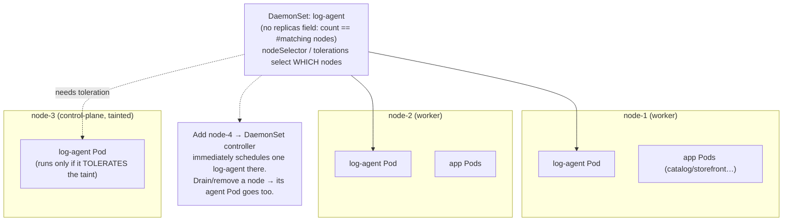

# 06 — DaemonSets

> One Pod per node (or per selected subset): the controller for **node-level
> agents**, such as log shippers, metrics exporters, CNI, storage and security
> agents. This chapter covers node selection, tolerations for system Pods, the
> update strategy, and the namespace rule for an agent that needs host access.

**Estimated time:** ~15 min read · ~30 min hands-on
**Prerequisites:** [01.01](01-pods.md) for the security baseline every manifest here carries · [01.04](04-replicasets-and-deployments.md) for the controller contrast · [01.05](05-statefulsets.md) for the workload decision tree
**You'll know after this:** • recognize the workloads that belong in a DaemonSet (CNI, log shippers, metrics agents) · • use `nodeSelector` and tolerations to choose the nodes an agent runs on · • add the narrowest toleration that reaches a tainted node · • place a node agent that needs host access in its own namespace, at the lowest Pod Security level that admits it · • choose between `RollingUpdate` and `OnDelete` for an agent

<!-- tags: core-objects, daemonsets, node-agents, tolerations, pod-security, exceptions -->

## Why this exists

Deployments ([01.04](04-replicasets-and-deployments.md)) and StatefulSets
([01.05](05-statefulsets.md)) answer "run **N** copies *somewhere*". A whole
class of software needs the opposite: "run **exactly one** copy **on every
node**, and one more whenever a node joins". A log collector reads every
node's container logs. A metrics exporter reads every node's kernel and cgroup
stats. The CNI plugin and `kube-proxy` run on every node so that Pods there
can be networked. A Deployment cannot express this. Its replica count does not
track the node count, and nothing puts a copy on a node that joins later.

The **DaemonSet** is the controller for this case. Its desired state is "one
Pod per matching node", reconciled as nodes appear and disappear. The Bookstore
runs no DaemonSet yet. Its logging agent, in
[06.02](../06-production-readiness/02-logging.md), is the textbook case, and so
is the node exporter in
[06.01](../06-production-readiness/01-observability-metrics.md). Node agents
also hold the most host access in a cluster, which makes them the hardest
workload to secure. Most of this chapter is about that.

## Mental model

A DaemonSet is a controller whose replica count **is** the node count, after
selectors and tolerations filter the nodes. You do not set `replicas`. For each
node that matches the Pod template's selectors and tolerations, the controller
keeps exactly one Pod running there. Add a node and it gets a Pod. Remove a
node and its Pod goes with it. `nodeSelector` or affinity narrows the set, for
example to nodes labelled `role=ingress`. System agents often must run on nodes
tainted to repel ordinary workloads, so their Pods carry tolerations. Each
toleration decides which taints an agent may ignore, which is a security
decision as much as a scheduling one.

Mentally: Deployment = "N anonymous copies, scheduler decides where";
StatefulSet = "N named copies with sticky disks"; DaemonSet = "the set of nodes
*is* the desired set; one agent each".

## Threats and controls

A node agent runs on every node it matches, and it often reads that node's
files. The threats below belong to the DaemonSet itself. The Pod-level controls
come from [01.01](01-pods.md#baseline) and are not repeated here.

| Threat | Control taught here | Goes deeper |
|---|---|---|
| A compromised agent reaches every node it runs on | One DaemonSet per agent, in its own namespace, at the lowest Pod Security level that admits it, recorded in the exceptions registry | [05.02](../05-security/02-pod-security.md) |
| The agent mounts more of the host than it reads | `hostPath` to the one directory it reads, mounted `readOnly` | [05.02](../05-security/02-pod-security.md) |
| The agent runs as root on every node | A non-root UID, with group 0 for the root-owned log files | [05.02](../05-security/02-pod-security.md) |
| The agent runs on nodes it was never meant for | Tolerate the taint the agent must reach, not every taint | [04.02](../04-scheduling/02-affinity-taints-topology.md) |
| A bad rollout breaks the agent on every node at once | `RollingUpdate` with `maxUnavailable: 1` | [01.08](08-deployment-strategies.md) |
| Whoever can create or edit a DaemonSet decides what runs on every node | Grant create and update on `daemonsets` only where that is intended | [05.01](../05-security/01-authn-authz-rbac.md) |

## Diagrams

### DaemonSet scheduling across nodes (Mermaid)



### Node → agent (ASCII)

```
                       DaemonSet "log-agent"  (one per matching node)
   ┌────────────── node-1 ──────────────┐  ┌────────────── node-2 ──────────────┐
   │  [log-agent] ── reads ──┐           │  │  [log-agent] ── reads ──┐           │
   │  catalog  orders  ...   │           │  │  storefront  ...        │           │
   │            hostPath: /var/log/...   │  │            hostPath: /var/log/...   │
   └──────────────┬──────────┘           │  └──────────────┬──────────┘           │
                  └─────────► log backend ◄────────────────┘
   exactly ONE agent per node · scales with the cluster, not with traffic
```

## Hands-on with the Bookstore

Save the manifests in this section in one directory and run the commands from
there. Use a kind cluster from
[00.07](../00-foundations/07-local-cluster-setup.md). The output below comes
from a one-node lab cluster named `sf-pilot`. Your node names will differ.

**No Bookstore manifest in this chapter.** The Bookstore's services are
Deployments and a StatefulSet, not per-node agents, so a DaemonSet here would be
contrived. Its real DaemonSet is the logging agent in
[06.02](../06-production-readiness/02-logging.md). This chapter uses a small
log-reading agent of its own, so the rules can be seen without the logging
stack.

### 1. What already runs on each node

`kube-proxy` and the CNI are DaemonSets, one Pod per node, by definition. Read
them first:

```sh
kubectl get daemonset -A
kubectl get pod -n kube-system -o wide -l k8s-app=kube-proxy
kubectl get ds kube-proxy -n kube-system -o jsonpath='{.spec.updateStrategy}{"\n"}'
kubectl describe node sf-pilot-control-plane | grep -A1 '^Taints'
kubectl get pod -n kube-system -l k8s-app=kube-proxy -o jsonpath='{range .items[0].spec.tolerations[*]}{.key}{" "}{.operator}{" "}{.effect}{"\n"}{end}'
kubectl get pod -n kube-system -l k8s-app=kube-proxy -o jsonpath='{.items[0].spec.affinity.nodeAffinity}{"\n"}'
```

<!-- gate: output -->
```text
NAMESPACE     NAME         DESIRED   CURRENT   READY   UP-TO-DATE   AVAILABLE   NODE SELECTOR            AGE
kube-system   kindnet      1         1         1       1            1           kubernetes.io/os=linux   7h50m
kube-system   kube-proxy   1         1         1       1            1           kubernetes.io/os=linux   7h50m
```

<!-- gate: output -->
```text
NAME               READY   STATUS    RESTARTS   AGE     IP           NODE                     NOMINATED NODE   READINESS GATES
kube-proxy-pb9p9   1/1     Running   0          7h50m   172.18.0.2   sf-pilot-control-plane   <none>           <none>
```

<!-- gate: output -->
```text
{"rollingUpdate":{"maxSurge":0,"maxUnavailable":1},"type":"RollingUpdate"}
```

<!-- gate: output -->
```text
Taints:             <none>
Unschedulable:      false
```

<!-- gate: output -->
```text
 Exists 
node.kubernetes.io/not-ready Exists NoExecute
node.kubernetes.io/unreachable Exists NoExecute
node.kubernetes.io/disk-pressure Exists NoSchedule
node.kubernetes.io/memory-pressure Exists NoSchedule
node.kubernetes.io/pid-pressure Exists NoSchedule
node.kubernetes.io/unschedulable Exists NoSchedule
node.kubernetes.io/network-unavailable Exists NoSchedule
```

<!-- gate: output -->
```text
{"requiredDuringSchedulingIgnoredDuringExecution":{"nodeSelectorTerms":[{"matchFields":[{"key":"metadata.name","operator":"In","values":["sf-pilot-control-plane"]}]}]}}
```

`DESIRED` equals the node count, and nothing in the spec sets it. The
`kube-proxy` update strategy lets one node be unavailable at a time. Its
template tolerates every taint with `operator: Exists`, which system agents
often do. The first toleration line is that one. The other seven are added by
the DaemonSet controller, and one of them is `node.kubernetes.io/unschedulable`,
which is why a cordoned node keeps its agent. The affinity pins each Pod to one
node by name. The scheduler then applies taints and affinity to that Pod like
any other.

The lab cluster has one node and no taint on it, so the toleration in the agent
manifest does nothing here. On a cluster with a worker, run the `describe node`
command above against the control plane. Its taints decide whether the agent
needs the toleration.

### 2. A namespace that starts at restricted

The agent needs host access, so it cannot pass `restricted` as written. Start
at `restricted` anyway. The API server then names the fields that break the
agent, and the lowest level that works is the answer. Save this as
`ns-and-sa.yaml`:

```yaml
apiVersion: v1
kind: Namespace
metadata:
  name: node-logs
  labels:
    pod-security.kubernetes.io/enforce: restricted
    pod-security.kubernetes.io/audit: restricted
    pod-security.kubernetes.io/warn: restricted
---
apiVersion: v1
kind: ServiceAccount
metadata:
  name: log-agent
  namespace: node-logs
automountServiceAccountToken: false
```

The ServiceAccount is dedicated and mounts no token. The agent makes no API
calls, so it needs none. The baseline still asks for a dedicated ServiceAccount
even when a workload makes no calls
([01.01](01-pods.md#baseline-service-account)).

```sh
kubectl apply -f ns-and-sa.yaml
```

<!-- gate: output -->
```text
namespace/node-logs created
serviceaccount/log-agent created
```

### 3. The agent, and the refusal it earns

The agent reads the node's pod log directory, `/var/log/pods`, through a
`hostPath` volume. It counts the log files it can see and prints the count with
its node's name. Save this as `log-agent.yaml`:

```yaml
apiVersion: apps/v1
kind: DaemonSet
metadata:
  name: log-agent
  namespace: node-logs
  labels:
    app: log-agent
spec:
  selector:
    matchLabels:
      app: log-agent
  updateStrategy:
    type: RollingUpdate
    rollingUpdate:
      maxUnavailable: 1
  template:
    metadata:
      labels:
        app: log-agent
    spec:
      serviceAccountName: log-agent
      automountServiceAccountToken: false
      tolerations:
        - key: node-role.kubernetes.io/control-plane
          operator: Exists
          effect: NoSchedule
      securityContext:
        runAsNonRoot: true
        runAsUser: 65532
        runAsGroup: 65532
        supplementalGroups: [0]
        seccompProfile:
          type: RuntimeDefault
      containers:
        - name: log-agent
          # busybox:1.36, pinned by digest: a tag can be moved, a digest cannot
          image: busybox@sha256:73aaf090f3d85aa34ee199857f03fa3a95c8ede2ffd4cc2cdb5b94e566b11662
          command: ["sh", "-c"]
          args:
            - |
              while true; do
                echo "node=$NODE_NAME pod-log-files=$(ls /host/var/log/pods/*/*/*.log | wc -l)"
                sleep 60
              done
          env:
            - name: NODE_NAME
              valueFrom:
                fieldRef:
                  fieldPath: spec.nodeName
          securityContext:
            allowPrivilegeEscalation: false
            readOnlyRootFilesystem: true
            capabilities:
              drop: ["ALL"]
          resources:
            requests:
              cpu: 10m
              memory: 16Mi
            limits:
              memory: 32Mi
          volumeMounts:
            - name: tmp
              mountPath: /tmp
            - name: pod-logs
              mountPath: /host/var/log/pods
              readOnly: true
      volumes:
        - name: tmp
          emptyDir: {}
        - name: pod-logs
          hostPath:
            path: /var/log/pods
            type: Directory
```

Most of this manifest is the baseline, which [01.01](01-pods.md) explains field
by field: [non-root](01-pods.md#baseline-run-as),
[seccomp](01-pods.md#baseline-seccomp),
[privilege escalation](01-pods.md#baseline-privilege-escalation),
[capabilities](01-pods.md#baseline-capabilities),
[read-only root](01-pods.md#baseline-read-only-root),
[ServiceAccount](01-pods.md#baseline-service-account),
[digest](01-pods.md#baseline-image-digest) and
[resources](01-pods.md#baseline-resources). Five fields are new here, and each
is explained where it first appears:

- **`updateStrategy`.** `RollingUpdate` replaces the agent one node at a time.
  `maxUnavailable: 1` keeps at most one node's agent down during a rollout, so
  a broken image stops at one node.
- **`tolerations`.** One toleration, for the control-plane taint, scoped to its
  key and effect. Without `key` and `effect`, `operator: Exists` tolerates every
  taint on every node.
- **`supplementalGroups: [0]`.** The node creates `/var/log/pods` as root with
  mode `0750`, and each log file as root with mode `0640`. A UID other
  than root cannot read them unless it is in group 0. Group 0 gives read access
  without UID 0, so `runAsNonRoot` still holds. It is still a privilege: inside
  the mount, the agent can read whatever group root can read. The mount is
  limited to the log directory, which keeps that narrow. Step 5 shows the modes.
- **`hostPath` with `type: Directory`, and `readOnly: true` on the mount.**
  `type: Directory` makes the kubelet refuse to start the Pod if the path is
  missing or is not a directory. `readOnly` stops the agent writing to the node,
  even if its process is compromised.
- **`NODE_NAME`.** The downward API gives the agent its node's name for its log
  line. It is not a hardening field.

Apply the manifest to the restricted namespace. The refusal is the point of
this step, so it is a deliberate failure:

```sh
kubectl apply -n node-logs -f log-agent.yaml
kubectl get ds log-agent -n node-logs
kubectl get events -n node-logs --sort-by=.lastTimestamp
```

<!-- gate: output -->
```text
Warning: would violate PodSecurity "restricted:latest": restricted volume types (volume "pod-logs" uses restricted volume type "hostPath")
daemonset.apps/log-agent created
```

<!-- gate: output -->
```text
NAME        DESIRED   CURRENT   READY   UP-TO-DATE   AVAILABLE   NODE SELECTOR   AGE
log-agent   1         0         0       0            0           <none>          25s
```

<!-- gate: output -->
```text
LAST SEEN   TYPE      REASON         OBJECT                MESSAGE
23s         Warning   FailedCreate   daemonset/log-agent   Error creating: pods "log-agent-hdtl6" is forbidden: violates PodSecurity "restricted:latest": restricted volume types (volume "pod-logs" uses restricted volume type "hostPath")
# ...
3s          Warning   FailedCreate   daemonset/log-agent   (combined from similar events): Error creating: pods "log-agent-r2th9" is forbidden: violates PodSecurity "restricted:latest": restricted volume types (volume "pod-logs" uses restricted volume type "hostPath")
```

The API server checks the Pods a controller creates, not the DaemonSet object
itself, so it can only warn about the DaemonSet. The controller's Pods are
refused, and the events name the rule that refused them. No agent runs.

### 4. The lowest level that admits it, and the registry

`hostPath` is forbidden at `baseline` and at `restricted`. The
[Pod Security Standards](https://kubernetes.io/docs/concepts/security/pod-security-standards/)
list it under baseline, and the restricted policy's allowed volume types
leave it out. Only `privileged` admits it. That makes `privileged` the lowest level
that works for this agent. Give the exception its own namespace, so no other
workload inherits it:

```sh
kubectl label namespace node-logs pod-security.kubernetes.io/enforce=privileged --overwrite
kubectl get namespace node-logs \
  -L pod-security.kubernetes.io/enforce,pod-security.kubernetes.io/audit,pod-security.kubernetes.io/warn
kubectl rollout status daemonset/log-agent -n node-logs --timeout=180s
kubectl get pods -n node-logs -o wide
kubectl get ds log-agent -n node-logs
kubectl logs -n node-logs -l app=log-agent --tail=3
```

<!-- gate: output -->
```text
namespace/node-logs labeled
```

<!-- gate: output -->
```text
NAME        STATUS   AGE   ENFORCE      AUDIT        WARN
node-logs   Active   32s   privileged   restricted   restricted
```

<!-- gate: output -->
```text
Waiting for daemon set "log-agent" rollout to finish: 0 out of 1 new pods have been updated...
Waiting for daemon set "log-agent" rollout to finish: 0 of 1 updated pods are available...
daemon set "log-agent" successfully rolled out
```

<!-- gate: output -->
```text
NAME              READY   STATUS    RESTARTS   AGE   IP            NODE                     NOMINATED NODE   READINESS GATES
log-agent-24wwh   1/1     Running   0          46s   10.244.0.45   sf-pilot-control-plane   <none>           <none>
```

<!-- gate: output -->
```text
NAME        DESIRED   CURRENT   READY   UP-TO-DATE   AVAILABLE   NODE SELECTOR   AGE
log-agent   1         1         1       1            1           <none>          92s
```

<!-- gate: output -->
```text
node=sf-pilot-control-plane pod-log-files=41
```

`audit` and `warn` stay at `restricted`. The API server still records, and
reports on every apply, what `restricted` would refuse. The exception stays
visible, and the warnings show when the agent drifts from the rest of the
baseline.

The exception also goes in the registry. Record it in
`security/namespace-exceptions.yaml`, the one exceptions registry. The entry
records the namespace, the reason (the agent reads host logs), this chapter,
and an expiry no more than 12 months away. A privileged namespace with no
entry breaks the rule.

### 5. What the agent can and cannot do

```sh
POD=$(kubectl get pods -n node-logs -l app=log-agent -o name)
kubectl exec -n node-logs "$POD" -- id
kubectl exec -n node-logs "$POD" -- ls -ld /host/var/log/pods
kubectl exec -n node-logs "$POD" -- sh -c 'ls -l "$(ls /host/var/log/pods/*/*/*.log | head -1)"'
kubectl exec -n node-logs "$POD" -- sh -c 'cat "$(ls /host/var/log/pods/*/*/*.log | head -1)" | wc -c'
kubectl exec -n node-logs "$POD" -- touch /host/var/log/pods/probe
kubectl exec -n node-logs "$POD" -- sh -c 'ls /var/run/secrets/kubernetes.io/serviceaccount 2>&1; echo exit=$?'
```

<!-- gate: output -->
```text
uid=65532 gid=65532 groups=0(root),65532
```

<!-- gate: output -->
```text
drwxr-x---   52 root     root          8192 Oct 31 01:25 /host/var/log/pods
```

<!-- gate: output -->
```text
-rw-r-----    1 root     root          4193 Oct 31 01:25 /host/var/log/pods/kube-system_coredns-559f6c778d-77g29_5e234064-b084-43ff-885d-09eb7403e0b6/coredns/0.log
```

<!-- gate: output -->
```text
4193
```

The agent is UID 65532, not root, and it reads the root-owned log through
group 0. The `touch` is a deliberate failure. It shows the `readOnly` mount
refusing a write, and the command exits 1. The last check shows that no
ServiceAccount token was mounted, because `automountServiceAccountToken: false`
removes the directory. Step 3 explained why the group, not UID 0, is the way in.

<!-- gate: output -->
```text
touch: /host/var/log/pods/probe: Read-only file system
command terminated with exit code 1
```

<!-- gate: output -->
```text
ls: /var/run/secrets/kubernetes.io/serviceaccount: No such file or directory
exit=1
```

### 6. Clean up

```sh
kubectl delete daemonset log-agent -n node-logs
kubectl delete namespace node-logs
```

Delete the DaemonSet first, then the namespace. The namespace can stay
`Terminating` for a few minutes after the delete. Remove its registry entry
when the namespace goes.

### Optional: a two-node cluster

The lab cluster has one node, so the "tracks node count" property cannot be
shown on it. On a kind cluster with one control-plane and one worker node, you
can see DESIRED follow the count:

```sh
cat > kind-2node.yaml <<'EOF'
kind: Cluster
apiVersion: kind.x-k8s.io/v1alpha4
nodes:
  - role: control-plane
  - role: worker
EOF
kind create cluster --name ds-demo --config kind-2node.yaml
kubectl --context kind-ds-demo get daemonset kube-proxy -n kube-system
kind delete cluster --name ds-demo
```

Illustrative, not captured here: `DESIRED` shows 2 for `kube-proxy`, because its
`operator: Exists` toleration reaches the control plane. Without that
toleration, a DaemonSet on the same cluster would show 1.

## How it works under the hood

- **The controller derives Pods from the node list.** It watches Nodes. For
  every node that satisfies the Pod template's selectors and tolerations, it
  keeps one Pod running. A new Node gets a Pod at once, and a removed Node loses
  its Pod. There is no `replicas` field: the count is a consequence of the
  cluster.
- **Scheduling goes through node affinity.** The controller pins each Pod to its
  node with a `nodeAffinity` on `metadata.name`, as step 1 showed. The scheduler
  then applies taints and affinity to that Pod like any other, so a DaemonSet
  needs explicit tolerations for tainted nodes
  ([04.02](../04-scheduling/02-affinity-taints-topology.md)). The controller
  adds tolerations for node conditions, including `unschedulable`.
- **Tolerations decide where an agent runs.** Control-plane nodes often carry a
  `NoSchedule` taint. An agent that does not tolerate it skips that node without
  any error, which is the usual cause of "why are there no logs from the control
  plane?". The narrow toleration in this chapter reaches the control plane and
  no other tainted node. `operator: Exists` with no key tolerates everything,
  which is as broad as a DaemonSet can be.
- **`updateStrategy` limits the blast radius.** `RollingUpdate` updates Pods
  node by node, honoring `maxUnavailable` (and `maxSurge`), so the agent is
  never lost on too many nodes at once. `OnDelete` updates a node's Pod only
  when you delete it by hand. It suits an agent whose restart is disruptive
  enough to need a person in the loop.
- **Host access is what the exceptions rule governs.** A DaemonSet often needs
  `hostPath` to do its job. Baseline and restricted both forbid it, so the Pod
  can only run in a namespace at `privileged`. That namespace belongs to one
  agent, is recorded in the registry, and keeps the rest of the baseline on
  every Pod it runs. A compromised agent reaches every node it runs on, so the
  namespace boundary is the whole argument.
- **Singleton and leader election are different.** A DaemonSet gives one Pod per
  node, not one Pod per cluster. For a single active controller, run replicas
  that perform **leader election**, so only one acts
  ([08.05](../08-day-2-operations/05-operators-and-crds.md)). Do not treat
  "runs on every node" as "exactly one in the cluster".

## Production notes

> **In production:** DaemonSet Pods run on **every** node, so their requests
> are multiplied by the node count, and they compete with your workloads for
> node resources. Size them tightly, and give a critical agent a
> **priorityClass** ([04.03](../04-scheduling/03-priority-and-preemption.md)) so
> that a CNI or logging agent is not evicted before application Pods.

> **In production:** get **tolerations right**, or you get blind spots. A
> logging or security DaemonSet that does not tolerate the control-plane or
> dedicated-node taints misses exactly the nodes you most need to observe.
> Compare `kubectl get ds -A` coverage with the node count.

> **In production:** use a conservative `updateStrategy`. Rolling a broken CNI,
> logging or metrics DaemonSet to every node at once can take down networking or
> observability fleet-wide. Treat its rollout like a control-plane change.

> **In production:** managed clusters (EKS, GKE, AKS) already run several
> DaemonSets you do not author, such as the CNI, kube-proxy or its replacement,
> CSI node plugins and cloud agents. Know what is there before you add more.
> Duplicate log agents double the cost and can fight over the same files.

> **In production:** DaemonSets are a prime **supply-chain and privilege**
> concern: node-wide reach, often privileged, often `hostPath`. Pin their images
> by digest, scan them, and keep privileged namespaces to the agents that need
> them, each with a registry entry and an expiry
> ([05.03](../05-security/03-supply-chain.md)).

## Quick Reference

```sh
kubectl get daemonset -A                                  # all DaemonSets
kubectl get ds <DS> -n <NS> -o wide                       # DESIRED == matching nodes
kubectl describe ds <DS> -n <NS>                          # selectors, tolerations, Events
kubectl get events -n <NS> --sort-by=.lastTimestamp       # FailedCreate: a Pod was refused
kubectl label namespace node-logs pod-security.kubernetes.io/enforce=privileged --overwrite
kubectl rollout status    daemonset/<DS> -n <NS>
kubectl rollout restart   daemonset/<DS> -n <NS>
```

The fields that make a DaemonSet a node agent, as a fragment to add to a
complete manifest. The baseline from [01.01](01-pods.md#baseline) stays on the
Pod template.

```yaml
spec:
  updateStrategy:
    type: RollingUpdate
    rollingUpdate:
      maxUnavailable: 1
  template:
    spec:
      tolerations:
        - key: node-role.kubernetes.io/control-plane   # only the taint it must reach
          operator: Exists
          effect: NoSchedule
      securityContext:
        supplementalGroups: [0]     # group read on root-owned host logs, no UID 0
      volumes:
        - name: pod-logs
          hostPath:
            path: /var/log/pods
            type: Directory         # mount it readOnly in the container
```

Checklist:

- [ ] Workload is genuinely **per-node** (else Deployment or StatefulSet)
- [ ] No `replicas` (the count is derived from nodes)
- [ ] Each agent in its own namespace, at the lowest level that admits it, with a registry entry
- [ ] Tolerations name the taints the agent must reach, not every taint
- [ ] `hostPath` limited to the directory read, mounted `readOnly`, `type: Directory`
- [ ] Non-root UID, with group membership only where a file needs group read
- [ ] `RollingUpdate` with a small `maxUnavailable`
- [ ] Dedicated ServiceAccount with `automountServiceAccountToken: false`; image pinned by digest
- [ ] Tight resources and a sensible priorityClass (the cost is multiplied by the node count)

## Test your understanding

> Try each before opening the answer drawer. The act of trying is the exercise; the answer is the check.

1. **Why does a DaemonSet have no `replicas` field, and what would go wrong if you used a Deployment with `replicas: <number of nodes>` for a log-shipping agent?**
   <details><summary>Show answer</summary>

   A DaemonSet's count is derived from the node list. Adding a node schedules a Pod there, and removing a node removes its Pod. A Deployment with `replicas=N` does not track the node count. The scheduler may stack several Pods on one node and none on another, which leaves logs missing. When the cluster scales, the Deployment does not react, and the DaemonSet does (see the mental model and the section on the controller).

   </details>

2. **You deploy a security agent as a DaemonSet, but `kubectl get ds` shows DESIRED=2 while the cluster has 3 nodes. Where do you look, and what is the fix?**
   <details><summary>Show answer</summary>

   A node has a taint the DaemonSet's tolerations do not cover. `kubectl describe node <missing-node>` shows its taints. Add a toleration for that taint, scoped to its key and effect. `operator: Exists` with no key reaches every taint, which is broader than the agent needs. Tolerate only what the agent must reach.

   </details>

3. **A teammate proposes a `RollingUpdate` with `maxUnavailable: 100%` "so updates finish fast". Why is this dangerous for a CNI or logging DaemonSet, and what is a safer default?**
   <details><summary>Show answer</summary>

   These agents often run load-bearing node infrastructure. The CNI provides Pod networking, and the logging agent is your observability. Rolling every node's agent at once can take down networking, or blind observability fleet-wide, if the new version is broken. `maxUnavailable: 1` stops any breakage at one node, so you find out before the whole fleet is affected (see the production notes).

   </details>

4. **What is the difference between "run on every node" (DaemonSet) and "exactly one in the cluster" (leader-elected controller)? When would each be wrong for the other's job?**
   <details><summary>Show answer</summary>

   A DaemonSet runs one Pod per node, so N copies run in parallel. That is wrong for a cluster singleton, because N controllers reconciling the same state will fight. A leader-elected Deployment runs N replicas, but only the leader acts. That is wrong for a node agent, because each node needs an agent of its own. A log shipper running on the leader does nothing for the other nodes' logs.

   </details>

5. **The log agent could run as UID 0 and read the logs without any group trick. Why does it keep `runAsNonRoot: true` and `supplementalGroups: [0]` instead? What does group 0 still allow?**
   <details><summary>Show answer</summary>

   `runAsNonRoot` is part of the baseline, and the kubelet refuses to start a container that runs as UID 0 under it. Group 0 gives read access to the root-owned log files without UID 0, so the agent stays non-root. Group 0 still reads any group-readable root file inside the mount, so the mount must stay narrow: one directory, read-only. Running as UID 0 would also need an exception to `runAsNonRoot`, which this agent does not need.

   </details>

6. **On a multi-node kind cluster, `kubectl cordon` one node, then run `kubectl drain` on it without flags. What happens to its DaemonSet Pods, and what changes with `--ignore-daemonsets`?**
   <details><summary>What you should see</summary>

   `drain` stops with an error while DaemonSet Pods are on the node, unless you pass `--ignore-daemonsets`. The flag defaults to false, as `kubectl drain --help` shows. With the flag, `drain` evicts the other Pods and leaves the DaemonSet Pods running. The controller ignores the unschedulable marking, and the agent's toleration keeps it on the node. Deleting one of those Pods by hand makes the controller recreate it. Removing the node from the selector, or deleting the Node object, is what removes the agent.

   </details>

## Further reading

- Kubernetes, DaemonSet:
  <https://kubernetes.io/docs/concepts/workloads/controllers/daemonset/>.
- Kubernetes, Pod Security Standards (the hostPath rows for baseline and
  restricted): <https://kubernetes.io/docs/concepts/security/pod-security-standards/>.
- `kubectl drain --help` for the `--ignore-daemonsets` default.
- Lukša, _Kubernetes in Action_, 2nd edition: the chapter on DaemonSets, for the
  one-per-node model, node selection, tolerations and update strategy.
- Ibryam and Huß, _Kubernetes Patterns_, 2nd edition: the Daemon Service pattern,
  with the Singleton Service pattern for the one-per-cluster case.
