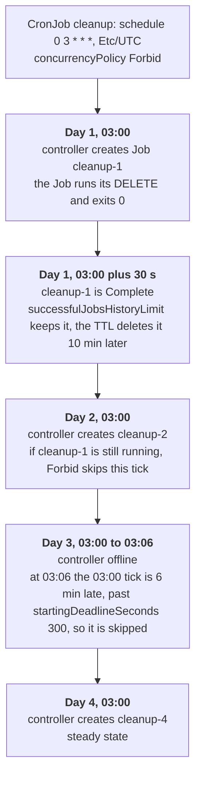

# 07 — Jobs and CronJobs

> Run-to-**completion** workloads: `Job` (completions, parallelism,
> backoffLimit, activeDeadlineSeconds, indexed Jobs, TTL cleanup) and
> `CronJob` (schedule, concurrencyPolicy, startingDeadlineSeconds, history
> limits, time zone). Applied with the Bookstore's DB-migration Job and a
> nightly cleanup CronJob. Both run under a dedicated ServiceAccount with no
> API token and the full baseline.

**Estimated time:** ~15 min read · ~30 min hands-on, including a ten-minute wait
**Prerequisites:** [01.01](01-pods.md): the Pod a Job creates, and the baseline · [01.03](03-resources-and-qos.md): bounding a batch workload's resources · [01.05](05-statefulsets.md): the Postgres the migration writes to
**You'll know after this:** • configure `completions`, `parallelism`, and `backoffLimit` for a Job · • give a batch Job a ServiceAccount with no rights and no token · • set `activeDeadlineSeconds` and `ttlSecondsAfterFinished` so runs are bounded and cleaned up · • write a CronJob with the right `concurrencyPolicy` and time zone · • apply a migration Job and a nightly cleanup CronJob with the baseline

<!-- tags: core-objects, jobs, cronjobs, batch, run-to-completion, security -->

## Why this exists

Every controller so far assumes a Pod that should run **forever**: a crash or
clean exit is a problem to be reconciled away. But a lot of real work is
**finite and must run exactly to completion, then stop**: apply a database
schema migration before the app starts; back up a volume; re-index a search
corpus; send a nightly digest; prune old rows. Modeling that as a Deployment
is wrong at both ends. A Deployment would *restart* a process that finished
successfully, and it has no notion of "this is done, stop, and tell me if it
failed".

The Bookstore needs this **right now**. The Postgres StatefulSet from
[01.05](05-statefulsets.md) is an empty database: the `books` and `orders`
tables do not exist until something runs the schema once. "Run once to
completion, and succeed before the app uses the database" is a **Job**.
"Prune old order rows every night" is a **CronJob**. These are the
[Batch Job](#further-reading) and [Periodic Job](#further-reading) patterns.

A batch Pod also holds credentials: a database login, and whatever its
ServiceAccount allows. A finished Job that nothing deletes keeps its Pods and
logs in the namespace. So this chapter is as much about bounding batch runs
as it is about running them.

## Mental model

A **Job** runs Pods until a target number **succeed** (exit 0), then it is
*Complete* and stops. Failure is first-class: a failed Pod is retried up to
`backoffLimit`, after which the Job is *Failed* and says so. It does not loop
forever. You tune **how many** must succeed (`completions`) and **how many at
once** (`parallelism`), which gives three shapes: one-shot, fixed-count batch,
and work queue.

A **CronJob** is a small controller that, on a cron `schedule`, **creates a
Job** from a template. It is "cron that produces Jobs". The run-to-completion
semantics all come from the Job it spawns. The CronJob adds *when* to run, and
*what to do* about overlapping runs and missed ticks.

The contrast with long-running controllers is `restartPolicy`. A Job's Pods
use **`OnFailure` or `Never`**, never `Always`, because `Always` means "this
should run forever", which contradicts "run to completion". For a Job,
"healthy" means it completed. For a CronJob, "healthy" means its Jobs keep
completing on schedule.

## Threats and controls

A batch Job is a short-lived Pod with a database login. Its threats are about
what that Pod can reach, how long its leftovers last, and how often it runs.
The [baseline](01-pods.md#baseline) covers the Pod itself. The table lists
what belongs to the batch workload.

| Threat | Control taught here | Goes deeper |
|---|---|---|
| The batch Pod reads a ServiceAccount token and calls the API server | `automountServiceAccountToken: false` and a ServiceAccount with no RoleBinding, [as in 01.01](01-pods.md#baseline-service-account) | [05.01](../05-security/01-authn-authz-rbac.md) |
| A finished Job keeps its Pods, logs and status in the namespace | `ttlSecondsAfterFinished`, and history limits on a CronJob | |
| A stuck or retried Job holds CPU, memory and a database connection | `activeDeadlineSeconds`, `backoffLimit`, requests and a memory limit | [01.03](03-resources-and-qos.md) |
| Two runs of a cleanup overlap and contend for the same rows | `concurrencyPolicy: Forbid` and `startingDeadlineSeconds` | |
| Someone who can create a CronJob runs code in the namespace every night | The `restricted` namespace refuses Pods that lack the fields that level requires, and RBAC limits who may create Jobs and CronJobs | [05.01](../05-security/01-authn-authz-rbac.md), [05.02](../05-security/02-pod-security.md) |
| The database password is copied into the manifest | `secretKeyRef` to the `db-credentials` Secret | [03.02](../03-config-and-storage/02-secrets.md) |

One threat this chapter does not close is the database login. `POSTGRES_USER`
is the superuser that the official `postgres` image creates on its first start,
as the [image documentation](https://hub.docker.com/_/postgres) states. The migration and cleanup Jobs can therefore do anything the database
allows, whatever their ServiceAccount cannot. RBAC limits what a Pod may ask
the API server to do. It says nothing about what a database role may change.
Narrowing that role is a database task, and this part does not cover it.

## Diagrams

### Job parallelism modes (Mermaid)

```mermaid
flowchart TB
    subgraph A["Non-parallel (default)<br/>completions=1, parallelism=1"]
        a1["Pod #1 → exit 0"] --> aC["Job Complete"]
    end
    subgraph B["Fixed completion count<br/>completions=5, parallelism=2"]
        b1["2 Pods run<br/>at a time"] --> b2["…until 5 successes total"] --> bC["Job Complete"]
    end
    subgraph C["Indexed (completions=5,<br/>completionMode: Indexed)"]
        c1["Pod idx 0"] --- c2["1"] --- c3["2"] --- c4["3"] --- c5["4"]
        c5 --> cC["each index must succeed once<br/>(JOB_COMPLETION_INDEX)"]
    end
    subgraph D["Work queue<br/>parallelism=N, completions unset"]
        d1["N Pods pull from a queue<br/>any Pod exiting 0 ⇒ done"] --> dC["Complete when work drained"]
    end
```



### CronJob trigger timeline (Mermaid)



## Hands-on with the Bookstore

**Assumed working directory: the guide repo root (`full-guide/`).** All paths
are relative to it. This chapter needs what 01.01 to 01.05 left running: the
`bookstore` namespace with its restricted labels and quota
([01.03](03-resources-and-qos.md)); the ServiceAccounts and RBAC from
`05-serviceaccounts-rbac.yaml`, the `db-credentials` Secret from
`16-db-credentials.yaml`, and the PriorityClasses from
`35-priorityclasses.yaml`, all applied in
[01.04](04-replicasets-and-deployments.md); and the Postgres StatefulSet from
[01.05](05-statefulsets.md).

Check that Postgres is up before you apply a Job that needs it:

```sh
kubectl rollout status statefulset/postgres -n bookstore
```

<!-- gate: output -->
```text
# ...
partitioned roll out complete: 1 new pods have been updated...
```

On the lab cluster the first start took a few minutes while Postgres
initialized an empty data directory. The rollout command waits for it. Do not
apply the Job until it has finished.

### 1. The batch identity has no token and no rights

Check the identity before the Job runs. `migrate-sa` is the ServiceAccount
both batch workloads in this chapter use. It was applied in
[01.04](04-replicasets-and-deployments.md) with
`automountServiceAccountToken: false`, and no Role or RoleBinding names it. Its
Pods get no token, and a token that leaked would still allow nothing.

```sh
kubectl get serviceaccount migrate-sa -n bookstore -o jsonpath='{.automountServiceAccountToken}'; echo
```

<!-- gate: output -->
```text
false
```

```sh
kubectl auth can-i list secrets -n bookstore --as=system:serviceaccount:bookstore:migrate-sa
```

<!-- gate: output -->
```text
no
```

```sh
kubectl auth can-i create jobs -n bookstore --as=system:serviceaccount:bookstore:migrate-sa
```

<!-- gate: output -->
```text
no
```

`kubectl auth can-i` prints `no` and exits 1 for a no. The exit status is the
answer, not a fault. The second check matters for the threat table: a Pod
that could create Jobs could schedule a run of its own.

The migration and the cleanup need the same nothing, so they share
`migrate-sa`. Sharing is safe only because neither gets rights. What the
baseline forbids is the `default` ServiceAccount, not sharing.
[01.01](01-pods.md#baseline-service-account) explains why.

### 2. Run the schema migration once

The migration is a Job, not an init container. An init container runs on every
start of every replica, so N replicas would race the same schema change. A Job
runs once, its Pod must succeed, and the pipeline can hold the app back until
it has. [Part 07](../07-delivery/03-cicd-pipeline.md) moves this step into the
release pipeline.

The Job reads the Postgres headless Service from [01.05](05-statefulsets.md)
and takes its three values from the `db-credentials` Secret, so the password
never sits in the manifest. The file in `examples/` has a longer header
comment. The fields are the same.

```yaml
apiVersion: batch/v1
kind: Job
metadata:
  name: db-migrate
  namespace: bookstore
  labels:
    app: db-migrate
    app.kubernetes.io/part-of: bookstore
spec:
  backoffLimit: 4                  # failed attempts before the Job is Failed
  activeDeadlineSeconds: 120       # cap on the whole Job, counted from its start
  ttlSecondsAfterFinished: 600     # delete the Job and its Pods 10 minutes on
  template:
    metadata:
      labels:
        app: db-migrate
    spec:
      restartPolicy: Never         # a failed Pod stays Failed; the Job makes a new one
      priorityClassName: bookstore-batch   # lowest Bookstore tier, see 04.03
      serviceAccountName: migrate-sa
      automountServiceAccountToken: false
      securityContext:
        runAsNonRoot: true
        runAsUser: 999             # the postgres user of the image
        runAsGroup: 999
        seccompProfile:
          type: RuntimeDefault
      containers:
        - name: migrate
          # postgres:16, pinned by digest. The image ships psql and pg_isready.
          image: postgres@sha256:1beaa3084eee2676f20a9cd9928f0bf2c5bf674f8e49f81017912183d377c61c  # postgres:16
          securityContext:
            allowPrivilegeEscalation: false
            readOnlyRootFilesystem: true
            capabilities:
              drop: ["ALL"]
          env:
            - name: PGHOST                 # the headless Service from 01.05
              value: postgres.bookstore.svc.cluster.local
            - name: PGUSER
              valueFrom:
                secretKeyRef: { name: db-credentials, key: POSTGRES_USER }
            - name: PGPASSWORD
              valueFrom:
                secretKeyRef: { name: db-credentials, key: POSTGRES_PASSWORD }
            - name: PGDATABASE
              valueFrom:
                secretKeyRef: { name: db-credentials, key: POSTGRES_DB }
          command: ["/bin/sh", "-c"]
          args:
            - |
              set -e
              echo "waiting for postgres..."
              until pg_isready -q; do sleep 2; done
              echo "applying schema (idempotent)..."
              psql -v ON_ERROR_STOP=1 <<'SQL'
              CREATE TABLE IF NOT EXISTS books  (id SERIAL PRIMARY KEY, title TEXT, author TEXT, price NUMERIC);
              CREATE TABLE IF NOT EXISTS orders (id SERIAL PRIMARY KEY, book_id INT, qty INT, created_at TIMESTAMPTZ);
              SQL
              echo "migration complete"
          resources:
            requests:
              cpu: 50m
              memory: 64Mi
            limits:
              cpu: 200m
              memory: 128Mi
          volumeMounts:
            - name: tmp
              mountPath: /tmp
      volumes:
        - name: tmp
          emptyDir:
            sizeLimit: 32Mi
```

The `securityContext` blocks at both levels are the baseline, and
[01.01](01-pods.md#baseline) explains each field. The image is pinned by
digest, the way [01.05](05-statefulsets.md) pins it, with the tag in a comment.
UID and GID 999 are the `postgres` user the image creates. The fields that
belong to batch work are these:

- `restartPolicy: Never` keeps each failed attempt as its own Pod with its own
  logs. `OnFailure` restarts the container in place instead.
- `backoffLimit: 4` allows four failed attempts before the Job is Failed. The
  default is 6. This migration sets a smaller number on purpose.
- `activeDeadlineSeconds: 120` caps the whole Job, counted from its start.
  When the cap passes, the Job's Pods are stopped and the Job is Failed, so a
  hung migration cannot run on indefinitely. The loop that waits for Postgres
  counts against the cap, so the database should be up before the Job starts.
- `ttlSecondsAfterFinished: 600` deletes the Job and its Pods ten minutes after
  they finish. Their logs go with them, so copy the logs out first if you need
  them later.
- `priorityClassName: bookstore-batch` puts the batch at the lowest Bookstore
  tier. [04.03](../04-scheduling/03-priority-and-preemption.md) explains
  preemption. Here it means the batch yields to the database and the apps.
- The `secretKeyRef` entries take each value from the Secret. The Secret's keys
  are the ones the official image reads: `POSTGRES_USER`, `POSTGRES_PASSWORD`
  and `POSTGRES_DB`. libpq reads `PGUSER`, `PGPASSWORD` and `PGDATABASE`, so
  each variable maps one key. The Pod spec names the key and does not hold the
  value. `kubectl get job -o yaml` shows a reference, not the password.
- The SQL uses `CREATE TABLE IF NOT EXISTS`. A Pod that fails after it has
  changed the schema, but before Kubernetes records success, runs the SQL
  again. Write every batch step so that a second run is harmless.

```sh
kubectl apply -f examples/bookstore/raw-manifests/21-db-migrate-job.yaml
kubectl wait --for=condition=complete job/db-migrate -n bookstore --timeout=120s
kubectl get job db-migrate -n bookstore
kubectl logs -n bookstore job/db-migrate
```

<!-- gate: output -->
```text
job.batch/db-migrate created
```

<!-- gate: output -->
```text
job.batch/db-migrate condition met
```

<!-- gate: output -->
```text
NAME         STATUS     COMPLETIONS   DURATION   AGE
db-migrate   Complete   1/1           31s        38s
```

<!-- gate: output -->
```text
waiting for postgres...
applying schema (idempotent)...
CREATE TABLE
CREATE TABLE
migration complete
```

Read the Pod's identity while the TTL still keeps it. This must happen within
ten minutes of the Job finishing:

```sh
kubectl get pod -n bookstore -l app=db-migrate -o jsonpath='{.items[0].spec.serviceAccountName} {.items[0].spec.automountServiceAccountToken} {.items[0].spec.securityContext.runAsUser} {.items[0].status.phase}'; echo
```

<!-- gate: output -->
```text
migrate-sa false 999 Succeeded
```

Check the schema:

```sh
kubectl exec -n bookstore postgres-0 -- psql -U bookstore -d bookstore -c '\dt'
```

<!-- gate: output -->
```text
          List of relations
 Schema |  Name  | Type  |   Owner   
--------+--------+-------+-----------
 public | books  | table | bookstore
 public | orders | table | bookstore
(2 rows)
```

### Deliberate refusal: a Job without the restricted fields

Pod Security admission checks the Pods a Job creates, not the Job object. A bare
Job is therefore accepted, and its Pod is refused. This step is a deliberate
action, not a pattern to copy. It creates a Job with no `securityContext` to
show the refusal:

```sh
kubectl create job -n bookstore unrestricted-probe --image=postgres:16
kubectl get events -n bookstore --field-selector reason=FailedCreate
kubectl delete job -n bookstore unrestricted-probe
```

<!-- gate: output -->
```text
Warning: would violate PodSecurity "restricted:latest": allowPrivilegeEscalation != false (container "unrestricted-probe" must set securityContext.allowPrivilegeEscalation=false), unrestricted capabilities (container "unrestricted-probe" must set securityContext.capabilities.drop=["ALL"]), runAsNonRoot != true (pod or container "unrestricted-probe" must set securityContext.runAsNonRoot=true), seccompProfile (pod or container "unrestricted-probe" must set securityContext.seccompProfile.type to "RuntimeDefault" or "Localhost")
job.batch/unrestricted-probe created
```

The events show the refusal on the Job. The Job controller retries, so several
rows follow. The first is shown:

<!-- gate: output -->
```text
LAST SEEN   TYPE      REASON         OBJECT                   MESSAGE
16s         Warning   FailedCreate   job/unrestricted-probe   Error creating: pods "unrestricted-probe-x7799" is forbidden: violates PodSecurity "restricted:latest": allowPrivilegeEscalation != false (container "unrestricted-probe" must set securityContext.allowPrivilegeEscalation=false), unrestricted capabilities (container "unrestricted-probe" must set securityContext.capabilities.drop=["ALL"]), runAsNonRoot != true (pod or container "unrestricted-probe" must set securityContext.runAsNonRoot=true), seccompProfile (pod or container "unrestricted-probe" must set securityContext.seccompProfile.type to "RuntimeDefault" or "Localhost")
```

### Deliberate failure: the token is not mounted

The same field, on a running Pod: Postgres from [01.05](05-statefulsets.md)
also sets `automountServiceAccountToken: false`. Looking for the token
directory fails, which is the control working. This step is a deliberate
action.

```sh
kubectl exec -n bookstore postgres-0 -- ls /var/run/secrets/kubernetes.io/serviceaccount
```

<!-- gate: output -->
```text
ls: cannot access '/var/run/secrets/kubernetes.io/serviceaccount': No such file or directory
command terminated with exit code 2
```

### 3. The nightly cleanup CronJob

A CronJob creates a Job from its `jobTemplate` on every tick, so the rules from
step 2 apply to every run. What differs is when it runs and what happens when
runs overlap or are missed.

```yaml
apiVersion: batch/v1
kind: CronJob
metadata:
  name: cleanup
  namespace: bookstore
  labels:
    app: cleanup
    app.kubernetes.io/part-of: bookstore
spec:
  schedule: "0 3 * * *"              # 03:00 every day
  timeZone: "Etc/UTC"                # read the schedule in this zone
  concurrencyPolicy: Forbid          # skip a tick while the last run is still going
  startingDeadlineSeconds: 300       # a tick more than 5 minutes late is skipped
  successfulJobsHistoryLimit: 3      # finished successful Jobs kept
  failedJobsHistoryLimit: 1          # finished failed Jobs kept
  jobTemplate:
    spec:
      backoffLimit: 2
      activeDeadlineSeconds: 300
      ttlSecondsAfterFinished: 600
      template:
        metadata:
          labels:
            app: cleanup
        spec:
          restartPolicy: Never
          priorityClassName: bookstore-batch
          serviceAccountName: migrate-sa
          automountServiceAccountToken: false
          securityContext:
            runAsNonRoot: true
            runAsUser: 999
            runAsGroup: 999
            seccompProfile:
              type: RuntimeDefault
          containers:
            - name: cleanup
              image: postgres@sha256:1beaa3084eee2676f20a9cd9928f0bf2c5bf674f8e49f81017912183d377c61c  # postgres:16
              securityContext:
                allowPrivilegeEscalation: false
                readOnlyRootFilesystem: true
                capabilities:
                  drop: ["ALL"]
              env:
                - name: PGHOST
                  value: postgres.bookstore.svc.cluster.local
                - name: PGUSER
                  valueFrom:
                    secretKeyRef: { name: db-credentials, key: POSTGRES_USER }
                - name: PGPASSWORD
                  valueFrom:
                    secretKeyRef: { name: db-credentials, key: POSTGRES_PASSWORD }
                - name: PGDATABASE
                  valueFrom:
                    secretKeyRef: { name: db-credentials, key: POSTGRES_DB }
              command: ["/bin/sh", "-c"]
              args:
                - |
                  set -e
                  echo "pruning orders older than 90 days..."
                  psql -v ON_ERROR_STOP=1 -c \
                    "DELETE FROM orders WHERE created_at < now() - interval '90 days';"
                  echo "cleanup complete"
              resources:
                requests:
                  cpu: 25m
                  memory: 32Mi
                limits:
                  cpu: 100m
                  memory: 64Mi
              volumeMounts:
                - name: tmp
                  mountPath: /tmp
          volumes:
            - name: tmp
              emptyDir:
                sizeLimit: 32Mi
```

The fields that control time and overlap are these:

- `timeZone: "Etc/UTC"` reads the schedule in a named zone. Without it the
  controller's own zone applies, and a change of zone or a daylight-saving rule
  moves the run to another hour. Time zone support is stable since v1.27.
- `concurrencyPolicy: Forbid` is a resource control. A tick that arrives while
  the previous run is still going is skipped. `Allow` is the default and lets
  runs overlap. `Replace` stops the running Job and starts a new one, which can
  leave a half-finished delete behind. The policy governs only Jobs of the same
  CronJob, as the
  [CronJob docs](https://kubernetes.io/docs/concepts/workloads/controllers/cron-jobs/)
  state.
- `startingDeadlineSeconds: 300` skips a tick the controller cannot start
  within 300 seconds. It is not replayed, so a long outage does not start a
  burst of catch-up runs against the database.
- The history limits keep three finished successful Jobs and one failed Job, the
  documented defaults written out. The TTL removes the rest.

The lab does not wait for a tick, so `Forbid` is cited here, not run. To test a
CronJob without waiting for 03:00, run its template now with `kubectl create
job --from`:

```sh
kubectl apply -f examples/bookstore/raw-manifests/22-cleanup-cronjob.yaml
kubectl get cronjob cleanup -n bookstore
kubectl get cronjob cleanup -n bookstore -o jsonpath='{.spec.concurrencyPolicy} {.spec.timeZone} {.spec.jobTemplate.spec.ttlSecondsAfterFinished}'; echo
kubectl create job -n bookstore cleanup-manual --from=cronjob/cleanup
kubectl wait --for=condition=complete job/cleanup-manual -n bookstore --timeout=120s
kubectl logs -n bookstore job/cleanup-manual
```

<!-- gate: output -->
```text
cronjob.batch/cleanup created
```

<!-- gate: output -->
```text
NAME      SCHEDULE    TIMEZONE   SUSPEND   ACTIVE   LAST SCHEDULE   AGE
cleanup   0 3 * * *   Etc/UTC    False     0        <none>          3s
```

<!-- gate: output -->
```text
Forbid Etc/UTC 600
```

<!-- gate: output -->
```text
job.batch/cleanup-manual created
```

<!-- gate: output -->
```text
job.batch/cleanup-manual condition met
```

<!-- gate: output -->
```text
pruning orders older than 90 days...
DELETE 0
cleanup complete
```

### 4. The TTL removes the finished Job

Read the TTL on the migration Job:

```sh
kubectl get job db-migrate -n bookstore -o jsonpath='{.spec.ttlSecondsAfterFinished}'; echo
```

<!-- gate: output -->
```text
600
```

Wait about ten minutes after step 2 finished the Job. The TTL controller then
deletes the Job, and its Pods go with it:

```sh
kubectl get job db-migrate -n bookstore
kubectl get pods -n bookstore -l app=db-migrate -o name
```

<!-- gate: output -->
```text
Error from server (NotFound): jobs.batch "db-migrate" not found
```

The second command prints nothing. No Pod remains.

## Job and CronJob fields that matter

**Job:**

| Field | Effect |
|---|---|
| `completions` | how many Pods must **succeed** for the Job to be Complete (default 1) |
| `parallelism` | max Pods running **at once** (default 1) |
| `completionMode` | `NonIndexed` (default) or **`Indexed`**, stable since v1.24. Each Pod gets `JOB_COMPLETION_INDEX` (0..completions-1) for partitioned, parallel work |
| `backoffLimit` | retries of failed Pods before the Job is **Failed**. Default 6, with exponential backoff between retries |
| `activeDeadlineSeconds` | hard wall-clock cap for the *whole* Job. Exceeded: the Job's Pods are terminated and the Job is Failed |
| `ttlSecondsAfterFinished` | delete the Job and its Pods this many seconds after it finishes. Stable since v1.23, and the standard cleanup mechanism |
| `podFailurePolicy` | act on a Pod failure by exit code or Pod condition, for example fail fast on a non-retriable error or ignore an infrastructure eviction. Stable since v1.31 |
| `backoffLimitPerIndex` | a per-index retry budget for **Indexed** Jobs, so one bad index does not fail the whole Job. Stable since v1.33; first available in v1.28 |
| `restartPolicy` | `OnFailure` (restart the container in place) or `Never` (a failed Pod stays Failed and the Job makes a new one). **Never `Always`** |

The three shapes are **one-shot** (`completions=1`, `parallelism=1`, the
migration), **fixed batch** (`completions=N` with some `parallelism`), and
**work queue** (`parallelism=N` with `completions` unset, where Pods pull from
an external queue and the Job is done when the queue is drained). **Indexed**
Jobs add a stable per-Pod index for static work partitioning.

**CronJob:**

| Field | Effect |
|---|---|
| `schedule` | standard cron (`m h dom mon dow`), or a macro such as `@hourly` |
| `timeZone` | IANA zone the schedule is read in. Stable since v1.27. Default: the controller's zone |
| `concurrencyPolicy` | `Allow` (default, runs may overlap), **`Forbid`** (skip the tick while the previous run is still going), or `Replace` (stop the running Job and start a new one) |
| `startingDeadlineSeconds` | if a scheduled time was missed, start only within this many seconds. Otherwise count the tick as missed |
| `successfulJobsHistoryLimit` / `failedJobsHistoryLimit` | finished Jobs kept. Defaults 3 and 1 |
| `suspend` | `true` pauses scheduling without deleting the CronJob |

## How it works under the hood

- **The Job controller tracks success and failure, not "running".** It creates
  Pods up to `parallelism`, counts succeeded Pods toward `completions`, and
  counts failed Pods toward `backoffLimit`, with exponential backoff between
  retries. It sets the Job's `Complete` or `Failed` condition in `status`, and
  that condition is the result to alert on. Unlike a Deployment, a Pod that
  exits successfully is the goal, not a fault to undo.
- **`ttlSecondsAfterFinished` is garbage collection by a dedicated controller.**
  Finished Jobs and their Pods stay by default, so you can read logs and exit
  codes. The TTL controller deletes them once the timer runs out. Without a TTL,
  or history limits on a CronJob, finished Jobs and Pods accumulate, and the
  namespace fills with objects nobody reads.
- **Indexed completion.** With `completionMode: Indexed`, each Pod gets a
  `JOB_COMPLETION_INDEX`. The Job is Complete only when every index from 0 to
  N-1 has had a successful Pod. This shards batch work across Pods without an
  external queue.
- **A CronJob only creates Jobs.** On each tick the CronJob controller
  instantiates a Job from `jobTemplate`. All run-to-completion behavior comes
  from that Job. `concurrencyPolicy` decides what happens when the previous Job
  is still running at the next tick. `startingDeadlineSeconds` decides what
  happens to missed ticks, so that a recovered controller does not stampede.
- **Migrations belong in a Job ordered before the rollout.** An init container
  runs on every Pod start, so N replicas race the same migration. A Job runs
  once, and the pipeline holds the Deployment back until it succeeds. A
  backward-compatible (expand, then contract) change lets the rolling update
  run while both schema versions exist.
  [Part 07](../07-delivery/03-cicd-pipeline.md) builds that pipeline.
- **It is not a precise scheduler.** The CronJob controller polls, so a Job is
  created shortly after the scheduled instant, not on it. A controller outage
  longer than `startingDeadlineSeconds` means the ticks are missed. CronJobs
  are for "roughly at 03:00 daily", not for real-time timing.

## Quick Reference

```sh
kubectl get job,cronjob -n <NS>
kubectl get job <J> -n <NS> -o jsonpath='{.status.conditions}'   # Complete or Failed
kubectl logs -n <NS> job/<J>                                     # Job Pod logs
kubectl create job <NAME> -n <NS> --from=cronjob/<CJ>            # run a CronJob now
kubectl get cronjob <CJ> -n <NS> -o wide                         # schedule, last run
kubectl patch cronjob <CJ> -n <NS> -p '{"spec":{"suspend":true}}'  # pause
kubectl delete job <J> -n <NS>                                   # or let the TTL do it
kubectl auth can-i create jobs -n <NS> --as=system:serviceaccount:<NS>:<SA>
```

For a new batch workload, copy the Job in step 2 or the CronJob in step 3.
Change the name, the image, the command and the schedule. Keep the
ServiceAccount, the `automountServiceAccountToken: false` line and both
`securityContext` blocks.

Checklist:

- [ ] `restartPolicy` is `Never` or `OnFailure`, never `Always`
- [ ] A ServiceAccount of its own, with `automountServiceAccountToken: false`
  and no RoleBinding unless the Job calls the API
- [ ] The full baseline on the Pod and on the container
- [ ] `backoffLimit` and `activeDeadlineSeconds` bound retries and runtime
- [ ] `ttlSecondsAfterFinished` on Jobs, and history limits on CronJobs
- [ ] `concurrencyPolicy`, `startingDeadlineSeconds` and `timeZone` on CronJobs
- [ ] Steps are idempotent, and migrations run as a Job before the rollout
- [ ] Credentials come from a Secret, by `secretKeyRef`

## Test your understanding

> Try each before opening the answer drawer. The act of trying is the exercise; the answer is the check.

1. **Why is `restartPolicy: Always` invalid for a Job, and what is the practical difference between `OnFailure` and `Never`?**
   <details><summary>Show answer</summary>

   `Always` means "this should run forever", which contradicts the Job's run-to-completion semantics. With `OnFailure`, the kubelet restarts the same container in place on failure, which keeps the Pod identity. With `Never`, a failed Pod stays Failed and the Job controller creates a new Pod, so each attempt keeps its own logs. Both honor `backoffLimit`. The choice is between in-place restart and a fresh Pod (see the Mental model and the Job fields table).

   </details>

2. **A teammate puts the schema migration in an `initContainer` on the catalog Deployment, so it runs before the app starts. What is wrong with that, and what is the right pattern?**
   <details><summary>Show answer</summary>

   The init container runs on every Pod start, on every replica, and on every restart. N replicas race the same migration, and every rollout runs it again. The right pattern is a Job that runs once and is ordered before the rollout, or a Helm pre-install or pre-upgrade hook. The pipeline holds the Deployment until the Job succeeds. A rolling update between two schema versions also needs an expand-then-contract change to be safe (see How it works under the hood).

   </details>

3. **A CronJob has `schedule: "*/5 * * * *"` and `concurrencyPolicy: Forbid`. A run starts at 12:00 and takes 8 minutes. What happens at 12:05 and 12:10?**
   <details><summary>Show answer</summary>

   At 12:05 the previous Job is still running, so `Forbid` skips the tick and creates no Job. At 12:08 the running Job completes. At 12:10 the next tick starts a new Job. The skipped 12:05 is not run later. Use `Allow` if you want overlap, and `Replace` if the new run should stop the old one. A tight schedule with a long job needs this choice made on purpose (see the CronJob fields table).

   </details>

4. **The cleanup controller is down from 02:00 to 04:00. The schedule is `0 3 * * *` and `startingDeadlineSeconds: 300`. What happens when the controller recovers, and why is that the right design?**
   <details><summary>Show answer</summary>

   At 04:00 the controller checks whether the 03:00 tick is still within 300 seconds of its scheduled time. It is 60 minutes late, so the tick is recorded as missed and not run. The next run is the following 03:00. Without `startingDeadlineSeconds`, a long outage would queue every missed tick to fire on recovery, and a database would take the burst (see How it works under the hood).

   </details>

5. **Hands-on extension: apply the `db-migrate` Job again while it still exists, and again after the TTL has deleted it. What happens each time, and what does that teach about re-runs?**
   <details><summary>What you should see</summary>

   While the Job exists, the apply reports no change. The Job's Pod template cannot change in place, so Kubernetes keeps the finished Job and does not run it again. After the TTL has deleted it, the same apply creates a new Job with the same name, and the migration runs again. That is safe only because of `CREATE TABLE IF NOT EXISTS`. A pipeline that migrates on every release should give each run a unique name, as Helm hooks do, instead of relying on the TTL timing (see step 2 and step 4).

   </details>

6. **A teammate says: "`migrate-sa` has no RoleBinding, so the cleanup CronJob cannot delete any rows." What is wrong with that?**
   <details><summary>Show answer</summary>

   RBAC decides which API calls the ServiceAccount may make. The cleanup deletes rows through the database login in `db-credentials`, and that login is the superuser the official image creates from `POSTGRES_USER`. Postgres does not ask Kubernetes RBAC what it may do. The row deletion is allowed by the database, not by the ServiceAccount. Narrowing it takes a database role with only the grants the cleanup needs, such as `DELETE` on `orders`. This chapter does not build that role.

   </details>

## Further reading

- **Lukša, _Kubernetes in Action_ 2e, ch.17, "Running finite workloads with
  Jobs and CronJobs"**: completions and parallelism, backoff, indexed Jobs,
  CronJob scheduling and concurrency.
- **Ibryam & Huß, _Kubernetes Patterns_ 2e, *Batch Job* (ch.7) and
  *Periodic Job* (ch.8)**: when run-to-completion and scheduled work are the
  right model, and how to make them reliable.
- Official:
  <https://kubernetes.io/docs/concepts/workloads/controllers/job/> and
  <https://kubernetes.io/docs/concepts/workloads/controllers/cron-jobs/>.
- [Configure a Security Context for a Pod or Container](https://kubernetes.io/docs/tasks/configure-pod-container/security-context/)
  and [Pod Security admission](https://kubernetes.io/docs/concepts/security/pod-security-admission/),
  for the fields this chapter reuses.
