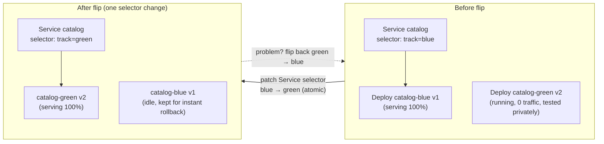
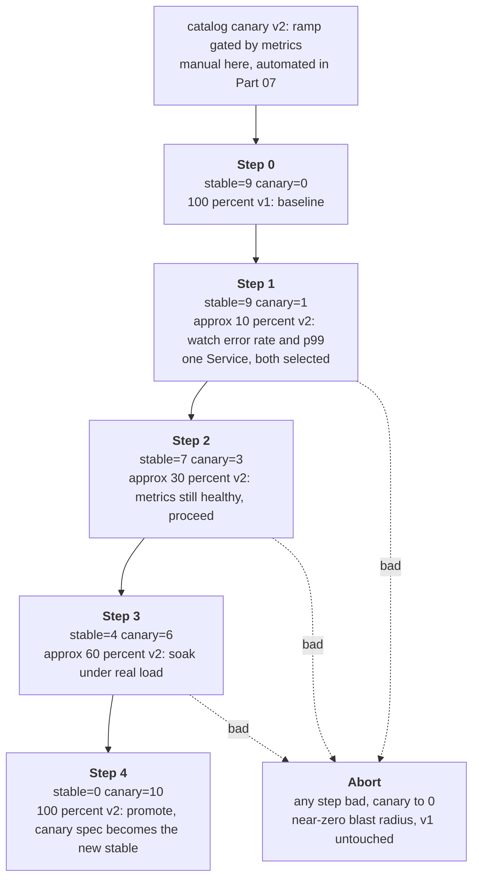

# 08 — Deployment strategies

> How you move from version N to N+1 with controlled risk: recreate, rolling,
> blue-green and canary. A rollout is also a security event: it decides which
> build reaches users, and how fast you can take it back. This chapter runs a
> *manual* canary of catalog with two Deployments behind one Service, then
> rolls back a bad image. Progressive delivery (automated) is
> forward-referenced.

**Estimated time:** ~15 min read · ~60 min hands-on
**Prerequisites:** [01.04](04-replicasets-and-deployments.md): the rolling-update mechanism and the ServiceAccounts · [01.02](02-health-and-lifecycle.md): readiness gates a rollout depends on
**You'll know after this:** • compare recreate, rolling, blue-green, and canary strategies and their failure modes · • run a manual canary using two Deployments and one Service selector · • reason about traffic-splitting limitations of Service-selector canaries · • explain why a rollback is a security decision, not only an availability one · • choose a deployment strategy for a given risk profile · • recognize when automated progressive delivery (Argo Rollouts/Flagger) becomes worth the cost

<!-- tags: core-objects, deployments, canary, blue-green, rolling-update, progressive-delivery -->

## Why this exists

[01.04](04-replicasets-and-deployments.md) gave you the *mechanism* of a
rolling update: surge math, readiness gating, rollback. But "how the bytes get
swapped" is not the same as "how you **release** safely". A rolling update
exposes **every** user to the new version as it rolls. If the new version is
subtly broken (a bad query, a memory leak that shows under real traffic, a bug
only some requests hit), you have already degraded everyone before the rollout
finishes, and rollback is a *reaction* to damage already done.

Security adds a second worry. A new build runs with the same ServiceAccount,
network reach and mounted secrets as the build it replaces. A rollout is
therefore a security event: each Pod it replaces changes which code holds
those identities. The question is how many users run that code before you can
stop it.

Real release engineering asks: *can I expose the new version to a tiny slice
first, watch real signals, and abort with near-zero blast radius?* That is the
domain of **deployment strategies**: recreate, rolling, blue-green and canary,
each trading speed, cost, risk and operational complexity differently. This
chapter is the conceptual map, a hands-on **manual canary** of the Bookstore
catalog, and a rollback. It is the release-strategy face of the [Declarative
Deployment](#further-reading) pattern. The *automated* version (Argo Rollouts
or Flagger, with metric-gated promotion) is in
[07.05](../07-delivery/05-progressive-delivery.md).

## Mental model

Every strategy is a different answer to two questions: **how many versions run
at once**, and **how is traffic split between them**.

- **Recreate:** stop all old, then start all new. One version at a time;
  100% cut. Simple, but a **downtime window**. Use only when versions *cannot*
  coexist (incompatible schema or protocol).
- **Rolling** ([01.04](04-replicasets-and-deployments.md)): gradually replace
  old Pods with new, both versions briefly serving, traffic split roughly by
  replica ratio. No downtime and no extra full environment, but **no control
  over which users hit new**, and the new version reaches everyone by the end.
- **Blue-green:** run the *full* new version ("green") **alongside** the old
  ("blue"), test green privately, then **flip 100% of traffic at once** (swap a
  Service selector or load-balancer target). Instant cutover, instant rollback
  (flip back), but **2× resources** during the overlap and still a big-bang
  exposure.
- **Canary:** run a **small** amount of new ("canary") next to old
  ("stable"), send it a **small fraction** of real traffic, watch
  error, latency and business metrics, then **ramp up** (or abort). Smallest
  blast radius and real-traffic validation, but it needs traffic splitting and
  good signals.

Manual canary by replica ratio: if one Service selects both a 9-replica stable
Deployment and a 1-replica canary Deployment, ≈10% of requests hit canary
(load-balanced across endpoints). Crude but real, and the exact mechanism we
use below before introducing the precise (mesh/Gateway-weighted) form later.

## Threats and controls

A rollout moves a new build onto the identity, network reach and secrets of
the Deployment it replaces. Each canary Pod here carries the same
[baseline](01-pods.md#baseline) as the stable Pods, so the canary is no looser
than the build it tests. The table lists the threats this chapter owns.

| Threat | Control taught here | Goes deeper |
|---|---|---|
| A Pod that copies a Service's labels receives its traffic | Label discipline: the shared `app` label is set only on the Deployments' templates, and the endpoints show any Pod that matches it | [02.02](../02-networking/02-services.md); who may create such a Pod, 05.07 <!-- link-later: 05.07 --> |
| A canary ships without the baseline and runs as root or with a writable root filesystem | The canary carries the full baseline, and the namespace refuses any Pod that lacks it, so a ReplicaSet cannot create one | [05.02](../05-security/02-pod-security.md) |
| A bad image reaches every user before anyone notices | Readiness keeps an image that cannot start from serving. A canary limits how many users run a build that starts, and scaling it to 0 stops it | [07.05](../07-delivery/05-progressive-delivery.md) |
| A rollback reinstates an image that is no longer trusted | `kubectl rollout undo` restores an earlier pod template. Keep the bad ReplicaSet to read, and pin images by digest so an old reference means the same bytes | [01.04](04-replicasets-and-deployments.md), [05.03](../05-security/03-supply-chain.md) |

Two limits matter. A build that starts and misbehaves gets past readiness, so
only metrics and a person or controller catch it. And a rollback restores code,
not state: credentials the bad build read stay valid until they are rotated.
The rollback section covers both.

## Diagrams

### Blue-green traffic switch (Mermaid)



### Canary weight ramp (Mermaid)



## Hands-on with the Bookstore

**Assumed working directory: the guide repo root (`full-guide/`).** This
chapter needs the `bookstore` namespace and its quota from
[01.03](03-resources-and-qos.md), the ServiceAccounts from
[01.04](04-replicasets-and-deployments.md), and the `bookstore/catalog:dev`
image loaded into the cluster. The canary introduces a **Service** a little
ahead of [Part 02](../02-networking/02-services.md). It is kept minimal, only
so the split is observable.

### 1. Two tracks behind one Service

The key idea: a **Service selects on `app: catalog` only**. Two Deployments,
`catalog-stable` and `catalog-canary`, both label their Pods `app: catalog`
(so the Service load-balances across *both*) **plus** a `track: stable|canary`
label (so you can scale and observe each one). The traffic split is the
**replica ratio**.

Both Pod templates carry the full [baseline](01-pods.md#baseline) and the
`catalog-sa` ServiceAccount from [01.04](04-replicasets-and-deployments.md).
The file is
[`examples/bookstore/raw-manifests/30-catalog-canary.yaml`](../examples/bookstore/raw-manifests/30-catalog-canary.yaml).
The copy below matches it, without the header comments:

```yaml
apiVersion: v1
kind: Service
metadata:
  name: catalog
  namespace: bookstore
  labels:
    app: catalog
spec:
  selector:
    app: catalog            # no track key: selects BOTH tracks
  ports:
    - name: http
      port: 80
      targetPort: http      # the container's named port (8080)
---
apiVersion: apps/v1
kind: Deployment
metadata:
  name: catalog-stable
  namespace: bookstore
  labels:
    app: catalog
    track: stable
spec:
  replicas: 9               # about 90% of the Ready endpoints
  revisionHistoryLimit: 5   # old ReplicaSets kept as rollback targets
  selector:
    matchLabels:
      app: catalog
      track: stable         # owns only the stable Pods
  template:
    metadata:
      labels:
        app: catalog        # the label the Service selects
        track: stable
        component: backend
    spec:
      serviceAccountName: catalog-sa
      automountServiceAccountToken: false
      securityContext:
        runAsNonRoot: true
        runAsUser: 65532
        runAsGroup: 65532
        seccompProfile:
          type: RuntimeDefault
      containers:
        - name: catalog
          image: bookstore/catalog:dev      # the image the stable track runs
          imagePullPolicy: IfNotPresent
          securityContext:
            allowPrivilegeEscalation: false
            readOnlyRootFilesystem: true
            capabilities:
              drop: ["ALL"]
          ports:
            - name: http
              containerPort: 8080
          env:
            - name: PORT
              value: "8080"
          readinessProbe:
            httpGet: { path: /readyz, port: http }
            periodSeconds: 5
          livenessProbe:
            httpGet: { path: /healthz, port: http }
            periodSeconds: 10
          resources:
            requests:
              cpu: 50m
              memory: 64Mi
            limits:
              cpu: 250m
              memory: 128Mi
          volumeMounts:
            - name: scratch
              mountPath: /tmp/cache
      volumes:
        - name: scratch
          emptyDir:
            sizeLimit: 64Mi
---
apiVersion: apps/v1
kind: Deployment
metadata:
  name: catalog-canary
  namespace: bookstore
  labels:
    app: catalog
    track: canary
spec:
  replicas: 1               # about 10% of the Ready endpoints
  revisionHistoryLimit: 5
  selector:
    matchLabels:
      app: catalog
      track: canary         # owns only the canary Pods
  template:
    metadata:
      labels:
        app: catalog        # also selected by the same Service
        track: canary
        component: backend
    spec:
      serviceAccountName: catalog-sa
      automountServiceAccountToken: false
      securityContext:
        runAsNonRoot: true
        runAsUser: 65532
        runAsGroup: 65532
        seccompProfile:
          type: RuntimeDefault
      containers:
        - name: catalog
          image: bookstore/catalog:dev      # the candidate image, in a real rollout
          imagePullPolicy: IfNotPresent
          securityContext:
            allowPrivilegeEscalation: false
            readOnlyRootFilesystem: true
            capabilities:
              drop: ["ALL"]
          ports:
            - name: http
              containerPort: 8080
          env:
            - name: PORT
              value: "8080"
            - name: LOG_LEVEL
              value: "debug"                # a marker that this is the canary
          readinessProbe:
            httpGet: { path: /readyz, port: http }
            periodSeconds: 5
          livenessProbe:
            httpGet: { path: /healthz, port: http }
            periodSeconds: 10
          resources:
            requests:
              cpu: 50m
              memory: 64Mi
            limits:
              cpu: 250m
              memory: 128Mi
          volumeMounts:
            - name: scratch
              mountPath: /tmp/cache
      volumes:
        - name: scratch
          emptyDir:
            sizeLimit: 64Mi
```

The canary runs the same image tag as stable here, so the lab measures routing,
not a new build. The `LOG_LEVEL` variable is only a marker: the catalog reads
it to set its log level and does nothing else with it. In a real rollout the
canary runs the candidate image, which should pass the same checks as stable
first ([05.03](../05-security/03-supply-chain.md)).

Both tracks carry the baseline from [01.01](01-pods.md#baseline) unchanged.
Two details differ from that example. The scratch volume mounts at
`/tmp/cache`, not `/tmp`, so the one writable path has a name that says what it
is for. The catalog writes no files today
([its source](../examples/bookstore/app/catalog/main.go)), so the volume is
headroom: a future cache write lands in a capped volume instead of failing
against the read-only root. `sizeLimit: 64Mi` is that cap, so a runaway write
cannot fill the node's disk. That is the threat in
[01.03](03-resources-and-qos.md).

> **Don't run both catalog stacks at once.** The canary file defines
> `app: catalog` Pods in the same namespace as the canonical catalog from
> [01.04](04-replicasets-and-deployments.md). Together they would make the
> shared Service select 13 Pods (3 + 9 + 1), and the 90/10 split below would be
> wrong. The first command below retires the canonical Deployment. To go back
> to it later, delete the canary file and apply `10-catalog-deploy.yaml` again.

Retire the canonical Deployment, apply the canary, and check that one Service
fronts both tracks:

```sh
kubectl delete deployment/catalog -n bookstore --ignore-not-found
kubectl apply -f examples/bookstore/raw-manifests/30-catalog-canary.yaml
kubectl rollout status deployment/catalog-stable -n bookstore
kubectl rollout status deployment/catalog-canary -n bookstore
kubectl get pods -n bookstore -l app=catalog -L track
kubectl get endpointslices -n bookstore -l kubernetes.io/service-name=catalog \
  -o jsonpath='{range .items[*].endpoints[*]}{.conditions.ready}{"\n"}{end}' \
  | sort | uniq -c
```

<!-- gate: output -->
```text
service/catalog created
deployment.apps/catalog-stable created
deployment.apps/catalog-canary created
```

<!-- gate: output -->
```text
deployment "catalog-stable" successfully rolled out
# ...
deployment "catalog-canary" successfully rolled out
```

<!-- gate: output -->
```text
NAME                              READY   STATUS    RESTARTS   AGE   TRACK
catalog-canary-7bd4cf6bc5-6rclj   1/1     Running   0          77s   canary
catalog-stable-5cc48c67c7-4jznq   1/1     Running   0          77s   stable
catalog-stable-5cc48c67c7-6nj6d   1/1     Running   0          78s   stable
catalog-stable-5cc48c67c7-8xfvx   1/1     Running   0          71s   stable
catalog-stable-5cc48c67c7-j96g7   1/1     Running   0          78s   stable
catalog-stable-5cc48c67c7-kpkqq   1/1     Running   0          77s   stable
catalog-stable-5cc48c67c7-svxtp   1/1     Running   0          77s   stable
catalog-stable-5cc48c67c7-t46sr   1/1     Running   0          79s   stable
catalog-stable-5cc48c67c7-wwq7g   1/1     Running   0          77s   stable
catalog-stable-5cc48c67c7-xv684   1/1     Running   0          71s   stable
```

<!-- gate: output -->
```text
  10 true
```

Ten Ready endpoints: nine from the stable track and one from the canary. The
`TRACK` column is the split you are about to measure.

### 2. Measure the split from the Pods' own counters

The catalog counts each request it answers in `http_requests_total`, labelled
by handler and status code, and serves the counts on `/metrics` on its own
port. The catalog's logs do not record requests, so the lab reads each Pod's
counter through the API server's proxy. The probe calls only `/books`. The
kubelet's probes call `/healthz` and `/readyz`, which have their own handler
labels, so they do not inflate the count.

The probe is a client Pod with the baseline and its own ServiceAccount,
`probe-sa`, so it holds no catalog identity. The busybox image declares no
user, so the probe sets `runAsUser` to 65534 (`nobody`). The image is pinned by
digest, with the tag in a comment, as the baseline asks for third-party images.

```sh
kubectl apply -f - <<'EOF'
apiVersion: v1
kind: ServiceAccount
metadata:
  name: probe-sa
  namespace: bookstore
automountServiceAccountToken: false
---
apiVersion: v1
kind: Pod
metadata:
  name: curlbox
  namespace: bookstore
  labels:
    component: probe
spec:
  serviceAccountName: probe-sa
  automountServiceAccountToken: false
  restartPolicy: Never
  securityContext:
    runAsNonRoot: true
    runAsUser: 65534
    runAsGroup: 65534
    seccompProfile:
      type: RuntimeDefault
  containers:
    - name: curlbox
      image: busybox@sha256:73aaf090f3d85aa34ee199857f03fa3a95c8ede2ffd4cc2cdb5b94e566b11662  # busybox:1.36
      command:
        - sh
        - -c
        - for i in $(seq 1 200); do wget -qO- http://catalog/books >/dev/null; done
      securityContext:
        allowPrivilegeEscalation: false
        readOnlyRootFilesystem: true
        capabilities:
          drop: ["ALL"]
      resources:
        requests: { cpu: 10m, memory: 16Mi }
        limits: { cpu: 100m, memory: 64Mi }
      volumeMounts:
        - name: tmp
          mountPath: /tmp
  volumes:
    - name: tmp
      emptyDir: {}
EOF
```

The Pod sends 200 requests and exits. `restartPolicy: Never` leaves it
`Succeeded`, and the next command waits for that:

```sh
kubectl wait --for=jsonpath='{.status.phase}'=Succeeded pod/curlbox -n bookstore --timeout=180s
```

<!-- gate: output -->
```text
pod/curlbox condition met
```

The counters start at zero for new Pods and only go up, so read them before and
after a probe and subtract. This helper sums them per track:

```sh
# served: the 200 responses on /books per track, from each catalog Pod's own
# counter. Pods being deleted are skipped. A missing track label shows <none>.
served() {
  kubectl get pods -n bookstore -l app=catalog \
    -o custom-columns=POD:.metadata.name,TRACK:.metadata.labels.track,DELETING:.metadata.deletionTimestamp --no-headers |
  while read -r pod track deleting; do
    [ "$deleting" = "<none>" ] || continue
    kubectl get --raw "/api/v1/namespaces/bookstore/pods/$pod:8080/proxy/metrics" |
      awk -v t="$track" '/^http_requests_total/ && /handler="books"/ && /code="200"/ {n += $NF}
        END {print t, n + 0}'
  done | awk '{ s[$1] += $2 } END { for (t in s) print t, s[t] }' | sort
}
```

Before the first probe, the counters are zero:

```sh
served
```

<!-- gate: output -->
```text
canary 0
stable 0
```

After the probe, read them again:

```sh
kubectl wait --for=jsonpath='{.status.phase}'=Succeeded pod/curlbox -n bookstore --timeout=180s
served
```

<!-- gate: output -->
```text
pod/curlbox condition met
```

<!-- gate: output -->
```text
canary 16
stable 184
```

Of the 200 requests, 16 reached the canary and 184 reached stable. That is 8%,
against 10% for one canary Pod in ten. Delete the probe Pod before the next run:

```sh
kubectl delete pod curlbox -n bookstore
```

### 3. Ramp and abort: change only the replica counts

Ramping, measuring and aborting change the replica counts and nothing else. This
step moves to three canary Pods and seven stable Pods, then probes again:

```sh
kubectl scale deploy/catalog-canary -n bookstore --replicas=3
kubectl scale deploy/catalog-stable -n bookstore --replicas=7
kubectl rollout status deployment/catalog-canary -n bookstore
kubectl get pods -n bookstore -l app=catalog -L track
served
```

<!-- gate: output -->
```text
deployment "catalog-canary" successfully rolled out
```

<!-- gate: output -->
```text
NAME                              READY   STATUS    RESTARTS   AGE     TRACK
catalog-canary-7bd4cf6bc5-6rclj   1/1     Running   0          3m51s   canary
catalog-canary-7bd4cf6bc5-7xwwn   1/1     Running   0          26s     canary
catalog-canary-7bd4cf6bc5-nm8dr   1/1     Running   0          28s     canary
catalog-stable-5cc48c67c7-6nj6d   1/1     Running   0          3m52s   stable
catalog-stable-5cc48c67c7-8xfvx   1/1     Running   0          3m45s   stable
catalog-stable-5cc48c67c7-j96g7   1/1     Running   0          3m52s   stable
catalog-stable-5cc48c67c7-kpkqq   1/1     Running   0          3m51s   stable
catalog-stable-5cc48c67c7-svxtp   1/1     Running   0          3m51s   stable
catalog-stable-5cc48c67c7-wwq7g   1/1     Running   0          3m51s   stable
catalog-stable-5cc48c67c7-xv684   1/1     Running   0          3m45s   stable
```

<!-- gate: output -->
```text
canary 16
stable 140
```

The first canary Pod keeps its count of 16. The two new canary Pods start at
zero, and the two stable Pods that scaled down take their counts with them.
Probe again, after deleting the previous probe Pod and applying the manifest
from step 2:

```sh
kubectl delete pod curlbox -n bookstore
# apply the probe manifest from step 2 again, then wait:
kubectl wait --for=jsonpath='{.status.phase}'=Succeeded pod/curlbox -n bookstore --timeout=180s
served
```

<!-- gate: output -->
```text
pod/curlbox condition met
```

<!-- gate: output -->
```text
canary 91
stable 265
```

This run sent 75 of the 200 requests to the canary (91 less 16), about 37%.
Three Pods in ten predict 30%. One run of 200 requests is a small sample, so
the share will wander. Read the metric over a longer window before you ramp
again, and compare the canary with stable over the same period, as the
production notes say.

Abort uses the same commands in reverse. The canary's replicas go to zero, the
Service stops sending it traffic once its Pods are gone, and the stable track
returns to full size:

```sh
kubectl scale deploy/catalog-canary -n bookstore --replicas=0
kubectl scale deploy/catalog-stable -n bookstore --replicas=9
kubectl rollout status deployment/catalog-stable -n bookstore
kubectl get endpointslices -n bookstore -l kubernetes.io/service-name=catalog \
  -o jsonpath='{range .items[*].endpoints[*]}{.conditions.ready}{"\n"}{end}' \
  | sort | uniq -c
```

<!-- gate: output -->
```text
deployment "catalog-stable" successfully rolled out
```

<!-- gate: output -->
```text
   9 true
```

### 4. A Pod that copies the Service's label (deliberate)

This step is deliberate. The Service selects on a label, and any Ready Pod that
carries that label becomes an endpoint. The Pod below is a copy of the catalog
container with `app: catalog` and no `track` label. It carries the full
baseline, so admission accepts it:

```sh
kubectl apply -f - <<'EOF'
apiVersion: v1
kind: Pod
metadata:
  name: catalog-copy
  namespace: bookstore
  labels:
    app: catalog
spec:
  serviceAccountName: catalog-sa
  automountServiceAccountToken: false
  securityContext:
    runAsNonRoot: true
    runAsUser: 65532
    runAsGroup: 65532
    seccompProfile:
      type: RuntimeDefault
  containers:
    - name: catalog
      image: bookstore/catalog:dev
      imagePullPolicy: IfNotPresent
      ports:
        - name: http
          containerPort: 8080
      readinessProbe:
        httpGet: { path: /readyz, port: http }
        periodSeconds: 5
      securityContext:
        allowPrivilegeEscalation: false
        readOnlyRootFilesystem: true
        capabilities:
          drop: ["ALL"]
      resources:
        requests: { cpu: 50m, memory: 64Mi }
        limits: { cpu: 250m, memory: 128Mi }
      volumeMounts:
        - name: scratch
          mountPath: /tmp/cache
  volumes:
    - name: scratch
      emptyDir:
        sizeLimit: 64Mi
EOF
kubectl wait --for=condition=Ready pod/catalog-copy -n bookstore --timeout=120s
kubectl get pods -n bookstore -l app=catalog -L track
served
```

<!-- gate: output -->
```text
pod/catalog-copy condition met
```

<!-- gate: output -->
```text
NAME                              READY   STATUS    RESTARTS   AGE     TRACK
catalog-copy                      1/1     Running   0          15s     
catalog-stable-5cc48c67c7-6fzzl   1/1     Running   0          44s     stable
catalog-stable-5cc48c67c7-6nj6d   1/1     Running   0          5m14s   stable
catalog-stable-5cc48c67c7-8xfvx   1/1     Running   0          5m7s    stable
catalog-stable-5cc48c67c7-j96g7   1/1     Running   0          5m14s   stable
catalog-stable-5cc48c67c7-kpkqq   1/1     Running   0          5m13s   stable
catalog-stable-5cc48c67c7-pzrr9   1/1     Running   0          43s     stable
catalog-stable-5cc48c67c7-svxtp   1/1     Running   0          5m13s   stable
catalog-stable-5cc48c67c7-wwq7g   1/1     Running   0          5m13s   stable
catalog-stable-5cc48c67c7-xv684   1/1     Running   0          5m7s    stable
```

<!-- gate: output -->
```text
<none> 0
stable 265
```

Probe again, with the same probe manifest as step 2:

```sh
kubectl delete pod curlbox -n bookstore
# apply the probe manifest from step 2 again, then wait:
kubectl wait --for=jsonpath='{.status.phase}'=Succeeded pod/curlbox -n bookstore --timeout=180s
served
```

<!-- gate: output -->
```text
error: timed out waiting for the condition on pods/curlbox
```

<!-- gate: output -->
```text
<none> 28
stable 437
```

The wait gave up after 180 seconds on a node shared with other workloads. The
counters read afterwards are complete: 28 to the copy and 172 to stable, which
is 200. On a busy node, a probe can run longer than the wait allows. Give the
wait more time, and read the counters once the Pod reaches `Succeeded`.

The copy took 28 of the 200 requests. From the Service's side, the copy and a
canary Pod look the same. Admission did not stop it, because the copy meets the
baseline. What stops it is who can create Pods in the namespace. That is RBAC
on Pod creation ([05.01](../05-security/01-authn-authz-rbac.md)), together with
an admission rule that accepts the `app: catalog` label only from the release's
ServiceAccount (05.07 <!-- link-later: 05.07 -->). Narrowing the Service
selector does not help, because the copy matches it by design. Delete the probe
Pod and the copy:

```sh
kubectl delete pod curlbox -n bookstore
kubectl delete pod catalog-copy -n bookstore
```

### 5. A bad image lands on stable (deliberate)

Treat a bad image as an incident. Stop its spread first, restore the last good
revision second, and keep the evidence third. This step deploys a tag that does
not exist, so the bad image cannot start. That failure is deliberate. Readiness
is what keeps its Pods out of the Service. A bad image that starts and
misbehaves passes readiness, and only the canary's metrics, read by a person or
a controller, will catch it.

```sh
kubectl set image deploy/catalog-stable -n bookstore catalog=bookstore/catalog:candidate-404
kubectl rollout status deployment/catalog-stable -n bookstore --timeout=60s
kubectl get pods -n bookstore -l app=catalog -L track
kubectl get endpointslices -n bookstore -l kubernetes.io/service-name=catalog \
  -o jsonpath='{range .items[*].endpoints[*]}{.conditions.ready}{"\n"}{end}' \
  | sort | uniq -c
```

<!-- gate: output -->
```text
deployment.apps/catalog-stable image updated
```

<!-- gate: output -->
```text
Waiting for deployment "catalog-stable" rollout to finish: 5 out of 9 new replicas have been updated...
error: timed out waiting for the condition
```

<!-- gate: output -->
```text
NAME                              READY   STATUS              RESTARTS   AGE     TRACK
catalog-stable-5cc48c67c7-6nj6d   1/1     Running             0          10m     stable
catalog-stable-5cc48c67c7-8xfvx   1/1     Running             0          10m     stable
catalog-stable-5cc48c67c7-j96g7   1/1     Running             0          10m     stable
catalog-stable-5cc48c67c7-kpkqq   1/1     Running             0          10m     stable
catalog-stable-5cc48c67c7-pzrr9   0/1     Completed           0          5m38s   stable
catalog-stable-5cc48c67c7-svxtp   1/1     Running             0          10m     stable
catalog-stable-5cc48c67c7-wwq7g   1/1     Running             0          10m     stable
catalog-stable-5cc48c67c7-xv684   1/1     Running             0          10m     stable
catalog-stable-64d4dc76b6-bbh7q   0/1     ContainerCreating   0          70s     stable
catalog-stable-64d4dc76b6-cvp64   0/1     ContainerCreating   0          68s     stable
catalog-stable-64d4dc76b6-gglrl   0/1     Pending             0          57s     stable
catalog-stable-64d4dc76b6-mqvrh   0/1     ContainerCreating   0          68s     stable
catalog-stable-64d4dc76b6-xhhjb   0/1     Pending             0          59s     stable
```

<!-- gate: output -->
```text
   7 true
```

Seven Pods are Ready. The new Pods never become Ready, so none of them is
an endpoint.
Roll back to the last revision:

```sh
kubectl rollout undo deploy/catalog-stable -n bookstore
kubectl rollout status deployment/catalog-stable -n bookstore
kubectl get deploy catalog-stable -n bookstore -o jsonpath='{.spec.template.spec.containers[0].image}{"\n"}'
kubectl get endpointslices -n bookstore -l kubernetes.io/service-name=catalog \
  -o jsonpath='{range .items[*].endpoints[*]}{.conditions.ready}{"\n"}{end}' \
  | sort | uniq -c
kubectl get rs -n bookstore -l app=catalog,track=stable
```

<!-- gate: output -->
```text
Warning: resource deployments/catalog-stable was previously managed with 'kubectl apply'. Rolling back will not update the kubectl.kubernetes.io/last-applied-configuration annotation, which may cause unexpected behavior on future 'kubectl apply' operations. Consider using 'kubectl apply' with your previous configuration file instead.
deployment.apps/catalog-stable rolled back
```

<!-- gate: output -->
```text
deployment "catalog-stable" successfully rolled out
```

<!-- gate: output -->
```text
bookstore/catalog:dev
```

<!-- gate: output -->
```text
   9 true
```

<!-- gate: output -->
```text
NAME                        DESIRED   CURRENT   READY   AGE
catalog-stable-5cc48c67c7   9         9         9       11m
catalog-stable-64d4dc76b6   0         0         0       2m6s
```

The warning is real. This Deployment was created with `kubectl apply`, and
`rollout undo` does not update its `last-applied-configuration` annotation. A
later `kubectl apply` of the file puts back whatever the file says, so fix the
file in version control first. Then apply it, and the file and the cluster
agree.

A rollback restores code, not state. The bad build may have read credentials
or called services with the identity it had. Those stay valid until they are
rotated ([05.04](../05-security/04-secrets-and-cluster-hardening.md)). Keep the
bad ReplicaSet at zero replicas until you have read it. The listing shows it,
and `revisionHistoryLimit` in the manifest decides how many old ReplicaSets
stay. The rollback is also only as trusted as the image it returns to. Pin the
reviewed image by digest, as the baseline does for third-party images
([01.01](01-pods.md#baseline-image-digest)), so the old revision cannot change
quietly.

### 6. Refusals (deliberate failures)

Two commands fail on purpose, so you recognise the refusals. The first is a
bare Pod with no baseline, which admission refuses as [01.01](01-pods.md)
showed. The second is a canary Deployment with no baseline. The API server
accepts the Deployment with a warning, but its ReplicaSet cannot create the Pod.
Neither leaves anything running.

```sh
kubectl run canary-probe --image=bookstore/catalog:dev -n bookstore --dry-run=server -- /catalog
```

<!-- gate: output -->
```text
Error from server (Forbidden): pods "canary-probe" is forbidden: violates PodSecurity "restricted:latest": allowPrivilegeEscalation != false (container "canary-probe" must set securityContext.allowPrivilegeEscalation=false), unrestricted capabilities (container "canary-probe" must set securityContext.capabilities.drop=["ALL"]), runAsNonRoot != true (pod or container "canary-probe" must set securityContext.runAsNonRoot=true), seccompProfile (pod or container "canary-probe" must set securityContext.seccompProfile.type to "RuntimeDefault" or "Localhost")
```

```sh
kubectl create deployment canary-nobase --image=bookstore/catalog:dev -n bookstore
kubectl get deployment canary-nobase -n bookstore
kubectl get deployment canary-nobase -n bookstore -o jsonpath='{.status.conditions[?(@.type=="ReplicaFailure")].message}{"\n"}'
kubectl get rs -n bookstore -l app=canary-nobase
kubectl delete deployment canary-nobase -n bookstore
```

<!-- gate: output -->
```text
Warning: would violate PodSecurity "restricted:latest": allowPrivilegeEscalation != false (container "catalog" must set securityContext.allowPrivilegeEscalation=false), unrestricted capabilities (container "catalog" must set securityContext.capabilities.drop=["ALL"]), runAsNonRoot != true (pod or container "catalog" must set securityContext.runAsNonRoot=true), seccompProfile (pod or container "catalog" must set securityContext.seccompProfile.type to "RuntimeDefault" or "Localhost")
deployment.apps/canary-nobase created
```

<!-- gate: output -->
```text
NAME            READY   UP-TO-DATE   AVAILABLE   AGE
canary-nobase   0/1     0            0           16s
```

<!-- gate: output -->
```text
pods "canary-nobase-88f8db48c-8n4ms" is forbidden: violates PodSecurity "restricted:latest": allowPrivilegeEscalation != false (container "catalog" must set securityContext.allowPrivilegeEscalation=false), unrestricted capabilities (container "catalog" must set securityContext.capabilities.drop=["ALL"]), runAsNonRoot != true (pod or container "catalog" must set securityContext.runAsNonRoot=true), seccompProfile (pod or container "catalog" must set securityContext.seccompProfile.type to "RuntimeDefault" or "Localhost")
```

<!-- gate: output -->
```text
NAME                      DESIRED   CURRENT   READY   AGE
canary-nobase-88f8db48c   1         0         0       18s
```

The canary never runs. A build without the baseline does not reach users, and
the reason is printed in the ReplicaFailure condition, where you will look
first.

> **Why this is "manual".** The traffic share follows the replica ratio, the
> split is coarse, and **you** watch the metrics and run the `scale` commands.
> Nothing promotes or aborts on its own, and the ratio cannot give 5%. The
> automated form is [07.05](../07-delivery/05-progressive-delivery.md): Argo
> Rollouts or Flagger drive the ramp from metrics, and a service mesh or Gateway
> API does weighted routing instead of replica ratio. The shape, two tracks
> behind one Service that you observe and then ramp or abort, is the same. The
> automation and the precision change.

> **Lineage note.** The canonical catalog is `10-catalog-deploy.yaml` from
> [01.04](04-replicasets-and-deployments.md). `30-catalog-canary.yaml` is the
> strategy demo, and the two must not run at once. To return to the canonical
> catalog, delete the canary file with
> `kubectl delete -f examples/bookstore/raw-manifests/30-catalog-canary.yaml`,
> then apply `10-catalog-deploy.yaml`. In the full Bookstore, a progressive
> delivery controller ([07.05](../07-delivery/05-progressive-delivery.md))
> replaces hand-run tracks.

## Strategy comparison

| Strategy | Versions live | Traffic cut | Extra cost | Rollback | Use when |
|---|---|---|---|---|---|
| **Recreate** | 1 | 0→100% (downtime) | none | redeploy old | versions can't coexist; downtime acceptable |
| **Rolling** | 2 (briefly) | gradual by replica | ~maxSurge | `rollout undo` | default for stateless; backward-compatible changes |
| **Blue-green** | 2 (full) | 100% flip | **2×** during overlap | flip selector back (instant) | need instant cutover/rollback; can pay 2× |
| **Canary** | 2 (small canary) | small → ramped | ~canary size | scale canary to 0 (tiny blast) | risky change; have metrics + traffic split |

Decision shortcut: **rolling** by default; **blue-green** when you need an
instant, atomic cut with instant rollback and can afford double; **canary**
when the change is risky enough that you want real-traffic validation at <100%
before committing; **recreate** only when two versions truly cannot run
together (then pair with an expand/contract migration,
[01.07](07-jobs-and-cronjobs.md), to *avoid* needing recreate at all).

## How it works under the hood

- **All of these are just label/selector and replica arithmetic on top of
  [01.04](04-replicasets-and-deployments.md).** Kubernetes core has **no**
  "canary" or "blue-green" object. A rolling update is the Deployment
  controller managing two ReplicaSets. Blue-green is *two Deployments* and a
  **Service whose `selector` you patch** to repoint endpoints atomically.
  Canary is *two Deployments selected by one Service*, with the split emerging
  from how many Ready endpoints each contributes.
- **The Service and EndpointSlice layer is what makes traffic move.** A Service
  selects Pods by label. The EndpointSlice controller
  ([00.04](../00-foundations/04-control-plane-deep-dive.md)) keeps the endpoint
  set in sync with matching **Ready** Pods, and kube-proxy load-balances across
  them roughly evenly. So "10% to canary" means "the canary contributes about
  10% of the Ready endpoints", and a blue-green flip means "change the
  selector, the endpoint set is recomputed, traffic follows". Full mechanics
  are in [02.02](../02-networking/02-services.md). Readiness probes
  ([01.02](02-health-and-lifecycle.md)) gate every one of these: an unready
  canary gets no traffic.
- **Replica-ratio canary is statistical and coarse.** Splitting by Pod count
  means the minimum step is `1/(stable+canary)`, the split is only
  *approximately* even (connection reuse and keep-alive skew it), and *which*
  users hit the canary is random (there is no sticky or by-header routing).
  Precise, weighted or sticky canaries need an L7 router that does **weighted
  traffic splitting** (a service mesh, the Gateway API, or an ingress with
  canary annotations). That is the step to
  [07.05](../07-delivery/05-progressive-delivery.md).
- **Promotion and abort are a control loop you, or a controller, close.**
  Nothing built in watches canary metrics and decides. By hand, you read the
  dashboards and run `kubectl scale`. With **Argo Rollouts or Flagger**, a
  controller runs the ramp as steps, queries Prometheus or SLOs as
  **analysis**, and auto-promotes or auto-aborts. That is the same canary
  control loop, automated and declarative
  ([07.05](../07-delivery/05-progressive-delivery.md)), with less toil and less
  waiting for a person.

## Production notes

> **In production:** even with canary or blue-green, **schema and API changes
> must be backward-compatible** (expand and contract). During *any* of these
> strategies, two code versions hit the *same* database, and a destructive
> migration breaks the version that did not expect it. Decouple schema changes
> from code releases ([01.07](07-jobs-and-cronjobs.md),
> [07.03](../07-delivery/03-cicd-pipeline.md)).

> **In production:** blue-green's instant rollback is only real if **stateful
> side effects are handled**. Sessions, in-flight jobs, cache warmth and,
> above all, database writes do not "flip back". Keep the old stack warm, drain
> connections on cutover ([01.02](02-health-and-lifecycle.md), preStop and
> grace), and make sure writes from green are readable by blue if you might
> revert.

> **In production:** a canary is worthless without **good signals and an SLO**.
> Define the metrics that gate promotion (error rate, p99 latency, saturation,
> a key business metric) *before* you canary, and compare the canary **against
> the stable baseline at the same time**, not against history. Without analysis,
> you have just done a slower rolling update with extra steps.

> **In production:** prefer **automated progressive delivery** (Argo
> Rollouts or Flagger, with a mesh or Gateway for weighted routing) over
> hand-running `kubectl scale`. People are slow and inconsistent at watching
> graphs at 3am. Automation gives precise weights, metric-gated promotion and
> **automatic abort** on an SLO breach
> ([07.05](../07-delivery/05-progressive-delivery.md)). The manual canary
> teaches the concept; automation is the production form.

> **In production:** account for the **cost and quota** of the overlap.
> Blue-green needs about 2× capacity during the window. A canary needs its own
> headroom, plus enough stable capacity to avoid under-provisioning while you
> split. On EKS, GKE or AKS this transiently raises node count and spend
> ([06.06](../06-production-readiness/06-capacity-and-cost.md)). Size the
> `ResourceQuota` ([01.03](03-resources-and-qos.md)) to allow the overlap, or
> the rollout stalls at admission.

## Quick Reference

```sh
# manual canary by replica ratio (one Service selecting app=<APP>)
kubectl scale deploy/<APP>-canary -n <NS> --replicas=<N>    # ramp up
kubectl scale deploy/<APP>-stable -n <NS> --replicas=<N>    # ramp down
kubectl scale deploy/<APP>-canary -n <NS> --replicas=0      # ABORT
kubectl get pods -n <NS> -l app=<APP> -L track              # the split
kubectl get endpointslices -n <NS> -l kubernetes.io/service-name=<SVC> \
  -o jsonpath='{range .items[*].endpoints[*]}{.conditions.ready}{"\n"}{end}' \
  | sort | uniq -c                                          # ready vs not ready

# bad image: restore the last revision, then read the bad ReplicaSet
kubectl rollout undo deploy/<D> -n <NS>
kubectl rollout status deploy/<D> -n <NS>
kubectl get rs -n <NS> -l app=<APP>

# blue-green: flip a Service selector atomically
kubectl patch svc <SVC> -n <NS> -p '{"spec":{"selector":{"track":"green"}}}'
kubectl patch svc <SVC> -n <NS> -p '{"spec":{"selector":{"track":"blue"}}}'   # rollback

# rolling: pin the new image by digest, never by a moving tag (01.04)
kubectl set image deploy/<D> -n <NS> <CTR>=<image>@sha256:<digest>
# recreate: spec.strategy.type: Recreate, only when versions cannot coexist
```

Manual canary, one Service and two tracks (the full manifest is in the
hands-on section):

```text
Service <APP>              selector app=<APP>, no track key
Deployment <APP>-stable    labels app=<APP>,track=stable    replicas 9
Deployment <APP>-canary    labels app=<APP>,track=canary    replicas 1
each selector.matchLabels includes its own track
each Pod template carries the full baseline and a dedicated ServiceAccount
```

Checklist:

- [ ] Strategy matches the change's risk (rolling default; canary for risky)
- [ ] Service selector is the **shared** label; per-track label only for scaling
- [ ] Each Deployment's `selector` includes the track label (owns only its Pods)
- [ ] Every track carries the baseline and a dedicated ServiceAccount
- [ ] Endpoints checked for Pods you did not create (no stray `app` label)
- [ ] Schema/API changes backward-compatible (two versions coexist safely)
- [ ] Canary gated on defined metrics vs. the live stable baseline
- [ ] Rollback path proven (canary to 0, `rollout undo`), incl. side effects
- [ ] Bad ReplicaSet kept to read; revisions pinned by digest
- [ ] Quota/cost allows the overlap; automate via progressive delivery in prod

## Test your understanding

> Try each before opening the answer drawer. The act of trying is the exercise; the answer is the check.

1. **Why is "rolling update" still considered risky for a high-impact change, even though it's the default and has no downtime? What does canary add that rolling doesn't?**
   <details><summary>Show answer</summary>

   A rolling update exposes 100% of users to the new version by the end of the rollout. If the new version has a subtle bug only some requests hit, you have already degraded everyone before you can detect it and roll back. Canary keeps a small slice of traffic on the new version, you watch real signals, and abort with near-zero blast radius before promotion. Rolling validates "the binary starts and probes pass"; canary validates "real traffic looks healthy" (see §Why this exists and §Mental model).

   </details>

2. **In the manual-canary recipe, the Service selects only `app: catalog` and not `track: stable|canary`. Why? What would change if the Service selector included `track: stable`?**
   <details><summary>Show answer</summary>

   With `app: catalog` only, both Deployments' Pods end up in the same Service's EndpointSlice. The replica ratio determines the traffic split. If `track: stable` were added to the selector, the Service would only route to stable Pods and the canary would get zero traffic, which defeats the whole point. The trick is that the Service selector is the *shared* label, while each Deployment's `selector.matchLabels` includes track to own its own Pods exclusively (see the hands-on section, step 1).

   </details>

3. **A teammate applies a Pod with the full baseline and the label `app: catalog` to test something. Within seconds the Service sends it requests. Which control should have stopped this, and why did the baseline not?**
   <details><summary>Show answer</summary>

   The baseline says how a Pod runs: non-root, read-only root, no capabilities. It says nothing about who may run one, so a Pod that carries the baseline passes admission. What should have stopped it is RBAC that limits who can create Pods in the namespace ([05.01](../05-security/01-authn-authz-rbac.md)), together with an admission rule that accepts the `app: catalog` label only from the release's ServiceAccount (05.07 <!-- link-later: 05.07 -->). Narrowing the Service selector does not help, because the teammate's Pod matches it by design. After any unexpected Pod, check the endpoints. The extra Pod shows up there.

   </details>

4. **A bad image lands on `catalog-stable`, and you run `kubectl rollout undo`. The previous revision uses the tag `bookstore/catalog:dev`, which someone re-pushed last week. What did the rollback restore, and what did it leave in place?**
   <details><summary>Show answer</summary>

   It restored the previous pod template, so the Pods use that image reference again. The reference is a moving tag, so you get whatever the tag points to now, which may not be the build you reviewed. Pin the reviewed image by digest, so the old reference means the same bytes. The rollback also leaves in place the credentials and network reach the bad build used. They stay valid until you rotate them ([05.04](../05-security/04-secrets-and-cluster-hardening.md)). Keep the bad ReplicaSet to read it, and fix the manifest in version control. Otherwise the next `kubectl apply` brings the bad image back.

   </details>

5. **A 9-stable-1-canary split should give about 10% of requests to the canary, but the canary's `http_requests_total` counter shows about 17%. List two plausible causes.**
   <details><summary>Show answer</summary>

   (1) Connection reuse: a client that opened a connection to the canary keeps sending requests over it. On persistent connections the split is per connection, not per request. (2) Stable Pods went unready, so only 5 of the 9 stable Pods took traffic. With the canary Ready, that is 1 in 6, which is about 17%. Count the Ready endpoints per track with the query in the Quick Reference. This is why precise weights need L7 weighted routing (see [how it works under the hood](#how-it-works-under-the-hood)).

   </details>

## Further reading

- **Ibryam & Huß, _Kubernetes Patterns_ (2nd ed.), the *Declarative
  Deployment* pattern:** rolling, fixed (recreate), blue-green and canary,
  expressed declaratively, with their trade-offs.
- **Rosso et al., _Production Kubernetes_, the chapter on application
  considerations:** release and rollout strategy, and safe delivery in
  production. For the rolling-update foundation, see **Lukša, _Kubernetes in
  Action_ (2nd ed.)**, the chapter on Deployments.
- **Pod Security admission:**
  <https://kubernetes.io/docs/concepts/security/pod-security-admission/>, which
  defines the `restricted` level that refuses a canary without the baseline.
- Official Deployment reference, with the strategy field and rolling back a
  Deployment: <https://kubernetes.io/docs/concepts/workloads/controllers/deployment/>,
  and the canary discussion in
  <https://kubernetes.io/docs/concepts/cluster-administration/manage-deployment/#canary-deployments>.
