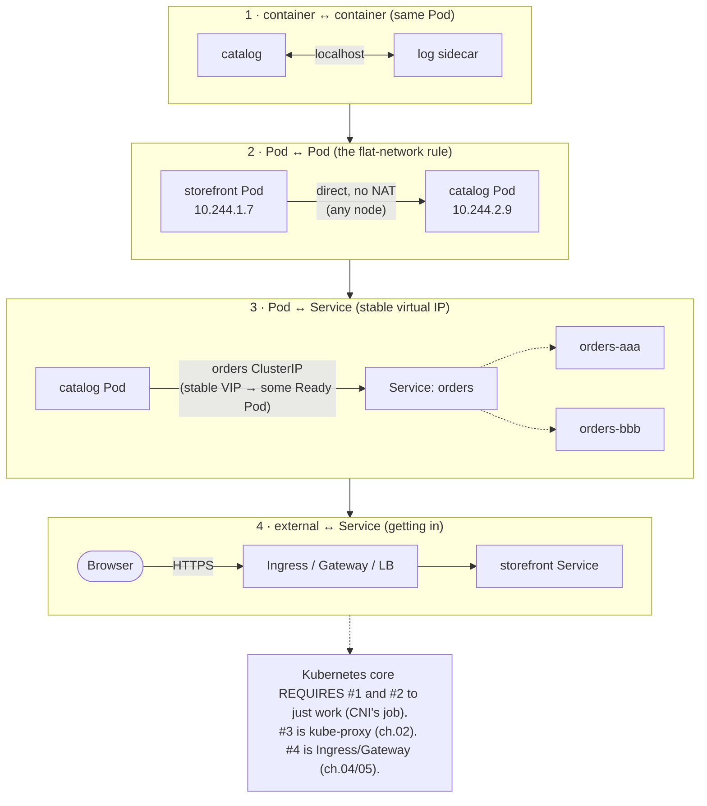
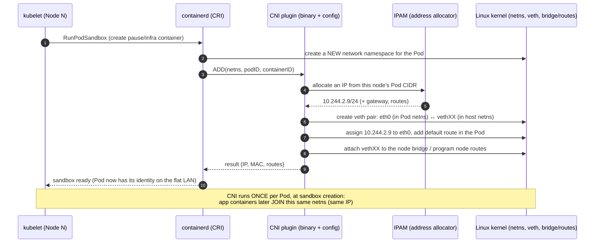

# 01. The networking model

> The four networking problems Kubernetes must solve, the one rule that makes
> them tractable (**IP-per-Pod on a flat network, no NAT pod-to-pod**), and how
> the CNI plugin actually wires a Pod's network namespace to the node when the
> kubelet creates the sandbox: a veth pair, then routes or a bridge, depending
> on the plugin.

**Estimated time:** ~15 min read, ~10 min hands-on on the Bookstore
**Prerequisites:** [Part 00 ch.05](../00-foundations/05-node-components.md) (kubelet/CRI sandbox creation) · [Part 01 ch.01](../01-core-workloads/01-pods.md) (Pods sharing a network namespace)
**You'll know after this:** • name the four networking problems Kubernetes must solve · • state the one rule (IP-per-Pod, no NAT pod-to-pod) that makes the model tractable · • explain what a CNI plugin actually does to a Pod's network namespace · • trace a veth pair from a Pod to the node · • show a Pod in one namespace reaching a Pod in another with no policy in place · • name the flat network as Part 02's first threat, and where its control is taught

<!-- tags: networking, cni, pod-network, veth, ip-per-pod -->

## Why this exists

So far the Bookstore is a pile of Pods: `catalog`, `storefront`, `orders`,
`postgres` ([Part 01](../01-core-workloads/04-replicasets-and-deployments.md)).
Each is alive, but **isolated**. `storefront` cannot reach `catalog`;
`catalog` cannot reach `postgres`; nothing outside the cluster can reach the
UI. A microservices app is *defined* by the calls between its parts, and none
of them work yet.

Before Services, Ingress, DNS, or NetworkPolicy can mean anything, you need the
**substrate** they all stand on: how does a packet get from one container to
another at all? Kubernetes deliberately does *not* invent a network. It
defines a small set of **requirements** and delegates the implementation to a
pluggable **CNI** plugin (the seam introduced in
[Part 00 ch.05](../00-foundations/05-node-components.md)). Every later
networking chapter (Services in [ch.02](02-services.md), DNS in
[ch.03](03-dns-and-discovery.md), policy in [ch.06](06-network-policies.md)) is
a layer *on top of* the model in this chapter. Get the model wrong and every
layer above it is mysterious.

## Mental model

Kubernetes networking is **"every Pod is a host on one big flat LAN"**.

Picture a single, flat virtual switch the size of the whole cluster. Every Pod
plugs into it and gets **its own IP address**, not the node's IP, its *own*.
Any Pod can open a connection to any other Pod's IP **directly**, on **any
port**, **without NAT**, whether they are on the same node or different nodes.
A Pod sees the *same* IP for itself that everyone else uses to reach it (no
"behind a NAT" surprise). It is as if every container were a small VM on one
giant subnet.

That model is a **promise Kubernetes makes but does not implement**. The thing
that *makes the flat LAN real* (handing each Pod an IP, creating its virtual
network cable, and getting packets between nodes) is the **CNI plugin**
(Calico, Cilium, Flannel, kindnet...). Different plugins keep the same promise
with very different machinery (an overlay tunnel, plain routing, or eBPF).
Everything above (Services, DNS, policy) is built assuming this promise holds.

## Threats and controls

This chapter teaches no control. The flat network is the default, so the
threats below exist until a later chapter adds a control.

| Threat | Control in this chapter | Goes deeper |
|---|---|---|
| **Lateral movement.** Any Pod reaches any Pod, on any port, in any namespace, until a policy says otherwise. | None. Hands-on step 2 shows the request that succeeds. | [02.06](06-network-policies.md): default deny, explicit allows, and proof that they hold. |
| **Plaintext between Pods.** Traffic on the Pod network is not encrypted unless the workload or a mesh encrypts it. | None. | [11.04](../11-advanced-production-patterns/04-service-mesh.md): mutual TLS between workloads. |
| **Recycled Pod IPs.** A Pod's IP goes back to the pool when the Pod is deleted, so an allowlist keyed on an IP admits whichever Pod gets it next. | None. Select peers by label, never by IP. | [02.06](06-network-policies.md) |
| **hostNetwork.** A Pod on the node's network namespace shares the node's addresses and sits outside the Pod network. | None here. The Pod Security baseline rejects it. | [05.02](../05-security/02-pod-security.md) |

## Diagrams

### The four networking problems (Mermaid)



The whole of Part 02 is these four problems, in order: this chapter owns #1 and
#2 (the substrate); [ch.02](02-services.md) owns #3; [ch.04](04-ingress.md) /
[ch.05](05-gateway-api.md) own #4; [ch.03](03-dns-and-discovery.md) is the
*naming* layer over #3/#4; [ch.06](06-network-policies.md) *restricts* #2/#3.

### kubelet → CNI ADD at sandbox creation (Mermaid)



This is the precise expansion of the "CNI ADD" arrow from the
[Part 00 ch.05 node-startup sequence](../00-foundations/05-node-components.md#sequence-a-pod-starting-on-a-node).
It is why a `CrashLoopBackOff` Pod keeps its IP (the sandbox/netns persists
across app-container restarts) and why all containers in a Pod share one IP.

### Pod netns and veth, with a bridge-style plugin (ASCII)

```
        WORKER NODE (host network namespace)
 ┌─────────────────────────────────────────────────────────────────────┐
 │                                                                     │
 │   ┌─ Pod A netns ──────────┐      ┌─ Pod B netns ──────────┐        │
 │   │ eth0  10.244.2.9/24    │      │ eth0  10.244.2.10/24   │        │
 │   │  (loopback: lo)        │      │  (loopback: lo)        │        │
 │   └─────────┬──────────────┘      └─────────┬──────────────┘        │
 │             │ veth pair                     │ veth pair             │
 │        vethA1│ (host end)              vethB1│ (host end)           │
 │             └──────────────┬────────────────┘                       │
 │                            ▼                                        │
 │                  cni0  (Linux bridge, 10.244.2.1)  ← Pod default GW │
 │                            │                                        │
 │                     eth0 (node NIC, e.g. 192.168.0.5)               │
 │                            │  inter-node Pod traffic leaves here:   │
 │                            │  VXLAN-encapsulated (overlay) OR       │
 │                            │  plain-routed (BGP/route table)        │
 └────────────────────────────┼────────────────────────────────────────┘
                               ▼  to other nodes' Pod CIDRs
   Same-node Pod↔Pod  : A.eth0 → vethA1 → cni0 → vethB1 → B.eth0  (L2, no NAT)
   Cross-node Pod↔Pod : A.eth0 → vethA1 → cni0 → node NIC → (overlay|route)
                        → remote node → its bridge → target veth → Pod
```

The diagram draws a bridge, which some plugins use. The kind node in the
hands-on does not. Its kindnet config names the `ptp` plugin, which gives each
Pod a point-to-point veth and a host route to the Pod's IP. Step 3 shows both.

## Hands-on with the Bookstore

**Assumed working directory: the guide repo root (`full-guide/`).** This
chapter adds one client Pod in its own namespace, so there is a second workload
to make a request from. Everything else observes the model on the running
Bookstore.

This needs the `bookstore` namespace and the catalog Deployment from
[Part 01 ch.04](../01-core-workloads/04-replicasets-and-deployments.md).
Catalog reads a ServiceAccount, a ConfigMap and a Secret, so apply those first,
with the `bookstore/catalog:dev` image loaded
(`kind load docker-image bookstore/catalog:dev --name bookstore`):

```sh
kubectl apply -f examples/bookstore/raw-manifests/00-namespace.yaml
kubectl apply -f examples/bookstore/raw-manifests/05-serviceaccounts-rbac.yaml
kubectl apply -f examples/bookstore/raw-manifests/15-catalog-config.yaml
kubectl apply -f examples/bookstore/raw-manifests/16-db-credentials.yaml
kubectl apply -f examples/bookstore/raw-manifests/10-catalog-deploy.yaml
```

Catalog reads Postgres when `DB_DSN` is set, and its readiness probe
(`/readyz`) pings Postgres. Until Postgres runs, catalog shows `0/1` Ready.
This chapter needs a Running Pod with an IP, so it does not wait for Ready.

The output below came from a shared lab cluster, where the same files were
applied under the namespace names `p02-01-bookstore` and `p02-01-netdemo`. The
output prints no namespace names, so it matches what you will see.

### 1. Every Pod has its own IP (the flat LAN)

```sh
kubectl get pods -n bookstore -l app=catalog -o custom-columns=POD:.metadata.name,IP:.status.podIP,NODE:.spec.nodeName
```

<!-- gate: output -->
```
POD                        IP             NODE
catalog-86d7dc55cc-dl2mk   10.244.0.191   sf-pilot-control-plane
catalog-86d7dc55cc-f6gjb   10.244.0.192   sf-pilot-control-plane
catalog-86d7dc55cc-m85rq   10.244.0.188   sf-pilot-control-plane
```

Each catalog Pod has its own address from the Pod CIDR. The node's own address
is different:

```sh
kubectl get nodes -o custom-columns='NAME:.metadata.name,IP:.status.addresses[0].address'
```

<!-- gate: output -->
```
NAME                     IP
sf-pilot-control-plane   172.18.0.2
```

### 2. Pod to Pod across namespaces: the threat, working

Catalog runs in `bookstore`. Make a second namespace with a client Pod that
stands in for any other workload, including one an attacker controls. The
client carries the baseline, so it is as locked down as catalog. The fields are
explained field by field in
[Part 01 ch.01](../01-core-workloads/01-pods.md#baseline).

Save this as `netdemo.yaml`:

```yaml
apiVersion: v1
kind: Namespace
metadata:
  name: netdemo
  labels:
    pod-security.kubernetes.io/enforce: restricted
    pod-security.kubernetes.io/enforce-version: latest
    pod-security.kubernetes.io/audit: restricted
    pod-security.kubernetes.io/audit-version: latest
    pod-security.kubernetes.io/warn: restricted
    pod-security.kubernetes.io/warn-version: latest
---
apiVersion: v1
kind: ServiceAccount
metadata:
  name: client
  namespace: netdemo
automountServiceAccountToken: false
---
apiVersion: v1
kind: Pod
metadata:
  name: client
  namespace: netdemo
  labels:
    app: client
spec:
  serviceAccountName: client
  automountServiceAccountToken: false
  securityContext:
    runAsNonRoot: true
    runAsUser: 100                    # curl_user, the UID the image declares
    runAsGroup: 101
    seccompProfile:
      type: RuntimeDefault
  containers:
    - name: app
      # curlimages/curl:8.9.1, pinned by its index digest
      image: curlimages/curl@sha256:8addc281f0ea517409209f76832b6ddc2cabc3264feb1ebbec2a2521ffad24e4
      command: ["sleep", "3600"]      # stay up so kubectl exec can run curl
      securityContext:
        allowPrivilegeEscalation: false
        readOnlyRootFilesystem: true
        capabilities:
          drop: ["ALL"]
      resources:
        requests:
          cpu: 10m
          memory: 16Mi
        limits:
          memory: 64Mi
      volumeMounts:
        - name: tmp
          mountPath: /tmp
  volumes:
    - name: tmp
      emptyDir: {}
```

```sh
kubectl apply -f netdemo.yaml
kubectl wait pod/client -n netdemo --for=jsonpath='{.status.phase}'=Running --timeout=100s
CAT_IP=$(kubectl get pod -n bookstore -l app=catalog -o jsonpath="{.items[0].status.podIP}")
kubectl exec -n netdemo client -- curl -s http://$CAT_IP:8080/healthz
```

<!-- gate: output -->
```
{"status":"ok"}
```

A Pod in one namespace reached a Pod in another by IP. No Service, no DNS name
and no policy stood in the way, and nothing refused the connection, because
nothing in the cluster says it should be refused. This is the threat working,
not a fault. [Part 02 ch.06](06-network-policies.md) adds the control, and
after its default deny this same command fails. Both Pods share one node
in this run, so the request never crosses a node boundary.

### 3. See the CNI on the node

kind nodes are containers, so you can read the node's network directly. This
inspects the node, not an app Pod. Start with the CNI:

```sh
kubectl get daemonset -n kube-system kindnet
docker exec bookstore-control-plane grep -o '"type": "[^"]*"' /etc/cni/net.d/10-kindnet.conflist
```

<!-- gate: output -->
```
NAME      DESIRED   CURRENT   READY   UP-TO-DATE   AVAILABLE   NODE SELECTOR            AGE
kindnet   1         1         1       1            1           kubernetes.io/os=linux   9h
```

<!-- gate: output -->
```
"type": "ptp"
"type": "host-local"
"type": "portmap"
```

The config lists `ptp`, which creates each Pod's veth, `host-local`, which
hands out addresses, and `portmap`, which handles host ports. No bridge plugin
is listed. Next, the host side of the Pods in this chapter. Each Pod IP has a
host route through its own veth. For the two Pods used here:

```sh
CAT_IP=$(kubectl get pod -n bookstore -l app=catalog -o jsonpath="{.items[0].status.podIP}")
CLIENT_IP=$(kubectl get pod client -n netdemo -o jsonpath="{.status.podIP}")
for ip in $CAT_IP $CLIENT_IP; do
  docker exec bookstore-control-plane sh -c "ip route | grep \"^$ip \""
done
```

<!-- gate: output -->
```
10.244.0.191 dev veth08ee030f scope host 
10.244.0.219 dev veth3aa32292 scope host 
```

The node has no bridge device. This counts the links named `cni*` or `br*`:

```sh
docker exec bookstore-control-plane sh -c 'ip -br link | awk "/^(cni|br)/{n++} END{print n+0}"'
```

<!-- gate: output -->
```
0
```

Compare this with the bridge-style diagram above. The packet leaves the client
through its `eth0`, crosses its veth, and reaches catalog through the node's
routing table, which sends it to the other veth.

> **Lineage note.** Nothing here is saved as a manifest because the networking
> *model* is not an object you apply. It is a property the CNI guarantees so
> that the Services you add in [ch.02](02-services.md)
> (`40-services.yaml`), the Ingress in [ch.04](04-ingress.md)
> (`50-ingress.yaml`), and the NetworkPolicies in
> [ch.06](06-network-policies.md) (`60-networkpolicy.yaml`) have a flat,
> routable Pod network to operate over. The Bookstore manifests resume in
> [ch.02](02-services.md).

## How it works under the hood

### The Kubernetes network model: the four rules

The model is small and is the *contract* every CNI must satisfy:

1. **Every Pod gets its own unique cluster-wide IP.** Not the node's IP; its
   own, from a per-node slice of the cluster **Pod CIDR**.
2. **Pods communicate Pod-IP → Pod-IP directly, without NAT**, regardless of
   which nodes they're on. (Source address is preserved end to end.)
3. **An agent on the node (kubelet/CNI) communicates with all Pods on that
   node** without NAT.
4. **A Pod's view of its own IP == others' view of it.** No "I think I'm
   `127.0.0.1`, but the world sees me as `10.x`": one identity.

Containers *in the same Pod* share one network namespace (the pause
container's, [Part 00 ch.05](../00-foundations/05-node-components.md)) so they
reach each other on **`localhost`** and **must not** use the same port. That is
networking problem #1, solved structurally by the Pod itself.

### CNI: the spec and how the kubelet invokes it

**CNI (Container Network Interface)** is a deliberately tiny spec: a CNI plugin
is an **executable** plus a JSON config in `/etc/cni/net.d/`. The contract is
just a few verbs, chiefly **`ADD`** (wire this sandbox up, return an IP) and
**`DEL`** (tear it down), invoked with the target **network namespace** and
container ID, parameters passed via env + stdin JSON, result returned as JSON.

The kubelet does **not** call CNI directly. The chain (from
[Part 00 ch.05](../00-foundations/05-node-components.md)) is: kubelet, then
(CRI) containerd, which on `RunPodSandbox` creates the Pod's **netns** and
invokes the configured **CNI plugin `ADD`**. The plugin allocates an IP (via an
**IPAM** plugin), creates a **veth pair** (one end `eth0` *inside* the Pod
netns, the other end on the host), assigns the IP and a default route inside
the Pod, and connects the host end to the node's dataplane (a **bridge**,
direct **routes**, or an **eBPF** path). It runs **once per Pod, at sandbox
creation**, which is exactly why all containers in a Pod share one IP and why
the IP survives app-container restarts.

### Plugin landscape: overlay vs. routed vs. eBPF

All keep the four-rule promise. They differ in *how cross-node Pod traffic
moves* and *what extra features they add*:

| Approach | How cross-node packets move | Examples | Trade-off |
|---|---|---|---|
| **Overlay (encapsulation)** | Pod packets wrapped in **VXLAN** (or Geneve/IPIP) UDP between node IPs; an L2 overlay on top of the real network | Flannel (VXLAN), Calico (VXLAN/IPIP mode) | Works on *any* underlying network (no fabric changes); small MTU/encap overhead |
| **Routed (no encapsulation)** | Each node advertises its Pod CIDR via **BGP** (or the cloud's route table), or the node programs routes to other nodes' Pod CIDRs via their host IPs; packets are plain-routed, unwrapped | Calico (BGP mode), Cilium (native routing), cloud VPC-CNI, kind's **kindnet** (routes through node addresses) | Near-native performance, real Pod IPs on the wire; needs an L3 fabric or route control |
| **eBPF dataplane** | Programs the kernel via **eBPF** for forwarding and policy; can **replace kube-proxy** entirely | **Cilium**, Calico eBPF mode | Best performance and richest policy and observability; newer, kernel-version sensitive |

`kind`'s default **kindnet** is a minimal CNI for learning. It adds plain
routes between nodes and wires each Pod with a `ptp` veth, so it has no tunnel
and no bridge (hands-on step 3). The choice of CNI is a **cluster-build
decision** ([Part 00 ch.05 production note](../00-foundations/05-node-components.md)).
It determines performance, IPv6 and dual-stack support, and whether kube-proxy
is even present.

### Pod netns, veth and routes, concretely

A network namespace is a kernel-isolated copy of the network stack
([Part 00 ch.02](../00-foundations/02-containers-and-images.md)): its own
interfaces, routes, ARP/neighbor table, iptables. A **veth pair** is a virtual
"patch cable": two linked interfaces where bytes in one end come out the other.
The CNI puts `eth0` in the Pod's netns and the partner (`vethXXXX`) in the
host netns, then connects the host end to the node's forwarding mechanism:

- **same-node Pod↔Pod:** Pod A `eth0` → `vethA` → the node, which forwards by
  route (kindnet) or through a bridge (`cni0` in bridge-style plugins) → `vethB`
  → Pod B `eth0`. No NAT is involved.
- **cross-node Pod↔Pod:** up to the node, then either **encapsulated**
  (overlay: wrapped in VXLAN to the peer node IP, unwrapped, delivered to the
  target Pod's veth) or **routed** (the node knows a route to the remote Pod
  CIDR and forwards natively).

Either way rule #2 holds: the *Pod* only ever sees a flat IP network.

### Default allow, and why a policy object is not yet proof

Kubernetes does not isolate Pods by default. The NetworkPolicy documentation
says a Pod that no policy selects is non-isolated: all inbound and outbound
connections are allowed ([upstream](https://kubernetes.io/docs/concepts/services-networking/network-policies/)).
A policy changes that only for the Pods it selects, and only if the networking
solution implements it. The API server accepts a NetworkPolicy either way, and
the docs say that without an implementing controller it has no effect. So
"policy applied" and "policy enforced" are different facts.
[Part 02 ch.06](06-network-policies.md) proves enforcement with a connection
that must fail, not by reading the object.

Two more facts from the model turn into threats:

- **Pod IPs are not identities.** A Pod's IP goes back to the pool when the Pod
  is deleted, and a later Pod can receive it. An allowlist keyed on an IP
  therefore admits whatever Pod gets that address next. Select peers by label
  ([ch.06](06-network-policies.md)) or by Service name ([ch.02](02-services.md)),
  never by IP.
- **Host networking leaves the model.** A Pod with `hostNetwork: true` shares
  the node's network namespace instead of getting its own IP. It sees the
  node's interfaces and addresses, so the rules above stop describing it. The
  Pod Security baseline rejects this field.
  [05.02](../05-security/02-pod-security.md) covers the Pod Security rule.

## Production notes

> **In production:** the **CNI is a foundational, hard-to-change decision**.
> Migrating CNIs on a live cluster is disruptive (Pod IP churn, policy gaps).
> Choose it up front for performance (eBPF or routed beats overlay), IPv6 and
> dual-stack, scale (BGP and route-table limits), and observability
> (Cilium/Hubble). Choose it for its policy story too: see the section above.

> **In production (EKS/GKE/AKS):** the cloud picks a default CNI and it changes
> the model. **EKS VPC-CNI** gives Pods **real VPC IPs** (no overlay; Pods are
> first-class in the VPC, but Pod density is bounded by ENI/IP limits per
> instance). **GKE** uses an alias-IP/VPC-native model (or **Dataplane V2** =
> Cilium/eBPF with built-in policy). **AKS** offers kubenet vs. **Azure CNI**.
> Whether `NetworkPolicy` is enforced and how Pod IPs appear on the wire all
> depend on this choice. Confirm it before designing
> [ch.06](06-network-policies.md) policies.

> **In production:** mind the **MTU**. Overlays (VXLAN ≈ 50 bytes of headers)
> reduce the usable payload; if Pod MTU isn't lowered to match, you get
> intermittent failures on large packets (TLS handshakes, big responses) that
> "ping works but curl hangs": a classic, baffling overlay misconfiguration.

> **In production:** `kube-proxy`'s mode (or its **eBPF replacement**) is part
> of this decision. It is how Service VIPs work over this Pod network
> ([ch.02](02-services.md), [Part 00 ch.05](../00-foundations/05-node-components.md)).

## Quick Reference

```sh
kubectl get pods -A -o wide                 # Pod IPs and nodes (the flat LAN)
kubectl get pod <P> -n <NS> \
  -o jsonpath='{.status.podIP}'             # one Pod's own IP
kubectl get daemonset -n kube-system        # the node agent, for example kindnet
kubectl get nodes -o custom-columns='NAME:.metadata.name,IP:.status.addresses[0].address'
# cross-namespace check from the restricted client Pod in netdemo:
kubectl exec -n netdemo client -- curl -s http://<PODIP>:8080/healthz
# inspect a kind node (not an app Pod):
docker exec -it <CLUSTER>-control-plane sh -c 'ip -br addr; ip route'
```

The model in one skeleton (memorize this shape):

```
Kubernetes network contract (CNI must satisfy ALL four):
  1. every Pod has its OWN cluster-unique IP (not the node's)
  2. Pod ↔ Pod direct, NO NAT, any node          ← the "flat network" rule
  3. node agent ↔ all local Pods, no NAT
  4. Pod's self-IP == the IP others use for it

kubelet ─CRI→ containerd ──(RunPodSandbox)──► create Pod netns
                                └──► CNI ADD: IPAM ip + veth pair + (bridge|route|eBPF)
   (runs ONCE per Pod; app containers join the same netns ⇒ shared IP)

Implementations keep the promise differently:
  overlay (VXLAN)  | routed (BGP / route table) | eBPF (Cilium; replaces kube-proxy)
```

Networking-model checklist:

- [ ] CNI chosen for: policy enforcement, performance, IPv6, scale, observability
- [ ] NetworkPolicy enforcement proven on this cluster with a connection that
      must fail ([ch.06](06-network-policies.md)), not assumed from the CNI's name
- [ ] Pod MTU correct for the dataplane (overlay encap overhead accounted for)
- [ ] No Pod IPs hardcoded or used in allowlists (Services, DNS, label policy)
- [ ] On managed: you know the cloud CNI's model (VPC-IP vs overlay) and limits
- [ ] kube-proxy mode / eBPF-replacement decided (it rides on this Pod network)

## Test your understanding

> Try each before opening the answer drawer. The act of trying is the exercise; the answer is the check.

1. **State Kubernetes' four networking-model rules in one sentence each. Why does rule 2 (Pod-to-Pod, no NAT) make the rest of the abstractions (Services, DNS, NetworkPolicy) tractable?**
   <details><summary>Show answer</summary>

   (1) Every Pod has its own cluster-unique IP. (2) Pods talk Pod-IP to Pod-IP directly without NAT. (3) Node agents reach local Pods without NAT. (4) A Pod's self-IP equals the IP others see. Rule 2 is the keystone: if every Pod is reachable on a flat LAN, Services can be "a stable VIP that load-balances to a set of Pod IPs", DNS can resolve names to those IPs, and policy can be expressed by label without IP gymnastics. Break rule 2 (e.g., port-mapped containers) and every layer above becomes special-cased (see §Mental model and §The four rules).

   </details>

2. **Your team says "our namespaces isolate the teams", and hands-on step 2 just reached catalog from another namespace. What is true about namespaces, what is missing, and how would you check the missing part?**
   <details><summary>Show answer</summary>

   Namespaces scope names, RBAC and quotas. They draw no network boundary, which is why the request in step 2 worked. Only NetworkPolicy adds one, and only where the networking solution enforces it. The API server accepts a NetworkPolicy whether or not anything enforces it, so the object alone proves nothing. Check with a connection that must fail, as ch.06 does: apply a default deny, then confirm the same request is refused. A policy you have only read is not evidence.

   </details>

3. **You see a Pod's `CrashLoopBackOff` keep the same IP across multiple restarts, but the IP changes when the Pod is deleted and recreated by its Deployment. What's the structural reason?**
   <details><summary>Show answer</summary>

   CNI runs *once per Pod* at sandbox (pause container) creation. The IP belongs to the sandbox's network namespace. App containers restart in place and rejoin the same netns; the sandbox (and IP) outlive container restarts. When the Pod itself is recreated, a *new* sandbox gets a *new* CNI ADD and a *new* IP from IPAM. This is why Pod IPs must never be hardcoded: they're ephemeral and recycled (see §Pod netns and veth, and §Default allow).

   </details>

4. **On EKS, a teammate notices Pods get "real VPC IPs" rather than 10.244.x.y, but Pod density per node is capped. What CNI is this, and what's the trade-off being made?**
   <details><summary>Show answer</summary>

   AWS VPC-CNI: Pods get IPs from the VPC subnet (first-class VPC members, security groups apply directly, no overlay encapsulation). Trade-off: each Pod IP costs an ENI secondary IP, and an EC2 instance has a hard max IP count per ENI and ENI count per instance type, so Pod density is bounded by instance shape, not just CPU/memory. EKS docs publish the max-Pods-per-instance table for this reason (see §Production notes, EKS/GKE/AKS).

   </details>

5. **Hands-on extension: after step 2, find the host route for the client's Pod IP on the node with `ip route`. Which interface does it name, and what does that tell you about the wiring?**
   <details><summary>What you should see</summary>

   The route names one veth, in the form `dev vethXXXX scope host`. Each Pod has one veth pair: one end is `eth0` inside the Pod, and the other end sits in the node's network namespace. The node routes each Pod IP to its own end. The request needed no Service, because Pods reach each other by IP on the flat network (rule 2). The node has no bridge, since the `ptp` plugin wires each Pod directly (see §3. See the CNI on the node).

   </details>

## Further reading

- **Rosso et al., _Production Kubernetes_, ch.5: "Pod Networking"**. The
  network model, CNI, overlay vs. routed dataplanes from an operator's view.
- **Lukša, _Kubernetes in Action_ 2e, ch.11: "Exposing Pods with Services"**.
  Opens with the Pod network model the Service abstraction sits on.
- Official: <https://kubernetes.io/docs/concepts/cluster-administration/networking/>
  ("Cluster Networking": the model and its requirements),
  <https://kubernetes.io/docs/concepts/extend-kubernetes/compute-storage-net/network-plugins/>
  (CNI / network plugins), and
  <https://kubernetes.io/docs/concepts/services-networking/network-policies/>
  (default isolation and what a policy needs before it has any effect).
- kindnet's routing, as described in its README in the kind repository:
  <https://github.com/kubernetes-sigs/kind/tree/main/images/kindnetd>.
