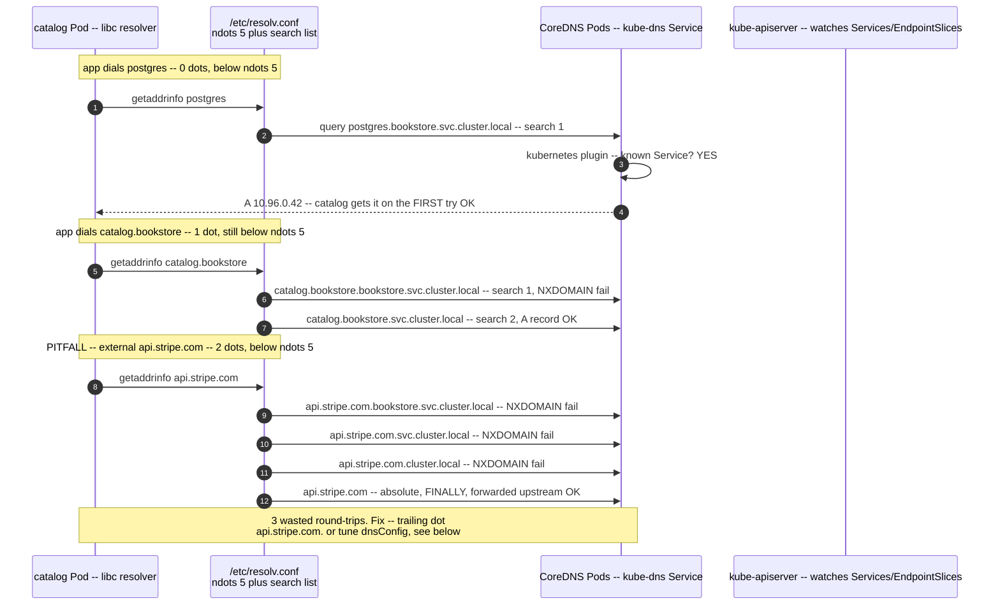

# 03 — DNS and service discovery

> How a name like `postgres.bookstore.svc.cluster.local` becomes an IP:
> CoreDNS and its Corefile, the A/AAAA/SRV records for Services and headless
> Pods, the `pod-ip.ns.pod` form, DNSPolicy, and the `ndots:5` +
> search-domain latency pitfall (and the FQDN / `dnsConfig` fixes) — applied by
> wiring the Bookstore tiers to each other by DNS name.

**Estimated time:** ~15 min read · ~30 min hands-on
**Prerequisites:** [Part 02 ch.02](02-services.md) — Services that DNS names point at
**You'll know after this:** • trace how `service.ns.svc.cluster.local` resolves through CoreDNS · • read a Corefile and the records served for Services and headless Pods · • set `dnsPolicy` (`ClusterFirst`, `ClusterFirstWithHostNet`, `None`) appropriately · • diagnose and fix the `ndots:5` + search-domain DNS-latency pitfall · • configure `dnsConfig` for FQDN lookups and custom resolvers · • say what a lookup reveals to any Pod, and why a resolved name grants no connection

<!-- tags: networking, dns, coredns, service-discovery, dnspolicy -->

## Why this exists

[ch.02](02-services.md) gave the Bookstore stable virtual IPs. But nothing
should hardcode a `ClusterIP` either — it's assigned at Service creation and
differs per cluster/namespace. What `catalog` actually needs in its config is
**`postgres.bookstore.svc.cluster.local`**, resolved at runtime to whatever the
current ClusterIP is. That resolution — turning **names into IPs inside the
cluster** — is **cluster DNS**, and it is the final piece that makes service
discovery *usable* (not just *possible*).

It is also where a notorious, silent performance problem lives: the
`ndots:5`-plus-search-domain behavior that turns one DNS lookup into **five
failed lookups** before the right one — invisible until it's your p99. This
chapter completes the [Service Discovery](#further-reading) pattern: ch.02 was
the *mechanism* (VIP+endpoints), this is the *naming* over it.

## Mental model

Cluster DNS is **an in-cluster phone book that updates itself**.

- Every Service automatically gets a **name → ClusterIP** entry the moment it
  exists. No registration code; the DNS server *watches the API* and keeps the
  records current as Services come and go.
- The phone book is **CoreDNS** — itself just Pods + a Service
  (`kube-dns` in `kube-system`). The kubelet injects its address into **every**
  Pod's `/etc/resolv.conf`, so every container resolves cluster names with zero
  app config.
- Names are **hierarchical**: short within a namespace (`postgres`), fully
  qualified across (`postgres.bookstore.svc.cluster.local`). A **search list**
  in `resolv.conf` auto-expands short names — convenient, but the source of the
  `ndots` latency trap below.

So "service discovery" in Kubernetes is mostly: **name your Service, then use
its DNS name**. The system does the registration and keeps it live; your only
real decision is *short vs. fully-qualified name* (and that decision has a
performance edge).

The phone book answers anyone who asks. CoreDNS has no per-caller policy, so a
Pod in any namespace that asks for `postgres.bookstore.svc.cluster.local` gets
the ClusterIP. A lookup tells a caller where a name points. Whether a Pod may
connect is a separate decision, made by NetworkPolicy
([ch.06](06-network-policies.md)).

## Threats and controls

Cluster DNS is shared, and it answers every Pod without a permission check.
Each row is a threat specific to name lookup, with the control this chapter
teaches and the chapter that decides the rest.

| Threat | Control in this chapter | Deeper |
|---|---|---|
| Any Pod resolves any Service name in any namespace, and an SRV query lists its named ports. | Treat a Service name as visible to the whole cluster: no secrets or internal detail in names. A lookup is not access. | [ch.06](06-network-policies.md) decides who may connect |
| NXDOMAIN and an answer differ, so a caller can test names one at a time and map the cluster. | Step 4 shows the oracle. Egress rules (ch.06) can deny port 53 for a Pod, which stops the lookup itself, on a CNI that enforces them. | [ch.06](06-network-policies.md) |
| A Pod sets `dnsPolicy: None` and its own `dnsConfig.nameservers`, so its lookups go to a resolver the manifest chooses. | Reader Pods keep `ClusterFirst`. The `dnsConfig` here sets only `ndots`. The admission rule is not taught here. | 05.07 <!-- link-later: 05.07 --> |
| Write access to the `coredns` ConfigMap in `kube-system` changes DNS for every Pod. | Not taught here. Restrict who can write it. | [05.01](../05-security/01-authn-authz-rbac.md) |
| One CoreDNS Deployment answers for every Pod. A crash or a flood of queries stops name lookups cluster-wide. | HA and headroom in the production notes. Egress rules must still allow it. | [ch.06](06-network-policies.md) |

## Diagrams

### Pod → CoreDNS resolution path, with search-domain expansion (Mermaid)



### Record naming scheme (ASCII)

```
 FORM                                                    RESOLVES TO
 ───────────────────────────────────────────────────────────────────────────
 <SVC>.<NS>.svc.cluster.local            A/AAAA          Service ClusterIP
   catalog.bookstore.svc.cluster.local           → 10.96.x.x (load-balanced)

 <SVC>.<NS>.svc.cluster.local            SRV             port+target per named port
   _http._tcp.catalog.bookstore.svc.cluster.local

 headless <SVC>.<NS>.svc.cluster.local   A (multi)       ALL Ready Pod IPs (no VIP)
   postgres.bookstore.svc.cluster.local          → 10.244.* , 10.244.* , ...

 <POD>.<SVC>.<NS>.svc.cluster.local      A   (StatefulSet stable per-Pod name)
   postgres-0.postgres.bookstore.svc.cluster.local → that ordinal's Pod IP

 <POD-IPV4-DASHES>.<NS>.pod.cluster.local A  (any Pod, by IP, rarely used)
   10-244-2-9.bookstore.pod.cluster.local        → 10.244.2.9

 SHORT names (resolv.conf `search` auto-appends, SAME namespace):
   postgres            → postgres.bookstore.svc.cluster.local
   catalog.bookstore   → catalog.bookstore.svc.cluster.local   (cross-ns: add the ns)
```

## Hands-on with the Bookstore

**Assumed working directory: the guide repo root (`full-guide/`).** Requires
the `bookstore` namespace, the catalog/storefront/orders Deployments, the
redis/rabbitmq scaffolding, the Services from
[ch.02](02-services.md) (`40-services.yaml`), and the postgres StatefulSet
([Part 01 ch.05](../01-core-workloads/05-statefulsets.md),
`20-postgres-statefulset.yaml`). The one manifest this chapter adds is a probe
Pod that asks the questions from inside the cluster. DNS records are created
*automatically* for the Services you already applied; this chapter shows the
names the Bookstore will be configured with (the actual `DB_DSN`/`REDIS_ADDR`
wiring lands as Secret-backed env in
[Part 03 ch.02](../03-config-and-storage/02-secrets.md)).

The output blocks were captured on the lab cluster in a namespace named
`p02-bookstore`, a copy of `bookstore` with only the name changed, so the output
carries that name. The lab transcript is
`full-guide/examples/security-lab/evidence/02-03.txt`. The search line of the
probe's `resolv.conf` also lists the lab host's own search domains; those are
redacted there. On your cluster the line ends with whatever your host adds.

### 0. Start the probe Pod

The probe runs the netshoot toolbox, which has `nslookup`, `dig` and `getent`,
and sleeps so that you can `exec` into it. netshoot declares root in its image
config, so the Pod runs as UID 65532. The DNS tools need no root. The other
fields are the baseline from [01.01](../01-core-workloads/01-pods.md#baseline).
The image is pinned by digest, with its tag in a comment.

```sh
kubectl apply -n bookstore -f - <<'EOF'
apiVersion: v1
kind: Pod
metadata:
  name: dns-probe
  labels:
    app.kubernetes.io/name: dns-probe
    app.kubernetes.io/part-of: bookstore
spec:
  automountServiceAccountToken: false
  securityContext:
    runAsNonRoot: true
    runAsUser: 65532
    runAsGroup: 65532
    seccompProfile:
      type: RuntimeDefault
  containers:
    - name: probe
      # nicolaka/netshoot:v0.16
      image: nicolaka/netshoot@sha256:b09d9b21381f47a79b3cbcb30da25266dc17186ea00ae65e99fdc51396f48e70
      command: ["sleep", "infinity"]
      securityContext:
        allowPrivilegeEscalation: false
        readOnlyRootFilesystem: true
        capabilities:
          drop: ["ALL"]
      resources:
        requests:
          cpu: 10m
          memory: 32Mi
        limits:
          memory: 128Mi
      volumeMounts:
        - name: tmp
          mountPath: /tmp
  volumes:
    - name: tmp
      emptyDir: {}
EOF
kubectl -n bookstore wait --for=condition=Ready pod/dns-probe --timeout=300s
```

<!-- gate: output -->
```text
pod/dns-probe created
# ...
pod/dns-probe condition met
```

### 1. Every Service already has a record

The catalog Service implies catalog's DB target is the **headless postgres**
name and storefront's API target is the **catalog** name, with no code and no
registration. Ask the probe for them. `catalog` and `orders` are distroless and
have no `nslookup`, so do not exec into them.

```sh
kubectl -n bookstore exec dns-probe -- nslookup catalog.bookstore.svc.cluster.local
kubectl -n bookstore exec dns-probe -- nslookup postgres.bookstore.svc.cluster.local
kubectl -n bookstore exec dns-probe -- nslookup postgres-0.postgres.bookstore.svc.cluster.local
kubectl -n bookstore exec dns-probe -- nslookup -type=SRV _http._tcp.catalog.bookstore.svc.cluster.local
```

<!-- gate: output -->
```text
Name:	catalog.p02-bookstore.svc.cluster.local
Address: 10.96.185.51
# ...
Name:	postgres.p02-bookstore.svc.cluster.local
Address: 10.244.0.167
# ...
Name:	postgres-0.postgres.p02-bookstore.svc.cluster.local
Address: 10.244.0.167
# ...
_http._tcp.catalog.p02-bookstore.svc.cluster.local	service = 0 100 80 catalog.p02-bookstore.svc.cluster.local.
```

`catalog` returns one ClusterIP, and kube-proxy spreads connections over the
Ready Pods behind it. The headless `postgres` returns the Ready Pod IPs
directly, with no virtual IP. `postgres-0.postgres` returns that ordinal's Pod
alone. The SRV answer names port 80 and its target, so a caller learns the
port from DNS.

### 2. Short names, the search list and a second namespace

A short name works because the search list in `resolv.conf` completes it with
the caller's own namespace. Read the search list, then ask for the same short
name from a second namespace. Create that namespace with the `restricted` label
that `00-namespace.yaml` sets, and apply the probe from step 0 with
`-n <other-ns>` in place of `-n bookstore`.

```sh
kubectl -n bookstore exec dns-probe -- cat /etc/resolv.conf
kubectl -n bookstore exec dns-probe -- nslookup catalog
kubectl -n <other-ns> exec dns-probe -- nslookup catalog
kubectl -n <other-ns> exec dns-probe -- nslookup catalog.bookstore
```

<!-- gate: output -->
```text
search p02-bookstore.svc.cluster.local svc.cluster.local cluster.local <host search domains redacted>
nameserver 10.96.0.10
options ndots:5
# ...
Name:	catalog.p02-bookstore.svc.cluster.local
Address: 10.96.185.51
# ...
;; Got SERVFAIL reply from 10.96.0.10
# ...
** server can't find catalog: SERVFAIL
# ...
command terminated with exit code 1
# ...
Name:	catalog.p02-bookstore.svc.cluster.local
Address: 10.96.185.51
```

Inside `bookstore`, `catalog` expands to `catalog.bookstore.svc.cluster.local`.
From the other namespace the same short name finds no Service. The search list
there does not reach `bookstore`, so CoreDNS does not own the name, and its
`forward` plugin sends it to the node's resolver. On the lab host that resolver
answered SERVFAIL, and `kubectl exec` exited 1. Your host may answer NXDOMAIN
instead. This failure is deliberate: it shows that a short name is scoped to
its caller's namespace. The namespace-qualified form works from anywhere.

### 3. See (and avoid) the ndots pitfall

```sh
kubectl -n bookstore exec dns-probe -- dig +search +showsearch api.github.com
kubectl -n bookstore exec dns-probe -- dig +noall +answer +stats api.github.com.
```

<!-- gate: output -->
```text
;; ->>HEADER<<- opcode: QUERY, status: NXDOMAIN, id: 64694
# ...
;api.github.com.p02-bookstore.svc.cluster.local.	IN A
# ...
;; ->>HEADER<<- opcode: QUERY, status: NXDOMAIN, id: 13206
# ...
;api.github.com.svc.cluster.local. IN	A
# ...
;; ->>HEADER<<- opcode: QUERY, status: NXDOMAIN, id: 51825
# ...
;api.github.com.cluster.local.	IN	A
# ...
;; ->>HEADER<<- opcode: QUERY, status: NXDOMAIN, id: 31443
# ...
;api.github.com.<redacted-domain>. IN	A
# ...
;; ->>HEADER<<- opcode: QUERY, status: NXDOMAIN, id: 31542
# ...
;api.github.com.<redacted-domain>.		IN	A
# ...
;; ->>HEADER<<- opcode: QUERY, status: NOERROR, id: 14219
# ...
;api.github.com.			IN	A
```

`api.github.com` has two dots, below the `ndots:5` threshold, so the resolver
tries each search domain before it tries the name as written. `+showsearch`
prints every attempt: three cluster search domains, then one domain the lab host
adds, and only then the name as written. A host with no extra search domain
leaves three failed lookups. The trailing dot marks the name absolute, so the
resolver skips the search list. The second command asks for the absolute name
and gets its answer directly.

### 4. What a lookup reveals to another namespace

DNS answers a Pod in any namespace, and it does not check whether that Pod
should know. Run these from the other namespace. The last name is made up on
purpose, and its NXDOMAIN is part of the result.

```sh
kubectl -n <other-ns> exec dns-probe -- nslookup catalog.bookstore.svc.cluster.local
kubectl -n <other-ns> exec dns-probe -- nslookup -type=SRV _http._tcp.catalog.bookstore.svc.cluster.local
kubectl -n <other-ns> exec dns-probe -- nslookup billing-admin.bookstore.svc.cluster.local
```

<!-- gate: output -->
```text
Name:	catalog.p02-bookstore.svc.cluster.local
Address: 10.96.185.51
# ...
_http._tcp.catalog.p02-bookstore.svc.cluster.local	service = 0 100 80 catalog.p02-bookstore.svc.cluster.local.
# ...
** server can't find billing-admin.p02-bookstore.svc.cluster.local: NXDOMAIN
# ...
command terminated with exit code 1
```

The other namespace received the ClusterIP and the port, and nothing refused
it. The `billing-admin` lookup came back NXDOMAIN, so a caller that tries a list
of guessed names learns which Services exist from the answers alone. A Pod that
can reach CoreDNS can always ask. Egress rules in
[ch.06](06-network-policies.md) can stop that Pod from reaching port 53 at all,
on a CNI that enforces them.

### 5. Clean up

```sh
kubectl -n bookstore delete pod dns-probe
kubectl delete namespace <other-ns>
```

The Bookstore namespace and its Services stay, because later chapters use them.


## How it works under the hood

### CoreDNS and the Corefile

Cluster DNS is **CoreDNS**: a Deployment of CoreDNS Pods fronted by the
`kube-system` Service **`kube-dns`** (the name is historical). It is a normal
workload the control plane manages — not a core binary
([Part 00 ch.03](../00-foundations/03-architecture-overview.md)).

CoreDNS is configured by a **Corefile** (a ConfigMap, `coredns` in
`kube-system`), an ordered plugin chain. The Corefile on the lab cluster, read
with `kubectl`:

<!-- gate: output -->
```text
.:53 {
    errors
    health {
       lameduck 5s
    }
    ready
    kubernetes cluster.local in-addr.arpa ip6.arpa {
       pods insecure
       fallthrough in-addr.arpa ip6.arpa
       ttl 30
    }
    prometheus :9153
    forward . /etc/resolv.conf {
       max_concurrent 1000
    }
    cache 30 {
       disable success cluster.local
       disable denial cluster.local
    }
    loop
    reload
    loadbalance
}
```

The **`kubernetes` plugin** is the heart: it **watches the API** for Services
and EndpointSlices and answers `*.cluster.local` from live cluster state
(no zone files, no registration). `forward` sends everything else (e.g. `api.github.com`) to upstream DNS.
`cache 30` also keeps a denial (NXDOMAIN) for up to 30 seconds, which is why a
typo or a not-yet-created Service can keep failing after the fix. The lab
Corefile narrows this for `cluster.local`: `disable success` and `disable
denial` skip caching for that zone, so a denial there is not kept for the TTL.
Check your own Corefile before you rely on either behaviour.

### The records CoreDNS serves

- **Service A/AAAA:** `my-svc.my-ns.svc.cluster.local` → the Service
  **ClusterIP**.
- **Service SRV:** `_<PORT-NAME>._<PROTO>.my-svc.my-ns.svc.cluster.local` →
  port + target (per **named** port — another reason the Bookstore names its
  ports).
- **Headless Service A:** `clusterIP: None` → **multiple A records**, one per
  **Ready** backing Pod IP (no VIP). The client picks/round-robins; this is the
  StatefulSet discovery mechanism
  ([Part 01 ch.05](../01-core-workloads/05-statefulsets.md)).
- **StatefulSet per-Pod:** with a headless governing Service,
  `<POD>.<SVC>.<NS>.svc.cluster.local` → that **ordinal's** Pod
  (`postgres-0.postgres.bookstore…`). Stable across reschedule.
- **Pod by IP:** `<IPV4-WITH-DASHES>.<NS>.pod.cluster.local` →
  `10-244-2-9.bookstore.pod.cluster.local` = `10.244.2.9`. Rarely needed
  directly; used by some controllers/headless flows.

### resolv.conf, search domains, and the `ndots:5` trap

The kubelet writes each Pod's `/etc/resolv.conf` (per **DNSPolicy** below).
The probe's file reads, captured in `p02-bookstore`:

<!-- gate: output -->
```text
search p02-bookstore.svc.cluster.local svc.cluster.local cluster.local <host search domains redacted>
nameserver 10.96.0.10
options ndots:5
```

`ndots:5` means: **if the queried name has fewer than 5 dots, try the `search`
domains *first*** (treat it as relative) before trying it as absolute. Short
in-cluster names (`catalog`, 0 dots) therefore resolve on the **first** search
entry — great. But an external name like `api.github.com` (2 dots, still
`< 5`) gets the search list appended **first**:
`api.github.com.bookstore.svc.cluster.local` (NXDOMAIN) →
`api.github.com.svc.cluster.local` (NXDOMAIN) →
`api.github.com.cluster.local` (NXDOMAIN) → `api.github.com` (finally). That's
**3 wasted round-trips per lookup** on a host that adds no search domain, one
more for each domain the host adds (×2 for A and AAAA). That is a real and
*silent* latency/QPS tax on any Pod making external calls.

Fixes (in order of preference):

1. **Trailing dot** — `api.github.com.` is **absolute**: the resolver skips the
   search list entirely. One query. (Use FQDNs-with-dot for external endpoints
   in latency-sensitive code.)
2. **Per-Pod `dnsConfig`** — override options for that workload:
   ```yaml
   spec:
     dnsConfig:
       options:
         - { name: ndots, value: "1" }   # only ≥1-dot names use search
   ```
   Lowers wasted lookups for Pods that mostly call external/long names.
3. **Use FQDNs internally too** (the Bookstore convention) — fewer surprises
   and namespace-independent.

### DNSPolicy

`spec.dnsPolicy` controls what resolver config a Pod gets:

- **`ClusterFirst`** (default) — cluster DNS first; non-cluster names forwarded
  upstream by CoreDNS. What every Bookstore Pod uses.
- **`ClusterFirstWithHostNet`** — `ClusterFirst` semantics for
  `hostNetwork: true` Pods (which would otherwise inherit the node's resolver
  and lose cluster DNS).
- **`Default`** — inherit the **node's** `/etc/resolv.conf` (no cluster DNS).
- **`None`** — use **only** what you specify in `dnsConfig` (full control).

`None` with `dnsConfig.nameservers` is the rogue-resolver threat in the table.
Such a manifest sends that Pod's lookups to a server the manifest names. This
chapter does not run it, and it does not decide whether the cluster admits it.
That admission rule belongs to 05.07, and the field reference is in the
[Kubernetes DNS documentation](https://kubernetes.io/docs/concepts/services-networking/dns-pod-service/).

### Cross-namespace and FQDN

A short name only resolves within the **caller's** namespace (the search list
is the caller's). Cross-namespace **must** qualify: `catalog.bookstore` (search
appends `svc.cluster.local`) or the full
`catalog.bookstore.svc.cluster.local`. There is **no implicit cross-namespace
short name** — this is also a security boundary
([ch.06](06-network-policies.md): DNS resolving a name ≠ being allowed to
*connect* to it).

## Production notes

> **In production:** **CoreDNS is critical-path for nearly every request.**
> Give it **HA** (≥2 replicas, anti-affinity across nodes/zones,
> [Part 04 ch.02](../04-scheduling/02-affinity-taints-topology.md)), a PDB
> ([Part 06 ch.05](../06-production-readiness/05-reliability-and-disruptions.md)),
> and resource headroom. When CoreDNS is degraded, *everything* looks "slow or
> flaky" with no obvious culprit — DNS is the first thing to check in a
> cluster-wide brownout.

> **In production:** the **`ndots:5` tax is real at scale.** Services doing
> many external calls (payment gateways, S3, third-party APIs) multiply every
> request by failed search-list lookups. Mitigate with **FQDN-with-trailing-dot**
> for external hosts, per-workload **`dnsConfig` `ndots:1`**, and consider
> **NodeLocal DNSCache** (a per-node DNS cache that slashes CoreDNS load and
> tail latency and avoids conntrack races on UDP DNS).

> **In production:** **negative caching bites where the Corefile allows it.** A
> Service referenced before it exists (an ordering bug, a typo) can have its
> NXDOMAIN cached for the `cache` TTL, and the client keeps failing after the
> fix. The lab Corefile turns denial caching off for `cluster.local`. A plain
> `cache 30` does cache denials. Check the Corefile, apply dependencies in order
> ([Part 01 ch.05](../01-core-workloads/05-statefulsets.md)), and keep `cache`
> TTLs short.

> **In production:** prefer **FQDNs (and the headless name, not Pod IPs)** in
> all config. Short names break when a workload moves namespace; Pod IPs are
> ephemeral ([ch.01](01-networking-model.md)). The Bookstore standard —
> `<SVC>.<NS>.svc.cluster.local` — is namespace-explicit and portable across
> overlays/Kustomize ([Part 07 ch.02](../07-delivery/02-packaging-kustomize.md)).

> **In production:** scope DNS for **multi-tenancy**. Resolving a name across
> namespaces is allowed even when *connecting* is not — enforce reachability
> with **NetworkPolicy** ([ch.06](06-network-policies.md)), and remember that a
> default-deny egress policy **must explicitly allow DNS** or every name lookup
> in the namespace fails (taught hands-on in ch.06).

## Quick Reference

```sh
kubectl -n kube-system get deploy,svc,cm -l k8s-app=kube-dns   # CoreDNS + Corefile cm
kubectl -n kube-system get configmap coredns -o yaml           # the Corefile
kubectl -n kube-system logs -l k8s-app=kube-dns                # resolution errors
# from the probe of step 0 (a restricted-shaped Pod); never exec a distroless app Pod:
kubectl -n <NS> exec dns-probe -- nslookup <SVC>.<NS>.svc.cluster.local
kubectl -n <NS> exec dns-probe -- nslookup -type=SRV _http._tcp.<SVC>.<NS>.svc.cluster.local
kubectl -n <NS> exec dns-probe -- dig +search +showsearch <NAME>   # the search-list expansion
```

DNS naming + tuning skeleton:

```
Service     :  <SVC>.<NS>.svc.cluster.local            (A → ClusterIP)
Headless    :  <SVC>.<NS>.svc.cluster.local            (A → each Ready Pod IP)
StatefulSet :  <POD>.<SVC>.<NS>.svc.cluster.local      (A → that ordinal)
Cross-ns    :  always qualify (≥ <SVC>.<NS>); no implicit short name
External    :  use a TRAILING DOT "host.example.com."  (skip search list)
```
```yaml
spec:
  dnsPolicy: ClusterFirst          # default; ClusterFirstWithHostNet if hostNetwork
  dnsConfig:
    options: [ { name: ndots, value: "1" } ]   # cut search-list waste
```

Checklist:

- [ ] Config uses **FQDN** Service names, not ClusterIPs or Pod IPs
- [ ] CoreDNS HA: ≥2 replicas, anti-affinity, PDB, resource headroom
- [ ] External hostnames use a trailing dot (or `dnsConfig ndots:1`)
- [ ] NodeLocal DNSCache considered for scale / tail-latency / UDP conntrack
- [ ] Cross-namespace calls fully qualified (short names are caller-ns only)
- [ ] Negative-cache aware (create dependencies before referrers; sane TTLs)
- [ ] default-deny egress (ch.06) explicitly allows DNS (UDP/TCP 53)

## Test your understanding

> Try each before opening the answer drawer. The act of trying is the exercise; the answer is the check.

1. **Walk through why `ndots:5` in `resolv.conf` turns a lookup of `api.stripe.com` into four queries. What's the cheapest fix in application code?**
   <details><summary>Show answer</summary>

   `api.stripe.com` has 2 dots — fewer than 5 — so the resolver tries it as *relative* first, appending each search domain: `.bookstore.svc.cluster.local`, `.svc.cluster.local`, `.cluster.local` (all NXDOMAIN), then finally as absolute `api.stripe.com`. That's 4 queries (8 with AAAA). Cheapest fix: write the hostname with a trailing dot (`api.stripe.com.`) — that signals "absolute", skipping the search list entirely (see §Diagrams, ndots PITFALL).

   </details>

2. **A teammate creates a Service and a Pod that uses it. The Pod's first lookup returns NXDOMAIN, and it keeps failing after the Service exists. What is cached, where, and for how long? What pattern avoids it?**
   <details><summary>Show answer</summary>

   The NXDOMAIN is a denial, and CoreDNS's `cache` plugin keeps denials when the Corefile allows it. A plain `cache 30` keeps one for up to 30 seconds. The lab Corefile disables denial caching for `cluster.local`, so there the failure clears at once. Another cluster may keep it for the full TTL. The pattern is to create dependencies before the workloads that resolve them ([Part 01 ch.05](../01-core-workloads/05-statefulsets.md)), and to keep `cache` TTLs short (see Production notes, negative caching).

   </details>

3. **A Pod in namespace `default` resolves `postgres.bookstore.svc.cluster.local` to a ClusterIP. Can it connect to the database? What did the lookup reveal, and which control decides the connection?**
   <details><summary>Show answer</summary>

   Not by DNS alone. The lookup returned the ClusterIP, and an SRV query returns the port. It revealed that the Service exists and where it points. Whether the connection succeeds is decided by the NetworkPolicy in force ([ch.06](06-network-policies.md)) and by the database's own authentication. With no policy in place, nothing in the cluster stops that connection. With a default-deny policy that does not allow it, the connection fails even though the name resolved.

   </details>

4. **You apply a default-deny egress NetworkPolicy in `bookstore` and immediately every Pod's DNS breaks. Why, and what's the missing rule?**
   <details><summary>Show answer</summary>

   Default-deny egress blocks UDP/53 (and TCP/53) to CoreDNS in `kube-system`, so every name lookup fails. The policy must explicitly allow DNS egress: `to: namespaceSelector: { kubernetes.io/metadata.name: kube-system }`, `ports: [{ protocol: UDP, port: 53 }, { protocol: TCP, port: 53 }]`. This is the single most common gotcha when introducing default-deny — DNS is invisible until it isn't (see §Production notes, "default-deny egress explicitly allows DNS").

   </details>

5. **Hands-on extension: from the probe, run `dig +search +showsearch api.github.com`, then `dig +noall +answer +stats api.github.com.`. Count the attempts. Which search domains came from the cluster, and which from your host? What does this prove about the trailing dot in latency-sensitive code?**
   <details><summary>What you should see</summary>

   Cluster domains come first (`bookstore`, `svc`, `cluster.local`), then any domain your host adds, then the name as written. Each failed attempt is a round-trip, and A and AAAA double them. The absolute form skips the search list entirely, so high-QPS clients that call external hosts should write the trailing dot. The lab run showed one more domain from the host than a bare cluster would (see the hands-on step 3 output).

   </details>

## Further reading

- **Lukša, _Kubernetes in Action_ 2e, ch.11 — "Exposing Pods with Services"**
  — the DNS records for Services/headless Services and how discovery works.
- **Ibryam & Huß, _Kubernetes Patterns_ 2e, ch.13 — _Service Discovery_** —
  DNS- vs. API-based discovery and when each applies.
- Official: <https://kubernetes.io/docs/concepts/services-networking/dns-pod-service/>
  ("DNS for Services and Pods") and the CoreDNS docs
  <https://coredns.io/plugins/kubernetes/> (the `kubernetes` plugin).
