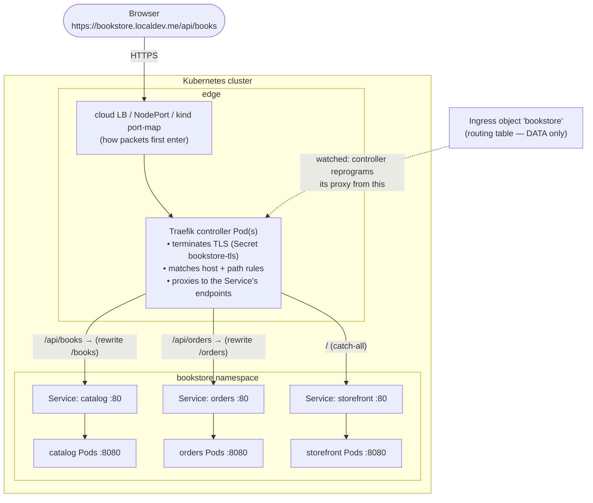

# 04 — Ingress

> One external entrypoint, L7. The **Ingress** resource and **IngressClass**,
> what an **ingress controller** actually does (turn Ingress objects into
> reverse-proxy config), host/path rules and `pathType`, TLS termination via
> a Secret, the default backend. Applied by exposing the Bookstore UI and APIs
> through one TLS endpoint, served by Traefik.

**Estimated time:** ~15 min read · ~60 min hands-on
**Prerequisites:** [Part 02 ch.02](02-services.md) — the Services Ingress fronts · [Part 02 ch.03](03-dns-and-discovery.md) — name resolution outside the cluster
**You'll know after this:** • distinguish the Ingress resource from the Ingress controller · • configure host/path rules and `pathType` (Exact, Prefix, ImplementationSpecific) · • set up TLS termination using a Secret · • understand what `IngressClass` does, and why Traefik is pinned to one class name and the default stays off · • expose Bookstore through Traefik with one TLS endpoint

<!-- tags: networking, ingress, traefik, tls, l7 -->

## Why this exists

The Bookstore now talks to itself ([ch.02](02-services.md)/[ch.03](03-dns-and-discovery.md)),
but a `ClusterIP` is **in-cluster only** — a browser cannot reach
`storefront.bookstore.svc.cluster.local`. You could set `type: LoadBalancer` on
every Service, but that's one cloud LB (and bill) **per Service**, no shared
TLS, no path routing, no single hostname. What a real app wants is **one
external address** that does TLS once and **routes by host/path** to many
in-cluster Services: `/` → UI, `/api/books` → catalog, `/api/orders` → orders.

That is **Ingress**: an L7 (HTTP/HTTPS) router into the cluster. It is the
fourth networking problem ([ch.01](01-networking-model.md)) — external →
Service — solved with **HTTP awareness** (hostnames, paths, TLS, redirects)
that an L4 Service cannot express. It is the [Service Routing](#further-reading)
edge layer for the Bookstore.

## Mental model

Ingress is **two things that are easy to confuse**:

1. The **Ingress object** — a *declarative routing table*: "host
   `bookstore.localdev.me`, path `/api/books` → Service `catalog:80`; TLS via
   Secret `bookstore-tls`". It is **pure desired state. It does nothing by
   itself.**
2. The **ingress controller** — a *Pod actually running a reverse proxy*
   (nginx, Envoy, HAProxy…). It **watches Ingress objects** and continuously
   **reprograms its proxy config** to match: vhosts, locations, upstreams
   (the Service endpoints), TLS certs. *This* is what terminates TLS and
   forwards requests.

So Ingress is the **reconciliation loop applied to a reverse proxy**: you
write the routing intent as an object; a controller makes a real proxy match
it. An Ingress with **no controller installed is inert** — the single most
common "my Ingress does nothing" cause. **IngressClass** is the link that says
*which* controller owns a given Ingress (clusters can run several).

## Threats and controls

An Ingress puts a process that reads Secrets on the internet. The threats
below belong to that position.

| Threat | Control in this chapter | Goes deeper |
|---|---|---|
| A controller flaw reaches Secrets. IngressNightmare (CVE-2025-1974, CVSS 9.8) needed only pod-network access to reach Secrets that ingress-nginx could read cluster-wide by default ([Kubernetes blog](https://kubernetes.io/blog/2025/03/24/ingress-nginx-cve-2025-1974/)). | One maintained controller, Traefik, installed from a pinned chart and image digest. Its Ingress and CRD watch lists name only `bookstore`, and only Ingresses that name the `traefik` class are routed. The ClusterRole still reads every Secret cluster-wide: the watch lists narrow what is routed, not what the token may read. That residual read is the price of the cluster-scoped install, since the chart does not allow the IngressClass with `rbac.namespaced`. | [Part 05 ch.03](../05-security/03-supply-chain.md): scanning and provenance |
| Plaintext at the edge, or a certificate that does not match the host. | HTTP redirects to HTTPS at the entrypoint. The TLS Secret sits in the app namespace with a SAN for the host. | [Part 02 ch.05](05-gateway-api.md): listeners. In-cluster TLS: [Part 11 ch.04](../11-advanced-production-patterns/04-service-mesh.md) |
| Routing set by controller-specific annotations. | `Prefix` paths only. The one rewrite is a typed Middleware with an explicit regex, not a free-form annotation. | [Part 02 ch.05](05-gateway-api.md): typed filters |
| A weakly labelled controller namespace. | The `traefik` namespace is labelled `restricted`, the same level as the bookstore. | [Part 05 ch.02](../05-security/02-pod-security.md) |

The controls are specific to Traefik in syntax and portable in intent. The
migration note near the end covers an existing ingress-nginx install.

## Diagrams

### external request → controller → Service → Pod (Mermaid)



### Host/path routing table (ASCII)

```
 Ingress "bookstore"  (ingressClassName: traefik, TLS host bookstore.localdev.me)
 ─────────────────────────────────────────────────────────────────────────────
   HOST                    PATH            pathType  BACKEND
   bookstore.localdev.me   /api/books      Prefix    catalog:80    (→ /books)
   bookstore.localdev.me   /api/orders     Prefix    orders:80     (→ /orders)
   bookstore.localdev.me   /               Prefix    storefront:80

   the most specific paths come first; '/' is the catch-all
   no rule matches  ───────────────────────────────────────►  default backend
   TLS: SNI host bookstore.localdev.me → cert+key from Secret 'bookstore-tls'
```

## Hands-on with the Bookstore

**Assumed working directory: the guide repo root (`full-guide/`).** Requires
the `bookstore` namespace and its ServiceAccounts and ConfigMap from earlier
chapters (`00-`, `05-`, `15-`), the Services from [ch.02](02-services.md)
(`40-services.yaml`), the Deployments they select (`10-`, `11-`, `14-`), and
the Redis and Postgres pieces that catalog and orders need before they report
ready (`12-`, `16-`, `20-`, `21-`). Step 3 applies them in order.

### 1. A kind cluster with ports 80 and 443 on localhost

The cluster from [Part 00 ch.07](../00-foundations/07-local-cluster-setup.md)
has no port mappings, so nothing on your machine answers on 80 or 443. Port
mappings are fixed when a kind cluster is created, so create a new cluster
with these mappings and the same kind version and node image as Part 00 ch.07.
`kind delete cluster --name bookstore` removes everything in the old cluster,
including the Bookstore data. Skip this step and use step 8 if you keep the
old cluster.

```yaml
kind: Cluster
apiVersion: kind.x-k8s.io/v1alpha4
nodes:
  - role: control-plane
    extraPortMappings:
      - containerPort: 30080     # Traefik's web NodePort (step 2)
        hostPort: 80
        listenAddress: "127.0.0.1"
        protocol: TCP
      - containerPort: 30443     # Traefik's websecure NodePort (step 2)
        hostPort: 443
        listenAddress: "127.0.0.1"
        protocol: TCP
```

```sh
kind create cluster --name bookstore --config kind-bookstore.yaml
```

`listenAddress` keeps the ports on localhost. kind's default is `0.0.0.0`,
which would publish them on every interface of your machine
([kind docs](https://kind.sigs.k8s.io/docs/user/configuration/)).

### 2. Install Traefik under `restricted`, on a pinned chart

ingress-nginx is retired upstream. Its repository was archived in March 2026
and it gets no more fixes ([Kubernetes blog, 2025-11-11](https://kubernetes.io/blog/2025/11/11/ingress-nginx-retirement/);
[GitHub](https://github.com/kubernetes/ingress-nginx)). This chapter uses
Traefik instead. The migration note at the end covers an existing install.

Pin the chart first. `helm show chart` prints the version and the Traefik
release it packages:

```sh
helm repo add traefik https://traefik.github.io/charts
helm repo update traefik
helm show chart traefik/traefik --version 42.2.0
```

<!-- gate: output -->
```text
apiVersion: v2
appVersion: v3.7.16
# ...
kubeVersion: '>=1.30.0-0'
# ...
name: traefik
# ...
version: 42.2.0
```

Chart 42.2.0 packages Traefik v3.7.16. Create the namespace with the
`restricted` labels before the install. The Helm flag `--create-namespace`
would create it without labels.

```yaml
apiVersion: v1
kind: Namespace
metadata:
  name: traefik
  labels:
    app.kubernetes.io/name: traefik
    pod-security.kubernetes.io/enforce: restricted
    pod-security.kubernetes.io/enforce-version: latest
    pod-security.kubernetes.io/audit: restricted
    pod-security.kubernetes.io/audit-version: latest
    pod-security.kubernetes.io/warn: restricted
    pod-security.kubernetes.io/warn-version: latest
```

```sh
kubectl apply -f 00-traefik-namespace.yaml
```

The values file sets only what this chapter needs. Everything else keeps the
chart's default.

```yaml
image:
  # Pinned by digest, with the version kept readable. Kubernetes pulls the digest.
  tag: v3.7.16@sha256:1336e85aaed293bd63d005086e0dd013b04078b26aaeb1c18b26a2f928af7e65
ingressClass:
  enabled: true
  name: traefik
  isDefaultClass: false        # classless Ingresses are not adopted by default
providers:
  kubernetesIngress:
    ingressClass: traefik      # only Ingresses that name this class are routed
    namespaces:                # the Ingress watch list
      - bookstore
    strictPrefixMatching: true # /api/books does not match /api/booksx
  kubernetesCRD:
    namespaces:                # the IngressRoute, Middleware and TLS watch list
      - bookstore
    defaultTLSResourcesNamespace: traefik
ports:
  web:
    nodePort: 30080            # matches the kind mapping in step 1
    http:
      redirections:
        entryPoint:
          to: websecure
          scheme: https
          permanent: true      # plain HTTP is redirected, not served
  websecure:
    nodePort: 30443
service:
  spec:
    type: NodePort             # the chart's Service spec; `service.type` is ignored
resources:                     # the baseline's requests and memory limit
  requests:
    cpu: 100m
    memory: 128Mi
  limits:
    memory: 256Mi
```

Each setting answers a threat from the table above:

- **Image.** A pinned digest means the Pod runs the bytes you reviewed. The
  digest is the value Kubernetes verifies, so the tag is a label only. This
  is the [baseline's image rule](../01-core-workloads/01-pods.md#baseline-image-digest).
- **IngressClass.** Two settings keep a classless Ingress out. The
  `ingressClass: traefik` setting makes Traefik route only Ingresses whose
  class is `traefik`. Without it, the provider processes Ingresses that have
  no class, or an empty annotation, or the value `traefik`, as the chart's
  comment says. `isDefaultClass: false` stops the IngressClass from becoming
  the cluster default. The chart's default is `true`. Every Ingress in this
  guide names `traefik` explicitly, and step 6 shows a classless Ingress left
  unrouted.
- **Watch lists.** An empty list means Traefik watches all namespaces. The
  `kubernetesIngress` list scopes Ingresses, and the `kubernetesCRD` list
  scopes IngressRoute, Middleware and TLS objects. The chart's default for the
  CRD provider is `enabled: true`, so this list is what stops a Middleware in
  another namespace from being served. `defaultTLSResourcesNamespace` limits
  which namespace may define the default TLS store. It needs Traefik v3.7.11 or
  later.
- **Redirect.** The `web` entrypoint answers HTTP with a redirect to the
  `websecure` entrypoint, so no request is served in cleartext
  ([Traefik entrypoint docs](https://doc.traefik.io/traefik/reference/install-configuration/entrypoints/#configuration-example)).

The chart's defaults already meet `restricted`. The Pod runs as UID and GID
65532 with `runAsNonRoot` and `seccompProfile: RuntimeDefault`, drops all
capabilities, and uses a read-only root filesystem with `emptyDir` volumes for
`/data` and `/tmp`. The values file adds no exception.

Check the install with a server dry run. A clean run prints only the status
line, with no PodSecurity warning:

```sh
helm install traefik traefik/traefik --version 42.2.0 \
  --namespace traefik -f traefik-values.yaml --dry-run=server 2>&1 \
  | grep -iE 'warning|error|^STATUS:'
```

<!-- gate: output -->
```text
STATUS: pending-install
```

Then install for real and check the controller and its class:

```sh
helm install traefik traefik/traefik --version 42.2.0 \
  --namespace traefik -f traefik-values.yaml --wait
kubectl -n traefik get pods,svc
kubectl get ingressclass traefik
```

<!-- gate: output -->
```text
NAME                           READY   STATUS    RESTARTS   AGE
pod/traefik-55fd4fd896-j4pvj   1/1     Running   0          59s

NAME              TYPE       CLUSTER-IP      EXTERNAL-IP   PORT(S)                      AGE
service/traefik   NodePort   10.96.169.177   <none>        80:30080/TCP,443:30443/TCP   60s
```

The Service is `NodePort`, with the node ports that step 1 maps to localhost.
The IngressClass is registered under the name the Ingresses will name:

<!-- gate: output -->
```text
NAME      CONTROLLER                      PARAMETERS   AGE
traefik   traefik.io/ingress-controller   <none>       59s
```

Check the two routing settings in the rendered manifest. `helm template` shows
the arguments the controller runs with, before anything is installed:

```sh
helm template traefik traefik/traefik --version 42.2.0 -n traefik -f traefik-values.yaml \
  | grep -iE -- "--providers\.kubernetes(ingress|crd)\.(ingressclass|strictprefix|defaulttls)|type: NodePort"
```

<!-- gate: output -->
```text
  type: NodePort
# ...
        - --providers.kubernetesingress.ingressClass=traefik
        - --providers.kubernetesingress.strictPrefixMatching=true
```

The Pod mounts a ServiceAccount token because Traefik must call the API to
watch Ingresses, Services, EndpointSlices and Secrets. It is the chart's own
`traefik` ServiceAccount, so the token belongs to the controller alone, which
is the baseline's rule for a workload that calls the API.

The chart's default grants that ServiceAccount `get`, `list` and `watch` on
Secrets in every namespace, through a ClusterRole. The watch lists narrow
which Ingresses and CRD objects Traefik routes. They do not narrow what the
token may read, so a flaw in Traefik can read every Secret in the cluster.
That is the residual exposure of this install. The chart offers
`rbac.namespaced: true` with `rbac.secretResourceNames` to narrow Secret reads
to named Secrets, but its comments say the IngressClass cannot be used with
namespaced RBAC, and resource names do not apply to cluster-scoped list and
watch rules. This chapter keeps the cluster-scoped install and accepts the
residual read.

Two releases collide when they set the same IngressClass name. The IngressClass
is cluster-scoped, and this chapter sets its name to `traefik`. A second
release that sets the same name is refused at install. With the release above
still installed, create a second namespace with the same labels and install a
second release into it, setting the name:

```sh
kubectl create namespace p02-traefik2
helm install second traefik/traefik --version 42.2.0 --namespace p02-traefik2 \
  --set ingressClass.name=traefik --wait --timeout 90s
```

<!-- gate: output -->
```text
Error: INSTALLATION FAILED: unable to continue with install: IngressClass "traefik" in namespace "" exists and cannot be imported into the current release: invalid ownership metadata; annotation validation error: key "meta.helm.sh/release-name" must equal "second": current value is "traefik"; annotation validation error: key "meta.helm.sh/release-namespace" must equal "p02-traefik2": current value is "p02-traefik"
```

The lab names are `p02-` prefixed, so the namespace in the message is the
lab's. The message names the release that owns the class.

To run a second release, give it its own `ingressClass.name`.

### 3. The Bookstore workloads

Skip any file you applied in an earlier chapter. Apply is idempotent.

```sh
# from the repo root (full-guide/)
kubectl apply -f examples/bookstore/raw-manifests/00-namespace.yaml
kubectl apply -f examples/bookstore/raw-manifests/05-serviceaccounts-rbac.yaml
kubectl apply -f examples/bookstore/raw-manifests/15-catalog-config.yaml
kubectl apply -f examples/bookstore/raw-manifests/16-db-credentials.yaml
kubectl apply -f examples/bookstore/raw-manifests/20-postgres-statefulset.yaml
kubectl -n bookstore rollout status statefulset/postgres --timeout=180s
kubectl apply -f examples/bookstore/raw-manifests/21-db-migrate-job.yaml
kubectl -n bookstore wait --for=condition=complete job/db-migrate --timeout=180s
kubectl apply -f examples/bookstore/raw-manifests/12-redis.yaml
kubectl apply -f examples/bookstore/raw-manifests/10-catalog-deploy.yaml
kubectl apply -f examples/bookstore/raw-manifests/11-storefront-deploy.yaml
kubectl apply -f examples/bookstore/raw-manifests/14-orders-deploy.yaml
kubectl apply -f examples/bookstore/raw-manifests/40-services.yaml
kubectl -n bookstore rollout status deploy/catalog --timeout=180s
```

The `:dev` images from [Part 00](../00-foundations/07-local-cluster-setup.md)
must be loaded into the kind cluster first. The catalog's readiness probe
pings both Postgres and Redis, so it stays not-ready until both answer. If
`db-migrate` reports `Failed` because Postgres was still starting, delete the
job and apply it again.

### 4. A TLS Secret (terminate HTTPS at the edge)

Run these in an empty directory outside the repo, so the key stays out of
version control. The SAN is the part that matters: a certificate without it
does not match `bookstore.localdev.me`, and clients reject it.

```sh
openssl req -x509 -nodes -days 365 -newkey rsa:2048 \
  -keyout tls.key -out tls.crt \
  -subj "/CN=bookstore.localdev.me" \
  -addext "subjectAltName=DNS:bookstore.localdev.me"
openssl x509 -in tls.crt -noout -subject -ext subjectAltName
```

<!-- gate: output -->
```text
subject=CN=bookstore.localdev.me
X509v3 Subject Alternative Name: 
    DNS:bookstore.localdev.me
```

```sh
kubectl create secret tls bookstore-tls -n bookstore \
  --cert=tls.crt --key=tls.key
```

<!-- gate: output -->
```text
secret/bookstore-tls created
```

A self-signed pair is fine on a laptop. In production this is cert-manager
issuing and renewing the Secret, as the production note below explains.

### 5. Check the backends directly

The Ingress will rewrite `/api/books` to `/books`, so the catalog must answer
on `/books`. Check that before you add the Ingress. Port-forward the three
Services to local ports:

```sh
kubectl -n bookstore port-forward svc/catalog 18080:80 &
kubectl -n bookstore port-forward svc/orders 18081:80 &
kubectl -n bookstore port-forward svc/storefront 18082:80 &
curl -s --retry 10 --retry-connrefused --retry-delay 1 -w '\n%{http_code}\n' http://localhost:18080/books
curl -s -w '\n%{http_code}\n' http://localhost:18080/api/books
curl -s -w '\n%{http_code}\n' -X POST http://localhost:18081/orders \
  -H 'Content-Type: application/json' -d '{"book_id":1,"qty":2}'
curl -s -w '\n%{http_code}\n' http://localhost:18082/healthz
kill %1 %2 %3
```

<!-- gate: output -->
```text
[]
200
```

The list is empty because the migration creates tables and adds no books.

**Deliberate failure.** The catalog has no `/api` routes, so a request for
`/api/books` that reaches it unchanged gets a not-found response. That is why
the Ingress rewrites the path.

<!-- gate: output -->
```text
404 page not found
404
```

The POST writes an order row. Its response is what the orders Service returns
for `/orders`, which is the path the Ingress rewrites `/api/orders` to.

<!-- gate: output -->
```text
{"order_id":2,"status":"accepted"}
201
```

<!-- gate: output -->
```text
{"status":"ok"}
200
```

The storefront's `/healthz` is answered by its own nginx `location`, and the
Ingress's `/` rule sends the same request there.

### 6. The Ingress object and its Middleware

Traefik routes by host and path like any ingress controller. Two parts are
Traefik-specific: a **Middleware**, a custom resource that rewrites the path,
and the annotation that attaches it. The annotation's value is
`<namespace>-<name>@kubernetescrd`. Traefik's `replacePathRegex` takes a regex
and a replacement with `$1` capture references
([Traefik docs](https://doc.traefik.io/traefik/reference/routing-configuration/http/middlewares/replacepathregex/)).

Something at the edge has to strip `/api`. The storefront calls `/api/books`
and `/api/orders` (`app/storefront/index.html`), and the services serve
`/books` and `/orders` (`app/catalog/main.go`, `app/orders/main.go`). Step 5
showed the catalog answering `/api/books` with a 404. The Ingress API has no
rewrite field, and Traefik's reference lists no Ingress annotation that
rewrites a path, only `router.middlewares`, which attaches a Middleware
([Traefik Ingress reference](https://doc.traefik.io/traefik/reference/routing-configuration/kubernetes/ingress/)).

The block below is the tree's
`examples/bookstore/raw-manifests/50-ingress-traefik.yaml`. Save it as
`50-ingress-traefik.yaml`, or use the tree file. The tree's `50-ingress.yaml` is
the same Ingress without the annotation and without the Middleware: the
portable form, which step 7 uses to show what the Middleware does. The Helm
chart and the Kustomize base carry the portable form as well and add the pair
on request (`ingress.traefikRewrite.enabled`, and the `traefik-rewrite`
component). A Middleware is a custom resource, so keeping it out of the
default renders keeps them free of CRD kinds and keeps their object counts
unchanged.

```yaml
apiVersion: traefik.io/v1alpha1
kind: Middleware
metadata:
  name: rewrite-api-prefix
  namespace: bookstore
  labels:
    app.kubernetes.io/part-of: bookstore
spec:
  replacePathRegex:
    regex: "^/api/(books|orders)(.*)"
    replacement: "/$1$2"
---
apiVersion: networking.k8s.io/v1
kind: Ingress
metadata:
  name: bookstore
  namespace: bookstore
  labels:
    app.kubernetes.io/part-of: bookstore
  annotations:
    traefik.ingress.kubernetes.io/router.middlewares: bookstore-rewrite-api-prefix@kubernetescrd
spec:
  ingressClassName: traefik          # which controller owns this Ingress
  tls:
    - hosts:
        - bookstore.localdev.me
      secretName: bookstore-tls      # the Secret from step 4
  rules:
    - host: bookstore.localdev.me
      http:
        paths:
          - path: /api/books
            pathType: Prefix
            backend:
              service:
                name: catalog
                port:
                  number: 80
          - path: /api/orders
            pathType: Prefix
            backend:
              service:
                name: orders
                port:
                  number: 80
          - path: /
            pathType: Prefix
            backend:
              service:
                name: storefront
                port:
                  number: 80
```

The regex matches only `/api/books` and `/api/orders`, so `/` and `/healthz`
reach the storefront unchanged. `Prefix` matches whole path segments, as the
Kubernetes Ingress spec defines it, so `/api/books` matches `/api/books/3` but
not `/api/booksx`. Traefik follows that rule only with
`strictPrefixMatching: true` in the step 2 values, which the chart leaves
`false`. Step 7 shows the request that the setting is for. One Middleware
serves both API routes because the annotation sits on the Ingress and the
regex touches only the two API paths.

```sh
kubectl apply --dry-run=server -f 50-ingress-traefik.yaml
```

<!-- gate: output -->
```text
middleware.traefik.io/rewrite-api-prefix created (server dry run)
ingress.networking.k8s.io/bookstore created (server dry run)
```

Applied before step 2, the same file is refused at the Middleware, because
its CRD does not exist yet:

<!-- gate: output -->
```text
ingress.networking.k8s.io/bookstore created (server dry run)
# ...
ensure CRDs are installed first
```

Apply it for real, then read back what Traefik adopted:

```sh
kubectl apply -f 50-ingress-traefik.yaml
kubectl get ingress -n bookstore
kubectl describe ingress bookstore -n bookstore
```

<!-- gate: output -->
```text
NAME        CLASS     HOSTS                   ADDRESS   PORTS     AGE
bookstore   traefik   bookstore.localdev.me             80, 443   1s
```

The class is `traefik`, and the host and the TLS ports match the Ingress. The
`ADDRESS` column is empty on this cluster. The Service is a NodePort, so it has
no load balancer address to show.

### 7. Route traffic through the one endpoint

This lab cluster has no port mappings, so the requests below go through a
port-forward to the Traefik Service. Step 8 gives the form for a cluster with
the step 1 mappings. Run the curl commands from the directory that holds
`tls.crt`. The `--resolve` flag sends the hostname to 127.0.0.1, so the TLS
handshake still checks the certificate for `bookstore.localdev.me`.

```sh
kubectl -n traefik port-forward svc/traefik 8443:443 &
```

Before the Bookstore requests, two probe Ingresses test the class setting. Save
the first as `probe-classless.yaml`. It has no class. Save the second as
`probe-nginx-class.yaml`. It names the class `nginx`, which this cluster does not
have. Each routes `/` on `classless.localdev.me` to the storefront, if Traefik
adopts it.

```yaml
apiVersion: networking.k8s.io/v1
kind: Ingress
metadata:
  name: probe-classless
  namespace: bookstore
spec:
  rules:
    - host: classless.localdev.me
      http:
        paths:
          - path: /
            pathType: Prefix
            backend:
              service:
                name: storefront
                port:
                  number: 80
```

```yaml
apiVersion: networking.k8s.io/v1
kind: Ingress
metadata:
  name: probe-nginx-class
  namespace: bookstore
spec:
  ingressClassName: nginx
  rules:
    - host: classless.localdev.me
      http:
        paths:
          - path: /
            pathType: Prefix
            backend:
              service:
                name: storefront
                port:
                  number: 80
```

```sh
kubectl apply -f probe-classless.yaml -f probe-nginx-class.yaml
curl -sk -w "\n%{http_code}\n" --resolve classless.localdev.me:8443:127.0.0.1 https://classless.localdev.me:8443/
kubectl delete -f probe-classless.yaml -f probe-nginx-class.yaml
```

<!-- gate: output -->
```text
404 page not found
404
```

Neither probe was adopted. The 404 is Traefik's own, not the storefront's
page, so no router matched the request. The Bookstore Ingress, which names
`traefik`, is adopted, and the requests below reach its backends:

```sh
curl -s --cacert tls.crt --resolve bookstore.localdev.me:8443:127.0.0.1 -w "\n%{http_code}\n" https://bookstore.localdev.me:8443/healthz
curl -s --cacert tls.crt --resolve bookstore.localdev.me:8443:127.0.0.1 -w "\n%{http_code}\n" https://bookstore.localdev.me:8443/api/books
curl -s --cacert tls.crt --resolve bookstore.localdev.me:8443:127.0.0.1 -w "\n%{http_code}\n" -X POST https://bookstore.localdev.me:8443/api/orders -H "Content-Type: application/json" -d '{"book_id":1,"qty":2}'
```

<!-- gate: output -->
```text
{"status":"ok"}
200
```

<!-- gate: output -->
```text
[]
200
```

<!-- gate: output -->
```text
{"order_id":2,"status":"accepted"}
201
```

The first two requests reach the storefront and the catalog, as in step 5.
The order ID is 2 because step 5 already wrote order 1.

Now the request that the strict prefix rule is for. `/api/booksx` is not a
catalog path, so it must not reach the catalog:

```sh
curl -s --cacert tls.crt --resolve bookstore.localdev.me:8443:127.0.0.1 -w "\n%{http_code}\n" https://bookstore.localdev.me:8443/api/booksx
```

<!-- gate: output -->
```text
<!DOCTYPE html>
# ...
  <title>Bookstore</title>
# ...
200
```

It reaches the storefront, which answers `200` with its own page, and not the
catalog. The `/` rule took it, because `strictPrefixMatching` keeps `/api/books`
from matching it.

Last, the portable Ingress without the Middleware. **Deliberate action:**
apply the tree's `50-ingress.yaml` over the Traefik form. It names the same
Ingress, so Kubernetes reports `configured`, and it removes the annotation.
Then repeat the catalog request:

```sh
kubectl apply -f examples/bookstore/raw-manifests/50-ingress.yaml
curl -s --cacert tls.crt --resolve bookstore.localdev.me:8443:127.0.0.1 -w "\n%{http_code}\n" https://bookstore.localdev.me:8443/api/books
```

<!-- gate: output -->
```text
ingress.networking.k8s.io/bookstore configured
```

<!-- gate: output -->
```text
404 page not found
404
```

The route is still there, and the request reaches the catalog as `/api/books`,
which the catalog does not serve. Nothing stripped the prefix. Put the pair
back:

```sh
kubectl apply -f 50-ingress-traefik.yaml
curl -s --cacert tls.crt --resolve bookstore.localdev.me:8443:127.0.0.1 -w "\n%{http_code}\n" https://bookstore.localdev.me:8443/api/books
```

<!-- gate: output -->
```text
middleware.traefik.io/rewrite-api-prefix unchanged
ingress.networking.k8s.io/bookstore configured
```

<!-- gate: output -->
```text
[]
200
```

```sh
kill %1
```

### 8. Localhost with the step 1 mappings

With the mappings from step 1, `localhost` is the edge, and no port-forward is
needed. The same requests go to `https://bookstore.localdev.me/...` on port
443, with `--cacert tls.crt` and no `--resolve`. Plain HTTP on port 80 is
redirected to HTTPS, as the lab run showed through a port-forward to the web
entrypoint:

```sh
kubectl -n traefik port-forward svc/traefik 8080:80 &
curl -sI --resolve bookstore.localdev.me:8080:127.0.0.1 http://bookstore.localdev.me:8080/ | head -3
kill %1
```

<!-- gate: output -->
```text
HTTP/1.1 308 Permanent Redirect
Location: https://bookstore.localdev.me/
```

> **Lineage note.** `50-ingress-traefik.yaml` is the Bookstore's external edge
> from here. It exposes the **existing** `storefront`/`catalog`/`orders`
> Services from [ch.02](02-services.md), with no app change and no Service-type
> change. [ch.05](05-gateway-api.md) re-expresses the same routing as **Gateway
> API**, a **mutually exclusive alternative**: apply the Ingress file or the
> Gateway file, never both. [ch.06](06-network-policies.md) then restricts the
> controller→storefront/catalog/orders edges.

## How it works under the hood

### The Ingress object is data; the controller is the engine

`kubectl apply` of an Ingress just stores a routing table in the API. An
**ingress controller** (a Deployment of proxy Pods) **watches** Ingress,
Service, EndpointSlice, and Secret objects and on every change **regenerates
its reverse-proxy configuration**. Traefik's Kubernetes Ingress provider does
this with the objects its ClusterRole lists. Its routers, services and
certificates are rebuilt from them. The data path at request time is
**browser → controller proxy → Pod** — the proxy *is* in the path
(unlike a ClusterIP, where kube-proxy only programs the kernel,
[ch.02](02-services.md)). Traefik proxies to the Pod endpoints behind each
Service, so it implements its own L7 load-balancing over the EndpointSlice
set.

### IngressClass — which controller owns it

A cluster can run several controllers. **IngressClass** (a cluster-scoped
object created by the controller install) names a controller; an Ingress
selects one via `spec.ingressClassName: traefik`. An Ingress with **no class**
is handled only if a controller is marked the **default**
(`ingressclass.kubernetes.io/is-default-class: "true"`). Otherwise the Ingress
is **ignored**, which is another classic "Ingress does nothing" symptom. The
Kubernetes docs say a default class should be defined if `ingressClassName` is
omitted. Traefik adds a check of its own. Its `providers.kubernetesIngress.ingressClass`
setting makes the controller route only Ingresses that name the class. Without
that setting, the chart's comment says Traefik also processes Ingresses with no
class, whether or not a default exists. This chapter sets both, so the default
stays off and a classless Ingress stays unrouted, and step 7 shows the 404.
Every Ingress names its class. (The deprecated
`kubernetes.io/ingress.class` annotation predates IngressClass; on every
supported version (this guide: **v1.37**) use `ingressClassName`.)

### host/path rules and `pathType`

Rules match on **`host`** (virtual host; SNI for TLS) then **`path`**.
`pathType` is required and defines path-matching semantics:

- **`Prefix`** — match by URL path *segments*: `/api` matches `/api` and
  `/api/x`, **not** `/apifoo`. The portable default for prefix routing
  (the Bookstore uses it for every rule).
- **`Exact`** — exact string, case-sensitive (e.g. a single `/healthz`).
- **`ImplementationSpecific`** — semantics belong to the controller.
  ingress-nginx read the path as an **nginx regex**. Each controller defines
  its own, so the rules become **controller-specific → not portable**. This chapter uses
  `Prefix` only, so the file survives a change of controller. Precedence among
  overlapping paths is controller-defined; put **most specific paths before
  `/`**.

### TLS termination

`spec.tls[]` maps **host(s) → a `kubernetes.io/tls` Secret** (`tls.crt` +
`tls.key`). The controller loads the cert and **terminates HTTPS at the edge**;
the controller→Pod hop is plain HTTP inside the cluster by default (re-encrypt
/ mTLS to the backend is a controller-specific or mesh concern). Traefik serves
its generated default certificate to connections without SNI or without a
matching domain ([Traefik docs](https://doc.traefik.io/traefik/reference/routing-configuration/http/tls/tls-certificates/)).
A missing or wrong SAN therefore shows up as a certificate error, not as a
working TLS endpoint.

### Default backend

Requests matching **no** rule (unknown host/path) go to the **default
backend** — a controller-level fallback or a per-Ingress
`spec.defaultBackend`. Useful for a branded 404 or a catch-all redirect;
without either, the controller answers with its own not-found response.

### Why a successor exists (segue to ch.05)

Anything beyond host/path (rewrites, canary weights, timeouts, auth, CORS,
header manipulation) is done via **controller-specific annotations** — every
controller spells them differently, so Ingress configs are **not portable** and
the annotation surface is unvalidated string soup. The Kubernetes docs say the
Ingress API is frozen and recommend Gateway API for new work. Ingress is also a
single role (no infra/app separation) and HTTP-centric. **Gateway API**
([ch.05](05-gateway-api.md)) is the typed, role-oriented, portable successor —
which is why the Bookstore carries both: `50-ingress-traefik.yaml` (this) and
the equivalent `51-gateway.yaml`.

## Production notes

> **In production:** **don't issue certs with `openssl` by hand.** Run
> **cert-manager** with an ACME issuer (Let's Encrypt) or your private CA: it
> provisions and **auto-renews** the TLS Secret the Ingress references. Expired
> certs are a top outage cause; manual certs guarantee one eventually.

> **In production (EKS/GKE/AKS):** the controller is fronted by a **real cloud
> LB**. A Traefik Service of type `LoadBalancer` gets one from the cloud.
> Alternatively a cloud-native Ingress (**AWS ALB Ingress / GKE Ingress /
> AGIC**) programs the cloud's *own* L7 LB directly from Ingress objects
> (no in-cluster proxy). Each has different annotations, TLS (ACM/Google-managed
> certs), and health-check semantics. Bare **kind has no cloud LB** — use
> `extraPortMappings` or `port-forward` (steps 1 and 8).

> **In production:** the ingress controller is a **shared, critical chokepoint**
> — *all* north-south traffic. Run it **HA** (multiple replicas, anti-affinity
> across nodes/zones, a PDB,
> [Part 06 ch.05](../06-production-readiness/05-reliability-and-disruptions.md)),
> size it, and watch its latency/error rate/reload time
> ([Part 06 ch.01](../06-production-readiness/01-observability-metrics.md)). It
> is also the natural home for **WAF, rate-limiting, and TLS policy**.

> **In production:** Middlewares and `router.middlewares` annotations are
> **controller lock-in**. Another controller ignores them and the rewrite is
> lost. Prefer **`Prefix`/`Exact`** for portable rules, and treat a growing set
> of Middlewares as a signal to evaluate **Gateway API**
> ([ch.05](05-gateway-api.md)). Pin the chart version and the image digest, and
> test each upgrade on a copy of the cluster first.

> **In production:** **terminate-at-edge means cleartext inside** unless you
> re-encrypt. For regulated/zero-trust environments, enable backend TLS/mTLS
> (controller-specific) or a service mesh, and pair the edge with
> **NetworkPolicy** ([ch.06](06-network-policies.md)) so only the controller
> can reach the app Services.

## Migrating from ingress-nginx

If your cluster still runs ingress-nginx, move one host at a time. Set
`ingressClassName: traefik` on each Ingress, replace the
`nginx.ingress.kubernetes.io/rewrite-target` annotation with a Middleware as
in step 6, and point DNS at the Traefik Service. Remove ingress-nginx once no
Ingress names its class. The routing is the same; the annotations are not.

## Quick Reference

```sh
kubectl get ingressclass                                  # classes and the default flag
kubectl get ingress -n <NS>                               # hosts, class, ADDRESS
kubectl describe ingress <ING> -n <NS>                    # rules, class, events
kubectl -n traefik get pods,svc                           # the controller itself
kubectl -n traefik logs deploy/traefik                    # routing and TLS errors
kubectl create secret tls <NAME> -n <NS> --cert=tls.crt --key=tls.key
# local test without a cloud LB (cluster without port mappings):
kubectl -n traefik port-forward svc/traefik 8443:443
curl --cacert tls.crt --resolve <HOST>:8443:127.0.0.1 https://<HOST>:8443/<PATH>
```

Minimal Ingress skeleton (replace the names; keep the fields):

```yaml
apiVersion: networking.k8s.io/v1
kind: Ingress
metadata: { name: app, namespace: bookstore }
spec:
  ingressClassName: traefik                # MUST match an installed class
  tls:
    - hosts: [ app.localdev.me ]
      secretName: app-tls                  # kubernetes.io/tls (cert-manager in prod)
  rules:
    - host: app.localdev.me
      http:
        paths:
          - path: /api                     # most specific FIRST
            pathType: Prefix               # Prefix/Exact = portable
            backend: { service: { name: app-api, port: { number: 80 } } }
          - path: /
            pathType: Prefix
            backend: { service: { name: app-ui, port: { number: 80 } } }
```

Checklist:

- [ ] One ingress **controller** is installed, its **IngressClass** is
  referenced, `providers.kubernetesIngress.ingressClass` names that class,
  and `isDefaultClass` is `false`
- [ ] The Ingress and CRD watch lists name only the namespaces the controller
  routes, and `defaultTLSResourcesNamespace` names the one namespace that may
  define the default TLS store
- [ ] The controller's ClusterRole still reads every Secret cluster-wide.
  This residual exposure is accepted in this chapter (see step 2)
- [ ] TLS Secret exists with a **SAN matching the host** (cert-manager in prod), and HTTP redirects to HTTPS
- [ ] Paths use portable **`Prefix`/`Exact`**; any rewrite is a typed Middleware
- [ ] The controller's namespace is `restricted`, and its image is pinned by digest
- [ ] Controller is **HA** (replicas, anti-affinity, PDB) and monitored
- [ ] Controller lock-in acknowledged (vs. Gateway API)
- [ ] Only the controller can reach the app Services (NetworkPolicy, ch.06)

## Test your understanding

> Try each before opening the answer drawer. The act of trying is the exercise; the answer is the check.

1. **A teammate applies an Ingress object on a freshly created cluster and is surprised that `curl` to the host returns connection refused. What's the missing piece, and what's the conceptual lesson?**
   <details><summary>Show answer</summary>

   The Ingress *object* is just data — a routing table stored in the API server. Nothing forwards traffic until an **ingress controller** (a Deployment of proxy Pods) is installed; the controller watches Ingress objects and reprograms its reverse-proxy config. Lesson: in Kubernetes, declarative objects describe intent; you need both the object *and* the controller that reconciles it. An Ingress without a controller is inert (see §Mental model).

   </details>

2. **A teammate removes `providers.kubernetesIngress.ingressClass` from the values and sets `isDefaultClass` to `true`. They then create an Ingress in `bookstore` with no `ingressClassName`. Does Traefik route it, and why does this chapter set both values?**
   <details><summary>Show answer</summary>

   Yes. Without the named class, the provider processes an Ingress with no class, so the controller routes a route that nobody assigned to it. With `isDefaultClass: true`, the IngressClass also becomes the cluster default, so every classless Ingress in the cluster falls to Traefik, including ones created later. The chapter sets both: `ingressClass: traefik` keeps classless Ingresses out of the routing, and `isDefaultClass: false` keeps the class from becoming the default. Step 6 shows a classless Ingress left unrouted, with a 404 from Traefik and no backend answering. The watch lists still limit which namespaces are routed (see §IngressClass and step 2).

   </details>

3. **Your rewrite uses a Traefik Middleware. A teammate moves the same Ingress to another controller. What breaks, and what does it tell you about the design?**
   <details><summary>Show answer</summary>

   The Middleware and the `router.middlewares` annotation are Traefik objects. Another controller ignores them, so the rewrite is lost and `/api/books` reaches the catalog unchanged, where it is a 404. Lesson: controller-specific features are lock-in. Keep to `Prefix`/`Exact` where you can, and treat a growing set of Middlewares as a signal to evaluate Gateway API (see §`pathType` and §Production notes).

   </details>

4. **Your TLS-enabled Ingress serves a cert error in the browser even though the Secret exists and is referenced. List two common causes.**
   <details><summary>Show answer</summary>

   (1) The certificate has no SAN matching the Ingress's `host` (`subjectAltName=DNS:bookstore.localdev.me` missing). Traefik then serves its generated default certificate, which does not match the host. (2) The `secretName` in `spec.tls` does not match the Secret's name, so Traefik has no certificate for the host and falls back to its default. Check the controller logs and `kubectl describe ingress` events (see §TLS termination).

   </details>

5. **Hands-on extension: apply `50-ingress-traefik.yaml`, then `kubectl scale deploy/traefik -n traefik --replicas=0`. What happens to in-cluster ClusterIP traffic between `storefront` and `catalog`, and what does this reveal about Ingress's scope?**
   <details><summary>What you should see</summary>

   In-cluster Service-to-Service traffic is unaffected — `storefront` calling `catalog.bookstore.svc...` continues working because that's L4 ClusterIP via kube-proxy, not Ingress. External (browser) requests to `https://bookstore.localdev.me` start failing because the controller proxy is gone. This proves Ingress is specifically the **external→Service** edge (problem #4 from ch.01), not in the cluster data path (see §Mental model and §How it works under the hood).

   </details>

## Further reading

- **Lukša, _Kubernetes in Action_ 2e, ch.12 — "Exposing Services with
  Ingress"** — the Ingress resource, controllers, host/path rules, TLS.
- **Rosso et al., _Production Kubernetes_, ch.6 — "Service Routing"** — ingress
  controllers and edge routing in production (HA, cloud LB integration).
- Official: <https://kubernetes.io/docs/concepts/services-networking/ingress/>
  ("Ingress") and
  <https://kubernetes.io/docs/concepts/services-networking/ingress-controllers/>
  ("Ingress Controllers").
- Traefik: the [Kubernetes Ingress reference](https://doc.traefik.io/traefik/reference/routing-configuration/kubernetes/ingress/),
  the [`replacePathRegex` middleware](https://doc.traefik.io/traefik/reference/routing-configuration/http/middlewares/replacepathregex/), and the
  [Helm chart](https://github.com/traefik/traefik-helm-chart).
- ingress-nginx: the [retirement announcement](https://kubernetes.io/blog/2025/11/11/ingress-nginx-retirement/) and the
  [CVE-2025-1974 advisory](https://kubernetes.io/blog/2025/03/24/ingress-nginx-cve-2025-1974/).
