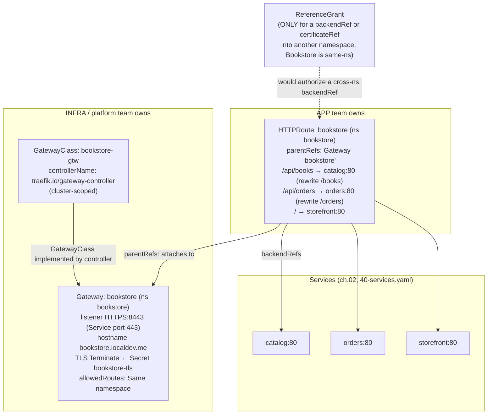

# 05 — Gateway API

> The role-oriented, typed successor to Ingress:
> **GatewayClass → Gateway → HTTPRoute** (+ **ReferenceGrant**), why it
> supersedes Ingress (expressiveness, portability, typed routing,
> multi-protocol, infra/app separation), status conditions, and the
> Ingress→Gateway migration — applied by re-expressing the ch.04 Bookstore
> routing as a Gateway + HTTPRoute alternative.

**Estimated time:** ~15 min read · ~60 min hands-on
**Prerequisites:** [Part 02 ch.04](04-ingress.md) — Ingress, the predecessor it replaces · [Part 02 ch.02](02-services.md) — the backend Services HTTPRoutes target
**You'll know after this:** • differentiate GatewayClass, Gateway, HTTPRoute, and ReferenceGrant roles · • explain why Gateway API supersedes Ingress (typed, multi-protocol, infra/app split) · • read Gateway and HTTPRoute status conditions to diagnose problems · • use listener `allowedRoutes` to decide which namespaces may attach routes, and `ReferenceGrant` to permit cross-namespace backends and certificates · • migrate an Ingress-based setup to Gateway + HTTPRoute

<!-- tags: networking, gateway-api, httproute, referencegrant, l7 -->

## Why this exists

[ch.04](04-ingress.md) exposed the Bookstore, but exposed Ingress's ceilings:
**everything beyond host/path is controller-specific annotation string-soup**
(the Bookstore's `rewrite-target` is an annotation that only one controller
reads), there is **one
role** (no separation between the team that owns the cluster's edge/TLS and the
team that owns *their* service's routes), it is **HTTP-only**, and the
annotation surface is **unvalidated** (typos fail silently at the controller).

**Gateway API** is the project's answer: a set of **typed, portable CRDs** that
expresses routing as first-class spec fields (not annotations), splits the
**infrastructure** concern from the **application** concern, supports
HTTP/TLS/TCP/UDP/gRPC, and reports machine-readable **status conditions**. For
the Bookstore it means the *same* edge routing as `50-ingress.yaml` — but
portable across implementations and split along team lines. This is the
forward-looking [Service Routing](#further-reading) model; **Gateway API v1
(GA)** covers `GatewayClass`, `Gateway`, and `HTTPRoute`.

## Mental model

Gateway API is **Ingress, refactored into three objects owned by two roles**.

- **GatewayClass** (cluster-scoped, *infra*) — "this kind of Gateway is
  implemented by *that* controller". Analogous to a StorageClass / IngressClass.
- **Gateway** (*infra/platform team*) — the actual **entrypoint**: listeners
  (port, protocol, hostname), **TLS termination**, and *which routes may
  attach*. This is the cluster's front door; the platform team owns it.
- **HTTPRoute** (*application team*) — "for host X, path `/api/books` →
  Service `catalog:80`, rewrite to `/books`". It **attaches** to a Gateway via
  `parentRefs`. The app team owns *their* routes without touching the shared
  entrypoint or TLS.
- **ReferenceGrant** (*resource owner*) — explicit, auditable permission for a
  cross-namespace *reference*: an HTTPRoute in ns A sending traffic to a
  Service in ns B, or a listener in ns A reading a TLS Secret in ns B. The
  owner of the target creates it. Cross-namespace references are
  **deny-by-default**; the grant is opt-in.

Attaching a route to a Gateway is a different decision, and no ReferenceGrant
is involved. The Gateway's `allowedRoutes` names the namespaces that may
attach, and the listener's `hostname` names the hosts they may claim.

So the leap from Ingress is: **one annotated object, one role → typed objects
split by responsibility**, with the routing options (rewrite, weighting,
header matching, timeouts) as **validated spec fields** instead of
stringly-typed annotations. It is CRD-installed — **not built into
Kubernetes** — so the CRDs + a controller must be present first.

## Threats and controls

| Threat | Control taught here | Goes deeper |
|---|---|---|
| A route in another team's namespace attaches to the shared Gateway and claims the Bookstore's host or path | The listener's `hostname` and `allowedRoutes`: only the namespaces you name may attach, and only for hosts the listener serves | [Part 05 ch.01](../05-security/01-authn-authz-rbac.md) for who may create routes |
| A route sends traffic to a Service, or a listener reads a Secret, in a namespace whose owner did not agree | `ReferenceGrant` in the target namespace, naming the source namespace and kind it accepts and the target's kind and name | [Part 05 ch.01](../05-security/01-authn-authz-rbac.md) |

Controller-level risk, such as a controller that reads every Secret, is
[ch.04](04-ingress.md)'s subject. The production notes below cover what the
Gateway provider adds on top of it.

## Diagrams

### Object relationships (Mermaid)



### Persona separation (ASCII)

```
                 GATEWAY API ROLE SPLIT (the core idea)
 ─────────────────────────────────────────────────────────────────────────────
  INFRASTRUCTURE PROVIDER  ─ owns ─►  GatewayClass   (which controller)
  PLATFORM / CLUSTER OPS   ─ owns ─►  Gateway        (listeners, TLS, who may attach)
  APPLICATION DEVELOPER    ─ owns ─►  HTTPRoute      (my paths → my Services)
  RESOURCE OWNER           ─ owns ─►  ReferenceGrant (allow a cross-ns reference)

  Ingress (ch.04):  ONE object, ONE role, controller-specific ANNOTATIONS.
  Gateway API:      typed objects, split by responsibility, PORTABLE fields.
  RBAC can now grant app teams HTTPRoute WITHOUT granting edge/TLS control.
```

## Hands-on with the Bookstore

**Assumed working directory: the guide repo root (`full-guide/`).** Requires
the `bookstore` namespace, the Services from [ch.02](02-services.md)
(`40-services.yaml`) and their Deployments, plus a TLS Secret `bookstore-tls`
in `bookstore` (created in [ch.04](04-ingress.md) step 2 — reused as-is).

> **Alternative, not addition — apply 51- OR 50-, never both.**
> [`51-gateway.yaml`](../examples/bookstore/raw-manifests/51-gateway.yaml)
> expresses the **same** external routing as
> [`50-ingress.yaml`](../examples/bookstore/raw-manifests/50-ingress.yaml) via
> a different data plane. Running both binds the same hostname/paths twice.
> Choose one stack: **Ingress** = `40-` + `50-`; **Gateway API** = `40-` +
> `51-`. Both are dry-run valid in isolation and in a whole-directory dry-run
> — a *client* dry-run does **not** detect the runtime hostname overlap, and
> Gateway kinds only map once the CRDs are installed (intrinsic to Gateway API
> being CRD-based). To switch from the ch.04 stack:
> `kubectl delete -f examples/bookstore/raw-manifests/50-ingress.yaml` first.

### 1. Install the Gateway API CRDs and the Traefik Gateway provider

Gateway API is **not** in core Kubernetes. Install the CRDs for the latest
release, v1.7.0 at the time of writing, then turn on the Gateway provider in
Traefik. Traefik is the controller [ch.04](04-ingress.md) installs for
Ingress. One Traefik serves both APIs: the Ingress provider stays on, and the
Gateway provider joins it.

```sh
kubectl apply -f \
  https://github.com/kubernetes-sigs/gateway-api/releases/download/v1.7.0/standard-install.yaml

kubectl get crd | grep gateway.networking.k8s.io
kubectl get crd httproutes.gateway.networking.k8s.io \
  -o jsonpath='{.metadata.annotations.gateway\.networking\.k8s\.io/channel}{"\n"}'
```

The list shows the kinds the install registered, and the annotation gives the
channel, `standard`:

<!-- gate: output -->
```text
backendtlspolicies.gateway.networking.k8s.io   Namespaced   v1(storage)           2026-10-30T23:35:45Z
gatewayclasses.gateway.networking.k8s.io       Cluster      v1(storage),v1beta1   2026-10-30T23:35:47Z
gateways.gateway.networking.k8s.io             Namespaced   v1(storage),v1beta1   2026-10-30T23:35:48Z
grpcroutes.gateway.networking.k8s.io           Namespaced   v1(storage)           2026-10-30T23:35:50Z
httproutes.gateway.networking.k8s.io           Namespaced   v1(storage),v1beta1   2026-10-30T23:35:50Z
listenersets.gateway.networking.k8s.io         Namespaced   v1(storage)           2026-10-30T23:35:52Z
referencegrants.gateway.networking.k8s.io      Namespaced   v1,v1beta1(storage)   2026-10-30T23:35:54Z
tcproutes.gateway.networking.k8s.io            Namespaced   v1(storage)           2026-10-30T23:35:57Z
tlsroutes.gateway.networking.k8s.io            Namespaced   v1(storage)           2026-10-30T23:35:59Z
udproutes.gateway.networking.k8s.io            Namespaced   v1(storage)           2026-10-30T23:36:01Z
```

<!-- gate: output -->
```text
standard
```

The kind list alone does not give the channel. The standard install also
registers `TLSRoute`, `TCPRoute` and `UDPRoute`, so read the annotation.

Save this namespace as `traefik-namespace.yaml` and apply it before the
install, so the namespace carries its Pod Security label from its first Pod:

```yaml
apiVersion: v1
kind: Namespace
metadata:
  name: traefik
  labels:
    pod-security.kubernetes.io/enforce: restricted
    pod-security.kubernetes.io/enforce-version: latest
    pod-security.kubernetes.io/audit: restricted
    pod-security.kubernetes.io/audit-version: latest
    pod-security.kubernetes.io/warn: restricted
    pod-security.kubernetes.io/warn-version: latest
```

Save these values as `traefik-values.yaml`. They set the image digest, turn on
the Gateway provider, and expose the controller on the NodePorts the kind
cluster maps. The chart's own security settings stay as shipped: non-root,
read-only root filesystem, every capability dropped:

```yaml
image:
  digest: sha256:1336e85aaed293bd63d005086e0dd013b04078b26aaeb1c18b26a2f928af7e65  # docker.io/traefik:v3.7.16
  versionOverride: v3.7.16       # the tag the digest was resolved from
providers:
  kubernetesGateway:
    enabled: true                # the Gateway API provider
gateway:
  enabled: false                 # the Bookstore's own Gateway (51-) replaces
                                 # the chart's default one
service:
  spec:
    type: NodePort               # kind has no load balancer; see the port
                                 # mapping below
ports:
  web:
    nodePort: 30080
  websecure:
    nodePort: 30443
```

```sh
helm repo add traefik https://traefik.github.io/charts
helm repo update traefik
helm upgrade --install traefik traefik/traefik --version 42.2.0 \
  --namespace traefik --values traefik-values.yaml
```

The chart renders a GatewayClass named `traefik`. Read its `controllerName`,
then check that the running controller accepts the class:

```sh
kubectl get gatewayclass traefik -o jsonpath='{.spec.controllerName}{"\n"}'
kubectl get gatewayclass traefik \
  -o jsonpath='{.status.conditions[?(@.type=="Accepted")].status}{"\n"}'
```

<!-- gate: output -->
```text
traefik.io/gateway-controller
```

<!-- gate: output -->
```text
True
```

The value is `traefik.io/gateway-controller`, and `51-gateway.yaml` uses it.
Use the `controllerName` your own controller advertises for any other
implementation.

The chart's installer notes name Gateway API v1.5.1 for Traefik v3.7. This
chapter ran v1.7.0 with the Gateway accepted and programmed, but check
Traefik's compatibility notes before you change CRD versions on a cluster you
keep.

The kind cluster needs a host port for each NodePort. Add these two mappings
under the control-plane node in the cluster config from
[ch.04](04-ingress.md). If that cluster lacks them, recreate it with them:

```yaml
nodes:
  - role: control-plane
    extraPortMappings:
      - containerPort: 30080     # Traefik web NodePort
        hostPort: 80
        protocol: TCP
      - containerPort: 30443     # Traefik websecure NodePort
        hostPort: 443
        protocol: TCP
```

Without the mapping, forward the Service and send the requests in steps 2 and 4
to port 8443 on the loopback address:

```sh
kubectl port-forward -n traefik svc/traefik 8443:443
curl -sS --resolve bookstore.localdev.me:8443:127.0.0.1 --cacert tls.crt \
  https://bookstore.localdev.me:8443/api/books
```

### 2. The Gateway and HTTPRoute (same routing as ch.04, typed)

[`51-gateway.yaml`](../examples/bookstore/raw-manifests/51-gateway.yaml) holds
three objects: the GatewayClass, the Gateway and the HTTPRoute. The GatewayClass
names the controller, `traefik.io/gateway-controller`, from step 1. The fields
that carry the controls are these two fragments, taken from the file.

The Gateway, which the platform team owns:

```yaml
spec:
  gatewayClassName: bookstore-gtw
  listeners:
    - name: https
      protocol: HTTPS            # the only listener: nothing serves plaintext
      port: 8443                 # Traefik's websecure entryPoint; the Service
                                 # maps client port 443 to it
      hostname: bookstore.localdev.me   # a route attaches only for this host
      tls:
        mode: Terminate          # TLS ends at the Gateway
        certificateRefs:
          - kind: Secret
            name: bookstore-tls  # the ch.04 Secret, in this namespace
      allowedRoutes:
        namespaces:
          from: Same             # only routes in this namespace may attach
```

The HTTPRoute, which the application team owns. Its rules repeat the Ingress
routes from [ch.04](04-ingress.md) as typed fields:

```yaml
spec:
  parentRefs:
    - name: bookstore            # attaches to the Gateway above
  hostnames:
    - bookstore.localdev.me
  rules:
    - matches:
        - path: { type: PathPrefix, value: /api/books }
      filters:
        - type: URLRewrite
          urlRewrite:
            path: { type: ReplacePrefixMatch, replacePrefixMatch: /books }
      backendRefs:
        - name: catalog
          port: 80
    - matches:
        - path: { type: PathPrefix, value: /api/orders }
      filters:
        - type: URLRewrite
          urlRewrite:
            path: { type: ReplacePrefixMatch, replacePrefixMatch: /orders }
      backendRefs:
        - name: orders
          port: 80
    - matches:
        - path: { type: PathPrefix, value: / }
      backendRefs:
        - name: storefront
          port: 80
```

Apply the Gateway-API stack only, then check its status conditions. Unlike an
Ingress, the objects report whether they are working:

```sh
# from the repo root (full-guide/); 50-ingress.yaml must not be applied
kubectl apply -f examples/bookstore/raw-manifests/51-gateway.yaml
kubectl get gateway,httproute -n bookstore
kubectl get gateway bookstore -n bookstore \
  -o jsonpath='{range .status.conditions[*]}{.type}={.status}{"\n"}{end}'
kubectl get httproute bookstore -n bookstore \
  -o jsonpath='{range .status.parents[0].conditions[*]}{.type}={.status}{"\n"}{end}'
```

The Gateway reports `Accepted` and `Programmed`, and the route reports
`Accepted` and `ResolvedRefs`. Captured on the lab:

<!-- gate: output -->
```text
Accepted=True
Programmed=True
```

<!-- gate: output -->
```text
Accepted=True
ResolvedRefs=True
```

`Programmed=True` means Traefik has configured its data plane.
`ResolvedRefs=True` means the TLS Secret and every backend Service resolved.

Check TLS with the certificate from [ch.04](04-ingress.md) step 2. Verify
against `tls.crt` rather than skipping verification with `-k`:

```sh
openssl s_client -connect bookstore.localdev.me:443 -servername bookstore.localdev.me \
  </dev/null 2>/dev/null | openssl x509 -noout -subject -ext subjectAltName
curl -sS --cacert tls.crt https://bookstore.localdev.me/api/books \
  -w "\nHTTP %{http_code}\n"
```

The certificate's subject and SAN come from the listener's Secret, and the
request succeeds only if the certificate verifies. Captured on the lab, where
the request went to the node's NodePort and the certificate was checked from
inside the node:

<!-- gate: output -->
```text
subject=CN=bookstore.localdev.me
X509v3 Subject Alternative Name:
    DNS:bookstore.localdev.me
```

<!-- gate: output -->
```text
[]
HTTP 200
```

The list is empty on a fresh database, so `HTTP 200` is the result to read:
the route reached the catalog Pods, and their rewrite to `/books` worked. The
list fills once the catalog has rows, and it needs the PostgreSQL and Redis
from the earlier chapters to be Ready.

### 3. Who may attach a route

`from: Same` in `51-gateway.yaml` lets only routes in `bookstore` attach to
the Gateway. Attachment is the Gateway owner's decision, so no
`ReferenceGrant` is involved. To let another team's namespace attach, the
platform team widens the listener to a label selector:

```sh
kubectl patch gateway bookstore -n bookstore --type=json -p='[
  {"op": "replace", "path": "/spec/listeners/0/allowedRoutes/namespaces",
   "value": {"from": "Selector",
             "selector": {"matchLabels": {"bookstore-routes": "allowed"}}}}]'
```

A selector matches the Gateway's own namespace only when that namespace
carries the label too. Without it, the Bookstore's own route stops attaching:

```sh
kubectl get httproute bookstore -n bookstore -o jsonpath='{range .status.parents[0].conditions[*]}{.type}={.status} {.reason}{"\n"}{end}'
```

<!-- gate: output -->
```text
Accepted=False NotAllowedByListeners
ResolvedRefs=True ResolvedRefs
```

Label the namespace, and the route attaches again:

```sh
kubectl label namespace bookstore bookstore-routes=allowed
kubectl get httproute bookstore -n bookstore -o jsonpath='{range .status.parents[0].conditions[*]}{.type}={.status} {.reason}{"\n"}{end}'
```

<!-- gate: output -->
```text
Accepted=True Accepted
ResolvedRefs=True ResolvedRefs
```

The label is the approval. Only the platform team may set it, so RBAC must
not let a team edit the labels of its own namespace: a team that can label
itself `bookstore-routes: allowed` has approved itself. The patch is not in
`51-gateway.yaml`, so applying that file does not undo it. To go back, patch
the listener's `from` to `Same` and remove the label.

The first team gets an approved namespace and a route under `/team-a`. The
route is complete as applied:

```yaml
apiVersion: v1
kind: Namespace
metadata:
  name: team-a
  labels:
    bookstore-routes: allowed    # set by the platform team
    pod-security.kubernetes.io/enforce: restricted
    pod-security.kubernetes.io/enforce-version: latest
    pod-security.kubernetes.io/audit: restricted
    pod-security.kubernetes.io/audit-version: latest
    pod-security.kubernetes.io/warn: restricted
    pod-security.kubernetes.io/warn-version: latest
---
apiVersion: gateway.networking.k8s.io/v1
kind: HTTPRoute
metadata:
  name: team-a-books
  namespace: team-a
spec:
  parentRefs:
    - name: bookstore
      namespace: bookstore
  hostnames:
    - bookstore.localdev.me
  rules:
    - matches:
        - path: { type: PathPrefix, value: /team-a }
      filters:
        - type: URLRewrite
          urlRewrite:
            path: { type: ReplacePrefixMatch, replacePrefixMatch: / }
      backendRefs:
        - name: catalog
          namespace: bookstore   # a Service in another namespace
          port: 80
```

Its route attaches, and its backend does not resolve yet. Its owner has not
granted anything (step 4):

```sh
kubectl get httproute team-a-books -n team-a -o jsonpath='{range .status.parents[0].conditions[*]}{.type}={.status} {.reason}{"\n"}{end}'
```

<!-- gate: output -->
```text
Accepted=True Accepted
ResolvedRefs=False RefNotPermitted
```

A second team's namespace has no label, so its route must be refused. This
route is a **deliberate failure**: it claims the Bookstore's own path and must
not attach:

```yaml
apiVersion: v1
kind: Namespace
metadata:
  name: team-b                   # not labelled bookstore-routes: allowed
  labels:
    pod-security.kubernetes.io/enforce: restricted
    pod-security.kubernetes.io/enforce-version: latest
    pod-security.kubernetes.io/audit: restricted
    pod-security.kubernetes.io/audit-version: latest
    pod-security.kubernetes.io/warn: restricted
    pod-security.kubernetes.io/warn-version: latest
---
apiVersion: gateway.networking.k8s.io/v1
kind: HTTPRoute
metadata:
  name: takeover                 # deliberate: must NOT attach
  namespace: team-b
spec:
  parentRefs:
    - name: bookstore
      namespace: bookstore
  hostnames:
    - bookstore.localdev.me
  rules:
    - matches:
        - path: { type: PathPrefix, value: /api/books }
      backendRefs:
        - name: catalog
          namespace: bookstore
          port: 80
```

The refusal shows in the route's status. Both conditions fail here: the
listener refuses the attachment, and the Service has no grant either:

```sh
kubectl get httproute takeover -n team-b -o jsonpath='{range .status.parents[0].conditions[*]}{.type}={.status} {.reason}{"\n"}{end}'
```

<!-- gate: output -->
```text
Accepted=False NotAllowedByListeners
ResolvedRefs=False RefNotPermitted
```

`takeover` never attaches, so `/api/books` still goes to the Bookstore's own
route.

### 4. Cross-namespace references need a ReferenceGrant

`team-a-books` attaches but cannot reach `catalog`: the Service lives in
`bookstore`, and the owner of that Service has not agreed. The owner grants it
with a `ReferenceGrant` in its own namespace. The grant names one source
namespace, one source kind, and one target kind and name:

```yaml
apiVersion: gateway.networking.k8s.io/v1
kind: ReferenceGrant
metadata:
  name: team-a-to-catalog
  namespace: bookstore           # the namespace that owns the Service
spec:
  from:
    - group: gateway.networking.k8s.io
      kind: HTTPRoute
      namespace: team-a
  to:
    - group: ""
      kind: Service
      name: catalog
```

Save the grant as `referencegrant.yaml`, apply it, and check the route. Then
fetch a book through the team's path:

```sh
kubectl apply -f referencegrant.yaml
kubectl get httproute team-a-books -n team-a -o jsonpath='{range .status.parents[0].conditions[*]}{.type}={.status} {.reason}{"\n"}{end}'
curl -sS --cacert tls.crt https://bookstore.localdev.me/team-a/books -w "\nHTTP %{http_code}\n"
```

<!-- gate: output -->
```text
Accepted=True Accepted
ResolvedRefs=True ResolvedRefs
```

<!-- gate: output -->
```text
[]
HTTP 200
```

Deleting the grant withdraws the consent at once. The route's `ResolvedRefs`
goes back to `False`, and the Service stops being reachable through it:

```sh
kubectl delete referencegrant team-a-to-catalog -n bookstore
kubectl get httproute team-a-books -n team-a -o jsonpath='{range .status.parents[0].conditions[*]}{.type}={.status} {.reason}{"\n"}{end}'
```

<!-- gate: output -->
```text
Accepted=True Accepted
ResolvedRefs=False RefNotPermitted
```

The same rule covers TLS. A listener in one namespace that reads a Secret in
another needs a `ReferenceGrant` in the Secret's namespace, with `from` set to
the Gateway and `to` set to `Secret`.

> **Lineage note.** `51-gateway.yaml` is the **Gateway-API alternative** to
> `50-ingress.yaml`; the Bookstore ships both so the guide can teach the
> migration, but a running cluster uses exactly one.
> [ch.06](06-network-policies.md) (`60-networkpolicy.yaml`) restricts the
> controller-to-app edges with an allow rule that names the controller's
> namespace. Both stacks run Traefik in `traefik`, so that rule works for
> either one once it names that namespace.

## How it works under the hood

### The resource model and attachment

A **controller** advertises a `controllerName`. A **GatewayClass** points at
that name; a **Gateway** references the GatewayClass and declares **listeners**
(protocol/port/hostname/TLS). A **route** (HTTPRoute/TLSRoute/TCPRoute/…)
**attaches** to a Gateway through **`parentRefs`** (optionally a specific
listener via `sectionName`). The controller watches all of these plus the
target Services/EndpointSlices and programs its proxy — same reconciliation
idea as an ingress controller ([ch.04](04-ingress.md)), but the *inputs* are
typed objects split by role. **Route attachment is bidirectionally gated:** the
Gateway's `allowedRoutes` says which namespaces (`Same`, `All`, or a label
`Selector`) and kinds may attach, and the route's `hostnames` must intersect
the listener's `hostname`. A route must also name the Gateway in its
`parentRefs`. Neither side can unilaterally bind.

### Why it supersedes Ingress

- **Expressiveness as typed fields:** header/method/query matching, **traffic
  splitting by weight** (native canary — no annotations,
  [Part 07 ch.05](../07-delivery/05-progressive-delivery.md)), request/response
  header modification, **URL rewrite/redirect**, timeouts, mirroring — all
  **schema-validated `spec`**, rejected at apply if malformed (vs. Ingress
  annotations failing silently at the controller).
- **Portability:** the Bookstore's rewrite is the **core `URLRewrite` filter**,
  identical across conformant implementations — unlike
  `nginx.ingress.kubernetes.io/rewrite-target`. Conformance is tested by the
  project, so behavior is consistent.
- **Role-oriented & RBAC-friendly:** infra owns GatewayClass/Gateway; apps own
  routes. RBAC can grant a team **HTTPRoute** in their namespace **without**
  giving them control of the shared edge/TLS — impossible with single-object
  Ingress.
- **Multi-protocol:** **HTTPRoute** and **GRPCRoute** (both GA), plus
  **TLSRoute**, **TCPRoute** and **UDPRoute**, which the v1.7.0 standard
  install registers as well (step 1). One model for L4 *and* L7. Ingress is
  HTTP-only. The CRDs carry a standard channel annotation, but Traefik's chart
  still gates TCP and TLS route support behind its `experimentalChannel`
  option. Check each implementation's docs before you rely on a route kind.
- **Observable status:** `Accepted`, `Programmed`, `ResolvedRefs` **conditions**
  on Gateway and per-`parentRef` on routes — you can *query* whether routing is
  healthy instead of reading controller logs.

### Status conditions

Gateway API leans on the standard **`status.conditions`** pattern
([Part 00 ch.06](../00-foundations/06-declarative-api-model.md)). On a Gateway:
**`Accepted`** (config valid/admitted), **`Programmed`** (data plane actually
configured); per listener: **`Accepted`**, **`Programmed`** and
**`ResolvedRefs`** (for example, the TLS Secret resolved). On an HTTPRoute,
per attached parent: **`Accepted`** and **`ResolvedRefs`** (backends and
filters resolved). `ResolvedRefs=False` on a route is the typical "my backend
Service name or port is wrong, or it is cross-namespace and ungranted" signal:
the route says so itself, which Ingress does not. Step 3 showed a refusal with
`Accepted=False` and reason `NotAllowedByListeners`, and step 4 showed
`ResolvedRefs=False` with reason `RefNotPermitted`.

### Ingress → Gateway migration

1. Install Gateway API **CRDs + a controller** (CRDs are *not* built in —
   omitting them is the #1 "kinds not found" error, exactly what a client
   dry-run shows without them).
2. **Infra**: create `GatewayClass` + `Gateway` (listeners + TLS — reuse the
   existing TLS Secret, as the Bookstore does).
3. **App**: translate each Ingress rule into **HTTPRoute** rules; replace
   annotation behaviors with **typed filters** (the Bookstore's
   `rewrite-target` → `URLRewrite`/`ReplacePrefixMatch`).
4. Run **in parallel on a test hostname**, verify via **status conditions** +
   real requests, then cut traffic over and **remove the Ingress** (the
   Bookstore keeps both files only as teaching artifacts; never both live).
   Community tooling (e.g. `ingress2gateway`) automates step 3.

## Production notes

> **In production:** Gateway API is **CRD-installed and
> controller-specific-in-practice.** Pin CRD **and** controller versions, check
> the channel each CRD carries (`gateway.networking.k8s.io/channel`), and test
> CRD upgrades. A missing or too-old CRD makes every `Gateway`/`HTTPRoute`
> apply fail with `no matches for kind "..."`, so the resources can't be
> registered or reconciled cluster-wide. Experimental kinds and fields come
> only from the experimental install, so a cluster that needs one must say so.

> **In production (EKS/GKE/AKS):** managed Gateway implementations exist —
> **GKE Gateway** (Google Cloud Load Balancing), **AWS Gateway API
> controller** (VPC Lattice), Istio/Cilium/Envoy Gateway. The Gateway/HTTPRoute
> **objects are portable**; the **GatewayClass/`controllerName`** and some
> infra-policy extensions are implementation-specific. This portability of the
> *app-facing* objects is the core multi-cloud argument over annotation-bound
> Ingress.

> **In production:** use the **role split as a real security boundary.** RBAC:
> platform team = GatewayClass/Gateway (+TLS Secrets); app teams = HTTPRoute in
> their namespace only. Gate attachment with the Gateway's **`allowedRoutes`**,
> and gate cross-namespace backends and certificates with **`ReferenceGrant`**,
> so no team can hijack the shared edge or reach another namespace's backend
> unapproved ([Part 05 ch.01](../05-security/01-authn-authz-rbac.md)). The
> namespace label in step 3 is an approval, so no team's RBAC may set labels
> on its own namespace.

> **In production:** the controller holds the keys. The lab's Traefik
> ClusterRole, rendered with the Gateway provider on, grants `get`, `list` and
> `watch` on Secrets in every namespace. `providers.kubernetesGateway.namespaces`
> limits the namespaces the controller watches, but the permission itself
> stays cluster-wide. Pin the chart, keep the controller's namespace under the
> strictest policy you run, and read [ch.04](04-ingress.md) for the controller
> threats this chapter does not repeat.

> **In production:** **gate on status conditions in automation.** CI/CD and
> GitOps ([Part 07 ch.04](../07-delivery/04-gitops-argocd.md)) should block
> promotion until `Programmed=True` / `ResolvedRefs=True` — a Gateway-API
> capability Ingress lacks; don't waste it by treating apply as success.

> **In production:** Gateway API is the **native home of weighted traffic
> splitting** — progressive delivery without controller-specific canary
> annotations ([Part 07 ch.05](../07-delivery/05-progressive-delivery.md)). If
> you do canaries, this is a strong reason to standardize on Gateway API over
> Ingress.

## Quick Reference

```sh
kubectl get crd | grep gateway.networking.k8s.io          # CRDs installed? (must be)
kubectl get gatewayclass                                   # classes and their controllers
kubectl get gateway,httproute -n <NS>
kubectl describe gateway <GW> -n <NS>                       # listeners, conditions, events
kubectl get gateway <GW> -n <NS> \
  -o jsonpath='{range .status.conditions[*]}{.type}={.status}{"\n"}{end}'
kubectl get httproute <R> -n <NS> \
  -o jsonpath='{range .status.parents[0].conditions[*]}{.type}={.status}{"\n"}{end}'
kubectl get referencegrant -n <TARGET-NS>                   # consent, in the owner's namespace
# client dry-run REQUIRES the CRDs registered first (Gateway API is not built-in):
kubectl apply --dry-run=client -f <GATEWAY-MANIFEST>.yaml
```

Secure forms of the fields that carry the controls:

```yaml
# Gateway listener: one HTTPS listener, a hostname, TLS ending at the Gateway,
# and attachment limited to the namespaces you name.
listeners:
  - name: https
    protocol: HTTPS
    port: <ENTRYPOINT-PORT>
    hostname: <HOST>
    tls:
      mode: Terminate
      certificateRefs:
        - kind: Secret
          name: <TLS-SECRET>
    allowedRoutes:
      namespaces:
        from: Same          # or Selector, on a label only the platform team sets
```

```yaml
# HTTPRoute: attaches by name, claims a host, and sends typed rules to a Service.
parentRefs:
  - name: <GW>
hostnames:
  - <HOST>
rules:
  - matches:
      - path: { type: PathPrefix, value: /<PREFIX> }
    filters:
      - type: URLRewrite
        urlRewrite:
          path: { type: ReplacePrefixMatch, replacePrefixMatch: / }
    backendRefs:
      - name: <SVC>
        port: 80
```

```yaml
# ReferenceGrant, in the namespace that owns the target: one source, one target.
from:
  - group: gateway.networking.k8s.io
    kind: HTTPRoute
    namespace: <SOURCE-NS>
to:
  - group: ""
    kind: Service
    name: <SVC>
```

Checklist:

- [ ] Gateway API **CRDs installed** (standard channel, `v1` kinds) **and a
  controller** whose GatewayClass `controllerName` matches it
- [ ] Listener `hostname` set; `allowedRoutes` names the namespaces, and only
  the platform team can set the label a `Selector` uses
- [ ] A **ReferenceGrant** in the target's namespace for each cross-namespace
  backend or certificate, scoped to one source and one name
- [ ] Routing uses **typed filters** (not annotations) → portable
- [ ] Automation gates on `Accepted`/`Programmed`/`ResolvedRefs` conditions
- [ ] RBAC enforces the infra (Gateway) vs. app (HTTPRoute) role split
- [ ] **Not** applied alongside the Ingress stack (mutually exclusive edge)

## Test your understanding

> Try each before opening the answer drawer. The act of trying is the exercise; the answer is the check.

1. **Explain the role split between `Gateway` and `HTTPRoute` and why it's a security improvement over a single-object Ingress with RBAC.**
   <details><summary>Show answer</summary>

   `Gateway` (platform-owned) defines listeners, TLS, and *who may attach
   routes*: concentrated edge concerns. `HTTPRoute` (app-team-owned) declares
   per-team paths/filters/backends. RBAC can grant app teams HTTPRoute in
   their namespace *without* granting Gateway or TLS Secret access, which is
   impossible with Ingress where one object mixes both concerns. Route
   attachment is opt-in through the Gateway's `allowedRoutes`, and a
   cross-namespace backend or certificate is opt-in through `ReferenceGrant`,
   not implicit (see §Mental model and §Persona separation diagram).

   </details>

2. **A teammate applies an HTTPRoute and sees `status.parents[].conditions[]: Accepted=True` but `ResolvedRefs=False`. What does this tell them, and what's the typical fix?**
   <details><summary>Show answer</summary>

   The Gateway accepted the route attachment, but at least one `backendRefs` couldn't be resolved — typically a wrong Service name/port, the backend is in a different namespace without a `ReferenceGrant`, or the kind isn't supported. Fix: `kubectl describe httproute` to see the specific message; double-check Service exists in the same namespace (or add ReferenceGrant for cross-ns) and the port number matches the Service's `spec.ports[].port` (see §Status conditions).

   </details>

3. **Your `nginx.ingress.kubernetes.io/rewrite-target: /$2` annotation works perfectly on ingress-nginx. You're evaluating Cilium's Gateway implementation. Why is the Gateway API form (`URLRewrite` + `ReplacePrefixMatch`) a meaningful improvement here?**
   <details><summary>Show answer</summary>

   The annotation is *string soup* — unvalidated, controller-specific, fails silently if misspelled, and unportable. `URLRewrite` is a schema-validated typed filter in the spec — `kubectl apply --dry-run=server` rejects malformed configs, the semantics are conformance-tested across implementations, and migrating to Cilium/Envoy Gateway/GKE Gateway keeps the same `HTTPRoute` yaml working. The forward-compatibility is real: this is the difference between a portable spec and per-vendor sugar (see §Why it supersedes Ingress).

   </details>

4. **The Bookstore's Gateway and HTTPRoute are both in `bookstore`. A platform team moves the Gateway to a shared `edge` namespace and keeps the route in `bookstore`. What must change, and which object controls each part?**
   <details><summary>Show answer</summary>

   Attachment is the Gateway owner's decision. The `edge` Gateway's
   `allowedRoutes` must select the `bookstore` namespace, for example with a
   label selector, and the `bookstore` namespace must carry that label. No
   ReferenceGrant governs the attachment. The route's backends are Services in
   `bookstore`, and the route sits there too, so nothing crosses a namespace
   for them. The exception is the TLS Secret: if it stays in `bookstore` while
   the Gateway runs in `edge`, the `bookstore` namespace needs a
   ReferenceGrant from `Gateway` in `edge` to `Secret`. See the step 3 and
   step 4 sections.

   </details>

5. **Hands-on extension: apply `51-gateway.yaml` to a cluster *without* a Gateway controller. Read the Gateway's status. What do you observe, and what does it teach about CRDs versus controllers?**
   <details><summary>What you should see</summary>

   The API server accepts the objects, because the CRDs validate them. Nothing
   reconciles them, so the Gateway's `Accepted` and `Programmed` conditions
   stay `Unknown` with the reason `Pending`. Captured on the lab, before
   Traefik was installed:

   <!-- gate: output -->
   ```text
   {"conditions":[{"lastTransitionTime":"1970-01-01T00:00:00Z","message":"Waiting for controller","reason":"Pending","status":"Unknown","type":"Accepted"},{"lastTransitionTime":"1970-01-01T00:00:00Z","message":"Waiting for controller","reason":"Pending","status":"Unknown","type":"Programmed"}]}
   ```

   CRDs install the schema, and a controller that claims the GatewayClass's
   `controllerName` does the work. Both pieces are needed, as with an Ingress
   object and its controller (see step 1).

   </details>

## Further reading

- Official (primary): <https://gateway-api.sigs.k8s.io/> — the Gateway API
  spec, the resource model, GA/`v1` status, and the conformance/channels model;
  see also <https://kubernetes.io/docs/concepts/services-networking/gateway/>.
- Security model: <https://gateway-api.sigs.k8s.io/concepts/security-model/>:
  route binding through `allowedRoutes` (including the risk of relying on
  labels that teams can set), hostname hijacking, and `ReferenceGrant`.
- ReferenceGrant design: <https://gateway-api.sigs.k8s.io/geps/gep-709/>.
- Release notes for v1.7.0, the version used here:
  <https://github.com/kubernetes-sigs/gateway-api/releases/tag/v1.7.0>.
- Traefik's Gateway API provider, including its listener-port rule and the
  chart values used in step 1:
  <https://doc.traefik.io/traefik/reference/routing-configuration/kubernetes/gateway-api/>.
- **Rosso et al., _Production Kubernetes_, ch.6 — "Service Routing"** — edge
  routing concerns (the chapter predates Gateway API GA; pair with the spec for
  the current model).
- Migration: <https://gateway-api.sigs.k8s.io/guides/getting-started/migrating-from-ingress/>
  ("Migrating from Ingress", incl. `ingress2gateway`).
