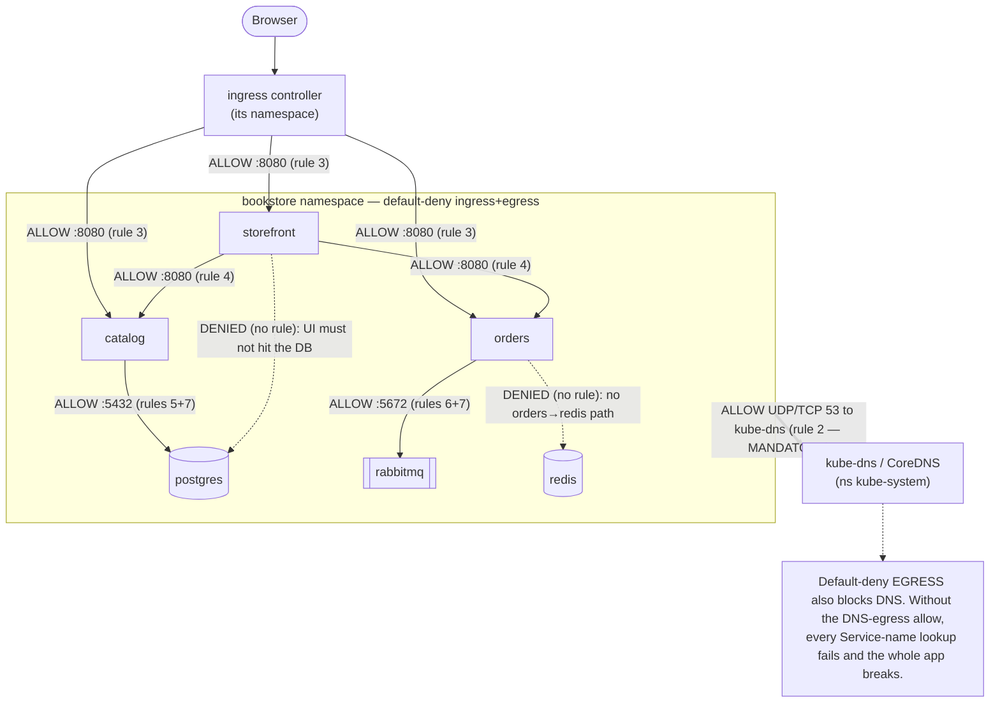

# 06 — Network policies

> The cluster is **default-allow** — any Pod can reach any Pod. NetworkPolicy
> flips that to **default-deny** then **whitelists** only needed flows:
> ingress/egress, `podSelector`/`namespaceSelector`/`ipBlock`, the
> additive/whitelist model, the DNS-egress gotcha, and the **CNI-must-enforce**
> caveat, which a denied request proves on your cluster. Applied, it locks
> the Bookstore namespace down to exactly its required edges.

**Estimated time:** ~15 min read · ~60 min hands-on
**Prerequisites:** [Part 02 ch.01](01-networking-model.md) — the default-allow fabric being locked down · [Part 02 ch.02](02-services.md) — the flows you must whitelist
**You'll know after this:** • explain default-allow and how NetworkPolicy flips it to default-deny · • write rules using `podSelector`, `namespaceSelector`, and `ipBlock` · • configure egress rules that include DNS without breaking name resolution · • know that NetworkPolicy is enforced only if the CNI supports it · • lock the Bookstore namespace down to its exact required edges

<!-- tags: networking, security, network-policies, default-deny, egress -->

## Why this exists

Every Bookstore tier now talks to the others by Service name
([ch.02](02-services.md)/[ch.03](03-dns-and-discovery.md)) and is reachable
from outside ([ch.04](04-ingress.md)/[ch.05](05-gateway-api.md)). But the
networking model ([ch.01](01-networking-model.md)) is a **flat, open LAN**: by
default `storefront` can talk straight to `postgres`, a compromised
`payments-worker` can reach *anything*, and a pod in another namespace can hit
your database. Nothing in the app *needs* most of these paths — they are pure
**blast radius**.

**NetworkPolicy** is the Kubernetes-native firewall: select Pods by label and
declare *exactly* who may connect to them (ingress) and where they may connect
*to* (egress). Applied well it turns the open LAN into **least-privilege
segmentation** — a containment boundary so one popped Pod can't pivot through
the cluster. This is the [Network Segmentation](#further-reading) pattern, and
it is the security capstone of Part 02.

## Mental model

NetworkPolicy is **a whitelist that switches on the moment you write one**.

- With **no** policy selecting a Pod: that Pod is **wide open** (allow-all, both
  directions) — the Kubernetes default.
- The instant **any** policy selects a Pod **for a direction** (Ingress or
  Egress), that Pod becomes **default-deny for that direction**, and **only**
  the `from`/`to` rules across **all** policies selecting it are allowed.
  Policies are **purely additive** — there is no "deny" rule, only the union of
  allows; you restrict by *adding allows to a deny baseline*, never by writing
  denies.
- It is **stateful** (reply traffic for an allowed connection is automatically
  allowed — you don't allow the return path) but **direction-scoped**: allowing
  A→B *ingress on B* is **not** enough if A also has a **default-deny egress** —
  then A's egress to B must be allowed **too** (both ends).

And the load-bearing caveat: **NetworkPolicy is enforced by the CNI, not by
Kubernetes.** The API server stores the object and nothing more. A CNI that
does not implement policy leaves the rules in place and enforces none of
them, which is worse than knowing the cluster is open. kind's default CNI,
**kindnet**, enforces policy, so the lab needs no CNI swap. Only a denied
request proves enforcement on your cluster (step 0 explains why).

## Threats and controls

| Threat | Control in this chapter | Goes deeper |
|---|---|---|
| A compromised Pod reaches any other Pod (lateral movement) | Default deny in both directions, then one allow per real edge, on both ends | [Part 08 ch.04](../08-day-2-operations/04-multi-tenancy-and-namespaces.md) for namespaces shared by tenants |
| A workload calls the cloud metadata endpoint and takes its credentials | `ipBlock` with an `except` for `169.254.169.254/32` (step 6) | [Part 10 ch.03](../10-cloud-and-managed-kubernetes/03-cloud-identity.md) |
| Data leaves through open egress or DNS | Egress limited to named peers and ports; DNS only to `kube-dns`; no `0.0.0.0/0` without an `except` | [Part 11 ch.04](../11-advanced-production-patterns/04-service-mesh.md) for L7 rules |
| A policy that enforces nothing: the CNI ignores it, or the engine fails open | A denied request after every change; the engine's start line is a start check only (step 0) | [Part 00 ch.07](../00-foundations/07-local-cluster-setup.md) for the cluster, [Part 10 ch.04](../10-cloud-and-managed-kubernetes/04-cloud-networking-and-load-balancing.md) for managed CNIs |

## Diagrams

### Allowed vs. denied after default-deny + targeted allows (Mermaid)



### Policy matrix — who → who (ASCII)

```
 SOURCE \ DEST   storefront  catalog  orders  postgres  rabbitmq  redis  kube-dns  ext-LB
 ─────────────────────────────────────────────────────────────────────────────────────
 ingress ctrl        ✔(8080)  ✔(8080)  ✔(8080)    ·         ·       ·       ·        —
 storefront            —      ✔(8080)  ✔(8080)    ✗         ✗       ✗     ✔(53)      ✗
 catalog               ✗        —        ✗     ✔(5432)      ✗       ✗     ✔(53)      ✗
 orders                ✗        ✗        —        ✗      ✔(5672)    ✗     ✔(53)      ✗
 (every bookstore Pod) ·        ·        ·        ·         ·       ·     ✔(53)      ✗
 ─────────────────────────────────────────────────────────────────────────────────────
   ✔ = explicitly allowed (rule #)   ✗ = denied by default-deny (no allow)
   · = not applicable / not part of the app's required edges
   redis has NO inbound allow yet (catalog runs with REDIS_ADDR unset, ch.02);
   add an allow-catalog-to-redis rule when redis is wired in Part 03.
```

## Hands-on with the Bookstore

**Assumed working directory: the guide repo root (`full-guide/`).** Requires
the `bookstore` namespace and the workloads it segments:
`10-catalog-deploy.yaml`, `11-storefront-deploy.yaml`, `14-orders-deploy.yaml`,
`13-rabbitmq.yaml`, `12-redis.yaml`, and the postgres StatefulSet
`20-postgres-statefulset.yaml`
([Part 01 ch.05](../01-core-workloads/05-statefulsets.md)). Also apply
`05-serviceaccounts-rbac.yaml`, `15-catalog-config.yaml`,
`16-db-credentials.yaml` and `40-services.yaml`. Either edge stack from
[ch.04](04-ingress.md)/[ch.05](05-gateway-api.md) may be present (the policy
targets the controller's *namespace*, same either way).

The steps run in order. Each one changes one thing and repeats the same
request, so every result is a policy decision. The captured output comes from
a lab copy of the namespace called `p02-06-bookstore`; in your cluster it is
`bookstore`.

### 0. Check that the cluster's CNI enforces policy

kind has enforced NetworkPolicy since v0.24.0. Its default CNI, **kindnet**,
runs the policy engine from the
[kube-network-policies](https://github.com/kubernetes-sigs/kube-network-policies)
project, so a default `kind create cluster` needs no CNI swap. Check the engine,
and the DNS Pods that the DNS rule in step 2 selects:

```sh
kubectl -n kube-system get daemonset kindnet
kubectl -n kube-system logs ds/kindnet | grep "Policy engine is ready"
kubectl -n kube-system get pods -l k8s-app=kube-dns
```

<!-- gate: output -->
```text
NAME      DESIRED   CURRENT   READY   UP-TO-DATE   AVAILABLE   NODE SELECTOR            AGE
kindnet   1         1         1       1            1           kubernetes.io/os=linux   9h
```

<!-- gate: output -->
```text
I1030 14:30:08.306411       1 controller.go:185] "Policy engine is ready."
```

<!-- gate: output -->
```text
NAME                       READY   STATUS    RESTARTS   AGE
coredns-559f6c778d-77g29   1/1     Running   0          9h
coredns-559f6c778d-xmmqq   1/1     Running   0          9h
```

The log line is necessary, not sufficient. kindnetd starts the policy
controller in a goroutine and only logs its error if the controller fails, so
kindnetd can keep running with no rules programmed. The packet hook also runs
with `FailOpen: true`, so a packet the engine cannot evaluate is accepted. The
source is kindnet's `cmd/kindnetd/main.go` and kube-network-policies'
`pkg/dataplane/controller.go`, on upstream main. A cluster can look healthy and
enforce nothing, so trust a denied request, not a log line. Step 2 is that test.

A cluster on another CNI needs its own check. Plain Flannel does not enforce
policy, and a managed cluster needs its provider's policy setting turned on.
[Part 10 ch.04](../10-cloud-and-managed-kubernetes/04-cloud-networking-and-load-balancing.md)
compares the managed CNIs.

### 1. Start a probe, and take the request with no policy

The probe is a Pod you can `kubectl exec` into. It uses the `curlimages/curl`
image pinned by digest, the `storefront-sa` ServiceAccount with its token mount
off, and the baseline. Its `app: storefront` label is what the policies select,
so the probe stands in for the storefront. Exec into the probe, never into
`catalog` or `orders`: those images are distroless and have no shell.

```sh
kubectl apply -f - <<'EOF'
apiVersion: v1
kind: Pod
metadata:
  name: probe
  namespace: bookstore
  labels:
    app: storefront                 # the label the policies select
spec:
  serviceAccountName: storefront-sa
  automountServiceAccountToken: false
  securityContext:
    runAsNonRoot: true
    runAsUser: 100                  # curl_user, the UID the image declares
    runAsGroup: 101                 # curl_group
    seccompProfile:
      type: RuntimeDefault
  containers:
    - name: probe
      image: curlimages/curl@sha256:8addc281f0ea517409209f76832b6ddc2cabc3264feb1ebbec2a2521ffad24e4  # curlimages/curl:8.9.1
      command: ["sleep", "3600"]
      securityContext:
        allowPrivilegeEscalation: false
        readOnlyRootFilesystem: true
        capabilities:
          drop: ["ALL"]
      resources:
        requests: { cpu: 10m, memory: 16Mi }
        limits: { memory: 64Mi }
      volumeMounts:
        - name: tmp
          mountPath: /tmp
  volumes:
    - name: tmp
      emptyDir: {}
EOF
kubectl wait --for=condition=Ready pod/probe -n bookstore --timeout=90s
CATALOG_IP=$(kubectl get pod -n bookstore -l app=catalog -o jsonpath='{.items[0].status.podIP}')
kubectl exec -n bookstore probe -- curl -sS --max-time 5 http://$CATALOG_IP:8080/healthz
```

<!-- gate: output -->
```text
pod/probe created
```

<!-- gate: output -->
```text
pod/probe condition met
```

<!-- gate: output -->
```text
{"status":"ok"}
```

The steps call catalog by its Pod IP, not its Service name. Catalog's readiness
check reads Postgres and Redis, so once a policy cuts one of those paths the
Service loses its endpoints, and a refused connection would not show which
policy did it. A Pod IP answers whether or not the Pod is Ready. Step 4 uses
the name, to test DNS.

### 2. Default deny, with DNS allowed, then the same request

Apply the two objects every application namespace starts with: a default deny
for both directions, and the DNS allow. DNS stays open here so that a denied
connection fails at the connection, not at name lookup.

```sh
kubectl apply -f - <<'EOF'
apiVersion: networking.k8s.io/v1
kind: NetworkPolicy
metadata: { name: default-deny-all, namespace: bookstore }
spec:
  podSelector: {}                       # {} = EVERY Pod in the namespace
  policyTypes: ["Ingress", "Egress"]    # no rules below = deny BOTH directions
---
apiVersion: networking.k8s.io/v1
kind: NetworkPolicy
metadata: { name: allow-dns-egress, namespace: bookstore }
spec:
  podSelector: {}                       # every Pod needs to resolve names
  policyTypes: ["Egress"]
  egress:
    - to:
        - namespaceSelector: { matchLabels: { kubernetes.io/metadata.name: kube-system } }
          podSelector:        { matchLabels: { k8s-app: kube-dns } }
      ports:
        - { protocol: UDP, port: 53 }
        - { protocol: TCP, port: 53 }
EOF
kubectl exec -n bookstore probe -- curl -sS --max-time 5 http://$CATALOG_IP:8080/healthz
```

<!-- gate: output -->
```text
networkpolicy.networking.k8s.io/default-deny-all created
networkpolicy.networking.k8s.io/allow-dns-egress created
```

<!-- gate: output -->
```text
curl: (28) Connection timed out after 5002 milliseconds
command terminated with exit code 28
```

The same Pod, with the same label and the same request, now times out. Only
the policy changed, and no allow exists yet. Keep this denied request in CI as
well, so that a later change which quietly removes a policy fails the build.

### 3. The Bookstore's allows, then the same request

Apply the file. It holds the default deny, the DNS allow, and one allow for each
edge, on both ends.

```sh
kubectl apply -f examples/bookstore/raw-manifests/60-networkpolicy.yaml
```

<!-- gate: output -->
```text
networkpolicy.networking.k8s.io/default-deny-all configured
networkpolicy.networking.k8s.io/allow-dns-egress configured
networkpolicy.networking.k8s.io/allow-ingress-to-http-tiers created
networkpolicy.networking.k8s.io/allow-storefront-to-apis created
networkpolicy.networking.k8s.io/allow-catalog-to-postgres created
networkpolicy.networking.k8s.io/allow-orders-to-rabbitmq created
networkpolicy.networking.k8s.io/allow-backend-egress created
networkpolicy.networking.k8s.io/allow-storefront-egress created
networkpolicy.networking.k8s.io/allow-payments-worker-egress created
networkpolicy.networking.k8s.io/allow-monitoring-scrape created
```

The rules, in order:

- **rule 3** `allow-ingress-to-http-tiers`: the ingress controller's namespace
  to storefront, catalog and orders on `:8080`.
- **rule 4** `allow-storefront-to-apis`: storefront to catalog and orders on
  `:8080`, the ingress side of that edge.
- **rule 5** `allow-catalog-to-postgres` and **rule 6**
  `allow-orders-to-rabbitmq`: the ingress side of the backend edges.
- **rule 7** `allow-backend-egress`: the egress side of catalog to postgres and
  orders to rabbitmq. Rules 5 and 6 alone still fail.
- **rule 8** `allow-storefront-egress`: the egress side of storefront to catalog
  and orders.

Rules 9 and 10 come from later Parts (the payments worker, and the monitoring
scrape). They follow the same pattern.

The file has no rule for redis. Catalog's readiness check reads Redis
(`REDIS_ADDR` in `15-catalog-config.yaml`), so without a rule catalog stops
being Ready once the default deny is in force. Apply this pair after the file.
It is a both-ends allow like the others, and `60-networkpolicy.yaml` should
carry it too.

```sh
kubectl apply -f - <<'EOF'
apiVersion: networking.k8s.io/v1
kind: NetworkPolicy
metadata: { name: allow-catalog-to-redis, namespace: bookstore }
spec:
  podSelector: { matchLabels: { app: redis } }
  policyTypes: ["Ingress"]
  ingress:
    - from: [ { podSelector: { matchLabels: { app: catalog } } } ]
      ports: [ { protocol: TCP, port: 6379 } ]
---
apiVersion: networking.k8s.io/v1
kind: NetworkPolicy
metadata: { name: allow-catalog-egress-redis, namespace: bookstore }
spec:
  podSelector: { matchLabels: { app: catalog } }
  policyTypes: ["Egress"]
  egress:
    - to: [ { podSelector: { matchLabels: { app: redis } } } ]
      ports: [ { protocol: TCP, port: 6379 } ]
EOF
kubectl exec -n bookstore probe -- curl -sS --max-time 5 http://$CATALOG_IP:8080/healthz
kubectl get pods -n bookstore -l app=catalog
```

<!-- gate: output -->
```text
networkpolicy.networking.k8s.io/allow-catalog-to-redis created
networkpolicy.networking.k8s.io/allow-catalog-egress-redis created
```

<!-- gate: output -->
```text
{"status":"ok"}
```

<!-- gate: output -->
```text
NAME                       READY   STATUS    RESTARTS   AGE
catalog-5469f6cfbf-86jcl   1/1     Running   0          7m43s
catalog-5469f6cfbf-g794h   1/1     Running   0          25m
catalog-5469f6cfbf-zrdgw   1/1     Running   0          7m57s
```

The request passes once both ends of the edge are allowed. Next, remove only the
source side, `allow-storefront-egress`, and repeat the request. Catalog still
has its ingress rule, so the destination is fine and the connection still fails.
That is the both-ends rule in action.

```sh
kubectl delete networkpolicy allow-storefront-egress -n bookstore
kubectl exec -n bookstore probe -- curl -sS --max-time 5 http://$CATALOG_IP:8080/healthz
kubectl apply -f examples/bookstore/raw-manifests/60-networkpolicy.yaml
```

<!-- gate: output -->
```text
networkpolicy.networking.k8s.io "allow-storefront-egress" deleted from p02-06-bookstore namespace
```

<!-- gate: output -->
```text
curl: (28) Connection timed out after 5002 milliseconds
command terminated with exit code 28
```

<!-- gate: output -->
```text
networkpolicy.networking.k8s.io/default-deny-all unchanged
networkpolicy.networking.k8s.io/allow-dns-egress unchanged
networkpolicy.networking.k8s.io/allow-ingress-to-http-tiers unchanged
networkpolicy.networking.k8s.io/allow-storefront-to-apis unchanged
networkpolicy.networking.k8s.io/allow-catalog-to-postgres unchanged
networkpolicy.networking.k8s.io/allow-orders-to-rabbitmq unchanged
networkpolicy.networking.k8s.io/allow-backend-egress unchanged
networkpolicy.networking.k8s.io/allow-storefront-egress created
networkpolicy.networking.k8s.io/allow-payments-worker-egress unchanged
networkpolicy.networking.k8s.io/allow-monitoring-scrape unchanged
```

### 4. The DNS gotcha, demonstrated

Remove the DNS allow and call catalog by name. The name no longer resolves, so
no connection is attempted. Restore the allow afterwards.

```sh
kubectl delete networkpolicy allow-dns-egress -n bookstore
kubectl exec -n bookstore probe -- curl -sS --max-time 5 http://catalog.bookstore.svc.cluster.local/healthz
kubectl apply -f examples/bookstore/raw-manifests/60-networkpolicy.yaml
```

<!-- gate: output -->
```text
networkpolicy.networking.k8s.io "allow-dns-egress" deleted from p02-06-bookstore namespace
```

<!-- gate: output -->
```text
curl: (28) Resolving timed out after 5001 milliseconds
command terminated with exit code 28
```

<!-- gate: output -->
```text
networkpolicy.networking.k8s.io/default-deny-all unchanged
networkpolicy.networking.k8s.io/allow-dns-egress created
networkpolicy.networking.k8s.io/allow-ingress-to-http-tiers unchanged
networkpolicy.networking.k8s.io/allow-storefront-to-apis unchanged
networkpolicy.networking.k8s.io/allow-catalog-to-postgres unchanged
networkpolicy.networking.k8s.io/allow-orders-to-rabbitmq unchanged
networkpolicy.networking.k8s.io/allow-backend-egress unchanged
networkpolicy.networking.k8s.io/allow-storefront-egress unchanged
networkpolicy.networking.k8s.io/allow-payments-worker-egress unchanged
networkpolicy.networking.k8s.io/allow-monitoring-scrape unchanged
```

This is the single most common NetworkPolicy outage. With egress denied and no
DNS allow, every Service name fails. The message is "Resolving timed out", which
reads like a slow DNS server, not a policy. Put the DNS allow in place before
the default deny.

### 5. The same request from a workload with no allow

Nothing about the Pod changes except its label, and the policies select Pods by
label. A workload that a teammate relabels can gain or lose access the same
way, so treat a label edit as a firewall change.

```sh
kubectl label pod probe -n bookstore app=intruder --overwrite
kubectl exec -n bookstore probe -- curl -sS --max-time 5 http://$CATALOG_IP:8080/healthz
kubectl label pod probe -n bookstore app=storefront --overwrite
```

<!-- gate: output -->
```text
pod/probe labeled
```

<!-- gate: output -->
```text
curl: (28) Connection timed out after 5002 milliseconds
command terminated with exit code 28
```

### 6. Egress to the metadata address: an ipBlock with an except

On a cloud node, `169.254.169.254` serves the instance metadata, which can
include credentials ([Part 10 ch.03](../10-cloud-and-managed-kubernetes/03-cloud-identity.md)).
A worker that calls an external payment API over HTTPS needs internet egress,
but not that address. An `ipBlock` admits every address in its `cidr` except
those in `except`. Use it for addresses outside the cluster: the upstream docs
say Pod IPs are too ephemeral for it. Never leave `0.0.0.0/0` open without a
port and an `except`, because open egress is an exfiltration path.

The worker's policy is added to the rules it already has, so the worker keeps
its rabbitmq egress from the file.

```sh
cat > worker-egress.yaml <<'EOF'
apiVersion: networking.k8s.io/v1
kind: NetworkPolicy
metadata: { name: allow-worker-https-except-metadata, namespace: bookstore }
spec:
  podSelector:
    matchLabels: { app: payments-worker }
  policyTypes: ["Egress"]
  egress:
    - to:
        - ipBlock:
            cidr: 0.0.0.0/0
            except: ["169.254.169.254/32"]   # cloud instance metadata
      ports: [ { protocol: TCP, port: 443 } ]
EOF
kubectl apply -f worker-egress.yaml
kubectl label pod probe -n bookstore app=payments-worker --overwrite
```

<!-- gate: output -->
```text
networkpolicy.networking.k8s.io/allow-worker-https-except-metadata created
```

<!-- gate: output -->
```text
pod/probe labeled
```

The lab cluster has no metadata service, and a request to `169.254.169.254`
times out with or without the rule, so it proves nothing here. Use the IPv4
gateway of the kind network as a stand-in instead. Nothing listens on its port
443, so a request that the policy allows fails at once, with curl reporting
that it could not connect, while a request the policy drops times out.

```sh
GW=$(docker network inspect kind -f '{{range .IPAM.Config}}{{println .Gateway}}{{end}}' | grep '\.')
echo "$GW"
kubectl exec -n bookstore probe -- curl -sS --max-time 5 https://$GW:443/
```

<!-- gate: output -->
```text
172.18.0.1
```

<!-- gate: output -->
```text
curl: (7) Failed to connect to 172.18.0.1 port 443 after 0 ms: Could not connect to server
command terminated with exit code 7
```

Now put the gateway into the `except` list, with the same manifest. The `sed`
changes only the address, and the rest of the rule is the one above.

```sh
sed "s#169.254.169.254/32#$GW/32#" worker-egress.yaml | kubectl apply -f -
kubectl exec -n bookstore probe -- curl -sS --max-time 5 https://$GW:443/
kubectl apply -f worker-egress.yaml
kubectl label pod probe -n bookstore app=storefront --overwrite
```

<!-- gate: output -->
```text
networkpolicy.networking.k8s.io/allow-worker-https-except-metadata configured
```

<!-- gate: output -->
```text
curl: (28) Connection timed out after 5002 milliseconds
command terminated with exit code 28
```

Same request, same Pod, and now the except drops it. On a cloud node, the
request to `169.254.169.254` is the one that matters. The gateway shows that
the except works on this cluster. The last two commands restore the rule and
the storefront label.

Delete the probe when you are done:

```sh
kubectl delete pod probe -n bookstore
```

> **Lineage note.** `60-networkpolicy.yaml` is the Bookstore's segmentation
> layer. Its selectors are a **subset of the real pod labels** from
> `10-`/`11-`/`13-`/`14-`/`20-` (`app: catalog|storefront|orders|rabbitmq|postgres`).
> Redis gets its pair in step 3 until the file carries it. Tighter identity
> (per-ServiceAccount), Pod Security, and admission rules that enforce the
> labels are [Part 05](../05-security/02-pod-security.md).

## How it works under the hood

### The default-allow problem and the switch

Kubernetes ships **default-allow**: with zero policies, all Pod↔Pod (and
Pod↔external) traffic is permitted ([ch.01](01-networking-model.md)). A
NetworkPolicy is **namespaced** and selects Pods via **`spec.podSelector`**
(`{}` = all Pods in the namespace). **`spec.policyTypes`** declares which
directions this policy governs (`Ingress`, `Egress`, or both). The rule that
makes it all work:

> A Pod is unrestricted in a direction **until some policy selects it for that
> direction**. Then traffic in that direction is **denied unless explicitly
> allowed** by the union of all policies selecting that Pod.

So **`podSelector: {}` + `policyTypes:[Ingress,Egress]` with no rules** = the
**default-deny baseline** for the whole namespace. Every other policy then
*adds* allowed flows on top. There is **no deny rule type** — the model is
strictly "deny by selection, allow by addition" (a whitelist).

### Selectors: pod / namespace / ipBlock

`ingress[].from` and `egress[].to` are lists of **peers**, each one of:

- **`podSelector`** — Pods **in the same namespace** matching labels (e.g.
  `app: storefront`). Same-namespace only unless combined with a
  namespaceSelector.
- **`namespaceSelector`** — all Pods in namespaces matching labels (e.g.
  `kubernetes.io/metadata.name: ingress-nginx` — that label is auto-set on
  every namespace and immutable, ideal for targeting `kube-system`/
  `ingress-nginx`).
- **`namespaceSelector` + `podSelector` in the *same* peer entry** — the
  **intersection**: those Pods *in* those namespaces (how the Bookstore allows
  *the kube-dns Pods in kube-system*, not all of kube-system).
- **`ipBlock`** — a CIDR (with optional `except`) for off-cluster
  endpoints/egress (cloud metadata, an external DB, the internet). The only
  IP-based peer; intra-cluster should be label-based (Pod IPs churn,
  [ch.01](01-networking-model.md)).

> **Subtle trap:** within **one** `from`/`to` element, `namespaceSelector` and
> `podSelector` are **ANDed** (intersection). As **separate list elements**
> they are **ORed** (union). `from: [{namespaceSelector: X}, {podSelector: Y}]`
> ≠ `from: [{namespaceSelector: X, podSelector: Y}]` — a very common
> over-permissive bug.

> **Label discipline is a security control.** A Pod that is missing `app:` or
> carries a stale label silently escapes a policy or matches the wrong one. Keep
> selector and template labels in lockstep
> ([Part 01 ch.04](../01-core-workloads/04-replicasets-and-deployments.md)), and
> let an admission rule reject Pods without the labels your policies select
> (Part 05 ch.07, <!-- link-later: 05.07 -->).
>
> **Policy and DNS names are different layers.** CoreDNS resolves
> `postgres.bookstore.svc.cluster.local` from any namespace. Only NetworkPolicy
> stops the connection. Pin the DNS allow to the `kube-dns` Pods, as the rule
> does, not to all of `kube-system`. A `namespaceSelector` rule across
> namespaces is the real tenant boundary ([Part 08 ch.04](../08-day-2-operations/04-multi-tenancy-and-namespaces.md)).

### `ports` and protocols

Each rule may restrict `ports` (`protocol` + `port`, named or numeric; optional
`endPort` for ranges). Omitting `ports` allows **all ports** for that peer.
The Bookstore pins each edge to its real port (`8080`/`5432`/`5672`) — least
privilege. Note ports are the **target container port** (e.g. `8080`), not the
Service `port` ([ch.02](02-services.md)) — policy enforces on the **Pod**, the
Service VIP is unwrapped before the packet reaches it.

### Why a default-deny EGRESS breaks DNS (and the fix)

The most common self-inflicted outage: add a default-deny that includes
**Egress**, and **DNS stops working** — because resolving any Service name is
an egress packet to **CoreDNS (`kube-dns`) on UDP/TCP 53**, now denied. *Every*
name lookup in the namespace fails; the app looks totally broken with confusing
"name resolution" errors. **You must explicitly allow egress to kube-dns**
(the Bookstore's `allow-dns-egress`, applied to `podSelector: {}` so it covers
*every* Pod). Allow **both UDP and TCP** 53 (large/truncated answers and
some resolvers use TCP). This is mandatory whenever egress is default-denied —
taught here by deleting and restoring it.

### Additive, stateful, direction-scoped

- **Additive:** the effective allow-set for a Pod is the **union** of all
  policies selecting it; you cannot subtract. To "remove" access, remove the
  allow.
- **Stateful:** an allowed connection's **reply traffic is automatically
  permitted** (conntrack) — you do **not** add a return-path rule.
- **Direction-scoped (both-ends):** A→B needs **ingress allowed on B** *and*,
  if A is under a default-deny egress, **egress allowed on A** (the Bookstore's
  rule 7 supplies the egress side for catalog→postgres and orders→rabbitmq;
  rule 8 supplies it for storefront→catalog/orders — each paired with its
  destination ingress rule 5/6/4). Forgetting the egress side is a top
  "I allowed it but it still fails" bug.

### Enforcement is the CNI's job

The API server only **stores** NetworkPolicy. Enforcement is the CNI's
dataplane, through iptables, nftables or eBPF. kindnet enforces it through
kube-network-policies, which programs nftables rules. Calico and Cilium enforce
policy too. A CNI with no policy implementation, such as plain Flannel, stores
the objects and enforces nothing. Check the CNI first, and check each policy
that matters with a denied request.

### What NetworkPolicy cannot do

NetworkPolicy matches Pods by label and addresses by CIDR, at layers 3 and 4
only. The upstream docs for Kubernetes 1.37 list what it does not do:

- **No DNS names as destinations.** A rule names a label or a CIDR. Name rules
  need a CNI extension, such as Cilium's FQDN policies.
- **No HTTP or TLS rules.** It cannot allow `GET /healthz` and deny `POST`, or
  match a certificate. That is layer 7, which a mesh or an L7 proxy handles
  ([Part 11 ch.04](../11-advanced-production-patterns/04-service-mesh.md)).
- **No control of node traffic.** Traffic to and from the node a Pod runs on is
  always allowed, and a `hostNetwork` Pod counts as node traffic.
- **No deny rule.** Policies only add allows over a deny baseline. You cannot
  write "deny this peer" over an allow.
- **No record of blocked connections.** A dropped packet leaves no trace in the
  NetworkPolicy API. Use the CNI's own logs or flow tooling for that.

## Quick Reference

```sh
kubectl -n kube-system logs ds/kindnet | grep "Policy engine is ready"  # start check only
kubectl get networkpolicy -n <NS>
kubectl describe networkpolicy <NP> -n <NS>      # parsed rules + selected Pods
# prove a rule with a denied or allowed request from a labelled probe:
kubectl exec -n <NS> probe -- curl -sS --max-time 5 http://<POD-IP>:8080/<PATH>
# exit 28 = timed out: a policy drop, or DNS blocked ("Resolving timed out")
```

Default-deny + DNS skeleton (the mandatory baseline for any namespace):

```yaml
apiVersion: networking.k8s.io/v1
kind: NetworkPolicy
metadata: { name: default-deny-all, namespace: <NS> }
spec:
  podSelector: {}                       # all Pods
  policyTypes: ["Ingress", "Egress"]    # no rules => deny both
---
apiVersion: networking.k8s.io/v1
kind: NetworkPolicy
metadata: { name: allow-dns-egress, namespace: <NS> }   # MANDATORY with deny-egress
spec:
  podSelector: {}
  policyTypes: ["Egress"]
  egress:
    - to:
        - namespaceSelector: { matchLabels: { kubernetes.io/metadata.name: kube-system } }
          podSelector:        { matchLabels: { k8s-app: kube-dns } }
      ports: [ { protocol: UDP, port: 53 }, { protocol: TCP, port: 53 } ]
# then ADD one targeted allow per real edge (ingress on dest; egress on source
# too if egress is default-denied: both ends).
```

Checklist:

- [ ] CNI **actually enforces** NetworkPolicy (kindnet does since kind v0.24.0;
      plain Flannel does not), and a denied request has been seen
- [ ] `default-deny-all` (ingress+egress) is the baseline for the namespace
- [ ] **DNS egress (UDP+TCP 53 to kube-dns) explicitly allowed**, or all breaks
- [ ] Each allow scoped to least privilege (specific peer **and** port)
- [ ] Both ends covered: ingress on dest **and** egress on source (deny-egress)
- [ ] `namespaceSelector`+`podSelector` AND-vs-OR understood (no over-allow)
- [ ] Selectors match real pod labels; label discipline enforced
- [ ] External egress via a tight `ipBlock` with an `except` for the metadata
      address, never blanket `0.0.0.0/0`

## Test your understanding

> Try each before opening the answer drawer. The act of trying is the exercise; the answer is the check.

1. **Why is a `NetworkPolicy` with `podSelector: {}` and `policyTypes: [Ingress, Egress]` (no rules) considered a "default-deny baseline" rather than a no-op?**
   <details><summary>Show answer</summary>

   The selection itself flips the affected Pods from default-allow to default-deny in the listed directions — a Pod is unrestricted in a direction until *some* policy selects it for that direction, then traffic is denied unless a separately added allow rule permits it. Empty rules = no allows = effective deny of everything in that direction. Other policies are then additive whitelist allows on top (see §Mental model and §How it works under the hood).

   </details>

2. **A teammate adds default-deny egress and the entire app stops working. Nothing is "denied" in logs — calls just hang. What single rule is missing and why is this *the* classic gotcha?**
   <details><summary>Show answer</summary>

   `allow-dns-egress` — every Service-name lookup is an egress packet to CoreDNS (`kube-dns` in `kube-system`) on UDP/TCP 53, now blocked. Without name resolution, no connections even start. The classic gotcha because DNS is invisible to most application code — you see HTTP timeouts, not "DNS denied". Always pair default-deny egress with an explicit allow to kube-dns Pods on UDP+TCP 53 (see §3. The DNS gotcha, demonstrated).

   </details>

3. **You write `from: [{namespaceSelector: {matchLabels: {kubernetes.io/metadata.name: kube-system}}, podSelector: {matchLabels: {k8s-app: kube-dns}}}]`. A teammate splits these into two list elements. What changes semantically?**
   <details><summary>Show answer</summary>

   Within **one** peer entry, selectors are AND'd (intersection): "kube-dns Pods *in* kube-system". As **two separate list entries** they're OR'd (union): "any Pod in kube-system OR any kube-dns Pod anywhere". The split version is far more permissive — and a classic over-permissive policy bug. The Bookstore deliberately uses the AND form (see §How it works under the hood, "Subtle trap").

   </details>

4. **Your teammate says kind ignores NetworkPolicy, so they want to swap kindnet for Calico before trusting the policies. What do you tell them, and what check proves the policies are enforced?**
   <details><summary>Show answer</summary>

   kind has enforced NetworkPolicy since v0.24.0, through kindnet's kube-network-policies engine, so the swap is unnecessary. The check is a denied request from a labelled probe (step 2). The engine's start line is not enough: kindnetd only logs a failed engine start and keeps running, and its packet hook fails open, so a Running kindnetd can enforce nothing (see step 0 and §How it works under the hood).

   </details>

5. **Hands-on extension: after step 3 of the hands-on, with `60-networkpolicy.yaml` applied, run a probe Pod labeled `app=storefront` and curl `catalog`. Now manually delete only `allow-storefront-egress`. What changes, and what does this prove about both-ends rules?**
   <details><summary>What you should see</summary>

   With the egress allow present, the call succeeds; once removed, it times out — even though `allow-storefront-to-apis` (the *ingress* rule on catalog) is still in place. This proves the both-ends rule: under default-deny egress, the *source* needs an explicit egress allow *and* the destination needs an ingress allow. Drop either side and the connection fails (see §How it works under the hood, "Direction-scoped (both-ends)").

   </details>

## Further reading

- **Ibryam & Huß, _Kubernetes Patterns_ 2e, ch.24 — _Network Segmentation_**
  — the default-deny/whitelist pattern and why segmentation is a core control.
- **Rosso et al., _Production Kubernetes_, ch.5 — "Pod Networking"** (policy
  enforcement by the CNI) and **Lukša, _Kubernetes in Action_ 2e, ch.11**
  (securing the Pod network).
- Official: <https://kubernetes.io/docs/concepts/services-networking/network-policies/>
  ("Network Policies") and
  <https://kubernetes.io/docs/tasks/administer-cluster/declare-network-policy/>
  (declaring policy; note the CNI-must-support caveat).
- kind v0.24.0 release, which added network policy support:
  <https://github.com/kubernetes-sigs/kind/releases/tag/v0.24.0>
- kindnet network policies:
  <https://kindnet.sigs.k8s.io/docs/user/network-policies/>
- kube-network-policies, the engine kindnet runs:
  <https://github.com/kubernetes-sigs/kube-network-policies>
