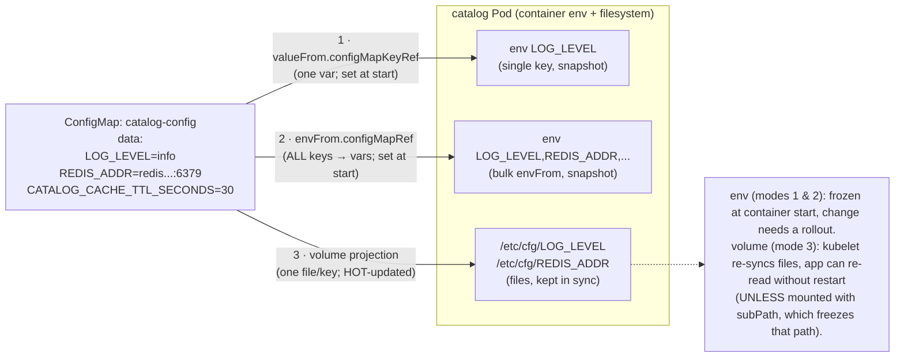

# 01 — ConfigMaps

> Externalize **non-secret** configuration so the same image runs in dev,
> staging and prod by changing data, not code. This chapter covers the three
> consumption modes (`configMapKeyRef`, bulk `envFrom`, projected files), who
> can read and change a ConfigMap, the `subPath` trap, immutable ConfigMaps,
> and why env vars never update. The Bookstore's catalog config is lifted out
> of its Deployment as the worked example.

**Estimated time:** ~15 min read · ~30 min hands-on
**Prerequisites:** [Part 01 ch.04](../01-core-workloads/04-replicasets-and-deployments.md) — the Deployment whose config you're lifting · [01.01](../01-core-workloads/01-pods.md) — env vars, volume mounts, and the [baseline](../01-core-workloads/01-pods.md#baseline) every manifest here carries
**You'll know after this:** • keep credentials out of a ConfigMap and check who can read and write one with `kubectl auth can-i` · • choose between `configMapKeyRef`, `envFrom`, and projected volumes · • predict which mount types update live and which do not · • use immutable ConfigMaps for production · • recognize the `subPath` trap

<!-- tags: core-objects, configmaps, configuration, env-vars, projected-volumes, rbac -->

## Why this exists

The catalog Deployment ([Part 01 ch.04](../01-core-workloads/04-replicasets-and-deployments.md))
hardcodes its configuration in the pod template: `PORT` is an inline env, the
log level is whatever the binary defaults to, and the Redis address is unset.
Changing a setting means editing and re-applying the workload, and the same
image cannot move from dev to prod without a manifest fork. That breaks the
twelve-factor rule to store config in the environment: build the artifact
once, and configure it per environment.

A **ConfigMap** is the Kubernetes object for exactly that: a namespaced bag of
key/value data (and small binary data), decoupled from any Pod, that you
inject into containers as environment variables or files. Config gets its
own lifecycle, reviewed, diffed and rolled independently of the image.

A ConfigMap is not a place for secrets. The Kubernetes docs say so directly:
"ConfigMap does not provide secrecy or encryption." Anyone whom RBAC lets read
the object reads every value in it, in plain text. Passwords and tokens belong
in a Secret ([ch.02](02-secrets.md)). **Never put a credential in a ConfigMap.**

## Mental model

A ConfigMap is a detachable config file or env block that lives in the API,
not in the image. It is the part of the environment that differs between
deployments, named and versioned as an object.

- It holds `data` (UTF-8 strings) and optionally `binaryData` (base64 bytes).
  The docs cap the data at **1 MiB** per ConfigMap. It is for configuration,
  not for files.
- A Pod consumes it three ways: one key becomes one env var
  (`valueFrom.configMapKeyRef`), every key becomes env vars in bulk
  (`envFrom`), or the whole map is projected as files in a volume.
- An env var is read **once, at container start**, and frozen for that
  container's life. A volume projection is **kept in sync** by the kubelet.
  That difference decides whether a change needs a restart.

Two controls are separate. The Pod's mount decides how a value reaches the
process. RBAC on the ConfigMap object decides who can read it and who can
change it through the API.

## Threats and controls

A ConfigMap holds configuration, so its threats are about who can read and
write it, and what a value does once it is inside a process.

| Threat | Control taught here | Goes deeper |
|---|---|---|
| A credential sits in a ConfigMap, where anyone whom RBAC lets `get` the object reads it in plain text | Keep credentials out. Step 3 shows who can read the object | [ch.02](02-secrets.md) |
| A namespace-wide grant reads every ConfigMap in the namespace. The built-in `view` role does, and `edit` also writes them, along with Secrets | Scope a grant to one object with `resourceNames` where a workload needs one. Check with `kubectl auth can-i` (step 3) | [05.01](../05-security/01-authn-authz-rbac.md) |
| A write to a mounted ConfigMap reaches the running app with no deploy, so one patch changes production live | RBAC on writes (`patch`, `update`, `delete`). `immutable: true` in production, so a change is a new object and a rollout (step 6) | [07.04](../07-delivery/04-gitops-argocd.md) |
| An env value is copied into the container's process and into every child it starts, and `/proc/<pid>/environ` returns it to a process with access to that PID | Mount config as files where the value does not have to be an env var (step 5) | [proc(5)](https://man7.org/linux/man-pages/man5/proc.5.html) |

Credentials are the one thing a ConfigMap must never hold. The other rows
are about who can read and change the config that is there.

## Diagrams

### ConfigMap → Pod: the three injection modes (Mermaid)



### The three modes side by side (ASCII)

```
 ConfigMap catalog-config = { LOG_LEVEL, REDIS_ADDR, CATALOG_CACHE_TTL_SECONDS }

 (1) configMapKeyRef            (2) envFrom (bulk)           (3) volume (projected)
 ─────────────────────         ────────────────────         ──────────────────────
 env:                          envFrom:                     volumeMounts:
  - name: LOG_LEVEL             - configMapRef:               - name: cfg
    valueFrom:                     name: catalog-config         mountPath: /etc/cfg
      configMapKeyRef:          ⇒ LOG_LEVEL, REDIS_ADDR,     volumes:
        name: catalog-config       CATALOG_CACHE_TTL_...      - name: cfg
        key:  LOG_LEVEL            all become env vars           configMap:
 ⇒ ONE explicit var            ⇒ every key, one shot            name: catalog-config
                                                             ⇒ /etc/cfg/LOG_LEVEL ...

 update: needs Pod restart     update: needs Pod restart    update: files re-sync
 (snapshot at start)           (snapshot at start)          live  (NO restart*)
                               key name == env var name     *except subPath mounts
```

## Hands-on with the Bookstore

**Assumed working directory: the guide repo root (`full-guide/`).** This
chapter needs the `bookstore` namespace ([Part 01 ch.03](../01-core-workloads/03-resources-and-qos.md)),
the catalog Deployment ([Part 01 ch.04](../01-core-workloads/04-replicasets-and-deployments.md)),
and Redis ([Part 02 ch.02](../02-networking/02-services.md)), which catalog
uses for its cache once `REDIS_ADDR` is set. The ServiceAccounts and the
`catalog-config-reader` Role come from `05-serviceaccounts-rbac.yaml`. Each
apply is idempotent, so it is safe if an earlier chapter already ran it.

```sh
kubectl apply -f examples/bookstore/raw-manifests/00-namespace.yaml
kubectl apply -f examples/bookstore/raw-manifests/05-serviceaccounts-rbac.yaml
kubectl apply -f examples/bookstore/raw-manifests/12-redis.yaml
```

### 1. Externalize catalog's non-secret config

The catalog binary ([`app/catalog/main.go`](../examples/bookstore/app/catalog/main.go))
reads `LOG_LEVEL` and `REDIS_ADDR` from the environment, and `PORT` and
`DB_DSN` as well. `DB_DSN` is a credential, so it is not part of this file.
[ch.02](02-secrets.md) moves it into a Secret. The new file is
[`15-catalog-config.yaml`](../examples/bookstore/raw-manifests/15-catalog-config.yaml):

```yaml
apiVersion: v1
kind: ConfigMap
metadata:
  name: catalog-config
  namespace: bookstore
  labels: { app: catalog, app.kubernetes.io/part-of: bookstore }
data:
  # consumed by the app (app/catalog/main.go):
  LOG_LEVEL: "info"
  REDIS_ADDR: "redis.bookstore.svc.cluster.local:6379"
  # illustrative, NOT read by the tiny demo binary: present only to make the
  # bulk envFrom realistic (flagged in the manifest comments):
  CATALOG_FEATURE_RECOMMENDATIONS: "false"
  CATALOG_CACHE_TTL_SECONDS: "30"
```

> **Honesty note.** Only `LOG_LEVEL` and `REDIS_ADDR` are read by the demo
> binary. `CATALOG_FEATURE_RECOMMENDATIONS` and `CATALOG_CACHE_TTL_SECONDS`
> are illustrative keys, so the bulk `envFrom` demo is not a single-key toy.
> The guide never claims the app reads config it does not.

A ConfigMap has no Pod spec, so the [baseline](../01-core-workloads/01-pods.md#baseline)
does not apply to it. Pod Security checks Pods, and the `restricted` label on
the namespace covers the workloads that read this object.

```sh
kubectl apply -f examples/bookstore/raw-manifests/15-catalog-config.yaml
```

<!-- gate: output -->
```text
configmap/catalog-config created
```

### 2. Wire the Deployment to consume it (two modes at once)

Edit [`10-catalog-deploy.yaml`](../examples/bookstore/raw-manifests/10-catalog-deploy.yaml)
so the catalog container pulls its config from the ConfigMap. The chapter
uses bulk `envFrom` for the whole map and an explicit `configMapKeyRef` for
`LOG_LEVEL`, so both modes appear together. An explicit `env[]` entry always
wins over an `envFrom[]` value for the same key. That is a fixed precedence
rule, not list order, so the `configMapKeyRef` is the authoritative one. The
value is identical here, on purpose.

```yaml
        - name: catalog
          image: bookstore/catalog:dev
          envFrom:
            - configMapRef:
                name: catalog-config        # bulk: every key → an env var
          env:
            - name: PORT
              value: "8080"
            - name: LOG_LEVEL               # explicit single-key (mode 1)
              valueFrom:
                configMapKeyRef:
                  name: catalog-config
                  key: LOG_LEVEL
            # ... ch.02 adds DB_DSN here from a Secret ...
```

The full file also carries the `DB_DSN` from [ch.02](02-secrets.md) and the
volumes from [ch.03](03-volumes.md). It is one cumulative manifest, and this
chapter's increment is the ConfigMap wiring.

The database comes first. The catalog's `/readyz` pings Postgres, so the
Deployment does not go Ready without it. `10-catalog-deploy.yaml` reads three
database keys from the `db-credentials` Secret with `secretKeyRef`, and builds
`DB_DSN` from them. `16-db-credentials.yaml` is the `Secret` that
[ch.02](02-secrets.md) creates. Its password is demo-only, and it is there so
the Deployment can start. Nothing in this chapter depends on its value, so do
not copy it anywhere.

```sh
# from the repo root (full-guide/)
kubectl apply -f examples/bookstore/raw-manifests/16-db-credentials.yaml
kubectl apply -f examples/bookstore/raw-manifests/20-postgres-statefulset.yaml
kubectl rollout status statefulset/postgres -n bookstore
kubectl apply -f examples/bookstore/raw-manifests/21-db-migrate-job.yaml
kubectl wait --for=condition=complete job/db-migrate -n bookstore --timeout=120s
kubectl apply -f examples/bookstore/raw-manifests/10-catalog-deploy.yaml
kubectl rollout status deployment/catalog -n bookstore
```

<!-- gate: output -->
```text
job.batch/db-migrate condition met
```

The two `rollout status` commands wait for readiness, and they can take
minutes on a small cluster. On a busy node, Postgres can take several minutes
to finish its first start, and the catalog's readiness probe, which pings
Postgres, can return HTTP 503 while it waits. `rollout status` exits non-zero
when its timeout passes. Run `kubectl get pods -n bookstore` to see where each
Pod stands. The Deployment's
spec, which is what this chapter checks, is the same either way.

Catalog is distroless and has no shell, so inspect the rendered Pod spec
rather than exec into it:

```sh
kubectl get pod -n bookstore -l app=catalog -o \
  jsonpath='{.items[0].spec.containers[0].envFrom[0].configMapRef.name}{"\n"}'
```

<!-- gate: output -->
```text
catalog-config
```

```sh
kubectl set env deployment/catalog -n bookstore --list | grep -i log_level
```

<!-- gate: output -->
```text
# LOG_LEVEL from configmap catalog-config, key LOG_LEVEL
```

`set env --list` renders only the explicit `env[]` entries. The `envFrom`
source is confirmed by the jsonpath above.

### 3. Who can read the ConfigMap, and who can change it

Reading or changing a ConfigMap is an RBAC decision. `kubectl auth can-i`
asks the API server what a subject may do, and it changes nothing. Start with
the catalog's own identity. The Role in `05-serviceaccounts-rbac.yaml` lets
`catalog-sa` get exactly one object by name, `catalog-config`. `resourceNames`
narrows the rule, so it does not grant the collection:

```sh
kubectl auth can-i get configmaps -n bookstore --as=system:serviceaccount:bookstore:catalog-sa
kubectl auth can-i get secrets -n bookstore --as=system:serviceaccount:bookstore:catalog-sa
kubectl auth can-i list configmaps -n bookstore --as=system:serviceaccount:bookstore:catalog-sa
kubectl auth can-i get configmap/catalog-config -n bookstore --as=system:serviceaccount:bookstore:catalog-sa
kubectl auth can-i get configmap/catalog-config-v1 -n bookstore --as=system:serviceaccount:bookstore:catalog-sa
```

<!-- gate: output -->
```text
no
# ...
no
# ...
no
# ...
yes
# ...
no
```

The answers are the control. The catalog reads its one ConfigMap by name, and
it has no read of the collection and no access to Secrets. The last answer is
the same check run against a ConfigMap the catalog does not own.

A namespace-wide grant is much more common, and it is wider than it looks.
The built-in `view` ClusterRole reads every ConfigMap in a namespace and no
Secrets. The `edit` ClusterRole writes ConfigMaps, and it also reads and writes
Secrets:

```sh
kubectl describe clusterrole view | grep -E 'configmaps|secrets'
kubectl describe clusterrole edit | grep -E 'configmaps|secrets'
```

<!-- gate: output -->
```text
  configmaps                                   []                 []              [get list watch]
# ...
  configmaps                                   []                 []              [create delete deletecollection patch update get list watch]
  secrets                                      []                 []              [get list watch create delete deletecollection patch update]
```

Bind an auditor to `view` and a deployer to `edit` in the namespace, check
what each can do, and then remove both bindings. These two bindings are
deliberate and short-lived:

```sh
kubectl create rolebinding cfg-auditor -n bookstore --clusterrole=view --user=auditor
kubectl auth can-i get configmaps -n bookstore --as=auditor
kubectl auth can-i get secrets -n bookstore --as=auditor
kubectl auth can-i patch configmaps -n bookstore --as=auditor
kubectl create rolebinding cfg-deployer -n bookstore --clusterrole=edit --user=deployer
kubectl auth can-i patch configmaps -n bookstore --as=deployer
kubectl delete rolebinding cfg-auditor cfg-deployer -n bookstore
```

<!-- gate: output -->
```text
rolebinding.rbac.authorization.k8s.io/cfg-auditor created
# ...
yes
# ...
no
# ...
no
# ...
rolebinding.rbac.authorization.k8s.io/cfg-deployer created
# ...
yes
```

An auditor bound to `view` reads every config value in the namespace,
including any password someone put in a ConfigMap. A deployer bound to `edit`
can change live config, which is what step 4 shows.

### 4. Project the ConfigMap as files and watch it update

Env vars are a start-time snapshot, so live updates need the volume
projection. Use a small inspection Pod built on busybox, which has a shell,
unlike the catalog image. It carries the [baseline](../01-core-workloads/01-pods.md#baseline)
in full: it runs as UID 65532, its root filesystem is read-only, it drops
every capability, and it mounts no API token. It uses `catalog-sa`, which has
no rights beyond reading `catalog-config`, so the Pod grants nothing new. The
busybox image is pinned by digest, with the tag in a comment. It reads
`LOG_LEVEL` both as a file and as an env var, and step 5 compares the two.

```sh
kubectl apply -f - <<'EOF'
apiVersion: v1
kind: Pod
metadata:
  name: cfg-peek
  namespace: bookstore
  labels:
    app: cfg-peek
    app.kubernetes.io/part-of: bookstore
spec:
  serviceAccountName: catalog-sa
  automountServiceAccountToken: false
  securityContext:
    runAsNonRoot: true
    runAsUser: 65532
    runAsGroup: 65532
    seccompProfile:
      type: RuntimeDefault
  containers:
    - name: peek
      image: busybox@sha256:73aaf090f3d85aa34ee199857f03fa3a95c8ede2ffd4cc2cdb5b94e566b11662  # busybox:1.36
      command: ["sh", "-c", "while true; do cat /etc/cfg/LOG_LEVEL; echo; sleep 15; done"]
      env:
        - name: LOG_LEVEL
          valueFrom:
            configMapKeyRef:
              name: catalog-config
              key: LOG_LEVEL
      securityContext:
        allowPrivilegeEscalation: false
        readOnlyRootFilesystem: true
        capabilities:
          drop: ["ALL"]
      resources:
        requests:
          cpu: 10m
          memory: 16Mi
        limits:
          memory: 32Mi
      volumeMounts:
        - name: cfg
          mountPath: /etc/cfg
          readOnly: true
        - name: tmp
          mountPath: /tmp
  volumes:
    - name: cfg
      configMap:
        name: catalog-config
    - name: tmp
      emptyDir: {}
EOF
kubectl wait --for=condition=Ready pod/cfg-peek -n bookstore --timeout=120s
kubectl logs cfg-peek -n bookstore --tail=2
kubectl exec cfg-peek -n bookstore -- ls -l /etc/cfg
```

<!-- gate: output -->
```text
pod/cfg-peek created
# ...
pod/cfg-peek condition met
# ...
info
# ...
total 0
lrwxrwxrwx    1 root     root            32 Oct 31 00:02 CATALOG_CACHE_TTL_SECONDS -> ..data/CATALOG_CACHE_TTL_SECONDS
lrwxrwxrwx    1 root     root            38 Oct 31 00:02 CATALOG_FEATURE_RECOMMENDATIONS -> ..data/CATALOG_FEATURE_RECOMMENDATIONS
lrwxrwxrwx    1 root     root            16 Oct 31 00:02 LOG_LEVEL -> ..data/LOG_LEVEL
lrwxrwxrwx    1 root     root            17 Oct 31 00:02 REDIS_ADDR -> ..data/REDIS_ADDR
```

Each key is a symlink into `..data`. When the ConfigMap changes, the kubelet
updates that link, so a reader sees either the old files or the new ones,
never a half-written file.

Now change the ConfigMap. Note the catalog's ReplicaSets first:

```sh
kubectl get rs -n bookstore -l app=catalog
kubectl patch configmap catalog-config -n bookstore --type merge -p '{"data":{"LOG_LEVEL":"debug"}}'
until kubectl logs cfg-peek -n bookstore --tail=1 | grep -q '^debug$'; do sleep 5; done
kubectl logs cfg-peek -n bookstore --tail=2
kubectl get rs -n bookstore -l app=catalog
```

<!-- gate: output -->
```text
NAME                 DESIRED   CURRENT   READY   AGE
catalog-56f9649677   3         3         0       4m50s
# ...
configmap/catalog-config patched
```

<!-- gate: output -->
```text
info
debug
```

<!-- gate: output -->
```text
NAME                 DESIRED   CURRENT   READY   AGE
catalog-56f9649677   3         3         0       6m1s
```

`cfg-peek` was not restarted, and the catalog's ReplicaSets did not change.
In the lab run the file showed `debug` 70 seconds after the patch. The kubelet
sets that delay, not the app. The env copy in a running Pod does not change at
all, as the docs also say: "ConfigMaps consumed as environment variables are
not updated automatically and require a pod restart."

### 5. What an env var exposes

`cfg-peek` also takes `LOG_LEVEL` as an env var. Read both copies from inside
the same container, while the ConfigMap says `debug`:

```sh
kubectl exec cfg-peek -n bookstore -- sh -c 'cat /etc/cfg/LOG_LEVEL; echo; tr "\0" "\n" < /proc/1/environ | grep LOG_LEVEL'
```

<!-- gate: output -->
```text
debug
LOG_LEVEL=info
```

The file says `debug` and the environment still says `info`. The env copy was
taken at start and is frozen. The same value also sits in the process itself:
every child process inherits it, and `/proc/<pid>/environ` returns it to any
process with access to that PID ([proc(5)](https://man7.org/linux/man-pages/man5/proc.5.html)).
A file mount has no copy in the environment. Mount a value as a file where the
app can read it, and keep env vars for values a process reads once at start.

Restore the value:

```sh
kubectl patch configmap catalog-config -n bookstore --type merge -p '{"data":{"LOG_LEVEL":"info"}}'
```

<!-- gate: output -->
```text
configmap/catalog-config patched
```

### 6. Immutable ConfigMaps: a change is a new object

An immutable ConfigMap cannot be changed in place. The API server refuses the
write, and that refusal is the control. A production config change becomes a
new object and a rollout. Create `catalog-config-v1` as immutable, then try to
change it. The failing patch is deliberate:

```sh
kubectl apply -f - <<'EOF'
apiVersion: v1
kind: ConfigMap
metadata:
  name: catalog-config-v1
  namespace: bookstore
  labels:
    app: catalog
    app.kubernetes.io/part-of: bookstore
immutable: true
data:
  LOG_LEVEL: "info"
EOF
kubectl patch configmap catalog-config-v1 -n bookstore --type merge -p '{"data":{"LOG_LEVEL":"debug"}}'
```

<!-- gate: output -->
```text
configmap/catalog-config-v1 created
# ...
The ConfigMap "catalog-config-v1" is invalid: data: Forbidden: field is immutable when `immutable` is set
```

To change this config, create `catalog-config-v2`, point the Deployment at it,
and roll out. The docs say immutable ConfigMaps improve cluster performance
"by closing watches for ConfigMaps marked as immutable", which reduces load
on the kube-apiserver.

Remove the inspection objects when you are done:

```sh
kubectl delete pod cfg-peek -n bookstore
kubectl delete configmap catalog-config-v1 -n bookstore
```

## How it works under the hood

- **Storage and projection.** A ConfigMap is a normal API object persisted in
  **etcd** ([Part 00 ch.04](../00-foundations/04-control-plane-deep-dive.md)).
  The kubelet fetches it for a Pod and renders the requested form. Env vars
  are written into the container's process environment at exec. A volume
  projection is materialized as a directory on the node that the kubelet keeps
  reconciled. A ConfigMap volume is not tmpfs. Secret volumes are, which is
  one reason credentials go there ([ch.02](02-secrets.md)).
- **Env vars are a one-shot snapshot.** The container environment is set once,
  at process start, from the value at that instant. Changing the ConfigMap has
  no effect on a running container. Only a new container picks up the new value.
- **Volume keys are kept in sync, with lag.** The kubelet refreshes the
  projection periodically, so the delay in step 4 (70 seconds in the lab run)
  is set by the kubelet, not by the app. An app that re-reads the file gets new
  config without a restart.
- **`subPath` opts out of updates.** A `subPath` mount is resolved once at
  container start. The docs say: "A container using a ConfigMap as a subPath
  volume mount will not receive ConfigMap updates." This is the classic "I
  updated the ConfigMap and nothing happened" trap. Mount the whole directory
  and have the app read `<mountPath>/<key>` when you want live updates.
- **Immutable ConfigMaps.** Setting `immutable: true` makes `data` and
  `binaryData` unchangeable. You delete and recreate the object, which means a
  new name per change. The API server closes the watches on immutable
  ConfigMaps, which takes load off the kube-apiserver in large clusters.
- **Size limit.** The docs say the data in a ConfigMap "cannot exceed 1 MiB".
  Large files belong in a volume or an object store.
- **`binaryData`.** Non-UTF-8 content, such as a TLS chain or a small keystore,
  goes in `binaryData` as base64, and is decoded to bytes on projection.
  Base64 here is an encoding for transport. It is not secrecy.
- **Optional and missing references.** A `configMapKeyRef` or `configMapRef`
  is required by default. If the ConfigMap or key is absent, the Pod does not
  start and sits in `CreateContainerConfigError`. Mark a reference
  `optional: true` only for genuinely optional tunables.
- **Who can read it.** RBAC is the only read control on the object. ConfigMaps
  give no secrecy or encryption of their own (step 3 shows the grants). Whether
  the object is encrypted in etcd is a cluster setting, covered in 05.04
  <!-- link-later: 05.04 -->.

## Production notes

> **In production:** treat config as **versioned, reviewed artifacts**, not
> hand-run `kubectl edit`. Manage ConfigMaps through the same GitOps pipeline
> as code ([Part 07 ch.04](../07-delivery/04-gitops-argocd.md)). A config change
> is a deploy, and it should be diffable and revertable. An out-of-band edit
> that drifts from Git is a common cause of incidents.

> **In production:** prefer **`immutable: true`** ConfigMaps with a
> **content-hashed name** (for example `catalog-config-7a3f`, a placeholder)
> and roll the Deployment to the new name. Every change becomes an explicit,
> auditable rollout with a rollback target, and the API server stops watching
> the object. Kustomize's `configMapGenerator`
> ([Part 07](../07-delivery/02-packaging-kustomize.md)) can add the hash for you.

> **In production:** know your update semantics before you rely on them.
> Env-var config never updates without a rollout. That is usually what you
> want, because the change is atomic and rollout-safe. "Live reload from a
> mounted ConfigMap" works only for full-directory volume mounts, and only if
> the app re-reads the file. It never works through `subPath`. Do not design a
> "change the ConfigMap and the app reacts" flow on an env-var consumer.

> **In production:** keep ConfigMaps **small and single-purpose**. A 1 MiB cap
> is a hard wall, and a large ConfigMap watched by many Pods adds control-plane
> load. Split it per concern. A ConfigMap is not a file distribution mechanism:
> that is a volume or object-store job ([ch.03](03-volumes.md),
> [ch.04](04-persistent-storage.md)).

## Quick Reference

```sh
kubectl create configmap <NAME> -n <NS> --from-literal=KEY=val --dry-run=client -o yaml   # author
kubectl get configmap <NAME> -n <NS> -o yaml                                             # inspect
kubectl patch configmap <NAME> -n <NS> --type merge -p '{"data":{"K":"v"}}'              # change
kubectl auth can-i get configmap/<NAME> -n <NS> --as=system:serviceaccount:<NS>:<SA>     # who can read
kubectl auth can-i patch configmaps -n <NS> --as=<USER>                                   # who can write
kubectl rollout restart deployment/<D> -n <NS>                                            # apply an env-var change
```

A minimal ConfigMap for production, immutable with a new name per change:

```yaml
apiVersion: v1
kind: ConfigMap
metadata:
  name: app-config
  namespace: bookstore
immutable: true                  # a change is a new name and a rollout
data:
  LOG_LEVEL: "info"
  FEATURE_X: "false"
```

The three consumption modes, in a container spec:

```yaml
envFrom:                           # (2) every key, as env vars: a snapshot
  - configMapRef:
      name: app-config
env:
  - name: LOG_LEVEL                # (1) one key, as an env var: a snapshot
    valueFrom:
      configMapKeyRef:
        name: app-config
        key: LOG_LEVEL
volumeMounts:
  - name: cfg                      # (3) files: the kubelet keeps them in sync
    mountPath: /etc/cfg
    readOnly: true
volumes:
  - name: cfg
    configMap:
      name: app-config
```

Checklist:

- [ ] No credentials in the ConfigMap (plaintext; use a Secret, [ch.02](02-secrets.md))
- [ ] `kubectl auth can-i` run for who can read and who can write the object
- [ ] Grants name the object (`resourceNames`) where a workload needs one
- [ ] Consumption mode chosen on purpose (env is a snapshot; volume is live)
- [ ] `subPath` mounts understood not to update
- [ ] `immutable: true` and a new name per change in production
- [ ] ConfigMap small (far below 1 MiB); split per concern
- [ ] Required references not marked `optional`
- [ ] Config changes flow through GitOps, not ad-hoc edits

## Test your understanding

> Try each before opening the answer drawer. The act of trying is the exercise; the answer is the check.

1. **A teammate updates `LOG_LEVEL` in a ConfigMap consumed via `valueFrom.configMapKeyRef`. They wait, but the app still logs at `info`. What's happening, and why is the absence of update the *correct* default behavior?**
   <details><summary>Show answer</summary>

   Env vars are a one-shot snapshot taken at container start. The process already has its copy, so a later change to the ConfigMap has no effect on the running container. To pick up the change, run `kubectl rollout restart deployment`. That is the desirable behavior: an env-var change becomes an atomic, auditable, rollout-safe deploy, not a silent live mutation (see "Env vars are a one-shot snapshot" above).

   </details>

2. **You mount a single ConfigMap key with `subPath` to drop one file into `/etc/app/config.yaml`. You patch the ConfigMap and the file doesn't change. Why, and what's the fix?**
   <details><summary>Show answer</summary>

   A `subPath` mount is resolved once, at container start, and is not part of the synced projection. The docs say such a mount "will not receive ConfigMap updates." The fix is to mount the full directory, with no `subPath`, and have the app read `<mountPath>/<key>`. The other option is to accept a rollout to pick up the new value (see "subPath opts out of updates" above).

   </details>

3. **Why is `immutable: true` on a ConfigMap a performance improvement at scale, and what changes about the rollout workflow when you use it?**
   <details><summary>Show answer</summary>

   The docs say immutable ConfigMaps let the API server close their watches, which reduces load on the kube-apiserver in large clusters. The workflow changes too: every change becomes a new ConfigMap with a new name, such as `catalog-config-7a3f`, which a Deployment references and rolls out as a normal release. That is auditable and rollback-friendly, and the failing patch in step 6 is the reason (see "Immutable ConfigMaps" above).

   </details>

4. **A teammate says the database password can go in `catalog-config` because only the catalog Pod mounts it. What do you check, and what do you tell them?**
   <details><summary>Show answer</summary>

   Mounting is not an access control. Run `kubectl auth can-i get configmaps` and `list` for every subject you care about, and read the `view` and `edit` ClusterRoles from step 3. Anyone bound to `view` reads every ConfigMap in the namespace, and the docs say ConfigMaps give no secrecy or encryption. Tell the teammate that the password goes in a Secret ([ch.02](02-secrets.md)), with its own RBAC, and that nothing about the Pod's mount changes who can read the object.

   </details>

5. **Hands-on extension: apply `15-catalog-config.yaml`, then run the `cfg-peek` Pod from step 4. In another terminal, patch `LOG_LEVEL` to `debug`. What do you observe, and what does it prove?**
   <details><summary>What you should see</summary>

   `cfg-peek` prints `debug` without any restart. In the lab run that took 70 seconds after the patch. The volume projection is refreshed by the kubelet, and each key is a symlink into `..data`, so readers never see a half-written file. The same patch applied to an env-var consumer changes nothing until the next rollout. The mode you choose decides the update semantics (see steps 4 and 5).

   </details>

## Further reading

- **Lukša, _Kubernetes in Action_, 2nd edition, the chapter "Configuration via
  ConfigMaps, Secrets, and the Downward API"**: the consumption modes, volume
  projection, immutability and update behavior.
- **Ibryam & Huß, _Kubernetes Patterns_, 2nd edition, the patterns
  _Configuration Resource_ and _EnvVar Configuration_**: when to use a config
  object and when plain env vars are enough, and the trade-offs of each.
- Official:
  <https://kubernetes.io/docs/concepts/configuration/configmap/> and
  <https://kubernetes.io/docs/tasks/configure-pod-container/configure-pod-configmap/>.
- [proc(5)](https://man7.org/linux/man-pages/man5/proc.5.html), for what
  `/proc/<pid>/environ` exposes.
