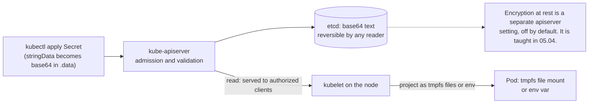

# 02 — Secrets

> A Secret holds the sensitive part of your configuration, and by default it
> is encoded, not encrypted. This chapter decodes one on the cluster to show
> that, then sets the RBAC that decides who can read Secrets, mounts a Secret
> as files, and makes a Secret immutable. [03.01](01-configmaps.md) already
> put the Bookstore's Postgres password into the `db-credentials` Secret. This
> chapter shows who can read a Secret like that, and how it reaches a Pod.

**Estimated time:** ~30 min read · ~60 min hands-on
**Prerequisites:** [Part 03 ch.01](01-configmaps.md): ConfigMap consumption, which Secret consumption mirrors · [Part 01 ch.04](../01-core-workloads/04-replicasets-and-deployments.md): the Deployment that reads `DB_DSN` · [01.01](../01-core-workloads/01-pods.md): the [baseline](../01-core-workloads/01-pods.md#baseline) every Pod here carries
**You'll know after this:** • decode a Secret and say why base64 is not protection · • check who can read, list or create Secrets with `kubectl auth can-i` · • mount a Secret as files, with the mode the app needs · • make a Secret immutable, so a change needs a new name · • name the env-var gap in the Bookstore and avoid it in new workloads

<!-- tags: security, secrets, base64, rbac, immutable, files-over-env -->

## Why this exists

[ch.01](01-configmaps.md) moved catalog's non-secret config out of its
Deployment, and applied `db-credentials`, the Secret that holds the Postgres
password. Before Part 03, that password was an inline env value in the
Postgres StatefulSet's pod template, with a `# TODO(Phase 3)` marker, which
[Part 01 ch.05](../01-core-workloads/05-statefulsets.md) deferred. A password
in a pod template shows in `kubectl get statefulset -o yaml`, in every Git
diff, and in the ControllerRevisions that keep a StatefulSet's pod-template
history. A Secret keeps the value out of the template. This chapter tests what
that does and does not protect.

A **Secret** is the Kubernetes object for sensitive key/value data. It is
almost a ConfigMap: the same env and file shapes, but a separate RBAC surface,
so a subject can read config without reading credentials, and kubelet mounts
a Secret volume on tmpfs. It is not encrypted by default, and the rest of the
chapter builds on that fact.

## Mental model

A Secret is **a ConfigMap that the platform agrees to treat as sensitive**.
Three differences matter:

- **It is base64-encoded, not encrypted.** The `data` field holds base64 text,
  and `base64 -d` returns the value in one command. Encoding lets arbitrary
  bytes survive JSON and YAML. It gives no secrecy: anyone who can read the
  object, or the etcd data behind it, reads the value.
- **It has its own RBAC surface and its own mount.** A Role can grant
  `get configmaps` and not `get secrets`, because RBAC has grants and no
  denies. kubelet mounts a Secret volume on tmpfs, so its files are never
  written to node disk.
- **It has typed variants** the platform acts on: `kubernetes.io/tls`,
  `kubernetes.io/dockerconfigjson` (an image pull secret),
  `kubernetes.io/basic-auth` and `kubernetes.io/service-account-token`. The
  catch-all is `Opaque`, which the Bookstore's database Secret uses.

So a Secret is the right object for the database password, and it is not
secure by itself. Encryption at rest is a separate apiserver setting, off by
default, and it is taught in 05.04. <!-- link-later: 05.04 --> Keeping values
out of Git altogether, with an external store, is taught in 11.05.
<!-- link-later: 11.05 -->

## Threats and controls

A Secret's threats are about who can read it, where its value ends up, and
whether it can change under a running workload.

| Threat | Control taught here | Goes deeper |
|---|---|---|
| A credential is written into a manifest or a pod template, and anyone who reads the workload reads it | The Secret is made from a value generated at apply time, and no manifest holds a real one. Step 2 generates one | [07.03](../07-delivery/03-cicd-pipeline.md) scans commits; external stores in 11.05 |
| A reader decodes base64 and treats the value as protected | Treat `data` as cleartext. Step 3 decodes one value and counts another | Encryption at rest in 05.04 |
| A subject reads or changes Secrets it does not need. `get` and `list` both return values, and a subject that can create a Pod can mount any Secret in the namespace | Name the Secret in a grant with `resourceNames` where the verb allows it, and check with `kubectl auth can-i`. Steps 4 to 6 show where names stop working | [05.01](../05-security/01-authn-authz-rbac.md) for RBAC; [05.02](../05-security/02-pod-security.md) for Pod creation |
| An env var is copied into the process and into every child it starts, and it is frozen until the next rollout | Mount the Secret as files, with the mode and group the app needs. Step 7 | [03.03 step 6](03-volumes.md#6-secret-volumes-tmpfs-defaultmode-and-fsgroup) for `defaultMode` and `fsGroup` |
| A Secret edited in place reaches running Pods with no review | `immutable: true`, so a change is a new object and a rollout. Step 8 | [07.04](../07-delivery/04-gitops-argocd.md) for reviewed rollouts |

The rows are specific to Secrets. The rest of the Pod's surface is in
[Part 01 ch.01](../01-core-workloads/01-pods.md#threats-and-controls).

## Diagrams

### Secret write path: apiserver to etcd (Mermaid)



### Secret vs. ConfigMap (ASCII)

```
                         ConfigMap                 Secret
 ───────────────────────────────────────────────────────────────────────
 intent                  non-secret config         sensitive data
 at rest in etcd         plaintext                 base64 (NOT encrypted)
 RBAC verb to read       get configmaps            get secrets  (separate!)
 kubelet file mount      regular                   tmpfs (RAM, not disk)
 typed variants          no                        tls / dockercfg / SA
 env vs file             both                      both (file preferred:
                                                   it can rotate)
 RULE: base64 is ENCODING, not ENCRYPTION. `base64 -d` reverses it.
```

## Hands-on with the Bookstore

**Assumed working directory: the guide repo root (`full-guide/`).** The steps
use the `bookstore` namespace ([Part 01
ch.03](../01-core-workloads/03-resources-and-qos.md)).
If it does not exist yet, apply its manifest first. It carries the `restricted`
label:

```sh
kubectl apply -f examples/bookstore/raw-manifests/00-namespace.yaml
```

**Tier A (kind).** The recorded run is in
[`examples/security-lab/evidence/03-02.txt`](../examples/security-lab/evidence/03-02.txt),
made by
[`examples/security-lab/labs/03-02.sh`](../examples/security-lab/labs/03-02.sh).
It ran in its own namespace, `p03-02-secrets`, on a kind cluster whose name and
node name differ from the guide's. Lines that name that namespace are kept as
captured. Every command below names `bookstore`. Run this chapter only against
a kind cluster you own.

### 1. Three ServiceAccounts with no token

Each reader in this chapter is a ServiceAccount, and none of them calls the API
or mounts a token. `automountServiceAccountToken: false` turns the token off,
and the [baseline](../01-core-workloads/01-pods.md#baseline-service-account)
explains why every workload gets its own ServiceAccount.

```sh
kubectl apply -f - <<'EOF'
apiVersion: v1
kind: ServiceAccount
metadata:
  name: secret-reader
  namespace: bookstore
automountServiceAccountToken: false
---
apiVersion: v1
kind: ServiceAccount
metadata:
  name: secret-lister
  namespace: bookstore
automountServiceAccountToken: false
---
apiVersion: v1
kind: ServiceAccount
metadata:
  name: pod-creator
  namespace: bookstore
automountServiceAccountToken: false
EOF
```

<!-- gate: output -->
```text
serviceaccount/secret-reader created
serviceaccount/secret-lister created
serviceaccount/pod-creator created
```

### 2. Create a Secret with a generated value

[03.01](01-configmaps.md) applied `16-db-credentials.yaml`, so the
`db-credentials` Secret already exists in `bookstore`. Check that it does:

```sh
kubectl get secret db-credentials -n bookstore -o name
```

<!-- gate: output -->
```text
secret/db-credentials
```

That Secret holds the demo literal `devpassword`, and the database uses it. The
official Postgres image reads `POSTGRES_PASSWORD` when it initialises an empty
data directory, and ignores it after that
([docker-library postgres](https://github.com/docker-library/docs/blob/master/postgres/README.md)).
So a new value written into `db-credentials` does not change the password the
database accepts, and the catalog and orders would fail at their next restart.
Do not apply a generated value over `db-credentials`. This step creates a
second Secret, `db-credentials-generated`, that no workload reads, and every
later step uses it:

```sh
PW="$(openssl rand -hex 16)"
sed -e "s/devpassword/$PW/" \
    -e "s/name: db-credentials/name: db-credentials-generated/" \
    examples/bookstore/raw-manifests/16-db-credentials.yaml | kubectl apply -f -
```

<!-- gate: output -->
```text
secret/db-credentials-generated created
```

The `devpassword` literal in the file is the value this step replaces. The file
on disk does not change: `sed` writes the generated value only into the stream
that `kubectl apply` reads. Generation keeps the value out of the file, but not
out of the cluster. `kubectl apply` stores what it applied, and step 3 shows
where that lands.

### 3. Decode it: base64 is encoding

Read the stored values back and decode them. The first key holds a plain
name, and the second holds the password:

```sh
kubectl get secret db-credentials-generated -n bookstore -o jsonpath='{.data.POSTGRES_DB}'; echo
kubectl get secret db-credentials-generated -n bookstore -o jsonpath='{.data.POSTGRES_DB}' | base64 -d; echo
kubectl get secret db-credentials-generated -n bookstore -o jsonpath='{.data.POSTGRES_PASSWORD}' | base64 -d | wc -c | tr -d ' '
```

<!-- gate: output -->
```text
Ym9va3N0b3Jl
# ...
bookstore
# ...
32
```

The stored value is base64 text, and `base64 -d` returns the original in one
command. No key and no privilege beyond `get` on this Secret were needed. The
captured run printed `32`, the length of its generated value. On the 03.01
Secret, the same last command prints `11`, the length of the demo literal
`devpassword`. The count is the only thing these commands show: the value
itself is never printed by the chapter.

`kubectl apply` also keeps the manifest it applied, in the
`kubectl.kubernetes.io/last-applied-configuration` annotation. Written with
`stringData`, the value sits in that annotation as plain text, so `get` on the
Secret discloses it even though `data` is base64. The check counts the
`stringData` key:

```sh
kubectl get secret db-credentials-generated -n bookstore -o jsonpath='{.metadata.annotations.kubectl\.kubernetes\.io/last-applied-configuration}' | grep -c stringData
```

<!-- gate: output -->
```text
1
```

In the same shell, replace the pattern with `grep -c "$PW"`. The count is `1`
too, so the generated value sits in the annotation as well. Treat the
annotation as part of the Secret: anyone who can read the Secret can read it.

### The gap the Bookstore still has

The consumers take the same three keys, and they do not follow the
file-over-env rule yet. Find the lines that build `DB_DSN`:

```sh
grep -n 'password=$(POSTGRES_PASSWORD)' examples/bookstore/raw-manifests/10-catalog-deploy.yaml examples/bookstore/raw-manifests/14-orders-deploy.yaml
```

<!-- gate: output -->
```text
examples/bookstore/raw-manifests/10-catalog-deploy.yaml:164:              value: "host=postgres.bookstore.svc.cluster.local port=5432 user=$(POSTGRES_USER) password=$(POSTGRES_PASSWORD) dbname=$(POSTGRES_DB) sslmode=disable"
examples/bookstore/raw-manifests/14-orders-deploy.yaml:109:              value: "host=postgres.bookstore.svc.cluster.local port=5432 user=$(POSTGRES_USER) password=$(POSTGRES_PASSWORD) dbname=$(POSTGRES_DB) sslmode=disable"
```

Both files read the keys with `secretKeyRef`, then use `$(VAR)` interpolation
to put the password into one `DB_DSN` string. The Go services read that string
with `os.Getenv`, so the password reaches the process as an environment
variable. There, `/proc/<pid>/environ` returns it, and child processes inherit
it. This is a **known gap**: the file form is not used for catalog or orders.
The Postgres StatefulSet has the same exposure. Its
[`20-postgres-statefulset.yaml`](../examples/bookstore/raw-manifests/20-postgres-statefulset.yaml)
takes the three keys with `envFrom.secretRef`, so `postgres-0` gets
`POSTGRES_PASSWORD` as an environment variable. The db-migrate Job in
[`21-db-migrate-job.yaml`](../examples/bookstore/raw-manifests/21-db-migrate-job.yaml)
reads its keys with `secretKeyRef`, mapped to the libpq `PG*` names. Only the
throwaway restore Pod in [03.05](05-stateful-data-patterns.md) reads the file
form, through `POSTGRES_PASSWORD_FILE`. Closing the gap for the services is a
change to the services, which would read a file. It is not a manifest change.

### 4. Who can read one Secret: `get` by name

A Role names one Secret and lists three verbs an application might want. The
grant names `db-credentials-generated`, the Secret from step 2, so the
Bookstore's own `db-credentials` is not part of this step. The RoleBinding
gives the verbs to `secret-reader`:

```sh
kubectl apply -f - <<'EOF'
apiVersion: rbac.authorization.k8s.io/v1
kind: Role
metadata:
  name: db-credentials-reader
  namespace: bookstore
rules:
  - apiGroups: [""]
    resources: ["secrets"]
    resourceNames: ["db-credentials-generated"]
    verbs: ["get", "list", "create"]
---
apiVersion: rbac.authorization.k8s.io/v1
kind: RoleBinding
metadata:
  name: db-credentials-reader
  namespace: bookstore
roleRef:
  apiGroup: rbac.authorization.k8s.io
  kind: Role
  name: db-credentials-reader
subjects:
  - kind: ServiceAccount
    name: secret-reader
    namespace: bookstore
EOF
```

<!-- gate: output -->
```text
role.rbac.authorization.k8s.io/db-credentials-reader created
rolebinding.rbac.authorization.k8s.io/db-credentials-reader created
```

Ask the API server what the ServiceAccount may do. `can-i` changes nothing:

```sh
kubectl auth can-i get secret/db-credentials-generated -n bookstore --as=system:serviceaccount:bookstore:secret-reader
kubectl auth can-i get secret/other-creds -n bookstore --as=system:serviceaccount:bookstore:secret-reader
kubectl auth can-i get secrets -n bookstore --as=system:serviceaccount:bookstore:secret-reader
kubectl auth can-i list secrets -n bookstore --as=system:serviceaccount:bookstore:secret-reader
kubectl auth can-i create secrets -n bookstore --as=system:serviceaccount:bookstore:secret-reader
```

<!-- gate: output -->
```text
yes
# ...
no
# ...
no
# ...
no
# ...
no
```

The `get` on the named Secret is the only read this subject has. The `get` on
the collection is refused, and so is a `get` on any other name. The `list` and
`create` answers are the surprise. A `list` request carries no name, and a
`create` request names its object in the body, not in the URL. The rule names
`db-credentials-generated`, so it has nothing to match in either request. Two
commands show the refusals, plus the one list that works:

```sh
kubectl get secrets -n bookstore --as=system:serviceaccount:bookstore:secret-reader -o name
kubectl get secrets -n bookstore --as=system:serviceaccount:bookstore:secret-reader --field-selector metadata.name=db-credentials-generated -o name
kubectl create secret generic extra -n bookstore --from-literal=k=v --as=system:serviceaccount:bookstore:secret-reader
```

<!-- gate: output -->
```text
Error from server (Forbidden): secrets is forbidden: User "system:serviceaccount:p03-02-secrets:secret-reader" cannot list resource "secrets" in API group "" in the namespace "p03-02-secrets"
# ...
secret/db-credentials-generated
# ...
error: failed to create secret secrets is forbidden: User "system:serviceaccount:p03-02-secrets:secret-reader" cannot create resource "secrets" in API group "" in the namespace "p03-02-secrets"
```

A plain list is refused, even with the name in the grant. A
`metadata.name` field selector gives the rule the name it needs, so the list
returns that one object, values included. A `create` is refused, and the
names cannot scope it. Treat the name as the scope for `get` only, and check
`list` and `create` separately with `kubectl auth can-i`.

### 5. `list` with no names returns every value

A list with no names is a read of the whole collection. The Role below grants
`list` on Secrets and nothing else:

```sh
kubectl apply -f - <<'EOF'
apiVersion: rbac.authorization.k8s.io/v1
kind: Role
metadata:
  name: secret-lister
  namespace: bookstore
rules:
  - apiGroups: [""]
    resources: ["secrets"]
    verbs: ["list"]
---
apiVersion: rbac.authorization.k8s.io/v1
kind: RoleBinding
metadata:
  name: secret-lister
  namespace: bookstore
roleRef:
  apiGroup: rbac.authorization.k8s.io
  kind: Role
  name: secret-lister
subjects:
  - kind: ServiceAccount
    name: secret-lister
    namespace: bookstore
EOF
kubectl get secrets -n bookstore --as=system:serviceaccount:bookstore:secret-lister -o json | grep -o '"POSTGRES_[A-Z]*"' | sort -u
```

<!-- gate: output -->
```text
role.rbac.authorization.k8s.io/secret-lister created
rolebinding.rbac.authorization.k8s.io/secret-lister created
# ...
"POSTGRES_DB"
"POSTGRES_PASSWORD"
"POSTGRES_USER"
```

The `grep` prints key names only. The same response holds every value, in
`data`, base64. So `list` on Secrets is a read of every value in the
namespace, and that includes the Bookstore's `db-credentials` from 03.01. Grant
it only where that read is intended.

### 6. A subject that may only create Pods reads a Secret

This subject can create Pods and nothing else. It cannot read a Secret:

```sh
kubectl apply -f - <<'EOF'
apiVersion: rbac.authorization.k8s.io/v1
kind: Role
metadata:
  name: pod-creator
  namespace: bookstore
rules:
  - apiGroups: [""]
    resources: ["pods"]
    verbs: ["create"]
---
apiVersion: rbac.authorization.k8s.io/v1
kind: RoleBinding
metadata:
  name: pod-creator
  namespace: bookstore
roleRef:
  apiGroup: rbac.authorization.k8s.io
  kind: Role
  name: pod-creator
subjects:
  - kind: ServiceAccount
    name: pod-creator
    namespace: bookstore
EOF
kubectl auth can-i create pods -n bookstore --as=system:serviceaccount:bookstore:pod-creator
kubectl auth can-i get secrets -n bookstore --as=system:serviceaccount:bookstore:pod-creator
```

<!-- gate: output -->
```text
role.rbac.authorization.k8s.io/pod-creator created
rolebinding.rbac.authorization.k8s.io/pod-creator created
# ...
yes
# ...
no
```

Now the subject creates a Pod that mounts the Secret. The `--as` flag makes
that request as `pod-creator`, so the create is the subject's own request. The
Pod is the deliberate part. It is not wrong in shape: it carries the full
baseline, so admission accepts it. It prints a checksum of the password and the
names of the keys. Its `serviceAccountName` is `pod-creator`, which sets only
the Pod's own identity. That identity has no token and plays no part in the
kubelet's read of the Secret, because the kubelet fetches the Secret for the Pod
it runs. The `tmp` volume is an `emptyDir` with a `sizeLimit`, which caps what
the Pod can write to it. [03.03 step 5](03-volumes.md#5-size-caps-eviction-on-disk-enospc-in-memory)
explains the cap.

```sh
kubectl create -f - --as=system:serviceaccount:bookstore:pod-creator <<'EOF'
apiVersion: v1
kind: Pod
metadata:
  name: secret-reveal
  namespace: bookstore
spec:
  serviceAccountName: pod-creator
  automountServiceAccountToken: false
  restartPolicy: Never
  securityContext:
    runAsNonRoot: true
    runAsUser: 65532
    runAsGroup: 65532
    seccompProfile:
      type: RuntimeDefault
  containers:
    - name: app
      image: busybox:1.36@sha256:73aaf090f3d85aa34ee199857f03fa3a95c8ede2ffd4cc2cdb5b94e566b11662 # busybox:1.36
      command: ["sh", "-c", "sha256sum /creds/POSTGRES_PASSWORD; ls /creds"]
      securityContext:
        allowPrivilegeEscalation: false
        readOnlyRootFilesystem: true
        capabilities:
          drop: ["ALL"]
      resources:
        requests: { cpu: 10m, memory: 16Mi }
        limits: { memory: 64Mi }
      volumeMounts:
        - name: creds
          mountPath: /creds
          readOnly: true
        - name: tmp
          mountPath: /tmp
  volumes:
    - name: creds
      secret:
        secretName: db-credentials-generated
    - name: tmp
      emptyDir:
        sizeLimit: 16Mi
EOF
kubectl wait pod/secret-reveal -n bookstore --for='jsonpath={.status.phase}=Succeeded' --timeout=300s
kubectl logs secret-reveal -n bookstore
```

<!-- gate: output -->
```text
pod/secret-reveal created
# ...
pod/secret-reveal condition met
# ...
8975cb8f1ad5d41046739ae649557b8f24f4f29acacdfcf71d9cce756dfc525f  /creds/POSTGRES_PASSWORD
POSTGRES_DB
POSTGRES_PASSWORD
POSTGRES_USER
```

The first line is a checksum of the value, not the value. `pod-creator` has no
`pods/log` right, so the administrator reads the logs. The point is the mount:
the Pod read the Secret because the subject could create it, and no `get
secrets` was needed. The checksum shows which value was read. To confirm that
it is the value the Secret holds, hash the decoded value and compare:

```sh
kubectl get secret db-credentials-generated -n bookstore -o jsonpath='{.data.POSTGRES_PASSWORD}' | base64 -d | sha256sum
```

The grant is the mistake, not the Pod. `create pods` lets its holder mount any
Secret in the namespace. No check is made against the creator's rights on
Secrets. The kubelet reads the Secret for the Pod it runs. `envFrom` and
`secretKeyRef` disclose in the same way. Grant `create pods` only with a
review of what the Pod may mount. The Pod side of that review is in
[05.02](../05-security/02-pod-security.md).

Delete the reveal Pod before the next step:

```sh
kubectl delete pod secret-reveal -n bookstore --now
```

### 7. The Secret as files, and the mode the app sees

A Secret mounted as files gives the app one file per key. This inspection Pod
runs as `secret-reader`, with the baseline, and mounts the Secret with
`defaultMode: 0440` and `fsGroup: 65532`. After it prints what it sees, it
sleeps, so that `kubectl exec` can reach it:

```sh
kubectl apply -f - <<'EOF'
apiVersion: v1
kind: Pod
metadata:
  name: secret-files
  namespace: bookstore
spec:
  serviceAccountName: secret-reader
  automountServiceAccountToken: false
  restartPolicy: Never
  securityContext:
    runAsNonRoot: true
    runAsUser: 65532
    runAsGroup: 65532
    fsGroup: 65532
    seccompProfile:
      type: RuntimeDefault
  containers:
    - name: app
      image: busybox:1.36@sha256:73aaf090f3d85aa34ee199857f03fa3a95c8ede2ffd4cc2cdb5b94e566b11662 # busybox:1.36
      command:
        - sh
        - -c
        - |
          id
          ls -lnL /etc/creds
          grep ' /etc/creds ' /proc/mounts
          sleep 300
      securityContext:
        allowPrivilegeEscalation: false
        readOnlyRootFilesystem: true
        capabilities:
          drop: ["ALL"]
      resources:
        requests: { cpu: 10m, memory: 16Mi }
        limits: { memory: 64Mi }
      volumeMounts:
        - name: creds
          mountPath: /etc/creds
          readOnly: true
        - name: tmp
          mountPath: /tmp
  volumes:
    - name: creds
      secret:
        secretName: db-credentials-generated
        defaultMode: 0440
    - name: tmp
      emptyDir:
        sizeLimit: 16Mi
EOF
kubectl wait pod/secret-files -n bookstore --for=condition=Ready --timeout=300s
kubectl logs secret-files -n bookstore
kubectl exec secret-files -n bookstore -- sh -c 'wc -c < /etc/creds/POSTGRES_PASSWORD'
```

<!-- gate: output -->
```text
pod/secret-files created
# ...
pod/secret-files condition met
# ...
uid=65532 gid=65532 groups=65532
total 12
-r--r-----    1 0        65532            9 Oct 31 02:27 POSTGRES_DB
-r--r-----    1 0        65532           32 Oct 31 02:27 POSTGRES_PASSWORD
-r--r-----    1 0        65532            9 Oct 31 02:27 POSTGRES_USER
tmpfs /etc/creds tmpfs ro,relatime,size=65536k,inode64,noswap 0 0
# ...
32
```

The app runs as UID 65532. The files are owned by root and readable by group
65532, which is the `fsGroup`. The mount is `tmpfs`, read-only, so the values
never reach node disk. The file sizes are the value lengths: `32` is the
generated password. The last command runs `wc -c` inside the running container
through `kubectl exec`, and it reads the same mounted file the app reads. The
mode and the group are the two settings the app depends on.
[03.03 step 6](03-volumes.md#6-secret-volumes-tmpfs-defaultmode-and-fsgroup)
runs the same Pod shape on a demo Secret and shows it failing with `0400` and
passing with `0440`. Root bypasses file modes, so the mode guards against other
UIDs in the Pod, not against root.

Files also rotate. The kubelet re-syncs them when the Secret changes, and an
env var does not. An env var is a start-time copy that stays in the process
and its children. Mount credentials as files, and use an env var only when an
application cannot read a file, with that exposure written down. A file
re-syncs only when its Secret changes in place, and
[step 8](#8-an-immutable-secret-refuses-an-in-place-change) shows that
`immutable: true` refuses such a change. With an immutable Secret, rotation is
a new name and a rollout, so the remaining benefit of a file is that the value
stays out of the environment.
[03.01 step 5](01-configmaps.md#5-what-an-env-var-exposes) shows that
exposure.

Delete the inspection Pod:

```sh
kubectl delete pod secret-files -n bookstore --now
```

### 8. An immutable Secret refuses an in-place change

An in-place edit reaches every Pod that mounts the Secret, with no review
step. `immutable: true` makes the API server refuse it. Create a separate
example Secret to try this on, with a value generated now. The `patch` below is
deliberate, and it fails:

```sh
TOK="$(openssl rand -hex 16)"
kubectl apply -f - <<EOF
apiVersion: v1
kind: Secret
metadata:
  name: immutable-demo
  namespace: bookstore
type: Opaque
immutable: true
stringData:
  token: "$TOK"
EOF
kubectl get secret immutable-demo -n bookstore -o jsonpath='{.immutable}'; echo
kubectl patch secret immutable-demo -n bookstore --type merge -p "{\"stringData\":{\"token\":\"$(openssl rand -hex 16)\"}}"
kubectl delete secret immutable-demo -n bookstore
```

<!-- gate: output -->
```text
secret/immutable-demo created
# ...
true
# ...
The Secret "immutable-demo" is invalid: data: Forbidden: field is immutable when `immutable` is set
# ...
secret "immutable-demo" deleted from p03-02-secrets namespace
```

The refusal is the control. It holds for anyone with `patch`, including an
administrator who types the wrong value. A change now means a new Secret name,
referenced by a new Pod template, and a rollout. That is the same pattern as
[the immutable ConfigMap in
03.01](01-configmaps.md#6-immutable-configmaps-a-change-is-a-new-object).

Immutability is not a lock on deletion. A subject with `delete` can remove the
Secret and create it again under the same name, so `delete` belongs in the same
review as `patch`.

### 9. Scan the manifests with Gitleaks

The CI pin is Gitleaks v8.30.1. Run it over the raw manifests, from
`full-guide/`,
with the repository's configuration one level up:

```sh
gitleaks version
gitleaks dir --config ../.gitleaks.toml --no-banner --no-color --redact examples/bookstore/raw-manifests
```

<!-- gate: output -->
```text
8.30.1
# ...
7:27AM INF scanned ~162680 bytes (162.68 KB) in 18.8ms
7:27AM INF no leaks found
```

The scan passes the demo file, because the default rules do not flag it. A pass
is not permission to commit a real value. The repository's `.gitleaks.toml`
also keeps one allowlist entry for this chapter. An earlier revision of this
page printed the base64 of the demo password in a shell comment, at commit
`2c7d81c0`. Full-history scans still find that line at that commit, so the
entry stays until no ref holds that commit.

### 10. Clean up

Keep `db-credentials`: the database and the rest of Part 03 use it. Delete what
this chapter added:

```sh
kubectl delete secret db-credentials-generated -n bookstore
kubectl delete rolebinding db-credentials-reader secret-lister pod-creator -n bookstore
kubectl delete role db-credentials-reader secret-lister pod-creator -n bookstore
kubectl delete serviceaccount secret-reader secret-lister pod-creator -n bookstore
```

## How it works under the hood

- **Encoding, not encryption.** `data` is base64 so arbitrary bytes survive
  JSON and YAML. The apiserver writes that base64 into etcd, so by default the
  etcd data is reversible by anyone who can read it, including an etcd backup.
  Encryption at rest is a separate apiserver setting, off by default, and it is
  taught in 05.04. <!-- link-later: 05.04 -->
- **`stringData` and the apply annotation.** `stringData` is write-only
  convenience: the apiserver base64-encodes it into `data` on write. But
  `kubectl apply` keeps the manifest in the last-applied annotation, and a
  `stringData` value stays there as plain text. Step 3 counted it there. The
  Secret is one object, so the annotation is part of what a reader gets.
- **Secret types.** `Opaque` is arbitrary key/value. `kubernetes.io/tls`
  holds `tls.crt` and `tls.key`, consumed by an Ingress or Gateway for TLS
  ([Part 02 ch.04](../02-networking/04-ingress.md)).
  `kubernetes.io/dockerconfigjson` holds registry credentials, referenced by a
  Pod's `imagePullSecrets` ([Part 05 ch.03](../05-security/03-supply-chain.md)).
  A `kubernetes.io/service-account-token` holds a token; modern clusters inject
  short-lived, audience-bound projected tokens instead of a static Secret
  ([Part 05 ch.01](../05-security/01-authn-authz-rbac.md)).
- **kubelet mounts Secrets on tmpfs.** A Secret volume is a tmpfs mount, so its
  files are never written to node disk, and they are removed with the Pod.
  Updates to the Secret reach a volume mount through the same atomic `..data`
  symlink swap as a ConfigMap ([ch.01](01-configmaps.md)). A `subPath` mount
  does not update.
- **File over environment.** An env var is a start-time snapshot, so a rotated
  value needs a rollout. It is also copied into `/proc/<pid>/environ`, into
  every child process, and into any log line or crash dump that prints the
  environment. [03.01 step 5](01-configmaps.md#5-what-an-env-var-exposes)
  demonstrates the `/proc` and child-process exposure. A mounted file re-syncs
  on change, and it is not copied into the environment of every process. Use
  env for a credential only when the application cannot read a file.
- **RBAC on Secrets.** `get`, `list` and `watch` on `secrets` all return
  values, so each is a credential disclosure. A grant with `resourceNames`
  narrows `get` to the named object. It does not reach a plain `list` or a
  `create` at all: those requests carry no name, and the rule has nothing to
  match. The `metadata.name` field selector is the one `list` form the names
  match ([step 4](#4-who-can-read-one-secret-get-by-name)). Check every grant
  with `kubectl auth can-i`.
- **Pod creation discloses too.** `pods/exec` runs a command in a running
  container, and that command reads what the container can read, including its
  environment and mounted files. [Step 7](#7-the-secret-as-files-and-the-mode-the-app-sees)
  runs `kubectl exec` on a Pod that mounts a Secret, and reads the mounted file.
  `pods/attach` and `pods/portforward` reach the container's streams and ports,
  and they belong in the same review. `create pods` can mount any Secret in the
  namespace, and no `get secrets` permission is needed
  ([step 6](#6-a-subject-that-may-only-create-pods-reads-a-secret)). Restricting
  `get` while leaving those open is a false sense of security. Lock them down
  together ([05.01](../05-security/01-authn-authz-rbac.md) and
  [05.02](../05-security/02-pod-security.md)).
- **Immutable Secrets.** `immutable: true` makes `data` and `stringData`
  read-only. The API server refuses an in-place write. A change is a new name
  and a rollout. The kubelet does not watch an immutable Secret, so its mounted
  files never update in place.
- **NetworkPolicy does not apply to delivery.** A Secret reaches a Pod through
  the kubelet, not over the Pod network. The default-deny NetworkPolicy in
  [Part 02 ch.06](../02-networking/06-network-policies.md) needs no rule for
  `secretKeyRef`, `envFrom` or a Secret volume. Only the Postgres TCP connection
  needs an egress allow, and that exists already.
- **External stores.** Sealed Secrets, the External Secrets Operator and Vault
  keep the source of truth outside Git. They are taught in 11.05 and 15.05.
  <!-- link-later: 11.05 --> <!-- link-later: 15.05 -->

## Quick Reference

```sh
kubectl get secret <NAME> -n <NS> -o jsonpath='{.data.KEY}' | base64 -d        # PROVE: encoded, not encrypted
kubectl auth can-i get secret/<NAME> -n <NS> --as=system:serviceaccount:<NS>:<SA>   # the named read
kubectl auth can-i list secrets -n <NS> --as=system:serviceaccount:<NS>:<SA>        # a list returns values
kubectl auth can-i create pods -n <NS> --as=system:serviceaccount:<NS>:<SA>         # can mount any Secret
```

A minimal immutable Secret. Replace the placeholder at apply time and never
commit a real value:

```yaml
apiVersion: v1
kind: Secret
metadata:
  name: app-creds
  namespace: bookstore
type: Opaque
immutable: true                   # a change is a new name and a rollout
stringData:
  PASSWORD: "replace at apply time, never commit the value"
```

Consume it as files. This fragment is not applied on its own. It goes under
the Pod's `spec.containers[]` and `spec.volumes`, and the Pod's `fsGroup`
makes the group readable ([03.03 step
6](03-volumes.md#6-secret-volumes-tmpfs-defaultmode-and-fsgroup)):

```yaml
volumeMounts: [ { name: creds, mountPath: /etc/creds, readOnly: true } ]
volumes:      [ { name: creds, secret: { secretName: app-creds, defaultMode: 0440 } } ]
```

With `immutable: true` the mounted file never re-syncs. Prefer the file form
for the environment exposure it avoids, not for rotation.

Checklist:

- [ ] Sensitive data in a Secret, never a ConfigMap or a manifest
- [ ] Understood: base64 is encoding, and `kubectl apply` keeps a
  `stringData` value in an annotation
- [ ] `get`, `list`, `watch` and Pod `create` each disclose values, so each
  is granted on purpose
- [ ] `resourceNames` narrows `get` only; `list` needs the field selector and
  `create` cannot be named
- [ ] Mount Secrets as files with `defaultMode` and `fsGroup`; env only with
  a written reason
- [ ] `immutable: true` on Secrets that rotate by replacement
- [ ] The Bookstore's env-var gap (catalog, orders and `postgres-0`) is known,
  and new workloads avoid it
- [ ] Encryption at rest and external stores are planned: 05.04 and 11.05

## Test your understanding

> Try each before opening the answer drawer. The act of trying is the
> exercise; the answer is the check.

1. **A teammate stores a database password in a Secret and asserts "it's
   encoded, so it's safe in Git". Why are they wrong, and what's the minimum
   production hardening?**
   <details><summary>Show answer</summary>

   `data` is base64-encoded, not encrypted. `kubectl get secret ... -o
   jsonpath='{.data.X}' | base64 -d` reverses it in one command, and etcd
   holds the same reversible bytes unless encryption at rest is on. A value
   applied with `stringData` also sits in plain text in the last-applied
   annotation. Minimum hardening: (a) keep real values out of Git, with an
   external store (11.05 <!-- link-later: 11.05 -->); (b) enable encryption at
   rest (05.04 <!-- link-later: 05.04 -->); (c) grant `get`, `list` and Pod
   `create` on Secrets only where needed ([step
   4](#4-who-can-read-one-secret-get-by-name)
   to [step 6](#6-a-subject-that-may-only-create-pods-reads-a-secret)).

   </details>

2. **You grant no one `get secrets` in `prod` and consider yourself secure.
   A colleague points out what is still open. What, and why does the grant not
   cover it?**
   <details><summary>Show answer</summary>

   `pods/exec` runs a command in a running container, and that command reads
   the container's mounted files, as [step 7](#7-the-secret-as-files-and-the-mode-the-app-sees)
   shows. `create pods` mounts any Secret in the namespace. `pods/attach` and
   `pods/portforward` reach the container's streams and ports, so they belong
   in the same review. None of these needs `get secrets`, and the kubelet reads
   the Secret for the Pod, not for the creator. Restricting `get` while leaving
   those verbs open is a false sense of security. Lock them down together
   ([step 6](#6-a-subject-that-may-only-create-pods-reads-a-secret),
   [05.01](../05-security/01-authn-authz-rbac.md)).

   </details>

3. **The Bookstore's catalog reads `DB_DSN` from its environment. You mount
   the credentials as files instead. What changes, and what does the Bookstore
   still not get?**
   <details><summary>Show answer</summary>

   For a Secret that is not immutable, a mounted file re-syncs when the Secret
   changes, so the app can pick up a new value without a rollout. The value
   also stays out of `/proc/<pid>/environ` and out of the child processes. The
   Bookstore's Go services read `DB_DSN` with `os.Getenv`, so a file gives them
   nothing until the services read a file ([the known
   gap](#the-gap-the-bookstore-still-has)). The Postgres StatefulSet is in the
   same position: `postgres-0` takes its password as an environment variable
   through `envFrom`. Only the restore Pod in
   [03.05](05-stateful-data-patterns.md) reads the file form, through
   `POSTGRES_PASSWORD_FILE`.

   </details>

4. **A teammate sets `immutable: true` on a Secret and believes nobody can
   change its value now. What does the flag stop, and what still changes it?**
   <details><summary>Show answer</summary>

   It stops every in-place write through the API: a `patch`, an `update` or a
   `replace` of `data` or `stringData` is refused ([step
   8](#8-an-immutable-secret-refuses-an-in-place-change)). It does not stop a
   subject with `delete` from removing the Secret and creating it again under
   the same name, and it does not stop a Pod that already mounts the old value
   from reading it. The rotation pattern is a new name, a new Pod template
   reference and a rollout. Review `delete` with `patch`.

   </details>

5. **A teammate grants `list` on Secrets with `resourceNames:
   ["db-credentials"]` and says the subject can see only that Secret. What is
   right about the grant, and what is wrong?**
   <details><summary>Show answer</summary>

   Right: a request with a `metadata.name=db-credentials` field selector
   returns only that Secret, and the subject cannot read any other name
   through `get`. Wrong: a plain `list` of the collection is refused, so the
   grant does not allow the list the teammate imagines. Also, the names do not
   reach `create` at all. The reliable way to scope a read is `get` with the
   name ([step 4](#4-who-can-read-one-secret-get-by-name)).

   </details>

## Further reading

- Kubernetes, Secrets:
  <https://kubernetes.io/docs/concepts/configuration/secret/>. The page
  covers the types, the mount behavior, the encoding of `data` and immutable
  Secrets.
- Kubernetes, Using RBAC authorization:
  <https://kubernetes.io/docs/reference/access-authn-authz/rbac/>. The
  `resourceNames` and verb rules used in steps 4 to 6.
- Kubernetes, Encrypting Confidential Data at Rest:
  <https://kubernetes.io/docs/tasks/administer-cluster/encrypt-data/>. The
  upstream for 05.04, which teaches it.
  <!-- link-later: 05.04 -->
