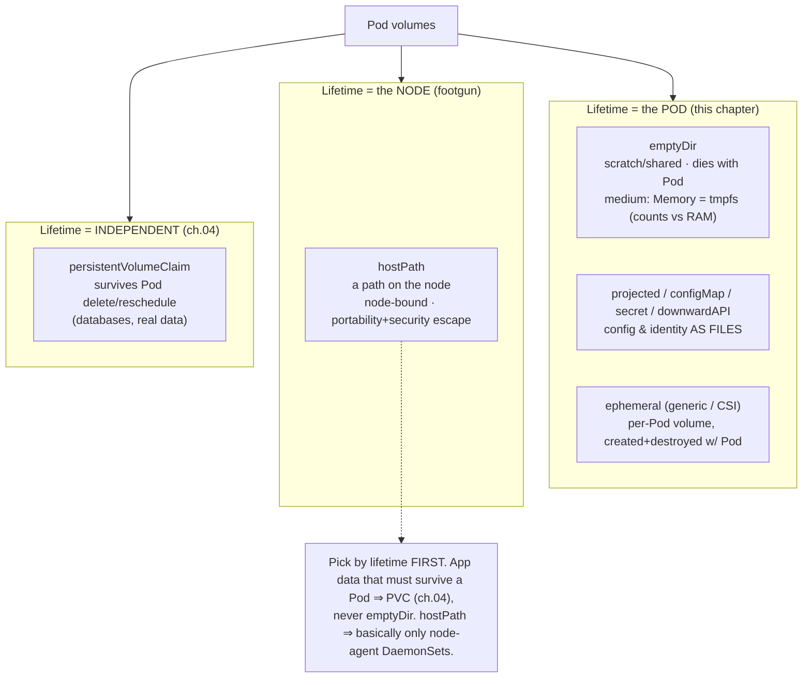

# 03 Volumes

> A **volume** is storage attached to a Pod that outlives individual container
> restarts but not the Pod itself. This chapter covers the volume kinds that
> live and die with the Pod: `emptyDir` (with `sizeLimit` and `medium: Memory`),
> `projected`, `downwardAPI` and ephemeral volumes. It also covers `hostPath`,
> the volume type this guide never uses for application data. Durable storage
> has a different lifecycle and is in [ch.04](04-persistent-storage.md).

**Estimated time:** ~15 min read · ~30 min hands-on
**Prerequisites:** [Part 01 ch.01](../01-core-workloads/01-pods.md) (Pods and volume mounts) · [Part 03 ch.01](01-configmaps.md) (projecting config into the filesystem)
**You'll know after this:**
- distinguish Pod-lifetime volumes from persistent storage
- cap every `emptyDir` with a `sizeLimit`, and use `medium: Memory` for
  sensitive scratch
- explain why `restricted` refuses `hostPath`
- set `defaultMode` and `fsGroup` so a Secret file is read by the app and by
  no other process
- inject Pod metadata into a container with the downwardAPI

<!-- tags: storage, volumes, emptydir, hostpath, projected-volumes, downwardapi -->

## Why this exists

A container's filesystem is **ephemeral and private**: when a container
restarts (liveness failure, crash, [Part 01
ch.02](../01-core-workloads/02-health-and-lifecycle.md)), everything it wrote
is gone, and a sidecar in the same Pod ([Part 01
ch.01](../01-core-workloads/01-pods.md)) can't see another container's
filesystem at all. Lots of legitimate needs don't fit that: a scratch or cache
directory that should survive a container restart within the same Pod; a path
**shared between containers** in a Pod (init writes, main reads); a way to
hand a container its **own identity** (pod name, namespace, the labels a
NetworkPolicy uses) as files; mounting a ConfigMap or Secret
([ch.01](01-configmaps.md), [ch.02](02-secrets.md)) as files.

Volumes also hold sensitive data. Once a Secret is mounted as a file, the file
is a credential on disk, and a careless volume can reach past the Pod into the
node. The controls for both are in this chapter.

A **volume** is the Pod-level abstraction for all of this: a directory,
declared on the Pod, mounted into one or more containers, whose **lifetime is
tied to the Pod** (not the container). The moment data must **outlive the Pod
itself** (a database's files), that is a *PersistentVolume*, a different
lifecycle entirely ([ch.04](04-persistent-storage.md)). Most "I lost my data"
bugs are an `emptyDir` used where a PVC was needed.

## Mental model

A volume is **a directory the Pod owns and lends to its containers**. The Pod
declares `spec.volumes[]`; each container mounts a subset at chosen paths with
`volumeMounts[]`. The key axis is **lifetime**:

- **Tied to the Pod (this chapter):** `emptyDir` (created empty when the Pod
  is scheduled, deleted with the Pod; it survives *container* restarts, not
  *Pod* deletion), `configMap`, `secret`, `downwardAPI` and `projected`
  (config and identity materialized as files), and generic or CSI
  **ephemeral** volumes (a per-Pod volume provisioned and destroyed with the
  Pod).
- **Independent of the Pod ([ch.04](04-persistent-storage.md)):** a
  `persistentVolumeClaim`, storage that exists before and after any Pod and is
  re-attached across rescheduling. Postgres uses this; an `emptyDir` there
  would be data loss.

`hostPath` has a third lifetime, the node's. It is the one volume type on this
list that the guide refuses, and its threats are set out below.

## Threats and controls

| Threat | Control taught here | Goes deeper |
|---|---|---|
| A `hostPath` volume reaches a path on the node. Writable, the Pod can change files there. Read-only, it still reads whatever the node's file modes allow, and a mount of `/` can end in a node takeover | No `hostPath` in an application Pod. `restricted` refuses it, shown [in step 7](#refuse-hostpath) | [05.02](../05-security/02-pod-security.md) runs the escape |
| A writable path with no cap fills the node's disk, and every Pod on that node suffers | `emptyDir` with a `sizeLimit` on every writable path | [01.03](../01-core-workloads/03-resources-and-qos.md) for memory limits |
| Sensitive scratch data stays on node disk after the app is done with it | `medium: Memory` with a `sizeLimit`: tmpfs, held in RAM, never written to disk | [03.02](02-secrets.md) |
| A Secret file is readable by a process that does not need it | `defaultMode: 0440` with `fsGroup`, so only the app's group can read the file | [03.02](02-secrets.md); etcd encryption in [05.04](../05-security/04-secrets-and-cluster-hardening.md) |
| A writable root filesystem lets an attacker rewrite the image | [`readOnlyRootFilesystem`](../01-core-workloads/01-pods.md#baseline-read-only-root), with an `emptyDir` for each writable path | [05.02](../05-security/02-pod-security.md) |

The rows are specific to volumes. The rest of the Pod's surface is in [ch.01
of Part 01](../01-core-workloads/01-pods.md#threats-and-controls).

## Diagrams

### Volume taxonomy by lifetime & purpose (Mermaid)



### Pod ↔ volume mount lifecycle (ASCII)

```
 Pod scheduled ──► kubelet creates volumes ──► containers mount them
 ───────────────────────────────────────────────────────────────────────
   spec.volumes:                     │  per container:
     - name: scratch  emptyDir{}     │   volumeMounts:
     - name: podinfo  downwardAPI{}  │     - name: scratch  /tmp/cache
                                     │     - name: podinfo  /etc/podinfo (ro)
   ┌───────────── Pod lifetime ──────────────────────────────┐
   │ container crash/restart: volume CONTENTS SURVIVE        │
   │   (emptyDir keeps data across restartCount++)           │
   │ Pod deleted/rescheduled: emptyDir contents GONE         │
   │   (new Pod = new empty volume; THIS is why DBs need PVC)│
   │ projected/secret/configMap: rebuilt from their sources  │
   └─────────────────────────────────────────────────────────┘
   subPath mount = resolved ONCE at start → no ConfigMap/Secret live-update
   mountPropagation: None (default) | HostToContainer | Bidirectional(rare)
```

## Hands-on with the Bookstore

**Assumed working directory: the guide repo root (`full-guide/`).** The
catalog Deployment ([Part 01
ch.04](../01-core-workloads/04-replicasets-and-deployments.md)) carries the
ConfigMap from [ch.01](01-configmaps.md) and the Secret-built `DB_DSN` from
[ch.02](02-secrets.md). Its scratch and identity volumes come from this
chapter. The inspection Pods run in a scratch namespace, so the `bookstore`
namespace holds only the catalog.

### 1. The catalog's volumes

`10-catalog-deploy.yaml` already declares the catalog's two volumes. The
container mounts them like this:

```yaml
volumeMounts:
  - name: scratch              # emptyDir: the only writable path
    mountPath: /tmp/cache      # dies with the Pod; this is not persistence
  - name: podinfo              # downwardAPI: the Pod's identity, as files
    mountPath: /etc/podinfo
    readOnly: true             # the container cannot write the mount
```

```yaml
volumes:
  - name: scratch
    emptyDir:
      sizeLimit: 64Mi          # capped; see step 5
  - name: podinfo
    downwardAPI:
      items:
        - path: pod_name
          fieldRef: { fieldPath: metadata.name }
        - path: pod_namespace
          fieldRef: { fieldPath: metadata.namespace }
        - path: pod_labels
          fieldRef: { fieldPath: metadata.labels }
        - path: cpu_limit
          resourceFieldRef:
            containerName: catalog
            resource: limits.cpu
```

Both fragments are partial. The complete Deployment is the file itself, which
also carries the baseline from
[01.01](../01-core-workloads/01-pods.md#baseline). The catalog is distroless,
so it has no shell and `kubectl exec catalog -- cat` cannot work. Inspect its
files from a separate Pod, as step 3 does.

Check the rendered volumes against the file. This is a client-side dry run, so
nothing on the cluster changes:

```sh
kubectl apply --dry-run=client -f examples/bookstore/raw-manifests/10-catalog-deploy.yaml \
  -o jsonpath='{.spec.template.spec.volumes[*].name}{"\n"}'
kubectl apply --dry-run=client -f examples/bookstore/raw-manifests/10-catalog-deploy.yaml \
  -o jsonpath='{.spec.template.spec.volumes[0].emptyDir.sizeLimit}{"\n"}'
```

<!-- gate: output -->
```text
scratch podinfo
```

<!-- gate: output -->
```text
64Mi
```

Apply the file once the `bookstore` namespace, the Secret and the ConfigMap
from the earlier chapters exist:

```sh
kubectl apply -f examples/bookstore/raw-manifests/10-catalog-deploy.yaml
kubectl rollout status deployment/catalog -n bookstore
```

### 2. A scratch namespace and its ServiceAccount

Create `p03-volumes` for the rest of this chapter. It enforces `restricted`.
Its ServiceAccount mounts no API token and has no RoleBinding of its own, so a
Pod that uses it has no API permissions. Every `emptyDir` below has a
`sizeLimit`. The baseline in [01.01](../01-core-workloads/01-pods.md#baseline)
shows `emptyDir: {}` for `/tmp`; read that as a placeholder for a size.

```sh
kubectl apply -f - <<'EOF'
apiVersion: v1
kind: Namespace
metadata:
  name: p03-volumes
  labels:
    pod-security.kubernetes.io/enforce: restricted
    pod-security.kubernetes.io/enforce-version: latest
---
apiVersion: v1
kind: ServiceAccount
metadata:
  name: inspect-sa
  namespace: p03-volumes
automountServiceAccountToken: false
EOF
```

<!-- gate: output -->
```text
namespace/p03-volumes created
serviceaccount/inspect-sa created
```

### 3. Read the downwardAPI files

The catalog mounts `/etc/podinfo` so that its binary can read its own name,
namespace, labels and CPU limit from files. The Go binary does not read those
files yet. This Pod does, using the same volume shape, so it is the pattern to
copy. The files hold this Pod's identity, not the catalog's.

```sh
kubectl apply -f - <<'EOF'
apiVersion: v1
kind: Pod
metadata:
  name: dapi-peek
  namespace: p03-volumes
  labels:
    app: inspect
spec:
  serviceAccountName: inspect-sa
  automountServiceAccountToken: false
  restartPolicy: Never
  securityContext:
    runAsNonRoot: true
    runAsUser: 65532
    runAsGroup: 65532
    seccompProfile:
      type: RuntimeDefault
  containers:
    - name: peek
      image: busybox:1.36@sha256:73aaf090f3d85aa34ee199857f03fa3a95c8ede2ffd4cc2cdb5b94e566b11662 # busybox:1.36
      command:
        - sh
        - -c
        - |
          echo NAME=$(cat /etc/podinfo/pod_name)
          echo NS=$(cat /etc/podinfo/pod_namespace)
          echo LABELS=$(cat /etc/podinfo/pod_labels)
          echo CPU_LIMIT=$(cat /etc/podinfo/cpu_limit)
      securityContext:
        allowPrivilegeEscalation: false
        readOnlyRootFilesystem: true
        capabilities:
          drop: ["ALL"]
      resources:
        requests: { cpu: 10m, memory: 16Mi }
        limits: { cpu: 250m, memory: 64Mi }
      volumeMounts:
        - name: tmp
          mountPath: /tmp
        - name: podinfo
          mountPath: /etc/podinfo
          readOnly: true
  volumes:
    - name: tmp
      emptyDir:
        sizeLimit: 16Mi
    - name: podinfo
      downwardAPI:
        items:
          - path: pod_name
            fieldRef: { fieldPath: metadata.name }
          - path: pod_namespace
            fieldRef: { fieldPath: metadata.namespace }
          - path: pod_labels
            fieldRef: { fieldPath: metadata.labels }
          - path: cpu_limit
            resourceFieldRef:
              containerName: peek
              resource: limits.cpu
EOF
kubectl wait pod/dapi-peek -n p03-volumes --for=jsonpath='{.status.phase}'=Succeeded --timeout=300s
kubectl logs dapi-peek -n p03-volumes
kubectl delete pod dapi-peek -n p03-volumes --now
```

<!-- gate: output -->
```text
pod/dapi-peek condition met
```

<!-- gate: output -->
```text
NAME=dapi-peek
NS=p03-volumes
LABELS=app="inspect"
CPU_LIMIT=1
```

<!-- gate: output -->
```text
pod "dapi-peek" deleted from p03-volumes namespace
```

`CPU_LIMIT` reads `1`, not `250m`. The downwardAPI reports CPU as whole cores
and rounds up, so the file tells the app its limit in the unit a runtime sizes
its worker pool in. Reading the node's CPU count instead is the common
mistake: an app on a large node sizes itself to the node and is throttled by
its own limit. The [Self
Awareness](https://kubernetes.io/docs/concepts/workloads/pods/downward-api/)
pattern is to take these numbers from the Pod, never from the node.

### 4. emptyDir survives a container restart, not a Pod

This Pod has two containers that share a volume. The init container writes a
note. The main container writes a marker and exits once, so the kubelet
restarts it. The marker sits in the same `emptyDir` across that restart. Save
the manifest as `ed-demo.yaml`:

```yaml
apiVersion: v1
kind: Pod
metadata:
  name: ed-demo
  namespace: p03-volumes
spec:
  serviceAccountName: inspect-sa
  automountServiceAccountToken: false
  securityContext:
    runAsNonRoot: true
    runAsUser: 65532
    runAsGroup: 65532
    seccompProfile:
      type: RuntimeDefault
  initContainers:
    - name: seed
      image: busybox:1.36@sha256:73aaf090f3d85aa34ee199857f03fa3a95c8ede2ffd4cc2cdb5b94e566b11662 # busybox:1.36
      command: ["sh", "-c", "echo hello-from-init > /work/note"]
      securityContext:
        allowPrivilegeEscalation: false
        readOnlyRootFilesystem: true
        capabilities:
          drop: ["ALL"]
      resources:
        requests: { cpu: 10m, memory: 16Mi }
        limits: { memory: 64Mi }
      volumeMounts:
        - name: work
          mountPath: /work
  containers:
    - name: main
      image: busybox:1.36@sha256:73aaf090f3d85aa34ee199857f03fa3a95c8ede2ffd4cc2cdb5b94e566b11662 # busybox:1.36
      command:
        - sh
        - -c
        - |
          if [ -f /work/marker ]; then
            echo "after restart: note=$(cat /work/note), marker present"
            sleep 3600
          fi
          echo "first run: no marker"
          touch /work/marker
          exit 1
      securityContext:
        allowPrivilegeEscalation: false
        readOnlyRootFilesystem: true
        capabilities:
          drop: ["ALL"]
      resources:
        requests: { cpu: 10m, memory: 16Mi }
        limits: { memory: 64Mi }
      volumeMounts:
        - name: work
          mountPath: /work
  volumes:
    - name: work
      emptyDir:
        sizeLimit: 16Mi
```

```sh
kubectl apply -f ed-demo.yaml
kubectl wait pod/ed-demo -n p03-volumes --for='jsonpath={.status.containerStatuses[0].restartCount}=1' --timeout=300s
kubectl logs ed-demo -n p03-volumes --previous -c main
kubectl logs ed-demo -n p03-volumes -c main
kubectl get pod ed-demo -n p03-volumes
```

<!-- gate: output -->
```text
first run: no marker
```

<!-- gate: output -->
```text
after restart: note=hello-from-init, marker present
```

Now delete the Pod and create it again from the same file. The second Pod gets
a new, empty `emptyDir`:

```sh
kubectl delete pod ed-demo -n p03-volumes --now
kubectl apply -f ed-demo.yaml
kubectl wait pod/ed-demo -n p03-volumes --for='jsonpath={.status.containerStatuses[0].restartCount}=1' --timeout=300s
kubectl logs ed-demo -n p03-volumes --previous -c main
kubectl delete pod ed-demo -n p03-volumes --now
```

<!-- gate: output -->
```text
first run: no marker
```

The restart kept the volume, because the Pod was the same. The new Pod's first
run found no marker, because the volume went with the old Pod. That is the
lifetime rule in one experiment: `emptyDir` is Pod-scoped scratch. Data that
must outlive the Pod belongs in a PVC ([ch.04](04-persistent-storage.md)).

### 5. Size caps: eviction on disk, ENOSPC in memory

An `emptyDir` with a `sizeLimit` has a cap, and what happens at the cap
depends on the medium. On disk, the kubelet measures the volume and evicts the
Pod once its usage passes the limit. Eviction stops the Pod after the write,
not during it, so the limit bounds the damage rather than preventing the
write. This is the first run:

```sh
kubectl apply -f - <<'EOF'
apiVersion: v1
kind: Pod
metadata:
  name: disk-fill
  namespace: p03-volumes
spec:
  serviceAccountName: inspect-sa
  automountServiceAccountToken: false
  restartPolicy: Never
  securityContext:
    runAsNonRoot: true
    runAsUser: 65532
    runAsGroup: 65532
    seccompProfile:
      type: RuntimeDefault
  containers:
    - name: fill
      image: busybox:1.36@sha256:73aaf090f3d85aa34ee199857f03fa3a95c8ede2ffd4cc2cdb5b94e566b11662 # busybox:1.36
      command: ["sh", "-c", "dd if=/dev/zero of=/scratch/fill bs=1M count=32; sleep 3600"]
      securityContext:
        allowPrivilegeEscalation: false
        readOnlyRootFilesystem: true
        capabilities:
          drop: ["ALL"]
      resources:
        requests: { cpu: 10m, memory: 16Mi }
        limits: { memory: 64Mi }
      volumeMounts:
        - name: scratch
          mountPath: /scratch
  volumes:
    - name: scratch
      emptyDir:
        sizeLimit: 16Mi
EOF
kubectl wait pod/disk-fill -n p03-volumes --for='jsonpath={.status.reason}=Evicted' --timeout=300s
kubectl get pod disk-fill -n p03-volumes
kubectl get pod disk-fill -n p03-volumes -o jsonpath='{.status.message}{"\n"}'
kubectl delete pod disk-fill -n p03-volumes --now
```

<!-- gate: output -->
```text
NAME        READY   STATUS   RESTARTS   AGE
disk-fill   0/1     Error    0          4m34s
```

<!-- gate: output -->
```text
Usage of EmptyDir volume "scratch" exceeds the limit "16Mi".
```

<!-- gate: output -->
```text
pod "disk-fill" deleted from p03-volumes namespace
```

The Pod's `reason` is `Evicted`, and its message names the limit. The `STATUS`
column shows `Error`, because the container was stopped. The kubelet checks
usage periodically, so the eviction comes some time after the write. In this
run the Pod also spent most of its time waiting to start on a loaded node.

In memory, the cap is enforced by the filesystem. `medium: Memory` is tmpfs,
and the kubelet sizes it to `sizeLimit`. A write past the size fails, and the
Pod keeps running. Its tmpfs pages count against the container's memory limit,
so the 16Mi below is charged to the 64Mi limit:

```sh
kubectl apply -f - <<'EOF'
apiVersion: v1
kind: Pod
metadata:
  name: ram-fill
  namespace: p03-volumes
spec:
  serviceAccountName: inspect-sa
  automountServiceAccountToken: false
  restartPolicy: Never
  securityContext:
    runAsNonRoot: true
    runAsUser: 65532
    runAsGroup: 65532
    seccompProfile:
      type: RuntimeDefault
  containers:
    - name: fill
      image: busybox:1.36@sha256:73aaf090f3d85aa34ee199857f03fa3a95c8ede2ffd4cc2cdb5b94e566b11662 # busybox:1.36
      command:
        - sh
        - -c
        - |
          df -h /scratch
          dd if=/dev/zero of=/scratch/fill bs=1M count=32
          echo "dd exit=$?"
          sleep 3600
      securityContext:
        allowPrivilegeEscalation: false
        readOnlyRootFilesystem: true
        capabilities:
          drop: ["ALL"]
      resources:
        requests: { cpu: 10m, memory: 16Mi }
        limits: { memory: 64Mi }
      volumeMounts:
        - name: scratch
          mountPath: /scratch
  volumes:
    - name: scratch
      emptyDir:
        medium: Memory
        sizeLimit: 16Mi
EOF
kubectl wait pod/ram-fill -n p03-volumes --for=condition=Ready --timeout=300s
sleep 5
kubectl logs ram-fill -n p03-volumes
kubectl delete pod ram-fill -n p03-volumes --now
```

<!-- gate: output -->
```text
Filesystem                Size      Used Available Use% Mounted on
tmpfs                    16.0M         0     16.0M   0% /scratch
dd: error writing '/scratch/fill': No space left on device
17+0 records in
16+0 records out
16777216 bytes (16.0MB) copied, 0.011741 seconds, 1.3GB/s
dd exit=1
```

`dd` wrote exactly 16 MiB, and the next write failed, as it would on a full
disk. The Pod kept running, because the write error is an ordinary error the
process can handle. Plan for it in the app, and keep `sizeLimit` below the
memory the container can spare.

### 6. Secret volumes: tmpfs, defaultMode and fsGroup

The kubelet mounts Secret volumes on tmpfs, so a Secret's files are never
written to node disk. Create a demo Secret, then mount it in two Pods. The
first Pod fails on purpose, to show the file mode at work. The value is a
placeholder, not a credential.

```sh
kubectl apply -f - <<'EOF'
apiVersion: v1
kind: Secret
metadata:
  name: demo-creds
  namespace: p03-volumes
type: Opaque
stringData:
  token: demo-only-value
EOF
kubectl apply -f - <<'EOF'
apiVersion: v1
kind: Pod
metadata:
  name: creds-denied
  namespace: p03-volumes
spec:
  serviceAccountName: inspect-sa
  automountServiceAccountToken: false
  restartPolicy: Never
  securityContext:
    runAsNonRoot: true
    runAsUser: 65532
    runAsGroup: 65532
    seccompProfile:
      type: RuntimeDefault
  containers:
    - name: app
      image: busybox:1.36@sha256:73aaf090f3d85aa34ee199857f03fa3a95c8ede2ffd4cc2cdb5b94e566b11662 # busybox:1.36
      command: ["sh", "-c", "id; ls -lnL /creds; cat /creds/token"]
      securityContext:
        allowPrivilegeEscalation: false
        readOnlyRootFilesystem: true
        capabilities:
          drop: ["ALL"]
      resources:
        requests: { cpu: 10m, memory: 16Mi }
        limits: { memory: 64Mi }
      volumeMounts:
        - name: creds
          mountPath: /creds
          readOnly: true
  volumes:
    - name: creds
      secret:
        secretName: demo-creds
        defaultMode: 0400
EOF
kubectl wait pod/creds-denied -n p03-volumes --for='jsonpath={.status.phase}=Failed' --timeout=300s
kubectl logs creds-denied -n p03-volumes
kubectl get pod creds-denied -n p03-volumes -o jsonpath='{.spec.volumes[0].secret.defaultMode}{"\n"}'
kubectl delete pod creds-denied -n p03-volumes --now
```

<!-- gate: output -->
```text
uid=65532 gid=65532 groups=65532
total 4
-r--------    1 0        0               15 Oct 31 00:15 token
cat: can't open '/creds/token': Permission denied
```

<!-- gate: output -->
```text
256
```

`0400` is the mode, and the API stores it as `256`. The file is owned by root,
and `0400` gives read access to the owner only. The app runs as 65532, so
`cat` is refused. The Pod is correct apart from the mode. The app is the
process that needs the file, and the mode denies it.

The fix is a group. `fsGroup` sets the group that owns the volume's files, and
the kubelet adds it to every container in the Pod as a supplementary group.
With `0440`, the group can read and the owner still can:

```sh
kubectl apply -f - <<'EOF'
apiVersion: v1
kind: Pod
metadata:
  name: creds-fixed
  namespace: p03-volumes
spec:
  serviceAccountName: inspect-sa
  automountServiceAccountToken: false
  restartPolicy: Never
  securityContext:
    runAsNonRoot: true
    runAsUser: 65532
    runAsGroup: 65532
    fsGroup: 65532
    seccompProfile:
      type: RuntimeDefault
  containers:
    - name: app
      image: busybox:1.36@sha256:73aaf090f3d85aa34ee199857f03fa3a95c8ede2ffd4cc2cdb5b94e566b11662 # busybox:1.36
      command:
        - sh
        - -c
        - |
          id
          ls -lnL /creds /run/identity
          cat /creds/token; echo
          cat /run/identity/pod_name; echo
          grep ' /creds \| /run/identity ' /proc/mounts
      securityContext:
        allowPrivilegeEscalation: false
        readOnlyRootFilesystem: true
        capabilities:
          drop: ["ALL"]
      resources:
        requests: { cpu: 10m, memory: 16Mi }
        limits: { memory: 64Mi }
      volumeMounts:
        - name: creds
          mountPath: /creds
          readOnly: true
        - name: identity
          mountPath: /run/identity
          readOnly: true
  volumes:
    - name: creds
      secret:
        secretName: demo-creds
        defaultMode: 0440
    - name: identity
      projected:
        defaultMode: 0440
        sources:
          - secret:
              name: demo-creds
              items:
                - key: token
                  path: token
          - downwardAPI:
              items:
                - path: pod_name
                  fieldRef: { fieldPath: metadata.name }
EOF
kubectl wait pod/creds-fixed -n p03-volumes --for='jsonpath={.status.phase}=Succeeded' --timeout=300s
kubectl logs creds-fixed -n p03-volumes
kubectl get pod creds-fixed -n p03-volumes -o jsonpath='{.spec.volumes[*].secret.defaultMode}{" "}{.spec.volumes[*].projected.defaultMode}{"\n"}'
kubectl delete pod creds-fixed -n p03-volumes --now
```

<!-- gate: output -->
```text
uid=65532 gid=65532 groups=65532
/creds:
total 4
-r--r-----    1 0        65532           15 Oct 31 00:13 token

/run/identity:
total 8
-r--r-----    1 0        65532           11 Oct 31 00:13 pod_name
-r--r-----    1 0        65532           15 Oct 31 00:13 token
demo-only-value
creds-fixed
tmpfs /creds tmpfs ro,relatime,size=65536k,inode64,noswap 0 0
tmpfs /run/identity tmpfs ro,relatime,size=65536k,inode64,noswap 0 0
```

`ls -lnL` follows the symlinks, so it shows the real files. Both files are
owned by root and read by group 65532, which is the `fsGroup`. The app reads
its token as uid 65532 through that group, and nothing else gets read access.
The projected identity file has the same mode, because `defaultMode` applies
to every source in the `projected` volume.

<!-- gate: output -->
```text
288 288
```

### 7. Refuse a hostPath {#refuse-hostpath}

A `hostPath` volume mounts a path from the node into the Pod. Mounting `/`
hands the Pod the node's filesystem. Read-only, the Pod reads whatever the
node's file modes allow. Writable, it can change the node: on a kubeadm
cluster the kubelet runs each manifest in `/etc/kubernetes/manifests` as a
static Pod, so a writable `/` can start a privileged Pod on the node. The full
escape is in [05.02](../05-security/02-pod-security.md). The control here is
that `restricted` refuses the volume type, whatever the path and whatever the
mount mode.

The command below fails on purpose, so that you recognise the refusal. It
carries every other baseline field, so the volume is the only violation. It
creates nothing, because `--dry-run=server` stops after admission:

```sh
# Deliberate failure: restricted refuses a hostPath volume, read-only or not.
kubectl run hostpath-probe -n p03-volumes --restart=Never --dry-run=server \
  --image=busybox:1.36@sha256:73aaf090f3d85aa34ee199857f03fa3a95c8ede2ffd4cc2cdb5b94e566b11662 \
  --overrides='{
    "spec": {
      "serviceAccountName": "inspect-sa",
      "automountServiceAccountToken": false,
      "securityContext": {"runAsNonRoot": true, "runAsUser": 65532, "runAsGroup": 65532, "seccompProfile": {"type": "RuntimeDefault"}},
      "containers": [{
        "name": "hostpath-probe",
        "image": "busybox:1.36@sha256:73aaf090f3d85aa34ee199857f03fa3a95c8ede2ffd4cc2cdb5b94e566b11662",
        "command": ["sleep", "60"],
        "securityContext": {"allowPrivilegeEscalation": false, "readOnlyRootFilesystem": true, "capabilities": {"drop": ["ALL"]}},
        "resources": {"requests": {"cpu": "10m", "memory": "16Mi"}, "limits": {"memory": "64Mi"}},
        "volumeMounts": [{"name": "nodefs", "mountPath": "/host", "readOnly": true}]
      }],
      "volumes": [{"name": "nodefs", "hostPath": {"path": "/", "type": "Directory"}}]
    }
  }'
kubectl get pods -n p03-volumes
```

<!-- gate: output -->
```text
Error from server (Forbidden): pods "hostpath-probe" is forbidden: violates PodSecurity "restricted:latest": restricted volume types (volume "nodefs" uses restricted volume type "hostPath")
```

<!-- gate: output -->
```text
No resources found in p03-volumes namespace.
```

The message names one violation, the volume. `readOnly: true` on the mount
does not change that, because the refusal is about the volume type. Node
agents that must read host paths need a namespace at the `privileged` Pod
Security level. Keep that namespace for the agent alone, with the reason
written down. [Part 01 ch.06](../01-core-workloads/06-daemonsets.md) covers
node agents.

### 8. Clean up

```sh
kubectl delete namespace p03-volumes --wait=true
```

<!-- gate: output -->
```text
namespace "p03-volumes" deleted
```

## How it works under the hood

- **`emptyDir`.** Created empty when the Pod is assigned to a node, on the
  node's disk by default, under the kubelet's directory. It survives container
  restarts because the Pod, and so the volume, survives. `sizeLimit` has no
  default: the API reference says the limit is undefined unless you set it, so
  set it on every `emptyDir` you write. With `medium: Memory` the volume is
  tmpfs, wiped with the Pod and charged to the containers' memory. The API
  reference caps its usable size at the lower of `sizeLimit` and the sum of
  the Pod's container memory limits.
- **`hostPath`.** The data is node-bound. Reschedule the Pod and the files are
  on another node, or gone. The volume type also sets the Pod's trust: the Pod
  Security `restricted` level refuses it ([step 7](#refuse-hostpath)).
  Legitimate use is limited to node agents at a privileged level. Application
  data belongs on a PVC ([ch.04](04-persistent-storage.md)).
- **Secret and ConfigMap volumes.** The kubelet writes each key as a file
  through a `..data` directory that it swaps atomically on update. Each file
  in the mount is a symlink into `..data`, which is why step 6 lists the mount
  with `ls -lnL`. Secret volumes are tmpfs, so their files never reach node
  disk. Their default file mode is `0644`, which the API reference gives as
  the default: any user in the container can read them. Step 6 sets a narrower
  mode.
- **`downwardAPI`.** Exposes fields of the Pod's own spec and status:
  `metadata.name`, `namespace`, `uid`, `labels` and `annotations`,
  `spec.nodeName` and `serviceAccountName`, `status.podIP` and `hostIP`, and
  the container's resource fields (`limits.cpu`, `limits.memory`,
  `requests.*`). CPU is reported in whole cores, rounded up, and memory in
  bytes. Labels and annotations in the volume form update when they change,
  the same as ConfigMap volumes. The env form is a snapshot taken at start.
- **`projected`.** Combines `configMap`, `secret`, `downwardAPI` and
  `serviceAccountToken` sources into one directory. `defaultMode` applies to
  every file the volume projects, and step 6 uses it. The
  `serviceAccountToken` source delivers a short-lived, audience-bound token
  that the kubelet rotates, in place of a static token Secret. Every Pod gets
  one through the `kube-api-access-*` volume, which is a projected volume. A
  Pod that does not call the API should not have one at all
  ([01.01](../01-core-workloads/01-pods.md#baseline-service-account),
  [05.01](../05-security/01-authn-authz-rbac.md)).
- **Ephemeral volumes.** A generic ephemeral volume declares a PVC template
  inline, and a CSI ephemeral volume has a CSI driver supply the volume
  inline. Both are created and deleted with the Pod, like `emptyDir`, but
  backed by a real storage driver.
- **Mount mechanics and `subPath`.** The kubelet prepares volumes before
  containers start. Each `volumeMounts` entry bind-mounts a volume, or a
  **`subPath`** of it. `subPath` is resolved once at start, so a ConfigMap or
  Secret key mounted that way does not live-update ([ch.01](01-configmaps.md),
  [ch.02](02-secrets.md)). `readOnly: true` stops the container writing the
  mount.
- **Mount propagation.** `None`, the default, keeps mounts isolated.
  `HostToContainer` shows the container the host submounts under the path.
  `Bidirectional` lets the container's mounts reach the host and needs a
  privileged container. Storage plugins use it. Applications do not.

## Production notes

> **In production:** `emptyDir` is not durability. A rescheduled Pod (node
> drain, eviction, rollout) starts with an empty one. Use it for caches,
> scratch and handoff between containers. Anything that must survive a Pod is
> a PVC ([ch.04](04-persistent-storage.md)).

> **In production:** size the app from its own limits. A runtime that reads
> the node's CPU count starts too many workers and is throttled by its own
> limit ([Part 01 ch.03](../01-core-workloads/03-resources-and-qos.md)). Where
> the runtime does not read the cgroup limit, set its worker count from the
> downwardAPI `limits.cpu` file.

## Quick Reference

```sh
kubectl get pod <P> -n <NS> -o jsonpath='{.spec.volumes}'      # declared volumes
kubectl describe pod <P> -n <NS> | sed -n '/Volumes:/,/QoS/p'  # mounts and types
kubectl explain pod.spec.volumes.emptyDir                      # medium, sizeLimit
kubectl explain pod.spec.volumes.secret.defaultMode            # octal or decimal
# inspect a mounted volume from an EPHEMERAL public-image Pod (NEVER exec a
# distroless app Pod): run busybox with the same volume(s) and cat the files.
```

Volumes skeleton with the controls from this chapter:

```yaml
spec:
  securityContext:
    fsGroup: 65532                      # group that reads the Secret files
  containers:
    - name: app
      volumeMounts:
        - { name: scratch, mountPath: /tmp/scratch }
        - { name: creds, mountPath: /etc/creds, readOnly: true }
        - { name: podinfo, mountPath: /etc/podinfo, readOnly: true }
  volumes:
    - name: scratch
      emptyDir: { sizeLimit: 64Mi }     # sensitive scratch: medium: Memory
    - name: creds
      secret:
        secretName: app-creds
        defaultMode: 0440               # owner and fsGroup read; others do not
    - name: podinfo
      downwardAPI:
        items:
          - { path: name, fieldRef: { fieldPath: metadata.name } }
          - { path: cpu, resourceFieldRef: { containerName: app, resource: limits.cpu } }
```

Checklist:

- [ ] Volume lifetime matches the need: Pod-scoped here, a PVC in
      [ch.04](04-persistent-storage.md)
- [ ] Every `emptyDir` has a `sizeLimit`; sensitive scratch uses `medium:
      Memory`
- [ ] No `hostPath` in an application Pod; `restricted` refuses it
- [ ] Secret volumes use `defaultMode: 0440` or stricter, with `fsGroup` for
      the app's group
- [ ] Identity and limits come from the downwardAPI, not from the node
- [ ] `subPath` mounts are not expected to live-update
      ([ch.01](01-configmaps.md), [ch.02](02-secrets.md))
- [ ] Distroless apps are inspected through an ephemeral public-image Pod, not
      `exec`
- [ ] `mountPropagation` is left at the default

## Test your understanding

> Try each before opening the answer drawer. The act of trying is the exercise; the answer is the check.

1. **Why does `emptyDir` survive a container restart but not a Pod
   restart-as-a-new-Pod? What's the architectural distinction this enforces?**
   <details><summary>Show answer</summary>

   `emptyDir` lifetime is *the Pod*. A container crash and restart keeps the
   same Pod and the same volume. Deleting the Pod, and creating a new one
   possibly on another node, deletes the volume and creates a new empty one.
   This enforces "Pods are disposable": anything that must survive a Pod's
   life must live in a PV, which has an independent lifetime. Most "I lost my
   data" bugs are an `emptyDir` where a PVC was needed ([step
   4](#4-emptydir-survives-a-container-restart-not-a-pod)).

   </details>

2. **A teammate proposes `hostPath: /var/log/app` to share logs between Pods
   on the same node. Give three reasons it is the wrong tool and what to use
   instead. Then say why `readOnly: true` on the mount does not make it
   acceptable under `restricted`.**
   <details><summary>Show answer</summary>

   (1) It is node-bound: reschedule a Pod and its logs are on another node or
   gone. (2) It is a security escape: the volume type reaches into the node,
   and a writable mount can change it. `restricted` refuses the type, so
   `readOnly` does not matter ([step 7](#refuse-hostpath)). (3) It is not
   portable: the path has to exist, and mean the same thing, on every node.
   Use a node-agent DaemonSet at a privileged level to read `/var/log` and
   ship it, or have the app ship its logs to a collector. To share files
   between containers of one Pod, use an `emptyDir`.

   </details>

3. **You set `emptyDir: { medium: Memory, sizeLimit: 100Mi }` on a Pod whose
   container has `resources.limits.memory: 128Mi`. The app writes 80Mi into
   the volume, then allocates 80Mi of heap. What happens?**
   <details><summary>Show answer</summary>

   `medium: Memory` is tmpfs, and its pages count against the container's
   memory limit. The 80Mi file is under the 100Mi `sizeLimit`, so the size cap
   does not stop it. 80Mi of tmpfs plus 80Mi of heap is 160Mi, over the 128Mi
   limit, so the kernel OOM-kills the container. Lower the in-memory
   `sizeLimit` or raise the memory limit to cover both ([How it
   works](#how-it-works-under-the-hood)).

   </details>

4. **A service reads the node's CPU count to size its worker pool. On a large
   node with a `500m` CPU limit, it starts far too many workers and is
   throttled. How does the downwardAPI help, and what has to change in the
   app?**
   <details><summary>Show answer</summary>

   A `resourceFieldRef` on `limits.cpu` reports the container's own limit in
   whole cores, rounded up, so `500m` reads as `1`. The Pod only supplies the
   value. The app must read the file or env var and size its pool from it.
   Reading the node's count was the bug, and the file replaces it.

   </details>

5. **A Secret volume has `defaultMode: 0400` and no `fsGroup`. The app runs as
   uid 65532 and gets `Permission denied`. Why, and what is the smallest
   change that fixes it without making the file world-readable?**
   <details><summary>Show answer</summary>

   The file is owned by root, uid 0. `0400` grants read to the owner only, and
   uid 65532 is not the owner, so the kernel refuses the read. The smallest
   fix is `fsGroup: 65532` with `defaultMode: 0440`. The kubelet makes the
   group of the files `fsGroup`, and `0440` gives that group read access.
   Other users still get nothing. [Step
   6](#6-secret-volumes-tmpfs-defaultmode-and-fsgroup) shows both outputs.

   </details>

## Further reading

- Kubernetes docs:
  [Volumes](https://kubernetes.io/docs/concepts/storage/volumes/),
  [Secrets](https://kubernetes.io/docs/concepts/configuration/secret/) (tmpfs
  and file modes), the [Downward
  API](https://kubernetes.io/docs/concepts/workloads/pods/downward-api/),
  [Expose Pod information to a container through
  files](https://kubernetes.io/docs/tasks/inject-data-application/downward-api-volume-expose-pod-information/),
  and the [Pod Security
  Standards](https://kubernetes.io/docs/concepts/security/pod-security-standards/),
  whose `restricted` level allows a fixed list of volume types.
