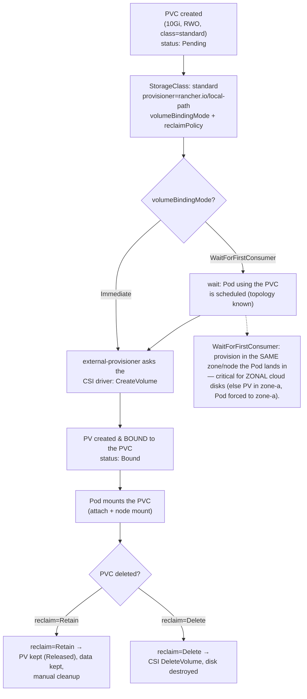
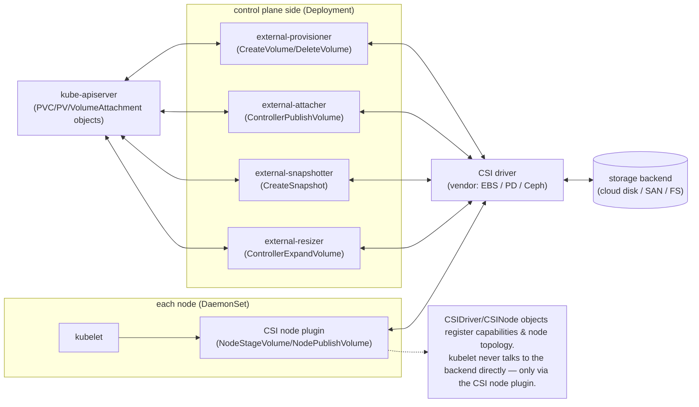

# 04 — Persistent storage

> Storage whose lifetime is independent of any Pod: the PersistentVolume and
> PersistentVolumeClaim split, StorageClass and dynamic provisioning,
> `volumeBindingMode: WaitForFirstConsumer`, access modes, and the reclaim
> policy that decides what a deleted claim leaves behind. Applied to the
> Bookstore's Postgres storage, with a non-root process writing to a real
> volume.

**Estimated time:** ~30 min read · ~60 min hands-on
**Prerequisites:** [Part 03 ch.03](03-volumes.md): Pod-lifetime volume basics · [Part 01 ch.05](../01-core-workloads/05-statefulsets.md): StatefulSets use `volumeClaimTemplates` · [Part 01 ch.01](../01-core-workloads/01-pods.md#baseline): the baseline this chapter reuses
**You'll know after this:** • trace the PV/PVC bind lifecycle and explain `WaitForFirstConsumer` · • choose access modes and a reclaim policy for data you cannot lose · • say who may create a PersistentVolume, and why that is a security decision · • show a non-root Pod writing to a volume, and say what `fsGroup` did and did not do here · • list what a `Retain` volume leaves behind after its claim is deleted

<!-- tags: storage, persistent-storage, pv-pvc, storageclass, csi, reclaim-policy, fsgroup -->

## Why this exists

[ch.03](03-volumes.md) gave the Pod scratch and identity volumes, all of which
**die with the Pod**. Postgres ([Part 01 ch.05](../01-core-workloads/05-statefulsets.md))
cannot tolerate that: its data files must survive a Pod restart-as-a-new-Pod, a
node drain, a rollout and a reschedule to another node. Storage whose lifecycle
is **decoupled from any Pod** is a different object from a volume.

Kubernetes models this with two objects that **separate "I need storage" from
"here is a concrete disk"**. A **PersistentVolumeClaim (PVC)** is the workload's
*request* ("10Gi, ReadWriteOnce"). A **PersistentVolume (PV)** is the *actual*
storage: an EBS volume, a Ceph RBD image, or a directory on a node. A
**StorageClass** ties them together by **dynamically provisioning** a PV for a
PVC on demand, through a CSI driver or, as with kind's `rancher.io/local-path`,
a legacy external provisioner (see the note under [Diagrams](#diagrams)).

Two decisions move out of the workload when it works this way. The first is
**who may create a PV**, because a PV names the disk and can name a directory on
a node. The second is **what happens to the disk** when its claim is deleted.
Both are security decisions, and they are the subject of this chapter. The
*should you run a database here* question is
[ch.05](05-stateful-data-patterns.md).

## Mental model

PVC/PV is **the same "request vs. reality" split as a Pod and a Node**, applied
to storage, plus a factory:

- **PVC** = the claim. It is namespaced. "I want this much storage, with these
  access modes, (optionally) from this StorageClass." The workload only ever
  names the PVC.
- **PV** = the fulfilled storage: a real volume on a real backend, with its own
  lifecycle. It is **cluster-scoped**, so it has no namespace, and it is
  **bound 1:1** to a PVC. A claim that names it, or matches it, can bind it,
  which is why who creates PVs matters.
- **StorageClass** = the **provisioner + parameters** ("which CSI driver, what
  disk type, what binding and reclaim policy"). With dynamic provisioning,
  creating a PVC that names a class makes the class's provisioner **create a PV
  automatically** and bind it. With no class and no default class, you must
  pre-create PVs (static provisioning), or the PVC stays `Pending`.
- **Binding is sticky and exclusive.** Once a PVC and a PV bind, that PV is that
  PVC's for life. Deleting the PVC triggers the PV's **reclaim policy**:
  `Delete` destroys the backing disk, `Retain` keeps it for manual recovery.

So a workload says "I need storage" (PVC); the platform turns that into "here
is a disk" (PV, through the StorageClass and CSI); and the disk **outlives the
Pod**. The StatefulSet's `volumeClaimTemplates` is a PVC factory: one PVC per
ordinal, re-attached to the same ordinal forever.

## Threats and controls

A PV outlives its Pod and often its claim, and it can point at a directory on a
node. The threats below belong to storage, not to the Pod.

| Threat | Control taught here | Goes deeper |
|---|---|---|
| A tenant creates a PV that names a directory on a node, then claims it | [No `create` on PersistentVolumes](#refusal): a namespaced Role grants claims only | [03.03](03-volumes.md) for `hostPath`; [05.01](../05-security/01-authn-authz-rbac.md) for RBAC |
| A deleted claim leaves its data on a `Retain` volume, where the next claimant or an operator can read it | [A reclaim policy chosen per data class](#reclaim), and a runbooked cleanup | [08.02](../08-day-2-operations/02-backup-and-dr.md) for backup |
| Data on a cloud disk is readable by whoever obtains the disk | [An encrypted StorageClass](#encryption), set on the driver. Cited, not run here | Etcd encryption, a separate control: 05.04 <!-- link-later: 05.04 --> |
| A tenant that can create or patch a StorageClass chooses the provisioner, the parameters and the reclaim policy for every claim, or changes the default class | [No `create` or `patch` on storageclasses](#refusal), checked with `can-i` in step 3 | [05.01](../05-security/01-authn-authz-rbac.md) for RBAC |
| A non-root process cannot write its volume, so the fix becomes running as root | [`fsGroup` with a non-root UID](#fsgroup), with the volume's owner and mode checked from inside the Pod | [01.01](../01-core-workloads/01-pods.md#baseline-fsgroup) |

Pod Security admission does not catch the first threat. The `restricted` level
accepts a Pod that mounts a `persistentVolumeClaim`, whatever the claim's PV
points at. Its volume list is about the Pod's own `spec.volumes`, and the node
path lives in the PV, outside the Pod. The
[Pod Security Standards](https://kubernetes.io/docs/concepts/security/pod-security-standards/)
page lists the restricted volume types. So RBAC has to stop the PV from being
created at all.

A claim can also name a PV directly with `volumeName`, and then binds to that
volume if it is available and compatible
([PersistentVolumeClaims](https://kubernetes.io/docs/concepts/storage/persistent-volumes/#persistentvolumeclaims)).
A tenant who can create claims can therefore take any available PV whose name
they know. Keep the PV set owned by operators, and do not leave available
volumes lying around.

## Diagrams

### PVC → StorageClass dynamic provision → PV bind lifecycle (Mermaid)



### CSI component interactions (Mermaid)



> **`rancher.io/local-path` is a *legacy external provisioner*, not a CSI
> driver.** It creates a host directory per PVC and implements none of the CSI
> node-plugin RPCs. That is why kind has no `VolumeAttachment` or snapshot
> machinery. It is used in this guide because it is the one provisioner that
> runs locally with no setup. The **modern standard is CSI** (EBS, PD, Azure
> Disk, Ceph), and the attacher, snapshotter, resizer and `CSIDriver`/`CSINode`
> objects above belong to CSI drivers, not to local-path.

### Access-mode matrix (ASCII)

```
 mode  short  meaning                                  typical backend
 ───────────────────────────────────────────────────────────────────────────
 RWO   ReadWriteOnce      one NODE may mount r/w        block: EBS/PD/AzDisk
                          (many Pods on THAT node ok)   (Postgres uses this)
 ROX   ReadOnlyMany       many nodes mount READ-ONLY    pre-populated images
 RWX   ReadWriteMany      many nodes mount r/w          file: NFS/EFS/CephFS
                          (needs a SHARED-FS backend)   (NOT plain block!)
 RWOP  ReadWriteOncePod   exactly ONE Pod mounts r/w    strict single-writer
 ───────────────────────────────────────────────────────────────────────────
  Requesting RWX on a block-only backend ⇒ PVC stays Pending / fails.
  The backend must SUPPORT the mode; the PVC only REQUESTS it.
```

## Hands-on with the Bookstore

**Assumed working directory: the guide repo root (`full-guide/`).** Requires
the `bookstore` namespace and the Postgres StatefulSet
([Part 01 ch.05](../01-core-workloads/05-statefulsets.md)), now Secret-backed
([ch.02](02-secrets.md)). On `kind` the `rancher.io/local-path` provisioner and
a default StorageClass (`standard`) already exist. The steps create scratch
objects in `bookstore` and delete them as they go. The Postgres StatefulSet
stays.

### 1. Inspect the claim the StatefulSet made

The `volumeClaimTemplates` in
[`20-postgres-statefulset.yaml`](../examples/bookstore/raw-manifests/20-postgres-statefulset.yaml)
is a PVC factory. It omits `storageClassName`, so the cluster default class
binds the claim:

```yaml
  volumeClaimTemplates:                   # one PVC per Pod; retained across restarts
    - metadata:
        name: data
      spec:
        accessModes: ["ReadWriteOnce"]
        resources:
          requests:
            storage: 1Gi
        # storageClassName omitted → default class (kind: "standard")
```

```sh
# from the repo root (full-guide/)
kubectl get storageclass
kubectl get pvc data-postgres-0 -n bookstore \
  -o custom-columns=NAME:.metadata.name,VOLUME:.spec.volumeName,STATUS:.status.phase,CLASS:.spec.storageClassName
PV=$(kubectl get pvc data-postgres-0 -n bookstore -o jsonpath='{.spec.volumeName}')
kubectl get pv "$PV" -o custom-columns=NAME:.metadata.name,RECLAIM:.spec.persistentVolumeReclaimPolicy,STATUS:.status.phase
kubectl get pv "$PV" -o jsonpath='{.spec.hostPath.type}'
```

<!-- gate: output -->
```text
NAME                 PROVISIONER             RECLAIMPOLICY   VOLUMEBINDINGMODE      ALLOWVOLUMEEXPANSION   AGE
bookstore-local      rancher.io/local-path   Delete          WaitForFirstConsumer   true                   34m
standard (default)   rancher.io/local-path   Delete          WaitForFirstConsumer   false                  9h
# ...
NAME              VOLUME                                     STATUS   CLASS
data-postgres-0   pvc-cb954671-1cb9-4739-8edf-f352352b702b   Bound    standard
# ...
NAME                                       RECLAIM   STATUS
pvc-cb954671-1cb9-4739-8edf-f352352b702b   Delete    Bound
# ...
DirectoryOrCreate
```

The default class is `Delete` and `WaitForFirstConsumer`. The PV is a
`hostPath` of type `DirectoryOrCreate`: a directory on the node that the
provisioner makes for the claim. Under `Delete`, the disk goes when its claim
goes. The Bookstore's Postgres claim takes this class, because
`20-postgres-statefulset.yaml` names no `storageClassName`, and the
`bookstore-local` class in `17-` is `Delete` too. So on this cluster a deleted
claim takes the database's data with it. The rest of this chapter warns against
that for data of record. Step 4 shows what `Retain` does instead, and the Quick
Reference gives the field to set on the class that holds the database.

### 2. Non-root against a real volume, with fsGroup {#fsgroup}

The Postgres container runs as UID 999, and the `20-` manifest sets
`fsGroup: 999` for it. Check what that produced on the volume:

```sh
kubectl exec -n bookstore postgres-0 -- \
  sh -c 'id; stat -c "%u:%g %a %n" /var/lib/postgresql/data /var/lib/postgresql/data/pgdata'
```

<!-- gate: output -->
```text
uid=999(postgres) gid=999(postgres) groups=999(postgres),101(ssl-cert)
0:0 777 /var/lib/postgresql/data
999:999 700 /var/lib/postgresql/data/pgdata
```

The process is UID 999 and wrote `pgdata` as 999 with mode 700. The volume root
itself is `0:0 777`, owned by root and writable by anyone. Keep that in mind
while the next probe runs.

`fsGroup` adds a GID to the processes' supplementary groups and asks the
kubelet to set the group owner of the volume's contents to that GID. The
upstream text reads "By default, Kubernetes recursively changes ownership and
permissions for the contents of each volume to match the fsGroup specified in a
Pod's securityContext when that volume is mounted"
([Configure a Security Context](https://kubernetes.io/docs/tasks/configure-pod-container/security-context/)).
A probe shows what happens on this cluster. It is a baseline Pod that mounts a
claim from the `bookstore-local` class in
[`17-storageclass.yaml`](../examples/bookstore/raw-manifests/17-storageclass.yaml),
which uses `Delete`. The busybox image has no user 10001, so `id` prints only
numbers.

```sh
kubectl apply -f - <<'EOF'
apiVersion: v1
kind: ServiceAccount
metadata:
  name: storage-probe
  namespace: bookstore
automountServiceAccountToken: false
---
apiVersion: v1
kind: PersistentVolumeClaim
metadata:
  name: probe-data
  namespace: bookstore
spec:
  storageClassName: bookstore-local
  accessModes: ["ReadWriteOnce"]
  resources:
    requests:
      storage: 1Gi
---
apiVersion: v1
kind: Pod
metadata:
  name: fsgroup-probe
  namespace: bookstore
spec:
  serviceAccountName: storage-probe
  automountServiceAccountToken: false
  securityContext:
    runAsNonRoot: true
    runAsUser: 10001
    runAsGroup: 10001
    fsGroup: 10001                          # the group the volume's contents take
    seccompProfile:
      type: RuntimeDefault
  containers:
    - name: probe
      image: busybox@sha256:73aaf090f3d85aa34ee199857f03fa3a95c8ede2ffd4cc2cdb5b94e566b11662  # busybox:1.36
      command: ["sleep", "3600"]
      securityContext:
        allowPrivilegeEscalation: false
        readOnlyRootFilesystem: true
        capabilities:
          drop: ["ALL"]
      resources:
        requests:
          cpu: 10m
          memory: 16Mi
        limits:
          memory: 32Mi
      volumeMounts:
        - name: data
          mountPath: /data
        - name: tmp
          mountPath: /tmp
  volumes:
    - name: data
      persistentVolumeClaim:
        claimName: probe-data
    - name: tmp
      emptyDir:
        sizeLimit: 16Mi
EOF
kubectl wait --for=condition=Ready pod/fsgroup-probe -n bookstore --timeout=600s
kubectl exec -n bookstore fsgroup-probe -- \
  sh -c 'id; stat -c "%u:%g %a %n" /data; touch /data/fsgroup.txt; stat -c "%u:%g %a %n" /data/fsgroup.txt'
PV=$(kubectl get pvc probe-data -n bookstore -o jsonpath='{.spec.volumeName}')
# On kind the node is a container, so the directory behind the PV is visible
# through it. On another cluster, skip the next two lines.
NODE=$(kubectl get nodes -o jsonpath='{.items[0].metadata.name}')
docker exec "$NODE" sh -c "stat -c '%u:%g %a' /var/local-path-provisioner/${PV}_*"
```

<!-- gate: output -->
```text
uid=10001 gid=10001 groups=10001
0:0 777 /data
10001:10001 644 /data/fsgroup.txt
# ...
0:0 777
```

The `id` line shows the UID, the primary group and the supplementary group. The
volume root is still `0:0 777` after the Pod with `fsGroup: 10001` mounted it,
and the directory on the node is the same. On this cluster the kubelet did not
change the owner of the volume root. The PV is a `hostPath` of type
`DirectoryOrCreate`, and the directory the provisioner makes is mode 777. The
upstream page does not name the volume types that take the change, so this
observation is the evidence for kind, not a general rule.

Now the same claim, mounted by a Pod without `fsGroup`:

```sh
kubectl delete pod fsgroup-probe -n bookstore --now
kubectl apply -f - <<'EOF'
apiVersion: v1
kind: Pod
metadata:
  name: plain-probe
  namespace: bookstore
spec:
  serviceAccountName: storage-probe
  automountServiceAccountToken: false
  securityContext:
    runAsNonRoot: true
    runAsUser: 10001
    runAsGroup: 10001
    seccompProfile:
      type: RuntimeDefault
  containers:
    - name: probe
      image: busybox@sha256:73aaf090f3d85aa34ee199857f03fa3a95c8ede2ffd4cc2cdb5b94e566b11662  # busybox:1.36
      command: ["sleep", "3600"]
      securityContext:
        allowPrivilegeEscalation: false
        readOnlyRootFilesystem: true
        capabilities:
          drop: ["ALL"]
      resources:
        requests:
          cpu: 10m
          memory: 16Mi
        limits:
          memory: 32Mi
      volumeMounts:
        - name: data
          mountPath: /data
        - name: tmp
          mountPath: /tmp
  volumes:
    - name: data
      persistentVolumeClaim:
        claimName: probe-data
    - name: tmp
      emptyDir:
        sizeLimit: 16Mi
EOF
kubectl wait --for=condition=Ready pod/plain-probe -n bookstore --timeout=600s
kubectl exec -n bookstore plain-probe -- sh -c 'id; touch /data/plain.txt; ls -ln /data'
docker exec "$NODE" sh -c "stat -c '%u:%g %a' /var/local-path-provisioner/${PV}_*"
```

<!-- gate: output -->
```text
uid=10001 gid=10001 groups=10001
total 0
-rw-r--r--    1 10001    10001            0 Oct 31 00:15 fsgroup.txt
-rw-r--r--    1 10001    10001            0 Oct 31 00:15 plain.txt
# ...
0:0 777
```

A Pod without `fsGroup` writes the same way. On this cluster `fsGroup` is not
what makes the write work. That is a finding about kind's provisioner, not
proof that `fsGroup` is optional. On a CSI disk that is root-owned and not
writable by the UID, the group change is what grants the write. The
[security context](https://kubernetes.io/docs/tasks/configure-pod-container/security-context/)
page says that for CSI drivers that support the `VOLUME_MOUNT_GROUP`
capability, the driver does the ownership work instead, and
`fsGroupChangePolicy` does not apply. Check the volume root from inside the Pod
on your cluster before you rely on either behaviour.

`Delete` reclaims the volume. Deleting the claim removes the PV and the
provisioner removes the directory, after the claim is gone, so wait for it:

```sh
kubectl delete pod plain-probe -n bookstore --now
kubectl delete pvc probe-data -n bookstore --wait=true
kubectl wait --for=delete pv/"$PV" --timeout=600s
docker exec "$NODE" sh -c "ls /var/local-path-provisioner/${PV}_* 2>/dev/null || echo directory removed"
```

<!-- gate: output -->
```text
persistentvolume/pvc-cd80183c-24ef-4ec2-9e0b-c631fe20e29a condition met
# ...
directory removed
```

### 3. Refusal: a tenant may claim storage, never create a PV {#refusal}

A PV is cluster-scoped, so only a ClusterRoleBinding can grant anyone the right
to create one. A Role in a namespace cannot. The tenant below gets a Role that
allows claims in its own namespace and nothing else:

```sh
kubectl apply -f - <<'EOF'
apiVersion: v1
kind: ServiceAccount
metadata:
  name: storage-tenant
  namespace: bookstore
automountServiceAccountToken: false
---
apiVersion: rbac.authorization.k8s.io/v1
kind: Role
metadata:
  name: claim-volumes
  namespace: bookstore
rules:
  - apiGroups: [""]
    resources: ["persistentvolumeclaims"]
    verbs: ["get", "list", "create", "delete"]
---
apiVersion: rbac.authorization.k8s.io/v1
kind: RoleBinding
metadata:
  name: claim-volumes
  namespace: bookstore
subjects:
  - kind: ServiceAccount
    name: storage-tenant
    namespace: bookstore
roleRef:
  kind: Role
  name: claim-volumes
  apiGroup: rbac.authorization.k8s.io
EOF
kubectl auth can-i create persistentvolumeclaims -n bookstore --as=system:serviceaccount:bookstore:storage-tenant
kubectl auth can-i create persistentvolumes --as=system:serviceaccount:bookstore:storage-tenant
kubectl auth can-i get storageclasses --as=system:serviceaccount:bookstore:storage-tenant
kubectl auth can-i create storageclasses --as=system:serviceaccount:bookstore:storage-tenant
kubectl auth can-i patch storageclasses --as=system:serviceaccount:bookstore:storage-tenant
```

<!-- gate: output -->
```text
yes
Warning: resource 'persistentvolumes' is not namespace scoped

no
Warning: resource 'storageclasses' is not namespace scoped in group 'storage.k8s.io'

no
Warning: resource 'storageclasses' is not namespace scoped in group 'storage.k8s.io'

no
Warning: resource 'storageclasses' is not namespace scoped in group 'storage.k8s.io'

no
```

This step fails on purpose, so that you recognise the refusal. The tenant tries
to create a PV. The PV below names an NFS server, so no node path appears in
it. The refusal comes from RBAC before the volume source is checked. The `sed`
replaces the ServiceAccount's name in the message, so the output does not
depend on your namespace.

```sh
kubectl create --as=system:serviceaccount:bookstore:storage-tenant -f - 2>&1 <<'EOF' | sed 's/system:serviceaccount:[^"]*/<tenant>/'
apiVersion: v1
kind: PersistentVolume
metadata:
  name: tenant-claimed-volume
spec:
  capacity:
    storage: 1Gi
  accessModes: ["ReadWriteOnce"]
  persistentVolumeReclaimPolicy: Retain
  nfs:
    server: nfs.example.invalid
    path: /exports/tenant
EOF
```

<!-- gate: output -->
```text
Error from server (Forbidden): error when creating "STDIN": persistentvolumes is forbidden: User "<tenant>" cannot create resource "persistentvolumes" in API group "" at the cluster scope
```

The control is the Role. It has no verb on `persistentvolumes`, and the
ClusterRole that could grant one is not bound to this tenant. The tenant can
still claim storage in its own namespace, and that is the right amount of
access for a workload that needs a disk, with the clone caveat below.

The `storageclasses` lines matter as much as the PV line. A tenant that can
create or patch a StorageClass picks the provisioner, `reclaimPolicy` and
`parameters` for every claim, or changes which class is the default. `get`
alone does not show that, so both `create` and `patch` must answer `no`.

Create on PVCs is also a clone path. A claim whose `dataSource` names another
PVC copies that claim, and the source must be in the same namespace
([PVC data sources](https://kubernetes.io/docs/concepts/storage/volume-pvc-datasource/)).
This Role is bound in `bookstore`, where `data-postgres-0` holds the database.
On a driver that supports cloning, this tenant could copy the database's
volume. The steps bind it there only because `bookstore` is the chapter's one
namespace. For a real tenant, bind the Role in a namespace that holds no
database data. Create on PVCs in the database's namespace belongs to the restore
runbook identity, not to a workload ([ch.05](05-stateful-data-patterns.md)).

### 4. Reclaim: Retain keeps the disk, and nothing scrubs it {#reclaim}

A class that sets `reclaimPolicy: Retain` keeps the volume when its claim goes.
The chapter's own `17-` class uses `Delete`, so this step adds a second class
that retains, and writes data the next claimant would find.

```sh
kubectl apply -f - <<'EOF'
apiVersion: storage.k8s.io/v1
kind: StorageClass
metadata:
  name: bookstore-retain
  labels:
    app.kubernetes.io/part-of: bookstore
provisioner: rancher.io/local-path
volumeBindingMode: WaitForFirstConsumer
reclaimPolicy: Retain
EOF
kubectl apply -f - <<'EOF'
apiVersion: v1
kind: PersistentVolumeClaim
metadata:
  name: retain-demo
  namespace: bookstore
spec:
  storageClassName: bookstore-retain
  accessModes: ["ReadWriteOnce"]
  resources:
    requests:
      storage: 1Gi
---
apiVersion: v1
kind: Pod
metadata:
  name: retain-writer
  namespace: bookstore
spec:
  serviceAccountName: storage-probe
  automountServiceAccountToken: false
  securityContext:
    runAsNonRoot: true
    runAsUser: 10001
    runAsGroup: 10001
    fsGroup: 10001
    seccompProfile:
      type: RuntimeDefault
  containers:
    - name: writer
      image: busybox@sha256:73aaf090f3d85aa34ee199857f03fa3a95c8ede2ffd4cc2cdb5b94e566b11662  # busybox:1.36
      command: ["sleep", "3600"]
      securityContext:
        allowPrivilegeEscalation: false
        readOnlyRootFilesystem: true
        capabilities:
          drop: ["ALL"]
      resources:
        requests:
          cpu: 10m
          memory: 16Mi
        limits:
          memory: 32Mi
      volumeMounts:
        - name: data
          mountPath: /data
        - name: tmp
          mountPath: /tmp
  volumes:
    - name: data
      persistentVolumeClaim:
        claimName: retain-demo
    - name: tmp
      emptyDir:
        sizeLimit: 16Mi
EOF
kubectl wait --for=condition=Ready pod/retain-writer -n bookstore --timeout=600s
kubectl exec -n bookstore retain-writer -- sh -c 'echo "order 1042 shipped" > /data/note.txt && cat /data/note.txt'
PV=$(kubectl get pvc retain-demo -n bookstore -o jsonpath='{.spec.volumeName}')
kubectl delete pod retain-writer -n bookstore --now
kubectl delete pvc retain-demo -n bookstore --wait=true
kubectl wait --for=jsonpath='{.status.phase}'=Released pv/"$PV" --timeout=600s
kubectl get pv "$PV" -o custom-columns=NAME:.metadata.name,RECLAIM:.spec.persistentVolumeReclaimPolicy,STATUS:.status.phase,CLAIM:.spec.claimRef.name
docker exec "$NODE" sh -c "cat /var/local-path-provisioner/${PV}_*/note.txt"
```

<!-- gate: output -->
```text
order 1042 shipped
# ...
persistentvolume/pvc-e2dc96a6-a2d0-45b8-b852-2e64ac423f28 condition met
# ...
NAME                                       RECLAIM   STATUS     CLAIM
pvc-e2dc96a6-a2d0-45b8-b852-2e64ac423f28   Retain    Released   retain-demo
# ...
order 1042 shipped
```

The volume is `Released`, its `claimRef` still names `retain-demo`, and the file
is still on the disk. Upstream says the same: the previous claimant's data
remains on the volume, and an administrator must delete the PV, clean the data
and delete the storage asset. Kubernetes does not scrub a `Retain` volume.

A Released volume still names its old claim, so a new claim does not take it
until someone clears that field. Clearing it is an operator step. The tenant
from step 3 cannot patch PVs. Here the operator clears it and a new claim in
the same class takes the volume:

```sh
kubectl patch pv "$PV" --type=json -p '[{"op":"remove","path":"/spec/claimRef"}]'
kubectl get pv "$PV" -o custom-columns=NAME:.metadata.name,RECLAIM:.spec.persistentVolumeReclaimPolicy,STATUS:.status.phase,CLAIM:.spec.claimRef.name
```

<!-- gate: output -->
```text
persistentvolume/pvc-e2dc96a6-a2d0-45b8-b852-2e64ac423f28 patched
# ...
NAME                                       RECLAIM   STATUS      CLAIM
pvc-e2dc96a6-a2d0-45b8-b852-2e64ac423f28   Retain    Available   <none>
```

```sh
kubectl apply -f - <<'EOF'
apiVersion: v1
kind: PersistentVolumeClaim
metadata:
  name: retain-reader
  namespace: bookstore
spec:
  storageClassName: bookstore-retain
  accessModes: ["ReadWriteOnce"]
  resources:
    requests:
      storage: 1Gi
---
apiVersion: v1
kind: Pod
metadata:
  name: retain-reader-pod
  namespace: bookstore
spec:
  serviceAccountName: storage-probe
  automountServiceAccountToken: false
  securityContext:
    runAsNonRoot: true
    runAsUser: 10001
    runAsGroup: 10001
    fsGroup: 10001
    seccompProfile:
      type: RuntimeDefault
  containers:
    - name: reader
      image: busybox@sha256:73aaf090f3d85aa34ee199857f03fa3a95c8ede2ffd4cc2cdb5b94e566b11662  # busybox:1.36
      command: ["sleep", "3600"]
      securityContext:
        allowPrivilegeEscalation: false
        readOnlyRootFilesystem: true
        capabilities:
          drop: ["ALL"]
      resources:
        requests:
          cpu: 10m
          memory: 16Mi
        limits:
          memory: 32Mi
      volumeMounts:
        - name: data
          mountPath: /data
        - name: tmp
          mountPath: /tmp
  volumes:
    - name: data
      persistentVolumeClaim:
        claimName: retain-reader
    - name: tmp
      emptyDir:
        sizeLimit: 16Mi
EOF
kubectl wait --for=condition=Ready pod/retain-reader-pod -n bookstore --timeout=600s
kubectl exec -n bookstore retain-reader-pod -- cat /data/note.txt
```

<!-- gate: output -->
```text
pod/retain-reader-pod condition met
# ...
order 1042 shipped
```

The new claim received the old file. Nothing in the cluster wiped it, and the
new claimant did not need to be the one who wrote it. Clean up the way the
upstream steps describe: delete the claims, delete the PV, then delete the
storage asset. On kind the asset is the directory on the node.

```sh
kubectl delete pod retain-reader-pod -n bookstore --now
kubectl delete pvc retain-reader -n bookstore --wait=true
kubectl wait --for=jsonpath='{.status.phase}'=Released pv/"$PV" --timeout=600s
kubectl delete pv "$PV"
docker exec "$NODE" sh -c "ls /var/local-path-provisioner/${PV}_* 2>/dev/null || echo directory removed"
docker exec "$NODE" sh -c "rm -rf /var/local-path-provisioner/${PV}_*"
docker exec "$NODE" sh -c "ls /var/local-path-provisioner/${PV}_* 2>/dev/null || echo directory removed"
```

<!-- gate: output -->
```text
note.txt
# ...
directory removed
```

Delete the chapter's RBAC and the class, and keep the Postgres StatefulSet:

```sh
kubectl delete rolebinding claim-volumes -n bookstore
kubectl delete role claim-volumes -n bookstore
kubectl delete serviceaccount storage-tenant -n bookstore
kubectl delete serviceaccount storage-probe -n bookstore
kubectl delete storageclass bookstore-retain
```

## How it works under the hood

- **PVC ↔ PV binding.** The control plane's **PV controller** matches a
  `Pending` PVC to a suitable PV: size at least the request, compatible access
  modes, matching `storageClassName`. If the class has a provisioner, a PV is
  **created on demand** to satisfy the PVC. Binding is **1:1 and exclusive**.
  Static provisioning, where an operator pre-creates PVs, still exists, and it
  is the case where PV creation rights matter most.
- **StorageClass = provisioner + parameters + policies.** `provisioner` names
  the CSI driver or legacy provisioner. `parameters` are driver-specific. The
  policies are `volumeBindingMode`, `reclaimPolicy` and `allowVolumeExpansion`.
  A class marked `storageclass.kubernetes.io/is-default-class` serves PVCs that
  omit `storageClassName`, which is how the Postgres template binds.
- **`volumeBindingMode`.** **`Immediate`** provisions the PV as soon as the
  PVC exists, and the scheduler must then place the Pod where that PV already
  is. **`WaitForFirstConsumer`** waits until a Pod using the PVC is scheduled,
  so the volume is created in the **same zone or node** as the Pod. This
  matters for **zonal cloud disks**, which are tied to one zone. With
  `Immediate`, a disk can be stranded in one zone while the Pod has nowhere
  else to run. kind's `standard` class uses `WaitForFirstConsumer`, as the
  output in step 1 shows.
- **Access modes.** `ReadWriteOnce` is one **node** read-write, with several
  Pods on that node able to share it. It is the norm for block storage and for
  Postgres. `ReadOnlyMany` is many nodes read-only. `ReadWriteMany` needs a
  shared-filesystem backend, not plain block. `ReadWriteOncePod` allows a
  single Pod to mount the volume read-write. The PVC requests a mode, and the
  **backend must support it**, or the PVC does not bind.
- **Reclaim policy.** When a bound PVC is deleted, `Delete` has the CSI driver
  or provisioner destroy the volume, and `Retain` moves the PV to `Released`
  with its data intact. `Retain` is the choice for data of record. A reclaim
  policy is not a backup. Step 4 shows what a retained volume holds after its
  claim is gone.
- **`fsGroup` and ownership.** Step 2 is the test. By default the kubelet
  changes the group owner of a volume's contents to `fsGroup`. For a CSI
  driver that advertises `VOLUME_MOUNT_GROUP`, the driver does that work, and
  `fsGroupChangePolicy` (`Always` or `OnRootMismatch`) does not take effect.
  Step 2 showed the kubelet leaving the root of a local-path volume alone.
- **CSI architecture.** Storage is out of tree, through the Container Storage
  Interface. A driver ships a **controller** Deployment with sidecars
  (**external-provisioner**, **external-attacher**, **external-snapshotter**,
  **external-resizer**) and a per-node **DaemonSet** node plugin that formats
  and mounts the volume. **`CSIDriver`** advertises capabilities. **`CSINode`**
  records per-node topology for the scheduler. The kubelet reaches the backend
  only through the node plugin.
- **Resizing.** `allowVolumeExpansion: true` on the class lets a claim be grown,
  and whether the driver can grow a volume while its Pod runs is the driver's
  capability. Size for expansion, not migration, and alert before a volume
  fills.
- **StatefulSet claims.** The StatefulSet controller creates **one PVC per
  ordinal** from the template, and a deleted Pod does not delete its PVC. These
  claims **outlive the StatefulSet** by default. Upstream, with the default
  policy, the PVCs "are not affected when their Pod is deleted". The
  `persistentVolumeClaimRetentionPolicy` field sets `whenDeleted` and
  `whenScaled` to `Retain` (the default) or `Delete`. Upstream, the policies
  "only apply when Pods are being removed due to the StatefulSet being deleted
  or scaled down". Set `Delete` only when the data should go on scale-down or
  delete, and set the field explicitly so the choice is written down.
- **VolumeSnapshot.** A driver that supports snapshots exposes a
  `VolumeSnapshot`, a point-in-time copy governed by a `VolumeSnapshotClass`. A
  new PVC can name the snapshot as its `dataSource`. These are CRDs from the
  external-snapshotter, and the restore drill is in
  [ch.05](05-stateful-data-patterns.md).

### Encryption of the volume, cited and not run {#encryption}

Encryption on a cloud disk is a StorageClass parameter, read by the driver.
The EBS CSI driver takes `encrypted: "true"` and an optional `kmsKeyId`, as
listed in its
[parameters](https://github.com/kubernetes-sigs/aws-ebs-csi-driver/blob/master/docs/parameters.md).
Other drivers use other names. The fragment below is the EBS parameter block
from such a class. The rest of the class is as in step 4.

```yaml
# fragment: the parameters of an EBS-backed class, cited and not run here
parameters:
  encrypted: "true"
```

This is **not run here**. kind's `rancher.io/local-path` provisioner has no
encryption parameter, so a lab on kind cannot show that the disk is encrypted,
and this chapter does not claim it is. Encryption of objects in etcd is a
different control, 05.04 <!-- link-later: 05.04 -->.

## Quick Reference

```sh
kubectl get storageclass                                      # provisioner, binding, reclaim
kubectl get pvc <PVC> -n <NS> -o jsonpath='{.spec.volumeName}{"\n"}'
kubectl get pv <PV> -o custom-columns=NAME:.metadata.name,RECLAIM:.spec.persistentVolumeReclaimPolicy,STATUS:.status.phase,CLAIM:.spec.claimRef.name
kubectl auth can-i create persistentvolumes --as=system:serviceaccount:<NS>:<SA>   # expect "no"
kubectl auth can-i create storageclasses --as=system:serviceaccount:<NS>:<SA>      # expect "no"
kubectl auth can-i patch storageclasses --as=system:serviceaccount:<NS>:<SA>       # expect "no"
kubectl wait --for=delete pv/<PV> --timeout=600s              # Delete reclaim runs after the claim goes
```

Secure forms of the fields this chapter decides:

```yaml
# StorageClass: the fields that decide what the disk does
volumeBindingMode: WaitForFirstConsumer   # create the disk where the Pod runs
reclaimPolicy: Retain                     # keep the disk when the claim is deleted
```

```yaml
# Pod: non-root, with the group the volume's contents take
securityContext:
  runAsNonRoot: true
  runAsUser: 10001
  runAsGroup: 10001
  fsGroup: 10001
```

```yaml
# StatefulSet: keep claims on delete and on scale-down, and say so
persistentVolumeClaimRetentionPolicy:
  whenDeleted: Retain
  whenScaled: Retain
```

Checklist:

- [ ] Need is Pod-independent durability (else a [ch.03](03-volumes.md) volume)
- [ ] `reclaimPolicy: Retain` for data whose loss is catastrophic, with a
      runbook for the manual cleanup
- [ ] `volumeBindingMode: WaitForFirstConsumer` for zonal disks
- [ ] Only operators can create PersistentVolumes; tenants hold claims only
- [ ] No available PV that a tenant can name with `volumeName`
- [ ] Access mode supported by the backend (RWX needs a shared filesystem)
- [ ] Volume encryption set on the StorageClass, on a cloud driver, and
      verified there
- [ ] StatefulSet `persistentVolumeClaimRetentionPolicy` set deliberately

## Test your understanding

> Try each before opening the answer drawer. The act of trying is the exercise; the answer is the check.

1. **Why is `volumeBindingMode: WaitForFirstConsumer` essential for zonal cloud disks, and what does `Immediate` risk?**
   <details><summary>Show answer</summary>

   A zonal disk lives in one zone. With `Immediate`, the PV is created when the PVC is created, in some zone, and the scheduler must then place the Pod in that zone or leave it unschedulable. With `WaitForFirstConsumer`, the disk is created in the zone where the Pod lands. See the `volumeBindingMode` bullet under [How it works](#how-it-works-under-the-hood).

   </details>

2. **A teammate sets `reclaimPolicy: Delete` on the production database class. What does that risk, and what does `Retain` not give you?**
   <details><summary>Show answer</summary>

   With `Delete`, a deleted claim calls the driver to destroy the disk. A mistaken `kubectl delete pvc`, or a GitOps prune, loses the data with no recovery. `Retain` keeps the disk for manual recovery, but it is not a backup. A `Retain` volume can be reclaimed by the next claim in its class once someone clears its `claimRef`, as step 4 showed. You still need snapshots or a logical dump.

   </details>

3. **A tenant can create PVCs in its namespace, but not PVs. Why does that not fully stop it from reaching an existing volume, and what closes the gap?**
   <details><summary>Show answer</summary>

   A claim can name a PV with `volumeName`, and it binds if that PV is available and compatible. The tenant does not need to create a PV, only to know one that is available. The gap is closed by keeping the PV set owned by operators, by not leaving available volumes that point at node paths, and by never giving a tenant `patch` on PVs. See [Threats and controls](#threats-and-controls).

   </details>

4. **You scale a StatefulSet from three replicas to one. What happens to the PVCs of ordinals 1 and 2, and what is the default?**
   <details><summary>Show answer</summary>

   By default the PVCs `data-postgres-1` and `data-postgres-2` are retained. The Pods are gone, but the volumes and their data remain. Scaling back up re-attaches them. `persistentVolumeClaimRetentionPolicy` with `whenScaled: Delete` deletes the PVCs of the removed replicas, after their Pods are gone. Set it on purpose.

   </details>

5. **In the lab, you deleted a claim on the `Delete` class and then one on the `Retain` class. What did each leave behind?**
   <details><summary>What you should see</summary>

   On `bookstore-local`, the PV and the directory on the node were removed after the claim went, and the check had to wait for the PV to disappear. On `bookstore-retain`, the PV went to `Released`, its `claimRef` kept the old claim, and the file stayed on the disk until it was removed by hand. Same operation, different outcomes, set by the class.

   </details>

6. **[security] A probe Pod with `fsGroup: 10001` and one without it both wrote to the same kind volume. Why can you not conclude from this that `fsGroup` is what makes a cloud volume writable?**
   <details><summary>Show answer</summary>

   On kind the volume root is `0:0 777` and the kubelet did not change it, so the write does not depend on `fsGroup` there. A cloud CSI volume may arrive root-owned and not writable by the UID, and then the group change, or the driver's own ownership handling, is what grants the write. The check to make on your cluster is the volume root's owner and mode, read from inside the Pod with `stat`, with and without `fsGroup`.

   </details>

## Further reading

- Kubernetes, [Persistent Volumes](https://kubernetes.io/docs/concepts/storage/persistent-volumes/):
  reclaim policies, `volumeName`, and the `hostPath` warning
- Kubernetes, [Storage Classes](https://kubernetes.io/docs/concepts/storage/storage-classes/)
  and the CSI developer documentation at <https://kubernetes-csi.github.io/docs/>
- Kubernetes, [Pod Security Standards](https://kubernetes.io/docs/concepts/security/pod-security-standards/):
  the restricted volume list
- Kubernetes, [Configure a Security Context](https://kubernetes.io/docs/tasks/configure-pod-container/security-context/):
  `fsGroup` and `fsGroupChangePolicy`
- Kubernetes, [StatefulSets](https://kubernetes.io/docs/concepts/workloads/controllers/statefulset/):
  `persistentVolumeClaimRetentionPolicy`
- AWS EBS CSI driver, [parameters](https://github.com/kubernetes-sigs/aws-ebs-csi-driver/blob/master/docs/parameters.md)
