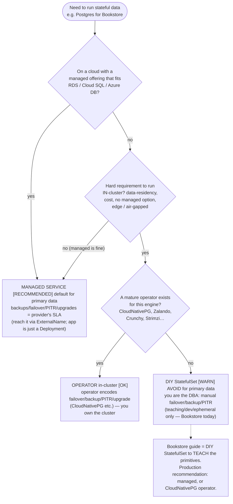

# 05 — Stateful data patterns

> The harder questions persistent storage forces: VolumeSnapshot
> backup/restore & clones; **should you run a database on Kubernetes at all?**
> (managed RDS/Cloud SQL vs. an operator vs. a DIY StatefulSet — failure
> domains, backups, failover, PITR); the **operator pattern** as the real
> answer for stateful; data gravity & migration; quorum/replicas — applied with
> a Bookstore Postgres snapshot, a restore, a credential rotation drill, and an
> explicit production recommendation.

**Estimated time:** ~15 min read · ~60 min hands-on
**Prerequisites:** [Part 03 ch.04](04-persistent-storage.md): the PV/PVC mechanics being applied · [Part 01 ch.05](../01-core-workloads/05-statefulsets.md): the StatefulSet running the data tier · [Part 03 ch.02](02-secrets.md): the `db-credentials` Secret
**You'll know after this:** • take and restore a VolumeSnapshot for a Bookstore Postgres clone · • restrict who can create snapshots and clones, and see why PVC RBAC alone is not enough · • rotate a database password after a restore and confirm the old one is refused · • compare managed DB (RDS/Cloud SQL), an operator, and a DIY StatefulSet on failure domains, backup, failover, PITR · • articulate the operator pattern as the real answer for stateful · • reason about data gravity and migration cost · • make and justify a production stateful-on-Kubernetes recommendation

<!-- tags: storage, stateful, operators, cnpg, backups, snapshot-restore, rbac, credentials -->

## Why this exists

[ch.04](04-persistent-storage.md) made Postgres's data **durable across Pod
restarts**. Durable is necessary but nowhere near sufficient for a database in
production. A bound PV survives a reschedule; it does **not** give you: a
**backup** (a deleted/corrupted table is gone on every replica and every
snapshot-of-the-corruption), **failover** (one Postgres Pod is still a single
point of failure regardless of the StatefulSet,
[Part 01 ch.05](../01-core-workloads/05-statefulsets.md)), **point-in-time
recovery**, safe **version upgrades**, or **replication topology**. A
StatefulSet gives identity + storage + ordering — the *plumbing* — not the
*operational behavior of a database*.

A copy adds a second problem. A snapshot or a clone is another copy of the
data, and another copy is another way to read it. A restore also brings back
whatever the database held on the day the copy was taken, including the
password hashes it checked logins against that day.

This chapter is the honest conclusion of Part 03: persistent storage lets you
run stateful workloads, and the **right question is whether you should**, and
if so **how**. The answers are a small decision space — **managed database**,
**operator**, or **DIY StatefulSet** — plus the **operator pattern** as the
mechanism that encodes database operations as software. This is the
[Stateful Service](#further-reading) pattern taken to its production
conclusion; the operator mechanism itself is
[Part 08 ch.05](../08-day-2-operations/05-operators-and-crds.md).

## Mental model

Running stateful data on Kubernetes is **a build-vs-buy decision about
operational burden**, not a YAML problem:

- **Storage durability ≠ data safety.** A PV/snapshot faithfully preserves
  whatever you have — *including corruption and a `DROP TABLE`*. **Backups are
  a separate, logical concern** (snapshots are crash-consistent point copies;
  `pg_dump`/WAL archiving are logical/PITR) and **untested backups don't
  exist**.
- **A copy inherits the data's sensitivity.** A snapshot, a clone or a dump
  holds the rows, the credential hashes and anything else the database stored.
  It needs the same access rules as the original, and those rules live on
  different objects: `volumesnapshots`, PVC creation, and Pod creation, which
  can mount the volume directly.
- **A StatefulSet is plumbing, not a DBA.** Identity/storage/ordering — yes;
  failover, replication, PITR, safe upgrades — **no**. That logic has to come
  from *somewhere*: a human runbook (fragile), an **operator** (software that
  encodes it), or a **managed service** (someone else's operator + SLA).
- **The decision space is three options:** **Managed** (RDS/Cloud SQL/Azure
  Database — least operational burden, a cloud bill, less control);
  **Operator** in-cluster (CloudNativePG, Zalando, Crunchy, Strimzi for Kafka —
  the operator runs the DBA logic; you own the cluster); **DIY StatefulSet**
  (you are the DBA — almost never the right answer for primary data).
- **Data gravity is real.** State is the hardest thing to move; the storage
  decision constrains your cluster, cloud, and DR for years. Decide it
  deliberately, early.

So: the Bookstore's teaching Postgres StatefulSet is correct *for learning the
primitives* and explicitly **not** what you'd run in production for real
customer data — and this chapter says exactly what you would.

## Threats and controls

Every copy of the data is a second door, and a restore reopens old credentials.
The table lists the threats specific to this topic. Each control is taught in
the hands-on section that follows.

| Threat | Control taught here | Goes deeper |
|---|---|---|
| A snapshot is a read path around the PVC: whoever can create a `VolumeSnapshot` holds a copy they can mount | A Role for the snapshot job only, with `get`, `list` and `create` on `volumesnapshots` | [05.01](../05-security/01-authn-authz-rbac.md) |
| A clone is a read path too: a PVC whose `dataSource` is another PVC copies the claim, and the snapshot rule does not stop it | Grant `create` on PVCs to the restore runbook, not to workloads | [05.01](../05-security/01-authn-authz-rbac.md) |
| Creating Pods in a namespace reaches the PersistentVolumes that Pods mount, so no snapshot rule closes that door | Keep Pod creation and `pods/exec` to the workloads that need them | [01.01 baseline](../01-core-workloads/01-pods.md#baseline-service-account); [05.01](../05-security/01-authn-authz-rbac.md) |
| A restore brings back the password the database held when the copy was taken, and the old one still logs in | Rotate the role password inside the restored database, then check the old password is refused | [03.02](02-secrets.md) for the Secret; rotation through an external store: <!-- link-later: 11.05 --> 11.05 and <!-- link-later: 15.05 --> 15.05 |
| A snapshot or dump holds credential hashes and any secret the app kept in the data | Treat every copy as secret-bearing: restricted access, encryption at rest, copies kept off the cluster | [08.02](../08-day-2-operations/02-backup-and-dr.md) for backups; encryption at rest, <!-- link-later: 05.04 --> 05.04; volume encryption is a StorageClass property, [03.04](04-persistent-storage.md) |
| One Postgres Pod is a single point of data loss | A managed database, or an operator that runs failover, backup and PITR | [08.05](../08-day-2-operations/05-operators-and-crds.md) |

## Diagrams

### Decision: managed DB vs. operator vs. DIY StatefulSet (Mermaid)



### Snapshot, restore and rotation timeline (ASCII)

```
 t0  steady state            postgres-0  ──mounts──►  PVC data-postgres-0  ─► PV
 ───────────────────────────────────────────────────────────────────────────────
 t1  take snapshot           VolumeSnapshot postgres-snap-0  ◄─ source: PVC
                             (CSI CreateSnapshot; status.readyToUse=true)
 t2  disaster                bad migration / DROP TABLE / volume corruption
 t3  provision from snap     new PVC  data-postgres-restore
                                 spec.dataSource: VolumeSnapshot postgres-snap-0
 t4  bring DB up on restore  point a fresh postgres at data-postgres-restore,
                             verify rows, then cut traffic over
 t5  rotate after restore    ALTER ROLE inside the restored DB; the old
                             password is refused; apps roll to the new one
 ───────────────────────────────────────────────────────────────────────────────
  Snapshot = crash-consistent POINT copy (not PITR; not logical). It restores
  state AS OF t1, including anything wrong that already existed at t1, and the
  credentials that existed at t1. Logical/PITR (pg_dump + WAL archiving / an
  operator) covers the t1→t2 gap.
```

## Hands-on with the Bookstore

**Assumed working directory: the guide repo root (`full-guide/`).** Requires
the Postgres StatefulSet ([ch.04](04-persistent-storage.md), Secret-backed
[ch.02](02-secrets.md)) so PVC `data-postgres-0` exists.

**Tier A (kind).** The recorded run is in
[`examples/security-lab/evidence/03-05.txt`](../examples/security-lab/evidence/03-05.txt),
made by [`examples/security-lab/labs/03-05.sh`](../examples/security-lab/labs/03-05.sh).
The commands below use the `bookstore` namespace. The recorded run used the
scratch namespace `p03-05-stateful` with the same files, so that name appears in
some of the messages shown. Run this only against a cluster you own.

### 1. Start the data tier under restricted

The Postgres StatefulSet from ch.04 holds the data. Its manifest already
carries the baseline, so check that it does instead of trusting it:

```sh
kubectl apply -f examples/bookstore/raw-manifests/20-postgres-statefulset.yaml
kubectl rollout status statefulset/postgres -n bookstore
```

<!-- gate: output -->
```text
Waiting for statefulset spec update to be observed...
Waiting for 1 pods to be ready...
Waiting for 1 pods to be ready...
partitioned roll out complete: 1 new pods have been updated...
```

```sh
kubectl get pod postgres-0 -n bookstore
```

<!-- gate: output -->
```text
NAME         READY   STATUS    RESTARTS   AGE
postgres-0   1/1     Running   0          49s
```

```sh
kubectl get pod postgres-0 -n bookstore -o jsonpath='{.spec.serviceAccountName}{" automount="}{.spec.automountServiceAccountToken}'; echo
```

<!-- gate: output -->
```text
postgres-sa automount=false
```

```sh
kubectl get pod postgres-0 -n bookstore -o jsonpath='{.spec.securityContext}'; echo
```

<!-- gate: output -->
```text
{"fsGroup":999,"fsGroupChangePolicy":"OnRootMismatch","runAsGroup":999,"runAsNonRoot":true,"runAsUser":999,"seccompProfile":{"type":"RuntimeDefault"}}
```

```sh
kubectl get pod postgres-0 -n bookstore -o jsonpath='{.spec.containers[0].securityContext}'; echo
```

<!-- gate: output -->
```text
{"allowPrivilegeEscalation":false,"capabilities":{"drop":["ALL"]},"readOnlyRootFilesystem":true}
```

The pod-level fields are the baseline's, with two specifics. The official image
runs as the `postgres` user, UID and GID 999, so the Pod says so and does not
start as root. `fsGroup: 999` makes the kubelet give the PVC's files the group
999, so the database can write its data directory without the image's own
root-then-`gosu` step. `fsGroupChangePolicy: OnRootMismatch` tells the kubelet
to re-own the volume only when its root directory has the wrong owner, so a
restart does not walk a large data directory. The
[baseline](../01-core-workloads/01-pods.md#baseline-run-as) explains the
run-as fields and the
[`fsGroup` note](../01-core-workloads/01-pods.md#baseline-fsgroup) explains the
group.

Now the root filesystem. Postgres writes only where the manifest mounts an
`emptyDir` or the data PVC:

```sh
kubectl exec -n bookstore postgres-0 -- sh -c 'touch /usr/local/bin/x; echo "exit=$?"; touch /tmp/x && echo "tmp: writable"'
```

<!-- gate: output -->
```text
touch: cannot touch '/usr/local/bin/x': Read-only file system
exit=1
tmp: writable
```

The first write is refused, which is the control working. The second succeeds
because `/tmp` is an `emptyDir`, as the baseline requires for every writable
path.

The password reaches the container as an environment variable. The manifest
uses `envFrom` on the `db-credentials` Secret, and this command lists only the
variable names:

```sh
kubectl exec -n bookstore postgres-0 -- sh -c 'env | cut -d= -f1 | grep -E "^(POSTGRES_|PGDATA)" | sort'
```

<!-- gate: output -->
```text
PGDATA
POSTGRES_DB
POSTGRES_PASSWORD
POSTGRES_USER
```

The official image also reads the password from a file: `POSTGRES_PASSWORD_FILE`
is listed in its documentation as supported for `POSTGRES_PASSWORD`,
`POSTGRES_USER`, `POSTGRES_DB` and `POSTGRES_INITDB_ARGS` ([docker-library
postgres](https://github.com/docker-library/docs/blob/master/postgres/README.md)).
A file keeps the value out of the environment, which `kubectl exec` and the
Pod spec both show. This manifest still uses `envFrom`, because the Bookstore
example tree is shared and this chapter reuses it unchanged. Step 4 uses the
file form. The Go services cannot take the file form at all: they read
`DB_DSN` from the environment, and [03.02](02-secrets.md) covers that gap.

Confirm that the database answers, through the local socket:

```sh
kubectl exec -n bookstore postgres-0 -- sh -c 'psql -U bookstore -d bookstore -tAc "select 1"'
```

<!-- gate: output -->
```text
1
```

### 2. Narrow the snapshot path with RBAC

A snapshot is created by a `VolumeSnapshot` object, and creating one is an API
call like any other, so RBAC decides who can make one. Give the job that takes
snapshots its own ServiceAccount and a Role with three verbs and nothing more.
There is no `update`, `patch` or `delete`: retention is a separate decision,
and it should not sit with the job that writes the copies.

```yaml
apiVersion: v1
kind: ServiceAccount
metadata:
  name: snapshot-job
  namespace: bookstore
automountServiceAccountToken: false   # the Pod that runs the job turns it on
---
apiVersion: rbac.authorization.k8s.io/v1
kind: Role
metadata:
  name: snapshotter
  namespace: bookstore
rules:
  - apiGroups: ["snapshot.storage.k8s.io"]
    resources: ["volumesnapshots"]
    verbs: ["get", "list", "create"]
---
apiVersion: rbac.authorization.k8s.io/v1
kind: RoleBinding
metadata:
  name: snapshot-job
  namespace: bookstore
roleRef:
  apiGroup: rbac.authorization.k8s.io
  kind: Role
  name: snapshotter
subjects:
  - kind: ServiceAccount
    name: snapshot-job
    namespace: bookstore
```

`resourceNames` cannot narrow the `create` verb. The Kubernetes RBAC reference
states that "for create, this limitation is because the name of the new object
may not be known at authorization time"
([RBAC reference](https://kubernetes.io/docs/reference/access-authn-authz/rbac/#referring-to-resources)).
The guard is the subject list: only `snapshot-job` holds the rule, and nothing
else in the namespace is bound to it.

The workload identities in this namespace must be refused. This request runs as
the Postgres ServiceAccount, which has no binding for snapshots. `kubectl get
--raw` sends the request straight to the API server, so the answer comes from
RBAC:

```sh
kubectl get --raw /apis/snapshot.storage.k8s.io/v1/namespaces/bookstore/volumesnapshots \
  --as=system:serviceaccount:bookstore:postgres-sa
```

<!-- gate: output -->
```text
Error from server (Forbidden): volumesnapshots.snapshot.storage.k8s.io is forbidden: User "system:serviceaccount:p03-05-stateful:postgres-sa" cannot list resource "volumesnapshots" in API group "snapshot.storage.k8s.io" in the namespace "p03-05-stateful"
```

The same request as the job's identity gets past RBAC and stops at
`NotFound`, because this cluster does not serve the snapshot API yet:

```sh
kubectl get --raw /apis/snapshot.storage.k8s.io/v1/namespaces/bookstore/volumesnapshots \
  --as=system:serviceaccount:bookstore:snapshot-job
```

<!-- gate: output -->
```text
Error from server (NotFound): the server could not find the requested resource
```

The two answers differ for a reason. `Forbidden` is RBAC refusing the request.
`NotFound` is RBAC allowing it and the API server having no such resource.

### 3. The snapshot and the restore claim: not runnable on kind

A `VolumeSnapshot` needs more than RBAC. The upstream volume snapshot
documentation says that "`VolumeSnapshot` support is only available for CSI
drivers", and that the CRDs and the snapshot controller "are the responsibility
of the Kubernetes distribution"
([volume snapshots](https://kubernetes.io/docs/concepts/storage/volume-snapshots/)).
kind's default `local-path` provisioner is not a CSI snapshot driver, and this
cluster has no snapshot CRDs. So the snapshot itself cannot be created here.
The manifests are still worth reading, and applying them shows the refusal the
cluster gives:

```sh
kubectl apply -f examples/bookstore/raw-manifests/18-postgres-snapshot.yaml
```

<!-- gate: output -->
```text
resource mapping not found for name: "bookstore-csi-snapclass" namespace: "" from "STDIN": no matches for kind "VolumeSnapshotClass" in version "snapshot.storage.k8s.io/v1"
ensure CRDs are installed first
resource mapping not found for name: "postgres-snap-0" namespace: "p03-05-stateful" from "STDIN": no matches for kind "VolumeSnapshot" in version "snapshot.storage.k8s.io/v1"
ensure CRDs are installed first
```

The restore is a new PVC whose `dataSource` names the snapshot. On a cluster
with a snapshot-capable CSI driver, this claim is the runbook's first step.
Apply it here as well, and watch what the cluster does with it:

```sh
kubectl apply -f - <<'EOF'
apiVersion: v1
kind: PersistentVolumeClaim
metadata:
  name: data-postgres-restore
  namespace: bookstore
spec:
  accessModes: ["ReadWriteOnce"]
  resources:
    requests:
      storage: 1Gi                 # at least the snapshot's size
  dataSource:
    name: postgres-snap-0
    kind: VolumeSnapshot
    apiGroup: snapshot.storage.k8s.io
EOF
kubectl get pvc data-postgres-restore -n bookstore
```

<!-- gate: output -->
```text
persistentvolumeclaim/data-postgres-restore created
```

<!-- gate: output -->
```text
NAME                    STATUS    VOLUME   CAPACITY   ACCESS MODES   STORAGECLASS   VOLUMEATTRIBUTESCLASS   AGE
data-postgres-restore   Pending                                      standard       <unset>                 0s
```

On this cluster the API server accepted the claim, even though the snapshot
kind it names is not served. The claim sat in `Pending`, and nothing reported an
error. A restore runbook must check for `Pending`, not only for an error on
apply. Step 4 needs a claim it can bind, so on this cluster the Pending claim
is replaced.

Not run here, and cited instead:

- **Snapshot readiness and the restored data.** `status.readyToUse` and the
  rows read back after a restore need a snapshot-capable driver. The upstream
  page is the reference for the fields.
- **Clones.** A PVC whose `dataSource` is a PVC copies the claim, and the
  source must be in the same namespace
  ([PVC data sources](https://kubernetes.io/docs/concepts/storage/volume-pvc-datasource/)).
  It needs a CSI driver with cloning support, which kind's provisioner does not
  have.
- **Volume encryption.** Whether a volume is encrypted at rest is a property of
  the StorageClass and the disk behind it. [03.04](04-persistent-storage.md)
  covers the StorageClass. kind does not encrypt its local volumes, so there is
  nothing to show here.

### 4. Restore into a Pod under restricted

The restored volume needs a database process. This Pod is the restore's
database, and it carries the full baseline. It differs from `20-` in two ways:
the password comes from a file, and the Secret is mounted as a volume.

On a cluster with a snapshot-capable driver, the claim from step 3 is this
Pod's volume. On kind, replace the Pending claim with one that binds, which is
the same claim without `dataSource`:

```sh
kubectl delete pvc data-postgres-restore -n bookstore
kubectl apply -f - <<'EOF'
apiVersion: v1
kind: PersistentVolumeClaim
metadata:
  name: data-postgres-restore
  namespace: bookstore
spec:
  accessModes: ["ReadWriteOnce"]
  resources:
    requests:
      storage: 1Gi
EOF
```

<!-- gate: output -->
```text
persistentvolumeclaim "data-postgres-restore" deleted from p03-05-stateful namespace
```

<!-- gate: output -->
```text
persistentvolumeclaim/data-postgres-restore created
```

Save the Pod below as `postgres-restore.yaml`, then apply it with
`kubectl apply -f postgres-restore.yaml`. Its volume is the claim above.

```yaml
apiVersion: v1
kind: Pod
metadata:
  name: postgres-restore
  namespace: bookstore
  labels:
    app: postgres-restore
    app.kubernetes.io/part-of: bookstore
spec:
  serviceAccountName: postgres-sa
  automountServiceAccountToken: false
  securityContext:
    runAsNonRoot: true
    runAsUser: 999
    runAsGroup: 999
    fsGroup: 999
    seccompProfile:
      type: RuntimeDefault
  containers:
    - name: postgres
      image: postgres@sha256:1beaa3084eee2676f20a9cd9928f0bf2c5bf674f8e49f81017912183d377c61c  # postgres:16
      securityContext:
        allowPrivilegeEscalation: false
        readOnlyRootFilesystem: true
        capabilities:
          drop: ["ALL"]
      env:
        - name: POSTGRES_USER
          value: bookstore
        - name: POSTGRES_DB
          value: bookstore
        - name: POSTGRES_PASSWORD_FILE
          value: /run/secrets/db/password
        - name: PGDATA
          value: /var/lib/postgresql/data/pgdata
      readinessProbe:
        exec:
          command: ["pg_isready", "-h", "/var/run/postgresql", "-U", "bookstore", "-d", "bookstore"]
        periodSeconds: 5
      resources:
        requests:
          cpu: 100m
          memory: 256Mi
        limits:
          memory: 512Mi
      volumeMounts:
        - name: data
          mountPath: /var/lib/postgresql/data
        - name: run
          mountPath: /var/run/postgresql
        - name: tmp
          mountPath: /tmp
        - name: db-password
          mountPath: /run/secrets/db
          readOnly: true
  volumes:
    - name: data
      persistentVolumeClaim:
        claimName: data-postgres-restore
    - name: run
      emptyDir:
        sizeLimit: 8Mi
    - name: tmp
      emptyDir:
        sizeLimit: 32Mi
    - name: db-password
      secret:
        secretName: db-credentials
        defaultMode: 0440
        items:
          - key: POSTGRES_PASSWORD
            path: password
```

```sh
kubectl wait --for=condition=Ready pod/postgres-restore -n bookstore --timeout=900s
```

<!-- gate: output -->
```text
pod/postgres-restore condition met
```

```sh
kubectl get pod postgres-restore -n bookstore
```

<!-- gate: output -->
```text
NAME               READY   STATUS    RESTARTS   AGE
postgres-restore   1/1     Running   0          113s
```

The readiness probe asks Postgres over the socket, so `Ready` means the server
accepts connections. Now check the identity and the mount:

```sh
kubectl exec -n bookstore postgres-restore -- sh -c 'id; ls -l /run/secrets/db/; touch /run/secrets/db/x; echo "exit=$?"'
```

<!-- gate: output -->
```text
uid=999(postgres) gid=999(postgres) groups=999(postgres),101(ssl-cert)
total 0
lrwxrwxrwx 1 root postgres 15 Oct 31 00:19 password -> ..data/password
touch: cannot touch '/run/secrets/db/x': Read-only file system
exit=1
```

The process runs as UID 999, and the Secret mount refuses writes because it is
`readOnly`. The `ls` line shows the usual layout of a Secret volume: `password`
is a symlink into the volume's `..data` directory. The read itself is proven in
step 5, where the same UID 999 process opens the file.

Three fields are new here. `POSTGRES_PASSWORD_FILE` points at the mounted file,
so the value never enters the container's environment. The Secret volume lists
one key, so the Pod sees only the password and not the user name beside it.
`defaultMode: 0440` makes the file readable by its owner and its group. With
`fsGroup: 999` the group is 999, so the postgres process reads the file without
the file being world-readable. Kubernetes stores a Secret volume in a `tmpfs`,
"so that the confidential data is not written to durable storage"
([Secrets](https://kubernetes.io/docs/concepts/configuration/secret/)).

`PGDATA` must match the path the source Pod wrote. The restored volume holds a
data directory at `pgdata/`, and a different `PGDATA` would start an empty
cluster beside it.

### 5. Rotate the password after a restore

Here is the trap. The official image reads `POSTGRES_PASSWORD` only when it
starts with an empty data directory. The upstream documentation says these
variables "will only have an effect if you start the container with a data
directory that is empty" ([docker-library
postgres](https://github.com/docker-library/docs/blob/master/postgres/README.md)).
A restored volume is not empty. So changing the Secret after a restore changes
what clients read from the Secret, and does nothing to the database. The
database keeps the password its snapshot held. The old credential still works,
and the new one is refused.

Two details make the check honest. First, the stock `pg_hba.conf` trusts the
local socket and the loopback addresses, and asks for a password only for every
other address. The recorded run shows the file:

```sh
kubectl exec -n bookstore postgres-restore -- sh -c 'grep -v "^#" /var/lib/postgresql/data/pgdata/pg_hba.conf | grep .'
```

<!-- gate: output -->
```text
local   all             all                                     trust
host    all             all             127.0.0.1/32            trust
host    all             all             ::1/128                 trust
local   replication     all                                     trust
host    replication     all             127.0.0.1/32            trust
host    replication     all             ::1/128                 trust
host all all all scram-sha-256
```

Second, a check over `127.0.0.1` proves nothing about the password, so the
checks below connect to the Pod's own address. Replace `<pod-ip>` with that
address, which the Pod reports as `.status.podIP`.

The rotation runs in four moves: write the new value to the Secret, wait for
the file in the Pod to carry it, change the password inside the database, and
check both directions.

```sh
kubectl patch secret db-credentials -n bookstore --type merge --patch-file new-password.json
```

<!-- gate: output -->
```text
secret/db-credentials patched
```

Wait until `/run/secrets/db/password` in the Pod shows the new value. The kubelet
syncs Secret volumes on its own schedule, so this can take a minute or more.
Then the Secret's value must be refused, and the old one must still work:

```sh
kubectl exec -n bookstore postgres-restore -- sh -c 'PGPASSWORD="$(cat /run/secrets/db/password)" psql -h <pod-ip> -U bookstore -d bookstore -tAc "select 1"'
```

<!-- gate: output -->
```text
psql: error: connection to server at "<pod-ip>", port 5432 failed: FATAL:  password authentication failed for user "bookstore"
command terminated with exit code 2
```

```sh
kubectl exec -n bookstore postgres-restore -- sh -c 'PGPASSWORD=devpassword psql -h <pod-ip> -U bookstore -d bookstore -tAc "select 1"'
```

<!-- gate: output -->
```text
1
```

That is the restore trap: the database still answers to the password from the
snapshot, and the Secret says something else. Now change the password inside
the database. The socket asks for no password here, because the local rule is
`trust`:

```sh
kubectl exec -i -n bookstore postgres-restore -- sh -c 'psql -h /var/run/postgresql -U bookstore -d bookstore -v ON_ERROR_STOP=1' <<'SQL'
\set pw `cat /run/secrets/db/password`
ALTER ROLE bookstore PASSWORD :'pw';
SQL
```

<!-- gate: output -->
```text
ALTER ROLE
```

Check both directions again. The new value must work, and the old one must be
refused:

```sh
kubectl exec -n bookstore postgres-restore -- sh -c 'PGPASSWORD="$(cat /run/secrets/db/password)" psql -h <pod-ip> -U bookstore -d bookstore -tAc "select 1"'
```

<!-- gate: output -->
```text
1
```

```sh
kubectl exec -n bookstore postgres-restore -- sh -c 'PGPASSWORD=devpassword psql -h <pod-ip> -U bookstore -d bookstore -tAc "select 1"'
```

<!-- gate: output -->
```text
psql: error: connection to server at "<pod-ip>", port 5432 failed: FATAL:  password authentication failed for user "bookstore"
command terminated with exit code 2
```

`new-password.json` holds `{"stringData":{"POSTGRES_PASSWORD":"<new value>"}}`,
written to a file that is deleted afterwards. A server that logs statements may
record the `ALTER ROLE` text, and with it the value. In an interactive session,
psql's `\password` prompts for the value and sends only its hash.

Why the socket needs no password: PostgreSQL's `initdb` uses `trust` for local
users unless told otherwise
([initdb](https://www.postgresql.org/docs/current/app-initdb.html)). So anyone
who can `exec` into this Pod can change the database's passwords, which makes
`pods/exec` on the database Pod database admin. Check the default on your own
cluster before relying on it.

Apps are a separate step. The Go services read `DB_DSN` from the environment,
and the environment is fixed when a Pod starts. After the database changes,
roll the Deployments that build `DB_DSN` from the Secret, or they keep the
old value until they restart.

### 6. Clean up

```sh
kubectl delete pod postgres-restore -n bookstore --now
kubectl delete pvc data-postgres-restore -n bookstore
```

Keep `postgres-0` and its PVC, which the rest of the guide uses.

## How it works under the hood

- **Snapshots are crash-consistent point copies, not backups or PITR.** A
  `VolumeSnapshot` triggers the CSI driver's `CreateSnapshot` — a block-level
  point-in-time copy of the **PVC as it is at that instant** (like pulling the
  power and copying the disk: the filesystem/DB recovers via its journal/WAL on
  restore). It faithfully preserves **whatever was there — including a
  half-finished bad migration, a `DROP TABLE` that already ran, and the
  credential hashes**. It is **not** a logical export (`pg_dump`) and **not**
  point-in-time recovery. Real DB backup strategy = periodic logical/base
  backups **plus** continuous WAL/redo archiving for PITR. That is precisely
  the operational logic an **operator** or **managed service** provides and a
  bare StatefulSet does not.
- **Restore = provision a new PVC `dataSource` the snapshot.** You don't
  "restore in place"; you create a **new PVC** with
  `spec.dataSource: {kind: VolumeSnapshot, ...}` (or clone directly from
  another PVC with `dataSource: {kind: PersistentVolumeClaim}` if the driver
  supports cloning), then bring a database up on it and cut over. This is why
  the **restore drill must be rehearsed**: an unrehearsed restore path is a
  latent outage; "we have snapshots" is not "we can recover".
- **Why a StatefulSet alone is not a database.** It guarantees stable
  identity/DNS, per-ordinal sticky PVCs, and ordered lifecycle
  ([Part 01 ch.05](../01-core-workloads/05-statefulsets.md)). It has **no**
  concept of primary/replica, replication lag, automated failover/promotion,
  quorum, backup scheduling, PITR, or version-aware rolling upgrades. Encoding
  *that* by hand (init containers, sidecars, scripts, runbooks) is exactly the
  fragile, error-prone work the **Operator pattern** exists to replace.
- **The operator pattern (the real answer for stateful).** An **operator** is a
  **custom controller + CRDs** that encodes a specific system's operational
  knowledge. `kind: Cluster` (CloudNativePG) declares "3-node HA Postgres,
  continuous backup to object storage, PITR window 7d"; the operator's
  reconcile loop runs the failover, base backups, WAL archiving, replica
  bootstrap, and minor-version rolling upgrade — the human DBA runbook as
  software, reconciled continuously. This is the
  [Stateful Service](#further-reading) pattern's production form; full
  mechanism (CRD + controller-runtime + reconciliation) is
  [Part 08 ch.05](../08-day-2-operations/05-operators-and-crds.md).
- **Failure domains & quorum.** HA stateful systems need **replicas across
  failure domains** (nodes, and **zones** on cloud) and, for consensus systems
  (etcd, ZooKeeper, Patroni-managed Postgres), an **odd-sized quorum** (3/5) so
  a minority partition can't split-brain. Zonal block PVs
  ([ch.04](04-persistent-storage.md)) pin each replica's data to one AZ — so
  topology spread/anti-affinity
  ([Part 04 ch.02](../04-scheduling/02-affinity-taints-topology.md)) is part of
  the data-safety design, not an afterthought. One Pod + one PVC (the teaching
  setup) has **no** failure domain tolerance by construction.
- **Data gravity & migration.** Stateless tiers move freely; **state does
  not**. The volume's backend ties you to a cloud/cluster; moving terabytes
  between StorageClasses/regions/providers is a planned migration (snapshot +
  restore, logical dump/load, or replication cutover), not a reschedule. The
  storage/engine decision has multi-year lock-in — which is the strongest
  argument for choosing **managed or operator-managed** deliberately up front
  rather than discovering the burden in an incident.

## Production notes

> **In production:** **prefer a managed database for primary data.** RDS /
> Cloud SQL / Azure Database make backups, HA failover, PITR, and patching the
> provider's responsibility. The app stays a stateless Deployment pointed at it
> (an `ExternalName` Service gives it a stable in-cluster name,
> [Part 02 ch.02](../02-networking/02-services.md)). This is the lowest-risk
> default for stateful — choose in-cluster only with a concrete reason.

> **In production:** **if in-cluster, use a mature operator, never a bare
> StatefulSet.** CloudNativePG/Zalando/Crunchy (Postgres), Strimzi (Kafka),
> etc. encode failover, replication, backup/PITR, and safe upgrades. A raw
> StatefulSet for a production database is an outage waiting for a node failure
> ([Part 08 ch.05](../08-day-2-operations/05-operators-and-crds.md)).

> **In production:** **spread stateful replicas across failure domains** and
> size quorum correctly (odd numbers for consensus). Zonal PVs pin data to an
> AZ; without cross-zone topology spread a single AZ outage is data
> unavailability. This is design-time, not a tuning knob
> ([Part 04 ch.02](../04-scheduling/02-affinity-taints-topology.md)).

> **In production:** **respect data gravity.** Decide engine + managed-vs-
> operator + storage backend **before** you have terabytes; migrating state
> across providers/classes is a project with downtime risk, not a redeploy.
> The capstone ([Part 09](../09-end-to-end-bookstore/01-bookstore-end-to-end.md)) treats
> the managed-vs-operated Postgres choice as an explicit DR decision.

> **In production:** **store copies off the cluster and rehearse the restore.**
> A backup or snapshot holds the credentials too, so it needs the access rules
> of the database it came from ([Part 08 ch.02](../08-day-2-operations/02-backup-and-dr.md)).
> After every restore, rotate the database password and confirm the old one is
> refused.

## Quick Reference

```sh
# snapshot lifecycle (needs snapshot CRDs + a snapshot-capable CSI driver):
kubectl get volumesnapshotclass
kubectl get volumesnapshot -n bookstore
kubectl get volumesnapshot postgres-snap-0 -n bookstore -o jsonpath='{.status.readyToUse}{"\n"}'
# restore = NEW PVC from the snapshot (dataSource below); clone = NEW PVC from a PVC
# a Pending restore claim is the signal to check, not an apply error
kubectl get pvc data-postgres-restore -n bookstore
# who can read the database pod's data? check the pod-create and exec rights too
kubectl auth can-i create pods -n bookstore --as=system:serviceaccount:bookstore:postgres-sa
```

Restore-from-snapshot PVC skeleton and the decision rule:

```yaml
apiVersion: v1
kind: PersistentVolumeClaim
metadata:
  name: data-postgres-restore
  namespace: bookstore
spec:
  accessModes: ["ReadWriteOnce"]
  resources:
    requests:
      storage: 1Gi                     # must be >= the source snapshot or PVC size
  dataSource:                          # restore (snapshot) OR clone (PVC)
    name: postgres-snap-0
    kind: VolumeSnapshot
    apiGroup: snapshot.storage.k8s.io
# DECISION: managed DB  ▸ default for primary data
#           operator    ▸ if must run in-cluster (CloudNativePG/Zalando/…)
#           DIY SS      ▸ teaching/dev/ephemeral ONLY (Bookstore today)
```

Checklist:

- [ ] Decision made deliberately: **managed** ▸ **operator** ▸ DIY (last resort)
- [ ] Backups are **logical + PITR**, off-cluster, and **restore-tested**
- [ ] Snapshot understood as crash-consistent point copy, **not** PITR/backup
- [ ] Snapshot and clone rights held by one job identity, not by people or workloads
- [ ] After every restore: role password rotated inside the database, old one refused
- [ ] Restore/clone path rehearsed and runbooked ([Part 08 ch.02](../08-day-2-operations/02-backup-and-dr.md))
- [ ] Stateful replicas spread across failure domains; quorum sized (odd)
- [ ] Production DB = managed or operator, **not** a bare StatefulSet
- [ ] Data-gravity / engine / backend lock-in accepted with eyes open

## Test your understanding

> Try each before opening the answer drawer. The act of trying is the exercise; the answer is the check.

1. **Why is a VolumeSnapshot *not* equivalent to a backup, and what specific failure mode does this distinction protect against?**
   <details><summary>Show answer</summary>

   A snapshot is a crash-consistent point copy — it faithfully preserves whatever was there at snapshot time, **including corruption and a `DROP TABLE` that already ran**. If a bad migration ran at t1 and you snapshot at t2, the snapshot has the bad state. Backups require *logical* exports (`pg_dump`) and *PITR* (continuous WAL archiving) to recover to a moment *before* the corruption. Snapshots speed up DR; they don't replace logical backups (see §How it works under the hood and §Snapshot/restore drill timeline).

   </details>

2. **Your team runs a Postgres StatefulSet in production. It survived a Pod delete and a node crash, so they conclude it's HA. What three production-DB capabilities does a bare StatefulSet not provide?**
   <details><summary>Show answer</summary>

   (1) **Automated failover** — promoting a replica when the primary dies. (2) **Replication topology and PITR** — streaming replicas, WAL archiving, recovery to any point in time. (3) **Safe rolling minor-version upgrades** that don't require manual coordination. A StatefulSet provides identity + storage + ordering — the plumbing. The DBA logic must come from an operator (CloudNativePG/Zalando/Crunchy) or a managed service. One Pod surviving a restart is not HA (see §Why a StatefulSet alone is not a database).

   </details>

3. **A teammate argues for in-cluster Postgres via the operator pattern instead of RDS. What's their strongest argument, and what's the strongest counter?**
   <details><summary>Show answer</summary>

   **For**: data residency, cost, no managed offering in the target region, edge/air-gapped deployments, deeper integration with cluster identity/network. **Against**: the operator is software too — you own its upgrades, etcd backups, cluster lifecycle, and operator bugs become *your* outages. The provider's SLA is real expertise at scale. Decision criteria: managed by default; operator only if you have concrete reasons + capacity to operate it (see §Mental model and §Decision diagram).

   </details>

4. **Explain "data gravity" in one sentence, then describe a concrete decision that becomes effectively irreversible once you accumulate state.**
   <details><summary>Show answer</summary>

   Data gravity = the cost of moving state grows with its size, making "swap providers later" practically a multi-quarter migration project rather than a redeploy. Concrete irreversible decision: the storage backend / cloud you put a multi-TB Postgres on. Migrating across StorageClasses or providers requires snapshot+restore or logical dump/load with planned downtime — not a `kubectl apply`. Choose deliberately up front (see §How it works under the hood, "Data gravity & migration").

   </details>

5. **Hands-on extension: with the Bookstore Postgres running on kind's `local-path` provisioner, apply `18-postgres-snapshot.yaml`, then apply the restore claim. What happens and what does the failure teach about CSI capabilities?**
   <details><summary>What you should see</summary>

   The snapshot apply fails with "no matches for kind VolumeSnapshotClass" because the snapshot CRDs are not installed. The restore claim is accepted, and it stays `Pending` with no error. This teaches two things: snapshot, clone and expand are *CSI driver features*, not Kubernetes features, and a claim that never binds fails silently unless you check for `Pending` (see §3 of the hands-on).

   </details>

6. **Security: a developer's ServiceAccount can `get` PVCs and `create` Pods in the `bookstore` namespace, but it has no rule for `volumesnapshots`. The team says the data is safe because the snapshot path is closed. What is the gap, and what closes it?**
   <details><summary>Show answer</summary>

   The gap is the Pod. Permission to create Pods in a namespace implicitly grants access to the PersistentVolumes that can be mounted in them, so a Pod with the right volume mount reads `data-postgres-0` directly, with no snapshot involved ([RBAC good practices](https://kubernetes.io/docs/concepts/security/rbac-good-practices/)). The snapshot rule was one door of several. The control is to keep Pod creation to the workloads that need it, to deny `pods/exec` on the database Pod, and to hold PVC creation for the restore runbook, so that the database's data is reachable through one identity you can audit (see §Threats and controls and [05.01](../05-security/01-authn-authz-rbac.md)).

   </details>

7. **Security: after a restore, the Secret holds the new password and the database still accepts the old one. A colleague says the Secret rotation worked because the Secret changed. What does the database do, and why does the Secret change not reach it?**
   <details><summary>Show answer</summary>

   The official image reads `POSTGRES_PASSWORD` only when it initialises an empty data directory. A restored volume is not empty, so the Secret value is never applied, and the database keeps the password its snapshot held ([docker-library postgres](https://github.com/docker-library/docs/blob/master/postgres/README.md)). The Secret change reached the file and the environment, but not the database. The fix is `ALTER ROLE` inside the database, then a check that the old password is refused, then a rollout of the apps that read the Secret (see §5 of the hands-on).

   </details>

## Further reading

- **Ibryam & Huß, _Kubernetes Patterns_ 2e, ch.12 — _Stateful Service_** — the
  full set of stateful requirements and why operators, not bare StatefulSets,
  meet them in production.
- **Rosso et al., _Production Kubernetes_, ch.4 — "Container Storage"** (data
  protection, snapshots) and **ch.16 — "Platform Abstractions"** (offering
  databases as a platform capability / operators) — the production framing of
  "should this run on Kubernetes, and how".
- Official:
  <https://kubernetes.io/docs/concepts/storage/volume-snapshots/>,
  <https://kubernetes.io/docs/concepts/storage/volume-pvc-datasource/>,
  <https://kubernetes.io/docs/reference/access-authn-authz/rbac/> (the
  `resourceName` limit on `create`) and
  <https://kubernetes.io/docs/concepts/extend-kubernetes/operator/> (the
  operator pattern — the production answer for stateful workloads).
- The snapshot machinery itself: <https://github.com/kubernetes-csi/external-snapshotter>.
- The Postgres image's variables and `_FILE` form:
  <https://github.com/docker-library/docs/blob/master/postgres/README.md>.
