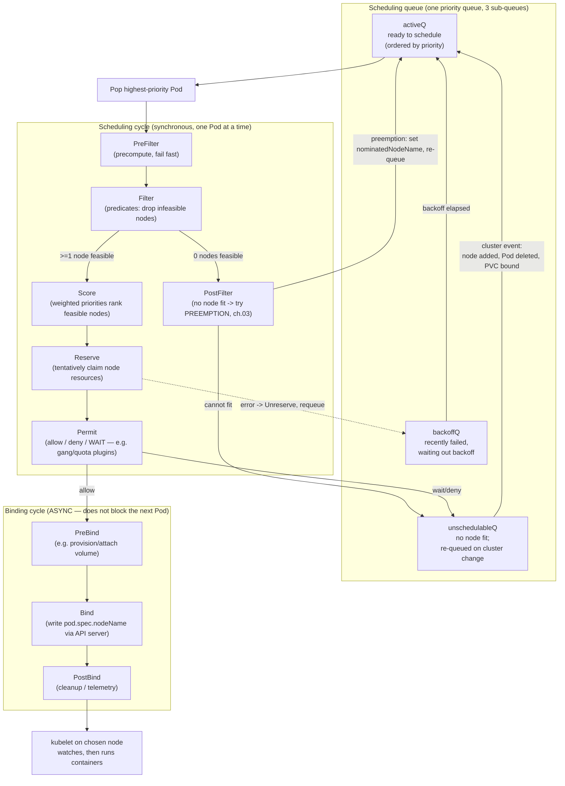

# 01 — The scheduler and nodes

> The scheduling cycle in depth: the scheduling queue (active/backoff/
> unschedulable), the scheduling cycle vs. the binding cycle, Filter → Score →
> Reserve → Permit → Bind, the scheduling framework (plugins & extension
> points), `nodeName` vs `nodeSelector`, node **capacity vs. allocatable**
> (system/kube reserved), why a Pod is `Pending` (the Events that tell you), and
> `schedulingGates` / scheduling readiness — diagnosed on a real Bookstore Pod.

**Estimated time:** ~30 min read · ~30 min hands-on
**Prerequisites:** [Part 00 ch.04](../00-foundations/04-control-plane-deep-dive.md) — where the scheduler sits · [Part 01 ch.03](../01-core-workloads/03-resources-and-qos.md) — requests drive scheduling decisions · [Part 01 ch.01](../01-core-workloads/01-pods.md) (the baseline every manifest here carries)
**You'll know after this:** • trace the scheduling queue (active / backoff / unschedulable) · • distinguish the scheduling cycle from the binding cycle (Filter → Score → Reserve → Permit → Bind) · • read scheduler-framework plugin extension points · • differentiate node capacity from allocatable and account for system/kube-reserved · • diagnose a `Pending` Pod from its Events on a real cluster

<!-- tags: scheduling, scheduler, allocatable, scheduling-gates, troubleshooting -->

## Why this exists

[Part 00 ch.04](../00-foundations/04-control-plane-deep-dive.md) said the
scheduler "filters then scores, then writes a Binding". That two-line summary is
enough to *understand* the architecture; it is not enough to *operate* it. The
moment you run more than one node, or set resource
[requests](../01-core-workloads/03-resources-and-qos.md), or use storage with
`WaitForFirstConsumer`, you start seeing Pods stuck in `Pending` — and the only
way to fix that is to know **exactly** what the scheduler does, in what order,
and where it records *why* it could not place a Pod.

This chapter opens the scheduler. Every later scheduling control —
[affinity, taints, topology spread](02-affinity-taints-topology.md),
[priority and preemption](03-priority-and-preemption.md) — is a *plugin at a
specific extension point* in the pipeline described here, so this is the
foundation those two chapters build on. It is also the single most useful
debugging skill in Kubernetes: "why is this Pod Pending?" is answered entirely
by the mechanics below.

## Mental model

The scheduler is a **loop over one queue that, per Pod, runs an
assembly line of pass/fail gates then a scoring round, reserves the winner,
and only then — separately — writes the booking.**

- **One Pod at a time.** The scheduler pops *one* unscheduled Pod from a
  priority queue and finds it a home before moving on. It is not a global
  bin-packing solver; it is a fast, greedy, per-Pod decision (this is why
  scheduling order and [priority](03-priority-and-preemption.md) matter).
- **Filter is binary, Score is a beauty contest.** First, throw away every node
  that *cannot* run the Pod (hard constraints). Then, among the survivors, give
  each a number and pick the best (soft preferences). No survivors ⇒ the Pod
  stays `Pending` with an Event explaining which gate failed.
- **Deciding and committing are two phases.** The *scheduling cycle* (pick a
  node) is synchronous and one-at-a-time. The *binding cycle* (write
  `nodeName`, wait for volumes to attach) is slower and runs **asynchronously**
  so a slow bind doesn't stall scheduling of other Pods.
- **It only writes one field.** The scheduler's entire output is
  `pod.spec.nodeName`. It never starts a container — the
  [kubelet](../00-foundations/05-node-components.md) on the chosen node does
  that, watching for Pods bound to it.

Hold that and `Pending` stops being mysterious: a Pod is `Pending` because
either the queue hasn't gotten to it, or **every node failed a filter**, or the
**binding cycle is blocked** (typically an unbound volume).

## Threats and controls

Scheduling decides where a Pod runs. It does not decide who may create one,
so it is not a security boundary. A taint keeps ordinary Pods off a node. It
does nothing about a Pod that someone allowed to create Pods has placed there
on purpose, and the steps below show two ways that happens.

| Threat | Control taught here | Deeper |
|---|---|---|
| A Pod sets `spec.nodeName`, which skips the scheduler's taint and affinity filters | A ValidatingAdmissionPolicy refuses `nodeName` in namespaces labelled `tier: sensitive` | [05.01](../05-security/01-authn-authz-rbac.md) for RBAC; <!-- link-later: 05.07 --> 05.07 for policy engines |
| A kubelet labels its own Node into a dedicated pool | NodeRestriction refuses the `node-restriction.kubernetes.io/` prefix, so only an administrator sets a pool label | [02](02-affinity-taints-topology.md), the pool itself |

The policy holds only while RBAC keeps users from editing the policy, its
binding or the labels on the namespace. NodeRestriction is limited to the
prefixes upstream names. The upstream text is silent on unprefixed labels, and
[ch.02](02-affinity-taints-topology.md) shows a kubelet identity setting one. A
pool key therefore carries the prefix, and an administrator sets it.

## Diagrams

### The scheduling pipeline — queue → cycle → bind (Mermaid)



> Note the preemption edge: when `PostFilter` decides preemption can help, it
> sets the Pod's `status.nominatedNodeName`, marks the victims for graceful
> deletion, and the Pod is **re-queued to `activeQ`** — it does **not** flow
> straight into `Score` in the same cycle. It then runs a *fresh* scheduling
> cycle and, once the victims have terminated, normally wins the nominated node
> on that next pass (the scheduler re-evaluates; it is not contractually pinned
> there). This matches [ch.03](03-priority-and-preemption.md)'s preemption flow.

### Filter → Score funnel, and capacity vs. allocatable (ASCII)

```
ALL NODES ─┐
           ▼
   ┌──────────────── FILTER (predicates — binary pass/fail) ───────────────┐
   │ NodeResourcesFit · NodeAffinity · NodeName · TaintToleration ·         │
   │ VolumeBinding · VolumeZone · NodeVolumeLimits · PodTopologySpread ...  │
   └──────────────────────────────┬────────────────────────────────────────┘
                feasible nodes ────┤  (zero feasible ⇒ Pending; PostFilter may preempt)
                                   ▼
   ┌──────────── SCORE (priorities — 0..100, then weighted, summed) ────────┐
   │ NodeResourcesFit(LeastAllocated|MostAllocated) · ImageLocality ·       │
   │ InterPodAffinity · TaintToleration · PodTopologySpread · NodeAffinity  │
   └──────────────────────────────┬────────────────────────────────────────┘
                                   ▼  highest total wins (ties: random)
                            chosen node → Reserve → (async) Bind

  Why a request can fail to "fit" even on an idle-looking node:

   Node CAPACITY        = the machine's real CPU/mem (e.g. 4 CPU, 8Gi)
     − kube-reserved    = reserved for kubelet/runtime
     − system-reserved  = reserved for the OS / sshd
     − eviction-threshold
     = ALLOCATABLE       = the only budget the scheduler may pack into
                           Σ(Pod requests on node) + new request ≤ ALLOCATABLE
   `kubectl top node` shows USAGE; the scheduler ignores usage and sums REQUESTS.
```

## Hands-on with the Bookstore

**Assumed working directory: the guide repo root (`full-guide/`).** This
chapter needs three nodes, one control plane and two workers. The taint steps
need two workers, one tainted and one clean, which the single-node cluster from
[Part 00 ch.07](../00-foundations/07-local-cluster-setup.md) cannot show.
Create the three-node cluster from the config beside the security labs:

```sh
kind create cluster --config examples/security-lab/kind/cluster-three-node.yaml
```

The config names the cluster `bookstore`, so its nodes are
`bookstore-control-plane`, `bookstore-worker` and `bookstore-worker2`. Create
the `bookstore` namespace with the Pod Security labels from
[01.01 step 1](../01-core-workloads/01-pods.md#restricted-namespace). The
captured output in this chapter came from a lab cluster whose nodes are named
`sf-sched-control-plane`, `sf-sched-worker` and `sf-sched-worker2`. Those names
appear verbatim in the output blocks. That lab cluster was built from an
earlier copy of the config without zone labels, and no step here reads them.
Your commands use your own node names.

This chapter changes no Bookstore manifest. The scheduling fields arrive in
[ch.02](02-affinity-taints-topology.md) and
[ch.03](03-priority-and-preemption.md). Here you make Pods unschedulable on
purpose, bypass the scheduler, and read what stops each one.

### 1. See node capacity vs. allocatable

```sh
# The number the scheduler actually packs into is Allocatable, not Capacity.
kubectl get nodes -o custom-columns=\
'NAME:.metadata.name,CAP_CPU:.status.capacity.cpu,ALLOC_CPU:.status.allocatable.cpu,ALLOC_MEM:.status.allocatable.memory'

# Where current requests vs. allocatable stand on a node:
kubectl describe node | sed -n '/Allocated resources/,/Events/p'
```

`Allocatable` is `Capacity` minus `kube-reserved`, `system-reserved` and the
eviction threshold. The lab cluster's workers each report four CPUs of
allocatable, as the output below shows. Note your workers' number: the next
step asks for more.

<!-- gate: output -->
```text
NAME                     CAP_CPU   ALLOC_CPU   ALLOC_MEM
sf-sched-control-plane   4         4           7480448Ki
sf-sched-worker          4         4           7480448Ki
sf-sched-worker2         4         4           7480448Ki
```

### 2. Make a Bookstore Pod `Pending` by over-requesting CPU

The cleanest reversible way to get an unschedulable Pod is to ask for more CPU
than any node's allocatable. This Deployment asks for 100 CPU. The Pod carries
the [baseline](../01-core-workloads/01-pods.md#baseline) and its own
ServiceAccount. It runs `registry.k8s.io/pause` in place of the distroless
catalog image. The pause image only waits, so a Pod that stays `Pending` is a
scheduling result, not an image pull failure. It runs as UID 65535, which
`runAsNonRoot` accepts. It is pinned by digest, with its tag in the comment, as
the [digest rule](../01-core-workloads/01-pods.md#baseline-image-digest) asks.

```yaml
apiVersion: v1
kind: ServiceAccount
metadata:
  name: sched-demo
  namespace: bookstore
---
apiVersion: apps/v1
kind: Deployment
metadata:
  name: sched-demo
  namespace: bookstore
  labels:
    app: sched-demo
spec:
  replicas: 1
  selector:
    matchLabels:
      app: sched-demo
  template:
    metadata:
      labels:
        app: sched-demo
    spec:
      serviceAccountName: sched-demo
      automountServiceAccountToken: false
      securityContext:
        runAsNonRoot: true
        runAsUser: 65535
        runAsGroup: 65535
        seccompProfile:
          type: RuntimeDefault
      containers:
        - name: pause
          image: registry.k8s.io/pause@sha256:7031c1b283388d2c2e09b57badb803c05ebed362dc88d84b480cc47f72a21097 # registry.k8s.io/pause:3.9
          securityContext:
            allowPrivilegeEscalation: false
            readOnlyRootFilesystem: true
            capabilities:
              drop: ["ALL"]
          resources:
            requests: { cpu: "100", memory: 64Mi }
            limits: { memory: 128Mi }
          volumeMounts:
            - name: tmp
              mountPath: /tmp
      volumes:
        - name: tmp
          emptyDir: {}
```

Save it as `sched-demo.yaml`, apply it, and wait for the scheduler's first
attempt:

```sh
kubectl apply -f sched-demo.yaml
until kubectl -n bookstore get pods -l app=sched-demo -o name | grep -q pod; do sleep 1; done
kubectl -n bookstore wait --for=jsonpath='{.status.conditions[?(@.type=="PodScheduled")].reason}'=Unschedulable pod -l app=sched-demo --timeout=90s
kubectl -n bookstore get pods -l app=sched-demo -o wide
```

<!-- gate: output -->
```text
serviceaccount/sched-demo created
deployment.apps/sched-demo created
```

<!-- gate: output -->
```text
NAME                          READY   STATUS    RESTARTS   AGE   IP       NODE     NOMINATED NODE   READINESS GATES
sched-demo-7b7d4d7b68-fr8px   0/1     Pending   0          6s    <none>   <none>   <none>           <none>
```

The scheduler writes its verdict into the Pod's events:

```sh
kubectl -n bookstore describe pods -l app=sched-demo | sed -n '/Events:/,$p'
```

<!-- gate: output -->
```text
Events:
  Type     Reason            Age   From               Message
  ----     ------            ----  ----               -------
  Warning  FailedScheduling  5s    default-scheduler  0/3 nodes are available: 1 node(s) had untolerated taint(s), 2 Insufficient cpu. preemption: 0/3 nodes are available: 3 Preemption is not helpful for scheduling.
```

Read that message literally. `2 Insufficient cpu` is the `NodeResourcesFit`
filter: on two workers, the requests already placed there plus 100 CPU exceed
allocatable. `1 node(s) had untolerated taint(s)` is the `TaintToleration`
filter on the control-plane node, which carries a `NoSchedule` taint by
default. `Preemption is not helpful` is `PostFilter`: evicting lower-priority
Pods would not free 100 CPU. The Pod waits in the unschedulable queue, and the
scheduler retries it only when a cluster event could change the answer, such
as a node being added or a Pod being deleted. The `Pending` phase alone says
none of this, which is why the Events matter.

### 3. Lower the request and let the Deployment replace the Pod

The Pending Pod keeps its request. The Deployment does not edit it: it creates
a new Pod from an edited template and removes the Pending one once the
replacement is available. Change `cpu: "100"` in `sched-demo.yaml` to
`cpu: 50m`, then apply the file again:

```sh
kubectl apply -f sched-demo.yaml
kubectl -n bookstore rollout status deployment/sched-demo --timeout=180s
kubectl -n bookstore get pods -l app=sched-demo -o wide
```

<!-- gate: output -->
```text
serviceaccount/sched-demo unchanged
deployment.apps/sched-demo configured
```

<!-- gate: output -->
```text
Waiting for deployment "sched-demo" rollout to finish: 1 old replicas are pending termination...
Waiting for deployment "sched-demo" rollout to finish: 1 old replicas are pending termination...
Waiting for deployment "sched-demo" rollout to finish: 1 old replicas are pending termination...
deployment "sched-demo" successfully rolled out
```

<!-- gate: output -->
```text
NAME                          READY   STATUS    RESTARTS   AGE   IP            NODE              NOMINATED NODE   READINESS GATES
sched-demo-66b54dfc97-2nl4h   1/1     Running   0          27s   10.244.1.13   sf-sched-worker   <none>           <none>
```

The replacement fits, so the scheduler binds it. The Pod that was `Pending`
never reached a node. The replacement is a new Pod, so the scheduler evaluates
it from the start, with no memory of the failed attempt.

### 4. The other common `Pending`: an unbound PVC

You have already seen this without naming it. The Bookstore Postgres
([ch.05](../01-core-workloads/05-statefulsets.md) /
[Part 03 ch.04](../03-config-and-storage/04-persistent-storage.md)) uses a
`StorageClass` whose `volumeBindingMode` is `WaitForFirstConsumer`. That mode
deliberately **delays PV provisioning until a Pod is scheduled**, which means
the Pod's binding cycle waits on the volume:

```sh
# (Only if Postgres is applied.) A freshly created postgres-0 before its PV
# binds shows the binding-side Pending, not a filter failure:
kubectl -n bookstore describe pod postgres-0 2>/dev/null | sed -n '/Events:/,$p'
#   ... waiting for first consumer to be created before binding   (normal here)
#   ... or: had volume node affinity conflict                     (a real bug)
kubectl -n bookstore get pvc                 # STATUS Pending until bound
```

This is the key distinction this chapter teaches: **`Insufficient cpu/memory` /
`didn't match node selector` / `had taint` = a Filter (scheduling-cycle)
failure**; **`waiting for first consumer` / `unbound PersistentVolumeClaim` /
`node affinity conflict` = a binding-cycle (volume) failure**. Same `Pending`
phase, different half of the pipeline — and `describe pod` Events tell you
which every time.

### 5. `nodeName` skips the scheduler's taint check

A Pod with `spec.nodeName` already set counts as scheduled, so the scheduler
never filters it, and its taint and affinity checks do not run. The kubelet on
the named node still runs its own admission. It refuses a Pod that does not fit
or whose selector does not match. For a `NoSchedule` taint it does not check
anything, so the bypass works. Steps 5b and 5c show the two refusals. Step 5d
shows the `NoExecute` effect, which the kubelet does enforce. This step is
deliberate: it shows the bypass working.

First, put a `NoSchedule` taint on the second worker. It uses the pool key that
[ch.02](02-affinity-taints-topology.md) uses:

```sh
kubectl taint nodes bookstore-worker2 dedicated=database:NoSchedule
```

<!-- gate: output -->
```text
node/sf-sched-worker2 tainted
```

The Pod below is valid under the baseline. Its `nodeName` line is the only
thing that bypasses the scheduler:

```yaml
apiVersion: v1
kind: Pod
metadata:
  name: pin-demo
  namespace: bookstore
spec:
  nodeName: bookstore-worker2   # skips the scheduler; deliberate in this step
  serviceAccountName: sched-demo
  automountServiceAccountToken: false
  securityContext:
    runAsNonRoot: true
    runAsUser: 65535
    runAsGroup: 65535
    seccompProfile:
      type: RuntimeDefault
  containers:
    - name: pause
      image: registry.k8s.io/pause@sha256:7031c1b283388d2c2e09b57badb803c05ebed362dc88d84b480cc47f72a21097 # registry.k8s.io/pause:3.9
      securityContext:
        allowPrivilegeEscalation: false
        readOnlyRootFilesystem: true
        capabilities:
          drop: ["ALL"]
      resources:
        requests: { cpu: 50m, memory: 64Mi }
        limits: { memory: 128Mi }
      volumeMounts:
        - name: tmp
          mountPath: /tmp
  volumes:
    - name: tmp
      emptyDir: {}
```

```sh
kubectl apply -f pin-demo.yaml
kubectl -n bookstore wait --for=condition=Ready pod/pin-demo --timeout=120s
kubectl -n bookstore get pod pin-demo -o wide
```

<!-- gate: output -->
```text
NAME       READY   STATUS    RESTARTS   AGE   IP            NODE               NOMINATED NODE   READINESS GATES
pin-demo   1/1     Running   0          45s   10.244.2.25   sf-sched-worker2   <none>           <none>
```

The Pod runs on the tainted worker. Pod Security admission does not look at
`nodeName`, so the baseline does not catch the bypass either. For the
scheduler's answer, change the `nodeName` line to this fragment, rename the Pod
`selector-demo`, and apply it:

```yaml
nodeSelector:
  kubernetes.io/hostname: bookstore-worker2
```

```sh
kubectl apply -f selector-demo.yaml
kubectl -n bookstore wait --for=jsonpath='{.status.conditions[?(@.type=="PodScheduled")].reason}'=Unschedulable pod/selector-demo --timeout=90s
kubectl -n bookstore describe pod selector-demo | sed -n '/Events:/,$p'
kubectl -n bookstore delete pod selector-demo
```

<!-- gate: output -->
```text
Events:
  Type     Reason            Age   From               Message
  ----     ------            ----  ----               -------
  Warning  FailedScheduling  5s    default-scheduler  0/3 nodes are available: 1 node(s) didn't match Pod's node affinity/selector, 2 node(s) had untolerated taint(s). preemption: 0/3 nodes are available: 3 Preemption is not helpful for scheduling.
```

<!-- gate: output -->
```text
pod "selector-demo" deleted from bookstore namespace
```

The scheduler refuses the tainted worker, because the Pod does not tolerate its
taint. The `nodeName` line removed that check, and nothing else in the Pod
changed. A `NoSchedule` taint steers ordinary Pods away; it does not stop a user
who can create Pods from naming the node. Step 5d shows the `NoExecute` effect,
and step 6 refuses the bypass where it matters.

**5b. The kubelet refuses a Pod that does not fit.** Save a copy of `pin-demo`
as `pin-big`, with `nodeName: bookstore-worker` and the request set to
`cpu: "100"`, then apply it. The kubelet on that worker refuses it:

```sh
kubectl -n bookstore get pod pin-big -o wide
kubectl -n bookstore describe pod pin-big | awk '/^Status:/{f=1} /^Containers:/{f=0} f'
```

<!-- gate: output -->
```text
NAME      READY   STATUS     RESTARTS   AGE   IP       NODE              NOMINATED NODE   READINESS GATES
pin-big   0/1     OutOfcpu   0          0s    <none>   sf-sched-worker   <none>           <none>
```

<!-- gate: output -->
```text
Status:           Failed
Reason:           OutOfcpu
Message:          Pod was rejected: Node didn't have enough resource: cpu, requested: 100000, used: 150, capacity: 4000
SeccompProfile:   RuntimeDefault
IP:               
IPs:              <none>
```

**5c. The kubelet refuses a selector it cannot match.** Save a copy of
`pin-big` as `pin-selector`, with `cpu: 50m` and this fragment added under
`spec`:

```yaml
nodeSelector:
  disktype: ssd
```

No node has that label, so the kubelet refuses the Pod with `NodeAffinity`:

```sh
kubectl -n bookstore describe pod pin-selector | awk '/^Status:/{f=1} /^Containers:/{f=0} f'
kubectl -n bookstore delete pod pin-demo pin-big pin-selector
```

<!-- gate: output -->
```text
Status:           Failed
Reason:           NodeAffinity
Message:          Pod was rejected: Predicate NodeAffinity failed: node(s) didn't match Pod's node affinity/selector
SeccompProfile:   RuntimeDefault
IP:               
IPs:              <none>
```

<!-- gate: output -->
```text
pod "pin-demo" deleted from bookstore namespace
pod "pin-big" deleted from bookstore namespace
pod "pin-selector" deleted from bookstore namespace
```

**5d. `NoExecute` is enforced by the kubelet.** A `NoExecute` taint has a
second rule that `NoSchedule` lacks. Put one on the
first worker, which no earlier step uses. Then create a copy of `pin-demo` that
names that worker, with no toleration. The copy is `noexec-probe`. It uses the
lab-only key `quarantine`, so this step stays apart from the pool.

```sh
kubectl taint nodes bookstore-worker quarantine=true:NoExecute
kubectl apply -f noexec-probe.yaml
kubectl -n bookstore get events --field-selector involvedObject.name=noexec-probe
```

<!-- gate: output -->
```text
LAST SEEN   TYPE      REASON                 OBJECT             MESSAGE
20s         Normal    TaintManagerEviction   pod/noexec-probe   Marking for deletion Pod bookstore/noexec-probe
20s         Warning   TaintToleration        pod/noexec-probe   Predicate TaintToleration failed: node(s) had taints that the pod didn't tolerate
```

The kubelet's admission check refuses the Pod with `TaintToleration`. The taint
manager in the control plane marks the same Pod for deletion. Both come from the
`NoExecute` rule. A copy that tolerates the taint runs on the same node:

```yaml
tolerations:
  - key: quarantine
    operator: Exists
    effect: NoExecute
```

```sh
kubectl apply -f noexec-tolerated.yaml
kubectl -n bookstore wait --for=condition=Ready pod/noexec-tolerated --timeout=120s
kubectl -n bookstore get pod noexec-tolerated -o wide
kubectl -n bookstore delete pod noexec-tolerated
kubectl taint nodes bookstore-worker quarantine=true:NoExecute-
```

<!-- gate: output -->
```text
NAME               READY   STATUS    RESTARTS   AGE   IP            NODE              NOMINATED NODE   READINESS GATES
noexec-tolerated   1/1     Running   0          20s   10.244.1.14   sf-sched-worker   <none>           <none>
```

The toleration lifts the refusal. It attracts nothing: this Pod's `nodeName`
already places it. So for `NoSchedule` the bypass works, and for `NoExecute` the
kubelet refuses a Pod that does not tolerate the taint.

### 6. Refuse `nodeName` in a sensitive namespace

A ValidatingAdmissionPolicy is built into the API server, so it needs no
install. This one refuses Pod creation that sets `nodeName` in any namespace
labelled `tier: sensitive`. This step labels the `bookstore` namespace, so the rule covers
all of it until the cleanup below removes the label. The policy is cluster-scoped, so it is
a manifest of its own, holding the policy and its binding:

```yaml
apiVersion: admissionregistration.k8s.io/v1
kind: ValidatingAdmissionPolicy
metadata:
  name: deny-nodename-in-sensitive
spec:
  failurePolicy: Fail
  matchConstraints:
    resourceRules:
      - apiGroups: [""]
        apiVersions: ["v1"]
        operations: ["CREATE"]
        resources: ["pods"]
  validations:
    - expression: '!has(object.spec.nodeName) || object.spec.nodeName == ""'
      message: "spec.nodeName skips the scheduler: use nodeSelector or required node affinity"
---
apiVersion: admissionregistration.k8s.io/v1
kind: ValidatingAdmissionPolicyBinding
metadata:
  name: deny-nodename-in-sensitive
spec:
  policyName: deny-nodename-in-sensitive
  validationActions: ["Deny"]
  matchResources:
    namespaceSelector:
      matchLabels:
        tier: sensitive
```

Save it as `vap.yaml`, apply it, and label the namespace:

```sh
kubectl apply -f vap.yaml
kubectl label namespace bookstore tier=sensitive
```

<!-- gate: output -->
```text
validatingadmissionpolicy.admissionregistration.k8s.io/deny-nodename-in-sensitive created
validatingadmissionpolicybinding.admissionregistration.k8s.io/deny-nodename-in-sensitive created
```

<!-- gate: output -->
```text
namespace/bookstore labeled
```

This step is deliberate. The Pod from step 5 is applied again, now that its
namespace is sensitive, and the policy refuses it:

```sh
kubectl apply -f pin-demo.yaml
kubectl -n bookstore get pods -l app=sched-demo -o wide
```

<!-- gate: output -->
```text
The pods "pin-demo" is invalid: : ValidatingAdmissionPolicy 'deny-nodename-in-sensitive' with binding 'deny-nodename-in-sensitive' denied request: spec.nodeName skips the scheduler: use nodeSelector or required node affinity
```

<!-- gate: output -->
```text
NAME                          READY   STATUS              RESTARTS   AGE   IP       NODE              NOMINATED NODE   READINESS GATES
sched-demo-66b54dfc97-cjw6w   0/1     ContainerCreating   0          46s   <none>   sf-sched-worker   <none>           <none>
```

The policy checks a Pod when it is created. It does not evict a Pod that
already exists: the `sched-demo` Pod below was created before the label. The denial names the policy and the binding, so it can be traced.
The policy holds only while RBAC keeps users from editing the policy, its
binding or the namespace labels. Check those verbs with `kubectl auth can-i`
for every user who can create Pods.

The label that stops a kubelet from setting the pool key is shown in
[ch.02](02-affinity-taints-topology.md), section 2. Clean up before ch.02. The
policy and its label go, because ch.02 applies a `nodeName` Pod in this
namespace on purpose. A production namespace keeps both:

```sh
kubectl -n bookstore delete -f sched-demo.yaml
kubectl delete -f vap.yaml
kubectl label namespace bookstore tier-
kubectl taint nodes bookstore-worker2 dedicated=database:NoSchedule-
```

## How it works under the hood

- **The scheduling queue has three sub-queues.** `activeQ` (a priority heap,
  ordered by Pod priority then arrival) holds Pods ready to try. A Pod whose
  scheduling attempt errors goes to `backoffQ` (exponential backoff so a
  perpetually-failing Pod doesn't hot-loop). A Pod that simply doesn't fit any
  node goes to `unschedulableQ` and is **not** retried on a timer alone — it is
  moved back to `activeQ` by **cluster events** that could plausibly change the
  outcome (a Node added/updated, a Pod deleted, a PVC bound, a scheduler
  plugin's "this changed" hint). This event-driven requeue is why a Pending Pod
  can suddenly schedule the instant you delete another Pod or add a node.
- **Scheduling cycle vs. binding cycle.** The scheduling cycle (PreFilter →
  Filter → PostFilter → PreScore → Score → Reserve → Permit) is **synchronous
  and serialized** — one Pod fully decided before the next is popped, so the
  resource accounting stays consistent. The binding cycle (PreBind → Bind →
  PostBind) is dispatched to a **goroutine** and runs concurrently: a slow
  PreBind (e.g. a cloud volume attach) for one Pod must not stall placement of
  unrelated Pods. `Reserve` exists precisely so the picked node's resources are
  *tentatively* counted during the async bind, preventing two Pods from racing
  onto the same last slice of a node. A failure after Reserve triggers
  `Unreserve` (give the tentative resources back) and a requeue.
- **The scheduling framework: plugins at extension points.** kube-scheduler is a
  thin engine; the actual logic is **plugins** registered at named extension
  points — `QueueSort`, `PreFilter`, `Filter`, `PostFilter`, `PreScore`,
  `Score`, `Reserve`, `Permit`, `PreBind`, `Bind`, `PostBind`. Default Filter
  plugins include **NodeResourcesFit** (requests ≤ allocatable),
  **NodeAffinity**, **NodeName**, **NodeUnschedulable**, **TaintToleration**,
  **PodTopologySpread**, **VolumeBinding**, **VolumeZone**,
  **NodeVolumeLimits**, **NodePorts**, **InterPodAffinity**. Default Score
  plugins include **NodeResourcesFit** — whose **default scoring strategy is
  `LeastAllocated`** (prefer the node with the *most* remaining capacity, which
  **spreads** load across nodes); the alternatives `MostAllocated` (bin-pack
  onto the fullest node, e.g. to scale down / save cost) and
  `RequestedToCapacityRatio` are opt-in via the plugin's config —
  **ImageLocality** (prefer nodes that already have the image — fewer pulls),
  **InterPodAffinity**,
  **TaintToleration**, **PodTopologySpread**, **NodeAffinity**. Score plugins
  return 0..100 per node; the framework multiplies by each plugin's **weight**
  and sums; highest total wins, ties broken at random for a basic spreading
  effect.
- **Scheduler profiles & multiple schedulers.** One kube-scheduler process can
  run several **profiles** (each a named plugin set with its own weights). A Pod
  selects one via `spec.schedulerName` (default profile name: `default-scheduler`).
  You can also run an *entirely separate* scheduler binary and
  point Pods at it by name — they coexist because each only acts on Pods naming
  it (and unscheduled, `nodeName`-empty). This is how specialized schedulers
  (batch/gang, GPU-aware) live alongside the default.
- **`schedulingGates` / scheduling readiness.** A Pod may be created with
  `spec.schedulingGates: [{name: ...}]`. While **any** gate is present the
  scheduler treats the Pod as **not ready to be scheduled** — it never enters
  the active queue. The Pod is still in the **`Pending` phase**, but its
  `PodScheduled` condition has `reason: SchedulingGated` (and `kubectl` shows a
  `SchedulingGated` status), so there is no `FailedScheduling` event — it is
  not "tried and failed", it is "not yet eligible to try". A controller removes
  gates (the list is mutable only by *removing* entries) when an external
  precondition is met — quota approved, data prefetched, a paired resource
  ready. Only when the gate list is empty does normal scheduling begin. This is
  "don't even try to place me yet", distinct from "tried and couldn't"
  (unschedulableQ). Pod scheduling readiness **graduated to GA in v1.30**
  (well below the guide's v1.37 target) and is enabled by default.
- **`nodeName` is the scheduler bypass.** A Pod created with `spec.nodeName`
  already set counts as scheduled, so no scheduler Filter or Score runs for it.
  The kubelet on that node still checks node resources, node selector and
  affinity, and refuses the Pod with `OutOfcpu` or `NodeAffinity` when they
  fail (steps 5b and 5c). It does not check `NoSchedule` taints, so a
  `NoSchedule` taint does not keep a `nodeName` Pod off a node (step 5). It does
  refuse a Pod that does not tolerate a `NoExecute` taint on its node (step 5d).
  Static Pods (kubelet-managed,
  e.g. control-plane components on kubeadm) are created this way.

## Production notes

> **In production:** **`kubectl describe pod` Events are the first and usually
> only tool** for a Pending Pod. The message is precise:
> `Insufficient cpu/memory` (NodeResourcesFit — scale down requests or add capacity),
> `didn't match Pod's node affinity/selector` (labels/affinity, ch.02),
> `had untolerated taint {…}` (taints, ch.02),
> `unbound immediate PersistentVolumeClaim` / `waiting for first consumer` (storage,
> [Part 03 ch.04](../03-config-and-storage/04-persistent-storage.md)),
> `node(s) didn't have free ports`. Read the literal predicate name; it tells
> you which knob to turn.

> **In production:** sloppy `requests` are the #1 cause of "won't schedule" and
> of wasted spend. The scheduler packs by **requests**, never usage — under-set
> and you overcommit nodes into eviction; over-set and Pods go Pending while
> nodes sit half-idle, and on EKS/GKE/AKS the **cluster-autoscaler scales by
> unschedulable Pods' requests**, so over-requesting directly inflates the bill.
> Right-size from real data ([Part 06 ch.04](../06-production-readiness/04-autoscaling.md),
> [ch.06](../06-production-readiness/06-capacity-and-cost.md)).

> **In production (managed — EKS/GKE/AKS):** you do not run or tune
> kube-scheduler — the provider does. What you *do* own is the inputs:
> requests/limits, affinity/taints, topology spread, PriorityClasses. Node
> **capacity vs. allocatable** differs by instance type and by the provider's
> `kube/system-reserved` defaults (often larger than kind's), so a Pod that
> fit locally can be Pending in the cloud — always compare against
> `status.allocatable`, never the instance's advertised vCPU/RAM.

> **In production:** steer placement with `nodeSelector`, required node
> affinity or a scheduler profile, never `spec.nodeName`. `nodeName` skips the
> scheduler's taint and affinity filters and its spreading, so the
> kubelet's own resource, selector and `NoExecute` checks are what remain. Reserve it for static and
> bootstrap Pods, and deny it in sensitive namespaces with an admission policy,
> as step 6 does.

> **In production:** use **`schedulingGates`** when a Pod must not be placed
> until an external precondition holds (quota granted, dependency provisioned,
> data staged). It is cleaner than letting the Pod thrash in the
> unschedulable queue or hand-holding with an init container that burns a node
> slot while it waits.

## Quick Reference

```sh
# Capacity vs. allocatable (the scheduler packs into ALLOCATABLE)
kubectl get nodes -o custom-columns=\
'N:.metadata.name,CAP_CPU:.status.capacity.cpu,ALLOC_CPU:.status.allocatable.cpu,ALLOC_MEM:.status.allocatable.memory'
kubectl describe node <NODE> | sed -n '/Allocated resources/,/Events/p'

# WHY is this Pod Pending? (read the predicate name in Events)
kubectl describe pod <POD> -n <NS> | sed -n '/Events:/,$p'
kubectl get events -n <NS> --sort-by=.metadata.creationTimestamp | tail -n 20

# Scheduling-gated (created with schedulingGates) shows here, not as Pending:
kubectl get pod <POD> -n <NS> -o jsonpath='{.status.conditions[?(@.type=="PodScheduled")].reason}{"\n"}'

# Which scheduler / profile is in play
kubectl get pod <POD> -n <NS> -o jsonpath='{.spec.schedulerName}{"\n"}'
kubectl -n kube-system get lease | grep -i scheduler   # leader-elected holder
```

Minimal skeletons (placement-relevant fields only):

```yaml
# 1) Steer with a label selector (the scheduler still filters/scores):
spec:
  nodeSelector: { disktype: ssd }

# 2) Required node affinity to the pool label (an administrator sets the label):
spec:
  affinity:
    nodeAffinity:
      requiredDuringSchedulingIgnoredDuringExecution:
        nodeSelectorTerms:
          - matchExpressions:
              - key: node-restriction.kubernetes.io/pool
                operator: In
                values: ["database"]

# 3) "Don't schedule me until a controller clears this":
spec:
  schedulingGates:
    - name: example.com/quota-approved   # status: SchedulingGated until removed
```

Checklist:

- [ ] Every container has `requests` (the scheduler packs by requests, not usage)
- [ ] For a Pending Pod, the **Events predicate name** has been read literally
- [ ] Distinguished Filter-failure (`Insufficient …`) vs. binding-failure (`unbound PVC`)
- [ ] No application manifest uses `spec.nodeName` (use `nodeSelector`/affinity)
- [ ] Sensitive namespaces refuse `spec.nodeName` with an admission policy
- [ ] Pool labels use the `node-restriction.kubernetes.io/` prefix, and an administrator sets them
- [ ] Requests compared against node **allocatable**, not raw capacity
- [ ] `schedulingGates` used (not init-container hacks) for external preconditions

## Test your understanding

> Try each before opening the answer drawer. The act of trying is the exercise; the answer is the check.

1. **Walk through the difference between the scheduling cycle and the binding cycle. Why does Kubernetes deliberately separate them, and what would go wrong if they were merged into one synchronous step?**
   <details><summary>Show answer</summary>

   Scheduling cycle (PreFilter→…→Reserve→Permit) is synchronous, one Pod at a time — so resource accounting is consistent (no two Pods racing onto the same last slot). Binding cycle (PreBind→Bind→PostBind) is async because PreBind can be slow (cloud volume attach, image pre-pull). Merging them would mean a single 30-second volume attach stalls scheduling of every other Pod cluster-wide. `Reserve` exists precisely to hold the seat during the async bind (see §Mental model and §How it works, scheduling vs. binding cycle).

   </details>

2. **A Pod is `Pending` with the event "0/3 nodes are available: 3 Insufficient cpu". The cluster has nodes showing 60% idle CPU in `kubectl top`. Explain the apparent contradiction and the fix.**
   <details><summary>Show answer</summary>

   The scheduler sums `requests` (the booking system), not `kubectl top`'s actual usage (the runtime reality). A node packed with Pods that each request 500m but actually use 50m looks 90% idle in `top` while having near-zero unbooked request budget. Fix: lower the new Pod's CPU request to fit available *allocatable* budget, or right-size the existing Pods' over-requests. Requests are a contract; usage is anecdote (see §Filter → Score funnel, capacity vs. allocatable).

   </details>

3. **A teammate sets `spec.nodeName: bookstore-worker2` on an application Pod in `bookstore`, "to make sure it runs there". List what the scheduler skips, what the kubelet still checks, and what stops this in a sensitive namespace.**
   <details><summary>Show answer</summary>

   The scheduler skips its Filter and Score for the Pod, so taints, required affinity and spreading do not apply. The kubelet still refuses a Pod whose requests do not fit the node's allocatable (`OutOfcpu`) or whose selector or affinity does not match (`NodeAffinity`). It does not check `NoSchedule` taints, and it refuses a Pod that does not
tolerate a `NoExecute` taint (step 5d). In a namespace labelled `tier: sensitive`, a ValidatingAdmissionPolicy refuses the Pod at creation (step 6). That policy holds only while RBAC keeps users from editing the policy, its binding or the namespace labels. The fix for the teammate is `nodeSelector` or required node affinity, which the scheduler still checks.

   </details>

4. **You want to defer scheduling of a Pod until an external "quota approved" controller signals OK. What field supports this without the kludge of an init container that sleeps?**
   <details><summary>Show answer</summary>

   `spec.schedulingGates` (GA in 1.30). The Pod is created with `schedulingGates: [{name: example.com/quota-approved}]`; it stays in `Pending` with `PodScheduled` condition reason `SchedulingGated` — never enters the active queue. The controller removes the gate when quota is granted; the scheduler then picks it up normally. Cleaner than an init container that holds a slot, doesn't waste compute, and integrates with policy (see §schedulingGates / scheduling readiness).

   </details>

5. **Hands-on extension: edit the `cpu` request in `sched-demo.yaml` until no node can fit it, and read the Events. Then lower the request. What happens to the Pending Pod, and what makes the scheduler place its replacement?**
   <details><summary>What you should see</summary>

   The Pending Pod keeps its original request, so it stays in the unschedulable queue and is not retried on a timer. When the Deployment template changes, the Deployment creates a new Pod from it and removes the Pending one. The new Pod enters the scheduling queue as a new Pod, so the scheduler evaluates it from the start and binds it to a node with room (step 3 shows the result).

   </details>

6. **Why does the NodeRestriction admission plugin stop a kubelet from labelling its own Node `node-restriction.kubernetes.io/pool=database`, and what does it leave open?**
   <details><summary>Show answer</summary>

   NodeRestriction refuses a kubelet's changes to labels under `node-restriction.kubernetes.io/` and `node-role.kubernetes.io/`. Upstream reserves the first prefix for administrators to isolate workloads, so only an administrator can place a node in that pool. It leaves open the keys upstream does not name: a kubelet identity can set an unprefixed `dedicated=database` label, which [ch.02](02-affinity-taints-topology.md) shows in a server dry run. Use the prefix for any placement that matters.

   </details>

## Further reading

- **Ibryam & Huß, _Kubernetes Patterns_ 2e — *Automated Placement* (ch.6)** —
  the placement model: how the scheduler turns declared demands and constraints
  into node assignments, and why requests are the scheduling currency.
- **Lukša, _Kubernetes in Action_ 2e — advanced scheduling material** — the
  scheduling cycle, predicates/priorities, and reading scheduling failures
  (pair with the official scheduler reference for the framework details).
- Official:
  <https://kubernetes.io/docs/concepts/scheduling-eviction/kube-scheduler/>,
  the scheduling framework
  <https://kubernetes.io/docs/concepts/scheduling-eviction/scheduling-framework/>,
  and Pod scheduling readiness
  <https://kubernetes.io/docs/concepts/scheduling-eviction/pod-scheduling-readiness/>.
- Upstream, for the claims in this chapter: the NodeRestriction rules in the
  [admission controllers reference](https://kubernetes.io/docs/reference/access-authn-authz/admission-controllers/#noderestriction),
  the [node authorization page](https://kubernetes.io/docs/reference/access-authn-authz/node/),
  and the `--node-labels` rule in the
  [kubelet reference](https://kubernetes.io/docs/reference/command-line-tools-reference/kubelet/).
