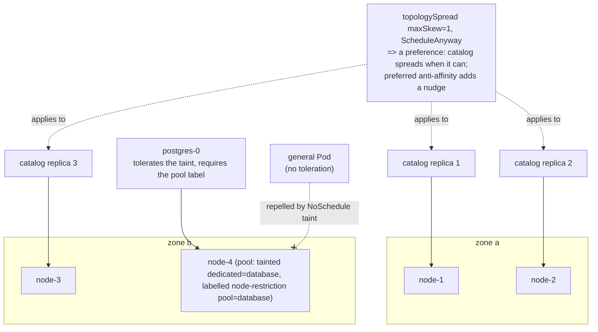

# 02 — Affinity, taints, and topology

> Steering placement: node affinity (`requiredDuringSchedulingIgnoredDuringExecution`
> vs `preferred…`, what *IgnoredDuringExecution* really means,
> `nodeAffinity` vs. the older `nodeSelector`); inter-pod affinity &
> anti-affinity (`topologyKey`, the scale/cost caveat, hard anti-affinity for
> HA); taints & tolerations (`NoSchedule`/`PreferNoSchedule`/`NoExecute`,
> `tolerationSeconds`, built-in taints); `topologySpreadConstraints`
> (`maxSkew`, `whenUnsatisfiable`, `minDomains` GA 1.30,
> `nodeAffinityPolicy`/`nodeTaintsPolicy`, `matchLabelKeys`) — applied by
> spreading the Bookstore for HA and pinning Postgres to a dedicated node.

**Estimated time:** ~30 min read · ~60 min hands-on
**Prerequisites:** [Part 04 ch.01](01-scheduler-and-nodes.md) — the scheduling pipeline you're influencing · [Part 01 ch.04](../01-core-workloads/04-replicasets-and-deployments.md) — replicas you're spreading
**You'll know after this:** • configure required vs. preferred node affinity and know what *IgnoredDuringExecution* really means · • use inter-pod (anti-)affinity with `topologyKey` for HA without exploding scheduling cost · • build a dedicated node pool from a taint, a toleration and required node affinity, and say which part of it the scheduler does not enforce · • design `topologySpreadConstraints` with the right `maxSkew` and `whenUnsatisfiable`, and say why spread is availability, not security · • pin Postgres to the dedicated pool and keep the stateless tiers off it

<!-- tags: scheduling, affinity, taints-tolerations, topology-spread, ha -->

## Why this exists

[ch.01](01-scheduler-and-nodes.md) showed *how* the scheduler picks a node. By
default it picks well, but it cannot read your intent. It does not know that:

- the three `catalog` replicas must land on **different nodes/zones**, so one
  machine or one zone failing does not take the whole catalog tier down;
- `postgres` should run on a **dedicated, isolated node** with fast disks and no
  noisy neighbours — and that *nothing else* should drift onto that node;
- a node reserved for the data tier must **repel** general workloads unless they
  explicitly opt in.

Those are placement *policies*, and Kubernetes expresses them with four
cooperating mechanisms: **node affinity** ("I want nodes *like this*"),
**inter-pod (anti-)affinity** ("near / away from *these other Pods*"), **taints
& tolerations** ("this node repels Pods unless they tolerate it"), and
**topology spread constraints** ("spread my replicas *evenly* across these
domains"). This is the heart of the [Automated Placement](#further-reading)
pattern, and it is what makes the Bookstore *highly available* instead of merely
*running*. We apply all four to real Bookstore manifests in this chapter.

Placement is also a security question, and the scheduler does not answer it.
A taint keeps other Pods off a node, but any author who can create a Pod can
write the matching toleration. A Pod that sets `nodeName` skips the scheduler,
and on the lab node the taint did not stop it. Each case is shown below with
the control that answers it.

## Mental model

Two of these mechanisms **attract**, two **repel** — and they combine:

- **Node affinity / `nodeSelector`** — *Pod → node label* matching. "Schedule
  me only on (or preferably on) nodes carrying these labels." Pure attraction
  toward node properties. `nodeSelector` is the old, simple, AND-only form;
  `nodeAffinity` is its superset (operators, `preferred` with weights, OR-ish
  expressions).
- **Inter-pod affinity / anti-affinity** — *Pod → other Pods*, evaluated within
  a **`topologyKey`** domain (a node label like `kubernetes.io/hostname` or
  `topology.kubernetes.io/zone`). Affinity = "co-locate with Pods like X in the
  same domain"; **anti**-affinity = "keep me out of any domain that already has
  Pods like X" — the HA spreading primitive.
- **Taints & tolerations** — the **node's** side. A *taint* on a node repels all
  Pods; only a Pod with a matching *toleration* may (still must be otherwise
  attracted to) land there. Taint = repel-by-default; toleration = "I'm allowed
  past this particular fence". A toleration lifts the taint's refusal
  and never attracts; pair it with affinity to pull the Pod in. It is not an
  authorization: the scheduler does not check who wrote it.
- **Topology spread constraints** — declare the **maximum imbalance**
  (`maxSkew`) of *my* Pods across a set of domains (`topologyKey`), and whether
  violating it is a hard error (`DoNotSchedule`) or just disfavoured
  (`ScheduleAnyway`). It is the precise, modern way to say "spread evenly",
  superseding the blunt hard-anti-affinity trick for most cases.

Rule of thumb the Bookstore uses: **spread the stateless tiers** (catalog,
storefront) across nodes/zones for HA; **isolate the sensitive workload**
(postgres, the data tier) on a **dedicated node pool**, with a taint, a
toleration and required node affinity together.

## Threats and controls

| Threat | Control taught here | Deeper |
|---|---|---|
| General Pods drift onto the dedicated pool | `NoSchedule` taint on the pool node | none |
| A sensitive Pod lands on a general node | required node affinity on the pool label, not preferred | none |
| Any Pod author writes the toleration and lands on the pool | RBAC on who may create Pods (in the lab, `catalog-sa` may not); the taint itself is not a boundary | RBAC: [05.01](../05-security/01-authn-authz-rbac.md); restricting tolerations by admission: 05.07 <!-- link-later: 05.07 --> |
| A Pod sets `nodeName` and skips the scheduler's taint check | none in the scheduler: the lab kubelet admitted the Pod on the tainted node | deny `nodeName` in sensitive namespaces, [Part 04 ch.01](01-scheduler-and-nodes.md); admission 05.07 <!-- link-later: 05.07 --> |
| A node labels itself into the pool, or removes its own taint | NodeRestriction refuses both (tested below) | none |
| Pods share a node, so they share its kernel | not solved by placement | 05.05 <!-- link-later: 05.05 --> |

Topology spread is availability, not security. It limits what one node or
zone failure takes down, and it does nothing against an author who can create
Pods. Scheduling is not a security boundary by itself: each row above is a
placement rule, or a check on who may write one.

## Diagrams

### Anti-affinity / spread placing replicas across nodes & zones (Mermaid)



### Taint / toleration match table & effects (ASCII)

```
A toleration matches a taint when key (+ value if operator=Equal) AND effect agree.

  Node taint                          Pod toleration                    Result
  ----------------------------------  --------------------------------  ----------------
  dedicated=database:NoSchedule       (none)                            NOT placed here
  dedicated=database:NoSchedule       key=dedicated Equal database      MAY be placed
                                        effect=NoSchedule                (if also attracted)
  dedicated=database:NoSchedule       operator=Exists key=dedicated     MAY be placed
  node.kubernetes.io/not-ready:       operator=Exists                   tolerates not-ready
    NoExecute                           effect=NoExecute                 forever
  node.kubernetes.io/not-ready:       (auto-added by default,           evicted after 300s
    NoExecute                           tolerationSeconds: 300)          if node stays bad

Effects (what the taint does):
  NoSchedule        new Pods without a matching toleration are NOT scheduled here
  PreferNoSchedule  scheduler AVOIDS this node, but will use it if nothing else fits
  NoExecute         as NoSchedule, AND already-running Pods lacking the toleration
                    are EVICTED (after tolerationSeconds, if set; immediately if not)
```

## Hands-on with the Bookstore

**Assumed working directory: the guide repo root (`full-guide/`).** This
chapter makes the Bookstore highly available and isolates its data tier. The
scheduling fields are **added to existing manifests** — `10-catalog-deploy.yaml`,
`11-storefront-deploy.yaml`, `20-postgres-statefulset.yaml` — as a clearly
marked *Part 04 scheduling layer*. **Every prior field
(ConfigMap/Secret/DSN/volumes/probes/preStop/labels/namespace) is preserved
unchanged; only placement fields are added.**

### 1. A multi-node kind cluster (so spreading has somewhere to spread)

A default `kind create cluster` is **single-node**, and a spread over
`kubernetes.io/hostname` has only one domain there. This chapter uses a
three-node config instead: one control plane and two workers. It sits beside
the Part 05 lab cluster config, as
[`cluster-three-node.yaml`](../examples/security-lab/kind/cluster-three-node.yaml).
It is infrastructure, not a Bookstore manifest, and it carries no label or
taint: the pool is made by an administrator, below.

```sh
# from the repo root (full-guide/)
kind delete cluster --name bookstore
kind create cluster --name bookstore --config examples/security-lab/kind/cluster-three-node.yaml
kubectl get nodes -L topology.kubernetes.io/zone
```

Pick one worker as the **dedicated pool** and give it the pool label and the
taint, as an administrator. Replace `<POOL-WORKER>` with its name:

```sh
kubectl label node <POOL-WORKER> node-restriction.kubernetes.io/pool=database
kubectl taint node <POOL-WORKER> dedicated=database:NoSchedule
kubectl get nodes -L node-restriction.kubernetes.io/pool
```

The label sits under `node-restriction.kubernetes.io/`, the prefix
NodeRestriction protects. A kubelet cannot set it, so the config does not try:
the admin sets it after the node has joined. The next section shows the refusal.

**A recreated cluster is empty**: the namespace, config, secrets, and the
PriorityClasses from earlier chapters are gone. Re-establish the prerequisites
**in this order** before applying any workload. Each file is complete, and the
order matters: the namespace and ServiceAccounts come before the workloads that
name them.

```sh
# from the repo root (full-guide/)
# 1) namespace and quota (Part 01 ch.03), then the ServiceAccounts (Part 05 ch.01)
kubectl apply -f examples/bookstore/raw-manifests/00-namespace.yaml
kubectl apply -f examples/bookstore/raw-manifests/05-serviceaccounts-rbac.yaml
# 2) config and DB credentials the workloads consume (Part 03 ch.01/ch.02)
kubectl apply -f examples/bookstore/raw-manifests/15-catalog-config.yaml
kubectl apply -f examples/bookstore/raw-manifests/16-db-credentials.yaml
# 3) PriorityClasses: cluster-scoped, explained in Part 04 ch.03
kubectl apply -f examples/bookstore/raw-manifests/35-priorityclasses.yaml
# 4) Services and redis. catalog's /readyz pings redis (REDIS_ADDR in
#    catalog-config), so catalog is not Ready until redis answers.
kubectl apply -f examples/bookstore/raw-manifests/40-services.yaml
kubectl apply -f examples/bookstore/raw-manifests/12-redis.yaml
# 5) re-load the kind-built images. postgres is pinned by digest and pulled.
kind load docker-image bookstore/catalog:dev    --name bookstore
kind load docker-image bookstore/storefront:dev --name bookstore
```

Now the workload manifests below apply cleanly. Until the admin step above is
done, postgres stays Pending: its required affinity has no node to match.

### 2. NodeRestriction: a node cannot label or taint itself into the pool

This check is a deliberate failure. It asks the API server to act as the
kubelet of the pool node, and the server refuses. `--dry-run=server` runs
admission without writing anything. The output below is from the lab cluster,
whose nodes are named `sf-sched-control-plane`, `sf-sched-worker` and
`sf-sched-worker2`. Your node names differ, and the lab's names appear in the
output verbatim.

```sh
# Deliberate failure: the pool node's identity tries to label itself.
kubectl --as=system:node:<POOL-WORKER> --as-group=system:nodes \
  label node <POOL-WORKER> node-restriction.kubernetes.io/pool=database --dry-run=server
```

<!-- gate: output -->
```text
Error from server (Forbidden): nodes "sf-sched-worker" is forbidden: is not allowed to modify labels: node-restriction.kubernetes.io/pool
```

The same identity may label a node outside the protected prefix, such as the
zone label:

```sh
kubectl --as=system:node:<POOL-WORKER> --as-group=system:nodes \
  label node <POOL-WORKER> topology.kubernetes.io/zone=zone-a --dry-run=server
```

<!-- gate: output -->
```text
node/sf-sched-worker labeled (server dry run)
```

It cannot take the pool's taint off either:

```sh
kubectl --as=system:node:<POOL-WORKER> --as-group=system:nodes \
  taint node <POOL-WORKER> dedicated:NoSchedule- --dry-run=server
```

<!-- gate: output -->
```text
Error from server (Forbidden): nodes "sf-sched-worker" is forbidden: node "sf-sched-worker" is not allowed to modify taints
```

A compromised kubelet therefore cannot put itself into the pool or take the
pool's taint off, and the affinity keyed on the protected label stays true. The
lab's API server runs this check with `--enable-admission-plugins=NodeRestriction`.

### 3. Spread `catalog` & `storefront` across nodes (HA)

The scheduling layer added to
[`10-catalog-deploy.yaml`](../examples/bookstore/raw-manifests/10-catalog-deploy.yaml)
— inside `spec.template.spec`, alongside (not replacing) the existing
containers/volumes/probes:

```yaml
    spec:
      priorityClassName: bookstore-critical   # ch.03 (35-): user-facing tier
      topologySpreadConstraints:
        - maxSkew: 1                           # node replica counts differ by ≤1
          topologyKey: kubernetes.io/hostname  # one domain per node
          whenUnsatisfiable: DoNotSchedule     # HARD: don't pile onto one node
          labelSelector:
            matchLabels: { app: catalog }      # count only catalog Pods
      affinity:
        podAntiAffinity:
          preferredDuringSchedulingIgnoredDuringExecution:   # SOFT
            - weight: 100
              podAffinityTerm:
                topologyKey: kubernetes.io/hostname
                labelSelector:
                  matchLabels: { app: catalog }
      # ... existing containers / volumes / probes / preStop UNCHANGED ...
```

`storefront`
([`11-storefront-deploy.yaml`](../examples/bookstore/raw-manifests/11-storefront-deploy.yaml))
gets the same shape with `app: storefront` and `whenUnsatisfiable:
ScheduleAnyway`. The `preferred` anti-affinity term is a score on each node. The
spread constraint is the one to make hard later, once the layout has enough
general nodes; the next paragraphs say why it is soft here.

```sh
# from the repo root (full-guide/)
# catalog carries DB_DSN and its readiness pings Postgres, so bring postgres up
# and gate on the schema Job first. Postgres itself is the next section.
kubectl apply -f examples/bookstore/raw-manifests/20-postgres-statefulset.yaml
kubectl rollout status statefulset/postgres -n bookstore
kubectl apply -f examples/bookstore/raw-manifests/21-db-migrate-job.yaml
kubectl wait --for=condition=complete job/db-migrate -n bookstore --timeout=120s
kubectl apply -f examples/bookstore/raw-manifests/10-catalog-deploy.yaml
kubectl apply -f examples/bookstore/raw-manifests/11-storefront-deploy.yaml
kubectl rollout status deployment/catalog -n bookstore

kubectl get pods -n bookstore -l app=catalog \
  -o custom-columns='POD:.metadata.name,NODE:.spec.nodeName,PHASE:.status.phase'
```

<!-- gate: output -->
```text
POD                        NODE               PHASE
catalog-686cc96476-6vkxm   sf-sched-worker2   Running
catalog-686cc96476-8fjtv   sf-sched-worker2   Running
catalog-686cc96476-kn7c8   sf-sched-worker2   Running
```

All three replicas sit on the general worker. None is on the pool node: the
taint keeps catalog off it, because catalog has no toleration. The spread constraint is soft, so the scheduler places a
replica it cannot spread rather than leave it Pending.

Why not `DoNotSchedule`? Try the hard form on this layout. This is a deliberate
failure: the rollout refuses to proceed.

```sh
# Deliberate failure: the hard form of the spread on a two-worker layout.
sed 's/whenUnsatisfiable: ScheduleAnyway/whenUnsatisfiable: DoNotSchedule/' \
  examples/bookstore/raw-manifests/10-catalog-deploy.yaml | kubectl apply -f -
kubectl get pods -n bookstore -l app=catalog \
  -o custom-columns='POD:.metadata.name,NODE:.spec.nodeName,PHASE:.status.phase'
kubectl get events -n bookstore --field-selector reason=FailedScheduling \
  -o custom-columns='OBJECT:.involvedObject.name,MESSAGE:.message'
```

<!-- gate: output -->
```text
POD                        NODE               PHASE
catalog-56fbd99bd7-s5fww   <none>             Pending
catalog-686cc96476-6vkxm   sf-sched-worker2   Running
catalog-686cc96476-8fjtv   sf-sched-worker2   Running
catalog-686cc96476-kn7c8   sf-sched-worker2   Running
```

<!-- gate: output -->
```text
OBJECT                     MESSAGE
catalog-56fbd99bd7-s5fww   0/3 nodes are available: 1 node(s) didn't match pod topology spread constraints, 2 node(s) had untolerated taint(s). preemption: 0/3 nodes are available: 1 node(s) didn't match pod topology spread constraints, 2 Preemption is not helpful for scheduling.
```

The rollout stalls. `maxUnavailable: 0` keeps the three old replicas running,
and the one new replica waits. The event names two reasons: the spread
constraint, and the untolerated taint on the two nodes that are not the general
worker, which are the control plane and the pool. The constraint refuses
because the pool still counts. `nodeTaintsPolicy` defaults to `Ignore`, so a
node the Pod cannot use stays in the domain count with zero catalog Pods. The
fourth replica on the general worker would leave a skew of 4 against it. Setting
`nodeTaintsPolicy: Honor` removes the pool from the count. Then the general
worker is the only domain, the skew is always zero, and the constraint passes
without separating anything. On a layout with one general node, a hostname
spread is either blocked or empty. That is why this chapter uses
`ScheduleAnyway`: apply the file from the block above again, and the rollout
completes with the replicas back on the general worker.

If the migration Job reports `DeadlineExceeded`, the image pull took longer than
its 120 s `activeDeadlineSeconds`. On the lab host the first postgres pull took
about four minutes, and the Job failed that way. Applying it again, once the
image was on the node, let it complete. On a slow registry, pull the image onto
the nodes before the Job runs.

### 4. Pin `postgres` to the dedicated pool (taint, toleration, required affinity)

The scheduling layer added to
[`20-postgres-statefulset.yaml`](../examples/bookstore/raw-manifests/20-postgres-statefulset.yaml)
(inside `spec.template.spec`, with the existing envFrom-Secret / probes /
volumeClaimTemplates untouched):

```yaml
    spec:
      priorityClassName: bookstore-data        # ch.03 (35-): highest tier
      tolerations:                             # lifts the taint's refusal
        - key: dedicated
          operator: Equal
          value: database
          effect: NoSchedule                   # must match the taint exactly
      affinity:
        nodeAffinity:                          # REQUIRED: only the pool node
          requiredDuringSchedulingIgnoredDuringExecution:
            nodeSelectorTerms:
              - matchExpressions:
                  - key: node-restriction.kubernetes.io/pool
                    operator: In
                    values: ["database"]
      # ... existing terminationGracePeriodSeconds / containers UNCHANGED ...
```

The dedicated pool needs all three parts, and each answers a different threat:

- The **taint** keeps general Pods off the pool. Catalog has no toleration, so
  the taint alone keeps it out.
- The **toleration** lifts the taint's refusal, so postgres may enter the pool.
  It is not an authorization: section 5 shows any Pod author writing one.
- The **required node affinity** keeps postgres on the pool. A preferred rule is
  only a score, so with one the data tier could land on a general node.

```sh
kubectl apply -f examples/bookstore/raw-manifests/20-postgres-statefulset.yaml
kubectl rollout status statefulset/postgres -n bookstore
kubectl get pods -n bookstore \
  -o custom-columns='POD:.metadata.name,NODE:.spec.nodeName,PHASE:.status.phase'
```

<!-- gate: output -->
```text
POD          NODE              PHASE
postgres-0   sf-sched-worker   Running
```

`postgres-0` runs on the pool node. Pool membership is a required rule, so the
replacement for a deleted postgres Pod can only land on a node that carries the
label. Required is the choice for the data tier: postgres waits for its pool
rather than running somewhere else. The [Production notes](#production-notes)
cover what that costs.

### 5. A toleration is not an authorization

Any author who can create a Pod in the namespace can write the toleration and
the required affinity from section 4. This Pod does exactly that, as a
deliberate demonstration of the gap. It is complete and carries the baseline.
Its image is the pause image, pinned by digest. On linux/amd64 its image config
declares UID 65535, and the Pod runs as that UID. It has its own ServiceAccount
with no token mounted, as every workload has.

```yaml
apiVersion: v1
kind: ServiceAccount
metadata:
  name: pool-tenant-sa
  namespace: bookstore
automountServiceAccountToken: false
---
apiVersion: v1
kind: Pod
metadata:
  name: pool-tenant
  namespace: bookstore
  labels:
    app: pool-tenant
spec:
  serviceAccountName: pool-tenant-sa
  automountServiceAccountToken: false
  securityContext:
    runAsNonRoot: true
    runAsUser: 65535
    runAsGroup: 65535
    seccompProfile:
      type: RuntimeDefault
  tolerations:
    - key: dedicated
      operator: Equal
      value: database
      effect: NoSchedule
  affinity:
    nodeAffinity:
      requiredDuringSchedulingIgnoredDuringExecution:
        nodeSelectorTerms:
          - matchExpressions:
              - key: node-restriction.kubernetes.io/pool
                operator: In
                values: ["database"]
  containers:
    - name: app
      image: registry.k8s.io/pause@sha256:ee6521f290b2168b6e0935a181d4cff9be1ac3f505666ef0e3c98fae8199917a  # pause:3.10
      securityContext:
        allowPrivilegeEscalation: false
        readOnlyRootFilesystem: true
        capabilities:
          drop: ["ALL"]
      resources:
        requests:
          cpu: 10m
          memory: 16Mi
        limits:
          memory: 32Mi
      volumeMounts:
        - name: tmp
          mountPath: /tmp
  volumes:
    - name: tmp
      emptyDir: {}
```

```sh
# Save the manifest as pool-tenant.yaml, then:
kubectl apply -f pool-tenant.yaml
kubectl wait --for=condition=Ready pod/pool-tenant -n bookstore --timeout=120s
kubectl get pod pool-tenant -n bookstore \
  -o custom-columns='POD:.metadata.name,NODE:.spec.nodeName,PHASE:.status.phase'
```

<!-- gate: output -->
```text
POD           NODE              PHASE
pool-tenant   sf-sched-worker   Running
```

The scheduler placed the Pod on the pool node. It did not ask who wrote the
toleration, and it cannot tell an authorized author from anyone else. The
control sits in front of the scheduler: who may create or update Pods in the
namespace. The lab's `catalog-sa` has no Role that grants that, and it is
refused:

```sh
kubectl auth can-i create pods -n bookstore --as=system:serviceaccount:bookstore:catalog-sa
```

<!-- gate: output -->
```text
no
```

A subject granted `create` on `pods` in this namespace could write the
toleration, which is why RBAC on Pods is the first control. [Authentication,
authorization and RBAC](../05-security/01-authn-authz-rbac.md) teaches the Role
itself. Restricting which tolerations a namespace may use is an admission
policy, which this chapter does not build: 05.07 <!-- link-later: 05.07 -->.

```sh
kubectl delete pod pool-tenant -n bookstore
```

### 6. `nodeName` skips the scheduler, and with it the taint

A Pod with `spec.nodeName` is bound to that node before the scheduler looks at
it, so the scheduler's filters never run for it. This Pod names the pool node
and has no toleration. It is a deliberate failure: it is the bypass that the
control has to stop. Save it as `pin-probe.yaml`, replacing `pool-worker` with the
pool node's name:

```yaml
apiVersion: v1
kind: ServiceAccount
metadata:
  name: pin-probe-sa
  namespace: bookstore
automountServiceAccountToken: false
---
apiVersion: v1
kind: Pod
metadata:
  name: pin-probe
  namespace: bookstore
  labels:
    app: pin-probe
spec:
  nodeName: pool-worker
  serviceAccountName: pin-probe-sa
  automountServiceAccountToken: false
  securityContext:
    runAsNonRoot: true
    runAsUser: 65535
    runAsGroup: 65535
    seccompProfile:
      type: RuntimeDefault
  containers:
    - name: app
      image: registry.k8s.io/pause@sha256:ee6521f290b2168b6e0935a181d4cff9be1ac3f505666ef0e3c98fae8199917a  # pause:3.10
      securityContext:
        allowPrivilegeEscalation: false
        readOnlyRootFilesystem: true
        capabilities:
          drop: ["ALL"]
      resources:
        requests:
          cpu: 10m
          memory: 16Mi
        limits:
          memory: 32Mi
      volumeMounts:
        - name: tmp
          mountPath: /tmp
  volumes:
    - name: tmp
      emptyDir: {}
```

```sh
kubectl apply -f pin-probe.yaml
kubectl wait --for=condition=Ready pod/pin-probe -n bookstore --timeout=60s
kubectl get pod pin-probe -n bookstore \
  -o custom-columns='POD:.metadata.name,NODE:.spec.nodeName,PHASE:.status.phase,REASON:.status.reason,MESSAGE:.status.message'
```

<!-- gate: output -->
```text
POD         NODE              PHASE     REASON   MESSAGE
pin-probe   sf-sched-worker   Running   <none>   <none>
```

On the lab node the kubelet did not check the taint for a Pod that named the
node, and the Pod runs there with no toleration. A taint keeps the scheduler
off a node. It does not keep out a Pod whose author sets `nodeName`. Scheduling
is not a security boundary by itself. The control is to deny `nodeName` in
sensitive namespaces, which [Part 04 ch.01](01-scheduler-and-nodes.md) owns,
and the admission policy that enforces it is 05.07
<!-- link-later: 05.07 -->.

```sh
kubectl delete pod pin-probe -n bookstore
```

### 7. Watch `IgnoredDuringExecution` actually mean what it says

Remove the pool label while postgres runs on the pool node. Postgres does not
move:

```sh
kubectl label node <POOL-WORKER> node-restriction.kubernetes.io/pool-
kubectl get pod postgres-0 -n bookstore \
  -o custom-columns='POD:.metadata.name,NODE:.spec.nodeName,PHASE:.status.phase'
```

<!-- gate: output -->
```text
node/sf-sched-worker unlabeled
```

<!-- gate: output -->
```text
POD          NODE              PHASE
postgres-0   sf-sched-worker   Running
```

The rule gates scheduling only, never eviction. The label is the one
NodeRestriction protects, so a kubelet cannot put it back. If postgres-0 were
deleted now, its replacement could not be placed until an administrator
restored the label.

Nothing reschedules. That is the entire meaning of the verbose name: node/pod
**affinity** is enforced **only at schedule time**; once a Pod is bound, later
label changes are ignored for that Pod. (The only placement rule that *does* act
on running Pods is a **`NoExecute` taint** — covered next — which is why
`NoExecute` exists as a separate effect.)

## How it works under the hood

- **`nodeSelector` vs. `nodeAffinity` — what *IgnoredDuringExecution* means.**
  `nodeSelector` is a flat `map[string]string`: all key=value pairs must match
  (AND), exact equality only. It is **not deprecated** but is the minimal form.
  `nodeAffinity` is the expressive superset:
  `requiredDuringSchedulingIgnoredDuringExecution` (a hard filter — node *must*
  match `matchExpressions` with operators `In`/`NotIn`/`Exists`/`DoesNotExist`/
  `Gt`/`Lt`; multiple `nodeSelectorTerms` are OR'd) and
  `preferredDuringSchedulingIgnoredDuringExecution` (a weighted Score
  contribution, 1–100). The clumsy suffix decodes literally: **`…DuringScheduling`** = applied when the scheduler places the Pod;
  **`IgnoredDuringExecution`** = once running, changing node labels does **not**
  evict or move the Pod. (A hypothetical `RequiredDuringExecution` would evict
  on label change; it does not exist for affinity — only `NoExecute` taints have
  that running-Pod power.)
- **Inter-pod (anti-)affinity and the `topologyKey`.** The term is evaluated as:
  "consider the set of nodes sharing the same value of `topologyKey` as a
  candidate node; do/don't any of them run a Pod matching `labelSelector` (in
  the given `namespaces`/`namespaceSelector`)?"
  `topologyKey: kubernetes.io/hostname` ⇒ per-node; `topology.kubernetes.io/zone` ⇒ per-zone.
  **The scale caveat:** evaluating pod affinity/anti-affinity is roughly
  *O(Pods × nodes)* per scheduling attempt — the scheduler must, for the
  candidate Pod, check matching Pods across topology domains. **Required**
  (hard) pod *affinity* especially is expensive and is explicitly discouraged on
  large clusters in the docs; hard **anti**-affinity for spreading is the
  classic use but `topologySpreadConstraints` is the cheaper, more precise modern
  replacement for "spread evenly". Use pod anti-affinity for true HA *hard*
  separation ("never two replicas of this critical singleton-ish service on one
  node"), spread constraints for "balance across domains".
- **Taints & tolerations mechanics.** A taint is `key[=value]:effect` on
  `node.spec.taints`. A toleration matches if `key` matches **and** `effect`
  matches **and** (for `operator: Equal`) `value` matches — with two wildcards:
  `operator: Exists` matches **any value** for that key (and an *empty-key*
  `Exists` toleration tolerates **all** taints — a dangerous catch-all), and an
  **empty `effect`** in the toleration matches **all effects** for that key
  (`NoSchedule`+`PreferNoSchedule`+`NoExecute` at once) rather than one — also
  broader than usually intended. **`NoSchedule`** blocks scheduling of
  non-tolerating Pods (running Pods stay). **`PreferNoSchedule`** is a soft
  Score penalty, not a filter. **`NoExecute`** additionally **evicts**
  already-running non-tolerating Pods: immediately if the toleration is absent,
  or after `tolerationSeconds` if the Pod tolerates it with a finite duration.
  Kubernetes auto-adds built-in taints — `node.kubernetes.io/not-ready` and
  `node.kubernetes.io/unreachable` (`NoExecute`, by the node controller when a
  node goes bad), `node.kubernetes.io/unschedulable` (on `cordon`),
  `node.kubernetes.io/memory-pressure`/`disk-pressure`/`pid-pressure` (by the
  kubelet), and `node-role.kubernetes.io/control-plane:NoSchedule` (keeps
  general workloads off control-plane nodes). The default admission also injects
  a 300s `tolerationSeconds` for the not-ready/unreachable taints, which is why
  a Pod on a node that briefly goes NotReady is **not** evicted instantly — it
  has ~5 minutes for the node to recover.
- **`topologySpreadConstraints` semantics.** For each constraint the scheduler
  groups feasible nodes into **domains** by `topologyKey`, counts matching Pods
  (selected by `labelSelector`, optionally narrowed/widened by `matchLabelKeys`)
  per domain, and ensures `max(count) − min(count) ≤ maxSkew` *after* placing
  the new Pod. `whenUnsatisfiable: DoNotSchedule` makes the constraint a Filter
  (Pending if no domain keeps skew ≤ maxSkew); `ScheduleAnyway` makes it a Score
  signal only. Refinements: **`minDomains`** (GA in 1.30) forces the scheduler to
  treat the topology as having *at least* N domains — so 3 replicas don't all
  pack into the only 1 domain currently present; **`nodeAffinityPolicy`** /
  **`nodeTaintsPolicy`** (`Honor`|`Ignore`; beta since 1.26, GA in 1.33) decide
  whether nodes the Pod cannot use, by its own nodeAffinity or by taints, are
  left out of the domain count. The defaults are `Honor` for affinity and
  `Ignore` for taints. Under `Ignore` a pool node that the Pod cannot enter
  still counts as an empty domain, which is why the hard spread stalled in the
  lab (section 3); **`matchLabelKeys`** (beta since 1.27) adds pod-
  template-hash-like keys to the implicit selector so a *rolling update's* new
  and old ReplicaSet Pods are spread independently rather than fighting each
  other's counts. Kubernetes also applies **cluster-level default constraints**
  (`maxSkew: 3` over hostname and `maxSkew: 5` over zone, both `ScheduleAnyway`) to Pods that
  declare none, via the scheduler's `PodTopologySpread` plugin defaults — a
  gentle built-in spreading even when you specify nothing.
- **How they combine, in pipeline terms.** All of these are scheduler
  *plugins* from [ch.01](01-scheduler-and-nodes.md): `NodeAffinity`,
  `TaintToleration`, `InterPodAffinity`, `PodTopologySpread` each run at
  **Filter** (the hard/`required`/`NoSchedule`/`DoNotSchedule` parts) **and** at
  **Score** (the `preferred`/`PreferNoSchedule`/`ScheduleAnyway` parts). Hard
  constraints intersect (a node must pass *all* required predicates); soft ones
  are weighted and summed. So postgres' placement is: NodeAffinity's Filter
  keeps only the pool node, because the affinity is required; TaintToleration's
  Filter then admits that node, because postgres tolerates the taint; it lands
  there. Catalog's placement is: under `DoNotSchedule`, Filter drops nodes that
  would break `maxSkew`; under `ScheduleAnyway`, the constraint only scores.
  A Pod with `spec.nodeName` skips this pipeline altogether. Section 6 shows a
  NoSchedule taint did not stop such a Pod on the lab node.

## Production notes

> **In production:** spread every replicated stateless service across **failure
> domains**, not just nodes. Use `topologySpreadConstraints` with
> `topologyKey: topology.kubernetes.io/zone` (cloud nodes get this label
> automatically; our kind config fakes it) so a whole-AZ outage cannot take a
> tier down. Pair `maxSkew: 1` with `minDomains` to stop all replicas packing
> into one zone when the cluster is small or scaling up.

> **In production:** prefer **`topologySpreadConstraints` over hard pod
> anti-affinity** for "spread evenly". Required pod affinity/anti-affinity is
> *O(Pods × nodes)* at schedule time and degrades scheduler throughput on large
> clusters; reserve hard anti-affinity for genuine "these two must never share a
> node" cases (e.g. a quorum's members). Keep anti-affinity `preferred` unless
> the separation is a correctness requirement.

> **In production:** `required` node affinity turns "no such pool node right
> now" into a Pending data tier. Keep the pool in a node group that
> cluster-autoscaler can grow, and alert on Pending Pods in the data namespace.
> Check the pool label on a real node after it joins. NodeRestriction stops a
> kubelet from setting that prefix itself, so the label has to come from an
> administrator or from the provider's node-pool configuration.

> **In production:** use **dedicated node pools + taints** for stateful or
> special-hardware workloads (databases, GPU jobs). Taint the pool
> `NoSchedule`, add the matching toleration **and** node affinity to only the
> intended workloads. On EKS/GKE/AKS, node pools/groups can be created
> pre-tainted/labelled and the **cluster-autoscaler** scales each pool
> independently — the dedicated DB pool grows without bloating the general pool.

> **In production:** understand the **built-in `NoExecute` taints**. The node
> controller applies **`node.kubernetes.io/not-ready:NoExecute`** when a node's
> status goes `NotReady` (the kubelet reports unhealthy), and
> **`node.kubernetes.io/unreachable:NoExecute`** when the node stops sending
> heartbeats entirely (the controller cannot reach it). For *both*, Pods are
> evicted after their `tolerationSeconds` (default 300s, auto-injected by
> admission). Tuning that value lower speeds failover but risks evicting Pods
> during brief blips; the control-plane taint
> `node-role.kubernetes.io/control-plane:NoSchedule` is why your app Pods never
> land on control-plane nodes — don't blanket-tolerate it.

## Quick Reference

```sh
# Inspect node labels & taints (the inputs to all four mechanisms)
kubectl get nodes -L topology.kubernetes.io/zone,node-restriction.kubernetes.io/pool
kubectl describe node <NODE> | sed -n '/Taints:/,/Unschedulable/p'

# Pool taint and pool label (administrator; a kubelet cannot set the label)
kubectl taint nodes <NODE> dedicated=database:NoSchedule       # add
kubectl taint nodes <NODE> dedicated=database:NoSchedule-      # remove (trailing -)
kubectl label nodes <NODE> node-restriction.kubernetes.io/pool=database   # add
kubectl label nodes <NODE> node-restriction.kubernetes.io/pool-           # remove

# Verify spreading worked. A Pod has its NODE in spec.nodeName, but NOT its
# zone — zone is a NODE label. Get the Pod→node mapping, then the node→zone
# mapping, and read them together (or use `-o wide` for the NODE column):
kubectl get pods -n <NS> -l <SEL> -o wide          # NODE column should vary
kubectl get pods -n <NS> -l <SEL> \
  -o custom-columns='POD:.metadata.name,NODE:.spec.nodeName'
kubectl get nodes -L topology.kubernetes.io/zone   # NODE → ZONE (node label)
```

Dedicated pool (sensitive Pods need the toleration **and** the required affinity):

```yaml
spec:
  tolerations:
    - { key: dedicated, operator: Equal, value: database, effect: NoSchedule }
  affinity:
    nodeAffinity:
      requiredDuringSchedulingIgnoredDuringExecution:
        nodeSelectorTerms:
          - matchExpressions:
              - { key: node-restriction.kubernetes.io/pool, operator: In, values: ["database"] }
```

Spread (a preference on a small layout; see the Production notes for zones):

```yaml
spec:
  topologySpreadConstraints:
    - maxSkew: 1
      topologyKey: kubernetes.io/hostname
      whenUnsatisfiable: ScheduleAnyway
      labelSelector: { matchLabels: { app: myapp } }
```

Checklist:

- [ ] Stateless replicated tiers have `topologySpreadConstraints` over zone (and/or host)
- [ ] Hard pod anti-affinity used only for true "must not co-locate" cases
- [ ] Pool nodes are **tainted**, and the pool label sits under `node-restriction.kubernetes.io/`, set by an administrator
- [ ] Sensitive Pods have the toleration **and** required node affinity to the pool
- [ ] A toleration is never treated as authorization: RBAC limits who may write Pods, and admission limits tolerations (05.07 <!-- link-later: 05.07 -->)
- [ ] Pods that set `spec.nodeName` are denied in sensitive namespaces ([Part 04 ch.01](01-scheduler-and-nodes.md))
- [ ] Relied on `IgnoredDuringExecution`: affinity gates scheduling, not eviction
- [ ] Did not blanket-tolerate built-in taints (`not-ready`, control-plane)

## Test your understanding

> Try each before opening the answer drawer. The act of trying is the exercise; the answer is the check.

1. **A teammate adds a toleration to a Pod for the `dedicated=database:NoSchedule` taint but the Pod is still scheduled on a random node — not the dedicated one. Why, and what's missing?**
   <details><summary>Show answer</summary>

   Tolerations lift the taint's refusal. They never attract a Pod to a node. Without `nodeAffinity` (or `nodeSelector`) pulling the Pod toward the pool, the scheduler treats the pool node as one of many feasible nodes and may pick any. The dedicated-pool recipe is **taint + toleration + required node affinity**, all three (see §4. Pin postgres to the dedicated pool).

   </details>

2. **You set `requiredDuringSchedulingIgnoredDuringExecution` node affinity on a Deployment, then later remove the matching label from the node. The running Pods stay there. Walk through the suffix's literal meaning.**
   <details><summary>Show answer</summary>

   `…DuringScheduling` = the rule is applied when the scheduler places the Pod. `IgnoredDuringExecution` = once running, label changes are ignored for that Pod — it is not evicted. The only mechanism that *does* evict running Pods on a node-side change is a `NoExecute` taint, which is why that effect exists separately. There is no `RequiredDuringExecution` for affinity (see §7. Watch IgnoredDuringExecution actually mean what it says).

   </details>

3. **You configure `topologySpreadConstraints` with `maxSkew: 1`, `topologyKey: topology.kubernetes.io/zone`, `whenUnsatisfiable: DoNotSchedule` for a 3-replica Deployment. The cluster has only 1 zone. What happens, and what field (GA in 1.30) helps?**
   <details><summary>Show answer</summary>

   All 3 replicas land in the 1 zone with skew=0 (only one domain, no spread possible) — the constraint is satisfied trivially. To force the scheduler to *assume* at least N domains (so spreading kicks in even before all zones have nodes), use `minDomains: 3` (GA in 1.30). With `minDomains` set and only one current zone, replica 2 and 3 stay `Pending` until two more zones exist (see §How it works under the hood, `topologySpreadConstraints` semantics).

   </details>

4. **A node briefly becomes `NotReady` because of a 30-second network blip. Why don't all the Pods on it get evicted immediately, and what controls the timing?**
   <details><summary>Show answer</summary>

   The node controller adds `node.kubernetes.io/not-ready:NoExecute` when status flips, but admission has auto-injected a 300s `tolerationSeconds` for that taint on every Pod by default. So Pods are evicted only after 5 minutes — long enough for a blip to resolve without thrashing workloads. You can tune `tolerationSeconds` lower for faster failover, but at the cost of evicting on brief flaps (see §How it works under the hood, built-in taints).

   </details>

5. **A teammate with `create` on Pods in `bookstore` writes a Pod with the same toleration and required affinity as postgres. It lands on the pool node. Which control would have stopped it, and why can neither the taint nor the affinity do that?**
   <details><summary>Show answer</summary>

   Neither the taint nor the affinity checks who wrote the Pod. The scheduler reads what the Pod says, and this Pod says the right things. The control sits before the scheduler: RBAC decides who may create or update Pods in the namespace (in §5 the lab's `catalog-sa` was refused), and an admission policy can reject tolerations for the pool key from namespaces that may not use the pool. That policy is 05.07 <!-- link-later: 05.07 -->. A related case: a Pod that sets `nodeName` skips the scheduler and the taint, so the control is to deny `nodeName` in sensitive namespaces ([Part 04 ch.01](01-scheduler-and-nodes.md)).

   </details>

## Further reading

- **Ibryam & Huß, _Kubernetes Patterns_ 2e — *Automated Placement* (ch.6)** —
  node/pod affinity, taints/tolerations, and topology-aware spreading as the
  declarative placement toolkit, with the trade-offs of hard vs. soft rules.
- **Lukša, _Kubernetes in Action_ 2e — advanced scheduling material** —
  affinity/anti-affinity and taints worked through on examples.
- Official:
  <https://kubernetes.io/docs/concepts/scheduling-eviction/assign-pod-node/>,
  taints & tolerations
  <https://kubernetes.io/docs/concepts/scheduling-eviction/taint-and-toleration/>,
  and topology spread constraints
  <https://kubernetes.io/docs/concepts/scheduling-eviction/topology-spread-constraints/>.
