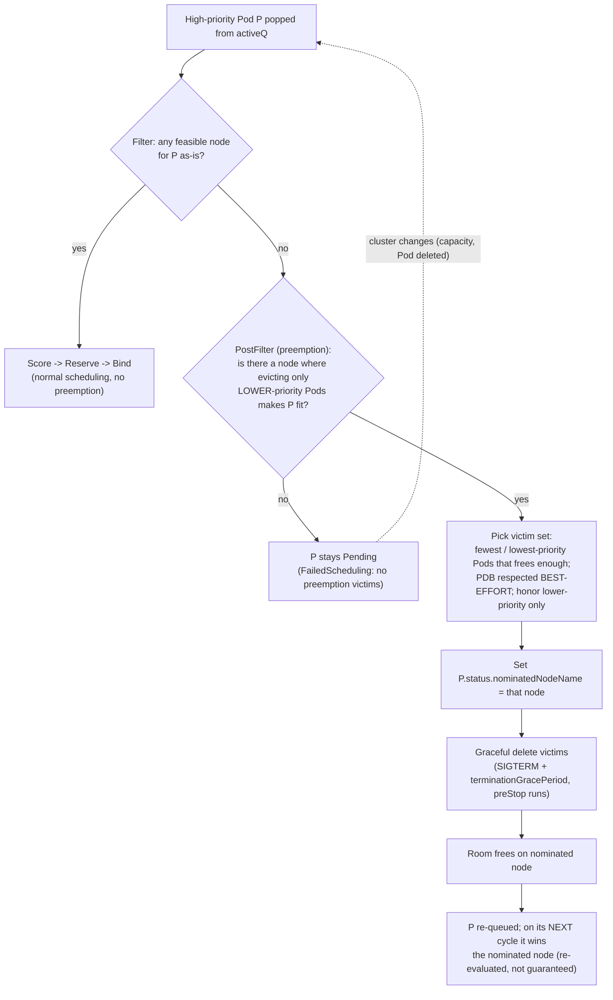

# 03 — Priority and preemption

> Ranking workloads under contention: `PriorityClass` (`value`,
> `globalDefault`, `preemptionPolicy`, the `system-*-critical` built-ins); the
> preemption flow (victim selection, graceful deletion, `PodDisruptionBudget`
> best-effort, the nominated node); preemption vs. node-pressure eviction vs.
> API-initiated eviction vs. `kubectl drain`; `cordon`/`drain`/`uncordon`
> mechanics; and the descheduler add-on — applied by giving the Bookstore a
> priority ladder so the data tier outranks the APIs, which outrank batch, and
> a quota that stops a tenant from choosing the top classes.

**Estimated time:** ~30 min read · ~60 min hands-on
**Prerequisites:** [Part 04 ch.01](01-scheduler-and-nodes.md) — the scheduling cycle that runs preemption · [Part 04 ch.02](02-affinity-taints-topology.md) — placement constraints that interact with preemption
**You'll know after this:** • design a PriorityClass ladder and understand `preemptionPolicy` · • trace the preemption flow (victim selection, graceful deletion, nominated node) · • distinguish preemption from node-pressure eviction, API-initiated eviction, and `kubectl drain` · • use `cordon` / `drain` / `uncordon` correctly during node maintenance · • give the Bookstore a priority ladder so the data tier outranks APIs which outrank batch • stop a tenant from taking a high class with a ResourceQuota

<!-- tags: scheduling, priority-classes, preemption, eviction, drain, pdb -->

## Why this exists

[ch.01](01-scheduler-and-nodes.md) and
[ch.02](02-affinity-taints-topology.md) decide *where* a Pod goes when there is
room. This chapter answers the harder question: **what happens when there
isn't.** A node fills up, the migration `Job` and `postgres` both want to
schedule, and the cluster must decide who waits and who wins — and, if it
matters enough, who gets *kicked off* to make room.

Without an explicit policy, that decision is essentially arbitrary (FIFO-ish by
arrival). For the Bookstore that is unacceptable: if capacity is tight, the
nightly `cleanup` CronJob must **never** push `postgres` or `catalog` out of the
way; if anything is sacrificed under pressure, it must be the deferrable batch
work, not the user-facing path or the database. `PriorityClass` makes that
ranking explicit and gives the scheduler permission to **preempt** (evict
lower-priority Pods to schedule a higher-priority one). This chapter also draws
the precise line between the four things people conflate —
**preemption**, **node-pressure eviction**, **API-initiated eviction**, and
**`kubectl drain`** — because confusing them is a classic production
mis-diagnosis.

The same lever is a threat on a shared cluster. Whoever may set a class on a
Pod can evict the Pods of everyone running at a lower class. The scheduler
cannot stop that, so the Threats and controls section names what does.

## Mental model

Priority is a **single integer per Pod that orders the queue and licenses
eviction-for-room**:

- **Queue order.** In the scheduling queue ([ch.01](01-scheduler-and-nodes.md)),
  Pods are popped **highest priority first**. A high-priority Pod jumps ahead of
  a backlog of low-priority ones.
- **Preemption is the escalation.** If a Pod cannot schedule *anywhere* (Filter
  finds zero feasible nodes), `PostFilter` asks: *is there a node where evicting
  some lower-priority Pods would make this one fit?* If yes, the scheduler marks
  those lower-priority Pods for **graceful deletion** (preemption) and the
  incoming Pod gets a **nominated node** to land on once they are gone.
- **It only ever evicts strictly lower priority.** Preemption never touches Pods
  of equal or higher priority. A Pod with `preemptionPolicy: Never` keeps its
  high queue position but **will not evict anyone** to get scheduled.
- **Preemption ≠ eviction ≠ drain.** Preemption is the *scheduler* making room
  for a pending higher-priority Pod. **Node-pressure eviction** is the *kubelet*
  killing Pods because the *node* is out of memory/disk (it ranks
  Pods first by whether their usage exceeds their
  [requests](../01-core-workloads/03-resources-and-qos.md), then by
  PriorityClass).
  **API-initiated eviction** is a client calling the eviction API (respects
  PodDisruptionBudgets *strictly*). **`kubectl drain`** is you, using
  API-initiated eviction to empty a node for maintenance. Different actor,
  different trigger, different rules — same visible symptom ("my Pod
  disappeared"), so you must know which one happened.

Bookstore ladder: `bookstore-data` (postgres) **>** `bookstore-critical`
(catalog/orders/storefront) **>** `bookstore-batch` (migration/cleanup) — far
below the cluster's `system-*-critical`.

## Threats and controls

Priority is not a security boundary. It decides who waits and who is evicted,
and the scheduler applies that rule to whatever class a Pod names. The boundary
is who may name a class: RBAC on the Pods and on the controllers that create
them, and a quota in every tenant namespace. Limits as denial of service, such
as a Pod that asks for a whole node, belong to
[Part 01 ch.03](../01-core-workloads/03-resources-and-qos.md).

| Threat | Control in this chapter | Deeper |
|---|---|---|
| A tenant gives its own Pods a high class and evicts neighbours in other namespaces | A ResourceQuota with a PriorityClass `scopeSelector` in each tenant namespace. Section 6 shows it refusing the request | [Part 05 ch.01](../05-security/01-authn-authz-rbac.md) for RBAC |
| A tenant reaches the same class through a Deployment, Job or CronJob, which writes the class into a pod template | The quota counts Pods however their controller created them. RBAC on Pods alone does not stop this, and [ch.02](02-affinity-taints-topology.md#5-a-toleration-is-not-an-authorization) shows the same gap for tolerations | [Part 05 ch.01](../05-security/01-authn-authz-rbac.md) |
| A tenant creates or changes a PriorityClass. Classes are cluster-wide, so a new value or `globalDefault` changes every namespace | No tenant role grants `priorityclasses`. Section 3 shows the `can-i` check | [Part 05 ch.01](../05-security/01-authn-authz-rbac.md) |
| A tenant uses `system-cluster-critical` or `system-node-critical` in its own namespace | Admission accepts them outside `kube-system` on this cluster (section 4), so the quota lists them too | [PriorityClass scope](https://kubernetes.io/docs/concepts/policy/resource-quotas/) |
| Batch work evicts serving Pods to run sooner | `preemptionPolicy: Never` on the batch class. This protects availability, not a boundary | [Part 06 ch.05](../06-production-readiness/05-reliability-and-disruptions.md) |
| A namespace owner deletes the quota that limits it | Keep `resourcequotas` writes in a platform role. Upstream can also require a matching quota for a class, through an admission configuration | [Part 05 ch.01](../05-security/01-authn-authz-rbac.md) |

## Diagrams

### Preemption decision & flow (Mermaid)



### The priority ladder & the four "Pod vanished" causes (ASCII)

```
PRIORITY LADDER (higher value = scheduled first, preempted last)

  2000001000  system-node-critical      (kube-proxy, CNI, node-critical add-ons)
  2000000000  system-cluster-critical   (CoreDNS, metrics-server, etc.)
  ─────────── built-in ceiling; Bookstore stays well below ───────────
     1000000  bookstore-data            postgres            (preempts lower if needed)
      100000  bookstore-critical        catalog/orders/storefront
        1000  bookstore-batch           db-migrate / cleanup (preemptionPolicy: Never)
           0  (no PriorityClass)        ad-hoc / default

FOUR DIFFERENT THINGS THAT REMOVE A RUNNING/PENDING POD
  Mechanism                 Actor       Trigger                 Ordering / rule
  ------------------------  ----------  ----------------------  --------------------------
  Preemption                scheduler   a higher-prio Pod is    strictly lower PRIORITY;
                                          Pending, needs room    PDB best-effort
  Node-pressure eviction    kubelet     node mem/disk/pid       usage over requests first,
                                          threshold crossed       then PriorityClass
  API-initiated eviction    any client  Eviction subresource    PDB STRICTLY enforced
  kubectl drain             you         node maintenance        = API eviction + cordon
```

## Hands-on with the Bookstore

**Assumed working directory: the guide repo root (`full-guide/`).** This
chapter adds a **new** manifest of PriorityClasses and wires the Bookstore
workloads to it. PriorityClass is **cluster-scoped** (no namespace) — apply it
before, or independently of, the workloads. Sections 1 and 2 run on the
Bookstore cluster from [ch.02](02-affinity-taints-topology.md). Section 3
starts a fresh cluster for the contention lab.

### 1. Apply the priority ladder

New file
[`examples/bookstore/raw-manifests/35-priorityclasses.yaml`](../examples/bookstore/raw-manifests/35-priorityclasses.yaml)
— three `PriorityClass` objects, **none `globalDefault: true`** (justification
in the file: a cluster-wide default would silently re-prioritise *every*
namespace's Pods — not ours to set; Pods without a class keep priority 0, which
is correctly below every Bookstore tier):

```yaml
apiVersion: scheduling.k8s.io/v1
kind: PriorityClass
metadata: { name: bookstore-data }
value: 1000000          # highest Bookstore tier: the stateful data (postgres)
globalDefault: false
description: "Bookstore stateful data tier. Scheduled first, preempted last."
---
apiVersion: scheduling.k8s.io/v1
kind: PriorityClass
metadata: { name: bookstore-critical }
value: 100000           # user-facing services (catalog/orders/storefront)
globalDefault: false
---
apiVersion: scheduling.k8s.io/v1
kind: PriorityClass
metadata: { name: bookstore-batch }
value: 1000             # deferrable batch (db-migrate Job / cleanup CronJob)
globalDefault: false
preemptionPolicy: Never # batch waits for room; it NEVER evicts others
```

```sh
# from the repo root (full-guide/) — cluster-scoped: no -n needed
kubectl apply -f examples/bookstore/raw-manifests/35-priorityclasses.yaml
kubectl get priorityclass | grep -E 'bookstore|system-'
# Expect three bookstore-* rows, with values 1000000, 100000 and 1000.
```

The wide value gaps only need to *order* the tiers; the space lets future
classes slot between them without renumbering. All three sit far below the
built-in `system-cluster-critical` (2000000000) and `system-node-critical`
(2000001000), so a Bookstore Pod that names its own tier cannot out-rank
CoreDNS, the CNI, or kube-proxy. That is deliberate. It does not stop a Pod
from naming a system class itself: section 4 shows default admission accepting
that, and section 6 closes it for a tenant namespace.

### 2. Wire the workloads (already layered into the manifests)

Each Bookstore workload now names its tier via `spec.template.spec.priorityClassName` — added as the *Part 04 ch.03 scheduling layer*, with **all
prior fields preserved**:

| Manifest | `priorityClassName` |
|---|---|
| [`20-postgres-statefulset.yaml`](../examples/bookstore/raw-manifests/20-postgres-statefulset.yaml) | `bookstore-data` |
| [`10-catalog-deploy.yaml`](../examples/bookstore/raw-manifests/10-catalog-deploy.yaml) | `bookstore-critical` |
| [`11-storefront-deploy.yaml`](../examples/bookstore/raw-manifests/11-storefront-deploy.yaml) | `bookstore-critical` |
| [`14-orders-deploy.yaml`](../examples/bookstore/raw-manifests/14-orders-deploy.yaml) | `bookstore-critical` |
| [`21-db-migrate-job.yaml`](../examples/bookstore/raw-manifests/21-db-migrate-job.yaml) | `bookstore-batch` |
| [`22-cleanup-cronjob.yaml`](../examples/bookstore/raw-manifests/22-cleanup-cronjob.yaml) | `bookstore-batch` |

```sh
# Re-apply ALL six wired workloads (PriorityClass must exist first — step 1).
# These are the exact six rows of the table above:
kubectl apply -f examples/bookstore/raw-manifests/20-postgres-statefulset.yaml
kubectl apply -f examples/bookstore/raw-manifests/10-catalog-deploy.yaml
kubectl apply -f examples/bookstore/raw-manifests/11-storefront-deploy.yaml
kubectl apply -f examples/bookstore/raw-manifests/14-orders-deploy.yaml
kubectl apply -f examples/bookstore/raw-manifests/21-db-migrate-job.yaml
kubectl apply -f examples/bookstore/raw-manifests/22-cleanup-cronjob.yaml

# The admission controller stamps the integer priority onto each Pod from its
# class — confirm the ladder took (db-migrate/cleanup pods appear once a Job
# tick has created them; the Deployments/StatefulSet show immediately):
kubectl get pods -n bookstore \
  -o custom-columns='POD:.metadata.name,PRIO:.spec.priority,CLASS:.spec.priorityClassName' \
  | sort -k2 -n
```

> A `PriorityClass` referenced by a Pod **must already exist** — the
> `Priority` admission plugin rejects a Pod whose `priorityClassName` is
> unknown. That is why `35-` is applied first, and why these names must match
> exactly between `35-` and every workload manifest. (This is also why the
> guide does not set `globalDefault: true`: it would change priority for Pods
> that never opted in, cluster-wide.)

### 3. Set up a tenant and a batch neighbour

This section sets up the problem on three nodes, so one worker can fill up
while another stays free. The Bookstore from ch.02 does not leave two idle
workers: its pool node is tainted, and its quota and LimitRange belong to the
`bookstore` namespace. Sections 3 to 6 therefore use a fresh cluster and two
namespaces of their own. Delete the cluster from ch.02 and create a new one
from the same config. The PriorityClasses are cluster-scoped, so they went with
the old cluster, and you apply them again:

```sh
kind delete cluster --name bookstore
kind create cluster --config examples/security-lab/kind/cluster-three-node.yaml
kubectl apply -f examples/bookstore/raw-manifests/35-priorityclasses.yaml
```

Sections 3 to 6 need nothing else from the Bookstore. To go back to it
afterwards, repeat
[ch.02 section 1](02-affinity-taints-topology.md#1-a-multi-node-kind-cluster-so-spreading-has-somewhere-to-spread),
which rebuilds the cluster and applies `00-namespace.yaml` and
`35-priorityclasses.yaml` again.

Each filler and the vip request `cpu: "3"`. On the lab's kind workers, which
report 4 allocatable CPU, that is three-quarters of one worker. On a smaller
worker, set those requests to about three-quarters of one worker's allocatable
CPU, so that two fillers fill both workers and the vip needs a victim. This
command shows the value:

```sh
kubectl get node -o custom-columns=NAME:.metadata.name,CPU:.status.allocatable.cpu
```

The output in sections 3 to 6 came from a lab cluster whose nodes are named
`sf-sched-*`, and whose namespaces and PriorityClasses had a fixed prefix added
to them. That cluster already existed, with idle workers, so the delete and
create steps were not run there. The commands here use the names the chapter
gives.

A tenant in `team-a` has one identity, `deployer`. Its RBAC lets it create
Deployments in its namespace and nothing else. A second namespace, `batch-lab`,
runs a batch filler that takes most of two workers. Later, the tenant asks for
the data-tier class.

Apply the tenant's namespace and RBAC first. A cluster administrator applies
this block. The tenant cannot create ServiceAccounts or Roles.

Save it as `tenant.yaml`:

```yaml
apiVersion: v1
kind: Namespace
metadata:
  name: team-a
  labels:
    pod-security.kubernetes.io/enforce: restricted
    pod-security.kubernetes.io/warn: restricted
---
apiVersion: v1
kind: ServiceAccount
metadata:
  name: vip
  namespace: team-a
automountServiceAccountToken: false
---
apiVersion: v1
kind: ServiceAccount
metadata:
  name: deployer
  namespace: team-a
automountServiceAccountToken: false
---
apiVersion: rbac.authorization.k8s.io/v1
kind: Role
metadata:
  name: deployer
  namespace: team-a
rules:
  - apiGroups: ["apps"]
    resources: ["deployments"]
    verbs: ["get", "list", "watch", "create", "update", "patch", "delete"]
---
apiVersion: rbac.authorization.k8s.io/v1
kind: RoleBinding
metadata:
  name: deployer
  namespace: team-a
roleRef:
  apiGroup: rbac.authorization.k8s.io
  kind: Role
  name: deployer
subjects:
  - kind: ServiceAccount
    name: deployer
    namespace: team-a
```

Save the filler as `filler.yaml` and apply it. It creates its own namespace,
labelled for the `restricted` Pod Security level and with no quota, so nothing
but the filler's requests limits it. Its class is `bookstore-batch`, with
`preemptionPolicy: Never`, so it waits for room and never evicts anyone to get
it. The pod template carries the baseline in full. Each field is explained in
[01.01](../01-core-workloads/01-pods.md#baseline). The pause image declares UID
and GID 65535, so the baseline pins those.

```yaml
apiVersion: v1
kind: Namespace
metadata:
  name: batch-lab
  labels:
    pod-security.kubernetes.io/enforce: restricted
    pod-security.kubernetes.io/warn: restricted
---
apiVersion: v1
kind: ServiceAccount
metadata:
  name: filler
  namespace: batch-lab
automountServiceAccountToken: false
---
apiVersion: apps/v1
kind: Deployment
metadata:
  name: filler
  namespace: batch-lab
spec:
  replicas: 2
  selector:
    matchLabels:
      app: filler
  template:
    metadata:
      labels:
        app: filler
    spec:
      serviceAccountName: filler
      automountServiceAccountToken: false
      priorityClassName: bookstore-batch
      securityContext:
        runAsNonRoot: true
        runAsUser: 65535
        runAsGroup: 65535
        seccompProfile:
          type: RuntimeDefault
      containers:
        - name: pause
          # registry.k8s.io/pause:3.9, pinned by its index digest
          image: registry.k8s.io/pause@sha256:7031c1b283388d2c2e09b57badb803c05ebed362dc88d84b480cc47f72a21097
          securityContext:
            allowPrivilegeEscalation: false
            readOnlyRootFilesystem: true
            capabilities:
              drop: ["ALL"]
          resources:
            requests:
              cpu: "3"
              memory: 64Mi
            limits:
              memory: 64Mi
          volumeMounts:
            - name: tmp
              mountPath: /tmp
      volumes:
        - name: tmp
          emptyDir: {}
```

```sh
kubectl apply -f tenant.yaml
kubectl apply -f filler.yaml
kubectl -n batch-lab rollout status deployment/filler --timeout=180s
kubectl -n batch-lab get pods -l app=filler \
  -o custom-columns=NAME:.metadata.name,NODE:.spec.nodeName,STATUS:.status.phase,PRIORITY:.spec.priority
```

<!-- gate: output -->
```text
NAME                      NODE               STATUS    PRIORITY
filler-5ff47db7c6-5kgsx   sf-sched-worker    Running   1000
filler-5ff47db7c6-w8hrw   sf-sched-worker2   Running   1000
```

Check what the deployer may do. It can create Deployments, and a Deployment
carries a pod template, which is where a class lives. It cannot create a Pod
directly, and it cannot create a PriorityClass at all.

```sh
kubectl auth can-i create priorityclasses --as=system:serviceaccount:team-a:deployer
kubectl auth can-i create deployments -n team-a --as=system:serviceaccount:team-a:deployer
kubectl auth can-i create pods -n team-a --as=system:serviceaccount:team-a:deployer
```

<!-- gate: output -->
```text
Warning: resource 'priorityclasses' is not namespace scoped in group 'scheduling.k8s.io'
no
# ...
yes
# ...
no
```

### 4. Check what admission allows

Before you rely on a class, check what the API server accepts. These are
server-side dry runs, so nothing is created. The name and value rules are
upstream: a user-defined PriorityClass name cannot start with `system-`, and a
user-defined value cannot exceed `1000000000`
([PriorityClass docs](https://kubernetes.io/docs/concepts/scheduling-eviction/pod-priority-preemption/)).
The first two checks below are deliberate failures, and the API server refuses
them.

The probe Pod below matters most for a tenant. It names
`system-cluster-critical` and runs as the tenant's ServiceAccount in the
tenant's namespace. Save it as `probe.yaml`. It is applied only with
`--dry-run=server`, so it is never scheduled.

```yaml
apiVersion: v1
kind: Pod
metadata:
  name: probe
  namespace: team-a
spec:
  serviceAccountName: vip
  automountServiceAccountToken: false
  priorityClassName: system-cluster-critical
  securityContext:
    runAsNonRoot: true
    runAsUser: 65535
    runAsGroup: 65535
    seccompProfile:
      type: RuntimeDefault
  containers:
    - name: pause
      # registry.k8s.io/pause:3.9, pinned by its index digest
      image: registry.k8s.io/pause@sha256:7031c1b283388d2c2e09b57badb803c05ebed362dc88d84b480cc47f72a21097
      securityContext:
        allowPrivilegeEscalation: false
        readOnlyRootFilesystem: true
        capabilities:
          drop: ["ALL"]
      resources:
        requests:
          cpu: 10m
          memory: 16Mi
        limits:
          memory: 16Mi
      volumeMounts:
        - name: tmp
          mountPath: /tmp
  volumes:
    - name: tmp
      emptyDir: {}
```

```sh
# Deliberate failures: the first two are refused.
kubectl create priorityclass system-example --value=1 --dry-run=server
kubectl create priorityclass too-high --value=1000000001 --dry-run=server
kubectl create priorityclass ceiling --value=1000000000 --dry-run=server
kubectl apply --dry-run=server -f probe.yaml
kubectl apply --dry-run=server -f probe.yaml -o jsonpath='{.spec.priority}{"\n"}'
```

<!-- gate: output -->
```text
error: failed to create priorityclass: PriorityClass.scheduling.k8s.io "system-example" is invalid: metadata.name: Forbidden: priority class names with 'system-' prefix are reserved for system use only. error: system-example is not a known system priority class
# ...
error: failed to create priorityclass: PriorityClass.scheduling.k8s.io "too-high" is invalid: value: Forbidden: maximum allowed value of a user defined priority is 1000000000
# ...
priorityclass.scheduling.k8s.io/ceiling created (server dry run)
# ...
pod/probe created (server dry run)
# ...
2000000000
```

The two refusals are the upstream rules working. The ceiling is accepted, so
`1000000000` is the highest value a user can give a class. The probe is also
accepted, and admission stamps priority 2000000000 on it. On this cluster,
default admission lets a tenant's Pod name `system-cluster-critical` in its own
namespace, and that class outranks every Bookstore tier. Upstream does not
restrict it either: the resource quota docs describe a quota requirement for a
class only when the API server is configured with `limitedResources`
([docs](https://kubernetes.io/docs/concepts/policy/resource-quotas/)). The quota
in section 6 therefore lists both system classes, not only the Bookstore ones.

### 5. Watch a tenant preempt across namespaces

The `vip` Deployment asks for the data-tier class. The deployer applies it, as
a tenant would. Both workers are full, and the lowest-priority thing running is
a filler in another namespace. This step is deliberate: it shows the abuse that
section 6 prevents. Save the Deployment as `vip.yaml`.

```yaml
apiVersion: apps/v1
kind: Deployment
metadata:
  name: vip
  namespace: team-a
spec:
  replicas: 1
  selector:
    matchLabels:
      app: vip
  template:
    metadata:
      labels:
        app: vip
    spec:
      serviceAccountName: vip
      automountServiceAccountToken: false
      priorityClassName: bookstore-data
      securityContext:
        runAsNonRoot: true
        runAsUser: 65535
        runAsGroup: 65535
        seccompProfile:
          type: RuntimeDefault
      containers:
        - name: pause
          # registry.k8s.io/pause:3.9, pinned by its index digest
          image: registry.k8s.io/pause@sha256:7031c1b283388d2c2e09b57badb803c05ebed362dc88d84b480cc47f72a21097
          securityContext:
            allowPrivilegeEscalation: false
            readOnlyRootFilesystem: true
            capabilities:
              drop: ["ALL"]
          resources:
            requests:
              cpu: "3"
              memory: 64Mi
            limits:
              memory: 64Mi
          volumeMounts:
            - name: tmp
              mountPath: /tmp
      volumes:
        - name: tmp
          emptyDir: {}
```

```sh
kubectl --as=system:serviceaccount:team-a:deployer apply -f vip.yaml
kubectl -n team-a rollout status deployment/vip --timeout=180s
kubectl -n team-a get events --field-selector reason=FailedScheduling
kubectl -n batch-lab get events --field-selector reason=Preempted
kubectl -n batch-lab get pods -l app=filler \
  -o custom-columns=NAME:.metadata.name,NODE:.spec.nodeName,STATUS:.status.phase,PRIORITY:.spec.priority
kubectl -n team-a get pods -l app=vip \
  -o custom-columns=NAME:.metadata.name,NOMINATED:.status.nominatedNodeName,NODE:.spec.nodeName,STATUS:.status.phase,PRIORITY:.spec.priority
```

<!-- gate: output -->
```text
LAST SEEN   TYPE      REASON             OBJECT                    MESSAGE
11s         Warning   FailedScheduling   pod/vip-65b686cb5-g4cz7   0/3 nodes are available: 1 node(s) had untolerated taint(s), 2 Insufficient cpu. preemption: found a potential placement for pod on node sf-sched-worker2, preempting 1 victims
# ...
LAST SEEN   TYPE     REASON      OBJECT                        MESSAGE
11s         Normal   Preempted   pod/filler-5ff47db7c6-w8hrw   Preempted by pod 96b77f3b-5586-4e54-833a-ec6bdfaa11f8 on node sf-sched-worker2
# ...
NAME                      NODE              STATUS    PRIORITY
filler-5ff47db7c6-5kgsx   sf-sched-worker   Running   1000
filler-5ff47db7c6-zwggg   <none>            Pending   1000
# ...
NAME                  NOMINATED   NODE               STATUS    PRIORITY
vip-65b686cb5-g4cz7   <none>      sf-sched-worker2   Running   1000000
```

The scheduler's message says that no node fits the vip as it stands, and that
one node would fit it if a victim left. It picks that node and one victim. The
victim gets a graceful stop, and the `Preempted` event on the filler names the
preemptor by its UID. The displaced filler is Pending, not gone. Its class is
`preemptionPolicy: Never`, so it cannot preempt the vip to win its place back.
While the victim terminates, the scheduler records the chosen node on the vip
as `status.nominatedNodeName`. Upstream does not guarantee that the Pod lands
there. Once the Pod is bound, the field is empty, which the table shows.

### 6. Refuse the tier with a quota

The defence is a ResourceQuota whose `scopeSelector` names the PriorityClasses.
A quota with a PriorityClass scope matches only Pods that name one of its
classes ([Kubernetes docs](https://kubernetes.io/docs/concepts/policy/resource-quotas/)).
This quota sets `pods: "0"` for the two Bookstore tiers and the two system
classes, so the namespace runs none of them. Pods that name the batch class, or
no class, are not matched. Save it as `quota.yaml`.

```yaml
apiVersion: v1
kind: ResourceQuota
metadata:
  name: no-data-tier
  namespace: team-a
spec:
  hard:
    pods: "0"
  scopeSelector:
    matchExpressions:
      - operator: In
        scopeName: PriorityClass
        values: ["bookstore-data", "bookstore-critical", "system-cluster-critical", "system-node-critical"]
```

Remove the earlier `vip`, apply the quota, and apply the `vip` Deployment as the
tenant again. This step is a deliberate failure: the Deployment is accepted and
its Pods are refused. Then check the probe and the batch probe against the
quota.

```sh
kubectl -n team-a delete deployment vip
kubectl -n batch-lab rollout status deployment/filler --timeout=180s
kubectl apply -f quota.yaml
kubectl --as=system:serviceaccount:team-a:deployer apply -f vip.yaml
kubectl -n team-a wait deployment/vip --for=condition=ReplicaFailure --timeout=120s
kubectl -n team-a get events --field-selector reason=FailedCreate
kubectl apply --dry-run=server -f probe.yaml
sed 's/system-cluster-critical/bookstore-batch/' probe.yaml | kubectl apply --dry-run=server -f -
kubectl -n batch-lab get pods -l app=filler \
  -o custom-columns=NAME:.metadata.name,NODE:.spec.nodeName,STATUS:.status.phase,PRIORITY:.spec.priority
```

<!-- gate: output -->
```text
deployment.apps/vip condition met
# ...
LAST SEEN   TYPE      REASON         OBJECT                     MESSAGE
# ...
0s          Warning   FailedCreate   replicaset/vip-65b686cb5   Error creating: pods "vip-65b686cb5-5hv9v" is forbidden: exceeded quota: no-data-tier, requested: pods=1, used: pods=0, limited: pods=0
# ...
Error from server (Forbidden): error when creating "STDIN": pods "probe" is forbidden: exceeded quota: no-data-tier, requested: pods=1, used: pods=0, limited: pods=0
# ...
pod/probe created (server dry run)
# ...
NAME                      NODE               STATUS    PRIORITY
filler-5ff47db7c6-5kgsx   sf-sched-worker    Running   1000
filler-5ff47db7c6-zwggg   sf-sched-worker2   Running   1000
```

The Deployment was accepted, because RBAC allows it. The refusal came at Pod
admission. The ReplicaSet controller tried to create Pods, the quota refused
them, and the ReplicaSet reported each refusal as a `FailedCreate` event. The
same check covers any controller and any route into a Pod. The batch probe is
accepted, which shows the quota matches only the listed classes. The filler
kept running, and nothing was preempted, because the request never reached the
scheduler.

Two limits apply. A quota protects only a namespace that has one. Upstream can
require a matching quota for a class in every namespace, through an API server
admission configuration (`limitedResources`). That is a cluster setting, and
this chapter does not change the cluster's configuration. A quota is also only
as strong as the rights over it. A tenant that can edit or delete its
`ResourceQuota` removes the control, so `resourcequotas` belongs to a platform
role.

Clean up the lab namespaces. The PriorityClasses are cluster-scoped and stay:

```sh
kubectl delete namespace batch-lab team-a
```

### 7. `cordon` / `drain` / `uncordon` (the operator's tool)

```sh
NODE=$(kubectl get nodes -o jsonpath='{.items[0].metadata.name}')

kubectl cordon "$NODE"          # mark unschedulable (adds the unschedulable
                                # taint); existing Pods keep running
kubectl get node "$NODE"        # STATUS shows SchedulingDisabled

# Drain = cordon + API-initiated eviction of the node's Pods. DaemonSet Pods
# are not "drainable" (they target every node) and emptyDir data would be lost,
# so both must be acknowledged explicitly:
kubectl drain "$NODE" --ignore-daemonsets --delete-emptydir-data \
  --grace-period=30 --timeout=120s
#   evicts Pods one by one, RESPECTING PodDisruptionBudgets (blocks if a PDB
#   would be violated — unlike preemption, which only best-effort respects PDBs)

kubectl uncordon "$NODE"        # re-enable scheduling when maintenance is done
```

This is the production node-maintenance sequence (kernel patch, instance
replacement). Note the contrast the chapter is built around: **`drain` uses
API-initiated eviction and is *strictly* blocked by a PodDisruptionBudget**;
**preemption only respects PDBs best-effort** (it tries to avoid violating them,
but a high-priority pending Pod will still preempt if that is the only way). PDBs
are covered in depth in
[Part 06 ch.05](../06-production-readiness/05-reliability-and-disruptions.md);
here, just know which mechanism honors them strictly.

## How it works under the hood

- **`PriorityClass` → an integer stamped at admission.** `PriorityClass` is a
  cluster-scoped object mapping a name to a 32-bit `value`. When a Pod is
  created, the **`Priority` admission plugin** resolves
  `spec.priorityClassName` to that integer and writes it into the immutable
  `pod.spec.priority`. No class named ⇒ the value of the `globalDefault` class
  if one exists, else `0`. An **unknown** class name ⇒ the Pod is **rejected at
  admission** (hence the name must exist first, and must match between `35-` and
  the workloads). A user-defined value can be at most
  `1000000000`, and a name cannot start with `system-` (section 4 shows both
  refusals). The two built-ins, `system-cluster-critical` (2000000000) and
  `system-node-critical` (2000001000), sit above that ceiling, so platform Pods
  always outrank application Pods.
- **`globalDefault` and `preemptionPolicy`.** Exactly one PriorityClass may set
  `globalDefault: true`; it then supplies the priority for **every** Pod
  cluster-wide that omits `priorityClassName` — a blunt, cluster-scoped lever
  (the Bookstore deliberately sets none). `preemptionPolicy` defaults to
  `PreemptLowerPriority` (this Pod *may* preempt). `Never` means the Pod still
  gets its high **queue position** (it is scheduled ahead of lower-priority
  Pods when capacity exists) but its `PostFilter` will **not** evict anyone — it
  simply waits. `bookstore-batch` uses `Never`: batch should never disrupt
  serving or data to run sooner.
- **The preemption algorithm.** On `PostFilter` for a Pod `P` that failed
  Filter on all nodes, the scheduler, **per candidate node**, simulates removing
  the node's Pods **with priority strictly lower than `P`** and re-runs the
  Filter. Among nodes where that makes `P` fit, it picks one minimizing
  disruption: it tries to evict **the fewest, lowest-priority** Pods, prefers a
  victim set that **does not violate PodDisruptionBudgets** (best-effort — if no
  PDB-respecting set works, it will still preempt), and prefers victims whose
  removal is "cheapest". Chosen victims get **graceful deletion** (normal
  termination: `terminationGracePeriodSeconds`, `preStop` hook, `SIGTERM` then
  `SIGKILL`) — preemption is *not* a hard kill. `P` gets
  `status.nominatedNodeName` set so other scheduling sees the slot is spoken
  for; `P` is then re-queued and **re-evaluated** — it usually lands on the
  nominated node but is not contractually guaranteed to (the scheduler
  re-checks; conditions may have changed). Once the Pod is bound, the field is
  cleared: section 5 shows `<none>` for the bound vip.
- **Preemption vs. node-pressure eviction: different ordering.** Preemption
  orders by **`pod.spec.priority`**. Node-pressure eviction (the kubelet, when
  a node crosses a memory, disk or PID threshold such as
  `memory.available<100Mi`) ranks Pods in a different order: first the Pods
  whose usage of the starved resource exceeds their requests, then by
  PriorityClass, then by usage relative to requests. QoS class is not part of
  that ranking. [Part 01 ch.03](../01-core-workloads/03-resources-and-qos.md)
  shows how the classes follow from requests. A BestEffort Pod has no requests,
  so it is over them as soon as it uses anything. A BestEffort Pod with a high
  class is therefore still in the first group the kubelet evicts from, ahead of
  Guaranteed Pods of a lower class. Priority protects against the *scheduler*
  removing you; requests and usage decide the *kubelet*. You need both set
  correctly.
- **A ResourceQuota by PriorityClass.** A quota whose `scopeSelector` names
  classes matches only Pods that name one of them, and it limits what it tracks
  for them, such as `pods`, `cpu` and `memory`
  ([docs](https://kubernetes.io/docs/concepts/policy/resource-quotas/)).
  Admission applies it to the Pod however the Pod was created, so it also
  refuses the Pods that a Deployment's ReplicaSet tries to create (section 6). A
  namespace with no matching quota is not restricted by default. Upstream can
  change that with an admission configuration (`limitedResources`) that rejects
  a class in any namespace without a matching quota. That is a cluster setting,
  not something a workload can set.
- **API-initiated eviction & `drain`.** The **Eviction** subresource
  (`POST .../pods/<P>/eviction`) is a *policy-aware delete*: the API server
  permits it **only if it would not violate a `PodDisruptionBudget`** (otherwise
  `429 TooManyRequests`). `kubectl drain` = add the unschedulable taint
  (`cordon`) **then** API-evict each Pod, **strictly** honoring PDBs, retrying
  until the budget allows — which is why a too-strict PDB can make a drain hang
  (a real day-2 incident). `--ignore-daemonsets` is required because DaemonSet
  Pods are intentionally on every node and would just be recreated;
  `--delete-emptydir-data` acknowledges that `emptyDir` contents on that node
  are destroyed; `--force` additionally evicts "bare" (unmanaged) Pods that
  nothing would recreate. `cordon` alone only stops *new* placement;
  `uncordon` removes the unschedulable taint.
- **The descheduler (add-on, not core).** The scheduler decides placement
  *once*, at schedule time, and `IgnoredDuringExecution` means it never revisits
  it ([ch.02](02-affinity-taints-topology.md)). Over time the cluster drifts:
  nodes added after a Pod scheduled stay empty, anti-affinity that couldn't be
  satisfied earlier now could, a node is lopsidedly packed. The
  **`descheduler`** is an optional component (run as a Deployment/CronJob,
  *not* part of kube-scheduler) that periodically finds Pods violating
  configured strategies (`RemoveDuplicates`,
  `LowNodeUtilization`, `RemovePodsViolatingInterPodAntiAffinity`,
  `RemovePodsViolatingTopologySpreadConstraint`, …) and **evicts** them (via the
  eviction API, so PDBs apply) so the scheduler can place them afresh. It does
  not reschedule — it only evicts; the scheduler does the rest. It respects
  priority and PDBs and is the standard answer to "scheduling was fine but the
  cluster is now unbalanced".

## Production notes

> **In production:** define a small, explicit **priority ladder** (3–4 classes:
> data/critical/normal/batch) and set `priorityClassName` on every workload.
> Without it, the scheduler's tie-break is effectively arbitrary and a batch Job
> can delay a customer-facing rollout. Keep all app classes **well below**
> `system-cluster-critical`/`system-node-critical` so your own classes never
> starve CoreDNS/CNI/kube-proxy — an inverted ladder there is a cluster-wide
> outage. Default admission also lets any Pod name a system class, so a tenant
> namespace needs the quota from section 6 to keep it out.

> **In production:** be deliberate with `globalDefault: true`. It silently
> applies to **every** Pod cluster-wide that omits a class, across all
> namespaces — easy to make everything "high" and so nothing high. Prefer no
> global default (Pods default to 0) and explicit `priorityClassName`, or set
> the global default to a clearly *low/normal* value, never a high one.

> **In production:** give deferrable/batch work `preemptionPolicy: Never`. It
> still schedules ahead of *even lower* priority when capacity exists, but never
> evicts serving or data Pods to run sooner — the Bookstore's
> `bookstore-batch` does exactly this. Reserve preemption (the default policy)
> for things that genuinely must run *now*.

> **In production:** priority does not protect a Pod from node-pressure
> eviction. The kubelet ranks Pods by usage against requests first and by
> priority second, so a must-not-die Pod needs both a high class and requests
> that match its real usage. The Bookstore's Postgres sets requests below its
> limits, so it is Burstable: once its usage exceeds its requests, it is in the
> first group the kubelet evicts from, whatever its class. Size its requests
> from measured usage.

> **In production:** PDBs are honored **strictly by `drain`/eviction** but only
> **best-effort by preemption**. Size PDBs so maintenance can proceed (not
> `minAvailable: 100%` for a multi-replica service), and remember a
> high-priority pending Pod can still preempt across a PDB. Automate
> `cordon`→`drain`→patch→`uncordon`; a hung drain is almost always an
> over-strict PDB or unignored DaemonSet
> ([Part 06 ch.05](../06-production-readiness/05-reliability-and-disruptions.md),
> [Part 08 ch.01](../08-day-2-operations/01-cluster-lifecycle.md)).

> **In production:** consider the **descheduler** once the cluster is large
> enough to drift (autoscaled node pools, frequent rollouts). It rebalances by
> evicting (PDB-respecting) Pods so the scheduler re-places them — pair it with
> sane PriorityClasses/PDBs so it cannot evict something critical at the wrong
> moment. It is an add-on you opt into, not default behavior.

## Quick Reference

```sh
kubectl get priorityclass                                  # all classes + values
kubectl get pod <P> -n <NS> \
  -o custom-columns='P:.metadata.name,PRIO:.spec.priority,CLASS:.spec.priorityClassName'
kubectl get pod <P> -n <NS> -o jsonpath='{.status.nominatedNodeName}'  # preemption target
kubectl get events -n <NS> --field-selector reason=Preempted           # who preempted whom
kubectl get pod <P> -n <NS> -o jsonpath='{.status.qosClass}'           # eviction (kubelet) order

# Node maintenance
kubectl cordon   <NODE>                                    # stop new scheduling
kubectl drain    <NODE> --ignore-daemonsets --delete-emptydir-data --timeout=120s
kubectl uncordon <NODE>                                    # resume scheduling
```

Minimal skeletons. The first is a complete object. The second is a fragment:
the pod template of any workload, with no `kind`, so it is not a manifest.

```yaml
apiVersion: scheduling.k8s.io/v1
kind: PriorityClass
metadata: { name: bookstore-critical }   # cluster-scoped: NO namespace
value: 100000
globalDefault: false                     # avoid true unless deliberately cluster-wide
preemptionPolicy: PreemptLowerPriority    # or Never (high queue spot, no evicting)
description: "User-facing services."
```

```yaml
# Fragment: the pod template of a workload.
spec:
  template:
    spec:
      priorityClassName: bookstore-critical   # name MUST exist (admission rejects unknown)
```

Checklist:

- [ ] An explicit 3–4 tier PriorityClass ladder exists; every workload sets
  `priorityClassName`
- [ ] All app classes are below `system-cluster-critical`/`system-node-critical`
- [ ] No unintended `globalDefault: true` (or it is a low/normal value)
- [ ] Batch/deferrable work uses `preemptionPolicy: Never`
- [ ] Every tenant namespace has a ResourceQuota whose `scopeSelector` lists
  every high class, the system classes included
- [ ] Tenant roles cannot create or update `priorityclasses` or `resourcequotas`
- [ ] Must-not-die Pods have a high class **and** requests that match their
  usage
- [ ] PDBs sized so `drain` can proceed; drain script uses `--ignore-daemonsets`
- [ ] Know which removed your Pod: preemption (priority) vs. node-pressure
  (requests, then priority) vs. drain (PDB)

## Test your understanding

> Try each before opening the answer drawer. The act of trying is the exercise; the answer is the check.

1. **Explain the difference between scheduler preemption and kubelet node-pressure eviction. Both make a Pod disappear under "out of capacity" — how do you tell which one happened?**
   <details><summary>Show answer</summary>

   Preemption is the scheduler proactively evicting strictly *lower-priority* Pods to make room for a Pending higher-priority Pod, ordered by `pod.spec.priority`. Node-pressure eviction is the kubelet killing Pods because the node crossed a memory, disk or PID threshold. It ranks Pods by whether their usage exceeds their requests, then by PriorityClass, then by usage relative to requests; QoS class is not the ranking. Tell them apart: `kubectl get events -n <NS> --field-selector reason=Preempted` shows the scheduler's preemptions, and node Events show `Evicted` with `MemoryPressure` for the kubelet (see §Mental model and §How it works, "Preemption vs. node-pressure eviction").

   </details>

2. **A teammate sets `globalDefault: true` on a PriorityClass with value `100000`. What's the cluster-wide effect, and why is this almost always the wrong move?**
   <details><summary>Show answer</summary>

   Every Pod across every namespace that doesn't specify `priorityClassName` now gets priority 100000 — including ad-hoc debug Pods, dev workloads, test runs. The ladder is now "everything is high", so nothing is high relative to anything else, and preemption becomes random among tied priorities. Worse, scaling system add-ons or platform tooling without setting an explicit lower class accidentally promotes them. Prefer no `globalDefault` (Pods default to 0) and explicit class names (see §Production notes).

   </details>

3. **The Bookstore's `db-migrate` Job has `priorityClassName: bookstore-batch` with `preemptionPolicy: Never`. What does this achieve, and how does it differ from a class with the default preemption policy?**
   <details><summary>Show answer</summary>

   With `Never`, the Job still gets its low queue position (scheduled ahead of unclassed Pods when capacity exists), but its `PostFilter` will *not* evict any other Pod to make room for it — batch waits for natural capacity. The default `PreemptLowerPriority` would let batch evict anything below its priority. `Never` is the right choice for deferrable work: schedule when there's room, never disrupt serving or data tiers to run sooner (see §1. Apply the priority ladder and §How it works, preemptionPolicy).

   </details>

4. **You run `kubectl drain node-1`, and it hangs forever even though there's only one Deployment with 3 replicas. List two PDB-related explanations and the fix.**
   <details><summary>Show answer</summary>

   (1) PDB `minAvailable: 3` for a 3-replica Deployment: any eviction would violate the budget, so the API-eviction returns 429 forever. (2) PDB `maxUnavailable: 0`: same effect from the other side. Drain *strictly* honors PDBs (unlike preemption, which respects them best-effort). Fix: relax the PDB to `minAvailable: 2` (or `maxUnavailable: 1`), so 2 of 3 must remain; drain can take one Pod at a time per node (see §7. cordon/drain/uncordon and §Production notes, "PDBs honored strictly by drain").

   </details>

5. **Hands-on extension: apply the Bookstore PriorityClasses, deploy a "filler" Deployment with `priorityClassName: bookstore-batch` that requests most of a node's CPU, then deploy a `bookstore-data` Pod that needs that CPU. What do you observe in `kubectl get events`, and what would change if you reversed the priority classes?**
   <details><summary>What you should see</summary>

   You see `Preempted` events for filler Pods: the scheduler evicts them (graceful SIGTERM + terminationGracePeriod) to make room for the data Pod, which then schedules on the freed node (its `status.nominatedNodeName` set during the gap). Reversing priorities makes filler the higher tier: now `bookstore-data` would have no lower-priority Pods to preempt and would simply stay `Pending` until natural capacity appears (see §5. Watch a tenant preempt across namespaces).

   </details>

6. **A tenant's Deployment names `bookstore-data`, and RBAC lets the tenant
   create Deployments but not Pods. Does RBAC on Pods stop the preemption?
   What does a quota do that RBAC does not, and what does neither cover?**
   <details><summary>Show answer</summary>

   RBAC on Pods does not stop it. The Deployment is allowed, and the ReplicaSet controller creates the Pods, so the class reaches the scheduler. A ResourceQuota whose `scopeSelector` names the class refuses at Pod admission, whichever controller created the Pod, and section 6 shows the ReplicaSet's `FailedCreate` event. Neither covers a namespace that has no quota, unless the admission configuration requires one, and neither covers a cluster administrator who can edit the quota or the classes. Those belong to platform RBAC and to the cluster's admission configuration.

   </details>

## Further reading

- **Ibryam & Huß, _Kubernetes Patterns_ 2e — *Automated Placement* (ch.6)** —
  Pod priority and preemption as part of the placement model, and how it
  interacts with resource demands and QoS.
- **Rosso et al., _Production Kubernetes_, ch.14 — "Application Considerations"**
  — priority, disruption budgets, and graceful handling of eviction/drain in
  production application design.
- Official:
  <https://kubernetes.io/docs/concepts/scheduling-eviction/pod-priority-preemption/>,
  node-pressure eviction
  <https://kubernetes.io/docs/concepts/scheduling-eviction/node-pressure-eviction/>,
  and safely draining a node
  <https://kubernetes.io/docs/tasks/administer-cluster/safely-drain-node/>,
  and resource quotas, with the PriorityClass scope
  <https://kubernetes.io/docs/concepts/policy/resource-quotas/>.
