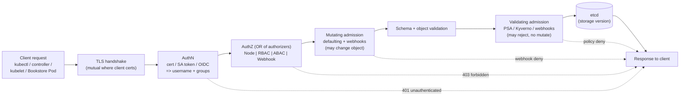

# 01: Authentication, authorization, RBAC

> The full API request gauntlet: TLS → **authentication** (who are you?) →
> **authorization** (may you?) → **admission** (mutate then validate) → etcd;
> why there are no User objects; ServiceAccounts and bound/projected tokens;
> RBAC end to end (Role vs ClusterRole, bindings, verbs/resources/resourceNames,
> aggregation, the default ClusterRoles, `auth can-i` + impersonation); the
> escalation verbs that turn one over-broad grant into cluster-wide access, each
> shown in a lab; and the least privilege that stops each one. The Bookstore
> services get their own identities.

**Estimated time:** ~45 min read · ~90 min hands-on, including the lab
**Prerequisites:** [Part 00 ch.04](../00-foundations/04-control-plane-deep-dive.md): the API request pipeline (authn → authz → admission) · [Part 00 ch.06](../00-foundations/06-declarative-api-model.md), apiVersion/Kind and resource verbs · [Part 03 ch.02](../03-config-and-storage/02-secrets.md), ServiceAccount tokens land as projected volumes
**You'll know after this:** • distinguish authentication, authorization and admission as separate stages · • create ServiceAccounts and bind them to least-privilege Roles/ClusterRoles · • read RBAC verbs, resources and resourceNames to predict whether a request is allowed · • use `kubectl auth can-i` and impersonation to debug access denials · • give each Bookstore workload its own ServiceAccount, and grant it only what it needs

<!-- tags: security, rbac, foundations, core-objects, day-2 -->

> **Lab tier: A**, kind on a Linux lab host. The lab is
> [`labs/05-01.sh`](../examples/security-lab/labs/05-01.sh) and its
> transcript is [`evidence/05-01.txt`](../examples/security-lab/evidence/05-01.txt).
> Run it
> only against a cluster you own. Recorded against a kind cluster whose node
> runs Kubernetes v1.37.0 (Debian 13, kernel 7.0.0, containerd 2.3.4), with
> kubectl v1.37.2.
>
> **What failed first.** The borrowed-token call first used busybox `wget`, and
> its TLS handshake with the API server failed (alert 47), so the lab's Pods use
> `curl`. A later run also missed the API server's pretty-printed JSON, so the
> parser allows a space after the colon. Both fixes are in the script.

## Why this exists

[Part 00 ch.04](../00-foundations/04-control-plane-deep-dive.md) established
that the API server is the *only* door to the cluster and that every request
runs a fixed pipeline. That chapter named the stages; this one **operates**
them, because every access-control bug and every "why can this pod do that?"
question is answered inside this pipeline.

A workload that runs under a shared, ambient identity, such as the namespace's
**`default` ServiceAccount**, gets whatever that identity was granted, and
nobody reviewed the grant. On a fresh cluster that grant is almost nothing, by
default and not by design. A catalog Pod that is compromised should not be able
to read the database Secret, list every Pod, or, worst of all, modify RBAC. The
Bookstore therefore gives each workload its own ServiceAccount, and this chapter
decides what RBAC may grant each one. To make "least privilege" real you
must know precisely **who a request is, how that is decided, and how
permissions are granted and scoped**. This is the [Access
Control](#further-reading) pattern.

## Mental model

Think of the API server as a **secure building with three checkpoints in a
fixed order**, and you never reach the next one until you clear the current:

1. **Authentication: the ID check at the door.** "Prove who you are."
   Kubernetes itself has **no user database**: identity is *asserted by a
   trusted authenticator* (a client certificate signed by the cluster CA, a
   ServiceAccount bearer token, an OIDC token from your IdP). Output: a
   username + groups, or `401`. A *human* "user" is just a string the
   authenticator vouches for; there is no `User` object you can `kubectl get`.
2. **Authorization: the access list.** "You are `alice` / this Pod's SA: are
   you allowed to *create pods in namespace bookstore*?" One or more
   authorizers (Node, **RBAC**, ABAC, Webhook) are consulted in order. The first
   to say *allow* or *deny* decides; if none allows, `403`.
3. **Admission: the inspector.** Already-authorized requests are first
   *mutated* (defaulting, webhooks, sidecar injection) **then** *validated*
   (schema, then validating webhooks/policy, PSA, Kyverno). Only a request
   that survives all three is converted to storage form and written to etcd.

Two invariants to keep: **mutate-before-validate is fixed** (a validating
policy always sees the final object), and **the API server is the sole etcd
client** (so this gauntlet is the *only* place anything is enforced, raw etcd
access bypasses all of it, which is why etcd access ≈ cluster-admin).

## Threats and controls

The table lists only the threats this chapter's subject creates. RBAC answers
who may use a verb on a resource. It does not say which ServiceAccount a new
Pod will run as, so one row needs admission, and the table says so. Treat
`get` and `list` on Secrets, `pods/exec`, `pods/attach`, `impersonate`,
`escalate`, `bind`, and `create` on RBAC objects as the verbs that lead to a
credential or to escalation. Audit them with
`kubectl auth can-i --list --as=…`.

| Threat | Control taught here | Deeper |
|---|---|---|
| A Pod, or an object that carries a pod template, runs as a ServiceAccount its author should not use | Only the identities that deploy may create workloads; one ServiceAccount per workload | Admission that restricts `serviceAccountName`: <!-- link-later: 05.07 --> chapter 05.07 |
| An identity adds rights to its own Role (`escalate`, or `update` and `patch` on roles) | Remove `escalate`, then remove write access to roles | Lab path B |
| An identity binds itself to a role it does not hold (`bind`) | Remove `bind`; RBAC refuses the rest | Lab path C |
| An identity impersonates a more privileged ServiceAccount (`impersonate`) | Impersonate named accounts that are no more privileged than the caller, or nothing | Lab path D; audit in <!-- link-later: 05.08 --> chapter 05.08 |
| Kubelet reads and commands in Pods through `nodes/proxy` | Grant `nodes` read only; never `nodes/proxy` to a person or a dashboard | Lab path E |
| Listing Secrets returns every value in a namespace | `get` on the one named Secret | [Part 03 ch.02](../03-config-and-storage/02-secrets.md) |
| Approving a CSR for a signer that honours client certificates | No `approve` on `kubernetes.io/kube-apiserver-client` for any workload | Lab path G |
| Standing `system:masters` or cluster-admin identities | Do not issue certificates or tokens that carry them | Built into the API server; see How it works |
| The default ServiceAccount, or a token nothing needs | A dedicated ServiceAccount, and `automountServiceAccountToken: false` as in the [baseline](../01-core-workloads/01-pods.md#baseline) | Hands-on section 4 |

## Diagrams

### The request pipeline: TLS → authN → authZ → admission → etcd (Mermaid)



### RBAC object matrix: scope × binding (ASCII)

```
                 │ grants permissions for ...        │ ... where it applies
 ────────────────┼───────────────────────────────────┼────────────────────────
 Role            │ namespaced resources in ONE ns     │ that one namespace
 ClusterRole     │ cluster-scoped resources, OR       │ cluster-wide, OR
                 │ namespaced resources as a template │ (per binding below)
 ────────────────┼───────────────────────────────────┼────────────────────────
 RoleBinding     │ binds a Role  OR a ClusterRole ... │ ... within ONE namespace
 ClusterRole-    │ binds a ClusterRole only ......... │ ... cluster-wide
   Binding       │                                    │   (every namespace)
 ────────────────┴───────────────────────────────────┴────────────────────────
 Key combinations:
   Role           + RoleBinding         -> perms in one ns (Bookstore uses this)
   ClusterRole    + RoleBinding         -> reusable perm set, applied to ONE ns
   ClusterRole    + ClusterRoleBinding  -> cluster-wide (e.g. cluster-admin)
   Role           + ClusterRoleBinding  -> INVALID (a Role can't go cluster-wide)
 RBAC is PURELY ADDITIVE: no deny rules. Absence of an allow = denied.
 A subject's permissions = union of every binding that names it.
```

## Hands-on with the Bookstore

**Assumed working directory: the guide repo root (`full-guide/`).** Requires
the `bookstore` namespace ([Part 01 ch.03](../01-core-workloads/03-resources-and-qos.md)).
This chapter adds **`05-serviceaccounts-rbac.yaml`** (numbered `05-` so a
whole-dir apply creates the identities right after the namespace and *before*
any workload that references them) and wires `serviceAccountName` +
`automountServiceAccountToken: false` into the workloads, purely additive
edits; every prior field (config, Secret-built `DB_DSN`, probes, `preStop`
sleep, volumes, labels, the Part 04 scheduling layer) is unchanged.

### 1. Inspect the pipeline you already depend on

```sh
# AuthN: who does the API server think YOU are (from your kubeconfig)?
kubectl auth whoami
# AuthZ stage, directly: the SubjectAccessReview API behind `can-i`:
kubectl auth can-i create pods -n bookstore
kubectl auth can-i 'delete' clusterroles            # almost certainly: no
# What can the *default* SA in bookstore do? (the ambient identity so far)
kubectl auth can-i --list \
  --as=system:serviceaccount:bookstore:default -n bookstore
#   → essentially nothing useful: that it "works" today is luck, not design.
```

### 2. Create a dedicated, least-privilege identity per service

New file
[`examples/bookstore/raw-manifests/05-serviceaccounts-rbac.yaml`](../examples/bookstore/raw-manifests/05-serviceaccounts-rbac.yaml).
It defines one ServiceAccount per workload and *one* tiny Role. The design
decision: **the Go services and the stock images never call kube-apiserver**
(verified in [`app/catalog/main.go`](../examples/bookstore/app/catalog/main.go):
it talks to Postgres/Redis, never the Kubernetes API). So the correct least
privilege is **no API permissions and no mounted token at all**:

```yaml
apiVersion: v1
kind: ServiceAccount
metadata: { name: catalog-sa, namespace: bookstore }
automountServiceAccountToken: false      # no projected token mounted
---
apiVersion: rbac.authorization.k8s.io/v1
kind: Role                               # namespaced
metadata: { name: catalog-config-reader, namespace: bookstore }
rules:
  - apiGroups: [""]                      # "" = core group (configmaps)
    resources: ["configmaps"]
    resourceNames: ["catalog-config"]    # ONLY this object, by name
    verbs: ["get"]                       # no list or watch: see How it works
---
apiVersion: rbac.authorization.k8s.io/v1
kind: RoleBinding
metadata: { name: catalog-config-reader-binding, namespace: bookstore }
subjects: [ { kind: ServiceAccount, name: catalog-sa, namespace: bookstore } ]
roleRef: { kind: Role, name: catalog-config-reader, apiGroup: rbac.authorization.k8s.io }
```

`storefront-sa`, `orders-sa`, `payments-worker-sa`, `postgres-sa`, `redis-sa`,
`rabbitmq-sa` and the
batch `migrate-sa` (shared by the `db-migrate` Job and `cleanup` CronJob) get
**no** binding: with no RoleBinding/ClusterRoleBinding naming them, RBAC
denies them everything, which is exactly right for a workload that never calls
the API. There is **one SA per workload and no Bookstore Pod uses the
namespace `default` SA**. The `catalog` Role is a deliberately minimal
**teaching** example of resource-name scoping: `get` on exactly one named
ConfigMap. `list` and `watch` are not granted. A list is name-scoped only when
the request carries a matching `metadata.name` field selector, and this Role
keeps the rule to one verb on one object. It grants **nothing** on `secrets`: a
`get secrets` returns cleartext, so that verb is credential disclosure
([Part 03 ch.02](../03-config-and-storage/02-secrets.md)).

```sh
# from the repo root (full-guide/)
kubectl apply -f examples/bookstore/raw-manifests/00-namespace.yaml
kubectl apply -f examples/bookstore/raw-manifests/05-serviceaccounts-rbac.yaml
kubectl get sa,role,rolebinding -n bookstore
```

### 3. Wire the identities into the workloads (additive)

[`10-catalog-deploy.yaml`](../examples/bookstore/raw-manifests/10-catalog-deploy.yaml),
[`11-storefront-deploy.yaml`](../examples/bookstore/raw-manifests/11-storefront-deploy.yaml),
[`14-orders-deploy.yaml`](../examples/bookstore/raw-manifests/14-orders-deploy.yaml)
and [`20-postgres-statefulset.yaml`](../examples/bookstore/raw-manifests/20-postgres-statefulset.yaml)
each gain two fields in `template.spec` (nothing else changes):

```yaml
    spec:
      serviceAccountName: catalog-sa          # the workload's own identity
      automountServiceAccountToken: false     # belt-and-braces: no token mounted
      # ...all prior fields (scheduling layer, containers, volumes) unchanged...
```

The **same two fields appear in every other Bookstore workload** in the
namespace: `11-storefront-deploy.yaml` (`storefront-sa`),
`14-orders-deploy.yaml` (`orders-sa`), `19-payments-worker-deploy.yaml`
(`payments-worker-sa`), `12-redis.yaml` (`redis-sa`), `13-rabbitmq.yaml`
(`rabbitmq-sa`), the manual-canary `30-catalog-canary.yaml` (`catalog-sa`, in
both the stable and canary templates), `20-postgres-statefulset.yaml`
(`postgres-sa`), and the `postgres:16` DB batch jobs `21-db-migrate-job.yaml`
and `22-cleanup-cronjob.yaml` (the shared `migrate-sa`). No Bookstore Pod is
left on the `default` ServiceAccount. The four blocks above show the pattern.
The repository files carry the same two fields in each workload, and the file
is the reference for the rest.

(The per-workload `securityContext` fields are already in these manifests, and
[ch.02](02-pod-security.md) explains them. This chapter's manifest edits are
identity only. The namespace's PSA `restricted` *labels* sit in the shared
`00-namespace.yaml` you applied above. ch.02 explains them too, and they
enforce from the first apply, which is why the debug pod earlier is
restricted-shaped.) Apply the prerequisites then the workload:

```sh
# from the repo root (full-guide/): prerequisite chain, in order
kubectl apply -f examples/bookstore/raw-manifests/00-namespace.yaml
kubectl apply -f examples/bookstore/raw-manifests/05-serviceaccounts-rbac.yaml
kubectl apply -f examples/bookstore/raw-manifests/15-catalog-config.yaml
kubectl apply -f examples/bookstore/raw-manifests/16-db-credentials.yaml
# cluster-scoped scheduling dep + local image (Part 04 / repo README):
kubectl apply -f examples/bookstore/raw-manifests/35-priorityclasses.yaml
kind load docker-image bookstore/catalog:dev --name bookstore   # if using kind
# catalog carries DB_DSN, so it needs Postgres + the schema Job to go Ready
# (its /readyz pings Postgres). Bring those up and gate on the Job first.
kubectl apply -f examples/bookstore/raw-manifests/20-postgres-statefulset.yaml
kubectl rollout status statefulset/postgres -n bookstore
kubectl apply -f examples/bookstore/raw-manifests/21-db-migrate-job.yaml   # schema
kubectl wait --for=condition=complete job/db-migrate -n bookstore --timeout=120s
kubectl apply -f examples/bookstore/raw-manifests/10-catalog-deploy.yaml
kubectl rollout status deployment/catalog -n bookstore
```

### 4. Prove the least privilege, and prove the token is gone

```sh
# catalog-sa can GET its one ConfigMap by name, and NOTHING else:
kubectl auth can-i get configmap/catalog-config \
  -n bookstore --as=system:serviceaccount:bookstore:catalog-sa
kubectl auth can-i list configmaps \
  -n bookstore --as=system:serviceaccount:bookstore:catalog-sa
kubectl auth can-i get secret/db-credentials \
  -n bookstore --as=system:serviceaccount:bookstore:catalog-sa
kubectl auth can-i --list \
  -n bookstore --as=system:serviceaccount:bookstore:orders-sa

# The token is not projected. Run a Pod as the same ServiceAccount, with the
# restricted securityContext the namespace requires. `--image` names the
# busybox image, and the overrides set the rest of the Pod.
kubectl run sa-peek -n bookstore --image=busybox@sha256:73aaf090f3d85aa34ee199857f03fa3a95c8ede2ffd4cc2cdb5b94e566b11662 --restart=Never -i --rm </dev/null \
  --overrides='{"spec":{"serviceAccountName":"catalog-sa","automountServiceAccountToken":false,"securityContext":{"runAsNonRoot":true,"runAsUser":65532,"runAsGroup":65532,"seccompProfile":{"type":"RuntimeDefault"}},"volumes":[{"name":"tmp","emptyDir":{}}],"containers":[{"name":"sa-peek","image":"busybox@sha256:73aaf090f3d85aa34ee199857f03fa3a95c8ede2ffd4cc2cdb5b94e566b11662","securityContext":{"allowPrivilegeEscalation":false,"readOnlyRootFilesystem":true,"capabilities":{"drop":["ALL"]}},"resources":{"requests":{"cpu":"10m","memory":"16Mi"},"limits":{"memory":"32Mi"}},"volumeMounts":[{"name":"tmp","mountPath":"/tmp"}],"command":["sh","-c","ls /var/run/secrets/kubernetes.io/serviceaccount 2>&1 || echo NO-TOKEN-MOUNTED"]}]}}'
```

<!-- gate: output -->
```text
yes
no
no
Resources                                       Non-Resource URLs                      Resource Names   Verbs
selfsubjectreviews.authentication.k8s.io        []                                     []               [create]
# ...
```

The first three lines are the `can-i` answers. The fourth prints the rules
`orders-sa` holds, and the rows after the header are the discovery rules every
authenticated identity has. The `sa-peek` Pod prints `NO-TOKEN-MOUNTED`:

<!-- gate: output -->
```text
ls: /var/run/secrets/kubernetes.io/serviceaccount: No such file or directory
NO-TOKEN-MOUNTED
# ...
pod "sa-peek" deleted from p05-01-bookstore namespace
```

The captured output comes from the lab's own namespace, `p05-01-bookstore`,
which the lab creates from the same manifests. The commands above name the
`bookstore` namespace you applied earlier in this chapter.

> **Why these `--overrides` (a teaching point, not a workaround).** This guide
> uses **one canonical `00-namespace.yaml`**, and it carries the
> `pod-security.kubernetes.io/enforce: restricted` labels from the very first
> apply (the mechanics and rationale are [ch.02](02-pod-security.md)'s subject;
> the file is shared, not duplicated per chapter). A practical consequence
> lands *here*, in ch.01: the moment you `kubectl apply 00-namespace.yaml`,
> **any** Pod in `bookstore`, including a throwaway `kubectl run` debug Pod,
> must satisfy `restricted` or admission rejects it. So every ephemeral pod in
> the Part 05 hands-on includes the restricted `securityContext` shown above
> (`runAsNonRoot`, `runAsUser`, `seccompProfile: RuntimeDefault`,
> `allowPrivilegeEscalation: false`, `drop: ["ALL"]`), plus a read-only root
> filesystem and an `emptyDir` at `/tmp` for the writes a process still needs
> (the [baseline](../01-core-workloads/01-pods.md#baseline) explains each).
> Internalize this now:
> hardening a namespace hardens *everything* you run in it, debugging
> included.

> **Lineage / forward refs.** This chapter establishes *identity* and *RBAC*.
> [ch.02](02-pod-security.md) explains the `restricted` PSA labels and the
> `securityContext` fields the workloads carry. The labels live in the single
> shared `00-namespace.yaml` and are in force the moment you apply it, which
> is why the debug pod above is restricted-shaped.
> [ch.03](03-supply-chain.md) covers images and supply chain. Admission
> **policy** at the validating stage you saw above is chapter 05.07, and the
> **audit trail** of every authN/authZ decision made here is chapter 05.08:
> <!-- link-later: 05.07 --> <!-- link-later: 05.08 -->
> [ch.04](04-secrets-and-cluster-hardening.md) covers Secret encryption at rest.
> RBAC on `secrets` was introduced in
> [Part 03 ch.02](../03-config-and-storage/02-secrets.md), this chapter is the
> general model behind it.

## Lab: escalation paths, attack and harden

**Tier A.** The lab is
[`labs/05-01.sh`](../examples/security-lab/labs/05-01.sh). Run it only against a
cluster you own. The transcript is
[`evidence/05-01.txt`](../examples/security-lab/evidence/05-01.txt), and every
output block below appears there verbatim.

```sh
cd full-guide
bash examples/security-lab/labs/05-01.sh
```

The lab creates the namespace `p05-rbac`, labelled `baseline`, and a victim Pod,
`p05-victim`. The victim runs as `p05-web` with the baseline securityContext,
and its environment holds `DB_PASSWORD` from the Secret `p05-db-creds`. Seven
identities each hold the grant for one escalation path, and each grant looks
ordinary. Each path checks what its identity can do, uses the grant, removes or
narrows it, and then repeats the step. Each identity has a kubeconfig with one
token and no admin credential.

Every path goes through the API server. Path E reaches the kubelet through the
API server's `nodes/proxy` subresource, so the API server's authorization
decides it too. A kind node is a container that shares the kernel of the Linux
host running it, and its kubelet is one process inside that container. The lab
touches that kubelet and the Pods in `p05-rbac`, and nothing else. The Secret
values are dummies, and no token is printed.

### Path A: a Pod or a Deployment borrows a ServiceAccount

`p05-dev` may create Pods and Deployments. `p05-deployer` may read
`p05-db-creds`, and `p05-dev` may not. Neither grant names a ServiceAccount, and
RBAC has no field that limits which one a Pod runs as.

```yaml
rules:
  - {apiGroups: [""], resources: ["pods"], verbs: ["*"]}
  - {apiGroups: ["apps"], resources: ["deployments"], verbs: ["create", "get", "list"]}
```

The attack is a Pod that names `p05-deployer`. The Pod reads its own token from
the volume the kubelet mounts, and asks the API server for the Secret. The Pod
omits `automountServiceAccountToken`, so the default applies and the token is
mounted. The baseline sets that field to false, which is why this manifest is
marked as insecure.

<!-- gate: insecure-on-purpose -->
```yaml
# INSECURE ON PURPOSE: a Pod that runs as the p05-deployer ServiceAccount and reads a Secret with its token. Lab cluster only.
apiVersion: v1
kind: Pod
metadata: {name: p05-borrow, namespace: p05-rbac}
spec:
  serviceAccountName: p05-deployer
  containers:
    - name: borrow
      image: curlimages/curl@sha256:58adaa4e8dca9c988bae2aba4ab3434a0bb2da16bbe3f92dec39ec7785166777  # curlimages/curl:8.22.0
      command: ["sh", "-c"]
      args:
        - |
          T=$(cat /var/run/secrets/kubernetes.io/serviceaccount/token)
          curl --version | head -1
          curl -s --cacert /var/run/secrets/kubernetes.io/serviceaccount/ca.crt \
            -H "Authorization: Bearer $T" \
            https://kubernetes.default.svc/api/v1/namespaces/p05-rbac/secrets/p05-db-creds \
            | sed -n 's/.*"password": *"\([^"]*\)".*/\1/p' | base64 -d; echo
          sleep 3600
```

The image is curl rather than busybox because busybox `wget` could not complete
its TLS handshake with the API server on this cluster. The Pod prints the curl
version it ran, so the logs record it. Before the attack, `p05-dev` can create
Pods and cannot read the Secret:

```sh
kubectl --kubeconfig dev.kubeconfig auth can-i create pods -n p05-rbac
kubectl --kubeconfig dev.kubeconfig auth can-i get secrets -n p05-rbac
kubectl --kubeconfig dev.kubeconfig get secret p05-db-creds -n p05-rbac
```

<!-- gate: output -->
```text
yes
no
Error from server (Forbidden): secrets "p05-db-creds" is forbidden: User "system:serviceaccount:p05-rbac:p05-dev" cannot get resource "secrets" in API group "" in the namespace "p05-rbac"
```

Applying the manifest as `p05-dev` is enough. The Secret comes back in the logs:

<!-- gate: output -->
```text
pod/p05-borrow created
pod/p05-borrow condition met
curl 8.22.0 (x86_64-pc-linux-musl) libcurl/8.22.0 OpenSSL/3.5.8 zlib/1.3.2 brotli/1.2.0 zstd/1.5.7 libidn2/2.3.8 libpsl/0.21.5 libssh2/1.11.1 nghttp2/1.69.0 mit-krb5/1.22.2
p05-lab-only-password
```

The Deployment route needs no Pod rights at all. Its controller creates the Pod
with the controller's own rights, and the pod template names the ServiceAccount:

```yaml
spec:
  template:
    spec:
      serviceAccountName: p05-deployer
```

<!-- gate: output -->
```text
deployment.apps/p05-borrow-deploy created
deployment.apps/p05-borrow-deploy condition met
curl 8.22.0 (x86_64-pc-linux-musl) libcurl/8.22.0 OpenSSL/3.5.8 zlib/1.3.2 brotli/1.2.0 zstd/1.5.7 libidn2/2.3.8 libpsl/0.21.5 libssh2/1.11.1 nghttp2/1.69.0 mit-krb5/1.22.2
p05-lab-only-password
```

**Harden.** `p05-dev` keeps read access to Pods and Deployments and loses the
ability to create either. Removing `create` on pods alone would not have been
enough, because of the Deployment route.

```yaml
rules:
  - {apiGroups: [""], resources: ["pods"], verbs: ["get", "list", "watch"]}
  - {apiGroups: [""], resources: ["pods/log"], verbs: ["get"]}
  - {apiGroups: ["apps"], resources: ["deployments"], verbs: ["get", "list"]}
```

Both routes are refused now:

<!-- gate: output -->
```text
Error from server (Forbidden): error when creating "borrow-pod.yaml": pods is forbidden: User "system:serviceaccount:p05-rbac:p05-dev" cannot create resource "pods" in API group "" in the namespace "p05-rbac"
Error from server (Forbidden): error when creating "borrow-deploy.yaml": deployments.apps is forbidden: User "system:serviceaccount:p05-rbac:p05-dev" cannot create resource "deployments" in API group "apps" in the namespace "p05-rbac"
```

Identities that deploy still need to create workloads, and nothing in RBAC stops
them naming a ServiceAccount. The control for that is admission, which is
chapter <!-- link-later: 05.07 --> 05.07.

### Path B: `escalate` lets an identity grant itself rules

`p05-author` may read and change its own Role. The Role carries `escalate`, so
the API server allows it to add rules it does not hold.

```yaml
rules:
  - {apiGroups: ["rbac.authorization.k8s.io"], resources: ["roles"], resourceNames: ["p05-author"], verbs: ["get", "update", "patch", "escalate"]}
```

The attack adds a rule for `p05-db-creds` to that Role, then reads the Secret:

<!-- gate: output -->
```text
no
yes
role.rbac.authorization.k8s.io/p05-author patched
p05-lab-only-password
```

**Harden, step 1.** Remove `escalate`. The same patch is then refused, because
RBAC will not write a rule the writer does not hold:

```yaml
rules:
  - {apiGroups: ["rbac.authorization.k8s.io"], resources: ["roles"], resourceNames: ["p05-author"], verbs: ["get", "update", "patch"]}
```

<!-- gate: output -->
```text
Error from server (Forbidden): roles.rbac.authorization.k8s.io "p05-author" is forbidden: user "system:serviceaccount:p05-rbac:p05-author" (groups=["system:serviceaccounts" "system:serviceaccounts:p05-rbac" "system:authenticated"]) is attempting to grant RBAC permissions not currently held:
{APIGroups:[""], Resources:["secrets"], ResourceNames:["p05-db-creds"], Verbs:["get"]}
```

**Harden, step 2.** Remove the write verbs too. A Role that the identity cannot
edit cannot be widened at all:

```yaml
rules:
  - {apiGroups: ["rbac.authorization.k8s.io"], resources: ["roles"], resourceNames: ["p05-author"], verbs: ["get"]}
```

<!-- gate: output -->
```text
Error from server (Forbidden): roles.rbac.authorization.k8s.io "p05-author" is forbidden: User "system:serviceaccount:p05-rbac:p05-author" cannot patch resource "roles" in API group "rbac.authorization.k8s.io" in the namespace "p05-rbac"
Error from server (Forbidden): secrets "p05-db-creds" is forbidden: User "system:serviceaccount:p05-rbac:p05-author" cannot get resource "secrets" in API group "" in the namespace "p05-rbac"
```

### Path C: `bind` lets an identity bind a role it does not hold

`p05-binder` may create RoleBindings and may bind the built-in `edit`
ClusterRole. It does not hold `edit`'s rules. `edit` reads Secrets, so a binding
to it is a route to the Secret.

```yaml
rules:
  - {apiGroups: ["rbac.authorization.k8s.io"], resources: ["rolebindings"], verbs: ["create", "get"]}
  - {apiGroups: ["rbac.authorization.k8s.io"], resources: ["clusterroles"], resourceNames: ["edit"], verbs: ["bind"]}
```

<!-- gate: output -->
```text
no
rolebinding.rbac.authorization.k8s.io/p05-grab created
p05-lab-only-password
```

**Harden.** Delete the binding the attack left behind, and remove `bind`. The
new binding is refused by the escalation check, not by a missing verb on
RoleBindings, because `create` is still granted:

```yaml
rules:
  - {apiGroups: ["rbac.authorization.k8s.io"], resources: ["rolebindings"], verbs: ["create", "get"]}
```

<!-- gate: output -->
```text
error: failed to create rolebinding: rolebindings.rbac.authorization.k8s.io "p05-grab" is forbidden: user "system:serviceaccount:p05-rbac:p05-binder" (groups=["system:serviceaccounts" "system:serviceaccounts:p05-rbac" "system:authenticated"]) is attempting to grant RBAC permissions not currently held:
# ...
```

### Path D: `impersonate` runs a request as another identity

`p05-impersonator` may impersonate `p05-deployer`, and nothing else.
Impersonation applies the target's rights for one call, so the caller needs no
Secret access of its own:

```yaml
rules:
  - {apiGroups: [""], resources: ["serviceaccounts"], resourceNames: ["p05-deployer"], verbs: ["impersonate"]}
```

<!-- gate: output -->
```text
Error from server (Forbidden): secrets "p05-db-creds" is forbidden: User "system:serviceaccount:p05-rbac:p05-impersonator" cannot get resource "secrets" in API group "" in the namespace "p05-rbac"
p05-lab-only-password
# ...
Error from server (Forbidden): serviceaccounts "p05-web" is forbidden: User "system:serviceaccount:p05-rbac:p05-impersonator" cannot impersonate resource "serviceaccounts" in API group "" in the namespace "p05-rbac"
```

The first line is the caller reading the Secret as itself, which fails. The
second reads it as `p05-deployer`, and succeeds. The third shows the name
restriction: `p05-web` is outside the grant.

**Harden.** Delete the grant. The same impersonation is refused:

<!-- gate: output -->
```text
rolebinding.rbac.authorization.k8s.io "p05-impersonator" deleted from p05-rbac namespace
Error from server (Forbidden): serviceaccounts "p05-deployer" is forbidden: User "system:serviceaccount:p05-rbac:p05-impersonator" cannot impersonate resource "serviceaccounts" in API group "" in the namespace "p05-rbac"
```

### Path E: `nodes/proxy` reaches the kubelet

`p05-node` holds `nodes/proxy` at cluster scope. It holds no `pods/exec` and no
Secret access.

```yaml
rules:
  - {apiGroups: [""], resources: ["nodes/proxy"], verbs: ["get", "create"]}
```

The lab lists the kubelet's Pods with `get`, which sends a GET request through
the API server to the kubelet. It runs a command with `create`, which sends a
POST to the kubelet's run endpoint, and the kubelet executes the command in a
container. That request reaches the kubelet on the API server's own connection,
so the caller's `pods/exec` permission is never checked. The
[kubelet authorization page](https://kubernetes.io/docs/reference/access-authn-authz/kubelet-authn-authz/)
warns that `get` on `nodes/proxy` is not read-only: it also authorizes running
commands in any container through the WebSocket endpoints. A grant of `get`
alone is therefore already dangerous.

<!-- gate: output -->
```text
yes
no
      29
# ...
DB_PASSWORD=p05-lab-only-password
```

The first two lines answer `auth can-i get nodes --subresource=proxy` (yes)
and `auth can-i create pods --subresource=exec` (no). The count is the number
of Pods the kubelet listed across namespaces, and the last line is the
victim's environment.

**Harden.** Grant only what a dashboard reads, `nodes` get and list, and no
proxy. Both kubelet calls are refused:

```yaml
rules:
  - {apiGroups: [""], resources: ["nodes"], verbs: ["get", "list"]}
```

<!-- gate: output -->
```text
Error from server (Forbidden): nodes "sf-pilot-control-plane" is forbidden: User "system:serviceaccount:p05-rbac:p05-node" cannot get resource "nodes/proxy" in API group "" at the cluster scope
  "message": "nodes \"sf-pilot-control-plane\" is forbidden: User \"system:serviceaccount:p05-rbac:p05-node\" cannot create resource \"nodes/proxy\" in API group \"\" at the cluster scope",
```

### Path F: `list` on Secrets returns every value

`p05-lister` holds `list` on Secrets, with no name restriction. A list returns
each object in full, values included:

```yaml
rules:
  - {apiGroups: [""], resources: ["secrets"], verbs: ["list"]}
```

<!-- gate: output -->
```text
no
p05-app-creds token=p05-lab-only-token 
p05-db-creds password=p05-lab-only-password 
```

**Harden.** Grant `get` on the one Secret the reader needs, by name. Without a
`list` verb, a bare list is refused, and the other Secret is refused too:

```yaml
rules:
  - {apiGroups: [""], resources: ["secrets"], resourceNames: ["p05-app-creds"], verbs: ["get"]}
```

<!-- gate: output -->
```text
Error from server (Forbidden): secrets is forbidden: User "system:serviceaccount:p05-rbac:p05-lister" cannot list resource "secrets" in API group "" in the namespace "p05-rbac"
Error from server (Forbidden): secrets "p05-db-creds" is forbidden: User "system:serviceaccount:p05-rbac:p05-lister" cannot get resource "secrets" in API group "" in the namespace "p05-rbac"
p05-lab-only-token
```

### Path G: CSR approval mints an identity

`p05-approver` may file CSRs, update their approval, and approve requests for
the `kubernetes.io/kube-apiserver-client` signer. The group `p05-readers` has a
RoleBinding that lets it read `p05-db-creds`, and `p05-approver` does not. The
lab files a CSR whose subject is `CN=p05-impostor` and `O=p05-readers`, approves
it, and uses the certificate.

```yaml
rules:
  - {apiGroups: ["certificates.k8s.io"], resources: ["certificatesigningrequests"], verbs: ["create", "get", "list"]}
  - {apiGroups: ["certificates.k8s.io"], resources: ["certificatesigningrequests/approval"], verbs: ["update"]}
  - {apiGroups: ["certificates.k8s.io"], resources: ["signers"], resourceNames: ["kubernetes.io/kube-apiserver-client"], verbs: ["approve"]}
```

The CSR asks for `expirationSeconds: 900`, so its certificate lasts 15 minutes:

```yaml
spec:
  signerName: kubernetes.io/kube-apiserver-client
  usages: ["client auth"]
  expirationSeconds: 900
```

<!-- gate: output -->
```text
certificatesigningrequest.certificates.k8s.io/p05-impostor-csr created
certificatesigningrequest.certificates.k8s.io/p05-impostor-csr approved
# ...
subject=O=p05-readers, CN=p05-impostor
notAfter=Oct 31 07:02:17 2026 GMT
Username                                            p05-impostor
Groups                                              [p05-readers system:authenticated]
p05-lab-only-password
```

**Harden.** Remove the `signers` grant. The approver can still file a CSR, but
the approval is refused:

```yaml
rules:
  - {apiGroups: ["certificates.k8s.io"], resources: ["certificatesigningrequests"], verbs: ["create", "get", "list"]}
  - {apiGroups: ["certificates.k8s.io"], resources: ["certificatesigningrequests/approval"], verbs: ["update"]}
```

<!-- gate: output -->
```text
certificatesigningrequest.certificates.k8s.io/p05-impostor2-csr created
Error from server (Forbidden): certificatesigningrequests.certificates.k8s.io "p05-impostor2-csr" is forbidden: user not permitted to approve requests with signerName "kubernetes.io/kube-apiserver-client"
```

The certificate outlives the lab only until its 15-minute expiry. Teardown
deletes the CSRs and the lab's RBAC, so the identity holds nothing even while
the certificate is still valid.

**Teardown.** The script deletes its namespace, its cluster-scoped objects and
its CSRs, and checks that none remain:

<!-- gate: output -->
```text
namespace "p05-rbac" deleted
clusterrolebinding.rbac.authorization.k8s.io "p05-node-proxy" deleted
clusterrolebinding.rbac.authorization.k8s.io "p05-csr-approver" deleted
clusterrole.rbac.authorization.k8s.io "p05-node-proxy" deleted
clusterrole.rbac.authorization.k8s.io "p05-csr-approver" deleted
certificatesigningrequest.certificates.k8s.io "p05-impostor-csr" deleted
certificatesigningrequest.certificates.k8s.io "p05-impostor2-csr" deleted
no lab-owned cluster objects left
```

**Not run here.** The lab does not show a CSR for `O=system:masters` (refused by
default by `CertificateSubjectRestriction`, cited in the `system:masters`
bullet above), a kubelet exec with
cluster-admin rights, or any audit record. Those belong to other chapters or
are cited to upstream.

## How it works under the hood

### Authentication: every credential is "asserted identity"

The API server runs configured authenticators **in order**; the first to
positively identify the request wins, producing a `user.Info` (a username
string + a set of group strings). Kubernetes stores **no** user records: it
*trusts the authenticator*. The common ones:

- **X.509 client certificates.** The client presents a TLS cert signed by the
  cluster CA; `CN` → username, `O` (organization) → groups. This is how admin
  kubeconfigs and kubelets authenticate. Revocation is awkward (no CRL by
  default), short-lived certs or another method is preferred for humans.
- **ServiceAccount tokens (the workload identity).** A signed JWT whose subject
  is `system:serviceaccount:<NS>:<NAME>` with groups
  `system:serviceaccounts` and `system:serviceaccounts:<NS>`. Modern clusters
  issue **bound, projected** tokens via the **TokenRequest** API: the kubelet
  mounts a token that is *audience-scoped* and **bound to the Pod object** (it
  is invalidated when the Pod is deleted). The kubelet asks for a token of about
  an hour and refreshes it before it expires. The API server's default
  `--service-account-extend-token-expiration` then raises the token's `exp`
  claim to one year, so the Pod's token in
  [00](00-the-attackers-view.md) lasts a year. Treat an automounted token as a
  long-lived credential. The legacy model, a permanent token in a
  `Secret` auto-created per SA, is **deprecated and off by default** (no
  auto-created token Secret in current Kubernetes); a never-expiring token is a
  standing liability. `automountServiceAccountToken: false` (set on both the SA
  and the podSpec in the Bookstore) stops even the projected token from being
  mounted when the workload never calls the API. The cloud bridge that trades
  this token for a cloud credential, as IRSA and GKE Workload Identity do, is
  taught in [10.03](../10-cloud-and-managed-kubernetes/03-cloud-identity.md).
- **OIDC.** For *humans*: the API server validates an ID token from your
  identity provider (`--oidc-issuer-url` etc.); claims map to username/groups.
  This is how real clusters do SSO, there is still no User object, just a
  trusted issuer. Human SSO is built in
  [13.04](../13-grand-capstone-bookstore-platform/04-real-auth-keycloak-irsa-istio-jwt.md).
  Bind IdP groups to RBAC rather than individuals, so access follows directory
  membership.
- **Webhook / authenticating proxy.** The API server delegates token review to
  an external service (used by managed providers, e.g. EKS's IAM
  authenticator).

`kubectl auth whoami` shows the result of this stage for *your* kubeconfig.

### Authorization: chain of authorizers, RBAC the workhorse

After identity, the configured authorizers (`--authorization-mode`) are
consulted **in order**. An *allow* or an explicit *deny* from one of them is
final, and the later ones are not asked. An authorizer with *no opinion* falls
through to the next. If none of them allows, the request gets `403`. The
typical chain is `Node,RBAC` (kubelets are authorized by the **Node**
authorizer; everything else by **RBAC**). Other modes: **ABAC** (static
attribute file, legacy), **Webhook** (external decision: how cloud IAM is
bolted on). **RBAC** is the one you author:

- A **Role** (namespaced) / **ClusterRole** (cluster-scoped or a reusable
  template) holds `rules`, each = `apiGroups` × `resources` (optionally
  `subresources` like `pods/exec`, `pods/log`, and/or `resourceNames` to scope
  to specific objects) × `verbs` (`get list watch create update patch delete
  deletecollection`, plus non-resource verbs and special ones like
  `impersonate`, `bind`, `escalate`). `apiGroups: [""]` is the **core** group
  (pods, services, configmaps, secrets). `resourceNames` constrains to named
  objects. `create` and `deletecollection` cannot be name-scoped at all, and
  `list` and `watch` only with a `metadata.name` field selector (see the
  escalation bullets below). The Bookstore Role grants only `get`, which needs
  neither.
- A **RoleBinding** grants a Role *or* a ClusterRole **within one namespace**;
  a **ClusterRoleBinding** grants a ClusterRole **cluster-wide**. (A
  ClusterRole bound by a RoleBinding applies only in that binding's namespace.
  This is the standard way to reuse a permission template per-namespace.)
- RBAC is **purely additive: there are no deny rules.** A subject's effective
  permission is the **union** of every binding that names it (directly or via a
  group). "Restricting" something means *not granting it* (and ensuring no
  other binding grants it), there is no override. This is why over-broad
  default bindings are dangerous: you can't subtract them, only avoid/remove.
- **The `system:masters` super-group bypasses RBAC entirely.** Any request
  whose authenticated groups include `system:masters` is granted
  *unconditional* cluster-admin by a hard-coded authorizer that runs *before*
  RBAC, **no RoleBinding is involved and none can revoke it** (RBAC has no
  deny rules, so you cannot "restrict" `system:masters`). Since kubeadm v1.29
  the admin kubeconfig carries `O=kubeadm:cluster-admins`, which a
  ClusterRoleBinding maps to `cluster-admin`. Only
  `/etc/kubernetes/super-admin.conf` carries `O=system:masters` ([kubeadm
  implementation
  details](https://kubernetes.io/docs/reference/setup-tools/kubeadm/implementation-details/)).
  The `CertificateSubjectRestriction` admission plugin, on by default, refuses
  a CSR that asks for `system:masters` ([admission
  controllers](https://kubernetes.io/docs/reference/access-authn-authz/admission-controllers/#CertificateSubjectRestriction));
  the lab does not run that refusal. The main mitigation is **not issuing**
  certs/tokens that carry that group: treat the `system:masters` kubeconfig as
  a break-glass credential, keep it offline, and give humans/automation
  narrowly-bound identities instead.
- **`escalate` and `bind`.** The API refuses to write a Role that grants rules
  the writer does not hold, unless the writer holds `escalate` on roles. It
  refuses a RoleBinding to a role the binder does not hold, unless the binder
  holds `bind` on that role. Both checks exist because a Role is only a set of
  rules: without them, anyone allowed to write Roles could write one that grants
  whatever they like. Paths B and C of the lab remove each verb in turn.
- **`impersonate`.** A subject with `impersonate` on `users`, `groups`, or
  `serviceaccounts` may send requests as that identity, and the impersonated
  identity's rights apply. Naming the ServiceAccount in `resourceNames` limits
  the grant to that one account (path D).
- **Any pod template.** `create` on `pods` lets a caller name any ServiceAccount
  in the namespace, and RBAC cannot restrict which one. A Deployment, Job,
  DaemonSet, StatefulSet or CronJob carries the same pod template, and its
  controller creates the Pod with the controller's rights. Removing `create` on
  pods alone therefore stops nothing (path A).
- **`nodes/proxy`.** `get` lets a caller send GET requests through the API
  server to the kubelet on a node, and the
  [kubelet authorization](https://kubernetes.io/docs/reference/access-authn-authz/kubelet-authn-authz/)
  page treats `get` as enough to run commands in a container through the
  WebSocket endpoints. `create` lets it send POST requests, which include the
  kubelet's run endpoint, a command inside a container. That request
  reaches the kubelet on the API server's own connection, so the caller's
  `pods/exec` permission is never checked (path E).
- **`list` and `watch` with names.** A list or watch is name-scoped only when
  its `metadata.name` field selector matches a permitted name. A bare list is
  refused. `create` and `deletecollection` cannot be name-scoped at all
  ([RBAC docs](https://kubernetes.io/docs/reference/access-authn-authz/rbac/)).
  Path F's hardened step refuses a bare list.
- **Aggregation.** A ClusterRole with `aggregationRule.clusterRoleSelectors`
  auto-unions in the rules of any ClusterRole matching the label selector. The
  built-in `admin`/`edit`/`view` roles are aggregated, which is how installing
  a CRD's `*-aggregate-to-edit` ClusterRole instantly extends `edit` to that
  CRD with no edit to the base role.
- **Default ClusterRoles** ship on every cluster: `cluster-admin` (everything,
  via `*`), `admin` (full namespace control incl. RBAC within the ns, via a
  RoleBinding), `edit` (read/write most objects, and **it reads Secrets**, runs
  `pods/exec`, and reaches `pods/proxy`; it cannot change RBAC, but its docs say
  it lets a user run Pods as any ServiceAccount in the namespace), `view`
  (read-only, **excludes Secrets**, because a Secret can carry a ServiceAccount
  token). Bind these by reference; don't recreate them. `system:*`
  ClusterRoles wire up the control plane itself.

`kubectl auth can-i <VERB> <RESOURCE> [--as=<USER_OR_SA>] [-n ns]` runs a
**SubjectAccessReview**, it asks the *real* authorizer, so it's the
authoritative audit tool (and `--list` enumerates everything an identity can
do). `--as` / `--as-group` is **impersonation**, itself an RBAC-gated power
(`impersonate` verb): cluster-admins can act as any subject to test policy
without that subject's credentials.

### Certificate signing requests

A client certificate is an identity the API server accepts without asking
anything else: `CN` becomes the username and `O` the groups. A CSR that is
approved and signed therefore mints an identity. For the
`kubernetes.io/kube-apiserver-client` signer, approval is RBAC: the approver
needs `approve` on the `signers` resource, named for the signer. A subject with
`update` on `certificatesigningrequests/approval` but no `signers` grant cannot
approve a CSR for this signer. Path G shows the refusal: *user not permitted to
approve requests with signerName*.

The signer is never auto-approved by the controller manager, so approval is
always a deliberate act by a holder of that grant. A signed certificate is
valid until its expiry. The lab sets `expirationSeconds: 900`, which the
signer honours within the cluster's own limit. Removing the RBAC the
certificate's identity holds is the one control that ends its power early: the
CSR page does not describe revoking an issued certificate.

### Admission: the last word (covered next, anchored here)

Authorized requests are then **mutated** (built-in plugins like
`ServiceAccount`, `LimitRanger`, `DefaultStorageClass`, plus mutating webhooks)
and only afterwards **validated** (schema, then `ResourceQuota`, **Pod Security
Admission**, validating webhooks / Kyverno / ValidatingAdmissionPolicy). This
is the seam [ch.02](02-pod-security.md) and [ch.03](03-supply-chain.md) plug
into; the ordering guarantee (mutate→validate) is why a validating policy can
trust it sees the final object.

## Quick Reference

```sh
kubectl auth whoami                                   # your identity (authN result)
kubectl auth can-i <VERB> <RES> [-n ns]               # your authZ (SubjectAccessReview)
kubectl auth can-i --list -n <NS>                     # everything you can do there
kubectl auth can-i <VERB> <RES> \
  --as=system:serviceaccount:<NS>:<SA> [-n ns]        # audit a workload identity
kubectl auth can-i get secret/<N> --as=<USER> -n <NS> # check a name-scoped grant
kubectl get sa,role,rolebinding,clusterrole,clusterrolebinding [-n ns]
kubectl describe clusterrole view                     # inspect a default role
kubectl auth can-i escalate roles/<NAME> -n <NS>      # may you grant rules you lack?
kubectl auth can-i get nodes --subresource=proxy      # kubelet proxy: want "no"
kubectl create role r --verb=get --resource=configmaps \
  --resource-name=catalog-config -n <NS> --dry-run=client -o yaml   # author
```

Minimal least-privilege identity skeleton:

```yaml
apiVersion: v1
kind: ServiceAccount
metadata: { name: app-sa, namespace: <NS> }
automountServiceAccountToken: false       # if the app never calls the API
---
apiVersion: rbac.authorization.k8s.io/v1
kind: Role
metadata: { name: app-role, namespace: <NS> }
rules:
  - apiGroups: [""]
    resources: ["configmaps"]
    resourceNames: ["app-config"]          # scope to named object (get only)
    verbs: ["get"]
---
apiVersion: rbac.authorization.k8s.io/v1
kind: RoleBinding
metadata: { name: app-rb, namespace: <NS> }
subjects: [ { kind: ServiceAccount, name: app-sa, namespace: <NS> } ]
roleRef:  { kind: Role, name: app-role, apiGroup: rbac.authorization.k8s.io }
# in the workload: spec.serviceAccountName: app-sa
#                  spec.automountServiceAccountToken: false
```

Checklist:

- [ ] Every workload has a **dedicated** ServiceAccount (never `default`)
- [ ] `automountServiceAccountToken: false` where the app doesn't call the API
- [ ] Roles grant the **minimum** verbs; `resourceNames` + `get` over blanket
  `list`
- [ ] **No** `get/list` on Secrets unless strictly required; name the one Secret
- [ ] No `escalate`, `bind` or `impersonate` outside the platform team
- [ ] No `nodes/proxy` for a person or a dashboard
- [ ] No `create` on pods, or on any object with a pod template, for
  identities that do not deploy
- [ ] No `approve` on `kubernetes.io/kube-apiserver-client` for any workload
- [ ] `Role`+`RoleBinding` per namespace; `ClusterRoleBinding` only when
  cluster-wide
- [ ] Reuse aggregated `view`/`edit`/`admin`; mind that `edit` reads Secrets
- [ ] `kubectl auth can-i --list --as=…` run for each SA (verified least
  privilege)
- [ ] Auditing of RBAC changes, `exec` and `impersonate` in place (<!-- link-later: 05.08 --> chapter 05.08)

## Test your understanding

> Try each before opening the answer drawer. The act of trying is the exercise; the answer is the check.

1. **There is no `User` object in Kubernetes: so where does the username come from when `alice` runs `kubectl get pods`, and how does the cluster decide which RBAC bindings apply?**
   <details><summary>Show answer</summary>

   The authenticator (client cert signed by the cluster CA, an OIDC token from the IdP, a bearer token, etc.) **asserts** a username + groups; Kubernetes itself stores no user database. RBAC then matches those strings against `subjects:` in `RoleBinding`/`ClusterRoleBinding`: see §Mental model. That is why binding to *groups* (`oidc:platform-team`) is preferred over individuals: identity follows your IdP, not in-cluster YAML.

   </details>

2. **A new engineer reports `kubectl get pods -n bookstore` returns `Forbidden`, but they swear they're in the `platform-team` group. How do you debug this in under 90 seconds, without granting them any new permissions?**
   <details><summary>Show answer</summary>

   `kubectl auth whoami` (or look at the JWT) to confirm the authenticator emitted `platform-team` as a group; `kubectl auth can-i list pods -n bookstore --as=alice --as-group=platform-team` to test the binding from your admin context; `kubectl get rolebinding,clusterrolebinding -A -o yaml | grep -B5 platform-team` to find what's actually bound. The most common cause is the group string in RBAC not matching what the IdP actually emits (case, prefix `oidc:`).

   </details>

3. **A teammate suggests giving the `payments-worker` SA `verbs: ["get","list"]` on `secrets` "so it can read its DB password". Why is this a code smell, and what's the right shape?**
   <details><summary>Show answer</summary>

   `list secrets` reads *every* Secret in the namespace, not just one, a compromised payments-worker now exfiltrates every credential. The right shape is `verbs: ["get"]` with `resourceNames: ["payments-db-credentials"]` (a single named Secret), or, far better, mount the Secret as a file/env and set `automountServiceAccountToken: false` so the SA needs no `secrets` permission at all. Better still: use IRSA/Workload Identity to skip Kubernetes Secrets entirely.

   </details>

4. **Hands-on extension: break impersonation cleanly. Create a ServiceAccount `app-sa` in `bookstore` with a Role that allows only `get configmaps`. Then try `kubectl auth can-i list configmaps --as=system:serviceaccount:bookstore:app-sa`. Now grant yourself `impersonate` on `users`/`groups` and try `--as=system:admin`. Why is impersonation a safer way to test a workload's rights than copying its token?**
   <details><summary>What you should see</summary>

   `can-i list` returns `no` (only `get` is granted). The impersonation attempt as `system:admin` works only while you hold `impersonate` on `users`. Impersonation mints no credential: the request carries the target's rights for that one call, and there is no token to copy, store or replay. Path D of the lab shows the same rule on ServiceAccounts, scoped by `resourceNames`. What the audit trail records for an impersonated request is covered in <!-- link-later: 05.08 --> chapter 05.08.

   </details>

5. **You discover a `ClusterRoleBinding` that binds `cluster-admin` to `system:authenticated`. Explain in one sentence why this is catastrophic, and what the cluster effectively becomes.**
   <details><summary>Show answer</summary>

   `system:authenticated` is *any* successfully-authenticated principal, every ServiceAccount, every human, every webhook with a valid token, so the binding silently makes the cluster a single-tenant cluster-admin free-for-all where any compromised Pod becomes cluster-admin. RBAC misconfiguration is the most common path to "from container breakout to full cluster compromise"; this is precisely why audit logs (<!-- link-later: 05.08 --> chapter 05.08) must alert on RBAC changes.

   </details>

6. **A developer's Role grants `create` on `deployments` in `bookstore` and nothing on `pods`. Can they run a Pod as `payments-deployer`? Why does removing `create` on pods not stop it, and what does?**
   <details><summary>Show answer</summary>

   Yes. The Deployment controller creates the Pod with its own rights, and the pod template names the ServiceAccount. RBAC cannot restrict which ServiceAccount a template may name, so only the rights to create the workload matter. Stopping it takes two things: no workload-creation rights for identities that do not deploy, and an admission policy that refuses ServiceAccount names outside an allowlist, which is chapter <!-- link-later: 05.07 -->05.07. Path A of the lab shows the Pod form and the Deployment form, and the refusal for both.

   </details>

## Further reading

- **Ibryam & Huß, _Kubernetes Patterns_ 2e, ch.26: _Access Control_**, the
  authentication/authorization/admission model and least-privilege RBAC as a
  pattern.
- **Rosso et al., _Production Kubernetes_, ch.10: "Identity"**, workload and
  human identity, token mechanics, and cloud-IAM bridging in production; pair
  with **Lukša, _Kubernetes in Action_ 2e** securing-the-API-server material.
- Official:
  <https://kubernetes.io/docs/reference/access-authn-authz/authentication/>,
  <https://kubernetes.io/docs/reference/access-authn-authz/rbac/> (its
  escalation-prevention section covers `escalate` and `bind`),
  <https://kubernetes.io/docs/reference/access-authn-authz/user-impersonation/>,
  <https://kubernetes.io/docs/reference/access-authn-authz/certificate-signing-requests/>
  (the `kubernetes.io/kube-apiserver-client` signer), and the request-flow
  overview
  <https://kubernetes.io/docs/reference/access-authn-authz/controlling-access/>.
