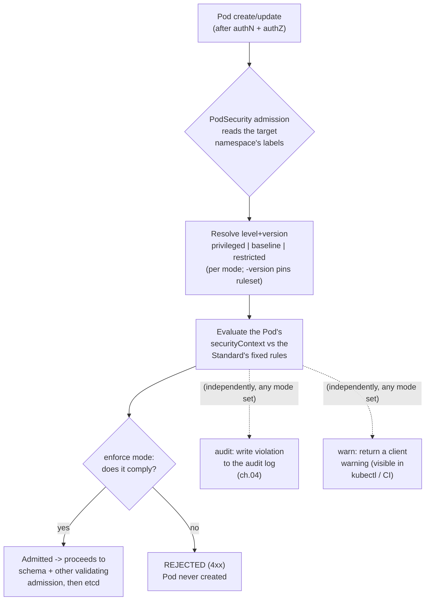

# 02 — Pod security and container escape

> What a compromised container can do to the node, shown by doing it on a
> kind cluster: `privileged`, `hostPID`, `hostPath: /`, a mounted runtime
> socket, writing a binary into a running container, and user namespaces.
> Then the control that closes every one of them: a `securityContext` that
> carries the [baseline](../01-core-workloads/01-pods.md#baseline), and **Pod
> Security Admission** enforcing the `restricted` standard on the namespace.

**Estimated time:** ~35 min read · ~45 min hands-on (the lab is scripted)
**Prerequisites:** [Part 05 ch.01](01-authn-authz-rbac.md) — RBAC controls who
can ask the API; this chapter controls what a running Pod can do to the kernel
· [Part 01 ch.01](../01-core-workloads/01-pods.md#baseline) — the workload
baseline, field by field · [Part 00 ch.02](../00-foundations/02-containers-and-images.md)
— capabilities, namespaces and cgroups
**You'll know after this:** • watch a container reach the node through four
classic escapes, and name the one `securityContext` field that closes each ·
• read the `restricted` Pod Security Standard as the list of escapes it
forbids · • label a namespace `enforce`/`audit`/`warn` at a standard and
version · • keep a workload that genuinely needs privilege in its own
namespace with a registered exception · • explain why PodSecurityPolicy is
gone and what replaced it

<!-- tags: security, psa-restricted, container-escape, core-objects, day-2 -->

## Why this exists

[ch.01](01-authn-authz-rbac.md) decided *who can ask the API server for
what*. This chapter starts after a Pod is already running and asks a
different question: **what can the process inside the container do to the
node and its kernel?** A container is a process with namespaces and cgroups,
sharing the node's kernel. By default it can run as **root (UID 0)**, gain
new privileges, holds a non-trivial set of Linux **capabilities**, has an
unrestricted **syscall** surface, and writes to its root filesystem. None of
that is the API's business, so **RBAC does not touch it**. A catalog process
compromised through an application bug, running with those defaults, is a
container breakout waiting to happen.

Two built-in controls answer this, and this chapter proves both on a lab
cluster. `securityContext` is how a workload **drops** those privileges. **Pod
Security Admission (PSA)** is the admission controller that **refuses to
admit** Pods that have not. Everything a workload should carry is the
[baseline](../01-core-workloads/01-pods.md#baseline); 01.01 explains each
field against the threat it answers, and this chapter does not repeat those
explanations. It shows the threats landing, and the baseline and PSA stopping
them.

## Mental model

Two complementary halves:

- **`securityContext` — the privileges a Pod gives up.** Set per-pod
  (`spec.securityContext`: `runAsNonRoot`, `runAsUser`/`Group`, `fsGroup`,
  `seccompProfile`) and per-container (`spec.containers[].securityContext`:
  `allowPrivilegeEscalation`, `capabilities`, `readOnlyRootFilesystem`,
  `privileged`). Container-level overrides pod-level for the same field. The
  hardened form is the [baseline](../01-core-workloads/01-pods.md#baseline):
  run as non-root, drop all capabilities, forbid privilege escalation, apply
  the runtime's default seccomp filter, read-only root filesystem.
- **Pod Security Admission — the floor the cluster enforces.** PSA is a
  built-in *validating admission* plugin (the stage from
  [ch.01](01-authn-authz-rbac.md)). You label a **namespace** with one of
  three **Pod Security Standards**, in up to three **modes**. You do not write
  rules; you pick a level. It is a fixed, versioned policy.

The two must agree. If a namespace enforces `restricted`, every Pod in it
must carry a `restricted`-satisfying `securityContext` or it is rejected at
admission. A guide that labels its namespace `restricted` and then ships Pods
that cannot be admitted is broken, so the hands-on proves the Bookstore
satisfies the floor it sets for itself.

## Threats and controls

Every threat here is a way a running container reaches the node. The lab
below lands each one, then closes it.

| Threat | Control this chapter teaches | Where it goes deeper |
|---|---|---|
| A container runs as **root** and its UID 0 is the node's UID 0 | [`runAsNonRoot` + a non-zero `runAsUser`](../01-core-workloads/01-pods.md#baseline-run-as); user namespaces remap root | user namespaces, 05.05 <!-- link-later: 05.05 --> |
| A **privileged** container holds every capability and every device | PSA `restricted` forbids `privileged`; [`capabilities.drop: ["ALL"]`](../01-core-workloads/01-pods.md#baseline-capabilities) | this chapter |
| A **setuid** binary or file capability escalates inside the container | [`allowPrivilegeEscalation: false`](../01-core-workloads/01-pods.md#baseline-privilege-escalation) | this chapter |
| `hostPath`, `hostPID`, `hostNetwork` or `hostIPC` break the sandbox | PSA `restricted` forbids host namespaces and `hostPath` | this chapter |
| A mounted **runtime socket** gives root over every pod on the node | no socket mount; `restricted` forbids the `hostPath` it needs | admission policy, 05.07 <!-- link-later: 05.07 --> |
| An attacker **drops a binary** into the running container | [`readOnlyRootFilesystem: true`](../01-core-workloads/01-pods.md#baseline-read-only-root) | this chapter |
| A rare **syscall** attacks the kernel | [`seccompProfile: RuntimeDefault`](../01-core-workloads/01-pods.md#baseline-seccomp); AppArmor, SELinux | kernel isolation, 05.05 <!-- link-later: 05.05 --> |
| A Pod with none of the above is admitted at all | [Pod Security labels on the namespace](../01-core-workloads/01-pods.md#baseline-namespace) | this chapter |

## Diagrams

### PSA admission decision: namespace labels → enforce/audit/warn (Mermaid)



### The `restricted` hardening checklist (ASCII)

```
 PSA `restricted` REQUIRES (pod or container securityContext) ──────────────
  [x] runAsNonRoot: true                  (pod or container)
  [x] allowPrivilegeEscalation: false     (container)
  [x] capabilities.drop: ["ALL"]          (container; may re-add only
                                            NET_BIND_SERVICE)
  [x] seccompProfile.type: RuntimeDefault (or Localhost; NOT Unconfined)
  [x] privileged: false / unset, no hostPID/hostIPC/hostNetwork,
      no hostPath volumes, no hostPorts, restricted /proc + sysctls,
      SELinux type unset/allowed
  [x] volumes only: configMap, csi, downwardAPI, emptyDir, ephemeral,
      persistentVolumeClaim, projected, secret
 NOT required by `restricted` (but in the baseline — add where the image
 allows):
  [ ] readOnlyRootFilesystem: true   + an emptyDir for any writable path
  [ ] runAsUser / runAsGroup pinned to a specific non-zero UID/GID
 `baseline` = the host*/privileged/hostPath/sysctl bans WITHOUT the
 non-root / drop-ALL / seccomp / no-priv-esc requirements.
```

## The attacker's view: escaping a container on kind

> **Lab 05.02 (tier A).** Recorded on a kind cluster: Kubernetes v1.37.0
> node, kubectl v1.37.2, containerd v2.3.4, runc 1.4.3, crictl 1.36.0. The
> script is [`labs/05-02.sh`](../examples/security-lab/labs/05-02.sh); the
> recorded run is
> [`evidence/05-02.txt`](../examples/security-lab/evidence/05-02.txt); the
> cluster config is
> [`kind/cluster.yaml`](../examples/security-lab/kind/cluster.yaml). **Run it
> only against a kind cluster you own:** it runs deliberately insecure Pods
> in a throwaway `psa-lab` namespace and deletes them at the end. What did not
> work the first time: user-namespace Pods (step 6) never start on a default
> kind cluster, and the lab shows why rather than pretending otherwise.

Every attack below lands in `psa-lab`, a namespace labelled `privileged` so
nothing is blocked while we show the danger:

```sh
kubectl create ns psa-lab
kubectl label ns psa-lab pod-security.kubernetes.io/enforce=privileged
```

All of them reach the **kind node**, and stop there. A kind node is itself a
container on the machine that runs kind, so these escapes end at the node
container; on a real cluster the node is a machine, and the same manifests
own it. Nothing in this lab touches the host that runs kind, and
host-kernel escapes wait for a tier-B lab, out of this chapter.

### `privileged`: all capabilities, all devices

A `privileged` container turns off almost every isolation the runtime
applies. The manifest is small, and that is the point:

<!-- gate: insecure-on-purpose -->

```yaml
# INSECURE ON PURPOSE: a privileged container owns the node kernel. Lab cluster only.
apiVersion: v1
kind: Pod
metadata:
  name: escape-privileged
  namespace: psa-lab
spec:
  containers:
    - name: esc
      image: busybox@sha256:73aaf090f3d85aa34ee199857f03fa3a95c8ede2ffd4cc2cdb5b94e566b11662  # busybox:1.36
      command: ["sleep", "3600"]
      securityContext:
        privileged: true
```

Its effective and bounding capability sets are full (`1f...f` is every
capability the kernel defines), so it can load kernel modules, mount
filesystems and open any device:

<!-- gate: output -->

```
CapEff: 000001ffffffffff
CapBnd: 000001ffffffffff
```

A hardened container's `CapEff` is `0000000000000000` (step 9 below). The
whole distance between a breakout and a dead end is those two numbers.

### `hostPath: /`: read every file on the node

A `hostPath` volume mounts a node path into the Pod. Mount `/` and the
container reads the node's entire filesystem, including the cluster's
certificate authority **private key**:

<!-- gate: insecure-on-purpose -->

```yaml
# INSECURE ON PURPOSE: hostPath / mounts the whole node filesystem. Lab cluster only.
apiVersion: v1
kind: Pod
metadata:
  name: escape-hostpath
  namespace: psa-lab
spec:
  containers:
    - name: esc
      image: busybox@sha256:73aaf090f3d85aa34ee199857f03fa3a95c8ede2ffd4cc2cdb5b94e566b11662  # busybox:1.36
      command: ["sleep", "3600"]
      volumeMounts:
        - name: nodefs
          mountPath: /host
          readOnly: true
  volumes:
    - name: nodefs
      hostPath:
        path: /
        type: Directory
```

<!-- gate: output -->

```
security-lab-control-plane
/host/etc/kubernetes/pki/ca.key
```

The hostname confirms this is the control-plane node, and `ca.key` is
readable. With the cluster CA key an attacker signs a client certificate for
any user, including `system:masters`. `hostPath` is not an operational
convenience to grant lightly; it is the node's filesystem.

### `hostPID`: see and signal every process on the node

`hostPID: true` puts the container in the node's process namespace, so it
sees and can signal every process on the node:

<!-- gate: insecure-on-purpose -->

```yaml
# INSECURE ON PURPOSE: hostPID shares the node's process namespace. Lab cluster only.
apiVersion: v1
kind: Pod
metadata:
  name: escape-hostpid
  namespace: psa-lab
spec:
  hostPID: true
  containers:
    - name: esc
      image: busybox@sha256:73aaf090f3d85aa34ee199857f03fa3a95c8ede2ffd4cc2cdb5b94e566b11662  # busybox:1.36
      command: ["sleep", "3600"]
```

<!-- gate: output -->

```
137 containerd
748 kubelet
```

The node's `containerd` and `kubelet` are right there. A process with the
right capability can enter their namespaces (`nsenter` against PID 1) and
run as the node. `hostPID` is also an information leak on its own: command
lines of other processes often carry tokens and passwords.

### A mounted runtime socket: root over every pod

"Just mount the Docker or containerd socket" is a common request from CI and
build tooling. The socket is the runtime's full control API, so a container
that holds it can start, stop and inspect **every** container on the node.
This Pod mounts the socket and borrows the node's `crictl` to talk to it:

<!-- gate: insecure-on-purpose -->

```yaml
# INSECURE ON PURPOSE: a mounted runtime socket controls every pod on the node. Lab cluster only.
apiVersion: v1
kind: Pod
metadata:
  name: escape-socket
  namespace: psa-lab
spec:
  containers:
    - name: esc
      image: busybox@sha256:73aaf090f3d85aa34ee199857f03fa3a95c8ede2ffd4cc2cdb5b94e566b11662  # busybox:1.36
      command: ["sleep", "3600"]
      volumeMounts:
        - name: sock
          mountPath: /run/containerd/containerd.sock
        - name: crictl
          mountPath: /usr/local/bin/crictl
          readOnly: true
  volumes:
    - name: sock
      hostPath:
        path: /run/containerd/containerd.sock
        type: Socket
    - name: crictl
      hostPath:
        path: /usr/local/bin/crictl
        type: File
```

<!-- gate: output -->

```
containers visible: 13
kube-apiserver-security-lab-control-plane
```

The socket enumerates every container on the node, control plane included
(the lab only lists them; it changes nothing). From here an attacker launches
a new container mounting the node's root, and the socket itself needs no extra
privilege inside the Pod, which is what makes it so dangerous.

### No read-only root filesystem: drop a binary in

A writable root filesystem lets an attacker who already has code execution
modify the image at runtime: overwrite the entrypoint, drop a tool, persist.
A plain Pod (no `readOnlyRootFilesystem`) writes a working script straight
into `/usr/bin` and runs it:

<!-- gate: output -->

```
INJECTED
```

With [`readOnlyRootFilesystem: true`](../01-core-workloads/01-pods.md#baseline-read-only-root)
the same write fails (step 9). The process may still write the `emptyDir`
mounted at `/tmp`, so the application keeps working while its own binaries
become immutable.

### User namespaces: remap in-container root

User namespaces are the deeper fix for "root in the container is root on the
node". With `hostUsers: false` the kernel maps the container's UID 0 to an
unprivileged **subordinate** UID on the node, so even a hostPath write lands
as a harmless high UID, not real root:

```yaml
spec:
  hostUsers: false     # map in-container root to an unprivileged node UID
  containers:
    - name: app
      # ... the baseline from 01.01 ...
```

Without it, the container's root is the node's root. A plain root Pod shows
an identity map (`0 0 4294967295`: container UID 0 is node UID 0, for the
whole range):

<!-- gate: output -->

```
0 0 4294967295
```

On a default kind cluster the `hostUsers: false` Pod never starts. The API
server accepts the field, but the kubelet cannot create the sandbox, because
the kind node is itself a container and the nested read-only `sysfs` mount is
denied:

<!-- gate: output -->

```
Failed to create pod sandbox: rpc error: code = Unknown desc = failed to start sandbox: failed to create containerd task: failed to create shim task: OCI runtime create failed: runc create failed: unable to start container process: error during container init: error mounting "sysfs" to rootfs at "/sys": mount src=sysfs, dst=/sys, dstFd=/proc/thread-self/fd/11, flags=MS_RDONLY|MS_NOSUID|MS_NODEV|MS_NOEXEC: operation not permitted
```

This is why 01.01 keeps `hostUsers: false` out of the baseline until it is
verified on kind on both Linux and macOS: the mechanism is sound, but a kind
node is not a faithful stand-in for a real one here. A tier-B node (a real
kubelet on a machine) is where the baseline will gain the field.

## Closing the escapes: `restricted` and the baseline

Now relabel a second namespace to `restricted` and apply the *same* attack
manifests with a server-side dry-run. The API server runs PSA in admission,
so a dry-run returns the verdict without creating anything:

```sh
kubectl create ns psa-restricted
kubectl label ns psa-restricted \
  pod-security.kubernetes.io/enforce=restricted \
  pod-security.kubernetes.io/warn=restricted
```

Every attack is refused, and the message names each field that failed:

<!-- gate: output -->

```
== privileged ==
Error from server (Forbidden): error when creating "STDIN": pods "escape-privileged" is forbidden: violates PodSecurity "restricted:latest": privileged (container "esc" must not set securityContext.privileged=true), allowPrivilegeEscalation != false (container "esc" must set securityContext.allowPrivilegeEscalation=false), unrestricted capabilities (container "esc" must set securityContext.capabilities.drop=["ALL"]), runAsNonRoot != true (pod or container "esc" must set securityContext.runAsNonRoot=true), seccompProfile (pod or container "esc" must set securityContext.seccompProfile.type to "RuntimeDefault" or "Localhost")
== hostpath ==
Error from server (Forbidden): error when creating "STDIN": pods "escape-hostpath" is forbidden: violates PodSecurity "restricted:latest": allowPrivilegeEscalation != false (container "esc" must set securityContext.allowPrivilegeEscalation=false), unrestricted capabilities (container "esc" must set securityContext.capabilities.drop=["ALL"]), restricted volume types (volume "nodefs" uses restricted volume type "hostPath"), runAsNonRoot != true (pod or container "esc" must set securityContext.runAsNonRoot=true), seccompProfile (pod or container "esc" must set securityContext.seccompProfile.type to "RuntimeDefault" or "Localhost")
== hostpid ==
Error from server (Forbidden): error when creating "STDIN": pods "escape-hostpid" is forbidden: violates PodSecurity "restricted:latest": host namespaces (hostPID=true), allowPrivilegeEscalation != false (container "esc" must set securityContext.allowPrivilegeEscalation=false), unrestricted capabilities (container "esc" must set securityContext.capabilities.drop=["ALL"]), runAsNonRoot != true (pod or container "esc" must set securityContext.runAsNonRoot=true), seccompProfile (pod or container "esc" must set securityContext.seccompProfile.type to "RuntimeDefault" or "Localhost")
== socket ==
Error from server (Forbidden): error when creating "STDIN": pods "escape-socket" is forbidden: violates PodSecurity "restricted:latest": allowPrivilegeEscalation != false (container "esc" must set securityContext.allowPrivilegeEscalation=false), unrestricted capabilities (container "esc" must set securityContext.capabilities.drop=["ALL"]), restricted volume types (volumes "sock", "crictl" use restricted volume type "hostPath"), runAsNonRoot != true (pod or container "esc" must set securityContext.runAsNonRoot=true), seccompProfile (pod or container "esc" must set securityContext.seccompProfile.type to "RuntimeDefault" or "Localhost")
```

`restricted` is not a long list of ad-hoc rules. It is exactly the set of
escapes above, read as prohibitions: no `privileged`, no host namespaces, no
`hostPath`, plus the non-root, drop-all, no-escalation and seccomp
requirements of the baseline.

A Pod that carries the [baseline](../01-core-workloads/01-pods.md#baseline)
is admitted into the same namespace and runs:

```yaml
apiVersion: v1
kind: Pod
metadata:
  name: hardened
  namespace: psa-restricted
spec:
  automountServiceAccountToken: false
  securityContext:
    runAsNonRoot: true
    runAsUser: 65532
    runAsGroup: 65532
    seccompProfile:
      type: RuntimeDefault
  containers:
    - name: app
      image: busybox@sha256:73aaf090f3d85aa34ee199857f03fa3a95c8ede2ffd4cc2cdb5b94e566b11662  # busybox:1.36
      command: ["sleep", "3600"]
      securityContext:
        allowPrivilegeEscalation: false
        readOnlyRootFilesystem: true
        capabilities:
          drop: ["ALL"]
      volumeMounts:
        - name: tmp
          mountPath: /tmp
  volumes:
    - name: tmp
      emptyDir: {}
```

It runs as UID 65532 with no capabilities, and the read-only root filesystem
turns the binary-drop from the earlier step into a dead end:

<!-- gate: output -->

```
uid=65532 gid=65532 groups=65532
CapEff: 0000000000000000
sh: can't create /usr/bin/backdoor: Read-only file system
```

## Pod Security: levels, modes, and exceptions

PSA selects a **standard** per **namespace** through labels, and nothing else.

- **Levels.** `privileged` (no restrictions, for trusted infrastructure
  only), `baseline` (blocks the host-namespace, `privileged` and `hostPath`
  escapes above but not the non-root/seccomp requirements), and `restricted`
  (the full hardened set the lab just proved). `restricted` is the right
  default for application namespaces.
- **Modes.** `enforce` rejects violators at admission; `audit` records the
  violation in the audit log ([ch.04](04-secrets-and-cluster-hardening.md));
  `warn` returns a client warning visible in `kubectl` and CI. Set all three
  at the same level so a regression that slips past review still surfaces.
  The migration path is always `warn`/`audit` first, fix every violation,
  then `enforce`, never the other way round.
- **Version.** The `-version` label pins the ruleset to a Kubernetes minor
  (`latest` is newest; pin to `v1.37` to freeze behaviour across upgrades).

### Exceptions, not exemptions

Some legitimate workloads cannot run under `restricted`: a CNI agent needs
host networking, an eBPF tool such as Falco needs `CAP_BPF` and
`CAP_SYS_ADMIN`, a node-exporter needs `hostPID`. The wrong move is to relax
the default to accommodate them, because every new agent then loosens it
further until the cluster is back at `privileged`. The rule this guide
follows, recorded in ADR 0005
(`docs/adr/0005-restricted-psa-default-with-exceptions.md` in the repository):

- The default stays `restricted`. A workload that needs more lives in **its
  own namespace**, labelled with the **lowest** level it actually works
  under, and only that namespace.
- If the privilege is for an optional feature, turn the feature off instead.
- Each exception is recorded in the one registry with its reason, the chapter
  that owns it, and an expiry within twelve months, so it is revisited rather
  than forgotten. The security programme chapter keeps that registry, 05.09
  <!-- link-later: 05.09 -->.

Never weaken the application namespace to fit an agent. Move the agent.

## Hardening the Bookstore to the floor it sets

The Bookstore's `bookstore` namespace enforces `restricted` (set in
[`00-namespace.yaml`](../examples/bookstore/raw-manifests/00-namespace.yaml)).
Every workload therefore carries the
[baseline](../01-core-workloads/01-pods.md#baseline); the only new work per
image is matching the baseline to what the image can actually do. The fields
are explained in 01.01, so here is only the per-image judgement:

| Workload | Image | `restricted`-valid because | `readOnlyRootFilesystem` |
|---|---|---|---|
| catalog, orders | `gcr.io/distroless/static:nonroot` (UID 65532) | non-root by design, single static binary | yes, `emptyDir` for scratch |
| storefront | purpose-built `nginx` on `USER 101`, listens `:8080`, all temp paths under `/tmp` | built unprivileged; stock nginx would fail | yes, `emptyDir` at `/tmp` |
| postgres, rabbitmq | official images, normally start as root and `gosu` to UID 999 | run directly as UID 999 with [`fsGroup`](../01-core-workloads/01-pods.md#baseline-fsgroup) 999 on the data volume | no, they write outside the data volume |
| redis | official image, in-memory (`--save "" --appendonly no`) | runs as UID 999 | yes, tiny `data` `emptyDir` |

The port choice matters: the Go services and nginx bind `:8080` (above 1024),
so they need no `NET_BIND_SERVICE` and can drop every capability. `fsGroup`
makes the kubelet give the data volume to GID 999 so a non-root process can
write it; `fsGroupChangePolicy: OnRootMismatch` skips a slow recursive chown
on a large volume.

> **The accurate verdict, per image.** `restricted` is a check on the
> manifest's `securityContext` and volume types, not on whether the app
> boots. **Every Pod that can land in `bookstore`** is made
> `restricted`-valid: the six long-running workloads, the manual-canary
> catalog variant, and both `postgres:16` batch jobs (the `db-migrate` Job
> and the `cleanup` CronJob), because `enforce: restricted` gates *every* Pod
> in the namespace. The distroless Go services and the purpose-built nginx
> are cleanly hardened including a read-only root filesystem; the stock
> postgres/redis/rabbitmq and the batch jobs are `restricted`-valid **only
> because** of `runAsNonRoot` plus a non-root UID plus `fsGroup`, which keep
> them starting as non-root. Never label a namespace `restricted` and apply
> stock images unchanged: they expect root and will fail PSA, or fail to boot.

Verify the floor matches the workloads with a server-side dry-run of every
manifest that can land in the namespace. This must be exhaustive, because
`enforce: restricted` gates every Pod, not just the long-running ones:

```sh
# from the repo root (full-guide/)
kubectl apply -f examples/bookstore/raw-manifests/00-namespace.yaml
for f in 10-catalog-deploy 11-storefront-deploy 14-orders-deploy \
         12-redis 13-rabbitmq 20-postgres-statefulset \
         21-db-migrate-job 22-cleanup-cronjob 30-catalog-canary; do
  kubectl apply --dry-run=server \
    -f examples/bookstore/raw-manifests/$f.yaml
done
```

Each line should report the object `created (server dry run)` with **no**
`would violate PodSecurity "restricted:latest"` warning. A warning there is
the one failure this whole chapter exists to prevent: the namespace sets a
floor its own workloads do not meet.

> **Why dry-run the workload, not just the Deployment?** PSA enforces on
> **Pods**. A Deployment with a bad template is *accepted* at admission; its
> ReplicaSet is what fails to create Pods. A server dry-run of the Deployment
> still surfaces the violation as a warning, which is why a warning counts as
> a failure and `--dry-run=server` is the right check.

## How it works under the hood

01.01 explains what each baseline field does to the running container. The
parts specific to Pod security:

- **`privileged: true`** is the opposite of the baseline: nearly all
  capabilities plus device access, close to root on the node, as the lab
  showed. `restricted` and `baseline` both forbid it.
- **seccomp defaults to `Unconfined`.** When `seccompProfile` is unset the
  Pod gets *no* syscall filtering, which is why `restricted` requires the
  field set to `RuntimeDefault` (the runtime's curated profile, blocking
  dangerous and obsolete syscalls) or a vetted `Localhost` profile, and
  rejects `Unconfined`. The kubelet's `--seccomp-default=RuntimeDefault` can
  flip the cluster-wide default, but do not assume it; set the field, which
  the Bookstore does at the pod level on every workload.
- **AppArmor and SELinux** confine a process further with a Linux Security
  Module. AppArmor is a first-class field,
  `securityContext.appArmorProfile.type` (GA in v1.31), preferred over the
  legacy annotation. SELinux uses `securityContext.seLinuxOptions`. On
  SELinux nodes the kubelet can mount an eligible volume with
  `-o context=<label>` instead of relabelling every file (the `SELinuxMount`
  work), which is much faster but means Pods sharing a volume on a node must
  share a label (opt out with `seLinuxChangePolicy: Recursive`). Both
  profiles, sandboxed runtimes and the
  Security Profiles Operator are the subject of kernel isolation, 05.05
  <!-- link-later: 05.05 -->.
- **PSA is built-in validating admission with a *fixed* policy.** Unlike a
  policy engine you do not author rules; you select the level with the
  namespace labels `pod-security.kubernetes.io/<enforce|audit|warn>[-version]`.
  Cluster-wide **exemptions** (by username, RuntimeClass or namespace) are
  configured in the API server's `AdmissionConfiguration`, used sparingly for
  system namespaces. For any rule beyond the three standards you reach for a
  policy engine (ValidatingAdmissionPolicy, Kyverno or Gatekeeper), admission
  policy as code, 05.07 <!-- link-later: 05.07 -->.
- **Why PodSecurityPolicy is gone.** PSP (removed in **v1.25**) was a cluster
  object bound via RBAC, whose mutating behaviour and ordering were confusing
  and easy to misconfigure. PSA replaces it with a non-mutating,
  namespace-labelled, three-level model. Any tutorial still telling you to
  write a `PodSecurityPolicy` is describing a removed API.

## Production notes

> **In production:** label **every** application namespace
> `enforce: restricted` with `audit` and `warn` at the same level, and roll
> it out `warn` to `audit` to `enforce` so you find every violation before you
> start rejecting. A namespace at `privileged` is an unlocked door;
> `baseline` is a minimum, not a goal.

> **In production:** pin the `-version` label (for example `v1.37`) on
> regulated clusters so a Kubernetes upgrade cannot silently change what
> `restricted` means; bump it deliberately. `latest` is fine for fast-moving
> environments that test upgrades.

> **In production:** prefer purpose-built non-root, distroless images so
> `restricted` is free. For stock images that assume root (databases,
> brokers), do what the Bookstore does, `runAsNonRoot` plus a specific UID
> plus `fsGroup` for the data volume plus an `emptyDir` for scratch, and
> *test that they boot*. Add `readOnlyRootFilesystem: true` wherever the app
> tolerates it, but do not force it on apps that legitimately write outside a
> data volume; that yields crash loops blamed on security.

> **In production (managed clusters):** PSA is built in and on by default, so
> the labels work the same on EKS, GKE and AKS. GKE Autopilot forces a
> hardened baseline and rejects privileged Pods; EKS and AKS commonly pair
> PSA with a policy engine and a node-level runtime sensor. PSA is the floor,
> not the whole story.

## Quick Reference

```sh
kubectl label ns <NS> \
  pod-security.kubernetes.io/enforce=restricted \
  pod-security.kubernetes.io/enforce-version=latest \
  pod-security.kubernetes.io/warn=restricted --overwrite     # apply PSA
kubectl apply --dry-run=server -f pod.yaml                    # PSA verdict (no create)
kubectl get ns <NS> --show-labels | tr ',' '\n' | grep pod-security
kubectl explain pod.spec.securityContext --recursive
kubectl explain pod.spec.containers.securityContext --recursive
```

Minimal `restricted`-compliant container skeleton (the baseline, in short):

```yaml
spec:
  securityContext:                       # pod-level
    runAsNonRoot: true
    runAsUser: 65532
    seccompProfile: { type: RuntimeDefault }
  containers:
    - name: app
      securityContext:                   # container-level
        allowPrivilegeEscalation: false
        readOnlyRootFilesystem: true     # + an emptyDir for any writable path
        capabilities: { drop: ["ALL"] }  # add back only NET_BIND_SERVICE if <1024
      volumeMounts: [ { name: tmp, mountPath: /tmp } ]
  volumes: [ { name: tmp, emptyDir: {} } ]
# namespace: pod-security.kubernetes.io/enforce: restricted (+ -version)
```

Checklist:

- [ ] `runAsNonRoot: true` (+ a non-zero `runAsUser`); image not built as root
- [ ] `capabilities.drop: ["ALL"]` (add back only what is proven necessary)
- [ ] `allowPrivilegeEscalation: false`; never `privileged: true`
- [ ] `seccompProfile.type: RuntimeDefault` (or a vetted `Localhost`)
- [ ] `readOnlyRootFilesystem: true` where feasible + `emptyDir` for writes
- [ ] Only `restricted`-allowed volume types; no hostPath/hostPort/host namespaces
- [ ] Namespace labelled `enforce: restricted` (+ `audit`/`warn` + `-version`)
- [ ] Server dry-run shows **no** PodSecurity violation for any workload

## Test your understanding

> Try each before opening the answer drawer. The act of trying is the exercise; the answer is the check.

1. **A teammate says: "We have RBAC; why do we also need Pod Security Admission?" Give the one-sentence answer that names the layer each one defends.**
   <details><summary>Show answer</summary>

   RBAC controls **what API calls a principal can make** (the API surface); PSA controls **what kernel-level privileges a running Pod gets** (capabilities, namespaces, syscalls). A perfectly RBAC'd Pod running `privileged: true` still mounts the host filesystem and reads the cluster CA key, as the lab showed, so the two are orthogonal defences. See §Mental model.

   </details>

2. **In the lab, the `hostPath: /` Pod and the mounted-socket Pod were both refused by `restricted` for "restricted volume types". Why is `hostPath` the field that matters there, and what is the attacker actually after in each case?**
   <details><summary>Show answer</summary>

   Both rely on a `hostPath` volume, which `restricted` forbids outright. The `hostPath: /` Pod is after the node's files (the CA private key signs a `system:masters` certificate); the socket Pod is after the runtime's control API (start a container mounting the node root, or inspect every other pod). Remove `hostPath` and both vectors are gone, which is why `restricted` bans the volume type rather than trying to judge the path.

   </details>

3. **The team wants a "node-exporter" DaemonSet on a `restricted`-labelled namespace. It needs `hostNetwork: true` and `hostPID: true`. What do you tell them, and what is the right fix?**
   <details><summary>Show answer</summary>

   `restricted` forbids host namespaces, so the DaemonSet is rejected at admission. Do **not** weaken PSA on the application namespace. Deploy node-exporter into its own `monitoring` namespace labelled at the lowest level it needs (here `baseline` plus the host-namespace allowance, or `privileged`), and record the exception in the registry with its reason, owning chapter and an expiry. Trusted infrastructure lives in trusted namespaces; apps stay `restricted`. See §Exceptions, not exemptions.

   </details>

4. **Hands-on extension — flip on warn-mode safely. Run `kubectl label ns default pod-security.kubernetes.io/warn=restricted --overwrite`, then `kubectl apply -f` any Deployment without a hardened `securityContext`. What do you see, and what would `enforce=restricted` have done instead?**
   <details><summary>What you should see</summary>

   `warn` returns a client-side `Warning: would violate PodSecurity "restricted:latest": ...` listing every failing field, but the Pod **is admitted**. The same label with `enforce` would reject the apply and create no Pod. This is the migration tool: `warn`/`audit` first to find every violation, fix them, then `enforce`, never the reverse.

   </details>

5. **Why was PodSecurityPolicy removed, and what do you say to someone who shows up with a "PSP migration" runbook?**
   <details><summary>Show answer</summary>

   PSP (removed in v1.25) was bound to ServiceAccounts via RBAC `use` permissions, with mutating behaviour and alphabetical tie-breaks that were hard to reason about and easy to misconfigure. PSA is namespace-labelled and bound to the fixed, versioned Pod Security Standards, which is far simpler. A PSP runbook is dead advice: the modern path is PSA labels plus a policy engine for any rule beyond the three standards.

   </details>

## Further reading

- **Ibryam & Huß, _Kubernetes Patterns_ 2e, ch.23 — _Process Containment_** —
  dropping privileges, capabilities, and the threat model behind running
  containers unprivileged.
- **Rosso et al., _Production Kubernetes_, ch.8 — "Admission Control"** —
  enforcing Pod security at admission and the migration from PSP to PSA.
- Official:
  <https://kubernetes.io/docs/concepts/security/pod-security-standards/>,
  <https://kubernetes.io/docs/concepts/security/pod-security-admission/>,
  <https://kubernetes.io/docs/tasks/configure-pod-container/security-context/>,
  and user namespaces,
  <https://kubernetes.io/docs/concepts/workloads/pods/user-namespaces/>.
- kind's "a node is a container":
  <https://kind.sigs.k8s.io/docs/design/initial/>.
