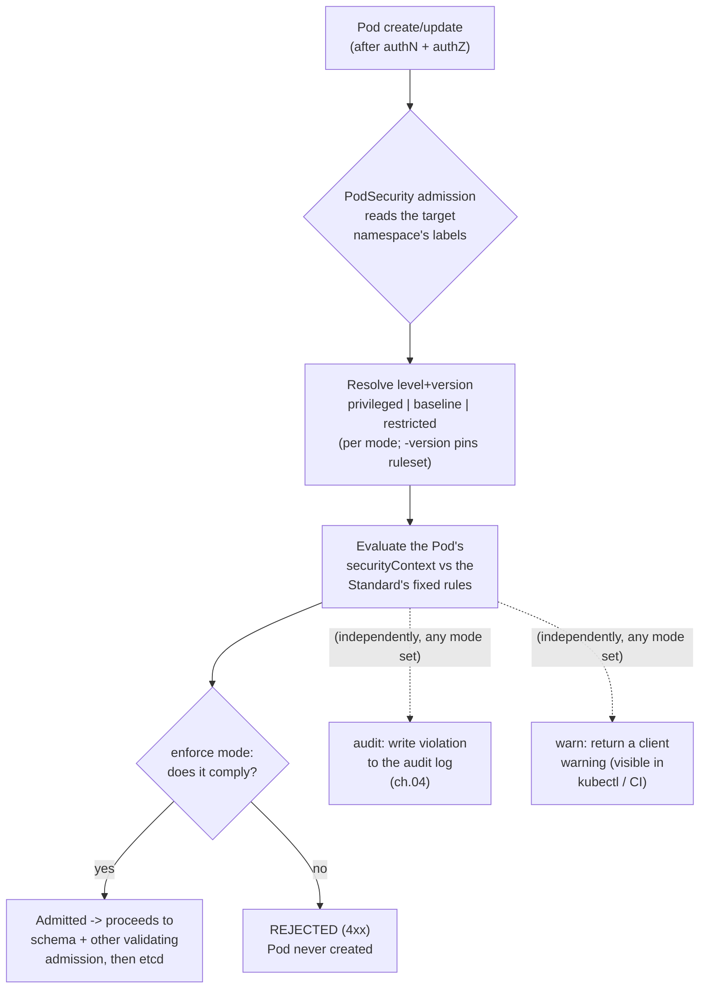

# 02 — Pod security and container escape

> What a compromised container can do to the node, shown by doing it on a
> kind cluster: `privileged`, `hostPath: /`, `hostPID`, a mounted runtime
> socket, and writing a binary into a running container. Then what closes
> them: **Pod Security Admission** enforcing the `restricted` standard on the
> namespace, and a Pod that carries the
> [baseline](../01-core-workloads/01-pods.md#baseline). User namespaces, the
> deeper fix for root, are taught here too, including why the lab could not
> run one.

**Estimated time:** ~35 min read · ~45 min hands-on (the lab is scripted)
**Prerequisites:** [Part 05 ch.01](01-authn-authz-rbac.md) — RBAC controls who
can ask the API; this chapter controls what a running Pod can do to the kernel
· [Part 01 ch.01](../01-core-workloads/01-pods.md#baseline) — the workload
baseline, field by field ·
[Part 00 ch.02](../00-foundations/02-containers-and-images.md)
— capabilities, namespaces and cgroups
**You'll know after this:** • watch a container reach the node through four
classic escapes, and name what closes each: a field `restricted` bans or a
field the baseline sets · • read the `restricted` Pod Security Standard: the
escapes it forbids, the fields it requires and what it leaves to the baseline
· • label a namespace `enforce`/`audit`/`warn` at a standard and version · •
keep a workload that genuinely needs privilege in its own namespace with a
registered exception · • explain why PodSecurityPolicy is gone and what
replaced it

<!-- tags: security, psa-restricted, container-escape, core-objects, day-2 -->

## Why this exists

[ch.01](01-authn-authz-rbac.md) decided *who can ask the API server for
what*. This chapter starts after a Pod is already running and asks a
different question: **what can the process inside the container do to the
node and its kernel?** A container is a process with namespaces and cgroups,
sharing the node's kernel. By default it can run as **root (UID 0)**, gain
new privileges, holds a non-trivial set of Linux **capabilities**, has an
unrestricted **syscall** surface, and writes to its root filesystem. None of
that is the API's business, so **RBAC does not touch it**. A catalog process
compromised through an application bug starts with all of that, and any
`hostPath`, `hostPID` or `privileged` in its spec hands it the node.

Two built-in controls answer this, and this chapter proves both on a lab
cluster. `securityContext` is how a workload **drops** those privileges. **Pod
Security Admission (PSA)** is the admission controller that **refuses to
admit** Pods that have not. Everything a workload should carry is the
[baseline](../01-core-workloads/01-pods.md#baseline); 01.01 explains each
field against the threat it answers, and this chapter does not repeat those
explanations. It shows the threats landing, and the baseline and PSA stopping
them.

## Mental model

Two complementary halves:

- **`securityContext` — the privileges a Pod gives up.** Set per-pod
  (`spec.securityContext`: `runAsNonRoot`, `runAsUser`/`Group`, `fsGroup`,
  `seccompProfile`) and per-container (`spec.containers[].securityContext`:
  `allowPrivilegeEscalation`, `capabilities`, `readOnlyRootFilesystem`,
  `privileged`). Container-level overrides pod-level for the same field. The
  hardened form is the [baseline](../01-core-workloads/01-pods.md#baseline):
  run as non-root, drop all capabilities, forbid privilege escalation, apply
  the runtime's default seccomp filter, read-only root filesystem.
- **Pod Security Admission — the floor the cluster enforces.** PSA is a
  built-in *validating admission* plugin (the stage from
  [ch.01](01-authn-authz-rbac.md)). You label a **namespace** with one of
  three **Pod Security Standards**, in up to three **modes**. You do not write
  rules; you pick a level. It is a fixed, versioned policy.

The two must agree. If a namespace enforces `restricted`, every Pod in it
must carry a `restricted`-satisfying `securityContext` or it is rejected at
admission. A guide that labels its namespace `restricted` and then ships Pods
that cannot be admitted is broken, so the hands-on proves the Bookstore
satisfies the floor it sets for itself.

## Threats and controls

Every threat here is a way a running container reaches the node. The lab
below lands five escapes (`privileged`, `hostPath`, `hostPID`, the runtime
socket and the binary drop) and shows root's UID 0 reading a root-only file on
the node, then closes them. It runs no setuid or syscall exploit: for those
two rows it reads the control on the hardened Pod, `NoNewPrivs: 1` and
`Seccomp: 2`, as
[01.01 step 5](../01-core-workloads/01-pods.md#debug-containers)
does. It lands `hostPID` only; `hostNetwork` and `hostIPC` fall under the same
rule in the
[Pod Security Standards](https://kubernetes.io/docs/concepts/security/pod-security-standards/#baseline).

| Threat | Control this chapter teaches | Where it goes deeper |
|---|---|---|
| A container runs as **root** and its UID 0 is the node's UID 0 | [`runAsNonRoot` + a non-zero `runAsUser`](../01-core-workloads/01-pods.md#baseline-run-as); user namespaces remap root | [User namespaces](https://kubernetes.io/docs/concepts/workloads/pods/user-namespaces/); 05.05 <!-- link-later: 05.05 --> |
| A **privileged** container holds every capability and sees the node's devices | PSA `restricted` forbids `privileged`; [`capabilities.drop: ["ALL"]`](../01-core-workloads/01-pods.md#baseline-capabilities) | [capabilities(7)](https://man7.org/linux/man-pages/man7/capabilities.7.html) |
| A **setuid** binary or file capability escalates inside the container | [`allowPrivilegeEscalation: false`](../01-core-workloads/01-pods.md#baseline-privilege-escalation) | [`no_new_privs`](https://docs.kernel.org/userspace-api/no_new_privs.html) |
| `hostPath`, `hostPID`, `hostNetwork` or `hostIPC` break the sandbox | PSA `restricted` forbids host namespaces and `hostPath` | [Pod Security Standards](https://kubernetes.io/docs/concepts/security/pod-security-standards/#baseline) |
| A mounted **runtime socket** gives root over every pod on the node | no socket mount; `restricted` forbids the `hostPath` it needs | admission policy, 05.07 <!-- link-later: 05.07 --> |
| An attacker **drops a binary** into the running container | [`readOnlyRootFilesystem: true`](../01-core-workloads/01-pods.md#baseline-read-only-root) | [01.01 step 5](../01-core-workloads/01-pods.md#debug-containers) |
| A rare **syscall** attacks the kernel | [`seccompProfile: RuntimeDefault`](../01-core-workloads/01-pods.md#baseline-seccomp); AppArmor, SELinux | kernel isolation, 05.05 <!-- link-later: 05.05 --> |
| A Pod with none of the above is admitted at all | [Pod Security labels on the namespace](../01-core-workloads/01-pods.md#baseline-namespace) | [Pod Security admission](https://kubernetes.io/docs/concepts/security/pod-security-admission/) |

## Diagrams

### PSA admission decision: namespace labels → enforce/audit/warn (Mermaid)



### The `restricted` hardening checklist (ASCII)

```
 PSA `restricted` REQUIRES (pod or container securityContext) ──────────────
  [x] runAsNonRoot: true                  (pod or container)
  [x] allowPrivilegeEscalation: false     (container)
  [x] capabilities.drop: ["ALL"]          (container; may re-add only
                                            NET_BIND_SERVICE)
  [x] seccompProfile.type: RuntimeDefault (or Localhost; NOT Unconfined)
  [x] privileged: false / unset, no hostPID/hostIPC/hostNetwork,
      no hostPath volumes, no hostPorts, restricted /proc + sysctls,
      SELinux type unset/allowed
  [x] volumes only: configMap, csi, downwardAPI, emptyDir, ephemeral,
      persistentVolumeClaim, projected, secret
 NOT required by `restricted`, but in the baseline, so every workload has it:
  [ ] readOnlyRootFilesystem: true   + an emptyDir for any writable path
  [ ] runAsUser / runAsGroup pinned to a specific non-zero UID/GID
  [ ] a digest pin, requests + a memory limit, a dedicated ServiceAccount
 `baseline` = the host*/privileged/hostPath/sysctl bans WITHOUT the
 non-root / drop-ALL / seccomp / no-priv-esc requirements.
```

## The attacker's view: escaping a container on kind

> **Lab 05.02 (tier A).** Recorded on a kind cluster: Kubernetes v1.37.0
> node, kubectl v1.37.2, containerd v2.3.4, runc 1.4.3, crictl 1.36.0, on a
> Linux host (Ubuntu 26.04, kernel 7.0.0, Docker 29.8.2). It has not been run
> on macOS. The script is
> [`labs/05-02.sh`](../examples/security-lab/labs/05-02.sh); the recorded run
> is [`evidence/05-02.txt`](../examples/security-lab/evidence/05-02.txt); the
> cluster config is
> [`kind/cluster.yaml`](../examples/security-lab/kind/cluster.yaml). **Run it
> only against a kind cluster you own:** it runs deliberately insecure Pods
> in a throwaway `psa-lab` namespace and boots the Bookstore's data tier, and
> it deletes them at the end. Each block of output below names the script step
> that produced it. What did not work the first time: the user-namespace Pod
> (script step 7) did not start on this host, and the lab shows the failure
> rather than pretending otherwise.

Every attack below lands in `psa-lab`, a namespace labelled `privileged` so
nothing is blocked while we show the danger (script step 1):

```sh
kubectl create ns psa-lab
kubectl label ns psa-lab pod-security.kubernetes.io/enforce=privileged
```

All of them reach the **kind node**, and stop there. A kind node is itself a
container on the machine that runs kind, so these escapes end at the node
container; on a real cluster the node is a machine, and the same manifests
reach it. Nothing in this lab touches the host that runs kind. Host-kernel
escapes are a tier-B topic, out of this chapter.

### `privileged`: every capability, and the node's devices

A `privileged` container turns off most of the isolation the runtime applies.
`kubectl explain pod.spec.containers.securityContext.privileged` describes its
processes as "essentially equivalent to root on the host". The manifest is
small, and that is the point:

<!-- gate: insecure-on-purpose -->

```yaml
# INSECURE ON PURPOSE: a privileged container is close to root on the node. Lab cluster only.
apiVersion: v1
kind: Pod
metadata:
  name: escape-privileged
  namespace: psa-lab
spec:
  containers:
    - name: esc
      image: busybox@sha256:73aaf090f3d85aa34ee199857f03fa3a95c8ede2ffd4cc2cdb5b94e566b11662  # busybox:1.36
      command: ["sleep", "3600"]
      securityContext:
        privileged: true
```

Read its capabilities (script step 2):

```sh
kubectl exec -n psa-lab escape-privileged -- sh -c '
  grep -E "^Cap(Eff|Bnd)" /proc/self/status | tr -s "\t" " "
  cat /proc/sys/kernel/cap_last_cap'
```

<!-- gate: output -->

```
CapEff: 000001ffffffffff
CapBnd: 000001ffffffffff
40
```

Bits 0 to 40 are all set and 40 is the kernel's highest capability, so both
sets are full. They include `CAP_SYS_MODULE`, which loads kernel modules, and
`CAP_SYS_ADMIN`, which mounts filesystems, as
[capabilities(7)](https://man7.org/linux/man-pages/man7/capabilities.7.html)
lists. The lab does not load a module: a kind node shares the kernel of the
machine that runs it, and that machine is out of bounds. It does compare two
things it can show safely against a plain Pod, which sets no `securityContext`
at all:

<!-- gate: insecure-on-purpose -->

```yaml
# INSECURE ON PURPOSE: no securityContext, so it runs as root with the runtime's defaults. Lab cluster only.
apiVersion: v1
kind: Pod
metadata:
  name: plain
  namespace: psa-lab
spec:
  containers:
    - name: app
      image: busybox@sha256:73aaf090f3d85aa34ee199857f03fa3a95c8ede2ffd4cc2cdb5b94e566b11662  # busybox:1.36
      command: ["sleep", "3600"]
```

```sh
for p in escape-privileged plain; do
  echo "== $p =="
  kubectl exec -n psa-lab "$p" -- sh -c '
    echo "entries in /dev: $(ls /dev | wc -l)"
    mount -t tmpfs tmpfs /tmp && echo "mount: allowed" || true'
done
```

<!-- gate: output -->

```
== escape-privileged ==
entries in /dev: 229
mount: allowed
== plain ==
entries in /dev: 16
mount: permission denied (are you root?)
```

The privileged container sees the node's devices and can mount filesystems.
Its mount here stays inside the container's own mount namespace. A hardened
container's `CapEff` is `0000000000000000`, as
[Closing the escapes](#closing-the-escapes) shows. Capabilities are only one
layer, though, and the next escape does not need any.

### `hostPath: /`: read every file on the node

A `hostPath` volume mounts a node path into the Pod. Mount `/` and the
container reads the node's filesystem, including the cluster's certificate
authority **private key**:

<!-- gate: insecure-on-purpose -->

```yaml
# INSECURE ON PURPOSE: hostPath / mounts the whole node filesystem. Lab cluster only.
apiVersion: v1
kind: Pod
metadata:
  name: escape-hostpath
  namespace: psa-lab
spec:
  containers:
    - name: esc
      image: busybox@sha256:73aaf090f3d85aa34ee199857f03fa3a95c8ede2ffd4cc2cdb5b94e566b11662  # busybox:1.36
      command: ["sleep", "3600"]
      volumeMounts:
        - name: nodefs
          mountPath: /host
          readOnly: true
  volumes:
    - name: nodefs
      hostPath:
        path: /
        type: Directory
```

Script step 3 reads the key and prints only its first ten bytes, the PEM
armour, so no key material reaches the transcript:

```sh
kubectl exec -n psa-lab escape-hostpath -- sh -c '
  cat /host/etc/hostname
  stat -c "%a %U %n" /host/etc/kubernetes/pki/ca.key
  head -c 10 /host/etc/kubernetes/pki/ca.key; echo'
```

<!-- gate: output -->

```
security-lab-control-plane
600 root /host/etc/kubernetes/pki/ca.key
-----BEGIN
```

The hostname confirms this is the control-plane node. `ca.key` is readable
only by its owner, root, and the container read it. With the cluster CA key an
attacker can sign a client certificate for any user: the API server takes the
[username and groups from the certificate](https://kubernetes.io/docs/reference/access-authn-authz/authentication/#x509-client-certificates),
and the group `system:masters` is
[bound to `cluster-admin`](https://kubernetes.io/docs/reference/access-authn-authz/rbac/#user-facing-roles).

This Pod asked for no capability and is not `privileged`. What let it read the
key is that its UID 0 is the node's UID 0, which owns the file. Script step 3
also runs two variants of it: `escape-hostpath-nocaps` adds
`capabilities.drop: ["ALL"]`, and `escape-hostpath-nonroot` adds
`runAsUser: 65532` as well:

```sh
for p in escape-hostpath-nocaps escape-hostpath-nonroot; do
  echo "== $p =="
  kubectl exec -n psa-lab "$p" -- sh -c '
    id -u
    grep ^CapEff /proc/self/status | tr -s "\t" " "
    cat /host/etc/hostname
    head -c 10 /host/etc/kubernetes/pki/ca.key; echo'
done
```

<!-- gate: output -->

```
== escape-hostpath-nocaps ==
0
CapEff: 0000000000000000
security-lab-control-plane
-----BEGIN
== escape-hostpath-nonroot ==
65532
CapEff: 0000000000000000
security-lab-control-plane
head: /host/etc/kubernetes/pki/ca.key: Permission denied
```

Root with no capabilities at all still reads the key. A non-root UID does not,
which is what the baseline's non-root fields buy. It still reads the node's
world-readable files, though, so non-root does not make the mount safe. That
is why `restricted` bans the volume type. `hostPath` is not an operational
convenience to grant lightly; it is the node's filesystem.

### `hostPID`: see and signal every process on the node

`hostPID: true` puts the container in the node's process namespace:

<!-- gate: insecure-on-purpose -->

```yaml
# INSECURE ON PURPOSE: hostPID shares the node's process namespace. Lab cluster only.
apiVersion: v1
kind: Pod
metadata:
  name: escape-hostpid
  namespace: psa-lab
spec:
  hostPID: true
  containers:
    - name: esc
      image: busybox@sha256:73aaf090f3d85aa34ee199857f03fa3a95c8ede2ffd4cc2cdb5b94e566b11662  # busybox:1.36
      command: ["sleep", "3600"]
```

From there, script step 4 lists the node's processes, checks it may signal the
kubelet and reads the kubelet's command line:

```sh
kubectl exec -n psa-lab escape-hostpid -- sh -c '
  ps -o pid,comm | grep -E "kubelet|containerd$" | sed "s/^ *//"
  K=$(pidof kubelet)
  kill -0 "$K" && echo "kill -0 kubelet: allowed"
  tr "\0" " " < "/proc/$K/cmdline" | cut -c1-40'
```

<!-- gate: output -->

```
137 containerd
748 kubelet
kill -0 kubelet: allowed
/usr/bin/kubelet --bootstrap-kubeconfig=
```

The node's `containerd` and `kubelet` are right there. `kill -0` delivers no
signal but makes the same permission check a real signal would
([kill(2)](https://man7.org/linux/man-pages/man2/kill.2.html)), and it passed.
The readable command line makes `hostPID` an information leak on its own: any
secret a process took as an argument is visible from this container. Add
`privileged` and a process can join PID 1's namespaces with `nsenter`, which
is what [setns(2)](https://man7.org/linux/man-pages/man2/setns.2.html)'s
capability checks otherwise stop.

### A mounted runtime socket: root over every pod

"Just mount the Docker or containerd socket" is a common request from CI and
build tooling. The socket is the runtime's full control API, so a container
that holds it can start, stop and inspect **every** container on the node.
This Pod mounts the socket and borrows the node's `crictl` to talk to it:

<!-- gate: insecure-on-purpose -->

```yaml
# INSECURE ON PURPOSE: a mounted runtime socket controls every pod on the node. Lab cluster only.
apiVersion: v1
kind: Pod
metadata:
  name: escape-socket
  namespace: psa-lab
spec:
  containers:
    - name: esc
      image: busybox@sha256:73aaf090f3d85aa34ee199857f03fa3a95c8ede2ffd4cc2cdb5b94e566b11662  # busybox:1.36
      command: ["sleep", "3600"]
      volumeMounts:
        - name: sock
          mountPath: /run/containerd/containerd.sock
        - name: crictl
          mountPath: /usr/local/bin/crictl
          readOnly: true
  volumes:
    - name: sock
      hostPath:
        path: /run/containerd/containerd.sock
        type: Socket
    - name: crictl
      hostPath:
        path: /usr/local/bin/crictl
        type: File
```

Script step 5 lists what the socket can see:

```sh
kubectl exec -n psa-lab escape-socket -- sh -c '
  R=unix:///run/containerd/containerd.sock
  echo "containers visible: $(crictl -r $R ps -q 2>/dev/null | wc -l)"
  crictl -r $R ps --name kube-apiserver -o table 2>/dev/null |
    grep -o "kube-apiserver-[a-z0-9-]*"'
```

<!-- gate: output -->

```
containers visible: 16
kube-apiserver-security-lab-control-plane
```

The socket enumerates every container on the node, control plane included.
The lab only lists them and changes nothing, but the same tool
[creates and starts containers](https://github.com/kubernetes-sigs/cri-tools/blob/master/docs/crictl.md),
so an attacker can launch a new one mounting the node's root. The Pod is not
`privileged` and adds no capability, which is what makes the socket so
dangerous.

### No read-only root filesystem: drop a binary in

A writable root filesystem lets an attacker who already has code execution
modify the image at runtime: overwrite the entrypoint, drop a tool, persist.
The `plain` Pod (no `readOnlyRootFilesystem`) writes a working script straight
into `/usr/bin` and runs it (script step 6):

```sh
kubectl exec -n psa-lab plain -- sh -c '
  printf "%s\n" "#!/bin/sh" "echo INJECTED" > /usr/bin/backdoor
  chmod +x /usr/bin/backdoor
  /usr/bin/backdoor'
```

<!-- gate: output -->

```
INJECTED
```

With
[`readOnlyRootFilesystem: true`](../01-core-workloads/01-pods.md#baseline-read-only-root)
the same write fails, as [Closing the escapes](#closing-the-escapes) shows.
The process may still write the `emptyDir` mounted at `/tmp`, so the
application keeps working while its own binaries become immutable.

### User namespaces: remap in-container root

User namespaces are the deeper fix for "root in the container is root on the
node". With `hostUsers: false` the kubelet maps the Pod's users to host IDs no
other Pod on the node shares. Root in the container then has no privilege on
the host, and the capabilities it holds apply only inside its own namespace,
so `CAP_SYS_MODULE`, for one, has no effect. File ownership on volumes does
not change: `runAsUser` and `fsGroup` still mean the user inside the
container, and files on any mounted volume, `hostPath` included, are owned as
they would be without a user namespace. The Kubernetes page on
[user namespaces](https://kubernetes.io/docs/concepts/workloads/pods/user-namespaces/)
states all of this.

```yaml
spec:
  hostUsers: false     # map in-container root to an unprivileged node UID
  containers:
    - name: app
      # ... the baseline from 01.01 ...
```

Without it, the container's root is the node's root. The `plain` Pod shows an
identity map (`0 0 4294967295`: container UID 0 is node UID 0, for the whole
range), from script step 7:

```sh
kubectl exec -n psa-lab plain -- cat /proc/self/uid_map | awk '{$1=$1;print}'
```

<!-- gate: output -->

```
0 0 4294967295
```

On this host the `hostUsers: false` Pod did not start. The API server accepted
the field, and the kubelet failed to create the sandbox at a `sysfs` mount
(script step 7):

<!-- gate: output -->

```
Failed to create pod sandbox: rpc error: code = Unknown desc = failed to start sandbox: failed to create containerd task: failed to create shim task: OCI runtime create failed: runc create failed: unable to start container process: error during container init: error mounting "sysfs" to rootfs at "/sys": mount src=sysfs, dst=/sys, dstFd=/proc/thread-self/fd/11, flags=MS_RDONLY|MS_NOSUID|MS_NODEV|MS_NOEXEC: operation not permitted
```

The kernel, runc and containerd versions here all clear the minimums on the
[same page](https://kubernetes.io/docs/concepts/workloads/pods/user-namespaces/#before-you-begin)
(Linux 6.3, runc 1.2, containerd 2.0). The lab did not check the page's
filesystem requirement separately, and did not trace the refused mount further.

This is one run on one Linux host, so it settles nothing about the field
itself. `hostUsers: false`
[joins the baseline](../01-core-workloads/01-pods.md#baseline-run-as) once it
is verified on kind on both Linux and macOS hosts. It has not been: it failed
here and has not been run on macOS. Until then the baseline does not carry it,
and nothing else in this chapter depends on it.

## Closing the escapes: `restricted` and the baseline {#closing-the-escapes}

Now point the *same* attack manifests at a namespace that enforces
`restricted`. Script step 1 created it:

```sh
kubectl create ns psa-restricted
kubectl label ns psa-restricted \
  pod-security.kubernetes.io/enforce=restricted \
  pod-security.kubernetes.io/audit=restricted \
  pod-security.kubernetes.io/warn=restricted
```

The API server runs PSA in admission, so a server-side dry-run returns the
verdict without creating anything. The script saved the manifests above as
`esc-<name>.yaml`. They name `psa-lab`, and `kubectl -n` refuses a mismatch,
so step 8 rewrites the namespace with `sed` on the way in:

```sh
for a in privileged hostpath hostpid socket; do
  echo "== $a =="
  sed "s/psa-lab/psa-restricted/" "esc-$a.yaml" |
    kubectl apply --dry-run=server -f - 2>&1 | sed -n 1p
done
```

Every attack is refused, and the message names each field that failed:

<!-- gate: output -->

```
== privileged ==
Error from server (Forbidden): error when creating "STDIN": pods "escape-privileged" is forbidden: violates PodSecurity "restricted:latest": privileged (container "esc" must not set securityContext.privileged=true), allowPrivilegeEscalation != false (container "esc" must set securityContext.allowPrivilegeEscalation=false), unrestricted capabilities (container "esc" must set securityContext.capabilities.drop=["ALL"]), runAsNonRoot != true (pod or container "esc" must set securityContext.runAsNonRoot=true), seccompProfile (pod or container "esc" must set securityContext.seccompProfile.type to "RuntimeDefault" or "Localhost")
== hostpath ==
Error from server (Forbidden): error when creating "STDIN": pods "escape-hostpath" is forbidden: violates PodSecurity "restricted:latest": allowPrivilegeEscalation != false (container "esc" must set securityContext.allowPrivilegeEscalation=false), unrestricted capabilities (container "esc" must set securityContext.capabilities.drop=["ALL"]), restricted volume types (volume "nodefs" uses restricted volume type "hostPath"), runAsNonRoot != true (pod or container "esc" must set securityContext.runAsNonRoot=true), seccompProfile (pod or container "esc" must set securityContext.seccompProfile.type to "RuntimeDefault" or "Localhost")
== hostpid ==
Error from server (Forbidden): error when creating "STDIN": pods "escape-hostpid" is forbidden: violates PodSecurity "restricted:latest": host namespaces (hostPID=true), allowPrivilegeEscalation != false (container "esc" must set securityContext.allowPrivilegeEscalation=false), unrestricted capabilities (container "esc" must set securityContext.capabilities.drop=["ALL"]), runAsNonRoot != true (pod or container "esc" must set securityContext.runAsNonRoot=true), seccompProfile (pod or container "esc" must set securityContext.seccompProfile.type to "RuntimeDefault" or "Localhost")
== socket ==
Error from server (Forbidden): error when creating "STDIN": pods "escape-socket" is forbidden: violates PodSecurity "restricted:latest": allowPrivilegeEscalation != false (container "esc" must set securityContext.allowPrivilegeEscalation=false), unrestricted capabilities (container "esc" must set securityContext.capabilities.drop=["ALL"]), restricted volume types (volumes "sock", "crictl" use restricted volume type "hostPath"), runAsNonRoot != true (pod or container "esc" must set securityContext.runAsNonRoot=true), seccompProfile (pod or container "esc" must set securityContext.seccompProfile.type to "RuntimeDefault" or "Localhost")
```

`restricted` forbids these attacks outright: `privileged`, `hostPID`, and the
`hostPath` that both the filesystem read and the socket need. `hostPID` and
`hostPath` are not `securityContext` fields. PSA closes them by requiring that
`spec.hostPID` and `spec.volumes[].hostPath` are absent, and the non-root
variant above shows the baseline's fields alone would not. `restricted` also
requires the non-root, drop-all, no-escalation and seccomp fields, which is why
every refusal lists them too.

It is not the same list as this chapter's escapes. The binary drop is closed
by `readOnlyRootFilesystem`, which
[`restricted` does not ask for](../01-core-workloads/01-pods.md#baseline-namespace)
and the baseline does, and user namespaces are no part of it. It also forbids
things the lab never shows: `hostPort`, other volume types, an unmasked
`/proc` and unsafe sysctls, as the
[Pod Security Standards](https://kubernetes.io/docs/concepts/security/pod-security-standards/#restricted)
list. So a Pod needs both: PSA is the floor the API server enforces, and the
baseline is what the workload carries.

A Pod that carries the [baseline](../01-core-workloads/01-pods.md#baseline)
is admitted into the same namespace and runs (script step 9):

```yaml
apiVersion: v1
kind: ServiceAccount
metadata:
  name: hardened-sa
  namespace: psa-restricted
automountServiceAccountToken: false
---
apiVersion: v1
kind: Pod
metadata:
  name: hardened
  namespace: psa-restricted
spec:
  serviceAccountName: hardened-sa
  automountServiceAccountToken: false
  securityContext:
    runAsNonRoot: true
    runAsUser: 65532
    runAsGroup: 65532
    seccompProfile:
      type: RuntimeDefault
  containers:
    - name: app
      image: busybox@sha256:73aaf090f3d85aa34ee199857f03fa3a95c8ede2ffd4cc2cdb5b94e566b11662  # busybox:1.36
      command: ["sleep", "3600"]
      securityContext:
        allowPrivilegeEscalation: false
        readOnlyRootFilesystem: true
        capabilities:
          drop: ["ALL"]
      resources:
        requests:
          cpu: 10m
          memory: 16Mi
        limits:
          memory: 32Mi
      volumeMounts:
        - name: tmp
          mountPath: /tmp
  volumes:
    - name: tmp
      emptyDir: {}
```

```sh
kubectl exec -n psa-restricted hardened -- sh -c '
  exec 2>&1
  id
  grep -E "^(CapEff|NoNewPrivs|Seccomp):" /proc/self/status | tr -s "\t" " "
  printf x > /usr/bin/backdoor || true'
```

<!-- gate: output -->

```
uid=65532 gid=65532 groups=65532
CapEff: 0000000000000000
NoNewPrivs: 1
Seccomp: 2
sh: can't create /usr/bin/backdoor: Read-only file system
```

It runs as UID 65532 with no capabilities, `no_new_privs` set and the seccomp
filter on, and the read-only root filesystem turns the binary drop from script
step 6 into a dead end.

## Pod Security: levels, modes, and exceptions

PSA selects a **standard** per **namespace** through labels, and nothing else.

- **Levels.** `privileged` (no restrictions, for trusted infrastructure
  only), `baseline` (blocks the host-namespace, `privileged` and `hostPath`
  escapes above but not the non-root/seccomp requirements), and `restricted`
  (`baseline` plus the non-root, drop-all, no-escalation and seccomp
  requirements the lab just showed). `restricted` is the right default for
  application namespaces.
- **Modes.** `enforce` rejects violators at admission; `audit` records the
  violation in the audit log ([ch.04](04-secrets-and-cluster-hardening.md));
  `warn` returns a client warning visible in `kubectl` and CI. Set all three
  at the same level so a regression that slips past review still surfaces.
  The migration path is always `warn`/`audit` first, fix every violation,
  then `enforce`, never the other way round.
- **Version.** The `-version` label pins the ruleset to a Kubernetes minor
  (`latest` is newest; pin to `v1.37` to freeze behaviour across upgrades).

### Exceptions, not exemptions

Some legitimate workloads cannot run under `restricted`. Falco's Modern eBPF
driver needs at least `CAP_SYS_PTRACE`, `CAP_SYS_RESOURCE`, `CAP_BPF` and
`CAP_PERFMON` ([Falco docs](https://falco.org/docs/setup/container/)), and
`restricted` lets a container add back only `NET_BIND_SERVICE`. node-exporter
runs in the host's network and PID namespaces
([its README](https://github.com/prometheus/node_exporter#docker)). The wrong
move is to relax the default to accommodate them, because every new agent then
loosens it further until the cluster is back at `privileged`.

The labels cannot be tuned to fit, either. They select a level and a version
and nothing more, and `baseline` forbids host namespaces and `hostPath` too.
So node-exporter's lowest working level is `privileged`. The only other route
is a
[PSA exemption](https://kubernetes.io/docs/concepts/security/pod-security-admission/#exemptions)
in the API server's configuration, which a namespace label does not show.

The first rule below is recorded in ADR 0005
(`docs/adr/0005-restricted-psa-default-with-exceptions.md` in the repository).
The other two come from the guide's authoring spec, section 2
(`docs/security-first-authoring.md`):

- The default stays `restricted`. A workload that needs more lives in **its
  own namespace**, labelled with the **lowest** level it actually works
  under, and only that namespace.
- If the privilege is for an optional feature, turn the feature off instead.
- Each exception is recorded in the one registry with its reason, the chapter
  that owns it, and an expiry within twelve months, so it is revisited rather
  than forgotten. The security programme chapter keeps that registry, 05.09
  <!-- link-later: 05.09 -->.

Never weaken the application namespace to fit an agent. Move the agent.

## Hardening the Bookstore to the floor it sets

The Bookstore's `bookstore` namespace enforces `restricted` (set in
[`00-namespace.yaml`](../examples/bookstore/raw-manifests/00-namespace.yaml)).
Every workload manifest in `raw-manifests/` carries the
[baseline](../01-core-workloads/01-pods.md#baseline), the three stock images
included: each is pinned by digest and runs on a read-only root. The only new
work per image is matching the baseline to what the image can actually do. The
fields are explained in 01.01, so here is only the per-image judgement:

| Workload | Image | How it runs non-root | Writable under the read-only root |
|---|---|---|---|
| catalog, orders, payments-worker | built on `gcr.io/distroless/static:nonroot` (UID 65532) | non-root by design, single static binary | `emptyDir` for scratch |
| storefront | purpose-built `nginx` on `USER 101`, listens `:8080`, all temp paths under `/tmp` | built unprivileged; stock nginx would fail | `emptyDir` at `/tmp` |
| postgres | official image, normally starts as root and `gosu` to UID 999 | runs directly as UID 999, with [`fsGroup`](../01-core-workloads/01-pods.md#baseline-fsgroup) 999 on the data volume | PVC for data; `emptyDir` at `/var/run/postgresql` and `/tmp` |
| rabbitmq | official image, normally starts as root and `gosu` to UID 999 | runs directly as UID 999, with `fsGroup` 999 | `emptyDir` at `/var/lib/rabbitmq` and `/tmp` |
| redis | official image, in-memory (`--save "" --appendonly no`) | runs as UID 999 | `emptyDir` at `/data` and `/tmp` |
| db-migrate, cleanup | the postgres image, for `psql` | runs as UID 999 | `emptyDir` at `/tmp` |

The port choice matters: the Go services and nginx bind `:8080` (above 1024),
so they need no `NET_BIND_SERVICE` and can drop every capability. `fsGroup`
makes the kubelet give the data volume to GID 999 so a non-root process can
write it; `fsGroupChangePolicy: OnRootMismatch` skips a slow recursive chown
on a large volume.

> **Valid and bootable are different checks.** `restricted` checks the
> manifest's `securityContext` and volume types, not whether the app boots.
> **Every Pod that can land in `bookstore`** passes it, because `enforce:
> restricted` gates *every* Pod in the namespace: the seven long-running
> workloads (catalog, orders, storefront, payments-worker, postgres, rabbitmq,
> redis), the manual-canary catalog variant, and both batch jobs (the
> `db-migrate` Job and the `cleanup` CronJob). They are valid because they set
> `runAsNonRoot`, a non-root UID, `capabilities.drop: ["ALL"]`,
> `allowPrivilegeEscalation: false` and `seccompProfile: RuntimeDefault`.
> `fsGroup` and the `emptyDir` mounts play no part in that verdict. They are
> for **boot**: `fsGroup` lets UID 999 write the data volume without the
> image's root step, and each `emptyDir` gives back a path the read-only root
> took away. Never label a namespace `restricted` and apply stock images
> unchanged: they expect root and will fail PSA, or fail to boot.

Verify the floor matches the workloads with a server-side dry-run of every
manifest that can land in the namespace. This must be exhaustive, because
`enforce: restricted` gates every Pod, not just the long-running ones, so the
loop finds the manifests itself instead of naming them. The `01-` and `02-`
seed Pods name no namespace; 01.01's lab admits them under `restricted`.

```sh
# from the repo root (full-guide/)
kubectl apply -f examples/bookstore/raw-manifests/00-namespace.yaml
kubectl apply -f examples/bookstore/raw-manifests/05-serviceaccounts-rbac.yaml
for f in $(grep -lE '^  namespace: bookstore' examples/bookstore/raw-manifests/*.yaml); do
  grep -qE '^kind: (Pod|Deployment|StatefulSet|DaemonSet|Job|CronJob)( |$)' "$f" &&
    kubectl apply --dry-run=server -f "$f"
done
```

Script step 10 prints:

<!-- gate: output -->

```
deployment.apps/catalog created (server dry run)
deployment.apps/storefront created (server dry run)
deployment.apps/redis created (server dry run)
deployment.apps/rabbitmq created (server dry run)
deployment.apps/orders created (server dry run)
deployment.apps/payments-worker created (server dry run)
service/postgres created (server dry run)
statefulset.apps/postgres created (server dry run)
job.batch/db-migrate created (server dry run)
cronjob.batch/cleanup created (server dry run)
service/catalog created (server dry run)
deployment.apps/catalog-stable created (server dry run)
deployment.apps/catalog-canary created (server dry run)
```

Each line reports the object `created (server dry run)`, with **no**
`would violate PodSecurity "restricted:latest"` warning. A warning there is
the one failure this whole chapter exists to prevent: the namespace sets a
floor its own workloads do not meet.

> **Why dry-run the workload, not just the Deployment?** PSA enforces on
> **Pods**. A Deployment with a bad template is *accepted* at admission; its
> ReplicaSet is what fails to create Pods. A server dry-run of the Deployment
> still surfaces the violation as a warning, which is why a warning counts as
> a failure and `--dry-run=server` is the right check.

A dry-run cannot tell you the stock images boot, so script step 11 runs the
data tier from those manifests, runs both batch jobs against it, and tries the
binary drop in each long-running container. It skips steps 10 and 11 on a
cluster that already has a `bookstore` namespace, because its teardown deletes
that namespace.

```sh
M=examples/bookstore/raw-manifests
kubectl apply -f $M/16-db-credentials.yaml -f $M/35-priorityclasses.yaml
kubectl apply -f $M/12-redis.yaml -f $M/13-rabbitmq.yaml -f $M/20-postgres-statefulset.yaml
kubectl rollout status -n bookstore deployment/redis --timeout=300s
kubectl rollout status -n bookstore deployment/rabbitmq --timeout=300s
kubectl rollout status -n bookstore statefulset/postgres --timeout=300s
```

```sh
M=examples/bookstore/raw-manifests
kubectl apply -f $M/21-db-migrate-job.yaml -f $M/22-cleanup-cronjob.yaml
kubectl wait -n bookstore --for=condition=complete --timeout=110s job/db-migrate
kubectl create job -n bookstore cleanup-lab --from=cronjob/cleanup
kubectl wait -n bookstore --for=condition=complete --timeout=110s job/cleanup-lab
kubectl logs -n bookstore job/db-migrate --tail=1
kubectl logs -n bookstore job/cleanup-lab --tail=1
```

<!-- gate: output -->

```
job.batch/db-migrate created
cronjob.batch/cleanup created
job.batch/db-migrate condition met
job.batch/cleanup-lab created
job.batch/cleanup-lab condition met
migration complete
cleanup complete
```

```sh
for w in deployment/redis deployment/rabbitmq statefulset/postgres; do
  echo "== $w =="
  kubectl exec -n bookstore "$w" -- sh -c 'id; touch /usr/bin/backdoor || true'
done
```

<!-- gate: output -->

```
== deployment/redis ==
uid=999(redis) gid=999(redis) groups=999(redis)
touch: cannot touch '/usr/bin/backdoor': Read-only file system
== deployment/rabbitmq ==
uid=999(rabbitmq) gid=999(rabbitmq) groups=999(rabbitmq)
touch: cannot touch '/usr/bin/backdoor': Read-only file system
== statefulset/postgres ==
uid=999(postgres) gid=999(postgres) groups=999(postgres),101(ssl-cert)
touch: cannot touch '/usr/bin/backdoor': Read-only file system
```

## How it works under the hood

01.01 explains what each baseline field does to the running container. The
parts specific to Pod security:

- **`privileged: true`** is the opposite of the baseline: every capability
  plus the node's devices, as the lab showed. `restricted` and `baseline` both
  forbid it.
- **seccomp defaults to `Unconfined`.** When `seccompProfile` is unset the
  Pod gets *no* syscall filtering, which is why `restricted` requires the
  field set to `RuntimeDefault` (the runtime's curated profile, blocking
  dangerous and obsolete syscalls) or a vetted `Localhost` profile, and
  rejects `Unconfined`. The kubelet's `--seccomp-default` flag, or
  `seccompDefault: true` in its configuration file, makes `RuntimeDefault` the
  default on that node
  ([seccomp tutorial](https://kubernetes.io/docs/tutorials/security/seccomp/)),
  but do not assume it; set the field, which the Bookstore does at the pod
  level on every workload.
- **AppArmor and SELinux** confine a process further with a Linux Security
  Module. AppArmor is a first-class field,
  `securityContext.appArmorProfile.type` (GA in v1.31), preferred over the
  legacy annotation. SELinux uses `securityContext.seLinuxOptions`. On
  SELinux nodes the kubelet can mount an eligible volume with
  `-o context=<label>` instead of relabelling every file (the `SELinuxMount`
  work), which is much faster but means Pods sharing a volume on a node must
  share a label (opt out with `seLinuxChangePolicy: Recursive`). Both
  profiles, sandboxed runtimes and the
  Security Profiles Operator are the subject of kernel isolation, 05.05
  <!-- link-later: 05.05 -->.
- **PSA is built-in validating admission with a *fixed* policy.** Unlike a
  policy engine you do not author rules; you select the level with the
  namespace labels `pod-security.kubernetes.io/<enforce|audit|warn>[-version]`.
  Cluster-wide **exemptions** (by username, RuntimeClass or namespace) are
  configured in the API server's `AdmissionConfiguration`, used sparingly for
  system namespaces. For any rule beyond the three standards you reach for a
  policy engine (ValidatingAdmissionPolicy, Kyverno or Gatekeeper), admission
  policy as code, 05.07 <!-- link-later: 05.07 -->.
- **Why PodSecurityPolicy is gone.** PSP (removed in **v1.25**) was a cluster
  object bound via RBAC, whose mutating behaviour and ordering were confusing
  and easy to misconfigure. PSA replaces it with a non-mutating,
  namespace-labelled, three-level model. Any tutorial still telling you to
  write a `PodSecurityPolicy` is describing a removed API.

## Production notes

> **In production:** label **every** application namespace
> `enforce: restricted` with `audit` and `warn` at the same level, and roll
> it out `warn` to `audit` to `enforce` so you find every violation before you
> start rejecting. A namespace at `privileged` is an unlocked door;
> `baseline` is a minimum, not a goal.

> **In production:** pin the `-version` label (for example `v1.37`) on
> regulated clusters so a Kubernetes upgrade cannot silently change what
> `restricted` means; bump it deliberately. `latest` is fine for fast-moving
> environments that test upgrades.

> **In production:** prefer purpose-built non-root, distroless images so
> `restricted` is free. For stock images that assume root (databases,
> brokers), do what the Bookstore does: `runAsNonRoot` plus a specific UID,
> `fsGroup` for the data volume, a read-only root with an `emptyDir` for each
> path the image writes, and *test that they boot*. If an image truly cannot
> run on a read-only root, do not drop the field quietly: record an exception
> in the registry, with its reason, its chapter and an expiry.

> **In production (managed clusters):** PSA is built in and on by default, so
> the labels work the same on EKS, GKE and AKS. GKE Autopilot forces a
> hardened baseline and rejects privileged Pods; EKS and AKS commonly pair
> PSA with a policy engine and a node-level runtime sensor. PSA is the floor,
> not the whole story.

## Quick Reference

```sh
kubectl label ns <NS> \
  pod-security.kubernetes.io/enforce=restricted \
  pod-security.kubernetes.io/enforce-version=latest \
  pod-security.kubernetes.io/audit=restricted \
  pod-security.kubernetes.io/warn=restricted --overwrite     # apply PSA
kubectl apply --dry-run=server -f pod.yaml                    # PSA verdict (no create)
kubectl get ns <NS> --show-labels | tr ',' '\n' | grep pod-security
kubectl explain pod.spec.securityContext --recursive
kubectl explain pod.spec.containers.securityContext --recursive
```

Minimal `restricted`-compliant skeleton (the baseline, in short; the image is
pinned by digest unless you built it):

```yaml
spec:
  serviceAccountName: app-sa             # never `default`
  automountServiceAccountToken: false
  securityContext:                       # pod-level
    runAsNonRoot: true
    runAsUser: 65532
    runAsGroup: 65532
    seccompProfile: { type: RuntimeDefault }
  containers:
    - name: app
      securityContext:                   # container-level
        allowPrivilegeEscalation: false
        readOnlyRootFilesystem: true     # + an emptyDir for any writable path
        capabilities: { drop: ["ALL"] }  # add back only NET_BIND_SERVICE if <1024
      resources:
        requests: { cpu: 10m, memory: 16Mi }
        limits: { memory: 32Mi }
      volumeMounts: [ { name: tmp, mountPath: /tmp } ]
  volumes: [ { name: tmp, emptyDir: {} } ]
# namespace: pod-security.kubernetes.io/enforce: restricted (+ -version)
```

Checklist:

- [ ] `runAsNonRoot: true` (+ a non-zero `runAsUser`); image not built as root
- [ ] `capabilities.drop: ["ALL"]` (add back only what is proven necessary)
- [ ] `allowPrivilegeEscalation: false`; never `privileged: true`
- [ ] `seccompProfile.type: RuntimeDefault` (or a vetted `Localhost`)
- [ ] `readOnlyRootFilesystem: true` + `emptyDir` for writes, or a registered
  exception
- [ ] Third-party images pinned by digest; requests and a memory limit; a
  dedicated ServiceAccount
- [ ] Only `restricted`-allowed volume types; no hostPath, hostPort or host
  namespaces
- [ ] Namespace labelled `enforce: restricted` (+ `audit`/`warn` + `-version`)
- [ ] Server dry-run shows **no** PodSecurity violation for any workload

## Test your understanding

> Try each before opening the answer drawer. The act of trying is the
> exercise; the answer is the check.

1. **A teammate says: "We have RBAC; why do we also need Pod Security
   Admission?" Give the one-sentence answer that names the layer each one
   defends.**
   <details><summary>Show answer</summary>

   RBAC controls **what API calls a principal can make** (the API surface);
   PSA controls **what kernel-level privileges a Pod may be admitted with**
   (capabilities, host namespaces, syscall filtering). A Pod admitted with
   `hostPath: /` reads the cluster CA key whatever its ServiceAccount may do,
   as `escape-hostpath` showed in script step 3, so the two are orthogonal
   defences. See §Mental model.

   </details>

2. **In the lab, the `hostPath: /` Pod and the mounted-socket Pod were both
   refused by `restricted` for "restricted volume types". Why is `hostPath`
   the field that matters there, and what is the attacker actually after in
   each case?**
   <details><summary>Show answer</summary>

   Both rely on a `hostPath` volume, which `restricted` forbids outright. The
   `hostPath: /` Pod is after the node's files (the CA private key signs a
   `system:masters` certificate); the socket Pod is after the runtime's
   control API (start a container mounting the node root, or inspect every
   other pod). Remove `hostPath` and both vectors are gone, which is why
   `restricted` bans the volume type rather than trying to judge the path.

   </details>

3. **The team wants a "node-exporter" DaemonSet on a `restricted`-labelled
   namespace. It needs `hostNetwork: true` and `hostPID: true`. What do you
   tell them, and what is the right fix?**
   <details><summary>Show answer</summary>

   `restricted` forbids host namespaces, so the DaemonSet's Pods are rejected
   at admission. Do **not** weaken PSA on the application namespace. Deploy
   node-exporter into its own `monitoring` namespace labelled at the lowest
   level it works under. That level is `privileged`: `baseline` forbids host
   namespaces too, and PSA labels select only a level and a version, so there
   is nothing in between. The only other route is an exemption in the API
   server's `AdmissionConfiguration`. Either way, record the exception in the
   registry with its reason, owning chapter and an expiry. Trusted
   infrastructure lives in trusted namespaces; apps stay `restricted`. See
   §Exceptions, not exemptions.

   </details>

4. **Hands-on extension, a deliberate failure, for a cluster you own: in a
   throwaway namespace, turn on warn mode and start a Pod with no hardened
   `securityContext`. What do you see, and what would `enforce=restricted`
   have done instead?**

   ```sh
   kubectl create ns psa-warn-demo
   kubectl label ns psa-warn-demo pod-security.kubernetes.io/warn=restricted
   kubectl run demo -n psa-warn-demo --restart=Never \
     --image=busybox@sha256:73aaf090f3d85aa34ee199857f03fa3a95c8ede2ffd4cc2cdb5b94e566b11662 \
     -- sleep 60
   kubectl delete ns psa-warn-demo
   ```

   A new namespace's `default` ServiceAccount takes a moment to appear. If
   `kubectl run` is refused for lacking it, run it again.
   <details><summary>What you should see</summary>

   `warn` returns a client-side `Warning: would violate PodSecurity
   "restricted:latest": ...` listing every failing field, but the Pod **is
   created**. With `enforce=restricted` on the namespace the same command gets
   `Error from server (Forbidden)` and no Pod exists. This is the migration
   tool: `warn`/`audit` first to find every violation, fix them, then
   `enforce`, never the reverse.

   </details>

5. **Why was PodSecurityPolicy removed, and what do you say to someone who
   shows up with a "PSP migration" runbook?**
   <details><summary>Show answer</summary>

   PSP (removed in v1.25) was bound to ServiceAccounts via RBAC `use`
   permissions, with mutating behaviour and alphabetical tie-breaks that were
   hard to reason about and easy to misconfigure. PSA is namespace-labelled
   and bound to the fixed, versioned Pod Security Standards, which is far
   simpler. A PSP runbook is dead advice: the modern path is PSA labels plus a
   policy engine for any rule beyond the three standards.

   </details>

## Further reading

- **Ibryam & Huß, _Kubernetes Patterns_ 2e, ch.23 — _Process Containment_**
  — dropping privileges, capabilities, and the threat model behind running
  containers unprivileged.
- **Rosso et al., _Production Kubernetes_, ch.8 — "Admission Control"** —
  enforcing Pod security at admission and the migration from PSP to PSA.
- Official:
  <https://kubernetes.io/docs/concepts/security/pod-security-standards/>,
  <https://kubernetes.io/docs/concepts/security/pod-security-admission/>,
  <https://kubernetes.io/docs/tasks/configure-pod-container/security-context/>,
  and user namespaces,
  <https://kubernetes.io/docs/concepts/workloads/pods/user-namespaces/>.
- kind's "a node is a container":
  <https://kind.sigs.k8s.io/docs/design/initial/>.
