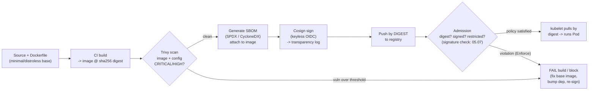

# 03 — Supply chain security

> Supply-chain security as a lab on the catalog image. Scan an image and its
> SBOM, watch two scanners disagree about the same SBOM, suppress one finding
> with a VEX statement, sign and attest the digest, and see a moved tag change
> what a Pod runs. Then pin the digest, and lint manifests before they reach
> the cluster. The lab runs on kind with a lab registry. The keyless pipeline
> is in [Part 07 ch.03](../07-delivery/03-cicd-pipeline.md).

**Estimated time:** ~30 min read · ~60 min hands-on (the lab is scripted)
**Prerequisites:** [Part 05 ch.02](02-pod-security.md): a hardened Pod can still run a malicious image · [Part 00 ch.02](../00-foundations/02-containers-and-images.md): image tags, digests and registries · [Part 00 ch.04](../00-foundations/04-control-plane-deep-dive.md): admission runs before persistence
**You'll know after this:** • scan an image digest and an SBOM, and explain why two scanners disagree · • write a CycloneDX SBOM with Syft and attest it to a digest · • sign a digest and verify it, and show that a moved tag fails · • pin a Pod to a digest in its manifest, and check the pin with a server dry run · • lint a manifest with KubeLinter, kubesec and Trivy config, and say what each one misses

<!-- tags: security, supply-chain, ci-cd, day-2 -->

## Why this exists

[ch.01](01-authn-authz-rbac.md) secured *who calls the API*;
[ch.02](02-pod-security.md) secured *what a running container can do*. Both
assume the **image you ran is the image you meant to run**. That assumption is
exactly where most real-world cluster compromises enter: a mistyped public
image (`bookstore/catlog`), a base image with a critical CVE, a dependency
with a backdoor, or a compromised CI pipeline that pushed a tampered image to a
tag you trust. A perfectly RBAC'd, `restricted`-hardened Pod running a
malicious image is still a malicious Pod.

Supply-chain security is making the path *from source to a running container*
verifiable: know what's **in** the image (scan + SBOM), prove **who built it
and that it's unmodified** (sign + attest), and **refuse to run** anything that
fails those checks (admission policy). The admission half is taught in
[05.07](07-admission-control-and-policy-as-code.md), which has the cluster check
signatures. This
chapter proves the rest on a lab cluster, so each control is seen to work
before a policy depends on it.

## Mental model

A container image is **untrusted input until proven otherwise**, and trust is
built in four stages, each answering one question:

1. **What is in it?** *Scan* the image and emit an **SBOM** (a bill of
   materials). Finds known-vulnerable packages and records exactly what
   shipped. (Trivy/Grype, syft.)
2. **Is it exactly what we built?** *Pin by digest* (`name@sha256:…`) so the
   reference is immutable; a tag like `:dev`/`:latest` can be repointed at
   anything later.
3. **Who vouches for it?** *Sign* the digest (Cosign) and *attest* what it
   contains (an SBOM) and how it was built (provenance). A signature proves
   *this digest was signed by that key or identity*. It does **not** prove the
   image is bug-free or non-malicious: provenance ≠ safety. A key you hold
   proves that you signed. A keyless signature from CI proves a workflow
   identity, and [07.03](../07-delivery/03-cicd-pipeline.md) builds that path.
4. **Will the cluster refuse the rest?** *Admission* checks the reference
   and the signature before the API server stores the Pod. The restricted
   namespace from [ch.02](02-pod-security.md) already refuses the insecure
   manifest in this chapter's lab. Checking signatures at admission is
   [05.07](07-admission-control-and-policy-as-code.md).

A policy that checks images starts in **Audit** mode, so it reports what it
would block before it blocks anything. Flip it straight to Enforce and you
block your own deployments, sometimes the cluster's own components. 05.07
covers that lifecycle.

## Threats and controls

Each threat is a way the image a Pod runs can differ from the one you meant to
ship. The lab below shows a moved tag fail verification (step 10) and a
signed digest verify (steps 8 and 9). The pin in the first row is shown only
as a server dry run (step 13). What a pinned Pod does after a tag move is
cited, not run: steps 11 and 12 need a throwaway cluster.

| Threat | Control this chapter teaches | Where it goes deeper |
|---|---|---|
| A **tag moves**: the name you tested now points at other bytes | [Pin by digest](../01-core-workloads/01-pods.md#baseline-image-digest), so the reference names the bytes | Signed releases in [15.03](../15-day-to-day-production-ops/03-image-signing-and-provenance.md) |
| A **tampered image** is pushed under a name you trust | Sign the digest, and verify before you deploy | Keyless signing from CI in [07.03](../07-delivery/03-cicd-pipeline.md); admission checks in [05.07](07-admission-control-and-policy-as-code.md) |
| A **known-vulnerable package** ships in the image | Scan the digest, keep an SBOM to find the image again after a new CVE, and suppress a finding only with a reviewed VEX statement | The image scan stage in [07.03](../07-delivery/03-cicd-pipeline.md); triage and SLAs in [05.09](09-running-security-on-a-platform-team.md) |
| You **cannot say what built the image**, or from what | A signed SBOM attestation and BuildKit's SLSA provenance | Supply-chain security on EKS, [14.12](../14-eks-in-production-a-to-z/12-supply-chain-security.md) |
| A manifest asks for **privilege** the workload does not need | KubeLinter, kubesec and Trivy config flag it before it reaches the cluster | The same checks in CI, [07.03](../07-delivery/03-cicd-pipeline.md) |

## Diagrams

### Secure pipeline: build → scan → SBOM → sign → admit → run (Mermaid)



### The trust chain (ASCII)

```
 developer ─commit─▶ CI (trusted builder)
                         │  builds → IMAGE@sha256:DIGEST   (immutable ref)
                         │  Trivy scan  ── CVEs over threshold? ─▶ FAIL
                         │  syft        ── SBOM (what's inside)
                         │  cosign sign ── signature + cert ─▶ Rekor (public log)
                         ▼
                   registry: only DIGESTs (tags are mutable pointers)
                         ▼
   kube-apiserver  ── admission ──────────┐   (05.07 adds the signature check)
                                         ├─ image is digest-pinned?      ┐
                                         ├─ restricted: runAsNonRoot, no privilege ─ all ▶ ADMIT
                                         ├─ signature verifies vs identity? (05.07) ┘  else ▶ DENY
                         ▼
                   kubelet pulls @DIGEST  (byte-identical to what was signed)

 A signature proves PROVENANCE (who built this digest), NOT that it is safe.
 Scanning proves KNOWN vulns absent at scan time, NOT that it is bug-free.
 Defense in depth: you need ALL of scan + SBOM + sign + admit, not one.
```

## Hands-on with the Bookstore

**Tier A: kind, and a lab registry on the same Docker host.** Run this lab only
against a kind cluster you own. The script refuses any kubectl context that is
not a kind cluster, and it creates and deletes only namespaces and containers
named `p05-03-*`. Steps 11 and 12 change what a node pulls, so they need the
throwaway cluster described in
[`kind/supply-chain.yaml`](../examples/security-lab/kind/supply-chain.yaml),
which `kind create cluster` builds from that file. Every other step runs on
any kind cluster.

The transcript at
[`evidence/05-03.txt`](../examples/security-lab/evidence/05-03.txt) opens with
what ran: the Kubernetes v1.37.0 node, Trivy 0.76.1, Syft 1.55.0, Grype
0.121.0, cosign 3.1.4, KubeLinter 0.8.3, kubesec 2.15.0 and Docker buildx
0.38.1. It also records what did not work the first time, and the lab host:
Ubuntu 26.04.1 with Docker 29.8.2. This revision ran the scanners from a
workstation, over an ssh tunnel to the registry. Nothing here is tested on any
other host system. The captured output keeps the lab's own names,
`p05-03-supply-chain` and `p05-03-registry`, where the commands in this
chapter use `supply-chain` and `lab-registry`.

### Set up

```sh
kind create cluster --config examples/security-lab/kind/supply-chain.yaml
```

If your Docker engine is remote, forward the registry port first, so the
scanners on your workstation can reach it:

```sh
ssh -fN -L 5001:127.0.0.1:5001 <docker-host>
```

Then run the lab from the guide root, where the script finds its files:

```sh
bash examples/security-lab/labs/05-03.sh
```

The script prints each command before it runs it, so the output below is the
output you should see. Your digests will differ from the ones printed here,
because the build records a new time in its provenance each run.

### Step 3: build with provenance, and read the digest

The catalog image is built with `--provenance=mode=max`, which makes BuildKit
attest how the image was built, and it is pushed to the lab registry. Its
identity is the digest, which the registry reports for the image index:

<!-- gate: output -->
```text
signed digest: sha256:9478671474c03d066d43e5a6c3b038215d9e83acf8465b8f617ea54eab1e1f33
```

The index lists the amd64 image and an attestation manifest for it:

<!-- gate: output -->
```text
Name:      localhost:5001/bookstore/catalog:lab
MediaType: application/vnd.oci.image.index.v1+json
Digest:    sha256:9478671474c03d066d43e5a6c3b038215d9e83acf8465b8f617ea54eab1e1f33

Manifests:
  Name:        localhost:5001/bookstore/catalog:lab@sha256:0874c9b2a5c21a42e0a114dab56ec765148acde815595129a0c9661337d29c54
  MediaType:   application/vnd.oci.image.manifest.v1+json
  Platform:    linux/amd64

  Name:        localhost:5001/bookstore/catalog:lab@sha256:d4bccd93be32e968fccbbb94f5409b0cba827b2ed895ea2b480a997d194cdf45
  MediaType:   application/vnd.oci.image.manifest.v1+json
  Platform:    unknown/unknown
  Annotations:
    vnd.docker.reference.digest: sha256:0874c9b2a5c21a42e0a114dab56ec765148acde815595129a0c9661337d29c54
    vnd.docker.reference.type:   attestation-manifest
```

The provenance names the build type, and the base images the build used, by
name and digest:

<!-- gate: output -->
```text
https://github.com/moby/buildkit/blob/master/docs/attestations/slsa-definitions.md
pkg:docker/docker/dockerfile sha256:4edf897a3ffa55b89f906fc8cc78afdb3f1834cc9c7083565e611a8a7d5fe99e
pkg:docker/golang sha256:a2012b4a1d1f9f7e9f44e0d39b805a901e856b1dd80b4e6ee4338db547050308
pkg:docker/gcr.io/distroless/static sha256:18f4cc26c9ffa7f20a359298be7deadac5c607c8e03a02b8119f1a5fc2f82c99
```

Read the digest, not the tag, from here on. The tag is a name that the
registry can repoint, and step 10 does that.

### Step 4: scan the digest

<!-- gate: output -->
```text
Report Summary

┌──────────────────────────────────────────────────────────────────────────────────┬──────────┬─────────────────┐
│                                      Target                                      │   Type   │ Vulnerabilities │
├──────────────────────────────────────────────────────────────────────────────────┼──────────┼─────────────────┤
│ localhost:5001/bookstore/catalog@sha256:9478671474c03d066d43e5a6c3b038215d9e83a- │  debian  │        0        │
│ cf8465b8f617ea54eab1e1f33 (debian 13.7)                                          │          │                 │
├──────────────────────────────────────────────────────────────────────────────────┼──────────┼─────────────────┤
│ catalog                                                                          │ gobinary │        0        │
└──────────────────────────────────────────────────────────────────────────────────┴──────────┴─────────────────┘
Legend:
- '-': Not scanned
- '0': Clean (no security findings detected)
```

Trivy reports no HIGH or CRITICAL finding in either target. That is the
answer of today's vulnerability database for these packages. It is not a
permanent property of the image, which is why the scan has to run again on a
schedule.

### Step 5: write the SBOM

Syft writes a CycloneDX inventory of the image: every package and every file
it recognised. The lab counts the component types:

<!-- gate: output -->
```text
file 946
library 25
operating-system 1
```

The six Debian packages and the Go modules are all `library` entries, which
is why the count is 25. The `operating-system` entry names the distribution,
`debian`. The `file` entries record the image's files, and no scanner matches
them against a vulnerability list.

### Step 6: two scanners, one SBOM

Scan the same SBOM with both tools and compare the findings by identifier and
severity:

<!-- gate: output -->
```text
trivy on the SBOM: 1 finding(s)
grype on the SBOM: 1 finding(s)
only trivy reports:
CVE-2026-39824 golang.org/x/sys UNKNOWN
only grype reports:
GO-2026-5024 golang.org/x/sys Low
grype on the image itself: 0 match(es)
```

Both scanners report one finding for `golang.org/x/sys`, but under different
identifiers and severities. Trivy keys it by a CVE, with severity UNKNOWN.
Grype keys it by a Go advisory, with severity Low. Grype's scan of the image
itself reports nothing. The lab does not trace why.
Each scanner answers from its own database and its own matching rules, so
neither result is the whole truth. Triage the union, and record each decision
where the next person can read it.

### Step 7: record a VEX statement

A VEX statement is a machine-readable claim about one finding. The lab writes
one that names the CVE and says it is still under investigation:

<!-- gate: output -->
```text
grype with vex.json: 1 finding(s)
trivy with vex.json: 1 finding(s)
```

Both scanners still report one finding. A statement that leaves a finding
open does not hide it, and that is the first thing VEX has to get right. The
lab writes no `not_affected` statement. That claim says the vulnerable code is
absent or cannot run, and only someone who checks the call path can make it.
The [OpenVEX specification](https://github.com/openvex/spec) lists the
justifications a reviewer chooses from, and the status and justification
values it allows.

### Step 8: sign the digest

The lab generates a key pair with an empty password, and signs the digest. The
signing config names no transparency log, so nothing goes to a public log.
The signature goes to the lab registry only:

<!-- gate: output -->
```text
verify exit=0
WARNING: Skipping tlog verification is an insecure practice that lacks transparency and auditability verification for the signature.
sha256:9478671474c03d066d43e5a6c3b038215d9e83acf8465b8f617ea54eab1e1f33
```

`cosign verify` passes for the digest. The lab passes `--insecure-ignore-tlog`,
so it also prints a warning that the transparency log was not checked. Keyless
signing in CI records the signature in a public transparency log, and
verification checks the builder's identity. That is the path
[07.03](../07-delivery/03-cicd-pipeline.md) builds, and this lab does not
repeat it.

### Step 9: attest the SBOM to the digest

The SBOM is signed as an in-toto statement whose predicate is the CycloneDX
document, and the lab reads back the predicate type:

<!-- gate: output -->
```text
https://cyclonedx.org/bom
```

The attestation travels with the digest. A later reader can check that this
inventory belongs to this image, not to a different build with the same name.

### Step 10: attack, and move the tag

An attacker with push access to the registry rebuilds the image from the signed
digest, changes one file, and pushes the result under the same tag:

<!-- gate: output -->
```text
signed digest:  sha256:9478671474c03d066d43e5a6c3b038215d9e83acf8465b8f617ea54eab1e1f33
tag now points: sha256:dd388115b18e1b02efa8b72c12c93fef257475f1f14f981331f2f070899fe269
```

The tag now points at a new digest. The signed digest is unchanged, and the
signature still verifies for it. Verification of the tag fails, because the
new bytes carry no signature:

<!-- gate: output -->
```text
verify of the tag, exit=10
Error: no signatures found
```

A deploy that verifies the tag and then deploys the tag is checking one thing
and running another. The tag can move between the two steps.

### Steps 11 and 12: a Pod that names a tag, and a Pod pinned by digest

Steps 11 and 12 of the lab create two baseline Pods, and they did not run in
this revision. The first names the tag with `imagePullPolicy: Always`, which
asks the kubelet to pull the tag each time the container starts. The second
names the signed digest. The Pod for the tag is below. Whatever the tag points
at when the node pulls it is what runs. After step 10, that is the attacker's
build:

```yaml
apiVersion: v1
kind: Pod
metadata: {name: catalog-by-tag, namespace: supply-chain}
spec:
  serviceAccountName: catalog
  automountServiceAccountToken: false
  securityContext:
    runAsNonRoot: true
    runAsUser: 65532
    runAsGroup: 65532
    seccompProfile: {type: RuntimeDefault}
  containers:
    - name: catalog
      image: lab-registry:5000/bookstore/catalog:lab
      imagePullPolicy: Always
      securityContext:
        allowPrivilegeEscalation: false
        readOnlyRootFilesystem: true
        capabilities: {drop: ["ALL"]}
      resources:
        requests: {cpu: 10m, memory: 16Mi}
        limits: {memory: 64Mi}
      volumeMounts: [{name: tmp, mountPath: /tmp}]
  volumes: [{name: tmp, emptyDir: {}}]
```

**Not run here.** This Pod needs the throwaway cluster `supply-chain`, which
this revision did not create, so the lab skipped it and printed that it did.
The kubelet's pull policies are defined on the [Kubernetes container images
page](https://kubernetes.io/docs/concepts/containers/images/#image-pull-policy).
There, `Always` means the kubelet asks the runtime to pull the image each time
it launches the container. An unset policy is chosen from the image reference
when the Pod is created: a digest, or a tag other than `:latest`, gives
`IfNotPresent`, and a `:latest` tag or no tag gives `Always`. What this Pod
runs on a real node was not observed here. The expected result is that its
digest differs from the signed digest after step 10.

The hardened form pins the digest from step 3 and keeps the rest of the
baseline:

```yaml
apiVersion: v1
kind: Pod
metadata: {name: catalog-by-digest, namespace: supply-chain}
spec:
  serviceAccountName: catalog
  automountServiceAccountToken: false
  securityContext:
    runAsNonRoot: true
    runAsUser: 65532
    runAsGroup: 65532
    seccompProfile: {type: RuntimeDefault}
  containers:
    - name: catalog
      image: lab-registry:5000/bookstore/catalog@sha256:9478671474c03d066d43e5a6c3b038215d9e83acf8465b8f617ea54eab1e1f33
      imagePullPolicy: IfNotPresent
      securityContext:
        allowPrivilegeEscalation: false
        readOnlyRootFilesystem: true
        capabilities: {drop: ["ALL"]}
      resources:
        requests: {cpu: 10m, memory: 16Mi}
        limits: {memory: 64Mi}
      volumeMounts: [{name: tmp, mountPath: /tmp}]
  volumes: [{name: tmp, emptyDir: {}}]
```

Step 12 pins the Pod, then moves the tag again and recreates the Pod, which is
the re-attack. Neither ran in this revision, so what the pinned Pod does after a
tag move was not observed. Step 13 does run this Pod, as a server dry run
against the restricted namespace, which is the admission part of the same
control:

<!-- gate: output -->
```text
pod/catalog-by-digest created (server dry run)
```

The ServiceAccount the Pod names is created first, because a dry run cannot
see one that does not exist yet. It has `automountServiceAccountToken: false`:

```yaml
apiVersion: v1
kind: ServiceAccount
metadata: {name: catalog, namespace: supply-chain}
automountServiceAccountToken: false
```

### Step 13: lint two manifests, and refuse one

The insecure Pod below is never applied to the cluster. It exists to be linted
and refused. It is marked as deliberately insecure, and it runs in a namespace
the lab creates:

<!-- gate: insecure-on-purpose -->
```yaml
# INSECURE ON PURPOSE: a Pod that every manifest linter should refuse. Lab cluster only.
apiVersion: v1
kind: Pod
metadata: {name: catalog-insecure, namespace: supply-chain}
spec:
  serviceAccountName: catalog
  hostNetwork: true
  containers:
    - name: catalog
      image: lab-registry:5000/bookstore/catalog:lab
      securityContext:
        privileged: true
        runAsUser: 0
        allowPrivilegeEscalation: true
```

Three linters read it, and each reports a different set of problems. KubeLinter
reports seven:

<!-- gate: output -->
```text
Error: found 7 lint errors
KubeLinter 0.8.3
# ...
insecure.yaml: (object: p05-03-supply-chain/catalog-insecure /v1, Kind=Pod) resource shares host's network namespace (via hostNetwork=true). (check: host-network, remediation: Ensure the host's network namespace is not shared.)
# ...
kube-linter exit=1
```

kubesec gives it a negative score and the baseline a positive one. Trivy config
checks a different rule set, and reports four HIGH misconfigurations:

<!-- gate: output -->
```text
kubesec score -43, critical items 3
kubesec score 14, critical items 0
```

<!-- gate: output -->
```text
Tests: 22 (SUCCESSES: 18, FAILURES: 4)
Failures: 4 (HIGH: 4, CRITICAL: 0)
# ...
KSV-0009 (HIGH): Pod 'catalog-insecure' should not set 'spec.template.spec.hostNetwork' to true
# ...
KSV-0014 (HIGH): Container 'catalog' of Pod 'catalog-insecure' should set 'securityContext.readOnlyRootFilesystem' to true
# ...
KSV-0017 (HIGH): Container 'catalog' of Pod 'catalog-insecure' should set 'securityContext.privileged' to false
# ...
KSV-0118 (HIGH): pod catalog-insecure in p05-03-supply-chain namespace is using the default security context, which allows root privileges
```

The restricted namespace refuses the insecure Pod at admission, and names the
Pod Security checks it fails:

<!-- gate: output -->
```text
Error from server (Forbidden): error when creating "insecure.yaml": pods "catalog-insecure" is forbidden: violates PodSecurity "restricted:latest": host namespaces (hostNetwork=true), privileged (container "catalog" must not set securityContext.privileged=true), allowPrivilegeEscalation != false (container "catalog" must set securityContext.allowPrivilegeEscalation=false), unrestricted capabilities (container "catalog" must set securityContext.capabilities.drop=["ALL"]), runAsNonRoot != true (pod or container "catalog" must set securityContext.runAsNonRoot=true), runAsUser=0 (container "catalog" must not set runAsUser=0), seccompProfile (pod or container "catalog" must set securityContext.seccompProfile.type to "RuntimeDefault" or "Localhost")
```

KubeLinter and Trivy both flag `hostNetwork` and privilege, and the namespace
refuses the same fields. The linters run in review, before a change is
proposed. The namespace checks every create and update in it. Neither replaces
the other, and neither checks the image's signature. That check is
[05.07](07-admission-control-and-policy-as-code.md).

### Step 14: tear down

The lab deletes its namespace and its registry. It writes its keys and files to
a scratch directory and removes that directory too:

<!-- gate: output -->
```text
namespace "p05-03-supply-chain" deleted
p05-03-registry
```

Delete the cluster when you have finished with it: `kind delete cluster --name
supply-chain`. The lab does not delete a cluster you created.

### What the run proves, and what it does not

The run proves the mechanism on this lab: a digest is the identity the
registry serves, a moved tag fails verification, an SBOM attestation travels
with the digest, two scanners give different answers for one SBOM, and a
restricted namespace refuses the insecure Pod while it admits the baseline.
It does not prove that the catalog is free of vulnerabilities, that the
builder can be trusted, or that a real pipeline signs and verifies this way.
Those are the jobs of [07.03](../07-delivery/03-cicd-pipeline.md), which runs
the same tools in CI, and of the cloud chapters that run them in production
([14.12](../14-eks-in-production-a-to-z/12-supply-chain-security.md),
[15.03](../15-day-to-day-production-ops/03-image-signing-and-provenance.md)).

## How it works under the hood

- **Tags are mutable pointers; digests are content.** `…/catalog:lab` names
  whatever the registry holds under that name today. `…@sha256:<HASH>` names
  the bytes. For an image index, the hash covers the index document, which
  lists each platform image and each attestation by its own digest. Step 10
  of the lab moves the tag. Step 11 is the Pod that names the tag, and it was
  not run in this revision. A digest reference cannot move; the tag can. The
[Kubernetes images page](https://kubernetes.io/docs/concepts/containers/images/)
says the same: tags can be moved, and digests are fixed.
- **Scanners compare an inventory with a database, and each database has its
  own identifiers.** Trivy and Grype both enumerate the Debian packages and
  the Go modules in the image, then look each one up. The same module can
  carry a CVE identifier in one database and a Go advisory identifier in the
  other, with a different severity. Step 6 shows exactly that. A clean result
  is true of today's database, so a scan has to run again on a schedule.
- **An SBOM is the durable inventory.** It records what the image contained
  when it was built. Once a new CVE is published, the stored SBOM answers
  "which images contain this module?" without rebuilding anything. A signed
  SBOM attestation ties that inventory to the digest, so changing the list
  breaks the signature.
- **Signatures and attestations live beside the image.** `cosign` stores
  them in the registry under the digest. Verification checks the signature
  over the digest, then the key or the certificate identity behind it. With a
  transparency log, it also checks the log entry. The lab's key has no log
  entry, so `cosign verify` prints a warning that it skipped that check. The
  keyless signing in CI, which [07.03](../07-delivery/03-cicd-pipeline.md)
  builds, writes to a public log, and verification checks the builder
  identity.
- **Provenance describes the build, and does not vouch for it.** BuildKit
  records the build definition, the source revision and the base images by
  digest, as an SLSA provenance attestation (the predicate type is
  `https://slsa.dev/provenance/v1`, per the
  [SLSA provenance specification](https://slsa.dev/spec/v1.1/provenance)). A
  record is only as trustworthy as the builder that wrote it. So a verifier
  checks the builder identity too, which is 07.03's pipeline and the
  admission check in 05.07.
- **Admission is where the cluster checks.** Kyverno's `verifyImages` rule
  checks signatures when a Pod is admitted, and
  [05.07](07-admission-control-and-policy-as-code.md)
 installs and tests it. A policy that checks
  images is best introduced in Audit mode, which reports what it would block
  without blocking it, and then moved to Enforce. The restricted namespace in
  this lab enforces the Pod Security standard, which is why step 13 refuses
  the insecure Pod.
- **Pull credentials are secrets.** A private registry is reached through an
  `imagePullSecrets` secret, which needs the same RBAC and encryption care as
  any Secret ([Part 03 ch.02](../03-config-and-storage/02-secrets.md)). Short-
  lived registry tokens from cloud identity are better than a long-lived pull
  secret; the cloud chapters cover that, in
  [14.12](../14-eks-in-production-a-to-z/12-supply-chain-security.md) and
  [15.03](../15-day-to-day-production-ops/03-image-signing-and-provenance.md).

## Quick Reference

```sh
docker buildx imagetools inspect <REGISTRY>/<IMAGE>:<TAG> --format '{{.Manifest.Digest}}'
docker buildx build --provenance=mode=max --push -t <REGISTRY>/<IMAGE>:<TAG> <CONTEXT>
trivy image --exit-code 1 --severity HIGH,CRITICAL <REGISTRY>/<IMAGE>@<DIGEST>  # CI gate
syft <REGISTRY>/<IMAGE>@<DIGEST> -o cyclonedx-json=sbom.cdx.json           # SBOM
grype sbom:sbom.cdx.json --vex <VEX-FILE>                                  # SBOM scan with VEX
cosign sign --yes <REGISTRY>/<IMAGE>@<DIGEST>                              # keyless, in CI
cosign attest --yes --type cyclonedx --predicate sbom.cdx.json <REGISTRY>/<IMAGE>@<DIGEST>
cosign verify --certificate-identity <IDENTITY> \
  --certificate-oidc-issuer <ISSUER> <REGISTRY>/<IMAGE>@<DIGEST>           # verify the builder
kube-linter lint <MANIFEST>
kubesec scan <MANIFEST>
trivy config --severity HIGH,CRITICAL <MANIFEST-DIR>
```

Checklist:

- [ ] Images **pinned by digest** in every manifest, and the digest comes from
  the build that was tested
- [ ] A Trivy gate on the digest with `--exit-code`, and an SBOM stored with
  the image
- [ ] Two scanners compared on the SBOM when the stakes justify it; every
  finding triaged, and every suppression a reviewed VEX statement
- [ ] Signatures verified against the expected builder identity, and the
  verify step deploys the digest it checked
- [ ] Build provenance and the SBOM attested to the digest
- [ ] Manifests linted before review, and the restricted namespace refusing
  what the linters flag as privileged

## Test your understanding

> Try each before opening the answer drawer. The act of trying is the exercise; the answer is the check.

1. **In the lab, `cosign verify` passed on the digest and failed on the tag
   after the tag moved. A deploy script verifies the tag, then runs
   `kubectl set image` with the tag. What runs, and what should it run
   instead?**
   <details><summary>Show answer</summary>

   The tag may move between the check and the deploy, so the script verified
   one thing and ran another. It should resolve the tag to a digest once,
   verify that digest, and deploy the same digest. The lab's failed tag
   verification is the same check made at the wrong moment.

   </details>

2. **Two scanners report different findings for one SBOM. Which result do you
   act on?**
   <details><summary>Show answer</summary>

   Neither result is the truth. Each scanner reads a database and matches
   packages by its own rules, so each finding is a claim with a source. Triage
   the union, record each decision, and do not pick the quieter scanner because
   it is quieter.

   </details>

3. **A VEX statement says a finding is `not_affected`. What must be true
   before anyone trusts it?**
   <details><summary>Show answer</summary>

   Someone who can check has reviewed the claim against the code or the
   package, and recorded the justification. The statement must also name the
   vulnerability ID the scanner reports. A statement that is not reviewed is
   a hidden finding, and that is the risk this control creates.

   </details>

4. **A keyless signature verifies. Does that mean the image is safe to run?**
   <details><summary>Show answer</summary>

   No. A signature proves **provenance**: this digest was signed by that
   identity. It does not prove the image is free of vulnerabilities or
   malicious code, and a compromised pipeline can sign a malicious image.
   Provenance ≠ safety. You still need the scan, the SBOM, a minimal base
   image and the restricted namespace.

   </details>

## Further reading

- **Rosso et al., _Production Kubernetes_, ch.15 — "Software Supply Chain"** —
  building, scanning, signing, and admitting images as a production pipeline.
- **Ibryam & Huß, _Kubernetes Patterns_ 2e, ch.30 — _Image Builder_** — image
  construction and provenance as a pattern; minimal-base rationale.
- Official / project docs:
  <https://kubernetes.io/docs/concepts/containers/images/#image-pull-policy>,
  Kyverno verify-images <https://kyverno.io/docs/writing-policies/verify-images/>,
  Sigstore Cosign <https://docs.sigstore.dev/cosign/overview/>,
  the OpenVEX specification <https://github.com/openvex/spec>, and the SLSA
  provenance specification <https://slsa.dev/spec/v1.1/provenance>.
