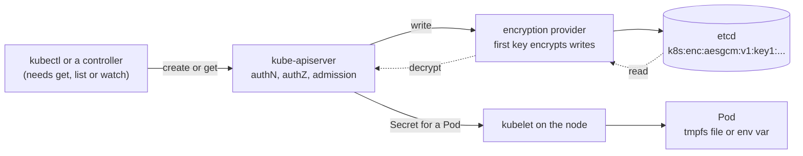

# 04: Secrets at rest and in use

> A Secret is base64 until something encrypts it, and encryption changes only
> what etcd stores. This chapter follows one Secret on kind clusters: its
> plaintext in etcd, its encrypted form under an `EncryptionConfiguration`, a
> key rotation, and then the in-use side, where a Pod sees the value as an
> environment variable or as a mounted file, and the two behave differently.

**Estimated time:** ~30 min read · ~60 min hands-on (the lab is scripted, and
its first cluster takes about ten minutes to start on a slow disk)
**Prerequisites:** [Part 03 ch.02](../03-config-and-storage/02-secrets.md):
a Secret is base64, not encrypted · [Part 05 ch.01](01-authn-authz-rbac.md):
who may ask the API for a Secret ·
[Part 00 ch.04](../00-foundations/04-control-plane-deep-dive.md): etcd and the
apiserver's request pipeline
**You'll know after this:** • write an `EncryptionConfiguration`, enable it on
a cluster that already holds data, and rewrite that data under the new key •
rotate an encryption key without leaving data unreadable • say what an
environment variable exposes that a mounted file does not • keep a
Secret-backed cache off the node's disk

<!-- tags: security, secrets, secrets-rotation, day-2 -->

## Why this exists

[03.02](../03-config-and-storage/02-secrets.md) established the Secret object
and proved its core danger: a Secret is **base64, not encrypted**. Anyone who
can read etcd, or an etcd backup, reads every credential in it. 03.02 deferred
the fix to this chapter.

A Secret's value is exposed in two places, so this chapter covers both. **At
rest**, the bytes sit in etcd, and the apiserver can encrypt them. That half
needs an apiserver flag and a file on the control plane. **In use**, the
kubelet hands the value to a Pod, and from then on anything that can read the
container's environment or its files can read the value too. RBAC decides who
may ask the API for a Secret. The Pod's spec decides what the container does
with the answer.

The flags and the transport that protect etcd belong to
[Part 05 ch.06](06-control-plane-and-node-hardening.md). The audit trail that
records Secret reads belongs to
[Part 05 ch.08](08-audit-detection-and-incident-response.md). The threat model
over the whole Bookstore is Part 00 ch.08 <!-- link-later: 00.08 -->.

## Mental model

Think about the two places a value exists, and the one place it gets copied.

- **At rest, in etcd.** The apiserver encrypts a Secret on the way into etcd
  and decrypts it on the way out. Writes go through the first provider in an
  `EncryptionConfiguration`, and reads try each provider that matches the
  stored bytes. This is apiserver configuration: a flag and a file on each
  control-plane node, not a `kubectl apply` object. It defeats one threat, a
  reader of etcd's files or backups. It does nothing about `get secrets`
  through the API or `pods/exec` into a Pod. Both go through the decrypting
  apiserver, as designed.
- **In use, through the API.** RBAC decides who may read a Secret. The
  [Secret documentation](https://kubernetes.io/docs/concepts/configuration/secret/)
  says that granting `list` or `watch` on Secrets "allows a subject to read all
  Secret data in that namespace, not only the Secrets explicitly referenced by
  its Pods."
- **In use, inside the Pod.** The kubelet gives a Pod the value in one of two
  forms. An environment variable is set when the container starts and is
  inherited by every process the container starts after that. A mounted file
  is copied into a `tmpfs`, which the kubelet keeps up to date when the Secret
  changes and which goes away with the Pod.
- **On the node.** What a container writes to a volume can outlive it. An
  `emptyDir` on the default medium is stored on the node's own filesystem.

## Threats and controls

Each row is a way a Secret's value leaks, the control this chapter teaches, and
where the topic goes deeper.

| Threat | Control this chapter teaches | Where it goes deeper |
|---|---|---|
| Someone reads etcd, or an etcd backup, and every Secret is readable | `EncryptionConfiguration`: the apiserver encrypts a Secret before it reaches etcd | [11.05](../11-advanced-production-patterns/05-secrets-at-scale.md), [15.05](../15-day-to-day-production-ops/05-production-secrets-vault-eso.md) |
| The key sits on the control plane next to the data it protects | KMS v2: the key-encryption key stays in an external KMS. Cited, not run here | [11.05](../11-advanced-production-patterns/05-secrets-at-scale.md) |
| A key that never changes outlives everyone who ever held it | Rotation: a new key encrypts, every Secret is rewritten, then the old key is dropped | [11.05](../11-advanced-production-patterns/05-secrets-at-scale.md) |
| An environment variable is copied into every process the container starts and is fixed until the Pod restarts | A mounted file, read-only, with `defaultMode: 0440` and `fsGroup` | [03.02](../03-config-and-storage/02-secrets.md) |
| A cache in an `emptyDir` on the node's disk keeps the plaintext after the app is done with it | `emptyDir` with `medium: Memory` and a `sizeLimit` | [03.03](../03-config-and-storage/03-volumes.md) |

RBAC on Secrets, which is the threat of a subject with `list` or `watch`
reading every value in a namespace, is taught in
[03.02](../03-config-and-storage/02-secrets.md) and
[Part 05 ch.01](01-authn-authz-rbac.md). This chapter does not repeat it.

## Diagrams

### Where a Secret's value goes (Mermaid)



## The lab: one Secret, from plaintext to rotated key

> **Lab 05.04 (tier A).** Two kind runs on a Linux lab host, with kind v0.33.0,
> Kubernetes v1.37.0 nodes, kubectl v1.37.0 and etcd 3.7.0 inside the node.
> It has not been run on macOS. The script is
> [`labs/05-04.sh`](../examples/security-lab/labs/05-04.sh), and the recorded
> transcript is [`evidence/05-04.txt`](../examples/security-lab/evidence/05-04.txt).
> **Run it only against kind clusters you own.** With `MODE=all` (the default)
> it creates a throwaway cluster, runs steps 1 to 10 on it, and deletes it.
> With `MODE=inuse` it runs steps 9 to 11 on another kind cluster you own, in a
> namespace of its own, and deletes that namespace. Steps 1 to 8 need an
> apiserver flag and a host directory, so they need the throwaway cluster.
> What did not work the first time is recorded at the end of the lab.

The commands here use the names `secrets-lab` for the namespace and
`lab-secrets` for the cluster. The captured output came from a cluster named
`p05-enc`, with a namespace named `p05-04-secrets`, so the output blocks show
those names, and the node is `p05-enc-control-plane`. The transcript header
records the substitution.

Every etcd read in the lab runs inside the kind node. A kind node is a
container on the Docker host, not a separate machine, and it shares the host's
kernel. Nothing in the lab reaches past the node's files and processes. The
Pods in steps 9 and 10 pass the baseline, so no manifest in this chapter needs
the insecure-on-purpose marker.

### 1. A cluster whose apiserver loads an encryption config

kind has no documented recipe for an encryption config, so this lab works one
out. It has two parts. An `extraMounts` entry puts a host directory at
`/etc/kubernetes/enc` inside the node container. A `kubeadmConfigPatches` entry
adds the apiserver flags and a `hostPath` volume, so the static Pod can read
the directory. The apiserver starts with an `identity` provider, which encrypts
nothing. The flags are on, and no data has changed yet.

```yaml
# Fragment of the kind config: the ClusterConfiguration patch. It has no kind:
# line, so it reads as a fragment, not a manifest.
apiServer:
  extraArgs:
    - name: encryption-provider-config
      value: /etc/kubernetes/enc/encryption-config.yaml
    - name: encryption-provider-config-automatic-reload
      value: "true"
  extraVolumes:
    - name: encryption
      hostPath: /etc/kubernetes/enc
      mountPath: /etc/kubernetes/enc
      readOnly: true
      pathType: DirectoryOrCreate
```

```yaml
# Fragment: the node entry that mounts the host directory into the node.
nodes:
  - role: control-plane
    extraMounts:
      - hostPath: /tmp/secrets-lab-enc
        containerPath: /etc/kubernetes/enc
        readOnly: true
```

The script also raises kubeadm's health-check timeouts. On the lab host the
control plane took about ten minutes to start, because etcd and the apiserver
restarted until the disk answered. The
[encryption page](https://kubernetes.io/docs/tasks/administer-cluster/encrypt-data/)
says that with `--encryption-provider-config-automatic-reload=true` the
apiserver polls the file every minute. The lab waits for the encryption metrics
to change, so it never sleeps for a fixed time.

<!-- gate: output -->
```
kind v0.33.0 go1.26.7 linux/amd64
```

<!-- gate: output -->
```
Client Version: v1.37.0
Kustomize Version: v5.8.1
Server Version: v1.37.0
```

<!-- gate: output -->
```
apiVersion: kubeadm.k8s.io/v1beta4
apiVersion: kubeadm.k8s.io/v1beta4
apiVersion: kubeadm.k8s.io/v1beta4
apiVersion: kubelet.config.k8s.io/v1beta1
--encryption-provider-config=/etc/kubernetes/enc/encryption-config.yaml
--encryption-provider-config-automatic-reload=true
```

The metrics present at start, and the etcd client version inside the node:

<!-- gate: output -->
```
apiserver_encryption_config_controller_last_config_info{apiserver_id_hash="sha256:df5695c37bf9404c5455b2f50853064cda3207
etcdctl version: 3.7.0
API version: 3.7
```

### 2. An old Secret, before anything is encrypted

The namespace enforces `restricted`, so every Pod later in the lab carries the
baseline. The Secret is made with the same command a developer would use.

```sh
kubectl create namespace secrets-lab
kubectl label namespace secrets-lab pod-security.kubernetes.io/enforce=restricted pod-security.kubernetes.io/audit=restricted pod-security.kubernetes.io/warn=restricted
kubectl create secret generic db-credentials -n secrets-lab --from-literal=password=lab-marker-0f3c9a
```

The password is a lab marker, not a credential. It is a fixed string so the
lab can search for it in etcd.

<!-- gate: output -->
```
namespace/p05-04-secrets created
namespace/p05-04-secrets labeled
secret/db-credentials created
```

### 3. The API returns the value, because base64 is not encryption

```sh
kubectl get secret db-credentials -n secrets-lab -o jsonpath='{.data.password}'; echo
kubectl get secret db-credentials -n secrets-lab -o jsonpath='{.data.password}' | base64 -d; echo
```

<!-- gate: output -->
```
bGFiLW1hcmtlci0wZjNjOWE=
lab-marker-0f3c9a
```

The first line is what the API stores and returns: base64 of the value. The
second decodes it. Anyone with `get` on the Secret reads the password this way,
and so does anyone who can read the raw bytes in etcd.

### 4. Attack view: read the Secret out of etcd, from inside the node

This is the view of someone holding the data directory or a backup, with a
shell on the node. The lab reads etcd through the etcd container's own
`etcdctl`, with the client certificates the node already holds:

```sh
etcd_ctl() {
  local id
  id=$(docker exec "$NODE" crictl ps -q --label io.kubernetes.container.name=etcd | head -n 1)
  docker exec "$NODE" crictl exec "$id" etcdctl \
    --endpoints=https://127.0.0.1:2379 \
    --cacert=/etc/kubernetes/pki/etcd/ca.crt \
    --cert=/etc/kubernetes/pki/etcd/server.crt \
    --key=/etc/kubernetes/pki/etcd/server.key "$@"
}
etcd_get() {
  etcd_ctl get "/registry/secrets/secrets-lab/$1" --print-value-only
}
etcd_get db-credentials > db.raw
head -c 4 db.raw | od -An -c
grep -a -o 'lab-marker-[0-9a-f]*' db.raw
```

<!-- gate: output -->
```
   k   8   s  \0
lab-marker-0f3c9a
```

The first four bytes are `k8s` and a NUL byte: the Kubernetes protobuf envelope
with no encryption prefix. The value is there as plain text, in the file a
backup would hold.

### 5. Enable encryption: an aesgcm key encrypts new writes

The config lists one `aesgcm` provider with a random 32-byte key, and
`identity` last. The first provider encrypts writes. `identity` stays last so
that the plaintext already in etcd still reads. The script writes the file
under a temporary name and renames it into place, so the apiserver never reads
half a file. The file is mode `0600`.

```sh
head -c 32 /dev/urandom | base64 | tr -d '\n' >key1
# the script then writes the file and waits for the apiserver to reload it
sed 's/secret: .*/secret: <redacted>/' "$ENC_DIR/encryption-config.yaml"
```

The file has the shape below. It is not a Kubernetes object, so there is no
`kubectl apply` step: the apiserver reads it from disk.

```yaml
# Fragment: the file the apiserver reads. It is not a Kubernetes object, so
# it has no kind: line, and kubectl never applies it.
resources:
  - resources: ["secrets"]
    providers:
      - aesgcm:
          keys:
            - name: key1
              secret: <base64 of 32 random bytes>
      - identity: {}
```

<!-- gate: output -->
```
apiserver reloaded the encryption config
apiserver_encryption_config_controller_automatic_reload_last_timestamp_seconds{apiserver_id_hash="sha256:df5695c37bf9404c5455b2f50853064cda3207ab78268df5267439d
apiserver_encryption_config_controller_automatic_reloads_total{apiserver_id_hash="sha256:df5695c37bf9404c5455b2f50853064cda3207ab78268df5267439dff1c7a30c",statu
apiserver_encryption_config_controller_last_config_info{apiserver_id_hash="sha256:df5695c37bf9404c5455b2f50853064cda3207ab78268df5267439dff1c7a30c",hash="sha256
apiVersion: apiserver.config.k8s.io/v1
kind: EncryptionConfiguration
resources:
  - resources: ["secrets"]
    providers:
      - aesgcm:
          keys:
            - name: key1
              secret: <redacted>
      - identity: {}
```

The reload counter appears in the metrics only after the first reload, so the
script does not wait on one counter by name. It waits for the encryption
metrics to change, and the output shows the reload's own lines.

### 6. A new Secret is encrypted, and the old one is not

```sh
kubectl create secret generic new-credentials -n secrets-lab --from-literal=password=lab-new-7e2d41
etcd_get new-credentials > new.raw
grep -a -o 'k8s:enc:[a-z]*:v1:[a-z0-9]*:' new.raw
grep -a -c 'lab-new-7e2d41' new.raw
etcd_get db-credentials > db.raw
grep -a -c 'lab-marker-0f3c9a' db.raw
```

<!-- gate: output -->
```
secret/new-credentials created
k8s:enc:aesgcm:v1:key1:
0
1
```

The prefix `k8s:enc:aesgcm:v1:key1:` names the provider and the key that wrote
the value, and the plaintext count for the new Secret is zero. The old Secret
still holds its plaintext, because enabling encryption is not retroactive. The
apiserver encrypts on write, and the old bytes stay where they are until the
Secret is written again.

### 7. Rewrite every Secret, so each one is encrypted

The Kubernetes encryption page gives this command for the rewrite, and says
that enabling encryption is not enough without it: existing objects keep their
old form until they are written again.

```sh
kubectl get secrets --all-namespaces -o json | kubectl replace -f - | grep -c replaced
etcd_get db-credentials > db.raw
grep -a -c 'lab-marker-0f3c9a' db.raw
grep -a -o 'k8s:enc:[a-z]*:v1:[a-z0-9]*:' db.raw
```

<!-- gate: output -->
```
3
0
k8s:enc:aesgcm:v1:key1:
```

Each Secret is read and written back, so the apiserver stores it under the
first provider. The count of `replaced` lines is the number of Secrets in the
cluster, and once the plaintext count is zero, the old plaintext is gone from
etcd.

### 8. Rotate: the new key encrypts, the old key still decrypts, then goes

The rotation order follows the Kubernetes encryption page. The new key goes in
first, as the encrypting key. The old key stays second so it can still read the
data it wrote. Then every Secret is rewritten under the new key. Only then is
the old key removed.

```sh
head -c 32 /dev/urandom | base64 | tr -d '\n' >key2
# the script writes key2 first, then key1, and waits for the reload
kubectl get secrets --all-namespaces -o json | kubectl replace -f - | grep -c replaced
etcd_get db-credentials > db.raw
grep -a -o 'k8s:enc:[a-z]*:v1:[a-z0-9]*:' db.raw
# the script then writes key2 alone, and waits for the reload again
kubectl get secret db-credentials -n secrets-lab -o jsonpath='{.data.password}' | base64 -d; echo
```

<!-- gate: output -->
```
apiserver reloaded the encryption config
apiserver_encryption_config_controller_automatic_reload_last_timestamp_seconds{apiserver_id_hash="sha256:df5695c37bf9404c5455b2f50853064cda3207ab78268df5267439d
apiserver_encryption_config_controller_automatic_reloads_total{apiserver_id_hash="sha256:df5695c37bf9404c5455b2f50853064cda3207ab78268df5267439dff1c7a30c",statu
apiserver_encryption_config_controller_last_config_info{apiserver_id_hash="sha256:df5695c37bf9404c5455b2f50853064cda3207ab78268df5267439dff1c7a30c",hash="sha256
3
k8s:enc:aesgcm:v1:key2:
```

The prefix changes from `key1` to `key2`, so the rewrite has moved every Secret
to the new key. After `key1` is dropped, the value still decrypts, because
nothing is stored under `key1` any more.

<!-- gate: output -->
```
apiserver reloaded the encryption config
apiserver_encryption_config_controller_automatic_reload_last_timestamp_seconds{apiserver_id_hash="sha256:df5695c37bf9404c5455b2f50853064cda3207ab78268df5267439d
apiserver_encryption_config_controller_automatic_reloads_total{apiserver_id_hash="sha256:df5695c37bf9404c5455b2f50853064cda3207ab78268df5267439dff1c7a30c",statu
apiserver_encryption_config_controller_last_config_info{apiserver_id_hash="sha256:df5695c37bf9404c5455b2f50853064cda3207ab78268df5267439dff1c7a30c",hash="sha256
lab-marker-0f3c9a
```

The Kubernetes page's procedure restarts every apiserver at two points. With
the automatic reload flag set, the file change is enough, and the lab restarts
nothing. Keep the backup step. The page says that losing every copy of a key
means losing every resource encrypted under it, so a key is removed only after
the rewrite and after a tested backup.

### 9. In use: an environment variable against a mounted file

The app ServiceAccount does not mount a token, and neither Pod calls the API.
`app-env` reads the password from an environment variable. `app-file` reads it
from a file the kubelet mounts. Both carry the baseline. They use the namespace
and the `db-credentials` Secret from step 2.

```yaml
apiVersion: v1
kind: ServiceAccount
metadata:
  name: app
  namespace: secrets-lab
automountServiceAccountToken: false
```

```yaml
apiVersion: v1
kind: Pod
metadata:
  name: app-env
  namespace: secrets-lab
spec:
  serviceAccountName: app
  automountServiceAccountToken: false
  securityContext:
    runAsNonRoot: true
    runAsUser: 65532
    runAsGroup: 65532
    seccompProfile:
      type: RuntimeDefault
  containers:
    - name: app
      image: busybox@sha256:73aaf090f3d85aa34ee199857f03fa3a95c8ede2ffd4cc2cdb5b94e566b11662  # busybox:1.36
      command: ["sleep", "3600"]
      env:
        - name: DB_PASSWORD
          valueFrom:
            secretKeyRef:
              name: db-credentials
              key: password
      securityContext:
        allowPrivilegeEscalation: false
        readOnlyRootFilesystem: true
        capabilities:
          drop: ["ALL"]
      resources:
        requests: {cpu: 10m, memory: 16Mi}
        limits: {memory: 64Mi}
      volumeMounts:
        - name: tmp
          mountPath: /tmp
  volumes:
    - name: tmp
      emptyDir: {}
```

```yaml
apiVersion: v1
kind: Pod
metadata:
  name: app-file
  namespace: secrets-lab
spec:
  serviceAccountName: app
  automountServiceAccountToken: false
  securityContext:
    runAsNonRoot: true
    runAsUser: 65532
    runAsGroup: 65532
    fsGroup: 65532
    seccompProfile:
      type: RuntimeDefault
  containers:
    - name: app
      image: busybox@sha256:73aaf090f3d85aa34ee199857f03fa3a95c8ede2ffd4cc2cdb5b94e566b11662  # busybox:1.36
      command: ["sleep", "3600"]
      securityContext:
        allowPrivilegeEscalation: false
        readOnlyRootFilesystem: true
        capabilities:
          drop: ["ALL"]
      resources:
        requests: {cpu: 10m, memory: 16Mi}
        limits: {memory: 64Mi}
      volumeMounts:
        - name: creds
          mountPath: /etc/creds
          readOnly: true
        - name: tmp
          mountPath: /tmp
        - name: cache
          mountPath: /cache
        - name: scratch
          mountPath: /scratch
  volumes:
    - name: creds
      secret:
        secretName: db-credentials
        defaultMode: 0440
        items:
          - key: password
            path: password
    - name: tmp
      emptyDir: {}
    - name: cache
      emptyDir: {}
    - name: scratch
      emptyDir:
        medium: Memory
        sizeLimit: 8Mi
```

`defaultMode: 0440` gives the file read access for its owner and its group, and
`fsGroup` sets that group to 65532, the Pod's own group. The app reads the file
through its group, and other users have no read access to it.

```sh
kubectl apply -f app.yaml
kubectl wait --for=condition=Ready pod/app-env pod/app-file -n secrets-lab --timeout=180s
kubectl exec -n secrets-lab app-env -- sh -c 'tr "\0" "\n" </proc/1/environ | grep DB_PASSWORD'
kubectl exec -n secrets-lab app-file -- ls -lL /etc/creds/password
kubectl exec -n secrets-lab app-file -- cat /etc/creds/password; echo
kubectl exec -n secrets-lab app-file -- sh -c "grep '/etc/creds ' /proc/mounts | cut -d ' ' -f 3"
```

<!-- gate: output -->
```
serviceaccount/app created
pod/app-env created
pod/app-file created
pod/app-env condition met
pod/app-file condition met
DB_PASSWORD=lab-marker-0f3c9a
-r--r-----    1 root     65532           17 Oct 31 04:19 /etc/creds/password
lab-marker-0f3c9a
tmpfs
```

Two things stand out. The environment variable is in `/proc/1/environ`, which
the container's own user can read, so every process the container starts
inherits it. The file is a group-readable `tmpfs` file, and it leaves the
container when the Pod goes.

Now rotate the value and watch both forms:

```sh
new=$(printf '%s' lab-marker-rotated | base64 | tr -d '\n')
kubectl patch secret db-credentials -n secrets-lab --type merge -p "{\"data\":{\"password\":\"$new\"}}"
for i in $(seq 1 60); do kubectl exec -n secrets-lab app-file -- cat /etc/creds/password 2>/dev/null | grep -q rotated && break; sleep 5; done
kubectl exec -n secrets-lab app-file -- cat /etc/creds/password; echo
kubectl exec -n secrets-lab app-env -- sh -c 'tr "\0" "\n" </proc/1/environ | grep DB_PASSWORD'
```

<!-- gate: output -->
```
secret/db-credentials patched
lab-marker-rotated
DB_PASSWORD=lab-marker-0f3c9a
```

The mounted file follows the Secret. The kubelet rewrites it after a delay, and
the [Secret page](https://kubernetes.io/docs/concepts/configuration/secret/)
calls the update eventually consistent: the kubelet sync period plus a cache
delay. The environment variable does not follow. It is read once, when the
container starts, and only a restart changes it. An app that must see
rotations has to read a file, and has to reread it.

### 10. Where an emptyDir lives on the node

The `cache` volume is an `emptyDir` on the default medium. The `scratch` volume
is `medium: Memory`. The app copies the password into both, and the check looks
at them from the node.

```sh
kubectl exec -n secrets-lab app-file -- sh -c 'cp /etc/creds/password /cache/password && cp /etc/creds/password /scratch/password'
uid=$(kubectl get pod -n secrets-lab app-file -o jsonpath='{.metadata.uid}')
docker exec "$NODE" cat "/var/lib/kubelet/pods/$uid/volumes/kubernetes.io~empty-dir/cache/password"; echo
docker exec "$NODE" stat -f -c '%T %n' "/var/lib/kubelet/pods/$uid/volumes/kubernetes.io~empty-dir/cache" "/var/lib/kubelet/pods/$uid/volumes/kubernetes.io~empty-dir/scratch"
```

<!-- gate: output -->
```
lab-marker-rotated
xfs /var/lib/kubelet/pods/df8a04a1-3cb9-46b1-876a-2c45c7fc5180/volumes/kubernetes.io~empty-dir/cache
tmpfs /var/lib/kubelet/pods/df8a04a1-3cb9-46b1-876a-2c45c7fc5180/volumes/kubernetes.io~empty-dir/scratch
```

The default `emptyDir` holds the plaintext on the node's own filesystem, which
here is `xfs`. It survives container restarts and goes with the Pod. The
[volumes page](https://kubernetes.io/docs/concepts/storage/volumes/#emptydir)
says the default medium is whatever backs the node, and that with
`medium: Memory` Kubernetes mounts a tmpfs whose files "count against the
memory limit of the container that wrote them." The `scratch` copy is in RAM,
and the Pod's 64Mi limit bounds it. The page does not say how `sizeLimit` is
enforced on a Memory-backed volume, so the lab does not claim a result for it.

### 11. Clean up

With `MODE=all` the script deletes the throwaway cluster, and the trap removes
its temporary directories. With `MODE=inuse` it deletes the namespace it made.

```sh
kind delete cluster --name lab-secrets
kubectl delete namespace secrets-lab
```

<!-- gate: output -->
```
namespace "p05-04-secrets" deleted
```

On a healthy host the first line prints `Deleting cluster "p05-enc" ...` and
returns. The run here printed an error instead, and the next section records
it.

## What did not work the first time

- **The control plane was slow to start.** The first cluster took about ten
  minutes to start. The apiserver crashed and restarted until etcd answered,
  because the disk was saturated. The script raises kubeadm's timeouts for this
  reason.
- **Steps 9 and 10 ran out of time on the throwaway cluster.** The Pods never
  became Ready while the host's disk was busy, and the apiserver restarted
  under the next commands:

<!-- gate: output -->
```
timed out waiting for the condition on pods/app-env
timed out waiting for the condition on pods/app-file
error: unable to upgrade connection: container not found ("app")
```

  The in-use steps were run again on a second kind cluster, and the output
  blocks above come from that second run. Steps 9 and 10 need no apiserver
  flag, so `MODE=inuse` can run them on any kind cluster you own.
- **Step 11 could not delete the throwaway cluster.** The container refused to
  stop under the same load, and the delete printed this error:

<!-- gate: output -->
```
ERROR: failed to delete cluster "p05-enc": failed to delete nodes: command "docker rm -f -v p05-enc-control-plane" failed with error: exit status 1
```

  The cluster was gone when the host freed up. A rerun needs the host to be
  quiet, or a longer wait before the delete.

## What the lab did not show

The lab uses an `aesgcm` key held on the node, so the key sits next to the data
it protects. The Kubernetes encryption page says a locally stored key "only
moderately improves your security posture, compared to no encryption". The
production shape is KMS v2. In that provider, the apiserver calls a plugin over
a socket, and each write uses a data-encryption key generated from a seed. The
page says the seed rotates whenever the key-encryption key does. A KMS plugin
needs a key held outside the cluster, which a kind cluster cannot provide.
**Not run here:** the KMS v2 path is cited to the upstream page, and its
operation is covered in
[11.05](../11-advanced-production-patterns/05-secrets-at-scale.md).

The lab also ran on one control-plane node. The page requires the encryption
file to match on every control-plane node, which a single-node lab does not
test.

## How it works under the hood

- **The write and read path.** A Secret write passes authN, authZ and admission,
  then the encryption provider, then etcd. A read runs the same path in reverse.
  Clients see the decrypted value, so encryption does not change what RBAC
  allows.
- **The prefix.** `k8s:enc:aesgcm:v1:key1:` records the provider and key that
  wrote the value. On read, each provider whose prefix matches the stored bytes
  attempts decryption. That is why old plaintext, `key1` data and `key2` data
  can coexist in etcd while the rewrite runs.
- **Provider strength, from the upstream table.** `aescbc` is weak, and not
  recommended because of padding-oracle attacks. `aesgcm` is not recommended
  except with an automated key rotation scheme, and its key must be rotated
  every 200,000 writes. `secretbox` is strong, but it uses newer technology that
  some environments review closely. Each local key sits on the control-plane
  host, so it protects against an etcd or backup reader but not a host
  compromise.
- **Reload.** The apiserver polls the file about once a minute, and the metrics
  above show each reload.
- **Mounted files.** The kubelet writes them to a `tmpfs` and removes them with
  the Pod. Updates follow the Secret under the `Watch` cache strategy. A
  container that mounts a Secret through `subPath` gets no automatic updates.
- **Listing and privilege.** `list` and `watch` on Secrets read every Secret in
  the namespace, and the Secret page says so. A container running
  `privileged: true` on a node can reach Secrets used on that node. Both are
  RBAC and admission questions, covered in Part 05 ch.01 and ch.02.

## Production notes

> **In production:** encrypt Secrets at rest with a KMS provider, so the
> key-encryption key lives outside the cluster. Rewrite existing Secrets after
> enabling or rotating, keep a tested backup of every key, and remove a key only
> after the rewrite. The operational detail is in
> [11.05](../11-advanced-production-patterns/05-secrets-at-scale.md) and
> [15.05](../15-day-to-day-production-ops/05-production-secrets-vault-eso.md).

> **In production (managed clusters):** managed control planes offer their own
> Secret encryption options, and the provider decides the key and the setup.
> Check which one your cluster uses, and turn on the KMS-backed option if it is
> off. [Part 10 ch.01](../10-cloud-and-managed-kubernetes/01-managed-kubernetes-model.md)
> covers the managed model.

> **In production:** do not depend on environment variables for a credential
> that rotates. Mount it as a file, and have the app reread the file. Keep the
> variables for values that never change.

## Quick Reference

```sh
# Inside the node: which provider and key wrote a Secret.
etcd_get db-credentials | grep -a -o 'k8s:enc:[a-z]*:v1:[a-z0-9]*:'
# After enabling or rotating: rewrite every Secret under the first key.
kubectl get secrets --all-namespaces -o json | kubectl replace -f -
```

Secure forms only:

```yaml
# Fragment: a Secret mounted as a read-only file, readable by the Pod's group.
spec:
  securityContext:
    fsGroup: 65532
  volumes:
    - name: creds
      secret:
        secretName: db-credentials
        defaultMode: 0440
        items:
          - key: password
            path: password
```

Checklist:

- [ ] Secrets encrypted at rest, with a KMS provider where the cluster allows
- [ ] Every existing Secret rewritten after enabling and after each rotation
- [ ] A rotation procedure written down, with a tested key backup
- [ ] No `list` or `watch` on Secrets for workloads; `get` with `resourceNames`
- [ ] `automountServiceAccountToken: false` on every Pod that makes no API call
- [ ] Secret values as read-only files: `defaultMode: 0440` and `fsGroup`
- [ ] Environment variables only for values that never rotate
- [ ] Secret caches on an `emptyDir` with `medium: Memory` and a `sizeLimit`

## Test your understanding

> Try each before opening the answer drawer. The act of trying is the exercise;
> the answer is the check.

1. **Encryption at rest is on, with KMS v2. A developer with `get` on Secrets
   runs `kubectl get secret db-credentials -o yaml`. What do they see?**
   <details><summary>Show answer</summary>

   They see the base64 of the plaintext, as before. Encryption at rest acts on
   the bytes stored in etcd. The apiserver decrypts on read for any caller the
   RBAC allows. The threat it removes is a reader of etcd files or backups. RBAC
   still decides who gets the value through the API.

   </details>

2. **You list `identity` first and an `aesgcm` provider second, then restart
   the apiserver and create a new Secret. What is stored, and what makes the old
   Secrets encrypted?**
   <details><summary>Show answer</summary>

   The first provider writes, so `identity` stores the new Secret as plaintext.
   Only a provider listed first encrypts writes. The restart does not rewrite
   the old Secrets either. Put the encrypting key first, then run
   `kubectl get secrets --all-namespaces -o json | kubectl replace -f -` to
   rewrite every Secret under it. Keep `identity` last until nothing is stored
   as plaintext.

   </details>

3. **You are rotating a key. Why must the old key stay in the config until
   every Secret is rewritten, and why must the new key come first?**
   <details><summary>Show answer</summary>

   The new key goes first so new writes use it. The old key stays so it can
   still decrypt the data it wrote before the rewrite. Remove it only after the
   rewrite and a tested backup. Removing it before the rewrite leaves objects
   that no configured key can read.

   </details>

4. **A Pod gets `DB_PASSWORD` from a Secret as an environment variable. The
   password is rotated. What does the process see, and what would you change?**
   <details><summary>Show answer</summary>

   The process keeps the old value until the container restarts, because the
   variable is read at start. The lab showed this: after the patch,
   `/proc/1/environ` still held the old value while the mounted file held the
   new one. Mount the Secret as a file instead, and have the app reread it. The
   variable also sits in `/proc/1/environ`, where every process the container
   starts can read it, which a mounted file does not do.

   </details>

5. **The `reader` identity holds `list` on Secrets in a namespace. Why does
   adding `resourceNames` not stop it from reading every Secret?**
   <details><summary>Show answer</summary>

   A `list` request asks for the whole collection and names no object, so a name
   in the rule has nothing to match. Grant `get` with `resourceNames` for the
   Secrets the workload needs, and do not grant `list` or `watch` at all. The
   Secret documentation says that granting `list` or `watch` on Secrets allows a
   subject to read all Secret data in the namespace.

   </details>

## Further reading

- Rosso et al., _Production Kubernetes_, ch.7 "Secret Management" (encryption
  at rest, KMS, rotation): the production operationalization of this chapter.
- Ibryam & Huß, _Kubernetes Patterns_ 2e, ch.25 _Secure Configuration_.
- Official:
  <https://kubernetes.io/docs/tasks/administer-cluster/encrypt-data/>
  (encryption at rest, rotation, the `replace` rewrite, automatic reload),
  <https://kubernetes.io/docs/concepts/configuration/secret/> (Secret volumes on
  `tmpfs`, `list` and `watch` exposure, eventual consistency), and
  <https://kubernetes.io/docs/concepts/storage/volumes/#emptydir> (the emptyDir
  mediums and memory accounting).
