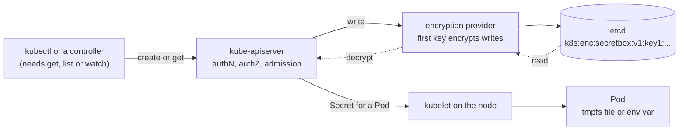

# 04: Secrets at rest and in use

> A Secret is base64 until something encrypts it, and encryption changes only
> what etcd stores. This chapter follows one Secret on kind clusters: its
> plaintext in etcd, its encrypted form under an `EncryptionConfiguration`, a
> key rotation, and then the in-use side, where a Pod sees the value as an
> environment variable or as a mounted file, and the two behave differently.

**Estimated time:** ~30 min read · ~60 min hands-on (the lab is scripted, and
each encryption change waits for the apiserver to reload its config, which
polls about once a minute)
**Prerequisites:** [Part 03 ch.02](../03-config-and-storage/02-secrets.md):
a Secret is base64, not encrypted · [Part 05 ch.01](01-authn-authz-rbac.md):
who may ask the API for a Secret ·
[Part 00 ch.04](../00-foundations/04-control-plane-deep-dive.md): etcd and the
apiserver's request pipeline
**You'll know after this:** • write an `EncryptionConfiguration`, enable it on
a cluster that already holds data, and rewrite that data under the new key •
rotate an encryption key without leaving data unreadable • say what an
environment variable exposes that a mounted file does not • keep a
Secret-backed cache off the node's disk

<!-- tags: security, secrets, secrets-rotation, day-2 -->

## Why this exists

[03.02](../03-config-and-storage/02-secrets.md) established the Secret object
and proved its core danger: a Secret is **base64, not encrypted**. Anyone who
can read etcd, or an etcd backup, reads every credential in it. 03.02 deferred
the fix to this chapter.

A Secret's value is exposed in two places, so this chapter covers both. **At
rest**, the bytes sit in etcd, and the apiserver can encrypt them. That half
needs an apiserver flag and a file on the control plane. **In use**, the
kubelet hands the value to a Pod, and from then on anything that can read the
container's environment or its files can read the value too. RBAC decides who
may ask the API for a Secret. The Pod's spec decides what the container does
with the answer.

The flags and the transport that protect etcd belong to
[Part 05 ch.06](06-control-plane-and-node-hardening.md). The audit trail that
records Secret reads belongs to
[Part 05 ch.08](08-audit-detection-and-incident-response.md). The threat model
over the whole Bookstore is [Part 00
ch.08](../00-foundations/08-security-foundations.md).

## Mental model

Think about the two places a value exists, and the one place it gets copied.

- **At rest, in etcd.** The apiserver encrypts a Secret on the way into etcd
  and decrypts it on the way out. Writes go through the first provider in an
  `EncryptionConfiguration`, and reads try each provider that matches the
  stored bytes. This is apiserver configuration: a flag and a file on each
  control-plane node, not a `kubectl apply` object. It defeats one threat, a
  reader of etcd's files or backups. It does nothing about `get secrets`
  through the API or `pods/exec` into a Pod. Both go through the decrypting
  apiserver, as designed.
- **In use, through the API.** RBAC decides who may read a Secret. The
  [Secret documentation](https://kubernetes.io/docs/concepts/configuration/secret/)
  says that granting `list` or `watch` on Secrets "allows a subject to read all
  Secret data in that namespace, not only the Secrets explicitly referenced by
  its Pods."
- **In use, inside the Pod.** The kubelet gives a Pod the value in one of two
  forms. An environment variable is set when the container starts and is
  inherited by every process the container starts after that. A mounted file
  is copied into a `tmpfs`, which the kubelet keeps up to date when the Secret
  changes and which goes away with the Pod.
- **On the node.** What a container writes to a volume can outlive it. An
  `emptyDir` on the default medium is stored on the node's own filesystem.

## Threats and controls

Each row is a way a Secret's value leaks, the control this chapter teaches, and
where the topic goes deeper.

| Threat | Control this chapter teaches | Where it goes deeper |
|---|---|---|
| Someone reads etcd, or an etcd backup, and every Secret is readable | `EncryptionConfiguration`: the apiserver encrypts a Secret before it reaches etcd | [11.05](../11-advanced-production-patterns/05-secrets-at-scale.md), [15.05](../15-day-to-day-production-ops/05-production-secrets-vault-eso.md) |
| The key sits on the control plane next to the data it protects | KMS v2: the key-encryption key stays in an external KMS. Cited, not run here | [11.05](../11-advanced-production-patterns/05-secrets-at-scale.md) |
| A key that never changes outlives everyone who ever held it | Rotation in two phases: the new key is added second, then made first, every Secret is rewritten, then the old key is dropped | [11.05](../11-advanced-production-patterns/05-secrets-at-scale.md) |
| An environment variable is copied into every process the container starts and is fixed until the Pod restarts | A mounted file, read-only, with `defaultMode: 0440` and `fsGroup` | [03.02](../03-config-and-storage/02-secrets.md) |
| A cache in an `emptyDir` on the node's disk keeps the plaintext after the app is done with it | `emptyDir` with `medium: Memory` and a `sizeLimit` | [03.03](../03-config-and-storage/03-volumes.md) |

RBAC on Secrets, which is the threat of a subject with `list` or `watch`
reading every value in a namespace, is taught in
[03.02](../03-config-and-storage/02-secrets.md) and
[Part 05 ch.01](01-authn-authz-rbac.md). This chapter does not repeat it.

## Diagrams

### Where a Secret's value goes (Mermaid)



## The lab: one Secret, from plaintext to rotated key

> **Lab 05.04 (tier A).** The output below comes from one run on a Linux lab
> host, with kind v0.33.0, Kubernetes v1.37.0 nodes, etcd 3.7.0 inside the node,
> and a kubectl v1.35.5 client on the host, which warned about the version skew.
> It has not been run on macOS. The script is
> [`labs/05-04.sh`](../examples/security-lab/labs/05-04.sh), and the recorded
> transcript is [`evidence/05-04.txt`](../examples/security-lab/evidence/05-04.txt).
> **Run it only against kind clusters you own.** With `MODE=all` (the default)
> it creates a throwaway cluster, runs steps 1 to 10 on it, and deletes it.
> With `MODE=inuse` it runs steps 9 to 11 on another kind cluster you own, in a
> namespace of its own, and deletes that namespace. Steps 1 to 8 need an
> apiserver flag and a host directory, so they need the throwaway cluster.
> What did not work the first time is recorded at the end of the lab.

The commands here use the names `secrets-lab` for the namespace and
`lab-secrets` for the cluster. The captured output came from one run, on a
cluster named `p05-enc`, in a namespace named `p05-04-secrets`. The output
blocks show those names, and the node is `p05-enc-control-plane`. The
transcript header records the substitution.

Every etcd read in the lab runs inside the kind node. A kind node is a
container on the Docker host, not a separate machine, and it shares the host's
kernel. Nothing in the lab reaches past the node's files and processes.

The Pods in steps 9 and 10 pass the
[security baseline](../01-core-workloads/01-pods.md#baseline) from Part 01
ch.01. Two of them are deliberate contrasts, labelled where they appear: the
`app-env` Pod puts the password in an environment variable, and the `cache`
volume keeps a copy on the node's disk. Each shows a form this chapter argues
against, and neither needs the insecure-on-purpose marker, because the baseline
still holds.

### 1. A cluster whose apiserver loads an encryption config

kind has no documented recipe for an encryption config, so this lab works one
out. It has two parts. An `extraMounts` entry puts a host directory at
`/etc/kubernetes/enc` inside the node container. A `kubeadmConfigPatches` entry
adds the apiserver flags and a `hostPath` volume, so the static Pod can read
the directory. The apiserver starts with an `identity` provider, which encrypts
nothing. The flags are on, and no data has changed yet.

```yaml
# Fragment of the kind config: the ClusterConfiguration patch. It has no kind:
# line, so it reads as a fragment, not a manifest.
apiServer:
  extraArgs:
    - name: encryption-provider-config
      value: /etc/kubernetes/enc/encryption-config.yaml
    - name: encryption-provider-config-automatic-reload
      value: "true"
  extraVolumes:
    - name: encryption
      hostPath: /etc/kubernetes/enc
      mountPath: /etc/kubernetes/enc
      readOnly: true
      pathType: DirectoryOrCreate
```

```yaml
# Fragment: the node entry that mounts the host directory into the node.
nodes:
  - role: control-plane
    extraMounts:
      - hostPath: /tmp/secrets-lab-enc
        containerPath: /etc/kubernetes/enc
        readOnly: true
```

The script also raises kubeadm's health-check timeouts as a margin for a slow
disk. The recorded runs reported the control plane ready after one minute and
after two minutes and 54 seconds, so the time varies with the host's load. The
[encryption page](https://kubernetes.io/docs/tasks/administer-cluster/encrypt-data/)
says that with `--encryption-provider-config-automatic-reload=true` the
apiserver polls the file every minute. The lab waits for the encryption metrics
to change, so it never sleeps for a fixed time.

<!-- gate: output -->
```
kind v0.33.0 go1.26.7 linux/amd64
```

<!-- gate: output -->
```
Client Version: v1.35.5+k3s1
Kustomize Version: v5.7.1
Server Version: v1.37.0
Warning: version difference between client (1.35) and server (1.37) exceeds the supported minor version skew of +/-1
```

<!-- gate: output -->
```
apiVersion: kubeadm.k8s.io/v1beta4
apiVersion: kubeadm.k8s.io/v1beta4
apiVersion: kubeadm.k8s.io/v1beta4
apiVersion: kubelet.config.k8s.io/v1beta1
--encryption-provider-config=/etc/kubernetes/enc/encryption-config.yaml
--encryption-provider-config-automatic-reload=true
```

The metrics present at start, and the etcd client version inside the node:

<!-- gate: output -->
```
apiserver_encryption_config_controller_last_config_info{apiserver_id_hash="sha256:df5695c37bf9404c5455b2f50853064cda3207
etcdctl version: 3.7.0
API version: 3.7
```

### 2. An old Secret, before anything is encrypted

The namespace enforces `restricted`, so every Pod later in the lab carries the
baseline. The Secret is made with the same command a developer would use.

```sh
kubectl create namespace secrets-lab
kubectl label namespace secrets-lab pod-security.kubernetes.io/enforce=restricted pod-security.kubernetes.io/audit=restricted pod-security.kubernetes.io/warn=restricted
kubectl create secret generic db-credentials -n secrets-lab --from-literal=password=lab-marker-0f3c9a
```

The password is a lab marker, not a credential. It is a fixed string so the
lab can search for it in etcd.

<!-- gate: output -->
```
namespace/p05-04-secrets created
namespace/p05-04-secrets labeled
secret/db-credentials created
```

### 3. The API returns the value, because base64 is not encryption

```sh
kubectl get secret db-credentials -n secrets-lab -o jsonpath='{.data.password}'; echo
kubectl get secret db-credentials -n secrets-lab -o jsonpath='{.data.password}' | base64 -d; echo
```

<!-- gate: output -->
```
bGFiLW1hcmtlci0wZjNjOWE=
lab-marker-0f3c9a
```

The first line is what the API stores and returns: base64 of the value. The
second decodes it. Anyone with `get` on the Secret reads the password this way,
and so does anyone who can read the raw bytes in etcd.

### 4. Attack view: read the Secret out of etcd, from inside the node

This is the view of someone holding the data directory or a backup, with a
shell on the node. The lab reads etcd through the etcd container's own
`etcdctl`, with the client certificates the node already holds:

```sh
etcd_ctl() {
  local id
  id=$(docker exec "$NODE" crictl ps -q --label io.kubernetes.container.name=etcd | head -n 1)
  docker exec "$NODE" crictl exec "$id" etcdctl \
    --endpoints=https://127.0.0.1:2379 \
    --cacert=/etc/kubernetes/pki/etcd/ca.crt \
    --cert=/etc/kubernetes/pki/etcd/server.crt \
    --key=/etc/kubernetes/pki/etcd/server.key "$@"
}
etcd_get() {
  etcd_ctl get "/registry/secrets/secrets-lab/$1" --print-value-only
}
etcd_get db-credentials > db.raw
head -c 4 db.raw | od -An -c
grep -a -o 'lab-marker-[0-9a-f]*' db.raw
```

<!-- gate: output -->
```
   k   8   s  \0
lab-marker-0f3c9a
```

The first four bytes are `k8s` and a NUL byte: the Kubernetes protobuf envelope
with no encryption prefix. The value is there as plain text, in the file a
backup would hold.

### 5. Enable encryption: a secretbox key encrypts new writes

The config lists one `secretbox` provider with a random 32-byte key, and
`identity` last. The first provider encrypts writes. `identity` stays last so
that the plaintext already in etcd still reads. The script writes the file
under a temporary name and renames it into place, so the apiserver never reads
half a file. The file is mode `0600`.

The lab uses `secretbox`, not `aesgcm`. The upstream providers table rates
`aesgcm` as needing a key rotation every 200,000 writes, and says it is not
recommended except with an automated rotation scheme. The lab rotates by hand,
so it takes the provider the table does not caveat. `secretbox` is listed as
strong, with a 32-byte key.

```sh
head -c 32 /dev/urandom | base64 | tr -d '\n' >key1
# the script then writes the file and waits for the apiserver to reload it
sed 's/secret: .*/secret: <redacted>/' "$ENC_DIR/encryption-config.yaml"
```

The file has the shape below. It is not a Kubernetes object, so there is no
`kubectl apply` step: the apiserver reads it from disk.

```yaml
# Fragment: the file the apiserver reads. It is not a Kubernetes object, so
# it has no kind: line, and kubectl never applies it.
resources:
  - resources: ["secrets"]
    providers:
      - secretbox:
          keys:
            - name: key1
              secret: <base64 of 32 random bytes>
      - identity: {}
```

<!-- gate: output -->
```
apiserver reloaded the encryption config
apiserver_encryption_config_controller_automatic_reload_last_timestamp_seconds{apiserver_id_hash="sha256:df5695c37bf9404c5455b2f50853064cda3207ab78268df5267439d
apiserver_encryption_config_controller_automatic_reloads_total{apiserver_id_hash="sha256:df5695c37bf9404c5455b2f50853064cda3207ab78268df5267439dff1c7a30c",statu
apiserver_encryption_config_controller_last_config_info{apiserver_id_hash="sha256:df5695c37bf9404c5455b2f50853064cda3207ab78268df5267439dff1c7a30c",hash="sha256
apiVersion: apiserver.config.k8s.io/v1
kind: EncryptionConfiguration
resources:
  - resources: ["secrets"]
    providers:
      - secretbox:
          keys:
            - name: key1
              secret: <redacted>
      - identity: {}
```

The reload counter appears in the metrics only after the first reload, so the
script does not wait on one counter by name. It waits for the encryption
metrics to change, and the output shows the reload's own lines.

### 6. A new Secret is encrypted, and the old one is not

```sh
kubectl create secret generic new-credentials -n secrets-lab --from-literal=password=lab-new-7e2d41
etcd_get new-credentials > new.raw
grep -a -o 'k8s:enc:[a-z]*:v1:[a-z0-9]*:' new.raw
grep -a -c 'lab-new-7e2d41' new.raw
etcd_get db-credentials > db.raw
grep -a -c 'lab-marker-0f3c9a' db.raw
```

<!-- gate: output -->
```
secret/new-credentials created
k8s:enc:secretbox:v1:key1:
0
1
```

The prefix `k8s:enc:secretbox:v1:key1:` names the provider and the key that
wrote the value, and the plaintext count for the new Secret is zero. The old
Secret still holds its plaintext, because enabling encryption is not
retroactive. The apiserver encrypts on write, and the old bytes stay where they
are until the Secret is written again.

### 7. Rewrite every Secret, so each one is encrypted

The Kubernetes encryption page gives this command for the rewrite, and says
that enabling encryption is not enough without it: existing objects keep their
old form until they are written again.

```sh
kubectl get secrets --all-namespaces -o json | kubectl replace -f - | grep -c replaced
etcd_get db-credentials > db.raw
grep -a -c 'lab-marker-0f3c9a' db.raw
grep -a -o 'k8s:enc:[a-z]*:v1:[a-z0-9]*:' db.raw
```

<!-- gate: output -->
```
3
0
k8s:enc:secretbox:v1:key1:
```

Each Secret is read and written back, so the apiserver stores it under the
first provider. The count of `replaced` lines is the number of Secrets in the
cluster. A zero plaintext count shows that the current revision of
`db-credentials` is encrypted, and nothing more. etcd keeps superseded
revisions until compaction. Compaction does not shrink the data file, and
defragmentation releases the space: the
[etcd maintenance guide](https://etcd.io/docs/v3.6/op-guide/maintenance/) says
that "deleting application data does not reclaim the space on disk." Older etcd
snapshots and backups still hold the plaintext, so they must be expired or
taken again after the rewrite. The lab does not compact or defragment.

### 8. Rotate in two phases: add the new key second, make it first, drop the old

The rotation follows the seven steps on the Kubernetes encryption page. The
new key is added as the second entry first, so that every apiserver can
decrypt data written with it. Only then is it made the first entry, which
makes it the encrypting key. The old key stays in the config until every
Secret has been rewritten under the new key, and it leaves last.

The lab writes the two phases as two reloads. Phase one is
`apply_config key1=key1 key2=key2`, and phase two is
`apply_config key2=key2 key1=key1`. The upstream page restarts every apiserver
at each phase, and the lab uses the automatic reload instead. On one control
plane node the phases can run back to back. On a highly available control
plane they cannot: an apiserver that has not yet reloaded phase one cannot
decrypt data that a reloaded apiserver writes under key2.

```sh
head -c 32 /dev/urandom | base64 | tr -d '\n' >key2
# phase one: key2 is second, so every apiserver can decrypt it
apply_config key1=key1 key2=key2
# phase two: key2 is first, so new writes use it
apply_config key2=key2 key1=key1
kubectl get secrets --all-namespaces -o json | kubectl replace -f - | grep -c replaced
etcd_get db-credentials > db.raw
grep -a -o 'k8s:enc:[a-z]*:v1:[a-z0-9]*:' db.raw
# key1 leaves last, once every Secret is rewritten
apply_config key2=key2
kubectl get secret db-credentials -n secrets-lab -o jsonpath='{.data.password}' | base64 -d; echo
```

Keep a secure backup of `key2` before phase two. The upstream steps put the
backup between the two phases, and the lab does not make one. If every copy of
a key is lost, every resource encrypted under it is lost with it.

<!-- gate: output -->
```
apiserver reloaded the encryption config
apiserver_encryption_config_controller_automatic_reload_last_timestamp_seconds{apiserver_id_hash="sha256:df5695c37bf9404c5455b2f50853064cda3207ab78268df5267439d
apiserver_encryption_config_controller_automatic_reloads_total{apiserver_id_hash="sha256:df5695c37bf9404c5455b2f50853064cda3207ab78268df5267439dff1c7a30c",statu
apiserver_encryption_config_controller_last_config_info{apiserver_id_hash="sha256:df5695c37bf9404c5455b2f50853064cda3207ab78268df5267439dff1c7a30c",hash="sha256
apiserver reloaded the encryption config
apiserver_encryption_config_controller_automatic_reload_last_timestamp_seconds{apiserver_id_hash="sha256:df5695c37bf9404c5455b2f50853064cda3207ab78268df5267439d
apiserver_encryption_config_controller_automatic_reloads_total{apiserver_id_hash="sha256:df5695c37bf9404c5455b2f50853064cda3207ab78268df5267439dff1c7a30c",statu
apiserver_encryption_config_controller_last_config_info{apiserver_id_hash="sha256:df5695c37bf9404c5455b2f50853064cda3207ab78268df5267439dff1c7a30c",hash="sha256
3
k8s:enc:secretbox:v1:key2:
```

The prefix changes from `key1` to `key2`, so the rewrite has moved every Secret
to the new key. After `key1` is dropped, the value still decrypts, because
nothing is stored under `key1` any more.

<!-- gate: output -->
```
apiserver reloaded the encryption config
apiserver_encryption_config_controller_automatic_reload_last_timestamp_seconds{apiserver_id_hash="sha256:df5695c37bf9404c5455b2f50853064cda3207ab78268df5267439d
apiserver_encryption_config_controller_automatic_reloads_total{apiserver_id_hash="sha256:df5695c37bf9404c5455b2f50853064cda3207ab78268df5267439dff1c7a30c",statu
apiserver_encryption_config_controller_last_config_info{apiserver_id_hash="sha256:df5695c37bf9404c5455b2f50853064cda3207ab78268df5267439dff1c7a30c",hash="sha256
lab-marker-0f3c9a
```

The lab changes the file and waits for each reload, and it restarts no
apiserver. That works here only because the flag is set and the control plane
has one node. Each apiserver reloads on its own, so on a highly available
control plane the wait must cover every apiserver before the next phase. The
lab's wait covers the one apiserver it can see. A key is removed only after the
rewrite and after a tested backup.

### 8b. Prevent plain text retrieval: remove identity

Until now the config ends with `identity`, so the apiserver still accepts a
value that was never encrypted. Once every Secret is encrypted, the upstream
page says to remove the `identity` line and restart the apiserver. The effect
is that the apiserver cannot read a plaintext Secret, even by accident.

This step does both, and then tests the claim. It writes the plaintext copy
from step 4 straight into etcd under a new key. **This is a deliberate
action:** it stands in for a bad restore or an attacker who writes to etcd,
and the apiserver is expected to refuse the value. The lab then deletes the
test key.

```sh
PLAINTEXT_FALLBACK=0 apply_config key2=key2
grep -a -c 'lab-marker-0f3c9a' plain-db.raw
etcd_put /registry/secrets/secrets-lab/plaintext-check < plain-db.raw
kubectl get secret plaintext-check -n secrets-lab 2>&1 | cut -c1-160
kubectl get secret db-credentials -n secrets-lab -o jsonpath='{.data.password}' | base64 -d; echo
etcd_ctl del /registry/secrets/secrets-lab/plaintext-check
```

The count of `1` shows the copy is plaintext. The write went through
`etcdctl`, and under the lab host's load its first attempt printed an etcd
timeout and a failed `crictl exec`. The key exists anyway: the apiserver's read
of `plaintext-check` finds it and fails to decode it, with a `StorageError` that
names the key. The encrypted Secret still reads, because `key2` is still in the
config.

<!-- gate: output -->
```
apiserver reloaded the encryption config
apiserver_encryption_config_controller_automatic_reload_last_timestamp_seconds{apiserver_id_hash="sha256:df5695c37bf9404c5455b2f50853064cda3207ab78268df5267439d
apiserver_encryption_config_controller_automatic_reloads_total{apiserver_id_hash="sha256:df5695c37bf9404c5455b2f50853064cda3207ab78268df5267439dff1c7a30c",statu
apiserver_encryption_config_controller_last_config_info{apiserver_id_hash="sha256:df5695c37bf9404c5455b2f50853064cda3207ab78268df5267439dff1c7a30c",hash="sha256
```

<!-- gate: output -->
```
1
# ...
Error: etcdserver: request timed out
time="2026-10-31T05:46:42Z" level=fatal msg="execing command in container 6b0e05c8724fa962e09c3c2b95302849945bdb7063d0a8b18960cfc63d46f2d6: command terminated with exit code 1"
Error from server (InternalError): Internal error occurred: StorageError: corrupt object, Code: 7, Key: /secrets/p05-04-secrets/plaintext-check, ResourceVersion
lab-marker-0f3c9a
1
```

The upstream page says that once `identity` is gone, the apiserver cannot read
a plaintext Secret "even by accident". With `identity` still in the config, it
would have read the copy. The lab did not run that case, so the claim rests on
the page. The read that failed here is the lab's own evidence that the refusal
happens. The last `1` is the count of keys the test removed.

### 9. In use: an environment variable against a mounted file

The app ServiceAccount does not mount a token, and neither Pod calls the API.
`app-env` reads the password from an environment variable. `app-file` reads it
from a file the kubelet mounts. Both carry the baseline. They use the namespace
and the `db-credentials` Secret from step 2.

**Deliberate contrast:** `app-env` is the form this chapter argues against. It
is in the lab so the two forms can be compared side by side, and it passes the
baseline like the other Pod.

```yaml
apiVersion: v1
kind: ServiceAccount
metadata:
  name: app
  namespace: secrets-lab
automountServiceAccountToken: false
```

```yaml
apiVersion: v1
kind: Pod
metadata:
  name: app-env
  namespace: secrets-lab
spec:
  serviceAccountName: app
  automountServiceAccountToken: false
  securityContext:
    runAsNonRoot: true
    runAsUser: 65532
    runAsGroup: 65532
    seccompProfile:
      type: RuntimeDefault
  containers:
    - name: app
      image: busybox@sha256:73aaf090f3d85aa34ee199857f03fa3a95c8ede2ffd4cc2cdb5b94e566b11662  # busybox:1.36
      command: ["sleep", "3600"]
      env:
        - name: DB_PASSWORD
          valueFrom:
            secretKeyRef:
              name: db-credentials
              key: password
      securityContext:
        allowPrivilegeEscalation: false
        readOnlyRootFilesystem: true
        capabilities:
          drop: ["ALL"]
      resources:
        requests: {cpu: 10m, memory: 16Mi}
        limits: {memory: 64Mi}
      volumeMounts:
        - name: tmp
          mountPath: /tmp
  volumes:
    - name: tmp
      emptyDir: {}
```

```yaml
apiVersion: v1
kind: Pod
metadata:
  name: app-file
  namespace: secrets-lab
spec:
  serviceAccountName: app
  automountServiceAccountToken: false
  securityContext:
    runAsNonRoot: true
    runAsUser: 65532
    runAsGroup: 65532
    fsGroup: 65532
    seccompProfile:
      type: RuntimeDefault
  containers:
    - name: app
      image: busybox@sha256:73aaf090f3d85aa34ee199857f03fa3a95c8ede2ffd4cc2cdb5b94e566b11662  # busybox:1.36
      command: ["sleep", "3600"]
      securityContext:
        allowPrivilegeEscalation: false
        readOnlyRootFilesystem: true
        capabilities:
          drop: ["ALL"]
      resources:
        requests: {cpu: 10m, memory: 16Mi}
        limits: {memory: 64Mi}
      volumeMounts:
        - name: creds
          mountPath: /etc/creds
          readOnly: true
        - name: tmp
          mountPath: /tmp
        - name: cache
          mountPath: /cache
        - name: scratch
          mountPath: /scratch
  volumes:
    - name: creds
      secret:
        secretName: db-credentials
        defaultMode: 0440
        items:
          - key: password
            path: password
    - name: tmp
      emptyDir: {}
    - name: cache
      emptyDir: {}
    - name: scratch
      emptyDir:
        medium: Memory
        sizeLimit: 8Mi
```

`defaultMode: 0440` gives the file read access for its owner and its group, and
`fsGroup` sets that group to 65532, the Pod's own group. The listing below
shows that mode and group. The lab runs every process as UID 65532, so it does
not test a second user, and the claim that other users cannot read the file is
not shown here.

```sh
kubectl apply -f app.yaml
kubectl wait --for=condition=Ready pod/app-env pod/app-file -n secrets-lab --timeout=180s
kubectl exec -n secrets-lab app-env -- sh -c 'tr "\0" "\n" </proc/1/environ | grep DB_PASSWORD'
kubectl exec -n secrets-lab app-file -- ls -lL /etc/creds/password
kubectl exec -n secrets-lab app-file -- cat /etc/creds/password; echo
kubectl exec -n secrets-lab app-file -- sh -c "grep '/etc/creds ' /proc/mounts | cut -d ' ' -f 3"
```

<!-- gate: output -->
```
serviceaccount/app created
pod/app-env created
pod/app-file created
pod/app-env condition met
pod/app-file condition met
DB_PASSWORD=lab-marker-0f3c9a
exec session: lab-marker-0f3c9a
-r--r-----    1 root     65532           17 Oct 31 05:47 /etc/creds/password
lab-marker-0f3c9a
tmpfs
```

Three things stand out. The variable is in `/proc/1/environ`, and the exec
session in the step above gets it too, because the kubelet sets it in the
container's start spec. Every process the container starts receives it. The
file is a group-readable `tmpfs` file, and it leaves the container when the
Pod goes. In this Pod the two forms do not differ in who can read them, because
every process runs as UID 65532, which is also the file's group. The difference
the lab shows is what happens on rotation, below.

Now rotate the value and watch both forms:

```sh
new=$(printf '%s' lab-marker-rotated | base64 | tr -d '\n')
kubectl patch secret db-credentials -n secrets-lab --type merge -p "{\"data\":{\"password\":\"$new\"}}"
for i in $(seq 1 60); do kubectl exec -n secrets-lab app-file -- cat /etc/creds/password 2>/dev/null | grep -q rotated && break; sleep 5; done
kubectl exec -n secrets-lab app-file -- cat /etc/creds/password; echo
kubectl exec -n secrets-lab app-env -- sh -c 'tr "\0" "\n" </proc/1/environ | grep DB_PASSWORD'
```

<!-- gate: output -->
```
secret/db-credentials patched
lab-marker-rotated
DB_PASSWORD=lab-marker-0f3c9a
```

The mounted file follows the Secret. The kubelet rewrites it after a delay, and
the [Secret page](https://kubernetes.io/docs/concepts/configuration/secret/)
calls the update eventually consistent: the kubelet sync period plus a cache
delay. The environment variable does not follow. It is read once, when the
container starts, and only a restart changes it. An app that must see
rotations has to read a file, and has to reread it.

### 10. Where an emptyDir lives on the node

The `cache` volume is an `emptyDir` on the default medium. The `scratch` volume
is `medium: Memory`. The app copies the password into both, and the check looks
at them from the node.

**Deliberate contrast:** `cache` is the form that keeps a copy on the node's
disk. It is in the lab to show that copy, and the Pod still passes the
baseline.

```sh
kubectl exec -n secrets-lab app-file -- sh -c 'cp /etc/creds/password /cache/password && cp /etc/creds/password /scratch/password'
uid=$(kubectl get pod -n secrets-lab app-file -o jsonpath='{.metadata.uid}')
docker exec "$NODE" cat "/var/lib/kubelet/pods/$uid/volumes/kubernetes.io~empty-dir/cache/password"; echo
docker exec "$NODE" stat -f -c '%T %n' "/var/lib/kubelet/pods/$uid/volumes/kubernetes.io~empty-dir/cache" "/var/lib/kubelet/pods/$uid/volumes/kubernetes.io~empty-dir/scratch"
```

<!-- gate: output -->
```
lab-marker-rotated
xfs /var/lib/kubelet/pods/1276816a-5b91-44d4-ad91-c3fe755158d1/volumes/kubernetes.io~empty-dir/cache
tmpfs /var/lib/kubelet/pods/1276816a-5b91-44d4-ad91-c3fe755158d1/volumes/kubernetes.io~empty-dir/scratch
Filesystem           1K-blocks      Used Available Use% Mounted on
tmpfs                     8192         4      8188   0% /scratch
7+0 records out
8384512 bytes (8.0MB) copied, 0.006537 seconds, 1.2GB/s
```

The default `emptyDir` holds the plaintext on the node's own filesystem, which
here is `xfs`. It survives container restarts and goes with the Pod. The
[volumes page](https://kubernetes.io/docs/concepts/storage/volumes/#emptydir)
says the default medium is whatever backs the node, and that with
`medium: Memory` Kubernetes mounts a tmpfs whose files "count against the
memory limit of the container that wrote them." The `scratch` copy is in RAM,
and the Pod's 64Mi limit bounds it.

The same page says that a memory-backed volume with no size is "sized to node
allocatable memory", which is the risk `sizeLimit` removes. The `df` line shows
that the `scratch` tmpfs is 8192 KiB, the limit the Pod asked for. The `dd`
line asks for 16 MiB, and the copy stops at 8384512 bytes: the 8192 KiB, less
the 4 KiB the copied password already used. The page does not say that
`sizeLimit` caps a memory-backed volume in so many words, so the lab records
the result instead of quoting a rule.

### 11. Clean up

With `MODE=all` the script deletes the throwaway cluster, and the trap removes
its temporary directories. With `MODE=inuse` it deletes the namespace it made.

```sh
kind delete cluster --name lab-secrets
kubectl delete namespace secrets-lab
```

<!-- gate: output -->
```
Deleting cluster "p05-enc" ...
Deleted nodes: ["p05-enc-control-plane"]
```

The run printed the two lines above and exited cleanly. The first attempt to
delete this cluster, in run 1, had failed, and the next section records it.

## What did not work the first time

- **Steps 9 and 10 ran out of time on the first throwaway cluster.** The Pods
  never became Ready while the host's disk was busy, and the apiserver
  restarted under the next commands. The transcript header records the busy
  disk; the lab did not capture the apiserver restarts themselves:

<!-- gate: output -->
```
timed out waiting for the condition on pods/app-env
timed out waiting for the condition on pods/app-file
error: unable to upgrade connection: container not found ("app")
```

  A second run, on a second kind cluster in a namespace of its own, completed
  steps 9 to 11. The output blocks in this chapter come from a third run, which
  completed steps 1 to 11 on one cluster. Two earlier attempts to start that
  third cluster failed before its node was ready, under the same load, and are
  not recorded. Steps 9 and 10 need no apiserver flag, so `MODE=inuse` can run
  them on any kind cluster you own.
- **Step 11 could not delete the throwaway cluster.** The container refused to
  stop under the same load, and the delete printed this error:

<!-- gate: output -->
```
ERROR: failed to delete cluster "p05-enc": failed to delete nodes: command "docker rm -f -v p05-enc-control-plane" failed with error: exit status 1
```

  The cluster was gone when the host freed up. A rerun needs the host to be
  quiet, or a longer wait before the delete.

## What the lab did not show

The lab uses a `secretbox` key held on the node, so the key sits next to the
data it protects. The Kubernetes encryption page says a locally stored key "only
moderately improves your security posture, compared to no encryption". The
production shape is KMS v2. In that provider, the apiserver calls a plugin over
a socket, and each write uses a data-encryption key generated from a seed. The
page says the seed rotates whenever the key-encryption key does. A KMS plugin
needs a key held outside the cluster, which a kind cluster cannot provide.
**Not run here:** the KMS v2 path is cited to the upstream page, and its
operation is covered in
[11.05](../11-advanced-production-patterns/05-secrets-at-scale.md).

The lab also ran on one control-plane node. The page requires the encryption
file to match on every control-plane node, which a single-node lab does not
test. The two rotation phases can run back to back here. On a highly available
control plane each apiserver must reload between them, which needs more than
one apiserver to check.

The lab does not compact or defragment etcd, so it does not show the older
revisions being removed. It does not test a second UID in the Pod, so it does
not show the other-user case of the file mode. Both are cited, not run.

## How it works under the hood

- **The write and read path.** A Secret write passes authN, authZ and admission,
  then the encryption provider, then etcd. A read runs the same path in reverse.
  Clients see the decrypted value, so encryption does not change what RBAC
  allows.
- **The prefix.** `k8s:enc:secretbox:v1:key1:` records the provider and key
  that wrote the value. On read, each provider whose prefix matches the stored
  bytes attempts decryption. That is why old plaintext, `key1` data and `key2`
  data can coexist in etcd while the rewrite runs.
- **Provider strength, from the upstream table.** `aescbc` is weak, and not
  recommended because of padding-oracle attacks. `aesgcm` must be rotated every
  200,000 writes, and is not recommended except with an automated rotation
  scheme. `secretbox` is listed as strong, with a 32-byte key and no rotation
  caveat, though the table notes it uses newer technology that some
  environments review closely. Each local key sits on the control-plane host,
  so it protects against an etcd or backup reader but not a host compromise.
- **Reload.** The apiserver polls the file about once a minute, and the metrics
  above show each reload.
- **Mounted files.** The kubelet writes them to a `tmpfs` and removes them with
  the Pod. Updates follow the Secret under the `Watch` cache strategy. A
  container that mounts a Secret through `subPath` gets no automatic updates.
- **Listing and privilege.** `list` and `watch` on Secrets read every Secret in
  the namespace, and the Secret page says so. A container running
  `privileged: true` on a node can reach Secrets used on that node. Both are
  RBAC and admission questions, covered in Part 05 ch.01 and ch.02.

## Production notes

> **In production:** encrypt Secrets at rest with a KMS provider, so the
> key-encryption key lives outside the cluster. Rewrite existing Secrets after
> enabling or rotating, keep a tested backup of every key, and remove a key only
> after the rewrite. Expire or take again every etcd snapshot and backup made
> before the rewrite, because each one still holds the plaintext. The
> operational detail is in
> [11.05](../11-advanced-production-patterns/05-secrets-at-scale.md) and
> [15.05](../15-day-to-day-production-ops/05-production-secrets-vault-eso.md).

> **In production (managed clusters):** managed control planes offer their own
> Secret encryption options, and the provider decides the key and the setup.
> Check which one your cluster uses, and turn on the KMS-backed option if it is
> off. [Part 10 ch.01](../10-cloud-and-managed-kubernetes/01-managed-kubernetes-model.md)
> covers the managed model.

> **In production:** mount Secret values as files, not as environment
> variables. A variable is fixed when the container starts, so it does not
> follow a rotation, and the kubelet copies it into every process the container
> starts. Rotation is a second reason for the file form, not the only one. The
> app must reread the file after a rotation.

## Quick Reference

```sh
# Inside the node: which provider and key wrote a Secret.
etcd_get db-credentials | grep -a -o 'k8s:enc:[a-z]*:v1:[a-z0-9]*:'
# After enabling or rotating: rewrite every Secret under the first key.
kubectl get secrets --all-namespaces -o json | kubectl replace -f -
```

Secure forms only:

```yaml
# Fragment: a Secret mounted as a read-only file, readable by the Pod's group.
spec:
  securityContext:
    fsGroup: 65532
  volumes:
    - name: creds
      secret:
        secretName: db-credentials
        defaultMode: 0440
        items:
          - key: password
            path: password
```

Checklist:

- [ ] Secrets encrypted at rest, with a KMS provider where the cluster allows
- [ ] Every existing Secret rewritten after enabling and after each rotation
- [ ] Rotation run in two phases: new key second, then first, then old key out
- [ ] A rotation procedure written down, with a tested key backup
- [ ] `identity` removed once every Secret is encrypted, and a restart done
- [ ] Old etcd snapshots and backups expired or taken again after the rewrite
- [ ] No `list` or `watch` on Secrets for workloads; `get` with `resourceNames`
- [ ] `automountServiceAccountToken: false` on every Pod that makes no API call
- [ ] Secret values as read-only files: `defaultMode: 0440` and `fsGroup`
- [ ] No Secret values in environment variables
- [ ] Secret caches on an `emptyDir` with `medium: Memory` and a `sizeLimit`

## Test your understanding

> Try each before opening the answer drawer. The act of trying is the exercise;
> the answer is the check.

1. **Encryption at rest is on, with KMS v2. A developer with `get` on Secrets
   runs `kubectl get secret db-credentials -o yaml`. What do they see?**
   <details><summary>Show answer</summary>

   They see the base64 of the plaintext, as before. Encryption at rest acts on
   the bytes stored in etcd. The apiserver decrypts on read for any caller the
   RBAC allows. The threat it removes is a reader of etcd files or backups. RBAC
   still decides who gets the value through the API.

   </details>

2. **You list `identity` first and a `secretbox` provider second, then restart
   the apiserver and create a new Secret. What is stored, and what makes the old
   Secrets encrypted?**
   <details><summary>Show answer</summary>

   The first provider writes, so `identity` stores the new Secret as plaintext.
   Only a provider listed first encrypts writes. The restart does not rewrite
   the old Secrets either. Put the encrypting key first, then run
   `kubectl get secrets --all-namespaces -o json | kubectl replace -f -` to
   rewrite every Secret under it. Keep `identity` last until every Secret is
   encrypted, then remove it and restart the apiserver (step 8b).

   </details>

3. **You are rotating a key. Why does the new key go in as the second entry
   first, and only then as the first? Why must the old key stay until every
   Secret is rewritten?**
   <details><summary>Show answer</summary>

   Phase one adds the new key second. Every apiserver reloads it and can then
   decrypt data written under it, before any apiserver writes with it. Phase
   two makes it first, so new writes use it, and each apiserver must reload
   that change. Written in the other order, with the new key first at once, an
   apiserver that has not reloaded yet could not read data that a reloaded one
   had already written with it. The old key stays
   so it can still decrypt the data it wrote before the rewrite. Remove it only
   after the rewrite and a tested backup. Removing it earlier leaves objects
   that no configured key can read. A single apiserver can collapse the two
   phases, as the lab does, but a highly available control plane cannot.

   </details>

4. **A Pod gets `DB_PASSWORD` from a Secret as an environment variable. The
   password is rotated. What does the process see, and what would you change?**
   <details><summary>Show answer</summary>

   The process keeps the old value until the container restarts, because the
   variable is set when the container starts. The lab showed this: after the
   patch, `/proc/1/environ` still held the old value while the mounted file held
   the new one. Mount the Secret as a file instead, and have the app reread it.
   The variable is also set for every process the container starts, including
   an exec session, so a value in the environment reaches each of them. In the
   lab's Pod the mounted file was no less readable, because every process ran
   as the same UID. The difference the lab shows is rotation.

   </details>

5. **A ServiceAccount holds a Role that grants `list` on Secrets with
   `resourceNames` set to one Secret name. Does the rule limit what the account
   can read?**
   <details><summary>Show answer</summary>

   The rule narrows a `list` only when the request carries a `metadata.name`
   field selector that matches the name in the rule. The
   [RBAC reference](https://kubernetes.io/docs/reference/access-authn-authz/rbac/#referring-to-resources)
   says a client must include that selector to be authorized, so a bare `list`
   is denied rather than narrowed. A `list` with no restriction, which the
   lister identity in
   [Part 05 ch.01](01-authn-authz-rbac.md#path-f-list-on-secrets-returns-every-value)
   holds, reads every value in the namespace, and that chapter's Path F step
   shows it. `list` or `watch` without `resourceNames` reads every Secret in the
   namespace, as the Secret page says. For a workload, grant `get` with
   `resourceNames` for the Secrets it needs.

   </details>

## Further reading

- Rosso et al., _Production Kubernetes_, ch.7 "Secret Management" (encryption
  at rest, KMS, rotation): the production operationalization of this chapter.
- Ibryam & Huß, _Kubernetes Patterns_ 2e, ch.25 _Secure Configuration_.
- Official:
  <https://kubernetes.io/docs/tasks/administer-cluster/encrypt-data/>
  (encryption at rest, rotation, the `replace` rewrite, automatic reload),
  <https://kubernetes.io/docs/concepts/configuration/secret/> (Secret volumes on
  `tmpfs`, `list` and `watch` exposure, eventual consistency), and
  <https://kubernetes.io/docs/concepts/storage/volumes/#emptydir> (the emptyDir
  mediums and memory accounting),
  <https://kubernetes.io/docs/reference/access-authn-authz/rbac/#referring-to-resources>
  (resourceNames with list and watch), and
  <https://etcd.io/docs/v3.6/op-guide/maintenance/> (compaction, defragmentation
  and the space they free).
