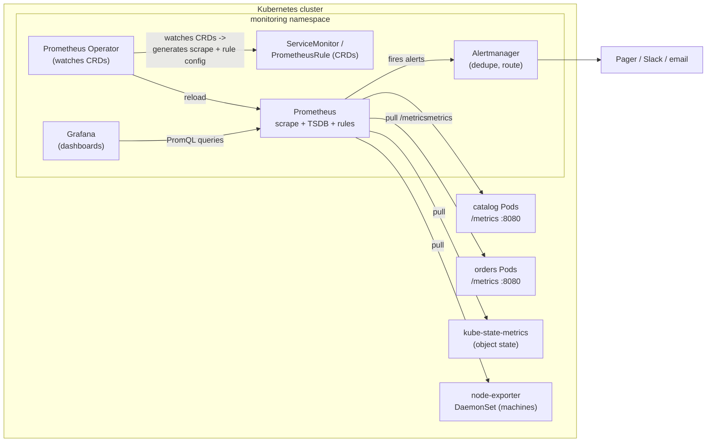

# 01 — Observability: metrics

> The two metrics planes — **metrics-server** (the resource-metrics API behind
> `kubectl top`/HPA) vs **Prometheus** (the monitoring TSDB) — Prometheus
> architecture (pull/scrape, service discovery, TSDB, PromQL, Alertmanager),
> kube-state-metrics vs node-exporter vs app metrics, the **Prometheus
> Operator** + ServiceMonitor/PrometheusRule, the exposition format and
> RED/USE/four-golden-signals — applied by scraping the Bookstore's existing
> `/metrics` and alerting on catalog's error rate.

**Estimated time:** ~30 min read · ~60 min hands-on
**Prerequisites:** [Part 04 ch.01](../04-scheduling/01-scheduler-and-nodes.md) — workloads are scheduled and running · [Part 05 ch.02](../05-security/02-pod-security.md) — hardened and running, but is it *healthy*? · [Part 01 ch.02](../01-core-workloads/02-health-and-lifecycle.md) — probes vs metrics: liveness ≠ p95 latency
**You'll know after this:** • distinguish metrics-server (resource metrics for HPA) from Prometheus (monitoring TSDB) · • read PromQL for RED, USE and the four golden signals · • deploy the Prometheus Operator and write ServiceMonitor + PrometheusRule resources · • interpret kube-state-metrics, node-exporter and application `/metrics` together · • alert on the Bookstore catalog's error rate via Alertmanager • lock `/metrics` to Prometheus and say what the endpoint reveals

<!-- tags: observability, prometheus, slo, day-2 -->

## Why this exists

The Bookstore now runs, is scheduled deliberately ([Part 04](../04-scheduling/01-scheduler-and-nodes.md))
and is hardened ([Part 05](../05-security/02-pod-security.md)). The next
question every operator asks is the one Kubernetes itself **cannot answer**:
*is it actually healthy, and how do I know before a user tells me?*
`kubectl get pods` shows `Running`; it does **not** show that catalog's p95
latency tripled, that the 5xx rate is climbing, or that a node is saturated.
A `Running` Pod serving 100% errors is still `Running`.

Kubernetes ships **no built-in monitoring database**. It exposes raw signals
(the kubelet's `/metrics/resource`, the API server's own `/metrics`, container
cgroup stats) but it does not store history, has no query language, and raises
no alerts. Observability is something you **add**. This chapter is the metrics
pillar of it (logs are [ch.02](02-logging.md), traces [ch.03](03-tracing.md));
together they are how you operate the system instead of guessing. This is the
[Observability](#further-reading) concern from *Production Kubernetes*.

## Mental model

There are **two distinct metrics planes**, and conflating them is the most
common beginner mistake:

- **The resource-metrics plane — `metrics-server`.** A single lightweight
  add-on that scrapes the kubelet Summary API on every node and serves
  *only* current CPU/memory per Pod/node through the aggregated
  **`metrics.k8s.io`** API. No history (the last data point only), no
  disk, no query language. It exists for exactly two consumers:
  `kubectl top` and the **HorizontalPodAutoscaler**
  ([ch.04](04-autoscaling.md)). It is *not* a monitoring system.
- **The monitoring plane — Prometheus.** A time-series database that
  **pulls** (`scrape`s) HTTP `/metrics` endpoints on an interval, stores the
  samples with their labels in a local TSDB, and lets you ask questions of
  the *history* with **PromQL**. It evaluates alerting rules and hands firing
  alerts to **Alertmanager** for routing. This is the system you graph,
  alert, and debug with.

You need both: metrics-server because the HPA's `Resource` metric is fed by
`metrics.k8s.io`, and Prometheus because that is where SLOs, dashboards and
alerts live. They scrape different things for different consumers and do not
replace each other.

Prometheus's data model: every sample is a `metric_name{label=value,...}` →
`float64` at a timestamp. The Bookstore's Go services already speak it — they
expose `http_requests_total{handler,code}` (a **counter**) and
`http_request_duration_seconds` (a **histogram**) on `/metrics`
(`app/catalog/main.go`). You instrument once in the app; Prometheus does the
rest by scraping.

Three metric *sources* you will always run, answering different questions:

| Source | What it knows | Example |
|---|---|---|
| **Application metrics** | what the app is doing | `http_requests_total`, `orders_placed_total` |
| **kube-state-metrics** | the desired/observed state of K8s *objects* | `kube_deployment_status_replicas_available` |
| **node-exporter** | the *machine* underneath | `node_cpu_seconds_total`, `node_filesystem_avail_bytes` |

## Threats and controls

| Threat | Control in this chapter | Deeper |
|---|---|---|
| Anyone who can reach the metrics port reads route names, traffic and the Go version | A NetworkPolicy admits only the Prometheus pods to `:8080` (section 4) | [02.06](../02-networking/06-network-policies.md) |
| A public route forwards `/metrics` to the app | No Ingress or Gateway rule may match it (section 4 shows one that does) | [02.04](../02-networking/04-ingress.md), [02.05](../02-networking/05-gateway-api.md) |
| node-exporter needs host networking and host paths, which the baseline forbids | `monitoring` is labelled `privileged`, registered as an exception, with host PID off | [05.02](../05-security/02-pod-security.md) |
| A Grafana admin password written into a values file or manifest | `grafana.admin.existingSecret`: the password lives in a Secret you create | [03.02](../03-config-and-storage/02-secrets.md) |
| Personal data or secrets reaching the TSDB through labels | Labels stay bounded (`handler`, `code`); log redaction is in [06.02](02-logging.md) | [06.02](02-logging.md) |
| metrics-server trusting a kubelet it cannot verify | Verification stays on; the insecure flag is never taught | [metrics-server FAQ](https://github.com/kubernetes-sigs/metrics-server/blob/master/FAQ.md) |

## Diagrams

### Prometheus architecture: scrape → store → query → alert (Mermaid)



### metrics-server vs Prometheus, and RED/USE (ASCII)

```
 TWO METRICS PLANES ─────────────────────────────────────────────────────────
   metrics-server  : kubelet summary -> metrics.k8s.io : NOW only, no history
                      consumers: `kubectl top`, HPA Resource metric
   Prometheus       : scrape /metrics -> TSDB (history) -> PromQL/alerts
                      consumers: Grafana, Alertmanager, you (debugging)
   (they do NOT overlap; you run both)

 RED — for every REQUEST-serving service (catalog, orders, storefront)
   Rate      requests/sec        sum(rate(http_requests_total[5m]))
   Errors    failed/sec or ratio rate(...{code=~"5.."}) / rate(...)
   Duration  latency distribution histogram_quantile(0.95, ...bucket)

 USE — for every RESOURCE (node CPU, memory, disk, a queue)
   Utilization  % time busy / used      node_cpu busy ratio
   Saturation   queued / waiting work   runqueue, RabbitMQ queue depth
   Errors       error events            disk errors, OOM kills

 The four golden signals (SRE book) = Latency + Traffic + Errors + Saturation
   ≈ RED (latency/traffic/errors) + the S of USE (saturation).
```

## Hands-on with the Bookstore

**Assumed working directory: the guide repo root (`full-guide/`).**

We will: (1) install **metrics-server** and see what its refusal looks like on
kind; (2) install **kube-prometheus-stack** (Prometheus Operator + Prometheus +
Alertmanager + Grafana + node-exporter + kube-state-metrics) into its own
`monitoring` namespace; (3) point a **ServiceMonitor** at catalog's existing
`/metrics`; (4) lock `/metrics` down to Prometheus; (5) query it with PromQL;
(6) add a **PrometheusRule**.

### 0. Prerequisites (self-bootstrapping — re-run after any kind recreate)

```sh
# A cluster (single-node kind is fine for this chapter).
kind create cluster --name bookstore
#   or: k3d cluster create bookstore --image rancher/k3s:v1.37.1-k3s1

# Build + load the Bookstore images (full instructions in
# examples/bookstore/app/README.md):
cd examples/bookstore/app
docker build -t bookstore/catalog:dev         ./catalog
docker build -t bookstore/orders:dev          ./orders
docker build -t bookstore/payments-worker:dev ./payments-worker
docker build -t bookstore/storefront:dev      ./storefront
cd ../../..                                   # back to the guide repo root
for i in catalog orders payments-worker storefront; do
  kind load docker-image bookstore/$i:dev --name bookstore
done

# The cumulative Bookstore chain, in dependency order (PSA-restricted ns first,
# then SAs, config/secret, cluster-scoped, then workloads + Services):
kubectl apply -f examples/bookstore/raw-manifests/00-namespace.yaml
kubectl apply -f examples/bookstore/raw-manifests/05-serviceaccounts-rbac.yaml
kubectl apply -f examples/bookstore/raw-manifests/15-catalog-config.yaml
kubectl apply -f examples/bookstore/raw-manifests/16-db-credentials.yaml
kubectl apply -f examples/bookstore/raw-manifests/35-priorityclasses.yaml
kubectl apply -f examples/bookstore/raw-manifests/12-redis.yaml
kubectl apply -f examples/bookstore/raw-manifests/13-rabbitmq.yaml
kubectl apply -f examples/bookstore/raw-manifests/20-postgres-statefulset.yaml
kubectl rollout status statefulset/postgres -n bookstore
kubectl apply -f examples/bookstore/raw-manifests/10-catalog-deploy.yaml
kubectl apply -f examples/bookstore/raw-manifests/11-storefront-deploy.yaml
kubectl apply -f examples/bookstore/raw-manifests/14-orders-deploy.yaml
kubectl apply -f examples/bookstore/raw-manifests/40-services.yaml
kubectl apply -f examples/bookstore/raw-manifests/21-db-migrate-job.yaml   # schema
# catalog/orders carry DB_DSN; their /readyz pings Postgres connectivity (not
# table existence), so gate on the schema Job BEFORE asserting readiness —
# else they CrashLoop/500 on /books and the rollout wait times out.
kubectl wait --for=condition=complete job/db-migrate -n bookstore --timeout=120s
kubectl rollout status deployment/catalog -n bookstore
```

### 1. metrics-server (the resource-metrics plane)

Install it with Helm into a namespace of its own, labelled `restricted`. The
chart's `securityContext` values already set what `restricted` asks for
(non-root, a read-only root filesystem, every capability dropped, the
`RuntimeDefault` seccomp profile), and the install keeps them. The chart does
not go into `kube-system`, which this chapter does not relabel:

```sh
kubectl create namespace metrics-server
kubectl label namespace metrics-server \
  pod-security.kubernetes.io/enforce=restricted \
  pod-security.kubernetes.io/audit=restricted \
  pod-security.kubernetes.io/warn=restricted
helm repo add metrics-server https://kubernetes-sigs.github.io/metrics-server/
helm repo update
helm install metrics-server metrics-server/metrics-server \
  --version 3.14.0 \
  --namespace metrics-server
kubectl -n metrics-server get pods
kubectl top nodes
```

<!-- gate: output -->
```
NAME                             READY   STATUS    RESTARTS   AGE
metrics-server-c4994bc54-b2jpz   0/1     Running   0          53s
```

<!-- gate: output -->
```
error: Metrics API not available
```

The output in this section came from a lab cluster whose node has a different
name from yours. The pod runs, but it does not become ready on this cluster.
Read its log to see why:

```sh
kubectl -n metrics-server logs deploy/metrics-server --tail=3
```

<!-- gate: output -->
```
E1031 01:17:58.628753       1 scraper.go:149] "Failed to scrape node" err="Get \"https://172.18.0.2:10250/metrics/resource\": tls: failed to verify certificate: x509: cannot validate certificate for 172.18.0.2 because it doesn't contain any IP SANs" node="sf-pilot-control-plane"
```

The log line is the control working. The kubelet's serving certificate on a
kind node does not list the node's IP address, so metrics-server's
verification refuses it. The tempting fix is `--kubelet-insecure-tls`, which
turns verification off for every kubelet in the cluster, so this chapter does
not teach it. The [metrics-server
FAQ](https://github.com/kubernetes-sigs/metrics-server/blob/master/FAQ.md)
names the secure setup: validate the kubelet certificate with
`--kubelet-certificate-authority`, and keep the insecure flags off. Serving
certificates that the cluster CA signs come from the CSR flow, which
`--rotate-server-certificates` turns on ([kubelet
reference](https://kubernetes.io/docs/reference/command-line-tools-reference/kubelet/)).
A kind configuration would have to set that up, and this lab cluster does not
have one. So on kind this chapter stops at the refusal. Until metrics-server
serves, `kubectl get apiservice v1beta1.metrics.k8s.io` reports `False
(MissingEndpoints)`, and the HPA in [ch.04](04-autoscaling.md) has no resource
metrics on this cluster.

`kubectl top` returns **current** usage only — there is no `--since`, no
history. That is the entire point of metrics-server: it is the live feed the
HPA samples ([ch.04](04-autoscaling.md)), not a monitoring store.

### 2. kube-prometheus-stack (the monitoring plane)

Install the chart into a `monitoring` namespace of its own, not `bookstore`.
That namespace cannot be `restricted`. node-exporter is a host-level
DaemonSet, and it needs host networking and host paths, which `restricted` and
`baseline` both forbid. So `monitoring` is labelled `privileged`, which makes
it an exception. The exception is registered in
`security/namespace-exceptions.yaml` at the repository root, with its reason
and an expiry date. The warn and audit labels stay at `restricted`, so the
warnings name every pod that would fail it, and the dry run below shows that
node-exporter is the only one.

This lab's install did not finish on the shared cluster, so the stack below is
checked by a server-side dry run of the rendered chart, not by a running stack.
The evidence file records what ran.

```sh
helm repo add prometheus-community https://prometheus-community.github.io/helm-charts
helm repo update
kubectl create namespace monitoring
kubectl label namespace monitoring \
  pod-security.kubernetes.io/enforce=privileged \
  pod-security.kubernetes.io/audit=restricted \
  pod-security.kubernetes.io/warn=restricted
kubectl -n monitoring create secret generic grafana-admin \
  --from-literal=admin-user=admin \
  --from-literal=admin-password="$(openssl rand -base64 24)"
```

<!-- gate: output -->
```
secret/grafana-admin created
```

The password is generated and never written to a file. Without an
`existingSecret`, the chart's Grafana subchart writes a random admin password
into a Secret it chooses. Naming your own Secret keeps the password out of the
values file.

The values file keeps node-exporter's host networking and its read-only root
mount, which the network and filesystem collectors read. It turns off the
shared host PID namespace, because the chart's collectors read host data
through the `/host` mounts instead. Check after install that `node_` series
still appear. The file also sets the seccomp and capability fields that the
chart exposes:

```sh
cat > monitoring-values.yaml <<'EOF'
grafana:
  admin:
    existingSecret: grafana-admin
prometheus-node-exporter:
  hostPID: false
  securityContext:
    seccompProfile:
      type: RuntimeDefault
  containerSecurityContext:
    allowPrivilegeEscalation: false
    capabilities:
      drop: ["ALL"]
EOF
```

Before installing, render the chart and dry-run it against the server. Nothing
is created, and the warning reports what `restricted` would refuse:

```sh
helm template kube-prometheus-stack prometheus-community/kube-prometheus-stack \
  --version 92.16.1 --namespace monitoring --values monitoring-values.yaml \
  --skip-tests | kubectl apply --dry-run=server -f -
```

<!-- gate: output -->
```
Warning: would violate PodSecurity "restricted:latest": host namespaces (hostNetwork=true), restricted volume types (volumes "proc", "sys", "root" use restricted volume type "hostPath")
```

That one warning is the registered exception: host networking and host paths.
Nothing else in the chart fails `restricted`. `--skip-tests` leaves out the
chart's test hook, which `helm test` runs and `helm install` does not. The dry
run needs the chart's CRDs in place for the `Prometheus` and `ServiceMonitor`
kinds. Without them the server does not know those kinds. `helm show chart`
reports the chart as version 92.16.1, which is the version pinned below.

Install the pinned version:

```sh
# The release name must be kube-prometheus-stack: the `release:` label on 80-
# and 81- has to match Prometheus's selector (see below).
helm install kube-prometheus-stack \
  prometheus-community/kube-prometheus-stack \
  --version 92.16.1 \
  --namespace monitoring \
  --values monitoring-values.yaml \
  --wait
kubectl get pods -n monitoring
```

You now have Prometheus, Alertmanager, Grafana, node-exporter (a DaemonSet),
and kube-state-metrics — all scraped automatically. Open Prometheus and
Grafana via port-forward (local only):

```sh
kubectl -n monitoring port-forward svc/kube-prometheus-stack-prometheus 9090:9090 &
# Prometheus UI: http://localhost:9090  (Status -> Targets shows what it scrapes)
kubectl -n monitoring port-forward svc/kube-prometheus-stack-grafana 3000:80 &
# Grafana: http://localhost:3000 (user admin; the password is in grafana-admin)
```

### 3. Scrape the Bookstore: a ServiceMonitor

Prometheus does not know about catalog yet. We do **not** edit
`prometheus.yml` — the Operator turns a `ServiceMonitor` custom resource into
scrape config. New file
[`examples/bookstore/raw-manifests/80-servicemonitor.yaml`](../examples/bookstore/raw-manifests/80-servicemonitor.yaml)
(catalog shown; the file also includes payments-worker):

```yaml
apiVersion: monitoring.coreos.com/v1
kind: ServiceMonitor
metadata:
  name: catalog
  namespace: bookstore
  labels:
    app: catalog
    release: kube-prometheus-stack   # MUST match Prometheus's serviceMonitorSelector
spec:
  selector:
    matchLabels: { app: catalog }    # selects the `catalog` Service (40-)
  namespaceSelector:
    matchNames: ["bookstore"]
  endpoints:
    - port: http                     # the catalog Service's named port (-> 8080)
      path: /metrics                 # promhttp.Handler() (app/catalog/main.go)
      interval: 15s
```

> **The `release:` label is load-bearing.** kube-prometheus-stack's Prometheus
> defaults to `serviceMonitorSelector: matchLabels: {release: kube-prometheus-stack}`.
> A ServiceMonitor *without* that label is a valid object that is **silently
> never scraped** — the single most common "my ServiceMonitor does nothing"
> cause. The file's header documents this.

> **CRD-backed object — expected dry-run note.** `ServiceMonitor` is a
> Prometheus Operator CRD, not a built-in kind. On a cluster *without* the
> Operator, `kubectl apply --dry-run=client -f 80-servicemonitor.yaml` prints
> `no matches for kind "ServiceMonitor" in version "monitoring.coreos.com/v1"`
> — **expected and not a defect**, exactly like the Gateway API
> ([Part 02 ch.05](../02-networking/05-gateway-api.md)), VolumeSnapshot
> ([Part 03 ch.05](../03-config-and-storage/05-stateful-data-patterns.md)) and
> Kyverno ([Part 05 ch.03](../05-security/03-supply-chain.md)) objects. After
> installing the stack the schema is valid and it applies. The same applies to
> `81-prometheusrule.yaml`.

```sh
kubectl apply -f examples/bookstore/raw-manifests/80-servicemonitor.yaml
# Prometheus UI -> Status -> Targets: bookstore/catalog should be UP within ~30s.
```

The lab created both objects with the chart's CRDs in place. No operator ran
there, so nothing scraped them:

<!-- gate: output -->
```
servicemonitor.monitoring.coreos.com/catalog created
servicemonitor.monitoring.coreos.com/payments-worker created
```

> **NetworkPolicy interaction.** Once a policy-enforcing CNI is in play (Part 02
> ch.06), default-deny ingress in `bookstore` blocks Prometheus's scrape and
> every target shows "context deadline exceeded". Rule 10 of
> `60-networkpolicy.yaml` (`allow-monitoring-scrape`) admits only the Prometheus
> pods in `monitoring` to catalog, orders and payments-worker on `:8080`.
> Section 4 applies it.
> Note this rule is **deliberately one-sided** — unlike the intra-`bookstore`
> backend edges (Part 02 ch.06), which need *both* a destination Ingress
> *and* a source Egress rule because *both* endpoints sit in the default-deny
> `bookstore` namespace. This scrape edge is **cross-namespace**: the source
> (Prometheus) lives in `monitoring`, which kube-prometheus-stack does **not**
> put under a default-deny policy, so Prometheus already has unrestricted
> egress and needs no egress rule. NetworkPolicy is per-namespace; only the
> locked-down side (`bookstore`) has a half to add, so the missing "other
> half" is correct by design, not an omission.

### 4. Lock `/metrics` to Prometheus

catalog serves `/metrics` on the port its API uses, `:8080`, and nothing
authenticates the request. Before a NetworkPolicy exists, a pod in any namespace
can read it. The probe below stands in for such a pod. It runs as UID 100 and
GID 101, which the curl image declares, with the restricted settings from the
[baseline](../01-core-workloads/01-pods.md#baseline):

```sh
kubectl create namespace probe
kubectl label namespace probe \
  pod-security.kubernetes.io/enforce=restricted \
  pod-security.kubernetes.io/audit=restricted \
  pod-security.kubernetes.io/warn=restricted
kubectl -n probe create serviceaccount probe
# curlimages/curl:8.10.1, pinned by digest
kubectl run probe -n probe --rm -i --restart=Never \
  --image=curlimages/curl@sha256:d9b4541e214bcd85196d6e92e2753ac6d0ea699f0af5741f8c6cccbfcf00ef4b \
  --overrides='{"spec":{"serviceAccountName":"probe","automountServiceAccountToken":false,"securityContext":{"runAsNonRoot":true,"runAsUser":100,"runAsGroup":101,"seccompProfile":{"type":"RuntimeDefault"}},"containers":[{"name":"probe","image":"curlimages/curl@sha256:d9b4541e214bcd85196d6e92e2753ac6d0ea699f0af5741f8c6cccbfcf00ef4b","command":["curl","-sS","-m","5","http://catalog.bookstore.svc.cluster.local/metrics"],"resources":{"requests":{"cpu":"10m","memory":"16Mi"},"limits":{"memory":"32Mi"}},"securityContext":{"allowPrivilegeEscalation":false,"readOnlyRootFilesystem":true,"capabilities":{"drop":["ALL"]}}}]}}'
```

<!-- gate: output -->
```
# HELP go_info Information about the Go environment.
# TYPE go_info gauge
go_info{version="go1.26.10"} 1
```

Most of the body is runtime detail. `go_info` gives the Go version, which is
enough to match a runtime advisory. The `handler` and `code` labels name each
route and status the app serves, and the counters show the traffic per route.
The health endpoints already show traffic before any load, because the
kubelet's probes call `healthz` and `readyz`:

<!-- gate: output -->
```
http_requests_total{code="200",handler="healthz"} 4
http_requests_total{code="200",handler="readyz"} 8
```

The labels hold no customer data, but the counters still show how busy the
service is. The other services add business volume to the same kind of
endpoint, as `orders_placed_total` and `payments_processed_total`. Any pod that
reaches the port reads all of it.

Apply the lock. Rule 10 admits the Prometheus pods and nothing else in
`monitoring`:

```sh
kubectl apply -f examples/bookstore/raw-manifests/60-networkpolicy.yaml
```

<!-- gate: output -->
```
networkpolicy.networking.k8s.io/default-deny-all created
# ...
networkpolicy.networking.k8s.io/allow-monitoring-scrape created
```

Rule 10 is the only edge into `monitoring`, and its `from` entry needs both
selectors. Two stand-in pods in that namespace show it. The first carries
`app.kubernetes.io/name: prometheus`, the label to check on the chart's real
Prometheus pods with `kubectl -n monitoring get pods --show-labels` once the
stack runs. The second carries a Grafana label. This lab did not run the
stack, so the stand-ins are the test.

```sh
kubectl -n monitoring create serviceaccount standin
kubectl run prometheus-standin -n monitoring --labels=app.kubernetes.io/name=prometheus \
  --rm -i --restart=Never --image=curlimages/curl@sha256:d9b4541e214bcd85196d6e92e2753ac6d0ea699f0af5741f8c6cccbfcf00ef4b \
  --overrides='{"spec":{"serviceAccountName":"standin","automountServiceAccountToken":false,"securityContext":{"runAsNonRoot":true,"runAsUser":100,"runAsGroup":101,"seccompProfile":{"type":"RuntimeDefault"}},"containers":[{"name":"prometheus-standin","image":"curlimages/curl@sha256:d9b4541e214bcd85196d6e92e2753ac6d0ea699f0af5741f8c6cccbfcf00ef4b","command":["curl","-sS","-m","5","-o","/dev/null","-w","%{http_code}\n","http://catalog.bookstore.svc.cluster.local/metrics"],"resources":{"requests":{"cpu":"10m","memory":"16Mi"},"limits":{"memory":"32Mi"}},"securityContext":{"allowPrivilegeEscalation":false,"readOnlyRootFilesystem":true,"capabilities":{"drop":["ALL"]}}}]}}'
kubectl run grafana-standin -n monitoring --labels=app.kubernetes.io/name=grafana \
  --rm -i --restart=Never --image=curlimages/curl@sha256:d9b4541e214bcd85196d6e92e2753ac6d0ea699f0af5741f8c6cccbfcf00ef4b \
  --overrides='{"spec":{"serviceAccountName":"standin","automountServiceAccountToken":false,"securityContext":{"runAsNonRoot":true,"runAsUser":100,"runAsGroup":101,"seccompProfile":{"type":"RuntimeDefault"}},"containers":[{"name":"grafana-standin","image":"curlimages/curl@sha256:d9b4541e214bcd85196d6e92e2753ac6d0ea699f0af5741f8c6cccbfcf00ef4b","command":["curl","-sS","-m","5","-o","/dev/null","-w","%{http_code}\n","http://catalog.bookstore.svc.cluster.local/metrics"],"resources":{"requests":{"cpu":"10m","memory":"16Mi"},"limits":{"memory":"32Mi"}},"securityContext":{"allowPrivilegeEscalation":false,"readOnlyRootFilesystem":true,"capabilities":{"drop":["ALL"]}}}]}}'
```

<!-- gate: output -->
```
200
```

The labelled stand-in gets `200`. The other is refused although it sits in the
same namespace. That is what the single `from` entry does. Two list items
would have admitted both pods.

<!-- gate: output -->
```
000
curl: (28) Connection timed out after 5002 milliseconds
```

Run the same probe again:

<!-- gate: output -->
```
curl: (28) Connection timed out after 5001 milliseconds
```

Exit code 28 is curl's timeout, and it is the result the policy should give. The
Bookstore's default-deny ingress has no rule that admits pods in `probe`, so the
connection is dropped and never answered.

Rule 4 still admits storefront to the same port, for the API. A NetworkPolicy
matches pods and ports, never URL paths, so storefront reads the same endpoint:

```sh
kubectl -n bookstore exec deploy/storefront -- wget -q -O - http://catalog/metrics
```

<!-- gate: output -->
```
# HELP go_info Information about the Go environment.
# TYPE go_info gauge
go_info{version="go1.26.10"} 1
```

That is the residual exposure, and the lock does not close it. The fix is a
metrics port that only Prometheus can reach, which catalog does not have yet, or
a layer-7 policy that matches the path, which this chapter does not build.

> **The public route.** No Ingress or Gateway rule may send `/metrics` to the
> app. The Gateway example in [02.05](../02-networking/05-gateway-api.md) meets
> this: its prefix rewrite turns `/api/books/metrics` into `/books/metrics`,
> which catalog does not serve. The Ingress example in
> [02.04](../02-networking/04-ingress.md) does not. Its path
> `/api/books(/|$)(.*)` keeps the suffix, and `rewrite-target: /$2` would turn
> `/api/books/metrics` into `/metrics`
> ([ingress-nginx rewrite](https://kubernetes.github.io/ingress-nginx/examples/rewrite/)).
> That is a defect in Part 02's example, and the fix belongs there: rewrite to
> the fixed `/books` path. Until it is fixed, the Ingress example would route
> `/metrics` to catalog.

### 5. Query the Bookstore with PromQL

Generate traffic from storefront, the one caller the policy admits. catalog is
distroless (no shell), so the load cannot run inside it. Storefront's image has
a shell and BusyBox `wget`:

```sh
kubectl -n bookstore exec deploy/storefront -- \
  sh -c 'for i in $(seq 1 200); do wget -q -O /dev/null http://catalog/books; done; echo done'
```

<!-- gate: output -->
```
done
```

`-q` hides failed requests, so check the counters rather than the loop's count.
Then query (Prometheus UI → Graph, or `/api/v1/query`). A throwaway pod would be
refused by the same policy, which is the point of the lock.

The RED queries (these work against the metrics catalog already exports):

```promql
# Rate — requests/sec to the books handler, per pod, last 5m
sum(rate(http_requests_total{handler="books"}[5m])) by (pod)

# Errors — 5xx ratio across catalog (the SLO-style symptom signal)
sum(rate(http_requests_total{handler!="metrics",code=~"5.."}[5m]))
  / sum(rate(http_requests_total{handler!="metrics"}[5m]))

# Duration — p95 latency from the histogram (the standard quantile pattern)
histogram_quantile(0.95,
  sum by (le) (rate(http_request_duration_seconds_bucket{handler="books"}[5m])))
```

In Grafana, the bundled "Kubernetes / Compute Resources" dashboards already
work (kube-state-metrics + node-exporter feed them); build a Bookstore RED
dashboard from the three queries above (one panel each).

### 6. Alert on catalog's error rate: a PrometheusRule

New file
[`examples/bookstore/raw-manifests/81-prometheusrule.yaml`](../examples/bookstore/raw-manifests/81-prometheusrule.yaml)
(one rule shown; the file has three — high error rate, high p95, absent):

```yaml
apiVersion: monitoring.coreos.com/v1
kind: PrometheusRule
metadata:
  name: bookstore-catalog-rules
  namespace: bookstore
  labels:
    app: catalog
    release: kube-prometheus-stack   # MUST match Prometheus's ruleSelector
spec:
  groups:
    - name: bookstore-catalog.rules
      rules:
        - alert: CatalogHighErrorRate
          expr: |
            (sum(rate(http_requests_total{handler!="metrics",code=~"5.."}[5m]))
             / sum(rate(http_requests_total{handler!="metrics"}[5m]))) > 0.05
          for: 10m
          labels: { severity: warning, service: catalog }
          annotations:
            summary: "catalog 5xx error ratio above 5%"
```

```sh
kubectl apply -f examples/bookstore/raw-manifests/81-prometheusrule.yaml
# Prometheus UI -> Alerts: the 3 rules appear (Inactive until the expr trips,
# then Pending for `for:` 10m, then Firing -> Alertmanager).
```

`for: 10m` means the condition must hold continuously for 10 minutes before
firing — this is what stops a momentary blip from paging anyone. The
thresholds here are illustrative; [ch.05](05-reliability-and-disruptions.md)
derives them from an actual SLO and error budget.

## How it works under the hood

- **Pull, not push.** Prometheus *scrapes*: it issues an HTTP `GET /metrics`
  to each target every `scrape_interval` and parses the text exposition
  format (`name{labels} value [timestamp]`, `# HELP`, `# TYPE`). Pull means
  Prometheus controls the load and target discovery, and a target being
  unreachable is itself a signal (`up == 0`). The Bookstore's
  `promhttp.Handler()` is the exposition endpoint; the client library tracks
  counters/histograms in memory and renders them on each scrape.
- **Service discovery, not a static list.** In Kubernetes, Prometheus uses
  the `kubernetes_sd` discovery role to enumerate Pods/Services/Endpoints
  from the API server and relabels them into targets. The **Prometheus
  Operator** sits on top: it watches `ServiceMonitor`/`PodMonitor`/
  `PrometheusRule` objects and **generates** the scrape and rule config, then
  triggers a Prometheus config reload. You manage Kubernetes objects; the
  Operator manages `prometheus.yml`. That is why adding a target is `kubectl
  apply` of a ServiceMonitor, never editing a config file.
- **The TSDB.** Samples append to a per-series in-memory head block, flushed
  to immutable on-disk blocks (default 2h) with a WAL for crash recovery;
  old blocks are compacted and expire at the retention horizon (default 15d
  — Prometheus is **not** long-term storage; that is Thanos/Cortex/Mimir).
  Each unique label-set is its own series.
- **PromQL evaluates over the series.** `rate()` needs a **counter** (the
  client library guarantees monotonicity; `rate` corrects for counter
  resets/restarts). A **histogram** is exposed as cumulative `_bucket{le=...}`
  series plus `_sum`/`_count`; `histogram_quantile(0.95, sum by (le) (rate(
  ..._bucket[5m])))` interpolates the p95 from the bucket rates. This is why
  the app exports a histogram, not a single latency gauge — quantiles must be
  computed from the distribution, and cannot be averaged across pods.
- **Rules and Alertmanager.** Prometheus evaluates each rule group on an
  interval. A *recording rule* precomputes an expensive expression into a new
  series; an *alerting rule* whose `expr` is non-empty for its `for:`
  duration becomes a firing alert sent to **Alertmanager**, which
  deduplicates, groups, silences, and routes (pager/Slack/email).
  Alertmanager does the routing; Prometheus only decides *what* is firing.
- **Cardinality is the failure mode.** Series count = product of every
  label's distinct values. A label with unbounded values (user ID, full
  URL, request UUID) multiplies series without limit and OOMs Prometheus.
  The Bookstore deliberately labels by **bounded** dimensions (`handler`,
  `code`) — never the book ID or a raw path. High cardinality is the number
  one way people take Prometheus down.

## Production notes

> **In production:** keep the two planes separate and do not skip either.
> `metrics-server` (or a cloud equivalent) is mandatory for `kubectl top` and
> any **HPA** Resource metric ([ch.04](04-autoscaling.md)); Prometheus (or a
> managed equivalent) is mandatory for SLOs and alerting. Removing
> metrics-server silently breaks autoscaling; relying on it for monitoring
> gives you no history at all.

> **In production:** instrument with **RED** for every request service and
> **USE** for every resource, and alert on **symptoms** (error ratio,
> latency, SLO burn) not **causes** (CPU high). A CPU alert pages you when
> nothing is wrong and stays silent when the app is broken but cheap. The
> Bookstore's `81-prometheusrule.yaml` alerts on error ratio and p95 — the
> things a user feels.

> **In production:** managed offerings change the *operator/scaler* you run,
> not the model. **EKS**: Amazon Managed Service for Prometheus + the
> CloudWatch agent / ADOT collector; **GKE**: Google Cloud Managed Service
> for Prometheus (drop-in, keeps PromQL + ServiceMonitor-style config);
> **AKS**: Azure Monitor managed Prometheus + Managed Grafana. They all
> ingest the same exposition format — your app instrumentation and PromQL are
> portable; only the install and long-term storage differ.

> **In production:** put **retention and long-term storage** in the design
> from day one. Local Prometheus retention is days; for months/years and HA,
> federate to Thanos/Cortex/Mimir (or the managed equivalents). Size
> Prometheus by **active series** and watch `prometheus_tsdb_head_series`;
> guard cardinality with `metric_relabel_configs` that drop dangerous labels.

> **In production:** scrape kube-state-metrics and node-exporter, not just
> apps. Most "why did the Pod restart / why was it evicted / is the node
> saturated" questions are answered by `kube_*` and `node_*` series, not
> application metrics — they are the USE half of the picture.

## Quick Reference

```sh
kubectl top nodes ; kubectl top pods -n bookstore        # metrics-server plane
kubectl get servicemonitor,prometheusrule -n bookstore   # Operator CRDs
kubectl -n monitoring port-forward svc/kube-prometheus-stack-prometheus 9090:9090
kubectl -n monitoring port-forward svc/kube-prometheus-stack-grafana   3000:80
# Prometheus UI: Status->Targets (is catalog UP?), Alerts (rule state)
```

```promql
sum(rate(http_requests_total{handler="books"}[5m]))                     # Rate
sum(rate(http_requests_total{code=~"5.."}[5m])) / sum(rate(http_requests_total[5m]))  # Errors
histogram_quantile(0.95, sum by (le) (rate(http_request_duration_seconds_bucket[5m]))) # Duration
up{job="catalog"}                                                       # is it scraped?
```

Minimal ServiceMonitor + alerting rule skeleton:

```yaml
apiVersion: monitoring.coreos.com/v1
kind: ServiceMonitor
metadata: { name: x, namespace: ns, labels: { release: kube-prometheus-stack } }
spec:
  selector: { matchLabels: { app: x } }
  endpoints: [{ port: http, path: /metrics, interval: 15s }]
---
apiVersion: monitoring.coreos.com/v1
kind: PrometheusRule
metadata: { name: x, namespace: ns, labels: { release: kube-prometheus-stack } }
spec:
  groups:
    - name: x.rules
      rules:
        - alert: XHighErrors
          expr: rate(http_requests_total{code=~"5.."}[5m]) > 0
          for: 10m
          labels: { severity: warning }
```

Checklist:

- [ ] metrics-server installed (`kubectl top` works) — HPA prerequisite
- [ ] Prometheus stack in its own (non-restricted) `monitoring` namespace
- [ ] App exposes `/metrics`; labels are **bounded** (no IDs/paths)
- [ ] ServiceMonitor carries the `release:` label Prometheus selects on
- [ ] Alerts are symptom-based (errors/latency/SLO), not CPU
- [ ] NetworkPolicy admits only the Prometheus pods to app `:8080`
- [ ] No Ingress or Gateway rule matches `/metrics`
- [ ] `monitoring` is a registered exception; Grafana's login is a Secret
- [ ] Retention/long-term storage and cardinality budget decided

## Test your understanding

> Try each before opening the answer drawer. The act of trying is the exercise; the answer is the check.

1. **`kubectl top pods` works and shows live CPU/memory. Does that mean Prometheus is also installed? Explain in one sentence.**
   <details><summary>Show answer</summary>

   No — `kubectl top` is served by **metrics-server** via the `metrics.k8s.io` aggregated API, which is a separate lightweight add-on for *current* CPU/memory only (no history, no alerts, no PromQL). Prometheus is a separate monitoring TSDB; you can have either, both, or — in production — both, because they answer different questions. See the table in §Mental model.

   </details>

2. **You write `up{job="catalog"} == 0` as an alerting rule and it never fires, even though you can `kubectl get pods` and see catalog pods crashing. Where would you look first?**
   <details><summary>Show answer</summary>

   `up` is the scrape result — if the *ServiceMonitor* doesn't select the pod's Service (label mismatch on `release:` or `app:`), Prometheus never tries to scrape it, so there's no `up{job="catalog"}` series at all (vs being 0). Check Prometheus UI → Status → Targets: if catalog isn't listed, it's a ServiceMonitor selector or `prometheus.spec.serviceMonitorSelector` mismatch. The trap is "no data" looks identical to "everything's healthy" — alert on **absence** with `absent(up{job="catalog"})`, not just `== 0`.

   </details>

3. **Your `http_requests_total` series has labels `{handler, code, customer_id}`. After a week Prometheus is OOMing and queries are slow. What's the root cause and the fix?**
   <details><summary>Show answer</summary>

   `customer_id` is unbounded — every customer creates a new time series, and Prometheus's memory cost is proportional to *active series count*, not request volume. This is **label cardinality explosion**, the #1 way to break a Prometheus. Fix: drop `customer_id` from the metric (it belongs in *logs* or *traces*, not metrics), keep labels to a small, fixed set of values (`handler`, `code`, `method`).

   </details>

4. **Hands-on extension — break a histogram. Define an HPA that uses `http_request_duration_seconds` (a histogram) as a custom metric without first exposing `_bucket`, `_sum`, `_count`. Apply it. What does `kubectl describe hpa` show?**
   <details><summary>What you should see</summary>

   The HPA stays at `Unknown` for the metric value; `kubectl describe hpa` shows `FailedGetExternalMetric` / `unable to fetch metrics`. Histograms are aggregated via `histogram_quantile(0.95, sum by (le) (rate(..._bucket[5m])))` — you cannot point HPA at a raw histogram. Either expose a derived `_p95` gauge via a recording rule, or use the Prometheus Adapter to register the quantile as an external metric.

   </details>

5. **Why does the chapter insist that alerts be symptom-based (errors/latency/SLO) rather than CPU-based?**
   <details><summary>Show answer</summary>

   High CPU is not a symptom of user pain — a pod can run at 90% CPU and serve perfect p95 latency; a pod at 10% CPU can be erroring every request. CPU alerts produce paging noise (false positives) *and* miss real failures (false negatives). Alert on **what users feel** (error rate, latency, throughput drop) — the four golden signals / RED — and use CPU as a *diagnostic* once you're already paged on a symptom.

   </details>

6. **A teammate wants an Ingress rule for `/api/books/metrics`, so the dashboard team can read catalog's metrics from outside the cluster. What do you tell them, and what do you check before approving it?**
   <details><summary>Show answer</summary>

   Say no. `/metrics` has no authentication, and it reveals the Go version,
   the route names and the traffic per route. A route that keeps the suffix
   hands the endpoint to anyone who can reach the host. Give the dashboard
   team Grafana, which has its own login, and keep the scrape inside the
   cluster. Before approving any route, check every Ingress and Gateway rule
   for a path that could match `/metrics`, including suffix captures such as
   `(.*)` and their rewrites.

   </details>

## Further reading

- **Rosso et al., _Production Kubernetes_, ch.9 — Observability** (metrics
  pipeline, Prometheus, alerting, the RED/USE framing for a platform).
- **Ibryam & Huß, _Kubernetes Patterns_ 2e — *Predictable Demands* (ch.2)**
  for why measured resource behaviour (not guesses) underpins scaling and
  capacity ([ch.04](04-autoscaling.md), [ch.06](06-capacity-and-cost.md)).
- Official: <https://kubernetes.io/docs/tasks/debug/debug-cluster/resource-metrics-pipeline/>
  (metrics-server / `metrics.k8s.io`),
  <https://prometheus.io/docs/introduction/overview/> and the Prometheus
  Operator design: <https://prometheus-operator.dev/docs/getting-started/introduction/>.
- metrics-server's secure setup, <https://github.com/kubernetes-sigs/metrics-server/blob/master/FAQ.md>, and kubelet serving certificates, <https://kubernetes.io/docs/reference/command-line-tools-reference/kubelet/>.
