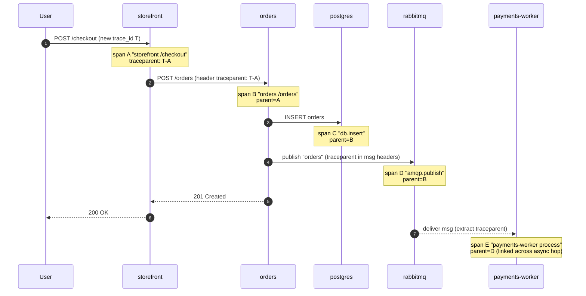

# 03 — Tracing

> Distributed tracing concepts (trace/span/context propagation, **W3C
> traceparent**, head vs tail sampling), **OpenTelemetry** (SDK, auto vs
> manual instrumentation, the **OTel Collector**: receivers/processors/
> exporters), backends (Jaeger/Tempo/Grafana), trace↔log↔metric correlation
> via exemplars, and sampling/overhead — applied by tracing a Bookstore
> checkout across storefront → orders → rabbitmq → payments-worker. A trace
> carries whatever the requests carried, so the chapter also covers the
> controls that keep span data from leaking.

**Estimated time:** ~15 min read · ~60 min hands-on
**Prerequisites:** [Part 06 ch.01](01-observability-metrics.md), metrics give p95, traces say *where* time went · [Part 06 ch.02](02-logging.md), trace IDs are the join key to logs · [Part 02 ch.02](../02-networking/02-services.md), the cross-service calls being traced · [Part 02 ch.06](../02-networking/06-network-policies.md), the policies in step 3
**You'll know after this:** • explain traces, spans and W3C `traceparent` context propagation · • choose head sampling vs tail sampling for a given traffic shape · • deploy the OpenTelemetry Collector with receivers, processors and exporters · • keep personal data and tokens out of span attributes, and name the control that drops them · • correlate trace → log → metric via exemplars in Grafana / Tempo · • follow one Bookstore checkout across four services in a flamegraph

<!-- tags: observability, opentelemetry, day-2, security -->


## Why this exists

[Metrics](01-observability-metrics.md) say catalog's p95 is 800ms.
[Logs](02-logging.md) show one request erroring. Neither answers the question
that actually matters in a microservice system: **for this one slow checkout,
where did the time go — orders' Postgres write, the RabbitMQ publish, or the
payments-worker?** A latency histogram is an aggregate across all requests; a
log line is one event in one service. Only a **distributed trace** stitches
the *causal path of a single request across every service it touched* into one
timeline.

The Bookstore is now genuinely distributed: a checkout is
storefront → orders → (Postgres + RabbitMQ) → payments-worker. When it is
slow, "which hop?" is unanswerable from metrics/logs alone. Tracing is the
third observability pillar; with metrics and logs it completes the
[Observability](#further-reading) concern from *Production Kubernetes*.

## Mental model

- A **span** = one timed operation (an HTTP handler, a DB query, a queue
  publish) with a start/end, a name, attributes, and a status.
- A **trace** = a tree of spans sharing one `trace_id`; each span records its
  `parent_span_id`, so the spans reconstruct the call graph and timeline.
- **Context propagation** is the whole trick. Service A, handling a request,
  injects its trace context into the **outbound** call's headers; service B
  extracts it and makes its spans children of A's. The standard wire format
  is the **W3C `traceparent`** HTTP header
  (`traceparent: 00-<TRACE_ID>-<SPAN_ID>-<FLAGS>`). Without propagation you
  get disconnected single-service spans, not a trace. For async hops
  (orders → RabbitMQ → payments-worker) the context rides in the **message
  headers** instead of HTTP headers — same idea, different carrier.
- **Sampling** controls cost. **Head sampling**: decide at the trace's first
  span whether to record it (e.g. keep 10%) — cheap, but you may discard the
  rare slow/errored trace. **Tail sampling**: buffer all spans and decide
  *after* the trace completes (e.g. keep 100% of errors and slow traces, 1%
  of the rest) — far more useful, done in the **Collector**, costs memory.

**OpenTelemetry (OTel)** is the vendor-neutral standard tying this together:

- An **SDK** in each service creates/propagates spans. **Auto-instrumentation**
  wraps common libraries (HTTP server/client, DB driver, AMQP) so you get
  spans without touching business code; **manual** spans annotate
  domain-specific work.
- The **OTel Collector** is a separate Deployment/DaemonSet that **receives**
  telemetry (OTLP), **processes** it (batch, tail-sampling, attribute
  scrubbing), and **exports** it to one or more backends. The app talks OTLP
  to the Collector and stays ignorant of the backend.
- **Backends** store and visualise traces: **Jaeger**, **Grafana Tempo**
  (label-indexed, Loki-like, pairs with Grafana), or a cloud APM.

> **Honesty up front (as [ch.01](01-observability-metrics.md) was about
> illustrative ConfigMap keys).** The Bookstore demo binaries
> (`app/*/main.go`) are intentionally tiny: they export Prometheus metrics and
> JSON logs but are **not** wired with the OTel SDK, so they do not emit spans
> today. This chapter is therefore honest about what is *runnable* vs
> *illustrative*: you will run a real Collector + Tempo and see them healthy,
> and the **instrumentation approach + collector config + how the trace would
> look** are shown faithfully and accurately — but a fully populated checkout
> trace requires adding the OTel SDK to the services (sketched in step 3),
> which is beyond these deliberately minimal teaching binaries. Everything
> claimed to be runnable is; everything illustrative is labelled as such.

## Threats and controls

A trace records what each request carried, so it is only as safe as its
contents. These threats belong to tracing. Log lines belong to
[06.02](02-logging.md).

| Threat | Control taught here | Goes deeper |
|---|---|---|
| A span attribute holds personal data or a token, and the trace store keeps it for everyone who can query traces | The app puts IDs in attributes, not values. The Collector deletes known keys and redacts matching values before export: [the pipeline](#collector-pipeline) | [03.02](../03-config-and-storage/02-secrets.md) for secret handling, [06.02](02-logging.md) for logs |
| Any Pod in the cluster can send spans. The OTLP receiver accepts any sender that can reach it, so a neighbour can flood the Collector or plant fake spans | [A NetworkPolicy that admits only Pods labelled as the services that emit spans](#netpol) | [02.06](../02-networking/06-network-policies.md) |
| Spans cross the pod network in cleartext, so anything that can observe that traffic reads them | [TLS on the OTLP receivers and on the Collector-to-Tempo hop](#tracing-namespace) | [11.04](../11-advanced-production-patterns/04-service-mesh.md) for workload mTLS |
| A caller outside the cluster sends its own `traceparent` or `baggage`, and that context reaches every service the request touches | [Start a new trace at the public edge, and propagate only the trace context](#propagation) | This chapter. [13.07](../13-grand-capstone-bookstore-platform/07-edge-gateway-waf-rate-limiting.md) covers the edge itself |

The Collector is a backstop, not the first line. A service should not write
a value into an attribute at all. The Collector's rules catch only the keys
and patterns they name, so a new field needs a rule before it can be
trusted.

The NetworkPolicy trusts the `app` label, which any Pod that can set its own
labels can change. It stops neighbours from sending spans, but a workload in
the namespace that lies about its label gets through. Step 4 flips the label
to show both directions.

## Diagrams

### A Bookstore checkout as a span tree (Mermaid, sequence)



### The span tree + the OTel pipeline (ASCII)

```
 TRACE  trace_id = T  (one checkout)
   span A  storefront /checkout                 [###############]  120ms
     span B  orders /orders                       [#########]       70ms
       span C  postgres INSERT orders               [##]            12ms
       span D  rabbitmq publish "orders"             [#]             4ms
     (async, same trace via msg-header propagation)
   span E  payments-worker process payment          [####]         25ms  parent=D

 OTEL PIPELINE          (TLS on both arrows)
   [app + OTel SDK] --OTLP--> [OTel Collector] --OTLP--> [Tempo]
                               receivers: otlp (4317, 4318)
                               processors: memory_limiter, tail_sampling,
                                           redaction, attributes, batch
                               exporters : otlp (to Tempo, CA-verified)
   App knows ONLY the Collector endpoint (OTEL_EXPORTER_OTLP_ENDPOINT);
   swapping the backend is a Collector change, not an app change.
```

## Hands-on with the Bookstore

**Assumed working directory: the guide repo root (`full-guide/`).**

We will: (1) create the `tracing` namespace and the TLS material its workloads
mount; (2) deploy **Tempo** and the **OpenTelemetry Collector** with pinned
charts; (3) lock the namespace down with NetworkPolicies; (4) send spans from a
service that emits them, and from one that must be refused; (5) check what
Tempo stores; (6) read the instrumentation the Go services would need, being
explicit about what is runnable and what is illustrative.

**Tier A.** Run these steps on a kind cluster you own. They create namespaces
and Secrets, so no shared cluster is safe for them. The output blocks below
were captured on a lab cluster whose node has a different name, in namespaces
named with a prefix. The commands here use the names in the text.

### 0. Prerequisites (self-bootstrapping)

Bring up the cluster + Bookstore as in
[ch.01 step 0](01-observability-metrics.md) (namespace → SAs → config/secret →
priorityclasses → workloads → Services; images built and `kind load`ed). For
the async path also apply rabbitmq, the worker, and the network policy:

```sh
kubectl apply -f examples/bookstore/raw-manifests/13-rabbitmq.yaml
kubectl apply -f examples/bookstore/raw-manifests/19-payments-worker-deploy.yaml
kubectl apply -f examples/bookstore/raw-manifests/60-networkpolicy.yaml   # if a policy CNI runs
kubectl rollout status deployment/payments-worker -n bookstore
```

### 1. The namespace and the TLS material {#tracing-namespace}

Telemetry infrastructure runs in its own `tracing` namespace, as the metrics
and logging stacks do. The namespace enforces `restricted` like every other
workload namespace, as the
[baseline](../01-core-workloads/01-pods.md#baseline-namespace) asks.

```sh
kubectl apply -f - <<'EOF'
apiVersion: v1
kind: Namespace
metadata:
  name: tracing
  labels:
    pod-security.kubernetes.io/enforce: restricted
    pod-security.kubernetes.io/warn: restricted
EOF
```

Span data crosses two hops, so both use TLS. This lab signs its own
certificates with a CA it creates. A platform should use the CA it already
trusts; [11.04](../11-advanced-production-patterns/04-service-mesh.md) covers
workload identity. Keep `ca.key` on your machine, since no cluster object
needs it. The Collector gets `ca.crt` to check Tempo's certificate, and the
services that send spans get it in step 4.

```sh
mkdir tls && cd tls
openssl req -x509 -newkey rsa:2048 -nodes -days 30 -subj "/CN=tracing-lab-ca" \
  -keyout ca.key -out ca.crt
printf 'subjectAltName=DNS:tempo.tracing.svc.cluster.local,DNS:tempo.tracing.svc,DNS:tempo\n' > san-tempo.cnf
printf 'subjectAltName=DNS:otel-collector-opentelemetry-collector.tracing.svc.cluster.local,DNS:otel-collector-opentelemetry-collector.tracing.svc,DNS:localhost\n' > san-otel.cnf
for name in tempo otel; do
  openssl req -newkey rsa:2048 -nodes -subj "/CN=$name" \
    -keyout $name.key -out $name.csr
  openssl x509 -req -in $name.csr -CA ca.crt -CAkey ca.key -CAcreateserial \
    -days 30 -extfile san-$name.cnf -out $name.crt
done

kubectl -n tracing create secret generic tempo-tls \
  --from-file=tls.crt=tempo.crt --from-file=tls.key=tempo.key
kubectl -n tracing create secret generic otel-collector-tls \
  --from-file=tls.crt=otel.crt --from-file=tls.key=otel.key \
  --from-file=ca.crt=ca.crt
```

The Collector's certificate also lists `localhost`, for a manual test over
`kubectl port-forward`. Tempo's certificate names only the in-cluster Service.

### 2. Tempo and the Collector from pinned charts {#pinned-charts}

Two pinned charts are used here: `grafana/tempo` 1.24.4 (Tempo 2.9.0) and
`open-telemetry/opentelemetry-collector` 0.178.1 (collector 0.163.2, the
contrib image). Each image is pinned by digest, with the tag kept beside it.
The Tempo chart has no digest field, so its `tag` carries `tag@digest`.

```sh
helm repo add grafana https://grafana.github.io/helm-charts
helm repo add open-telemetry https://open-telemetry.github.io/opentelemetry-helm-charts
helm repo update

```

Tempo reads its settings from the values file below. Save it as
`tempo-values.yaml`:

```yaml
tempo:
  tag: "2.9.0@sha256:65a5789759435f1ef696f1953258b9bbdb18eb571d5ce711ff812d2e128288a4"
  securityContext:
    allowPrivilegeEscalation: false
    readOnlyRootFilesystem: true
    capabilities:
      drop: ["ALL"]
  resources:
    requests: { cpu: 100m, memory: 256Mi }
    limits: { memory: 512Mi }
  extraVolumeMounts:
    - name: data
      mountPath: /var/tempo
    - name: tls
      mountPath: /etc/tempo/tls
      readOnly: true
    - name: tmp
      mountPath: /tmp
  receivers:
    otlp:
      protocols:
        grpc:
          endpoint: 0.0.0.0:4317
          tls:
            cert_file: /etc/tempo/tls/tls.crt
            key_file: /etc/tempo/tls/tls.key
        http: null
securityContext:
  seccompProfile:
    type: RuntimeDefault
serviceAccount:
  automountServiceAccountToken: false
extraVolumes:
  - name: data
    emptyDir: {}
  - name: tls
    secret:
      secretName: tempo-tls
      defaultMode: 0440
  - name: tmp
    emptyDir: {}
```

The root filesystem is read-only, so Tempo writes its trace blocks and WAL to
an `emptyDir` at `/var/tempo`, and `/tmp` is one too. The chart keeps its
Jaeger receivers enabled, because its Service template reads their settings
and a `null` there breaks the render. Step 3 closes their
ports. The TLS key is mode `0440`, and the pod's `fsGroup` lets the Tempo
group read it.

```sh
helm install tempo grafana/tempo --version 1.24.4 \
  --namespace tracing -f tempo-values.yaml --wait
```

Helm prints `level=WARN msg="this chart is deprecated"` for this chart. It
still installs and renders, which is why this chapter pins it. Check the
chart's repository for a replacement before you keep it on a cluster you run.

The Collector takes the values file below. Save it as `otel-values.yaml`:

```yaml
mode: deployment
image:
  repository: otel/opentelemetry-collector-contrib
  tag: "0.163.2"
  digest: "sha256:7f22d2a6748110ffb6a59bc0df448bccbf501cdb667d610ede4c61d3863d5849"
podSecurityContext:
  runAsNonRoot: true
  runAsUser: 10001
  runAsGroup: 10001
  fsGroup: 10001
  seccompProfile:
    type: RuntimeDefault
securityContext:
  allowPrivilegeEscalation: false
  readOnlyRootFilesystem: true
  capabilities:
    drop: ["ALL"]
serviceAccount:
  automountServiceAccountToken: false
resources:
  requests: { cpu: 100m, memory: 128Mi }
  limits: { memory: 256Mi }
extraVolumes:
  - name: tls
    secret:
      secretName: otel-collector-tls
      defaultMode: 0440
  - name: tmp
    emptyDir: {}
extraVolumeMounts:
  - name: tls
    mountPath: /etc/otel/tls
    readOnly: true
  - name: tmp
    mountPath: /tmp
ports:
  jaeger-compact:
    enabled: false
  jaeger-thrift:
    enabled: false
  jaeger-grpc:
    enabled: false
  zipkin:
    enabled: false
config:
  receivers:
    jaeger: null
    zipkin: null
    prometheus: null
    otlp:
      protocols:
        grpc:
          tls:
            cert_file: /etc/otel/tls/tls.crt
            key_file: /etc/otel/tls/tls.key
        http:
          tls:
            cert_file: /etc/otel/tls/tls.crt
            key_file: /etc/otel/tls/tls.key
  processors:
    tail_sampling:
      decision_wait: 10s
      policies:
        - name: errors
          type: status_code
          status_code: { status_codes: [ERROR] }
        - name: slow
          type: latency
          latency: { threshold_ms: 500 }
        - name: sample-rest
          type: probabilistic
          probabilistic: { sampling_percentage: 5 }
    redaction:
      allow_all_keys: false         # drop every key the list does not name
      allowed_keys:
        - service.name
        - http.route
        - http.method
        - order.id
        - note
      blocked_values:
        - '\b4[0-9]{3}[ -]?[0-9]{4}[ -]?[0-9]{4}[ -]?[0-9]{4}\b'
        - 'Bearer [A-Za-z0-9._~+/=-]+'
    attributes:
      actions:
        - { key: user.name, action: delete }
        - { key: db.statement, action: delete }
        - { key: http.request.header.authorization, action: delete }
        - { key: http.request.header.cookie, action: delete }
  exporters:
    debug: null
    otlp_grpc:
      endpoint: tempo.tracing.svc.cluster.local:4317
      tls:
        ca_file: /etc/otel/tls/ca.crt
  service:
    pipelines:
      logs: null
      metrics: null
      traces:
        receivers: [otlp]
        processors: [memory_limiter, tail_sampling, redaction, attributes, batch]
        exporters: [otlp_grpc]
```

The values replace the chart's default pipelines, so only traces remain and
only OTLP enters them. The exporter checks Tempo's certificate against
`ca.crt`, and nothing in the file turns that check off. The Service exposes
only 4317 and 4318.

```sh
helm install otel-collector open-telemetry/opentelemetry-collector --version 0.178.1 \
  --namespace tracing -f otel-values.yaml --wait
kubectl get pods -n tracing
```

<!-- gate: output -->
```
NAME                                                      READY   STATUS    RESTARTS   AGE
otel-collector-opentelemetry-collector-786d98f47b-2qmcm   1/1     Running   0          85s
tempo-0                                                   1/1     Running   0          37m
```

Both Pods should reach `1/1 Running`. The Collector now listens for OTLP on
`:4317` (gRPC) and `:4318` (HTTP, the port the services use) and forwards
spans to Tempo. A Running Pod only shows that the process started. Add Tempo
as a datasource in Grafana from [06.01](01-observability-metrics.md) at
`http://tempo.tracing.svc.cluster.local:3200` and query a trace to see the
pipeline work end to end. That query API stays plaintext inside the
namespace in this chapter. Step 3 admits only Grafana to it, and encrypting
it belongs with the workload TLS in
[11.04](../11-advanced-production-patterns/04-service-mesh.md).

### The Collector pipeline {#collector-pipeline}

The Collector's value is its processors. The app emits OTLP, and the
Collector samples, scrubs and batches centrally. The traces pipeline in the
values file runs these processors, in this order:

- `memory_limiter` refuses data before the Collector runs out of memory.
- `tail_sampling` holds each trace for `decision_wait` and then keeps every
  trace with an error, every trace over 500 ms, and 5% of the rest. It needs
  the whole trace, so only the Collector can run it.
- `redaction` removes every attribute whose key is not in `allowed_keys`.
  Then it replaces any remaining value that matches a `blocked_values`
  pattern with `****`, the processor's default masking string. The allow-list
  runs first, so an unlisted key never reaches the value patterns. The two
  patterns here match a card-number shape and a bearer token wherever they
  appear inside a kept key.
- `attributes` deletes the keys it lists. The allow-list already drops them,
  so this is a second guard: a span has no use for a customer name, a SQL
  statement or an Authorization header, and a later edit to the allow-list
  must not bring them back.
- `batch` amortises the export.

Scrubbing runs after sampling, so the sampling policies see the unscrubbed
trace. They read only status and duration, which hold no personal data. Only
the Collector sees every span of a trace, which is why sampling and scrubbing
live here and not in each service.

### 3. Close the namespace with NetworkPolicies {#netpol}

The default-deny policy stops every Pod in `tracing` from talking in either
direction. The rules after it open only the edges that spans need, and each
edge gets a rule on both ends, as
[02.06](../02-networking/06-network-policies.md) explains. The rules below
admit three things:

- Spans from the Bookstore services that emit them, on the Collector's HTTP
  port 4318. The services send OTLP over HTTP, so the Collector's gRPC port
  4317 stays closed to them. The namespace selector and the `app` selector sit
  in one `from` entry, so both must match.
- The Collector's traffic to Tempo on 4317, admitted at both ends.
- Grafana's queries to Tempo on 3200, from the `monitoring` namespace.

```yaml
apiVersion: networking.k8s.io/v1
kind: NetworkPolicy
metadata:
  name: default-deny-all
  namespace: tracing
spec:
  podSelector: {}
  policyTypes: ["Ingress", "Egress"]
---
apiVersion: networking.k8s.io/v1
kind: NetworkPolicy
metadata:
  name: allow-dns-egress
  namespace: tracing
spec:
  podSelector: {}
  policyTypes: ["Egress"]
  egress:
    - to:
        - namespaceSelector:
            matchLabels:
              kubernetes.io/metadata.name: kube-system
          podSelector:
            matchLabels:
              k8s-app: kube-dns
      ports:
        - { protocol: UDP, port: 53 }
        - { protocol: TCP, port: 53 }
---
apiVersion: networking.k8s.io/v1
kind: NetworkPolicy
metadata:
  name: allow-spans-into-collector
  namespace: tracing
spec:
  podSelector:
    matchLabels:
      app.kubernetes.io/name: opentelemetry-collector
  policyTypes: ["Ingress"]
  ingress:
    - from:
        - namespaceSelector:
            matchLabels:
              kubernetes.io/metadata.name: bookstore
          podSelector:
            matchExpressions:
              - key: app
                operator: In
                values: ["storefront", "orders", "payments-worker"]
      ports:
        - { protocol: TCP, port: 4318 }
---
apiVersion: networking.k8s.io/v1
kind: NetworkPolicy
metadata:
  name: allow-collector-egress-to-tempo
  namespace: tracing
spec:
  podSelector:
    matchLabels:
      app.kubernetes.io/name: opentelemetry-collector
  policyTypes: ["Egress"]
  egress:
    - to:
        - podSelector:
            matchLabels:
              app.kubernetes.io/name: tempo
      ports:
        - { protocol: TCP, port: 4317 }
---
apiVersion: networking.k8s.io/v1
kind: NetworkPolicy
metadata:
  name: allow-collector-and-grafana-into-tempo
  namespace: tracing
spec:
  podSelector:
    matchLabels:
      app.kubernetes.io/name: tempo
  policyTypes: ["Ingress"]
  ingress:
    - from:
        - podSelector:
            matchLabels:
              app.kubernetes.io/name: opentelemetry-collector
      ports:
        - { protocol: TCP, port: 4317 }
    - from:
        - namespaceSelector:
            matchLabels:
              kubernetes.io/metadata.name: monitoring
          podSelector:
            matchLabels:
              app.kubernetes.io/name: grafana
      ports:
        - { protocol: TCP, port: 3200 }
```

Save the file as `netpol.yaml` and apply it:

```sh
kubectl apply -f netpol.yaml
kubectl get networkpolicy -n tracing
```

<!-- gate: output -->
```
NAME                                     POD-SELECTOR                                     AGE
allow-collector-and-grafana-into-tempo   app.kubernetes.io/name=tempo                     0s
allow-collector-egress-to-tempo          app.kubernetes.io/name=opentelemetry-collector   0s
allow-dns-egress                         <none>                                           0s
allow-spans-into-collector               app.kubernetes.io/name=opentelemetry-collector   0s
default-deny-all                         <none>                                           0s
```

Tempo's Service still lists the Jaeger and OpenCensus ports, and Tempo still
listens on the Jaeger ones. None of them is admitted, so the policy is what
keeps them closed. The lab's kind cluster enforces these rules, as step 4
shows. A cluster whose CNI ignores NetworkPolicy accepts the same objects and
enforces nothing, so check enforcement before you rely on the rules.

### 4. Send spans from a service that emits them {#send-spans}

Each service that exports spans needs the CA, so copy `ca.crt` into the
`bookstore` namespace. Run this from the `tls` directory:

```sh
kubectl -n bookstore create secret generic otel-ca --from-file=ca.crt=ca.crt
```

A stand-in Pod labelled `app: orders` plays the orders service. It has its own
ServiceAccount, runs as the curl image's `curl_user` (UID 100), and mounts the
CA:

```yaml
apiVersion: v1
kind: ServiceAccount
metadata:
  name: span-sender
  namespace: bookstore
automountServiceAccountToken: false
---
apiVersion: v1
kind: Pod
metadata:
  name: span-sender
  namespace: bookstore
  labels:
    app: orders
spec:
  serviceAccountName: span-sender
  automountServiceAccountToken: false
  securityContext:
    runAsNonRoot: true
    runAsUser: 100
    runAsGroup: 101
    seccompProfile:
      type: RuntimeDefault
  containers:
    - name: sender
      image: curlimages/curl@sha256:d9b4541e214bcd85196d6e92e2753ac6d0ea699f0af5741f8c6cccbfcf00ef4b # curlimages/curl:8.10.1
      command: ["sleep", "3600"]
      securityContext:
        allowPrivilegeEscalation: false
        readOnlyRootFilesystem: true
        capabilities:
          drop: ["ALL"]
      resources:
        requests: { cpu: 10m, memory: 16Mi }
        limits: { memory: 64Mi }
      volumeMounts:
        - name: tmp
          mountPath: /tmp
        - name: otel-ca
          mountPath: /etc/otel/ca
          readOnly: true
  volumes:
    - name: tmp
      emptyDir: {}
    - name: otel-ca
      secret:
        secretName: otel-ca
        defaultMode: 0444
```

Save the file as `span-sender.yaml`, apply it, and send one span. The payload
is a slow `POST /orders` span, 800 ms long, that carries three things a span
should never hold: a customer name, a bearer token and a card number in free
text:

```json
{
  "resourceSpans": [
    {
      "resource": {
        "attributes": [
          { "key": "service.name", "value": { "stringValue": "orders" } }
        ]
      },
      "scopeSpans": [
        {
          "spans": [
            {
              "traceId": "4bf92f3577b34da6a3ce929d0e0e4736",
              "spanId": "00f067aa0ba902b7",
              "name": "POST /orders",
              "kind": 2,
              "startTimeUnixNano": "1793443200000000000",
              "endTimeUnixNano": "1793443200800000000",
              "attributes": [
                { "key": "http.route", "value": { "stringValue": "/orders" } },
                { "key": "order.id", "value": { "stringValue": "ord_1042" } },
                { "key": "user.name", "value": { "stringValue": "Jane Doe" } },
                { "key": "http.request.header.authorization", "value": { "stringValue": "Bearer lab-token-not-real" } },
                { "key": "note", "value": { "stringValue": "refund for card 4111 1111 1111 1111" } }
              ]
            }
          ]
        }
      ]
    }
  ]
}
```

Save the JSON block above as `span.json` in the same directory.

```sh
kubectl apply -f span-sender.yaml
kubectl wait --for=condition=Ready pod/span-sender -n bookstore --timeout=120s
kubectl cp span.json bookstore/span-sender:/tmp/span.json
kubectl exec -n bookstore span-sender -- curl -sS --max-time 10 \
  --cacert /etc/otel/ca/ca.crt -H 'Content-Type: application/json' \
  --data @/tmp/span.json \
  https://otel-collector-opentelemetry-collector.tracing.svc.cluster.local:4318/v1/traces
```

<!-- gate: output -->
```
{"partialSuccess":{}}
```

The Collector accepted the span. Now make the same Pod look like the catalog
service. This step is a deliberate failure: the policy admits only the three
emitting services.

```sh
kubectl label pod span-sender -n bookstore app=catalog --overwrite
kubectl exec -n bookstore span-sender -- sleep 20
kubectl exec -n bookstore span-sender -- curl -sS --max-time 10 \
  --cacert /etc/otel/ca/ca.crt -H 'Content-Type: application/json' \
  --data @/tmp/span.json \
  https://otel-collector-opentelemetry-collector.tracing.svc.cluster.local:4318/v1/traces
```

<!-- gate: output -->
```
curl: (28) Connection timed out after 10001 milliseconds
```

The refusal is silent. curl gets no reply and waits out its timeout. The
`sleep` matters. In the lab, a request sent straight after the label change
still got through, and the same request sent after the 20-second wait timed
out. Restore the label with `app=orders --overwrite`, and the same request
succeeds again.

### 5. Check what Tempo stores {#what-tempo-stores}

Query the trace through a port-forward, and print only the attribute keys and
values:

```sh
kubectl -n tracing port-forward svc/tempo 3200:3200 &
curl -s http://localhost:3200/api/traces/4bf92f3577b34da6a3ce929d0e0e4736 \
  | grep -o '"key":"[^"]*"\|"stringValue":"[^"]*"'
kill %1
```

<!-- gate: output -->
```
"key":"service.name"
"stringValue":"orders"
"key":"http.route"
"stringValue":"/orders"
"key":"order.id"
"stringValue":"ord_1042"
"key":"note"
"stringValue":"refund for card ****"
```

The customer name and the Authorization header are gone. The `note` value keeps
its text, with the card number masked. The Collector did all of this, before
Tempo stored anything. This lab resent the span on purpose while testing, so the trace
holds several identical copies. A real service sends each span once.

Tempo still listens on Jaeger ingest ports. The probe below runs from a Pod
in a `probe` namespace of its own. That namespace has no NetworkPolicy, so the
Pod's egress is open, and only Tempo's ingress rules decide whether the
connection gets in. Port 14250 is not in them.

```sh
kubectl apply -f - <<'EOF'
apiVersion: v1
kind: Namespace
metadata:
  name: probe
  labels:
    pod-security.kubernetes.io/enforce: restricted
    pod-security.kubernetes.io/warn: restricted
EOF
```

Save this Pod as `probe.yaml`:

```yaml
apiVersion: v1
kind: Pod
metadata:
  name: probe
  namespace: probe
spec:
  automountServiceAccountToken: false
  securityContext:
    runAsNonRoot: true
    runAsUser: 100
    runAsGroup: 101
    seccompProfile:
      type: RuntimeDefault
  containers:
    - name: probe
      image: curlimages/curl@sha256:d9b4541e214bcd85196d6e92e2753ac6d0ea699f0af5741f8c6cccbfcf00ef4b # curlimages/curl:8.10.1
      command: ["sleep", "3600"]
      securityContext:
        allowPrivilegeEscalation: false
        readOnlyRootFilesystem: true
        capabilities:
          drop: ["ALL"]
      resources:
        requests: { cpu: 10m, memory: 16Mi }
        limits: { memory: 64Mi }
      volumeMounts:
        - name: tmp
          mountPath: /tmp
  volumes:
    - name: tmp
      emptyDir: {}
```

```sh
kubectl apply -f probe.yaml
kubectl wait --for=condition=Ready pod/probe -n probe --timeout=120s
kubectl exec -n probe probe -- sh -c 'nc -z -w 5 tempo.tracing.svc.cluster.local 14250; echo "nc exit $?"'
```

<!-- gate: output -->
```
nc exit 1
```

Tempo's log names the listeners it started. The Jaeger ones are among them:

```sh
kubectl logs -n tracing tempo-0 | grep "Starting .*server"
```

<!-- gate: output -->
```
ts=2026-10-31T03:02:29Z level=info msg="Starting GRPC server" component=tempo endpoint=0.0.0.0:4317
ts=2026-10-31T03:02:29Z level=info msg="Starting UDP server for Binary Thrift" component=tempo endpoint=0.0.0.0:6832
ts=2026-10-31T03:02:29Z level=info msg="Starting UDP server for Compact Thrift" component=tempo endpoint=0.0.0.0:6831
ts=2026-10-31T03:02:29Z level=info msg="Starting HTTP server for Jaeger Thrift" component=tempo endpoint=0.0.0.0:14268
ts=2026-10-31T03:02:29Z level=info msg="Starting gRPC server for Jaeger Protobuf" component=tempo endpoint=0.0.0.0:14250
```

### 6. How the Go services would emit spans (illustrative) {#propagation}

The demo binaries don't emit spans (stated above). The minimal way to add
them keeps the backend out of the code: OTel is configured through the
environment.

1. **Add the SDK and auto-instrumentation** to each service: the
   `go.opentelemetry.io/otel` SDK, `otelhttp` (wraps the `net/http` server and
   client, which covers storefront→orders and the HTTP handlers), and `otelsql`
   plus the AMQP propagation helpers for the Postgres and RabbitMQ hops.
2. **Configure the exporter through the environment.** The endpoint is HTTPS,
   and the CA comes from the `otel-ca` Secret of step 4, mounted read-only at
   `/etc/otel/ca` the way the sender mounts it. The container env, as a
   fragment:

   ```yaml
   env:
     - name: OTEL_EXPORTER_OTLP_ENDPOINT
       value: "https://otel-collector-opentelemetry-collector.tracing.svc.cluster.local:4318"
     - name: OTEL_EXPORTER_OTLP_CERTIFICATE
       value: "/etc/otel/ca/ca.crt"
     - name: OTEL_SERVICE_NAME
       value: "orders"                       # per service
     - name: OTEL_PROPAGATORS
       value: "tracecontext"                 # no baggage, see below
     - name: OTEL_TRACES_SAMPLER
       value: "parentbased_always_on"        # the Collector samples
   ```

   `OTEL_PROPAGATORS` defaults to `tracecontext,baggage`. Baggage carries
   arbitrary key and value pairs to every service the request reaches, so the
   Bookstore leaves it out. Turn it on only for a value a downstream service
   must read, and never for personal data.

3. **Start a new trace at the public edge.** The storefront is the first
   service an outside caller reaches. Its inbound handler must not adopt a
   `traceparent` from outside. Otherwise the caller chooses the trace ID, or
   joins its request to a trace that belongs to someone else.
   `otelhttp.WithPublicEndpointFn` links the incoming context to the new span
   instead of making it the parent. The predicate lets the storefront return
   true for requests from outside the cluster and keep the parent relationship
   for calls from inside. The
   [otelhttp package docs](https://pkg.go.dev/go.opentelemetry.io/contrib/instrumentation/net/http/otelhttp)
   describe the option.
4. **Propagation is automatic inside the cluster.** Each service's outbound
   client injects `traceparent`, and its server extracts it. For the async hop,
   orders writes the trace context into the AMQP message headers on publish,
   and payments-worker reads it on consume. That turns span D and span E into
   one trace across the queue, the dashed link in the diagram. Once a service
   emits spans, its egress rule in `60-networkpolicy.yaml` also needs port 4318
   toward the `tracing` namespace. The example has that rule: `allow-span-egress` admits storefront, orders and
payments-worker to the Collector on 4318 and nothing else.

With that, a checkout produces the span tree shown above; in Grafana →
Explore → Tempo you would search by trace ID (or by service/duration) and see
storefront→orders→postgres→rabbitmq→payments-worker on one timeline, each hop's
latency explicit. This subsection is the *approach*, faithfully accurate to how
OTel-Go works; wiring it into these deliberately tiny binaries is left as the
illustrative step (the guide keeps the demo apps minimal on purpose).

### 7. Correlating traces with logs and metrics

The payoff of one shared `trace_id`:

- **Trace → logs:** include `trace_id`/`span_id` as fields in the
  [structured logs](02-logging.md) (`slog` already emits JSON — add the IDs
  from the span context). In Grafana, "View logs for this span" pivots
  straight to the matching Loki lines.
- **Metrics → trace (exemplars):** Prometheus histograms can carry
  **exemplars** — a sampled `trace_id` attached to a bucket observation. On
  the [ch.01](01-observability-metrics.md) latency panel you click the dot at
  p99 and jump to *an actual slow trace*, not just the number. This is the
  metric↔trace bridge.

## How it works under the hood

- **IDs and the span model.** A trace gets a 16-byte `trace_id` at the first
  span; every span gets an 8-byte `span_id` and records its parent's. Spans
  are emitted **independently** as each operation ends (not as one document);
  the backend groups by `trace_id` and rebuilds the tree from parent links —
  which is why a dropped span shows as a gap, not a corrupt trace.
- **Propagation is just header inject/extract.** The SDK's *propagator*
  serialises `{trace_id, span_id, flags}` into `traceparent` (and optional
  `tracestate`) on egress and parses it on ingress. HTTP carries it in
  headers; messaging carries it in message metadata. Cross-process causality
  is *entirely* this header — no shared clock, no central coordinator.
- **Sampling is a flag in the context.** The `traceparent` `flags` "sampled"
  bit propagates, so a head-sampling decision is consistent across the whole
  trace (all-or-nothing). Tail sampling overrides this in the Collector: it
  buffers spans per `trace_id` until `decision_wait`, applies policies
  (keep-if-error/slow/probabilistic), then exports or drops the whole trace.
  That is why tail sampling *must* be central — one service cannot know if a
  later service errored.
- **The Collector is a pipeline.** `receivers` accept OTLP (and other
  formats), `processors` run in order on batches (batch, tail_sampling,
  attribute scrub/PII redaction, resource detection), `exporters` fan out to
  one or more backends. Decoupling here means: change sampling/redaction or
  swap Jaeger↔Tempo by editing Collector config — never redeploying apps.
- **OTLP and backend storage.** Apps speak **OTLP** (gRPC `:4317` / HTTP
  `:4318`) to the Collector. Tempo, like Loki for logs, indexes only trace
  IDs + a little metadata and stores span blocks in object storage (cheap;
  you find traces by ID/exemplar or a TraceQL search, not full-text). Jaeger
  can use Elasticsearch/Cassandra with richer search at higher cost.
- **Overhead is real but bounded.** Span creation is cheap (in-memory) but
  not free; the network/storage cost is dominated by *how many traces you
  keep*. This is why production runs always-on per-request spans with
  **tail-sampling in the Collector** (keep all errors/slow, sample the rest)
  rather than head-sampling away the interesting traces at the source.

## Production notes

> **In production:** standardise on **OpenTelemetry** and keep the backend
> behind the **Collector**. Apps emit OTLP to a Collector Service; the
> Collector owns sampling, PII scrubbing and export. You can change vendors,
> add a second backend, or tighten sampling with **zero app redeploys** — the
> same decoupling logging gets from the node agent ([ch.02](02-logging.md)).

> **In production:** use **tail-based sampling** (keep 100% of error/slow
> traces, a few % of the rest). Head sampling at, say, 1% throws away 99% of
> traces *including the one that explains the incident*. Tail sampling costs
> Collector memory, because it buffers each trace. Size it deliberately. One
> Collector sees whole traces. Several replicas split a trace's spans across
> instances, so tail sampling then needs a trace-ID load-balancing tier in
> front, as the [tail sampling README](https://github.com/open-telemetry/opentelemetry-collector-contrib/blob/main/processor/tailsamplingprocessor/README.md)
> describes: all spans of a trace must reach the same instance.

> **In production:** **propagate context across async boundaries.** The
> orders → RabbitMQ → payments-worker hop only stays one trace if the trace
> context is injected into the message headers and extracted on consume. A
> missing async propagator is a common cause of "the trace stops at the
> queue", and it sits on the Bookstore's checkout path.

> **In production:** wire the **three pillars together** — `trace_id` on
> every log line ([ch.02](02-logging.md)) and **exemplars** on latency
> histograms ([ch.01](01-observability-metrics.md)). The operational win is
> "alert fires → click the exemplar → see the slow trace → jump to that
> request's logs" in seconds. Tracing without correlation is a curiosity;
> with it, it is the fastest path from symptom to root cause.

> **In production:** managed tracing changes the backend, not the model.
> **EKS**: ADOT (the AWS OTel distro) Collector → X-Ray or AMP-adjacent
> tooling; **GKE**: Cloud Trace via the OTel Collector; **AKS**: Azure
> Monitor / Application Insights via OTLP. All ingest OTLP — instrument once
> with OTel, point the Collector at the cloud exporter.

## Quick Reference

```sh
kubectl get pods -n tracing                                   # Collector + Tempo
kubectl logs -n tracing deploy/otel-collector-opentelemetry-collector  # pipeline health
kubectl get networkpolicy -n tracing                          # the edges that are open
kubectl -n tracing port-forward svc/tempo 3200:3200           # Tempo API (or via Grafana)
# Grafana -> Explore -> Tempo: search by trace_id / service / duration
```

W3C traceparent (the wire format that makes it all work):

```
traceparent: 00-4bf92f3577b34da6a3ce929d0e0e4736-00f067aa0ba902b7-01
             ^ver ^ trace-id (16 bytes)             ^ span-id (8B)  ^flags(sampled)
```

Minimal instrumentation contract (per service):

```yaml
env:
  - { name: OTEL_EXPORTER_OTLP_ENDPOINT, value: "https://<COLLECTOR>.tracing.svc.cluster.local:4318" }
  - { name: OTEL_EXPORTER_OTLP_CERTIFICATE, value: "/etc/otel/ca/ca.crt" }
  - { name: OTEL_SERVICE_NAME,           value: "<SERVICE>" }
  - { name: OTEL_PROPAGATORS,            value: "tracecontext" }
  - { name: OTEL_TRACES_SAMPLER,         value: "parentbased_always_on" }  # tail-sample in Collector
# + the OTel SDK + otelhttp (HTTP) + AMQP propagator (async) in the app
```

Checklist:

- [ ] OTel SDK + auto-instrumentation in each service (HTTP **and** AMQP)
- [ ] Context propagated over HTTP **and** message headers (async hop)
- [ ] The public edge starts a new trace (`WithPublicEndpointFn`), and `OTEL_PROPAGATORS` is `tracecontext`
- [ ] Backend endpoint via `OTEL_EXPORTER_OTLP_ENDPOINT` only (no coupling), over `https://` with the CA mounted
- [ ] Tail sampling in the Collector (keep errors/slow), not 1% head sampling
- [ ] `trace_id` on log lines + exemplars on latency histograms
- [ ] `tracing` is `restricted`; NetworkPolicy admits only Pods labelled as the services that emit spans
- [ ] No personal data or tokens in attributes; a new field gets a redaction rule before it ships

## Test your understanding

> Try each before opening the answer drawer. The act of trying is the exercise; the answer is the check.

1. **Metrics show catalog's p95 latency tripled to 800ms. Logs show the affected requests but no obvious cause. What does a trace tell you that those two cannot?**
   <details><summary>Show answer</summary>

   A trace shows the **single causal call graph for one slow request** — which span took the time: the orders Postgres write, the RabbitMQ publish, the payments-worker, the DNS lookup, the TLS handshake. Metrics are aggregates (every request mixed together), logs are one-event-at-a-time (no causal join across services). Tracing is the only pillar that answers "for *this* slow request, where did the time actually go?" See §Why this exists.

   </details>

2. **Service A calls Service B, but the trace in Jaeger shows two **disconnected** single-service traces instead of one. What's the most likely cause?**
   <details><summary>Show answer</summary>

   Context propagation is missing — A's HTTP client isn't injecting the `traceparent` header on the outbound call, so B sees no parent context and starts a fresh trace. The fix is to use OTel auto-instrumented HTTP clients (e.g. `otelhttp.NewTransport` in Go) on both sides; auto-instrumentation handles the inject/extract automatically. For async hops (RabbitMQ) the same rule applies but the context rides in **message headers**.

   </details>

3. **The team wants to keep tracing costs low and proposes head-sampling 1% of all traces. What's the operational problem and what's the better default?**
   <details><summary>Show answer</summary>

   Head sampling decides at the trace's **first** span — *before* it knows whether the trace will error or be slow. With 1% head sampling, you sample 99% of errored/slow traces *out*, exactly the ones you need for debugging. **Tail sampling** in the Collector buffers all spans, sees the final trace, and keeps 100% of errors + slow + 1% of the rest — the same ~1% volume but the *useful* 1%. Operationally pricier (Collector RAM), debuggingly invaluable.

   </details>

4. **Hands-on extension — break propagation visibly. With the OTel SDK installed in two services, deliberately remove `otelhttp.NewTransport` from the client. Make a request. What does the Tempo/Jaeger UI show, and what does each service's logs `trace_id` field show?**
   <details><summary>What you should see</summary>

   The UI shows **two separate single-span traces** with different `trace_id`s instead of one trace with two spans. The logs from service A and service B will carry different `trace_id` values, so you cannot join them in Grafana. Re-add the transport, redo the request: one trace, both services' logs share the `trace_id`. This is the visible test of "tracing without propagation is broken tracing."

   </details>

5. **You're considering writing your own custom HTTP header for trace propagation. Why is the W3C `traceparent` standard better?**
   <details><summary>Show answer</summary>

   `traceparent` is a vendor-neutral cross-language standard (W3C Trace Context recommendation), so a Go service, a Python service, a Java service, and any cloud-managed gateway/mesh on the path all inject and extract it correctly without custom code or vendor lock-in. A custom header works only inside your codebase — every external hop (CDN, API gateway, third-party SaaS) strips it. Trace propagation is exactly the place to lean on a standard, not invent.

   </details>

6. **A developer adds the customer's email address to a new span attribute named `contact`. The Collector rules in this chapter are unchanged. Does the address reach Tempo, and what should change?**
   <details><summary>Show answer</summary>

   No. The `contact` key is not in the `allowed_keys` list, so the `redaction` processor removes the attribute before it checks any value, and the address never leaves the Collector. The list is written to fail closed: a key nobody names is dropped. The cost is keeping the list current, so a service that needs a new attribute adds its key on purpose. The list does not inspect values under the keys it keeps. A developer who writes the address into `note` would still pass it through, because `note` is kept and the email pattern is not in `blocked_values`. So the service should not write the address into a span at all; an order ID serves the same purpose.

   </details>

## Further reading

- **Rosso et al., _Production Kubernetes_, ch.9 — Observability** (tracing as
  the third pillar; correlating traces with metrics and logs as a platform
  capability).
- Official: <https://opentelemetry.io/docs/> (SDK, the Collector,
  receivers/processors/exporters), the W3C Trace Context spec
  <https://www.w3.org/TR/trace-context/>, and the Kubernetes tracing/
  instrumentation note
  <https://kubernetes.io/docs/concepts/cluster-administration/system-traces/>.
- The SDK environment variables, including `OTEL_PROPAGATORS` and its
  default: <https://opentelemetry.io/docs/specs/otel/configuration/sdk-environment-variables/>.
- The Collector's redaction processor, with its `allow_all_keys`,
  `allowed_keys` and `blocked_values` settings:
  <https://github.com/open-telemetry/opentelemetry-collector-contrib/tree/main/processor/redactionprocessor>.
- `otelhttp`, with the public-endpoint option:
  <https://pkg.go.dev/go.opentelemetry.io/contrib/instrumentation/net/http/otelhttp>.
