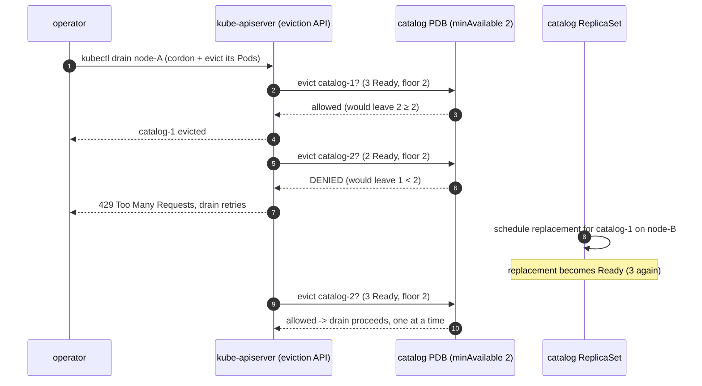

# 05: Reliability and disruptions

> Voluntary vs involuntary disruptions, the **PodDisruptionBudget**
> (`policy/v1`, minAvailable/maxUnavailable, `disruptionsAllowed`, the
> eviction API vs deletion, `unhealthyPodEvictionPolicy`), multi-replica +
> anti-affinity/spread for HA (cross-ref Part 04), graceful shutdown +
> readiness gating (cross-ref Part 01), PodReadinessGates, and **SLI/SLO/error
> budgets**, applied by adding PDBs for storefront/catalog/orders and proving
> a node drain respects them.

**Estimated time:** ~15 min read · ~60 min hands-on
**Prerequisites:** [Part 04 ch.02](../04-scheduling/02-affinity-taints-topology.md): anti-affinity / topology spread for HA · [Part 01 ch.02](../01-core-workloads/02-health-and-lifecycle.md): readiness gating and graceful shutdown · [Part 06 ch.01](01-observability-metrics.md): SLI/SLO measurement is what disruption budgets protect
**You'll know after this:** • distinguish voluntary from involuntary disruptions and what PDBs actually cover · • write `policy/v1` PodDisruptionBudgets with the right minAvailable / maxUnavailable · • explain how the eviction API differs from deletion and how `unhealthyPodEvictionPolicy` works · • define SLIs, SLOs and error budgets and tie them to alerting · • prove a `kubectl drain` of a Bookstore node respects the catalog PDB

<!-- tags: observability, slo, day-2, core-objects -->

## Why this exists

The Bookstore is observed ([ch.01–03](01-observability-metrics.md)) and
autoscaled ([ch.04](04-autoscaling.md)). But availability is not just "enough
replicas exist"; it is "enough replicas **stay Ready through the things that
take Pods away**". And Pods are taken away constantly in a healthy cluster:
every node OS patch, Kubernetes upgrade, autoscaler scale-down, and
`kubectl drain` evicts Pods **on purpose**. Without a guard, a routine
"upgrade the nodes one by one" drains every Pod on a node. If several catalog
replicas share that node, catalog loses them together during a **planned,
routine** operation. That is a self-inflicted outage.

A **PodDisruptionBudget (PDB)** is the contract that says "you may take my
Pods, but never more than *this many* at once". It converts "all replicas
vanish during a node upgrade" into "rolling, one at a time, capacity
preserved". This chapter is the reliability half of *Production Kubernetes*'s
[Application Considerations](#further-reading), and the single-instance/HA
reasoning of the [Singleton Service](#further-reading) pattern.

## Mental model

Two kinds of disruption. The distinction drives everything:

- **Involuntary**, not initiated by anyone: node hardware/kernel crash, OOM
  kill, network partition, the node simply disappears. A PDB does **not**
  protect against these (nobody asked permission). Your defence is
  **replicas + spread/anti-affinity** (Part 04 ch.02, already on catalog/
  storefront) so an involuntary loss removes *some* capacity, not all, plus
  good probes so traffic stops hitting the dead Pods.
- **Voluntary**: deliberately initiated: `kubectl drain` for a node upgrade,
  cluster-autoscaler/Karpenter scale-down ([ch.04](04-autoscaling.md)), and any
  eviction request. Evictions go through the **eviction API**, and **that** is
  what a PDB governs. A direct `kubectl delete pod` is voluntary too, but it
  skips the eviction API, so no PDB checks it.

A PDB declares a floor (`minAvailable: N` or `minAvailable: 75%`) or a ceiling
(`maxUnavailable`) on **healthy Pods of a selector**. The **eviction API**
(used by `kubectl drain`) checks it: evicting a Pod is allowed only if the
workload would *stay at or above the floor*; otherwise the eviction is
**refused** and the drain **blocks and retries** until the controller has
rescheduled a replacement elsewhere and it is Ready. That backpressure is the
PDB working: it paces voluntary disruption to the rate the workload can
absorb without losing capacity.

Critically: a PDB does **not** move or recreate Pods. It only **gates
evictions**. The Deployment controller still does the rescheduling; the PDB
just refuses to let the drain get ahead of it.

Reliability is the **stack**, not one feature:

| Layer | Mechanism | Where |
|---|---|---|
| Don't lose all replicas at once (involuntary) | replicas + topology spread + anti-affinity | Part 04 ch.02 |
| Don't lose too many at once (voluntary) | **PodDisruptionBudget** | this chapter |
| Don't drop in-flight requests when a Pod goes | readiness gating + SIGTERM + preStop + grace | [Part 01 ch.02](../01-core-workloads/02-health-and-lifecycle.md) |
| Know if you're meeting the bar | SLI / SLO / error budget | this chapter + [ch.01](01-observability-metrics.md) |

Availability is one of the three properties security protects, next to
confidentiality and integrity. A node patch is security work: it replaces a
kubelet or kernel that has a known fault. A PDB is an availability control,
and on a node patch it can slow the same work it should protect. A drain that
never finishes leaves the old node in service. Treat a stuck drain during a
patch as a security finding, not only as a scheduling delay.

## Threats and controls

A PDB sits where availability and patching meet. The rows below are the
threats this chapter owns. The rest link to the chapters that own them.

| Threat | Control taught here | Goes deeper |
|---|---|---|
| A node stays on an unpatched kubelet or kernel because its drain waits on a budget | Size `minAvailable` to what one node can lose, set `unhealthyPodEvictionPolicy: AlwaysAllow`, and watch `disruptionsAllowed` ([notice a refused patch](#3-notice-a-refused-patch), [a drain paced by the budget](#4-drain-a-node-and-watch-the-budget-pace-it)) | [08.01](../08-day-2-operations/01-cluster-lifecycle.md) |
| Someone lowers or deletes a budget to push a stuck drain through, unseen | Only named roles may change a PodDisruptionBudget. [Step 3](#3-notice-a-refused-patch) shows the workload's ServiceAccount cannot. Audit records a budget change when the audit policy covers it ([audit docs][audit]) | [05.01](../05-security/01-authn-authz-rbac.md), [05.08](../05-security/08-audit-detection-and-incident-response.md) |
| A compromised Pod keeps running because its budget refuses the eviction | A direct delete is not budget-checked, by design ([disruptions][disruptions]). [Step 3](#3-notice-a-refused-patch) deletes a Pod with its budget at zero. Use a direct delete on purpose and record it | [05.08](../05-security/08-audit-detection-and-incident-response.md) |
| One node failure removes every replica | Replicas and spread across nodes. A PDB cannot stop an involuntary loss | [04.02](../04-scheduling/02-affinity-taints-topology.md) |

The probes that decide when a Pod counts as Ready are owned by
[01.02](../01-core-workloads/02-health-and-lifecycle.md). This chapter
relies on them and does not repeat them.

## Diagrams

### `kubectl drain` blocked by a PDB (Mermaid, sequence)



### SLO / error budget (ASCII)

```
 SLI  = a measured ratio of good events     e.g. 1 - (5xx / total)   [ch.01 PromQL]
 SLO  = the target for that SLI             e.g. 99.9% over 30 days
 Error budget = 100% - SLO                  e.g. 0.1% = ~43m unavailable / 30d

 ┌──── 30-day error budget (0.1%) ────────────────────────────────┐
 │ spent ████████░░░░░░░░░░░░░░░░░░░░░░░░░░░░░░░░░░░░  remaining   │
 └────────────────────────────────────────────────────────────────┘
   budget left  -> you MAY take voluntary risk (drain, rollout, chaos)
   budget spent -> FREEZE risky changes, stabilise, raise reliability
   PDB minAvailable is sized so routine voluntary disruption fits the budget.
```

## Hands-on with the Bookstore

**Assumed working directory: the guide repo root (`full-guide/`).**

We will: (1) add PDBs for storefront/catalog/orders; (2) read the budget
before any eviction; (3) watch the budget refuse an eviction, and see that a
direct delete goes through; (4) drain a node on a **multi-node** kind cluster
(so a drain has somewhere to reschedule) and watch the budget pace it.

The output blocks come from one scripted run on a shared kind cluster of three
nodes, a control-plane and two workers, whose node names differ from yours. The
script is `examples/security-lab/labs/06-05.sh` and its transcript is
`examples/security-lab/evidence/06-05.txt`. The run's namespace was
`p06-finish-pdb` where this chapter says `bookstore`. A line that would print
it is elided with `# ...`, except in the drain output, where it is shown as it
came. The front-tier Pods were stand-ins, described in step 2. Step 0 builds
three workers, so a spread that gives one Pod per node on your cluster gave two
and one on the lab's.

### 0. Prerequisites: a multi-node cluster (self-bootstrapping)

A single-node kind cluster cannot demonstrate a drain (no other node to
reschedule onto, and draining the only node evicts everything). Reuse the
**Part 04 ch.02** multi-node pattern. Save as `kind-multinode.yaml` (infra,
not a Bookstore manifest):

```yaml
# kind-multinode.yaml: 1 control-plane + 3 workers (same pattern as Part 04
# ch.02; the dedicated DB node/taint is omitted here; not needed for PDBs).
kind: Cluster
apiVersion: kind.x-k8s.io/v1alpha4
nodes:
  - role: control-plane
  - role: worker
  - role: worker
  - role: worker
```

```sh
kind delete cluster --name bookstore 2>/dev/null || true
kind create cluster --name bookstore --config kind-multinode.yaml
kubectl get nodes        # 1 control-plane + 3 workers

# Rebuild + load images, then the cumulative chain (ch.01 step 0 in full):
cd examples/bookstore/app
for s in catalog orders payments-worker storefront; do docker build -t bookstore/$s:dev ./$s; done
cd ../../..
for s in catalog orders payments-worker storefront; do kind load docker-image bookstore/$s:dev --name bookstore; done
kubectl apply -f examples/bookstore/raw-manifests/00-namespace.yaml
kubectl apply -f examples/bookstore/raw-manifests/05-serviceaccounts-rbac.yaml
kubectl apply -f examples/bookstore/raw-manifests/15-catalog-config.yaml
kubectl apply -f examples/bookstore/raw-manifests/16-db-credentials.yaml
kubectl apply -f examples/bookstore/raw-manifests/35-priorityclasses.yaml
kubectl apply -f examples/bookstore/raw-manifests/20-postgres-statefulset.yaml
kubectl rollout status statefulset/postgres -n bookstore
kubectl apply -f examples/bookstore/raw-manifests/10-catalog-deploy.yaml
kubectl apply -f examples/bookstore/raw-manifests/11-storefront-deploy.yaml
kubectl apply -f examples/bookstore/raw-manifests/14-orders-deploy.yaml
kubectl apply -f examples/bookstore/raw-manifests/40-services.yaml
kubectl apply -f examples/bookstore/raw-manifests/21-db-migrate-job.yaml   # schema
# catalog/orders carry DB_DSN; gate on the schema Job before asserting
# readiness (their /readyz pings Postgres but not table existence).
kubectl wait --for=condition=complete job/db-migrate -n bookstore --timeout=120s
kubectl rollout status deployment/catalog -n bookstore
```

(catalog's `topologySpreadConstraints` are `DoNotSchedule`, on this 3-worker
cluster the 3 replicas spread one-per-node, which is exactly what makes the
PDB demo meaningful: draining one node evicts exactly one catalog Pod.)

### 1. Add PodDisruptionBudgets

New file
[`examples/bookstore/raw-manifests/84-pdb.yaml`](../examples/bookstore/raw-manifests/84-pdb.yaml). The objects are **built-in** `policy/v1` (no CRD; dry-runs cleanly). One PDB per
front-line workload, `minAvailable` sized to the **real replica counts**:

```yaml
apiVersion: policy/v1
kind: PodDisruptionBudget
metadata: { name: catalog, namespace: bookstore }
spec:
  minAvailable: 2                    # of 3 catalog replicas (10-): ≤1 down at a time
  selector: { matchLabels: { app: catalog } }   # EXACT 10- pod-template label
  unhealthyPodEvictionPolicy: AlwaysAllow
---
apiVersion: policy/v1
kind: PodDisruptionBudget
metadata: { name: storefront, namespace: bookstore }
spec:
  minAvailable: 1                    # of 2 storefront replicas (11-): keep UI up
  selector: { matchLabels: { app: storefront } }
  unhealthyPodEvictionPolicy: AlwaysAllow
---
apiVersion: policy/v1
kind: PodDisruptionBudget
metadata: { name: orders, namespace: bookstore }
spec:
  minAvailable: 1                    # of 2 orders replicas (14-): ≤1 down
  selector: { matchLabels: { app: orders } }
  unhealthyPodEvictionPolicy: AlwaysAllow
```

> **Sizing & selector decisions (in the manifest header).** `minAvailable`
> matches each Deployment's replica count: catalog 3→2 (tolerate one node
> down), storefront 2→1, orders 2→1. The selectors are the **exact** pod
> labels of each Deployment's template (`app: catalog|storefront|orders`), a
> PDB whose selector matches no Pods is silently useless; one matching
> *multiple* workloads is a classic mistake. **payments-worker gets no PDB on
> purpose**: it is KEDA-scaled and may legitimately be at **0** replicas
> ([ch.04](04-autoscaling.md)), so a `minAvailable` PDB would be meaningless
> and could even wedge a drain, autoscaled/scale-to-zero consumers are the
> documented exception. `unhealthyPodEvictionPolicy: AlwaysAllow` (stable since
> 1.31) lets the
> eviction API remove **not-Ready** Pods even at the budget floor, without
> it, a budget at its limit *plus* a crashed Pod can **deadlock** a drain
> forever (the broken Pod can't be evicted, so the node never drains).

```sh
kubectl apply -f examples/bookstore/raw-manifests/84-pdb.yaml
```

<!-- gate: output -->
```text
poddisruptionbudget.policy/catalog created
poddisruptionbudget.policy/storefront created
poddisruptionbudget.policy/orders created
```

```sh
kubectl get pdb -n bookstore
```

<!-- gate: output -->
```text
NAME         MIN AVAILABLE   MAX UNAVAILABLE   ALLOWED DISRUPTIONS   AGE
catalog      2               N/A               1                     1s
orders       1               N/A               1                     0s
storefront   1               N/A               1                     1s
```

`ALLOWED DISRUPTIONS` is `.status.disruptionsAllowed`, the **live headroom**:
with 3 Ready catalog Pods and floor 2, exactly **1** may be evicted right now.
storefront and orders have 2 Ready Pods and a floor of 1, so each allows 1 as
well. A budget allows the Ready Pods above its floor, and a workload with no
Ready Pods has none above it.

### 2. Read the budget before an eviction

The eviction API checks the budget, so read it before any drain. The describe
output shows the numbers the check uses:

```sh
kubectl describe pdb catalog -n bookstore | sed -n '1,20p'
```

<!-- gate: output -->
```text
Name:           catalog
# ...
Min available:  2
Selector:       app=catalog
Status:
    Allowed disruptions:  1
    Current:              3
    Desired:              2
    Total:                3
Events:                   <none>
```

`Current` counts the Ready Pods that match the selector, and `Desired` is the
floor. `Allowed disruptions` is their difference, never below zero. The lab's
three front tiers were stand-ins: busybox sleepers with the chapter's labels,
the chapter's ServiceAccounts and the restricted settings, ready ten seconds
after they start. The Bookstore catalog needs its database to report Ready.
The budgets were the chapter's own `84-pdb.yaml`.

> **Eviction vs `kubectl delete pod`.** A PDB only constrains the **eviction
> API** (what `drain` uses). `kubectl delete pod` is a *direct delete* and is
> **not** PDB-checked, it will remove the Pod regardless. So a PDB protects
> you from *orderly* operations (drain/upgrade/scale-down), not from someone
> force-deleting Pods. Node upgrades on managed clusters use the eviction API,
> so the PDB does its job there. [Step 3](#3-notice-a-refused-patch) runs both
> paths on the lab cluster.

### 3. Notice a refused patch

This is the stuck-drain case from the threats table. A budget set to the full
replica count, which a careless reviewer might write, lets no eviction through.
Set `minAvailable` to 3, the catalog replica count, and read the budget:

```sh
kubectl patch pdb catalog -n bookstore --type merge -p '{"spec":{"minAvailable":3}}'
```

<!-- gate: output -->
```text
poddisruptionbudget.policy/catalog patched
```

```sh
kubectl get pdb catalog -n bookstore
```

<!-- gate: output -->
```text
NAME      MIN AVAILABLE   MAX UNAVAILABLE   ALLOWED DISRUPTIONS   AGE
catalog   3               N/A               0                     2s
```

Now ask the eviction API for one catalog Pod. This is the request `kubectl
drain` makes for each Pod on a node:

```sh
POD=$(kubectl get pods -n bookstore -l app=catalog -o jsonpath='{.items[0].metadata.name}')
printf '{"apiVersion":"policy/v1","kind":"Eviction","metadata":{"name":"%s","namespace":"bookstore"}}' "$POD" > eviction.json
kubectl create --raw /api/v1/namespaces/bookstore/pods/$POD/eviction -f eviction.json
```

<!-- gate: output -->
```text
Error from server (TooManyRequests): Cannot evict pod as it would violate the pod's disruption budget.
```

The refusal is a `429`, and the drain retries it. The describe output shows why:

```sh
kubectl describe pdb catalog -n bookstore | sed -n '1,20p'
```

<!-- gate: output -->
```text
Name:           catalog
# ...
Min available:  3
Selector:       app=catalog
Status:
    Allowed disruptions:  0
    Current:              3
    Desired:              3
    Total:                3
Events:                   <none>
```

A direct delete is not budget-checked. Delete the same Pod, and the Deployment
replaces it:

```sh
kubectl delete pod "$POD" -n bookstore
kubectl wait --for=jsonpath='{.status.readyReplicas}'=3 deployment/catalog -n bookstore --timeout=120s
kubectl get pods -n bookstore -l app=catalog --no-headers | awk '{print $1, $2, $3}'
```

<!-- gate: output -->
```text
deployment.apps/catalog condition met
catalog-59cfcf98bc-kmg64 1/1 Running
catalog-59cfcf98bc-ld59l 1/1 Running
catalog-59cfcf98bc-x7l4c 1/1 Running
```

The delete went through with the budget at zero, so the budget does not guard
direct deletes. Only the eviction path does. Deletes you make on purpose need a
record, which is the audit trail in the threats table.

The workload's own ServiceAccount cannot change the budget or request an
eviction, so a compromised Pod cannot lower the floor to get past it:

```sh
kubectl auth can-i update poddisruptionbudgets.policy -n bookstore --as=system:serviceaccount:bookstore:catalog-sa
kubectl auth can-i create pods/eviction -n bookstore --as=system:serviceaccount:bookstore:catalog-sa
```

<!-- gate: output -->
```text
no
```

<!-- gate: output -->
```text
no
```

Restore the budget to the chapter's value, and the allowance returns:

```sh
kubectl patch pdb catalog -n bookstore --type merge -p '{"spec":{"minAvailable":2}}'
kubectl get pdb catalog -n bookstore
```

<!-- gate: output -->
```text
poddisruptionbudget.policy/catalog patched
```

<!-- gate: output -->
```text
NAME      MIN AVAILABLE   MAX UNAVAILABLE   ALLOWED DISRUPTIONS   AGE
catalog   2               N/A               1                     35s
```

### 4. Drain a node and watch the budget pace it

This is the drain that step 3's eviction request stood in for. Choose the
worker that runs the most catalog Pods and does **not** run postgres. postgres
is a single replica whose Pod can only run on the node that holds its volume,
and no PDB covers it. Draining that node takes the database down until the
node comes back. List where the Pods run, then choose:

```sh
kubectl get pods -n bookstore -o wide --sort-by=.spec.nodeName | awk '{print $1, $2, $3, $7}'
```

The fourth column is the node. On the lab cluster the first worker held two
catalog Pods, one storefront and one orders, and the second held one of each:

<!-- gate: output -->
```text
NAME READY STATUS NODE
catalog-59cfcf98bc-kmg64 1/1 Running lab-worker
catalog-59cfcf98bc-ld59l 1/1 Running lab-worker
orders-775657dddc-8jzqw 1/1 Running lab-worker
storefront-67f7fbd969-cqcnt 1/1 Running lab-worker
catalog-59cfcf98bc-x7l4c 1/1 Running lab-worker2
orders-775657dddc-9ftct 1/1 Running lab-worker2
storefront-67f7fbd969-mmw6x 1/1 Running lab-worker2
```

Set `NODE` to the worker you chose. The lab drained the first one:

```sh
NODE=<a worker that runs a catalog Pod but not postgres-0>
echo "draining $NODE"
```

<!-- gate: output -->
```text
draining lab-worker
```

Watch the budget in a second shell with `kubectl get pdb catalog -n bookstore
-w`, and run the drain:

```sh
kubectl drain "$NODE" --ignore-daemonsets --delete-emptydir-data --timeout=240s
```

`--ignore-daemonsets` leaves the DaemonSet Pods alone, because they are per
node. `--delete-emptydir-data` acknowledges that the Pods use `emptyDir`
scratch, which the drain discards. That is safe here only because the workers
hold stateless tiers: a StatefulSet's PersistentVolume is bound to its claim
and survives the drain untouched, and the flag must not be copied onto a
stateful drain in the belief that it is safe there. `--timeout` stops the
command from retrying forever, which a stuck budget would otherwise allow.

The drain cordons the node, then asks the eviction API for every Pod on it at
once. The lab's output, with the repeated retries trimmed:

<!-- gate: output -->
```text
node/lab-worker cordoned
Warning: ignoring DaemonSet-managed Pods: kube-system/kindnet-rm62x, kube-system/kube-proxy-pfxbz
evicting pod p06-finish-pdb/storefront-67f7fbd969-cqcnt
evicting pod p06-finish-pdb/catalog-59cfcf98bc-kmg64
evicting pod p06-finish-pdb/catalog-59cfcf98bc-ld59l
evicting pod p06-finish-pdb/orders-775657dddc-8jzqw
error when evicting pods/"catalog-59cfcf98bc-ld59l" -n "p06-finish-pdb" (will retry after 5s): Cannot evict pod as it would violate the pod's disruption budget.
evicting pod p06-finish-pdb/catalog-59cfcf98bc-ld59l
error when evicting pods/"catalog-59cfcf98bc-ld59l" -n "p06-finish-pdb" (will retry after 5s): Cannot evict pod as it would violate the pod's disruption budget.
# ...
pod/catalog-59cfcf98bc-kmg64 evicted
pod/orders-775657dddc-8jzqw evicted
pod/storefront-67f7fbd969-cqcnt evicted
# ...
evicting pod p06-finish-pdb/catalog-59cfcf98bc-ld59l
pod/catalog-59cfcf98bc-ld59l evicted
node/lab-worker drained
```

The first catalog eviction fitted the budget, and the second did not. The
second is the `429` from step 3, and the drain does not give up on it: it
retries every five seconds, here seven times, until the replacement for the
first Pod was Ready on the other worker and the budget allowed one more.
The other two tiers each had a spare Pod, so their evictions went straight
through. The lab polled the budget every two seconds while the drain ran. The
distinct readings, in order, with the budget's name, its floor and its allowed
disruptions, show the budget used up, restored and used up again:

<!-- gate: output -->
```text
catalog 2 1
catalog 2 0
catalog 2 1
catalog 2 0
```

That is the budget pacing the drain. It converted the node's two catalog Pods
into two evictions a replacement apart, so catalog never fell below two Ready
Pods. A drain does not wait for the replacements it triggers, though. Once
the second eviction was admitted the drain was finished, and its replacement
was still starting. The Pods then sat on the second worker, with one catalog
Pod not yet Ready:

```sh
kubectl get pods -n bookstore -o wide --sort-by=.spec.nodeName | awk '{print $1, $2, $3, $7}'
```

<!-- gate: output -->
```text
NAME READY STATUS NODE
catalog-59cfcf98bc-565kd 0/1 Running lab-worker2
catalog-59cfcf98bc-hjmdc 1/1 Running lab-worker2
catalog-59cfcf98bc-x7l4c 1/1 Running lab-worker2
orders-775657dddc-9ftct 1/1 Running lab-worker2
orders-775657dddc-hqblr 1/1 Running lab-worker2
storefront-67f7fbd969-mmw6x 1/1 Running lab-worker2
storefront-67f7fbd969-rkvlz 1/1 Running lab-worker2
```

Once that Pod is Ready the budgets read what they did before the drain. Read
them, and uncordon the node:

```sh
kubectl get pdb -n bookstore
kubectl uncordon "$NODE"
```

<!-- gate: output -->
```text
NAME         MIN AVAILABLE   MAX UNAVAILABLE   ALLOWED DISRUPTIONS   AGE
catalog      2               N/A               1                     2m6s
orders       1               N/A               1                     2m5s
storefront   1               N/A               1                     2m6s
```

<!-- gate: output -->
```text
node/lab-worker uncordoned
```

Two things can keep a drain waiting, and the lab saw the first. A budget at zero
holds an eviction until a replacement is Ready, as above. And a replacement
needs a node that the spread rules allow. catalog's `DoNotSchedule` hostname
spread takes `nodeTaintsPolicy: Ignore` for taints by default, so a node that
taints exclude still counts as a spread domain ([Part 04
ch.02](../04-scheduling/02-affinity-taints-topology.md)). On the lab cluster the
stand-ins had no spread constraint, so the replacements went to the other
worker at once. On a cluster where catalog does carry the constraint, a
replacement can stay Pending while the drained node is cordoned, and the drain
waits with it. Watch `kubectl get pods -o wide` during your drain.

### 5. Connection draining recap (why the PDB alone isn't enough)

A PDB keeps *enough Pods Ready*; it does not stop the *evicted* Pod from
dropping its in-flight requests. That is the Part 01 ch.02 contract, still in
force on every Bookstore workload: on SIGTERM the Pod is removed from Service
endpoints (readiness), the native `preStop.sleep: 5` lets in-flight requests
finish and propagation settle, the Go process does a graceful
`srv.Shutdown(...)` within `terminationGracePeriodSeconds: 30`. PDB +
graceful shutdown together = a node upgrade with **no capacity loss**, and
in-flight requests get to finish first. See
[Part 01 ch.02](../01-core-workloads/02-health-and-lifecycle.md).

> **PodReadinessGates** extend "Ready" beyond the container probes: a Pod is
> Ready only when its probes pass **and** every custom condition in
> `spec.readinessGates` is `True` (a controller, e.g. a cloud load-balancer, sets it once the Pod is registered in the external LB). This closes the
> race where Kubernetes considers a Pod Ready but the external LB has not yet
> added it; relevant on managed clusters with LB-backed Services/Ingress.

## How it works under the hood

- **The eviction API is a guarded delete.** `POST .../pods/<P>/eviction`
  (what `kubectl drain` calls per Pod) runs the **disruption controller's**
  admission check: for every PDB whose selector matches the Pod, is
  `currentHealthy - 1 ≥ desiredHealthy`? If any says no, the API returns
  **429** and the Pod is *not* deleted; `drain` backs off and retries. A
  plain `DELETE` of the Pod skips this entirely, that asymmetry is by
  design (break-glass must always work).
- **`disruptionsAllowed` is computed continuously.** The controller tracks
  `currentHealthy` (Ready Pods matching the selector) and `desiredHealthy`
  (from `minAvailable`, or `replicas − maxUnavailable`); `status.disruptionsAllowed
  = max(0, currentHealthy − desiredHealthy)`. It decrements as evictions are
  admitted and recovers as replacements go Ready, which is precisely why a
  drain *paces itself* to the reschedule rate instead of evicting in a burst.
- **`minAvailable` vs `maxUnavailable`.** `minAvailable` is an absolute/%
  floor of healthy Pods; `maxUnavailable` is the inverse ceiling. Percentages
  are computed against the workload's `.spec.replicas` and **rounded up** for
  `minAvailable` (conservative, it favours availability). The Bookstore uses
  `minAvailable` so the floor is explicit and obvious from the manifest.
- **The unhealthy-Pod deadlock.** Default eviction policy
  (`IfHealthyBudget`) only counts evicting a *Ready* Pod against the budget,
  but also won't evict an *unready* Pod once the budget is exhausted, so a
  crashing Pod on a node you must drain can never be evicted and the drain
  **hangs indefinitely**. `unhealthyPodEvictionPolicy: AlwaysAllow` (GA
  since 1.31) permits evicting not-Ready Pods regardless of the budget,
  breaking the deadlock; it is the recommended setting for almost all PDBs
  (and is on every Bookstore PDB).
- **PDBs don't reschedule; controllers do.** The PDB is purely an
  *admission gate on eviction*. Recreating the Pod is the Deployment/
  ReplicaSet's job; the scheduler places it
  ([Part 04 ch.01](../04-scheduling/01-scheduler-and-nodes.md)). A PDB on a
  bare Pod with no controller is a trap: nothing ever recreates it, so once
  it's at the floor the node can never be drained.
- **SLOs drive the disruption budget.** An SLI is a PromQL ratio of good
  events ([ch.01](01-observability-metrics.md)); the SLO is its target; the
  **error budget** = `1 − SLO` is how much unavailability you may *spend*.
  Voluntary disruption (drains, rollouts, chaos) spends budget; you size
  `minAvailable` and schedule node upgrades so routine churn fits within it,
  and **freeze** risky change when the budget is exhausted. This is how
  reliability becomes a *decision rule*, not a vibe.

## Production notes

> **In production:** a budget that stays at zero allowed disruptions past the
> patch window is a security finding, not a scheduling delay. Alert on
> `kube_poddisruptionbudget_status_pod_disruptions_allowed == 0` with a `for:`
> longer than your drain timeout, and page the owner of the workload. Do not
> delete the budget to finish the patch. Lowering a budget is a policy change,
> so it gets the same review as any other, and it is recorded when audit is on.

> **In production:** put a PDB on **every** multi-replica workload, sized so a
> **one-node** voluntary disruption is always allowed (so rolling node
> upgrades never stall) but a mass eviction is refused. `minAvailable: replicas-1` (or a % that rounds to that) is a sane default for stateless
> tiers; stateful/quorum systems need budgets tied to their quorum math
> ([Part 01 ch.05](../01-core-workloads/05-statefulsets.md)).

> **In production:** a PDB **without** enough replicas, spread, *and*
> `unhealthyPodEvictionPolicy: AlwaysAllow` causes the very outage it was
> meant to prevent, a stuck node drain during an upgrade window. Test it:
> `kubectl drain` a node in staging and confirm it completes and capacity
> holds. An untested PDB is a latent incident.

> **In production:** managed node upgrades **use the eviction API**, so PDBs
> directly shape them. A too-strict PDB (e.g. `minAvailable` = `replicas`,
> leaving `disruptionsAllowed: 0`) stalls the drain, and what follows depends
> on the platform. On **EKS**, a managed node group whose Pods do not leave
> the node within 15 minutes fails with `PodEvictionFailure`, and the force
> flag then deletes them ([EKS node updates][eks-update]). On **GKE**, surge
> upgrades respect PDBs for up to one hour, then forcibly evict the Pods still
> on the node ([GKE upgrade strategies][gke-upgrade]). A plain `kubectl drain`
> with no `--timeout` keeps retrying. A missing PDB lets the upgrade remove all
> replicas at once. There is a correct middle, and you must set it.

> **In production:** combine PDB with **PodReadinessGates** behind cloud
> LBs/Ingress so "Ready" means "actually receiving traffic from the external
> LB", and with graceful shutdown ([Part 01 ch.02](../01-core-workloads/02-health-and-lifecycle.md))
> so evicted Pods drain connections. PDB preserves *count*; readiness +
> SIGTERM/preStop preserve *individual requests*. You need both for
> zero-impact node operations.

> **In production:** drive disruption decisions with the **error budget**.
> Burning the budget fast → freeze rollouts/chaos, stabilise; budget healthy
> → you have room for aggressive delivery and chaos testing of the disruption
> path ([Part 07 ch.05](../07-delivery/05-progressive-delivery.md)). The PDB
> is the *mechanism*; the SLO/error budget is the *policy* that sets it.

## Quick Reference

```sh
kubectl get pdb -n <NS>                              # MIN AVAILABLE / ALLOWED DISRUPTIONS
kubectl get pdb -A                                   # zero headroom anywhere before a patch
kubectl describe pdb <P> -n <NS>                     # status.disruptionsAllowed + events
kubectl drain <NODE> --ignore-daemonsets --delete-emptydir-data   # respects PDBs
kubectl uncordon <NODE>                              # undo the cordon
kubectl get pod -n <NS> -o wide                      # watch reschedule across nodes
kubectl get pod <P> -o jsonpath='{.status.conditions}'   # readiness gates included
```

Minimal PDB, filled in for catalog. Swap in your workload's name, namespace and
pod labels, and keep the selector equal to the pod-template labels:

```yaml
apiVersion: policy/v1
kind: PodDisruptionBudget
metadata: { name: catalog, namespace: bookstore }
spec:
  minAvailable: 2                       # or maxUnavailable: 1 / a percentage
  selector: { matchLabels: { app: catalog } }   # EXACT pod-template labels
  unhealthyPodEvictionPolicy: AlwaysAllow           # avoid the drain deadlock
```

Checklist:

- [ ] Every multi-replica workload has a PDB; selector matches its **real** pod labels
- [ ] `minAvailable` allows a one-node drain but refuses a mass eviction
- [ ] `unhealthyPodEvictionPolicy: AlwaysAllow` set (no drain deadlock)
- [ ] Replicas + spread/anti-affinity cover **involuntary** loss (Part 04 ch.02)
- [ ] Graceful shutdown + readiness gating cover dropped connections (Part 01 ch.02)
- [ ] No PDB on bare Pods / scale-to-zero workloads (drain trap)
- [ ] An SLO + error budget sizes the budget and gates risky change

## Test your understanding

> Try each before opening the answer drawer. The act of trying is the exercise; the answer is the check.

1. **A node hard-crashes and takes 3 of catalog's 4 replicas with it. The PDB says `minAvailable: 3`. Does the PDB block this loss? Explain.**
   <details><summary>Show answer</summary>

   No. A PDB only governs **voluntary** disruptions through the eviction API (drain, autoscaler scale-down, an eviction request). A node crash is **involuntary**: nobody asked permission, Pods simply vanished. The defence against involuntary loss is `replicas + topology spread + anti-affinity` (Part 04 ch.02) so a single node never holds all replicas. PDBs are necessary but not sufficient, they protect routine ops, not crashes. See §Mental model.

   </details>

2. **You set `minAvailable: 100%` on catalog (replicas=3) thinking "always keep all 3 healthy". The next node upgrade hangs forever. Why?**
   <details><summary>Show answer</summary>

   `minAvailable: 100%` means "no eviction may reduce ready Pods below 3". To drain a node holding a catalog Pod, the eviction must succeed, but evicting reduces ready count to 2, which violates the PDB → the eviction is refused → drain blocks. You've made the workload **un-drainable**, which means no node upgrade, no autoscale-down, no chaos test. The right value is `minAvailable: N-1` (or a percentage that allows one Pod to roll), letting the Deployment controller replace evicted Pods before the next eviction.

   </details>

3. **`unhealthyPodEvictionPolicy: AlwaysAllow`: why is it almost always the right setting, and what's the failure mode of the default?**
   <details><summary>Show answer</summary>

   The default (`IfHealthyBudget`) counts unhealthy Pods *against* the budget, if 2 of 3 catalog replicas are CrashLoopBackOff and `minAvailable: 2`, the PDB has 0 disruptions allowed (1 ready ≤ 2 floor), so even a `kubectl drain` to evict a broken Pod is refused. This is the "drain deadlock": broken Pods cannot be drained for replacement because they're broken. `AlwaysAllow` says "evict unhealthy Pods freely; only count healthy ones against the budget", which is the operationally correct policy in almost every case.

   </details>

4. **Hands-on extension: prove the PDB. Set `minAvailable: 3` on catalog (replicas=3), then ask the eviction API for one catalog Pod. What status comes back, and what does `kubectl get pdb` show? Then set `minAvailable: 2` and read the same field.**
   <details><summary>What you should see</summary>

   At `minAvailable: 3` the eviction returns `TooManyRequests` with `Cannot evict pod as it would violate the pod's disruption budget`, and `ALLOWED DISRUPTIONS` is 0. At `minAvailable: 2` with three Ready Pods it is 1, so one eviction fits. Step 3 shows the first state. A drain follows the same rule Pod by Pod, and it pauses whenever the budget reads 0.

   </details>

5. **What's the difference between an SLI, an SLO, and an error budget, and how do they relate to PDB sizing?**
   <details><summary>Show answer</summary>

   **SLI** = the measurement (e.g. `1 - rate(5xx)/rate(total)` = success rate). **SLO** = the target on the SLI (e.g. 99.9% success over 30 days). **Error budget** = `1 - SLO` translated into allowed downtime/errors (99.9% over 30d = ~43 min/month). PDBs *size* the disruption: a workload with a tight SLO needs a conservative PDB (`maxUnavailable: 1`, multi-replica + spread); a stateless service with a loose SLO can absorb broader voluntary disruption. The error budget burns rate is the *policy*; the PDB is the *mechanism*. See §In production.

   </details>

6. **A kernel patch is due on a node that runs a catalog Pod. The drain stops on catalog's budget, and a colleague proposes deleting the PDB so the patch can finish. What do you check first, what do you do instead, and what do you record?**
   <details><summary>Show answer</summary>

   Check whether the budget is at zero because replicas are not Ready (a crash loop, a failed rollout) or because the replica count sits at the floor. `kubectl describe pdb catalog` shows `Current`, `Desired` and `Allowed disruptions`. Fix the cause: restore a Ready replica, or scale up so one eviction fits, and let the drain finish. Deleting the budget removes the guard for every later voluntary disruption, and it is a policy change that needs review. If the patch is urgent enough to bypass the budget, delete individual Pods directly, and record the reason and the time, because that bypass is the break-glass path and it leaves no budget check behind.

   </details>

## Further reading

- **Rosso et al., _Production Kubernetes_, ch.14, Application
  Considerations** (designing apps to survive disruption: PDBs, graceful
  termination, readiness, SLOs in a production platform).
- **Ibryam & Huß, _Kubernetes Patterns_ 2e, *Singleton Service* (ch.10)**
  for the single-instance vs HA reasoning behind disruption budgets and
  availability targets.
- Official:
  <https://kubernetes.io/docs/concepts/workloads/pods/disruptions/> and
  <https://kubernetes.io/docs/tasks/run-application/configure-pdb/> and the
  drain/eviction reference
  <https://kubernetes.io/docs/tasks/administer-cluster/safely-drain-node/>.

[disruptions]: https://kubernetes.io/docs/concepts/workloads/pods/disruptions/
[audit]: https://kubernetes.io/docs/tasks/debug/debug-cluster/audit/
[eks-update]: https://docs.aws.amazon.com/eks/latest/userguide/managed-node-update-behavior.html
[gke-upgrade]: https://docs.cloud.google.com/kubernetes-engine/docs/concepts/node-pool-upgrade-strategies
