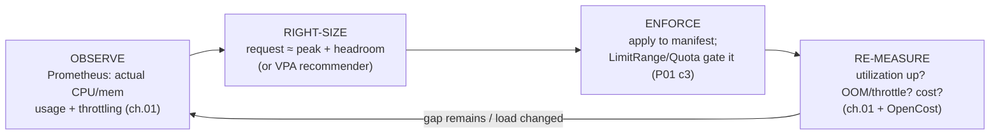

# 06: Capacity and cost

> Turning observed usage into right-sized requests and limits (over-request
> wastes spend, under-request evicts and OOMs; the CPU-limit throttling debate
> revisited), the **VPA recommender** as a sizing tool, **ResourceQuota** and
> **LimitRange** as spend ceilings against denial of wallet, cluster cost
> visibility with OpenCost and its billing credential, and the **FinOps
> loop**, applied by deriving right-sized catalog requests from the metrics
> gathered in [ch.01](01-observability-metrics.md).

**Estimated time:** ~15 min read · ~60 min hands-on **Prerequisites:** [Part
01 ch.03](../01-core-workloads/03-resources-and-qos.md): requests reserve,
limits cap, QoS decides eviction · [Part 06
ch.01](01-observability-metrics.md): usage data drives right-sizing · [Part 06
ch.04](04-autoscaling.md): autoscalers act on requests, not usage **You'll
know after this:** • turn observed usage into right-sized requests/limits
without over- or under-provisioning · • use the VPA recommender as a sizing
tool without enabling auto-updates · • configure ResourceQuota and LimitRange
as namespace guardrails and as denial-of-wallet controls · • read cluster cost
with OpenCost and keep its billing credential out of values files · • run the
FinOps loop on the Bookstore: measure → right-size → save → re-measure

<!-- tags: cost, finops, autoscaling, quotas, day-2 -->

## Why this exists

Every chapter so far set requests/limits by **reasoned guess**: catalog `cpu:
50m / memory: 64Mi` requests because "a tiny Go API is light" ([Part 01
ch.03](../01-core-workloads/03-resources-and-qos.md)). Guesses are where the
money leaks. The scheduler reserves **requests**, not usage ([Part 01
ch.03](../01-core-workloads/03-resources-and-qos.md)), and on EKS/GKE/AKS the
cluster autoscaler provisions **nodes to satisfy requests**
([ch.04](04-autoscaling.md)). So:

- **Over-request** → the scheduler reserves capacity nothing uses → low real
  utilization → you pay for nodes running mostly air. This is the dominant
  Kubernetes cost failure in practice.
- **Under-request** → Pods packed too tight → CPU **throttling** and memory
  **OOMKills** under load → evictions, latency, incidents ([Part 01
  ch.03](../01-core-workloads/03-resources-and-qos.md)).

Now that the Bookstore is **observed**, you can replace guesses with
*evidence*: measure actual usage in Prometheus
([ch.01](01-observability-metrics.md)), set requests just above the real peak
plus headroom, and re-measure. That loop, **observe → right-size → enforce →
re-measure**, is FinOps for Kubernetes: the cost lens on *Production
Kubernetes*'s [Autoscaling](#further-reading) and
[Multitenancy](#further-reading) chapters.

Cost has a security side too. A workload that can ask for more than the budget
allows spends money nobody approved, and it needs no stolen credential to do
it. The quotas in this chapter are the controls for that.

## Mental model

Three numbers per container, often wildly misaligned:

- **request**: what the scheduler reserves and the bill is (indirectly) based
  on.
- **usage**: what the container actually consumes (from metrics-server /
  Prometheus, [ch.01](01-observability-metrics.md)).
- **limit**: the ceiling (CPU → throttle, memory → OOMKill;
  [Part 01 ch.03](../01-core-workloads/03-resources-and-qos.md)).

The **requests-vs-usage gap** is the waste (or the risk). Right-sizing closes
it deliberately:

- **Memory**: set `request` ≈ steady RSS + safety margin, and (for anything
  you can't tolerate OOMKilled) `limit == request` (Guaranteed-style: memory
  is incompressible). Too low → OOMKill; too high → reserved RAM nobody uses.
- **CPU**: set `request` ≈ a realistic busy-time average (the scheduling
  guarantee). The **CPU-limit debate** (revisited from
  [Part 01 ch.03](../01-core-workloads/03-resources-and-qos.md)): a tight CPU
  *limit* causes CFS throttling that shows up as mysterious p99 latency even
  at low average CPU. Common production stance: accurate CPU **requests**,
  memory `request==limit`, and a CPU **limit** you chose on purpose. Measure
  throttling before you tighten it. An omitted CPU limit is not "no limit"
  either, once a namespace's LimitRange sets a default.

The data is already in Prometheus. **VPA in recommendation mode** automates
the same arithmetic (a percentile of historical usage → suggested requests).
**ResourceQuota/LimitRange** ([Part 01
ch.03](../01-core-workloads/03-resources-and-qos.md), already on the
`bookstore` namespace) stop a bad value from being deployed at all.

A cluster-economics framing on top:

- **Bin-packing / overcommit**: the scheduler packs Pods by request; setting
  *limits > requests* deliberately oversubscribes nodes (Burstable: efficient
  if usage is spiky and uncorrelated, risky if everyone peaks together).
  Utilization = Σ usage ÷ node allocatable; the goal is "high utilization
  without saturation".
- **Cost visibility**: **OpenCost** (a CNCF project; Kubecost is the
  commercial product in the same space) joins node and cloud prices to
  per-namespace and per-workload *requests and usage*, so "what does the
  orders tier cost, and how much of that is waste?" has an answer.
- **Node/spot strategy**: right requests + a node autoscaler + **spot/
  preemptible** nodes for fault-tolerant tiers is where the largest savings
  are, and it sits downstream of getting requests right.

## Threats and controls

Cost becomes a security problem when a workload can spend money nobody
approved. Three threats are specific to this chapter:

| Threat | Control | Goes deeper |
|---|---|---|
| Denial of wallet: a runaway or hostile workload asks for more CPU, memory, storage or public load balancers than the budget allows, and the autoscaler buys the nodes to serve it. | A namespace ResourceQuota on requests and on the cloud-billed objects, and a LimitRange per container. A cloud budget alert is a late, detective backstop. | Per-container limits: [01.03](../01-core-workloads/03-resources-and-qos.md). Tenant quotas: [08.04](../08-day-2-operations/04-multi-tenancy-and-namespaces.md). |
| The OpenCost billing credential is read by anything that can read its Secret or its values file. | The key sits in a read-only Secret mount, from a file that never enters Git, under a billing-read role. Where the cloud offers workload identity, there is no key at all. | Secret handling: [03.02](../03-config-and-storage/02-secrets.md). Workload identity: [10.03](../10-cloud-and-managed-kubernetes/03-cloud-identity.md). |
| Cost data reaches people who should not see per-team spend, and the cost tool can read most of the cluster. | A ClusterIP Service, the MCP server off, and a port-forward for the UI. Its cluster-wide read is kept in view. | Edge access and rate limiting: [13.07](../13-grand-capstone-bookstore-platform/07-edge-gateway-waf-rate-limiting.md). |

Scaling driven by someone else's load is also a cost attack.
[ch.04](04-autoscaling.md) owns that row. The quota below is the ceiling the
autoscaler runs into.

## Diagrams

### The right-size feedback loop (Mermaid)



### Utilization vs cost / requests-vs-usage (ASCII)

```
 ONE CONTAINER (catalog), CPU
   0 ─ usage(p95 busy) ─── request ──────────────── limit ─────►
        e.g. 35m            e.g. 50m  <-- 15m reserved-but-idle = waste
        (good: request just above p95 busy; small headroom; generous limit)

 NODE-LEVEL
   Allocatable │■ used ■│░ requested-not-used ░│   free   │
               └────────┴──────────────────────┴──────────┘
     waste = the ░ band  (you pay for the node; the scheduler reserved ░;
                           nothing runs there because requests > usage)
   too-low requests = ■ overflows the node -> throttle / OOM / eviction
   GOAL: shrink ░ without letting ■ hit the ceiling (utilization, not saturation)

 FinOps loop:  observe ──► right-size ──► enforce (Quota/LimitRange) ──► re-measure ─┐
                 ▲                                                                    │
                 └────────────────────────────────────────────────────────────────┘
```

## Hands-on with the Bookstore

**Assumed working directory: the guide repo root (`full-guide/`).**

Save each YAML block under the file name its commands use, for example
`load-allow.yaml`.

We will: (1) measure catalog's usage under load; (2) derive a right-sized
block and check that the namespace accepts it; (3) put a spend quota on the
namespace and watch it refuse a public load balancer; (4) dry-run the VPA
recommender; (5) install OpenCost with its billing key in a Secret.

The output blocks come from a lab cluster run. That cluster's node names
differ from yours, and the run used scratch namespaces named after this
chapter in place of `bookstore`, `vpa` and `opencost`. An output line that
printed one of those names is elided with `# ...`. Only the namespaces, their
ServiceAccounts and RBAC, and the spend quota were created for real. Every
other object was checked with a server-side dry run, so no workload started.

### 0. Prerequisites (self-bootstrapping)

Bring up the cluster and the Bookstore with metrics-server and
kube-prometheus-stack exactly as in [ch.01](01-observability-metrics.md)
(steps 0-3, including the catalog `ServiceMonitor` so the series exist).
Right-sizing requires the [ch.01](01-observability-metrics.md) metrics plane,
and it is the input to everything below. kube-prometheus-stack is large, so
give it a cluster with room for it. The lab run for this chapter did not
install it.

### 1. Measure catalog's real usage

The load runs inside the namespace, from a Job that uses the curl image pinned
by digest (`curlimages/curl:8.10.1`). It sends about ten parallel requests for
three minutes. `backoffLimit: 0` stops retries, so a broken load test cannot
multiply, and `ttlSecondsAfterFinished` removes the finished Job after ten
minutes.

The catalog's network policy from
[02.06](../02-networking/06-network-policies.md) admits traffic only from named
clients. The load Pod therefore carries the label `role: load-generator`, and
the two policies below open that one path. Delete them after the run. They are
a temporary hole in the default-deny.

```yaml
apiVersion: v1
kind: ServiceAccount
metadata:
  name: load-generator-sa
  namespace: bookstore
automountServiceAccountToken: false
---
apiVersion: networking.k8s.io/v1
kind: NetworkPolicy
metadata:
  name: allow-load-generator-egress
  namespace: bookstore
spec:
  podSelector:
    matchLabels:
      role: load-generator
  policyTypes: ["Egress"]
  egress:
    - to:
        - podSelector:
            matchLabels:
              app: catalog
      ports:
        - { protocol: TCP, port: 8080 }
---
apiVersion: networking.k8s.io/v1
kind: NetworkPolicy
metadata:
  name: allow-load-generator-to-catalog
  namespace: bookstore
spec:
  podSelector:
    matchLabels:
      app: catalog
  policyTypes: ["Ingress"]
  ingress:
    - from:
        - podSelector:
            matchLabels:
              role: load-generator
      ports:
        - { protocol: TCP, port: 8080 }
```

```yaml
apiVersion: batch/v1
kind: Job
metadata:
  name: load-catalog
  namespace: bookstore
spec:
  backoffLimit: 0
  ttlSecondsAfterFinished: 600
  template:
    metadata:
      labels:
        role: load-generator      # the one client the catalog policy admits
    spec:
      restartPolicy: Never
      serviceAccountName: load-generator-sa
      automountServiceAccountToken: false
      securityContext:
        runAsNonRoot: true
        runAsUser: 100              # curl_user in the image
        runAsGroup: 101
        seccompProfile:
          type: RuntimeDefault
      containers:
        - name: load
          image: curlimages/curl@sha256:d9b4541e214bcd85196d6e92e2753ac6d0ea699f0af5741f8c6cccbfcf00ef4b  # curlimages/curl:8.10.1
          command: ["sh", "-c"]
          args:
            - |
              end=$(( $(date +%s) + 180 ))
              while [ "$(date +%s)" -lt "$end" ]; do
                for i in $(seq 10); do
                  curl -s -o /dev/null http://catalog.bookstore.svc.cluster.local/books &
                done
                wait
              done
          securityContext:
            allowPrivilegeEscalation: false
            readOnlyRootFilesystem: true
            capabilities:
              drop: ["ALL"]
          resources:
            requests:
              cpu: 100m
              memory: 32Mi
            limits:
              memory: 64Mi
          volumeMounts:
            - name: tmp
              mountPath: /tmp
      volumes:
        - name: tmp
          emptyDir: {}
```

```sh
kubectl apply -f load-allow.yaml
kubectl apply -f load-catalog.yaml
```

Then query the **actual** usage (Prometheus UI / Grafana; the series come from
the [ch.01](01-observability-metrics.md) stack):

```promql
# Actual CPU per catalog pod (cores), p95 over the load window:
quantile_over_time(0.95,
  sum by (pod) (rate(container_cpu_usage_seconds_total{namespace="bookstore",pod=~"catalog-.*",container="catalog"}[2m]))[10m:])

# Actual working-set memory per catalog pod (bytes), max over the window:
max_over_time(
  sum by (pod) (container_memory_working_set_bytes{namespace="bookstore",pod=~"catalog-.*",container="catalog"})[10m:])

# CPU throttling: is the CURRENT cpu LIMIT (250m) already throttling it?
sum(rate(container_cpu_cfs_throttled_periods_total{namespace="bookstore",container="catalog"}[5m]))
  / sum(rate(container_cpu_cfs_periods_total{namespace="bookstore",container="catalog"}[5m]))

# Requests-vs-usage gap (the waste), CPU:
sum(kube_pod_container_resource_requests{namespace="bookstore",container="catalog",resource="cpu"})
  - sum(rate(container_cpu_usage_seconds_total{namespace="bookstore",container="catalog"}[5m]))
```

The numbers in the rest of this section are **illustrative**. They show the
arithmetic and are not a measured run. Suppose the load window shows catalog
p95 CPU of about 35m per Pod, peak working-set memory of about 40Mi, and a
throttle ratio above zero. The current `cpu: 250m` limit would then be
clipping catalog under load. The current block is `requests {cpu: 50m, memory:
64Mi} / limits {cpu: 250m, memory: 128Mi}`
([`10-catalog-deploy.yaml`][catalog-deploy]). Its CPU request is about 1.4
times the p95 (a mild over-reservation across three replicas), and its CPU
limit is the throttling cause, which is the
[Part 01 ch.03](../01-core-workloads/03-resources-and-qos.md) debate with data
behind it.

### 2. The right-sized block (before → after)

Derived from the illustrative numbers:

```yaml
# CURRENT (10-catalog-deploy.yaml, a reasoned guess from Part 01 ch.03)
resources:
  requests: { cpu: 50m,  memory: 64Mi }
  limits:   { cpu: 250m, memory: 128Mi }

# RECOMMENDED (illustrative numbers from section 1)
resources:
  requests: { cpu: 40m,  memory: 96Mi }
  limits:   { cpu: 500m, memory: 96Mi }
```

Two choices in that block. The memory limit equals the request, because memory
cannot be squeezed back. The CPU limit is explicit at 500m, because the
namespace's LimitRange would otherwise set 500m for a container that leaves it
out (shown below). A limit reserves nothing; the request does. Whether 500m
throttles is a question for the throttle metric.

Requests and limits are checked per Pod, not per Deployment, so check the
block with a Pod. The Pod below is the catalog container with the recommended
block, carrying the baseline. It is a dry-run target. Its `app: catalog` label
would route the catalog Service to it if it were applied for real.

```yaml
apiVersion: v1
kind: Pod
metadata:
  name: catalog-rightsize-check
  namespace: bookstore
  labels:
    app: catalog
spec:
  serviceAccountName: catalog-sa
  automountServiceAccountToken: false
  securityContext:
    runAsNonRoot: true
    runAsUser: 65532
    runAsGroup: 65532
    seccompProfile:
      type: RuntimeDefault
  containers:
    - name: catalog
      image: bookstore/catalog:dev
      securityContext:
        allowPrivilegeEscalation: false
        readOnlyRootFilesystem: true
        capabilities:
          drop: ["ALL"]
      resources:
        requests:
          cpu: 40m
          memory: 96Mi
        limits:
          cpu: 500m                 # explicit: else the LimitRange injects 500m
          memory: 96Mi
      volumeMounts:
        - name: tmp
          mountPath: /tmp
  volumes:
    - name: tmp
      emptyDir: {}
```

```sh
kubectl apply --dry-run=server -f catalog-rightsize-check.yaml
```

<!-- gate: output -->
```text
pod/catalog-rightsize-check created (server dry run)
```

Leave out the CPU limit and the LimitRange puts one back. Remove the line from
a copy and print what the API server would store:

```sh
grep -v 'cpu: 500m' catalog-rightsize-check.yaml | \
  kubectl apply --dry-run=server -o jsonpath='{.spec.containers[0].resources}' -f -
```

<!-- gate: output -->
```text
{"limits":{"cpu":"500m","memory":"96Mi"},"requests":{"cpu":"40m","memory":"96Mi"}}
```

Now ask for more than the LimitRange allows. This refusal is deliberate: the
CPU request is 3 and the limit is 4, and the namespace maximum is 2 CPU
([`00-namespace.yaml`](../examples/bookstore/raw-manifests/00-namespace.yaml)).

```sh
sed -e 's/cpu: 40m/cpu: 3/' -e 's/cpu: 500m/cpu: 4/' catalog-rightsize-check.yaml | \
  kubectl apply --dry-run=server -f -
```

<!-- gate: output -->
```text
Error from server (Forbidden): error when creating "STDIN": pods "catalog-rightsize-check" is forbidden: maximum cpu usage per Container is 2, but limit is 4
```

The load objects from section 1 passed the same check in the lab run. The
ServiceAccount and both policies first:

<!-- gate: output -->
```text
serviceaccount/load-generator-sa created (server dry run)
networkpolicy.networking.k8s.io/allow-load-generator-egress created (server dry run)
networkpolicy.networking.k8s.io/allow-load-generator-to-catalog created (server dry run)
```

Then the Job:

<!-- gate: output -->
```text
job.batch/load-catalog created (server dry run)
```

These lines show that the API server accepts the objects. They do not show
that the load ran.

### 3. The spend guardrail

The namespace's ResourceQuota caps requests and limits. It does not know what
a load balancer costs, and a `LoadBalancer` Service becomes a cloud load
balancer. Add a second quota on the objects that bill you directly:

```yaml
apiVersion: v1
kind: ResourceQuota
metadata:
  name: spend-ceiling
  namespace: bookstore
spec:
  hard:
    services.loadbalancers: "0"     # no cloud load balancers here
    services.nodeports: "0"         # no node ports, which open on every node
    persistentvolumeclaims: "4"     # each claim is a billed volume
    requests.storage: 10Gi          # total storage requested across all claims
```

`services.loadbalancers` refuses a cloud load balancer. A `LoadBalancer`
Service also takes a node port unless you turn that off, so
`services.nodeports` refuses it too; the refusal below names both.
`persistentvolumeclaims` and `requests.storage` cap the volumes, which bill
per GiB and per claim.

```sh
kubectl apply -f spend-quota.yaml
```

<!-- gate: output -->
```text
resourcequota/spend-ceiling created
```

Now try a public Service. This refusal is deliberate:

```yaml
apiVersion: v1
kind: Service
metadata:
  name: catalog-public
  namespace: bookstore
spec:
  type: LoadBalancer
  selector:
    app: catalog
  ports:
    - name: http
      port: 80
      targetPort: 8080
```

```sh
cat catalog-public.yaml | kubectl apply -f -
```

<!-- gate: output -->
```text
Error from server (Forbidden): error when creating "STDIN": services "catalog-public" is forbidden: exceeded quota: spend-ceiling, requested: services.loadbalancers=1,services.nodeports=1, used: services.loadbalancers=0,services.nodeports=0, limited: services.loadbalancers=0,services.nodeports=0
```

The namespace reports the quota's state:

```sh
kubectl describe resourcequota spend-ceiling -n bookstore
```

<!-- gate: output -->
```text
Name:                   spend-ceiling
# ...
Resource                Used  Hard
--------                ----  ----
persistentvolumeclaims  0     4
requests.storage        0     10Gi
services.loadbalancers  0     0
services.nodeports      0     0
```

The refusal happens at admission, before a load balancer exists, so the charge
never starts. A budget alert from your cloud (AWS Budgets and Google Cloud
budgets both offer one) is the detective backstop. It fires after the money is
spent. Keep it, but do not rely on it to stop a runaway.

### 4. The VPA recommender, as a sizing tool

Install the recommender in its own namespace, labelled `restricted` before the
chart goes in. The chart's own security values already meet `restricted` for
the recommender. With the updater and the admission controller off, the
install can recommend, but it cannot evict or mutate a Pod.

```sh
helm repo add fairwinds-stable https://charts.fairwinds.com/stable
kubectl create namespace vpa
kubectl label namespace vpa \
  pod-security.kubernetes.io/enforce=restricted \
  pod-security.kubernetes.io/audit=restricted \
  pod-security.kubernetes.io/warn=restricted
helm install vpa fairwinds-stable/vpa --version 5.1.0 --namespace vpa \
  --set updater.enabled=false --set admissionController.enabled=false \
  --wait
```

The install creates cluster-scoped objects: the VPA CRDs and ClusterRoles. On
a shared cluster, check with its owner first. Before you install, a server dry
run of the rendered chart shows the admission result. The lab run rendered it
with `--skip-tests`, which leaves out the chart's test hooks, and checked it
against a restricted namespace:

```sh
helm template vpa fairwinds-stable/vpa --version 5.1.0 --namespace vpa \
  --set updater.enabled=false --set admissionController.enabled=false \
  --include-crds --skip-tests | kubectl apply --dry-run=server -n vpa -f -
```

<!-- gate: output -->
```text
customresourcedefinition.apiextensions.k8s.io/verticalpodautoscalercheckpoints.autoscaling.k8s.io created (server dry run)
customresourcedefinition.apiextensions.k8s.io/verticalpodautoscalers.autoscaling.k8s.io created (server dry run)
serviceaccount/vpa-recommender created (server dry run)
# ...
deployment.apps/vpa-recommender created (server dry run)
```

The `VerticalPodAutoscaler` object needs its CRD. Before the chart is
installed, the server refuses it, the same way it refuses the Gateway API and
KEDA objects elsewhere in the guide. This refusal is expected:

```sh
kubectl apply --dry-run=server -f vpa.yaml
```

<!-- gate: output -->
```text
error: resource mapping not found for name: "catalog" namespace: "bookstore" from "vpa.yaml": no matches for kind "VerticalPodAutoscaler" in version "autoscaling.k8s.io/v1"
ensure CRDs are installed first
```

After the install, apply the recommender for the catalog Deployment:

```yaml
apiVersion: autoscaling.k8s.io/v1
kind: VerticalPodAutoscaler
metadata: { name: catalog, namespace: bookstore }
spec:
  targetRef: { apiVersion: apps/v1, kind: Deployment, name: catalog }
  updatePolicy: { updateMode: "Off" }     # recommend only: never evicts
```

```sh
kubectl apply -f vpa.yaml
kubectl describe vpa catalog -n bookstore
# Recommendation -> Target: cpu/memory it suggests from observed history.
# Compare it to the section 2 values; they should be in the same ballpark.
```

`updateMode: "Off"` makes VPA a report, not an actuator. In `Off` mode VPA
never changes a Pod's requests, so it cannot fight the HPA from
[ch.04](04-autoscaling.md). Auto mode on the same CPU or memory metric is the
combination that does. Read the recommendation, decide, and patch the manifest
yourself.

### 5. Cluster cost visibility and the billing credential

OpenCost joins node and cloud prices to the requests and usage of each
namespace. Its billing credential is the sensitive part, and three rules
apply:

- **The credential is a file.** Create the Secret from it. Do not pass the
  JSON through `opencost.cloudIntegrationJSON`, because a value given to Helm
  is stored in the release record. The file's format is in OpenCost's
  [cloud-cost configuration docs][opencost-cloud-costs].
- **The Secret is mounted read-only,** with only the one key the chart reads.
- **Use workload identity where your cloud offers it,** so there is no key to
  leak. Otherwise scope the key to billing reads and rotate it.

```sh
kubectl create namespace opencost
kubectl label namespace opencost \
  pod-security.kubernetes.io/enforce=restricted \
  pod-security.kubernetes.io/audit=restricted \
  pod-security.kubernetes.io/warn=restricted
kubectl create secret generic opencost-cloud-integration \
  --from-file=cloud-integration.json --namespace opencost
```

Save this as `opencost-values.yaml`. It turns the MCP server off (the chart
enables it by default, on port 8081 of the same Service), sets the restricted
container security context on the exporter and the UI, and sets the same at
pod level. The chart's own defaults do not meet `restricted`.

```yaml
opencost:
  cloudIntegrationSecret: opencost-cloud-integration
  mcp:
    enabled: false
  exporter:
    securityContext:
      allowPrivilegeEscalation: false
      capabilities:
        drop: ["ALL"]
      readOnlyRootFilesystem: true
      runAsNonRoot: true
      runAsUser: 65534
      seccompProfile:
        type: RuntimeDefault
  ui:
    securityContext:
      allowPrivilegeEscalation: false
      capabilities:
        drop: ["ALL"]
      readOnlyRootFilesystem: true
      runAsNonRoot: true
      runAsUser: 65534
      seccompProfile:
        type: RuntimeDefault
podSecurityContext:
  runAsNonRoot: true
  runAsUser: 65534
  runAsGroup: 65534
  seccompProfile:
    type: RuntimeDefault
```

Check the render against the restricted namespace before you install it:

```sh
helm repo add opencost https://opencost.github.io/opencost-helm-chart
helm template opencost opencost/opencost --version 2.5.33 --namespace opencost \
  -f opencost-values.yaml --skip-tests | kubectl apply --dry-run=server -n opencost -f -
```

<!-- gate: output -->
```text
serviceaccount/opencost created (server dry run)
configmap/opencost-ui-nginx-config created (server dry run)
clusterrole.rbac.authorization.k8s.io/opencost created (server dry run)
clusterrolebinding.rbac.authorization.k8s.io/opencost created (server dry run)
service/opencost created (server dry run)
deployment.apps/opencost created (server dry run)
```

The same check on the chart's defaults shows what `restricted` refuses. This
warning is deliberate:

```sh
helm template opencost opencost/opencost --version 2.5.33 --namespace opencost \
  --skip-tests | kubectl apply --dry-run=server -n opencost -f -
```

<!-- gate: output -->
```text
serviceaccount/opencost created (server dry run)
configmap/opencost-ui-nginx-config created (server dry run)
clusterrole.rbac.authorization.k8s.io/opencost created (server dry run)
clusterrolebinding.rbac.authorization.k8s.io/opencost created (server dry run)
service/opencost created (server dry run)
Warning: would violate PodSecurity "restricted:latest": allowPrivilegeEscalation != false (containers "opencost", "opencost-ui" must set securityContext.allowPrivilegeEscalation=false), unrestricted capabilities (containers "opencost", "opencost-ui" must set securityContext.capabilities.drop=["ALL"]), runAsNonRoot != true (pod or containers "opencost", "opencost-ui" must set securityContext.runAsNonRoot=true), seccompProfile (pod or containers "opencost", "opencost-ui" must set securityContext.seccompProfile.type to "RuntimeDefault" or "Localhost")
deployment.apps/opencost created (server dry run)
```

Install it with the same values:

```sh
helm install opencost opencost/opencost --version 2.5.33 --namespace opencost \
  -f opencost-values.yaml
```

OpenCost reads usage from Prometheus. Point the chart's Prometheus values at
the server from [ch.01](01-observability-metrics.md) before you trust any
number it prints; the chart's comments and the OpenCost docs name the keys.

Check how the render uses the credential. The Secret appears as a read-only
volume with one item, and the render holds only the reference:

```sh
helm template opencost opencost/opencost --version 2.5.33 --namespace opencost \
  -f opencost-values.yaml --skip-tests | grep -n -A3 'secretName: opencost-cloud-integration'
```

<!-- gate: output -->
```text
418:            secretName: opencost-cloud-integration
419-            items:
420-              - key: cloud-integration.json
421-                path: cloud-integration.json
```

The default render enables the MCP server: `grep -c 'name: mcp-server'` finds
two matches in it, and the values file above finds none. Those two matches are
the Service port and the container port.

The chart's ClusterRole reads ConfigMaps, Pods, Nodes and more in every
namespace. It has no rule for Secrets, so OpenCost's own identity cannot read
the billing key through the API. Only the pod that mounts the key can read it.
ConfigMaps are readable cluster-wide, so keep secrets out of them
([03.02](../03-config-and-storage/02-secrets.md)).

<!-- gate: output -->
```text
kind: ClusterRole
metadata:
  name: opencost
# ...
rules:
  - apiGroups: [""]
    resources:
      - configmaps
      - deployments
      - nodes
      - pods
      - services
      - resourcequotas
      - replicationcontrollers
      - limitranges
      - persistentvolumeclaims
      - persistentvolumes
      - namespaces
      - endpoints
    verbs:
      - get
      - list
      - watch
# ...
```

Keep the Service `ClusterIP`, which is the chart's default. Reach the UI with
a port-forward, not an Ingress:

```sh
kubectl port-forward -n opencost svc/opencost 9090:9090
```

## Production notes

> **In production:** right-size from **measured data on every workload**, not
> guesses or copy-paste. Memory: `request` ≈ steady RSS + margin, and
> `limit == request` for anything that must not OOM. CPU: `request` ≈
> realistic busy average; treat CPU **limits** with suspicion, and measure
> throttling first ([Part 01
> ch.03](../01-core-workloads/03-resources-and-qos.md)).
> The catalog recommendation above is this method applied to the illustrative
> numbers. Replace them with your own measurements before you apply it.

> **In production:** use **VPA recommendation mode** (or an equivalent
> right-sizing tool) as the steady input, and **never** run VPA in `Auto` on
> the same CPU/memory metric an HPA scales on, because they oscillate
> ([ch.04](04-autoscaling.md)). VPA *recommends*, HPA *scales out*, you
> *decide*: that division is the stable one by default.

> **In production:** give every tenant namespace a ResourceQuota and a
> LimitRange, and review them with the tenancy model in
> [Part 08 ch.04](../08-day-2-operations/04-multi-tenancy-and-namespaces.md).
> The spend quota above is the start, not the whole list.

> **In production:** make cost **visible and owned**. **OpenCost**/Kubecost
> (or **EKS** split-cost allocation with Cost Explorer, **GKE** cost
> allocation, **AKS** Cost Analysis) attributes spend per namespace or team
> and
> surfaces the efficiency (usage ÷ request) gap. Cost you can't attribute is
> cost nobody reduces.

> **In production:** after requests are right, the big wins are **node
> strategy**: a node autoscaler (Cluster Autoscaler / Karpenter,
> [ch.04](04-autoscaling.md)) sized to real requests, and **spot/preemptible**
> nodes for fault-tolerant tiers, protected by PDBs and spread
> ([ch.05](05-reliability-and-disruptions.md)). Sequence matters: fix requests
> first, then nodes. Cheap nodes running over-requested Pods are still waste.

> **In production:** run the **FinOps loop continuously**, not once. Usage
> drifts with releases and traffic, so a right-size is valid until the next
> deploy. Wire the [ch.01](01-observability-metrics.md) efficiency queries or
> the VPA recommendations into a recurring review.

## Quick Reference

```sh
kubectl top pods -n <NS>                                   # quick usage vs intuition
kubectl describe resourcequota -n <NS>                     # Used vs Hard (Part 01 ch.03)
kubectl describe limitrange   -n <NS>                      # min/max/defaults guardrails
kubectl describe vpa <W> -n <NS>                           # Recommendation -> Target
kubectl apply --dry-run=server -f <FILE>                   # admission check, no Pod starts
kubectl -n <NS> patch deployment <D> --type=json \
  -p='[{"op":"replace","path":"/spec/template/spec/containers/0/resources","value":{...}}]'
```

```promql
# usage vs request (the priced waste, per workload):
sum(rate(container_cpu_usage_seconds_total{namespace="ns",container="c"}[5m]))
  / sum(kube_pod_container_resource_requests{namespace="ns",container="c",resource="cpu"})
# is a CPU LIMIT throttling it? (>0 at low util = remove/raise the limit)
sum(rate(container_cpu_cfs_throttled_periods_total{container="c"}[5m]))
  / sum(rate(container_cpu_cfs_periods_total{container="c"}[5m]))
```

Right-size recipe (per container):

```
1. OBSERVE   p95 busy CPU + peak working-set memory + CFS throttle ratio (ch.01)
2. SET       cpu.request ≈ p95 busy + headroom ; mem.request ≈ peak + margin
             mem.limit == mem.request ; cpu.limit explicit, chosen after measuring
3. ENFORCE   LimitRange/ResourceQuota admit it (Part 01 ch.03) -> apply
4. RE-MEASURE utilization up? OOM/throttle gone? cost down? -> loop
```

Checklist:

- [ ] Requests derived from **measured** p95/peak usage, not guessed
- [ ] Memory `request==limit` for must-not-OOM; CPU limit throttling measured
- [ ] VPA in **recommendation** mode used as input; never `Auto` with HPA on
  same metric
- [ ] Namespace has ResourceQuota + LimitRange (guardrails enforce the change)
- [ ] Namespace has a spend quota on load balancers, node ports and storage
- [ ] Cost tools run in namespaces labelled `restricted`, with the billing key
  in a Secret
- [ ] Cost attributed per namespace/workload (OpenCost/Kubecost/cloud)
- [ ] Node strategy (autoscaler + spot for stateless) applied **after**
  requests fixed
- [ ] Right-sizing run as a recurring loop, re-validated after releases

## Test your understanding

> Try each before opening the answer drawer. The act of trying is the
> exercise; the answer is the check.

1. **A team reports the bill is too high. They want to lower CPU `limits` to
   cut cost. Why won't that help, and what actually drives the bill?**
   <details><summary>Show answer</summary>

   The cluster autoscaler / Karpenter provisions nodes to satisfy
   **requests**, not limits. Lowering limits changes only the *ceiling*
   (throttling threshold). It doesn't free a single CPU on a single node. The
   bill is driven by **requests** (or by usage × reserved capacity if you're
   on spot/right-sized fleets). Right-size **requests** to observed usage;
   that shrinks the bin-packing footprint and lets the autoscaler delete
   underused nodes. See [Mental model](#mental-model).

   </details>

2. **Catalog is right-sized to `cpu: 100m` request based on p95 usage. But at
   14:00 every Tuesday, traffic doubles and p99 latency spikes. CFS throttle
   ratio shows 30%. What's wrong with the right-sizing and what would you
   change?**
   <details><summary>Show answer</summary>

   You sized for the **average busy period**, not the **peak**. CFS throttling
   at 30% means the container is hitting its CPU `limit` (or, less commonly,
   getting starved at request). Either raise the **limit** generously (CPU is
   compressible, so throttling hurts latency more than over-allocation hurts
   cost), or, better, let HPA add replicas for the spike (`maxReplicas`
   headroom) so per-Pod CPU stays in its sized band. Sizing without measuring
   spike behaviour and CFS throttle is half-done.

   </details>

3. **Why does the chapter recommend `memory: request == limit` but is more
   relaxed about CPU?**
   <details><summary>Show answer</summary>

   Memory is **incompressible**. Exceeding the limit triggers an OOMKill (the
   process dies, and Burstable or BestEffort Pods are evicted under pressure).
   Memory you need *must* be reserved. CPU is **compressible**. Exceeding the
   limit throttles (slows the process), and the process still runs. So memory
   needs request==limit for QoS Guaranteed (no eviction), while CPU can have a
   higher limit than request (Burstable) to absorb spikes without paying for
   unused capacity. See [Mental model](#mental-model).

   </details>

4. **Hands-on extension: see the gap. With `kubectl top pods -n bookstore` and
   the PromQL from the Quick Reference, compute `usage / request` for catalog
   over an hour. What does a value of 0.15 (15% utilization of requested CPU)
   mean operationally?**
   <details><summary>What you should see</summary>

   You're paying for 85% reserved-but-unused CPU on every catalog replica, on
   every node, every hour. Multiplied by every workload in the cluster, that's
   the typical "Kubernetes is expensive" report. Kubernetes isn't the
   expensive part; the requests were guesses. The right-size move: drop
   catalog's `cpu.request` to about p95 busy + 20% headroom (probably 50-100m
   for the tiny Go service) and re-measure. Often this halves the node
   footprint without touching anything else.

   </details>

5. **A team adds VPA in `Auto` mode to every workload "to right-size
   automatically". A week later, an HPA on the same Deployments is broken.
   What's the rule, and what's the correct workflow?**
   <details><summary>Show answer</summary>

   Don't run VPA `Auto` and HPA on the **same** resource metric (the conflict
   from [ch.04](04-autoscaling.md)). Use VPA in **recommender mode** as a
   *sizing tool*. It emits `Recommendation.target` values into the status, and
   humans review and apply them as PR-reviewed manifest changes. HPA continues
   to manage replicas on its chosen metric. The right-sizing loop is `observe
   → right-size (VPA recommend / manual) → enforce → re-measure`. VPA helps
   with step 2, never step 3, in production.

   </details>

6. **A pull request adds a `LoadBalancer` Service to the Bookstore. No
   autoscaler setting changed, and the monthly bill still jumps. Which control
   should have refused it at create time, which field does it use, and what
   does a cloud budget alert add?**
   <details><summary>Show answer</summary>

   A namespace ResourceQuota on `services.loadbalancers`, with
   `services.nodeports` for the node port a LoadBalancer also takes by
   default. The API server refuses the Service at admission, and the message
   names the quota (see [section 3](#3-the-spend-guardrail)). A budget alert
   is detective: it tells you after the spend has happened. Use both, and
   check the first with `kubectl describe resourcequota`.

   </details>

## Further reading

- **Rosso et al., _Production Kubernetes_, ch.13: Autoscaling** (right-sizing,
  the requests-vs-usage gap, VPA as a platform capability) **and ch.12:
  Multitenancy** (quota and limits as the cost and isolation guardrail).
- **Ibryam & Huß, _Kubernetes Patterns_ 2e, *Predictable Demands* (ch.2)**:
  declaring accurate resource needs as the foundation of density, cost, and
  reliability (the through-line from [Part 01
  ch.03](../01-core-workloads/03-resources-and-qos.md)).
- Official:
  <https://kubernetes.io/docs/concepts/configuration/manage-resources-containers/>,
  <https://kubernetes.io/docs/concepts/policy/resource-quotas/>,
  <https://kubernetes.io/docs/concepts/policy/limit-range/>,
  the VPA project
  <https://github.com/kubernetes/autoscaler/tree/master/vertical-pod-autoscaler>,
  and OpenCost <https://www.opencost.io/docs/>.

[opencost-cloud-costs]: https://www.opencost.io/docs/configuration/#cloud-costs
[catalog-deploy]: ../examples/bookstore/raw-manifests/10-catalog-deploy.yaml
