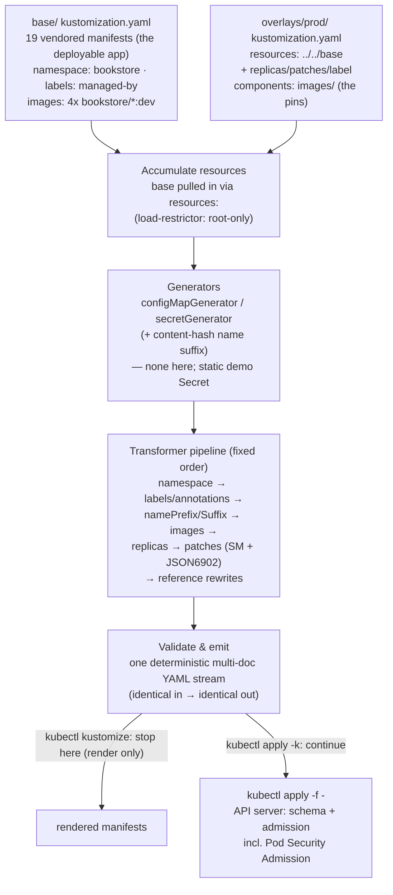

# 02 — Packaging with Kustomize

> Why the *other* answer to "same app, N environments" is **patch a base, no
> templating language**; the `kustomization.yaml` model (resources, namespace,
> namePrefix/Suffix, the `labels:`-vs-`commonLabels` immutability footgun,
> commonAnnotations, images, replicas, strategic-merge vs JSON6902 patches,
> configMapGenerator/secretGenerator + content-hash suffix, replacements,
> components, base/overlay composition); the build/transformer pipeline;
> `kubectl apply -k` vs `kubectl kustomize` vs standalone `kustomize build`;
> how Argo CD/Flux consume it — applied by packaging the **entire** cumulative
> Bookstore as a base + dev/staging/prod overlays that stay logically
> equivalent to [ch.01](01-packaging-helm.md)'s Helm chart and the raw
> manifests, restricted-PSA and all. Closes with a balanced **Helm vs
> Kustomize** (and *both*).

**Estimated time:** ~30 min read · ~90 min hands-on
**Prerequisites:** [Part 01 ch.01](../01-core-workloads/01-pods.md#baseline): the baseline every overlay must keep · [Part 07 ch.01](01-packaging-helm.md): same problem; different answer (templating vs patching) · [Part 00 ch.06](../00-foundations/06-declarative-api-model.md): patches are still declarative manifests · [Part 03 ch.01](../03-config-and-storage/01-configmaps.md): configMapGenerator and the content-hash suffix
**You'll know after this:** • build a base + overlays layout and explain when an overlay should patch vs replace · • use strategic-merge and JSON6902 patches without the `labels:` immutability footgun · • show that an overlay has stripped a hardening field, by rendering it and scanning the render · • keep a generated Secret's value out of the render and out of Git · • pin a remote base to a commit and keep a promotion a one-file diff · • render dev/staging/prod overlays of the Bookstore (45 / 49 / 48 objects) · • articulate when to pick Helm, Kustomize or both (Helm + post-render Kustomize)

<!-- tags: kustomize, platform-engineering, gitops, ci-cd -->

## Why this exists

[ch.01](01-packaging-helm.md) opened with four pressures that break a raw
`kubectl apply -f` directory: many environments, the release-as-a-unit, lifecycle
ordering, and discoverability. **Helm** answered them with a templating +
release-management layer. Kustomize answers the *first* one — **same app, a few
per-environment deltas** — from the opposite direction, and it is worth
understanding *why a second tool exists* rather than treating it as a Helm
competitor.

Helm's mechanism is **string substitution before parse**: a template is text,
you interpolate values, then it becomes YAML. That is maximally flexible
(loops, conditionals, functions) and also its cost: a chart with many toggles
becomes "YAML with extra steps" — every `{{ if }}` is debugging surface and a
place a value can make the app insecure by default (ch.01's *template soup*
warning, and its closing pointer **here**).

**Kustomize never templates.** A `kustomization.yaml` declares a set of
**plain, valid Kubernetes manifests** (the *base*) and a list of **typed
transformations** (set the namespace, bump replicas, add labels, retag images,
apply a patch). An *overlay* is just another `kustomization.yaml` that includes
the base and layers a few more transformations. The base is **the deployable
app, runnable and lint-able with no tool** (`kubectl apply -f base/` works);
the overlay is a **small, declarative diff**. There is no templating language,
so there is nothing to learn beyond Kubernetes itself, the render is
transparent, and — because the inputs are real manifests in Git — it is the
native shape for GitOps ([ch.04](04-gitops-argocd.md)).

This chapter packages the *exact same Bookstore* as
[`examples/bookstore/kustomize/`](../examples/bookstore/kustomize/) — a `base`
that renders the **same 49-object set** as the Helm default and the raw
manifests (every restricted `securityContext`, the Part 04 scheduling layer,
the byte-identical `catalog`/`orders` `DB_DSN`, the PSA-`restricted`
namespace), plus **dev/staging/prod overlays** and opt-in **components** for
the CRD-backed extras. The overlays are where a control can be lost without
anyone meaning it, so this chapter also shows how each render is judged.
[ch.01](01-packaging-helm.md) already forward-referenced this chapter as the
better fit for "same app, few env deltas"; the closing *Helm vs Kustomize*
section squares the two honestly. [ch.04](04-gitops-argocd.md) has Argo CD
reconcile this very tree from Git.

## Mental model

**Kustomize is `kubectl`-side `git merge` for manifests: a base of real YAML +
a stack of typed, declarative patches, rendered by a fixed pipeline.**

- **Base** = a directory of ordinary manifests + a `kustomization.yaml` listing
  them under `resources:`. It is a complete, applyable app on its own.
- **Overlay** = a `kustomization.yaml` whose `resources:` is `[../../base]`
  plus a few transformations (`replicas:`, `images:`, `patches:`, an extra
  label). `kubectl kustomize overlays/prod` emits the base **transformed** —
  one multi-document YAML stream, identical inputs → identical output (no
  `now`/random, so it is safe for GitOps reconcilation).
- **`kubectl apply -k overlays/dev`** = *render that overlay, then apply the
  result* — Kustomize is **built into `kubectl`** (here: `kubectl` v1.37.2,
  embedded Kustomize v5.8.1). `kubectl kustomize <DIR>` renders only;
  `kustomize build <DIR>` is the standalone binary's equivalent (mind version
  skew — the embedded copy lags the standalone release).
- **Transformers, not text.** Each knob is a *typed operation on parsed
  objects*: `namespace:` stamps `.metadata.namespace` (and is smart enough to
  skip cluster-scoped kinds), `images:` rewrites image refs, `replicas:` sets
  counts, `labels:`/`commonAnnotations:` add metadata, `patches:`
  strategic-merge or JSON6902 a sub-tree. They run in a **fixed pipeline**
  (generators → transformers → validation), so the result is predictable.
- **The discipline that keeps "the base equals the app" true:** an overlay
  changes only **safe knobs** (replica count, resources, image tag, ingress
  host, env-specific config, toggling an optional component). It must **never**
  weaken a `securityContext`, drop the scheduling layer, or mutate a
  **selector** — and the single sharpest way to violate the last one by
  accident is `commonLabels` (see *the footgun*, below). Get that right and an
  overlay is a safe, reviewable diff; get it wrong and `kubectl apply` of an
  upgrade fails on an immutable field.

The trap to keep in view (covered in *Helm vs Kustomize*): with no
conditionals or loops, genuinely *divergent* environments turn into **patch
sprawl** — many overlays each patching many fields — which is its own kind of
unreadable. Kustomize is at its best when environments are *the same app with
a few deltas*; that is exactly the Bookstore here.

This is the **Configuration Template** pattern (Ibryam & Huß ch.22) approached
without a template engine: the invariant app is the base, the variant is a
declarative patch.

## Threats and controls

An overlay is a small diff on a base that is meant to be safe. Each row is a
way that diff, or what it points at, can make the app less safe.

| Threat | Control taught here | Goes deeper |
|---|---|---|
| A patch removes a hardening field the base sets, and nobody reviews that line | Judge each render: `trivy config` on the rendered output, plus a `restricted` server dry run. The dry run alone misses fields `restricted` does not check | [01.01](../01-core-workloads/01-pods.md#baseline); blocking policy at admission is 05.07 <!-- link-later: 05.07 --> |
| A remote base changes under an overlay that was reviewed | Pin the remote base to a full commit SHA in `?ref=`, never a branch or tag name | [07.04](04-gitops-argocd.md), [05.03](../05-security/03-supply-chain.md) |
| A `secretGenerator` writes a secret value into the render, and the render reaches a log or an artifact | No literal values in a generator in Git; treat the render as secret material; prod gets its Secret out of band | [03.02](../03-config-and-storage/02-secrets.md), [15.05](../15-day-to-day-production-ops/05-production-secrets-vault-eso.md) |
| An opt-in component adds a Secret, a copy of data or an exposure, or removes a control the base has | Name what each component adds and removes, in the components step, and judge its render like any other | this chapter |
| A promotion is too big to review, so the change that matters hides in it | Image pins live in a one-file Component; a promotion changes that file, and the render diff shows the change | [07.03](03-cicd-pipeline.md#12-the-seam-from-signed-digest-to-git) |

This chapter judges the render. It does not make the cluster refuse a bad
overlay: that is admission policy (05.07). The Kyverno component in the
components step reports violations and blocks nothing.

## Diagrams

### `kubectl kustomize` build pipeline: base + overlay → transformers → rendered manifests (Mermaid)

The Bookstore's actual render. The overlay's `resources: [../../base]` pulls
the base in; generators run first, then the transformer chain in pipeline
order, then validation — emitting one deterministic multi-doc stream.



### base / overlays / components directory tree (ASCII)

```
 examples/bookstore/kustomize/
 ├── base/
 │   ├── kustomization.yaml      resources(19) + namespace: bookstore
 │   │                           + labels:(managed-by, includeSelectors:false)
 │   │                           + images:(4x bookstore/*:dev)
 │   └── 00-…84-*.yaml           VENDORED byte-identical copies of the
 │                               in-scope raw-manifests (cmp-verified)
 ├── overlays/
 │   ├── dev/      1 replica, debug cfg, NO HPA/PDB ($patch:delete),
 │   │             host bookstore.dev.local                 → 45 objects
 │   ├── staging/  2 replicas, moderate resources, HPA/PDB on,
 │   │             host bookstore.staging.example.com       → 49 objects
 │   └── prod/     4/3/3 replicas, tuned, image pins from images/,
 │       │         demo Secret $patch:delete'd              → 48 objects
 │       └── images/   kind: Component, only the image pins, so a
 │                     promotion edits this file and no other
 └── components/                 kind: Component — opt-in via overlay components:
     ├── servicemonitor/  + ServiceMonitor×2 + PrometheusRule  (Prom Operator CRDs)
     ├── keda/            + ScaledObject + TriggerAuth          (KEDA CRDs)
     ├── gateway/         SWAPS Ingress → Gateway/HTTPRoute     (Gateway API CRDs)
     ├── kyverno/         + ClusterPolicy (Audit, cluster-scoped)(Kyverno CRD)
     ├── snapshot/        + VolumeSnapshot(Class)               (snapshotter CRDs)
     └── canary/          SWAPS catalog → stable + canary, drops its HPA (no CRD)
 (base renders the SAME 49-object set as the Helm DEFAULT render.)
```

## Hands-on with the Bookstore

**Assumed working directory: the guide repo root (`full-guide/`).** All
`kubectl`/`kubectl kustomize` commands are run from there; kustomize paths are
relative to it. This chapter does **not** modify `raw-manifests/` — it operates
the parallel [`examples/bookstore/kustomize/`](../examples/bookstore/kustomize/)
tree. `kustomize` is **built into `kubectl`** here, so there is nothing extra
to install.

We will: (0) a clean kind cluster + the four images; (1) `kubectl kustomize`
and count the render; (2) `kubectl apply -k overlays/dev`; (3) diff dev vs prod
and inspect the typed knobs; (4) prove restricted admission with a server
dry-run; (5) strip a hardening field in a scratch copy and catch it; (6) see a
generated Secret in the render; (7) pin a remote base to a commit; (8) promote
one image pin and read the diff; (9) enable optional components and see the
honest "needs the CRD" behaviour.

### 0. Prerequisites — a fresh cluster, the images (self-bootstrapping)

Identical self-bootstrap to every prior chapter. The base pulls postgres, redis
and rabbitmq from the registry, each pinned by digest with its tag in a comment
(the baseline's image rule). Only the four `bookstore/*:dev` images are
`kind load`ed:

```sh
kind delete cluster --name bookstore 2>/dev/null || true
kind create cluster --name bookstore
kubectl cluster-info

# Build + load the four app images (full instructions: examples/bookstore/app/README.md)
cd examples/bookstore/app
for s in catalog orders payments-worker storefront; do docker build -t bookstore/$s:dev ./$s; done
cd ../../..
for s in catalog orders payments-worker storefront; do kind load docker-image bookstore/$s:dev --name bookstore; done
```

> **Self-bootstrapping note.** After any `kind delete && kind create` you must
> re-`kind load` the four images and re-run the `kubectl apply -k` below — a
> fresh cluster has neither. Like the Helm chapter and unlike the raw-manifests
> chapters, there is **no multi-command apply chain to replay**: a single
> `kubectl apply -k overlays/<ENV>` creates the namespace (PSA-labelled),
> every object, and the migration Job. That consolidation is the point.

### 1. Render — read what Kustomize will apply

`kubectl kustomize` renders locally (no cluster, no state) so you **read
exactly what would be applied** — the habit that keeps overlays honest:

```sh
kubectl kustomize examples/bookstore/kustomize/base | less
```

Count the objects in each render. ADR 0007 records these counts as invariants,
so a change to one is a design change, not a formatting one:

```sh
for o in base overlays/dev overlays/staging overlays/prod; do echo "$o $(kubectl kustomize examples/bookstore/kustomize/$o | grep -c "^kind:")"; done
```

<!-- gate: output -->

```text
base 49
overlays/dev 45
overlays/staging 49
overlays/prod 48
```

Sanity-check it against the API server **without applying** (client dry-run):

```sh
kubectl kustomize examples/bookstore/kustomize/base | kubectl apply --dry-run=client -f -
```

Each object should report `created (dry run)`. None should report `no matches
for kind`: every object in the base is a built-in kind.

That zero is by design: every CRD-backed object (ServiceMonitor,
PrometheusRule, KEDA `ScaledObject`, Gateway, Kyverno `ClusterPolicy`,
VolumeSnapshot) lives in a **component** that the base does not include — so a
plain base render is 100% built-in API kinds, exactly like the Helm chart's
defaults-off toggles. The base emits **49 objects** — the same
`(kind, name, namespace)` set as `helm template` with default values.

### 2. Apply the dev overlay

```sh
kubectl apply -k examples/bookstore/kustomize/overlays/dev
```

There is no `--create-namespace`: the base **includes** the `Namespace`
object, so the PSA `restricted` labels + ResourceQuota + LimitRange travel with
the apply. Kustomize emits an ordered stream (namespace and cluster-scoped
kinds first), so a single `apply` lands without "namespace not found" races.
Watch it converge. The comments show the results to expect. The lab run did
not reach this step, so none of this output is captured:

```sh
kubectl get pods -n bookstore -w
# Expected: postgres-0 Running; catalog/orders/storefront/payments-worker/redis/rabbitmq Ready
kubectl get job db-migrate -n bookstore         # the schema migration Job (Completed)
kubectl logs job/db-migrate -n bookstore        # "migration complete"
```

Confirm the namespace really enforces `restricted` and the pods were admitted.
Illustrative output (not captured in the lab run): the comments show the
expected results.

```sh
kubectl get ns bookstore -o jsonpath='{.metadata.labels}' | tr ',' '\n' | grep pod-security
# Expected: pod-security.kubernetes.io/enforce:restricted ... (audit + warn too)
kubectl get pods -n bookstore        # Expected: all Running, with no admission refusals
```

The dev overlay rendered **45** objects: the base's 49 minus the HPA and the
three PDBs (dev turns them off — fewer moving parts while iterating, exactly
like Helm `values-dev.yaml`'s `hpa.enabled:false`/`pdb.enabled:false`).

### 3. Diff overlays, read the typed knobs

The whole value of overlays is that the env delta is a small, reviewable diff.
Compare what dev vs prod would apply, with only built-in tooling:

```sh
diff <(kubectl kustomize examples/bookstore/kustomize/overlays/dev) \
     <(kubectl kustomize examples/bookstore/kustomize/overlays/prod) | grep -E '^[<>]' | head -40
```

Each difference comes from a **typed transformer or patch**, never a
hand-edited manifest. The differences are the replica counts, the catalog
resources and HPA bounds, the ingress host, the image pins, and the demo Secret
that prod removes. The replica and patch part of
`overlays/prod/kustomization.yaml` looks like this:

```yaml
replicas:                              # the replicas: transformer, not edited YAML
  - name: catalog
    count: 4
patches:
  - target: { group: apps, version: v1, kind: Deployment, name: catalog }
    patch: |                            # strategic-merge: only resources change
      apiVersion: apps/v1
      kind: Deployment
      metadata: { name: catalog }
      spec: { template: { spec: { containers: [ { name: catalog,
        resources: { requests: {cpu: 100m, memory: 128Mi},
                     limits: {cpu: 500m, memory: 256Mi} } } ] } } }
  - target: { group: autoscaling, version: v2, kind: HorizontalPodAutoscaler, name: catalog }
    patch: |                            # JSON6902: surgically replace two fields
      - op: replace
        path: /spec/minReplicas
        value: 4
      - op: replace
        path: /spec/maxReplicas
        value: 12
```

The image pins are not in that file. They are in `overlays/prod/images/`, a
Component that the overlay lists under `components:`. The whole file is the pin
list, in the shape `kustomize edit` writes:

```yaml
# overlays/prod/images/kustomization.yaml, fragment: the file also starts with
# apiVersion and kind: Component
images:
- digest: sha256:eaa26ada0a2e1575026a5e71e74572ed0bfdde80f50012e91a7be28f0de16ced
  name: bookstore/catalog
  newName: ghcr.io/abd-ulbasit/bookstore-catalog
- digest: sha256:78ad1a65b9647607b5903035685a864882f8f38f85a45c21d86089f4f7371caf
  name: bookstore/orders
  newName: ghcr.io/abd-ulbasit/bookstore-orders
- name: bookstore/payments-worker
  newName: registry.example.com/bookstore/payments-worker
  newTag: 1.0.0
- name: bookstore/storefront
  newName: registry.example.com/bookstore/storefront
  newTag: 1.0.0
```

Catalog and orders are pinned by digest, the form a promotion writes.
payments-worker and storefront are still tags on a placeholder registry; they
change to digests the same way when they are promoted. The `images:`
transformer rewrites each reference in the render, so no Deployment is edited.

> **Strategic-merge vs JSON6902, and the legacy spelling.** A
> **strategic-merge** patch is a partial object merged by the field's patch
> strategy (lists keyed by `name` merge, not replace) — readable for "change
> these fields". A **JSON6902** patch (`op/path/value`) is a precise RFC-6902
> operation — the right tool for "replace exactly `/spec/minReplicas`" or
> editing one list element by index. Both go under the modern unified
> **`patches:`** (each entry has a `target:` selector). The older
> **`patchesStrategicMerge:`** / **`patchesJson6902:`** keys still work but are
> legacy — `patches:` supersedes both and is what this tree uses.

### 4. Prove restricted admission with a server-side dry-run

A client dry-run does not run admission. A **server** dry-run does, including
**Pod Security Admission**. Same proof technique as Part 05 ch.02 / Part 06 /
ch.01; here it certifies the *rendered overlay*. The namespace is a throwaway
that enforces `restricted`, not the app's own:

```sh
S=$(mktemp -d)
kubectl create namespace bs-verify
kubectl label namespace bs-verify \
  pod-security.kubernetes.io/enforce=restricted \
  pod-security.kubernetes.io/enforce-version=latest \
  pod-security.kubernetes.io/warn=restricted
for o in dev staging prod; do kubectl kustomize examples/bookstore/kustomize/overlays/$o | awk 'BEGIN{RS="\n---\n";ORS="\n---\n"} !/(^|\n)kind: (Namespace|PriorityClass)(\n|$)/' | sed '/^  namespace: bookstore$/d' | kubectl apply --dry-run=server -n bs-verify -f - > "$S/$o-dry.txt" 2>&1; echo "$o $(grep -c 'created (server dry run)' "$S/$o-dry.txt") created, $(grep -ci warning "$S/$o-dry.txt") warnings"; done
```

The `awk` drops the Namespace and the three PriorityClasses. They are
cluster-scoped, so they are not this namespace's to create. The `sed` strips
the hardcoded `namespace: bookstore`, so the workloads land in the labelled
throwaway namespace (the SAME technique ch.01 used with `--set namespace.*`).
Each overlay then reports its objects:

<!-- gate: output -->

```text
dev 41 created, 0 warnings
staging 45 created, 0 warnings
prod 44 created, 0 warnings
```

Those are the step 1 counts minus the four objects the filter drops: 45 less
4, 49 less 4 and 48 less 4.

The negative control shows the namespace refusing what the baseline forbids:

```sh
kubectl run bad --image=busybox -n bs-verify --dry-run=server --restart=Never --overrides='{"spec":{"containers":[{"name":"bad","image":"busybox","securityContext":{"privileged":true}}]}}' 2>&1 | head -1
```

<!-- gate: output -->

```text
Error from server (Forbidden): pods "bad" is forbidden: violates PodSecurity "restricted:latest": privileged (container "bad" must not set securityContext.privileged=true), allowPrivilegeEscalation != false (container "bad" must set securityContext.allowPrivilegeEscalation=false), unrestricted capabilities (container "bad" must set securityContext.capabilities.drop=["ALL"]), runAsNonRoot != true (pod or container "bad" must set securityContext.runAsNonRoot=true), seccompProfile (pod or container "bad" must set securityContext.seccompProfile.type to "RuntimeDefault" or "Localhost")
```

The three overlays pass with no warning, because the base puts the restricted
`securityContext` from Part 05 ch.02 on every workload. Each of the nine
containers runs as non-root, drops every capability, sets
`allowPrivilegeEscalation: false` and sets `readOnlyRootFilesystem: true`. The
last one makes the container's own filesystem read-only, so a compromised
process cannot write a new binary into it. Writable paths are `emptyDir`
mounts. catalog, orders and payments-worker run as UID 65532, storefront as UID
101, and postgres, rabbitmq, redis and the two batch workloads as UID 999.
postgres, rabbitmq and redis also set `fsGroup: 999`, so their data volumes are
writable by that UID. The baseline defines these fields in
[01.01](../01-core-workloads/01-pods.md#baseline).

No overlay changes them. An overlay patches counts, resources, HPA and PDB
settings, the ingress host, config and the namespace quota. It never touches
`securityContext` or the scheduling fields (`priorityClassName`,
`topologySpreadConstraints`, `affinity`, `tolerations`).

Restricted checks privilege escalation, capabilities, non-root, seccomp and
volume types. It does **not** check `readOnlyRootFilesystem`, so a dry run is
blind to that field. The
[Pod Security Standards](https://kubernetes.io/docs/concepts/security/pod-security-standards/)
list the restricted fields. Step 5 shows what that blindness costs, and what
catches it.

### 5. Strip a hardening field, and catch it (deliberate)

**This step is deliberate.** It builds an overlay that breaks the baseline, in
a scratch copy. The repository does not change.

An overlay can drop a control without changing anything else. This one copies
the tree and removes one field from the catalog container: a JSON6902 `remove`
of `readOnlyRootFilesystem`, which the base sets to `true`:

```sh
cp -R examples/bookstore/kustomize "$S/kz"
mkdir -p "$S/kz/overlays/bad"
cat > "$S/kz/overlays/bad/kustomization.yaml" <<'EOF'
apiVersion: kustomize.config.k8s.io/v1beta1
kind: Kustomization
resources:
  - ../dev
patches:
  - target:
      kind: Deployment
      name: catalog
    patch: |
      - op: remove
        path: /spec/template/spec/containers/0/securityContext/readOnlyRootFilesystem
EOF
kubectl kustomize "$S/kz/overlays/bad" > "$S/bad.yaml" && grep -c "^kind:" "$S/bad.yaml"
```

<!-- gate: output -->

```text
45
```

```sh
kubectl kustomize examples/bookstore/kustomize/overlays/dev > "$S/dev.yaml"
diff "$S/dev.yaml" "$S/bad.yaml"
```

<!-- gate: output -->

```text
500d499
<           readOnlyRootFilesystem: true
```

The render succeeds, and the diff is one line. Nothing errors: a `remove` of a
field that exists is valid, and Kustomize does not know which fields are
controls. A review that reads the replica counts and the image pins never
reaches this line.

The restricted dry run admits the broken overlay, with the same command as
step 4:

```sh
kubectl kustomize "$S/kz/overlays/bad" | awk 'BEGIN{RS="\n---\n";ORS="\n---\n"} !/(^|\n)kind: (Namespace|PriorityClass)(\n|$)/' | sed '/^  namespace: bookstore$/d' | kubectl apply --dry-run=server -n bs-verify -f - > "$S/bad-dry.txt" 2>&1; echo "bad $(grep -c 'created (server dry run)' "$S/bad-dry.txt") created, $(grep -ci warning "$S/bad-dry.txt") warnings"
```

<!-- gate: output -->

```text
bad 41 created, 0 warnings
```

The scanner catches it. Trivy scans a directory, so each render gets its own:

```sh
mkdir -p "$S/scan-dev" "$S/scan-bad" && cp "$S/dev.yaml" "$S/scan-dev/" && cp "$S/bad.yaml" "$S/scan-bad/"
cd "$S/scan-dev" && trivy config --quiet --severity HIGH,CRITICAL .
```

<!-- gate: output -->

```text
│ dev.yaml │ kubernetes │         0         │
```

```sh
cd "$S/scan-bad" && trivy config --quiet --severity HIGH,CRITICAL .
```

<!-- gate: output -->

```text
│ bad.yaml │ kubernetes │         1         │
# ...
bad.yaml (kubernetes)
# ...
Failures: 1 (HIGH: 1, CRITICAL: 0)

KSV-0014 (HIGH): Container 'catalog' of Deployment 'catalog' should set 'securityContext.readOnlyRootFilesystem' to true
# ...
See https://avd.aquasec.com/misconfig/ksv-0014
```

KSV-0014 is the check for `readOnlyRootFilesystem`, and it names the container.
The clean dev render has no finding. The static gate in this guide runs five
core checks on every overlay render: KSV-0012 (non-root), KSV-0014 (read-only
root filesystem), KSV-0001 (no privilege escalation), KSV-0003 (capabilities
dropped) and KSV-0030 (seccomp profile set). KSV-0014 is the field `restricted`
leaves out, so the render scan is what sees this overlay. The lesson is the
pair: the dry run proves admission, the scan proves the fields admission does
not check, and both run on the render, not on the source.

### 6. A generated Secret is in the render (deliberate)

A `secretGenerator` builds a Secret from literals, and its value is in the
render. The render is the leak: `kubectl kustomize` prints the Secret to
stdout, so a pipeline log or a saved artifact carries the value too. This step
builds one in the scratch directory:

```sh
mkdir -p "$S/gen"
cat > "$S/gen/kustomization.yaml" <<'EOF'
secretGenerator:
- name: demo-db
  literals:
  - password=demo-only-value
EOF
kubectl kustomize "$S/gen"
```

<!-- gate: output -->

```text
apiVersion: v1
data:
  password: ZGVtby1vbmx5LXZhbHVl
kind: Secret
metadata:
  name: demo-db-766bk9t44g
type: Opaque
```

The password is one `base64 -d` away:

```sh
kubectl kustomize "$S/gen" | grep "password:" | awk '{print $2}' | base64 -d; echo
```

<!-- gate: output -->

```text
demo-only-value
```

Base64 is encoding, not encryption. Anyone who can read the render can read the
password. Trivy's secret scanner reports nothing on the rendered file. The
table shows `-`, which is not the clean `0`, and that is no evidence the value
is absent, because the value is in the file:

```sh
mkdir -p "$S/scan-gen" && kubectl kustomize "$S/gen" > "$S/scan-gen/gen.yaml" && cd "$S/scan-gen" && trivy fs --quiet --scanners secret .
```

<!-- gate: output -->

```text
│ Target │ Type │ Secrets │
# ...
│   -    │  -   │    -    │
```

So the control sits upstream of the render. Keep literal values out of a
generator in Git. The base's `db-credentials` is a static manifest for that
reason, and it carries the same demo warning (see *How it works* below). In CI,
treat the render as secret material: do not print it to a log or upload it as
an artifact. In prod the overlay deletes the demo Secret, and the real one is
created out of band, by External Secrets Operator, Sealed Secrets or Vault,
with the name the workloads expect. A value that must live in Git is encrypted
with SOPS, and KSOPS decrypts it at build time. Turn on encryption at rest for
Secrets on the API server either way.

### 7. Pin a remote base to a commit

An overlay can name its base in another repository. The `?ref=` in the URL
decides what the base is:

```yaml
resources:
  - https://github.com/abd-ulbasit/bookstore-kubernetes-guide//full-guide/examples/bookstore/kustomize/base?ref=23c3aa3175a2a2774eaed59a3469bda35d4d260f
```

That is the guide's own Bookstore base, at one commit of its public repository.
Render it:

```sh
kubectl kustomize "https://github.com/abd-ulbasit/bookstore-kubernetes-guide//full-guide/examples/bookstore/kustomize/base?ref=23c3aa3175a2a2774eaed59a3469bda35d4d260f" | grep -c "^kind:"
```

<!-- gate: output -->

```text
49
```

A branch or a tag is a name that can move. The same URL can render a different
base after the next push, and that change never passes through your review. A
full commit SHA does not move. Get the SHA you reviewed with
`git ls-remote <repo-url> refs/heads/main`, and pin that. Argo CD can also
sync a fixed commit, but the prod Application in [07.04](04-gitops-argocd.md)
tracks `main`, so a sync deploys whatever `main` holds at that moment. Scan a
remote base's render the way step 5 scans your own.

### 8. Promote one image pin, and read the diff

The promotion job (step 12 of
[07.03](03-cicd-pipeline.md#12-the-seam-from-signed-digest-to-git)) writes a
digest into `overlays/prod/images/` and opens a pull request. This step makes
the same edit in the scratch copy, with a placeholder digest of 64 zeros. The
render never pulls the image, so any well-formed digest shows the same diff:

```sh
sed "s/sha256:eaa26ada0a2e1575026a5e71e74572ed0bfdde80f50012e91a7be28f0de16ced/sha256:0000000000000000000000000000000000000000000000000000000000000000/" "$S/kz/overlays/prod/images/kustomization.yaml" > "$S/new-pins.yaml" && mv "$S/new-pins.yaml" "$S/kz/overlays/prod/images/kustomization.yaml"
diff examples/bookstore/kustomize/overlays/prod/images/kustomization.yaml "$S/kz/overlays/prod/images/kustomization.yaml"
```

<!-- gate: output -->

```text
26c26
< - digest: sha256:eaa26ada0a2e1575026a5e71e74572ed0bfdde80f50012e91a7be28f0de16ced
---
> - digest: sha256:0000000000000000000000000000000000000000000000000000000000000000
```

Now the render, which is what Argo CD or a reviewer compares:

```sh
diff <(kubectl kustomize examples/bookstore/kustomize/overlays/prod) <(kubectl kustomize "$S/kz/overlays/prod")
```

<!-- gate: output -->

```text
446c446
<         image: ghcr.io/abd-ulbasit/bookstore-catalog@sha256:eaa26ada0a2e1575026a5e71e74572ed0bfdde80f50012e91a7be28f0de16ced
---
>         image: ghcr.io/abd-ulbasit/bookstore-catalog@sha256:0000000000000000000000000000000000000000000000000000000000000000
```

One line of the file changed, and one line of the render: the catalog image.
That is what a reviewer has to read, and merging the pull request is the
production deploy. The same edit made with `kustomize edit set image` on the
whole prod overlay rewrote 288 lines (143 added, 145 removed) in the first
promotion run. `kustomize edit` rewrites the file it touches, so the pins live
in a file of their own, where the rewrite can only touch the pins.
[07.03 step 12](03-cicd-pipeline.md#12-the-seam-from-signed-digest-to-git)
shows that run.

### 9. Enable an optional component, and be honest about CRDs

The observability, scaling and policy extras are CRD-backed, so the base does
not include them. Each is a **component** an overlay opts into, the Kustomize
counterpart of a Helm toggle. The table says what each one adds, what it
removes from the base, and what it widens. Read a component's files before you
enable it: each row describes what those files contain in this repository.

| Component | Adds | Removes from the base | What it widens |
|---|---|---|---|
| `servicemonitor` | two ServiceMonitors and a PrometheusRule | nothing | scrape endpoints that Prometheus reads |
| `keda` | a ScaledObject that scales `payments-worker` to zero and a TriggerAuthentication that names the Secret `rabbitmq-conn` | nothing | scale to zero, and a dependency on a Secret you create first: the component renders none and holds no credential |
| `gateway` | a GatewayClass, a Gateway with an HTTPS listener and an HTTPRoute | the base Ingress | the entry point moves to a Gateway, which owns the TLS listener and its certificate |
| `kyverno` | a ClusterPolicy in `Audit` mode | nothing | nothing is blocked; violations are only reported |
| `snapshot` | a VolumeSnapshotClass and a VolumeSnapshot of `data-postgres-0` | nothing | a second copy of the database volume; whoever can create a volume from it can read the data |
| `canary` | `catalog-stable` and `catalog-canary` Deployments | the base `catalog` Deployment and its HPA | two catalog tracks behind one Service, and no autoscaling until you add some |

Stack two onto a copy of the dev overlay, so the repository stays unchanged:

```sh
mkdir -p "$S/kz/overlays/devc"
cat > "$S/kz/overlays/devc/kustomization.yaml" <<'EOF'
apiVersion: kustomize.config.k8s.io/v1beta1
kind: Kustomization
resources:
  - ../dev
components:
  - ../../components/servicemonitor
  - ../../components/keda
EOF
kubectl kustomize "$S/kz/overlays/devc" > "$S/devc.yaml" && grep -c "^kind:" "$S/devc.yaml"
```

<!-- gate: output -->

```text
50
```

That is the 45 objects of dev, three from `servicemonitor` and two from
`keda`. The `keda` component adds no Secret: its TriggerAuthentication names
`rabbitmq-conn`, which you create in the `bookstore` namespace before you
apply (the chart takes the same Secret through `keda.connectionSecretName`,
see
[07.01](01-packaging-helm.md#6-toggle-a-crd-backed-extra-and-be-honest-about-operators)).
Kustomize cannot refuse a render because an external object is missing, so the
check is yours: `kubectl get secret rabbitmq-conn -n bookstore`. To add the
components to the real dev overlay, append the same `components:` list to
`overlays/dev/kustomization.yaml`.

Dry-run the copy against a cluster:

```sh
kubectl kustomize "$S/kz/overlays/devc" | kubectl apply --dry-run=client -f - 2>&1 | grep -E 'ScaledObject|ServiceMonitor|PrometheusRule|TriggerAuth'
```

<!-- gate: output -->

```text
resource mapping not found for name: "payments-worker" namespace: "bookstore" from "STDIN": no matches for kind "ScaledObject" in version "keda.sh/v1alpha1"
resource mapping not found for name: "rabbitmq-trigger-auth" namespace: "bookstore" from "STDIN": no matches for kind "TriggerAuthentication" in version "keda.sh/v1alpha1"
resource mapping not found for name: "bookstore-catalog-rules" namespace: "bookstore" from "STDIN": no matches for kind "PrometheusRule" in version "monitoring.coreos.com/v1"
resource mapping not found for name: "catalog" namespace: "bookstore" from "STDIN": no matches for kind "ServiceMonitor" in version "monitoring.coreos.com/v1"
resource mapping not found for name: "payments-worker" namespace: "bookstore" from "STDIN": no matches for kind "ServiceMonitor" in version "monitoring.coreos.com/v1"
```

This cluster has neither the KEDA nor the Prometheus Operator CRDs, so the
client dry-run cannot map those kinds. That is **expected and correct**. The
component's objects are schema-correct, but the **CRD must exist first**.
Every built-in object still validates; only the component's kinds report
`no matches`. Install the operator as [ch.01](01-packaging-helm.md) describes, then the same
component applies cleanly. That chapter also explains why a release-asset URL
is not an install path. For KEDA, create and label the namespace first, and
pin the tarball by the SHA-256 in the repository index (version 2.21.0 at the
time of writing):

```sh
kubectl create namespace keda
kubectl label namespace keda pod-security.kubernetes.io/enforce=restricted
curl -fsSLO https://kedacore.github.io/charts/keda-2.21.0.tgz
echo "a7da56bf41a33dad9d2fc82a6fdecee552fff947d80bf1e1dbcf4db0f9e26dee  keda-2.21.0.tgz" | shasum -a 256 -c -
helm install keda ./keda-2.21.0.tgz -n keda --wait
```

Then create the `rabbitmq-conn` Secret in `bookstore` as [07.01 section
6](01-packaging-helm.md#6-toggle-a-crd-backed-extra-and-be-honest-about-operators)
shows, and apply the overlay that lists the component. This guide did not run
these last steps, because they install an operator:

```sh
kubectl apply -k examples/bookstore/kustomize/overlays/dev   # ScaledObject now applies
kubectl get scaledobject,hpa -n bookstore                    # KEDA created the managed HPA
```

The same pattern holds for every component (each documents its prerequisite in
[`examples/bookstore/kustomize/README.md`](../examples/bookstore/kustomize/README.md)
and its own `kustomization.yaml` header): `servicemonitor`/`prometheusRule`
need `kube-prometheus-stack`; `gateway` needs the Gateway API CRDs + a
controller and **swaps the Ingress out** (the structural analog of the chart's
mutually-exclusive `ingress`/`gateway` `fail` — there is never a double bind);
`kyverno` needs Kyverno, and its `ClusterPolicy` stays in **Audit** for the
reason [ch.01](01-packaging-helm.md) gives; `snapshot`
needs the external-snapshotter CRDs + a snapshot-capable CSI driver. `canary`
needs **no** CRD — it swaps the single `catalog` Deployment for the
stable/canary pair (manual replica-ratio canary; the automated, metric-gated
form is [ch.05](05-progressive-delivery.md)). Because the canary component
deletes the `catalog` Deployment, it also `$patch: delete`s the base catalog
**HPA** (82-) in the same component — its `scaleTargetRef` would otherwise
point at a deleted Deployment and orphan the autoscaler; re-introduce
autoscaling against `catalog-stable` in the overlay if you want it.

Clean up the throwaway namespace and the scratch copies first:

```sh
kubectl delete namespace bs-verify
rm -rf "$S"
```

Then the Bookstore:

```sh
kubectl delete -k examples/bookstore/kustomize/overlays/dev
# DESTRUCTIVE: the base includes the Namespace, so this deletes the
# `bookstore` namespace and EVERYTHING in it — including the postgres PVC
# `data-postgres-0` and its data. (Same caveat as ch.01's templated-Namespace
# `helm uninstall`.) To keep data, remove 00-namespace.yaml from base/, manage
# the namespace out of band, and delete only the workloads. PriorityClasses are
# cluster-scoped: `kubectl delete -k` removes them too — re-applied next time.
kind delete cluster --name bookstore
```

## How it works under the hood

**The build pipeline.** `kubectl kustomize <DIR>` (equivalently `kustomize
build`, or the render half of `kubectl apply -k`) runs a **fixed, ordered
pipeline** — there is no templating step anywhere in it:

1. **Load & accumulate `resources:`.** Each entry is read; a directory entry
   (e.g. an overlay's `../../base`) is recursively built first and its output
   accumulated. Two resources with the same Group/Version/Kind/namespace/name
   are an **error at this stage** (this is *why* the `canary` component cannot
   re-declare the base's `catalog` Service — the clash is detected before any
   patch could resolve it; the component instead reuses the base Service and
   only swaps the Deployment).
2. **Load restrictor.** By default Kustomize is `RootOnly`: a `resources:`
   path may **not** escape the kustomization root directory. This is *why this
   tree vendors byte-identical copies into `base/` instead of referencing
   `../../raw-manifests/<F>.yaml`* — `kubectl apply -k` does **not** expose
   `--load-restrictor LoadRestrictionsNone`, so a `../../raw-manifests`
   reference would make `kubectl apply -k` (and Argo CD / Flux, which also
   default to the restricted loader) fail. Vendoring keeps the tree
   self-contained and flag-free. The copies match their raw originals byte for
   byte (check with `cmp`), and the Equivalence paragraph below shows that the
   render matches the Helm chart.
3. **Generators** run: `configMapGenerator` / `secretGenerator` synthesise a
   ConfigMap/Secret from literals/files/env and append a **content-hash suffix**
   to the name (`catalog-config-7h8f9…`), then **rewrite every reference** to
   it (`configMapKeyRef`, `envFrom`, volumes) to the hashed name. The point is
   **rollout-on-change**: edit the data, the name changes, the Deployment's pod
   template changes, a rollout happens automatically (raw ConfigMaps are the
   "env vars don't hot-reload" problem from Part 03 ch.01). `generatorOptions:
   { disableNameSuffixHash: true }` turns the suffix off — *do not* do that for
   config you want to trigger rollouts; it is for a fixed name another system
   references. This tree keeps `16-db-credentials` as a **static** manifest
   (not a `secretGenerator`) so its demo-only / base64-≠-encryption warning
   travels verbatim and the `DB_DSN` stays byte-identical; the generator
   mechanics are taught here, used in [ch.04](04-gitops-argocd.md)'s GitOps
   flow where rollout-on-config-change matters. A generated Secret is also a
   leak in the render: step 6 shows the value.
4. **Transformers** run in a **fixed order** (not file order): `namespace` →
   `labels`/`annotations` → `namePrefix`/`nameSuffix` → `images` → `replicas`
   → `patches` → reference rewrites. Each is a typed operation on the parsed
   objects. `namespace:` sets `.metadata.namespace` **and is built-in-aware**:
   it does **not** stamp a namespace onto cluster-scoped kinds — the
   Bookstore's three `PriorityClass` objects (and, in components, `GatewayClass`
   / `ClusterPolicy` / `VolumeSnapshotClass`) render **namespace-free**
   (verified). `namePrefix`/`nameSuffix` rename objects *and* fix references to
   them; `images:` rewrites `newName`/`newTag`/`newDigest`; `replicas:` sets
   counts on workloads by name.
5. **Validate & emit** one deterministic multi-document stream. `kubectl
   kustomize` stops here; `kubectl apply -k` pipes it to the API server, where
   **normal admission still runs** — schema validation and **Pod Security
   Admission** — which is why a restricted-noncompliant overlay would be
   rejected here exactly as a raw manifest would.

**The `labels:`-vs-`commonLabels` immutability footgun (teach this).**
`Deployment`/`StatefulSet` `.spec.selector.matchLabels` and a `Service`'s
`.spec.selector` are **immutable after creation** (the API server rejects a
change). The **legacy `commonLabels:`** transformer adds its labels to *every*
object's `metadata.labels` **and into those selector fields and the pod
template labels**. On a *first* apply that is fine. But add one label via
`commonLabels` in an overlay later, and the next `kubectl apply` tries to patch
an existing Deployment's `spec.selector.matchLabels` → the API server returns

```
Deployment.apps "catalog" is invalid: spec.selector:
  Invalid value: ...: field is immutable
```

and the upgrade is **stuck** until someone deletes and recreates the workload
(downtime). The Helm analog is *template soup mutating a selector*; the
Kustomize analog is `commonLabels`. The fix is the **modern `labels:`
transformer with `includeSelectors: false`** (and `includeTemplates: false`
unless you deliberately want pod-template labels changed). It adds metadata
labels but **leaves selectors and pod templates untouched**. This tree's
`base/kustomization.yaml`:

```yaml
labels:
  - pairs:
      app.kubernetes.io/managed-by: kustomize
    includeSelectors: false      # ← do NOT touch spec.selector (immutable)
    includeTemplates: false      # ← do NOT touch pod-template labels either
```

and each overlay adds `app.kubernetes.io/environment: <ENV>` the same way. The
measurable result, from the actual render — the catalog Deployment in **base**:

```yaml
metadata:
  labels:
    app: catalog
    app.kubernetes.io/managed-by: kustomize     # ← added by labels:
    app.kubernetes.io/part-of: bookstore
spec:
  selector:
    matchLabels:
      app: catalog                               # ← UNCHANGED (no env/managed-by)
```

and in **every overlay** that `spec.selector.matchLabels` is **byte-identical**
(`{app: catalog}`) even though `metadata.labels` also gains
`app.kubernetes.io/environment`. Because the selector never changes between
base and overlays — or between two overlays — `kubectl apply` of any
environment over any other never hits the immutable-field error. (Verify it:
diff the `.spec.selector` of each Deployment/StatefulSet from `kubectl
kustomize base` against each `overlays/<ENV>`; they are identical. And
`grep -rnE '^[[:space:]]*commonLabels[[:space:]]*:'` the tree returns nothing —
`commonLabels` is taught, never used.) `commonAnnotations:` has **no** such
hazard (annotations are not selectors) and is the right tool for
audit/owner/contact metadata.

**Patches change only safe knobs.** Every patch in the overlays targets
replica count, resources, image (via `images:`, never a hand-edited string),
ingress host, env-specific config, or *toggles an optional component* — never
`securityContext`, never the scheduling layer, never a selector. `replicas:`
(or a small strategic-merge patch) sets counts; `images:` sets tags. The
`$patch: delete` directive removes a base object from an overlay (dev drops the
HPA + 3 PDBs; prod drops the demo Secret). That last is the production secret
story: prod's `$patch: delete` of `db-credentials` means Git carries no
password — a Secret of the same name is supplied out of band by **External
Secrets Operator / Sealed Secrets / Vault**, and the workloads' unchanged
`secretKeyRef`/`envFrom` resolve it at runtime (the env-built `DB_DSN` is
identical; only the *source* of the values moves out of Git).

**Components vs overlays.** An **overlay** (`kind: Kustomization`) is a
*concrete environment* — it is built directly. A **component**
(`kind: Component`) is a *reusable, optional mix-in* — it is **not** built on
its own; an overlay pulls it in via `components:`, and it can itself add
`resources:` and `patches:`. Components are the exact Kustomize analog of
ch.01's Helm value toggles: the base stays vanilla-cluster-clean (zero `no
matches for kind`), and an environment opts into `servicemonitor` / `keda` /
`gateway` / `kyverno` / `snapshot` / `canary`. Components run **after** the
base's transformers in the overlay's pipeline, which is why a component can
`$patch: delete` a base object (the `gateway` component deletes the base
Ingress so only the Gateway-API stack remains — the structural form of the
chart's `ingress`-XOR-`gateway` invariant; the `canary` component deletes the
base `catalog` Deployment **and its HPA 82-** — both, in the one component, so
the stable/canary pair replaces the Deployment and no autoscaler is left
pointing at a resource that no longer exists; an overlay enabling `canary`
must not *also* delete the HPA itself, as kustomize errors on two patches
deleting the same resource id).

**`vars` → `replacements`.** Old Kustomize used `vars:` to substitute a value
from one object into another. It is **deprecated**; the modern, more
predictable mechanism is **`replacements:`** — declare a `source`
(object+fieldpath) and one or more `targets` (object+fieldpath, with
list/wildcard support). The Bookstore needs none (the `DB_DSN` is intentionally
a single literal in `catalog`/`orders`, kept byte-identical *without*
indirection so it cannot skew), but reach for `replacements:` — not `vars:`,
not a generator hack — when a value genuinely must flow between objects.

**OpenAPI & built-in transformers.** Kustomize knows the OpenAPI schema of
built-in kinds (so strategic-merge knows which lists are keyed). For a CRD's
custom fields you can supply `openapi:` (a schema) or use a JSON6902 patch
(which needs no schema) — this tree uses JSON6902 for the HPA field edits,
which is schema-free and exact. Every transformer above is a **built-in
plugin**; Kustomize also supports out-of-tree plugins, deliberately unused here
(an external plugin reintroduces the "needs a tool/lang to understand the
output" cost Kustomize exists to avoid).

**Equivalence (why "the base equals the app" is true, not aspirational).** The
base's 19 files are copies of the in-scope `raw-manifests/*.yaml`, and all 19
are byte-identical to their originals (`cmp`-verified). Earlier copies had
drifted: the postgres copy lacked the liveness probe's `failureThreshold: 12`
that the raw file sets for a slow first start, so that probe ran on the
default of three failures. The copies were re-vendored, so every overlay now
runs postgres with the 12-failure liveness probe. `kubectl kustomize base` emits the **same
`(kind, name, namespace)` set as `helm template` with default values — 49
objects**. `staging` renders that **identical 49-set**; `dev` is 45 (−HPA −3
PDB, the documented dev knobs); `prod` is 48 (−demo Secret, the documented prod
knob) with **nothing extra and nothing else missing**. The `catalog` and
`orders` rendered `DB_DSN` are **byte-identical to each other and to the raw
canonical string** (`host=postgres.bookstore.svc.cluster.local port=5432
user=$(POSTGRES_USER) password=$(POSTGRES_PASSWORD) dbname=$(POSTGRES_DB)
sslmode=disable`). The namespace carries
`pod-security.kubernetes.io/enforce: restricted` + `enforce-version`. The
PriorityClasses render namespace-free. This is the same standard ch.01 held the
chart to: the packaging changed, and apart from that one probe, the deployed
app did not.

## Production notes

> **In production: GitOps reconciles Kustomize; humans rarely run `kubectl apply -k`.**
> Argo CD natively renders a `kustomization` path
> (`spec.source.path` → it runs `kustomize build`); Flux's `Kustomization`
> controller does the same on an interval. The cluster state always equals Git,
> rollback is `git revert`, and drift is auto-corrected. That is
> [ch.04](04-gitops-argocd.md); this tree is built to be reconciled — it
> vendors its inputs (the default `RootOnly` load-restrictor that the GitOps
> controllers also enforce), and the render is **deterministic** (no `now`/
> random; two `kubectl kustomize` runs are byte-identical — mandatory, or every
> reconcile shows false drift).

> **In production: promote environments by overlay, not by editing.** dev →
> staging → prod is "the same base, three small overlays" — a promotion is a
> reviewed change to *one small file* (a digest in the image pins, a count in
> `replicas:`). The base is never edited per environment, so environments
> cannot silently diverge. Pin prod images by **digest**, not tag (step 8;
> Part 05 ch.03's supply-chain story). The `digest:` field of `images:` takes
> the digest directly.

> **In production: the `commonLabels` immutability footgun is a real outage.**
> Adding an env/version label via `commonLabels` (or a `labels:` block without
> `includeSelectors: false`) mutates `spec.selector` — and the next `kubectl apply`/Argo sync
> fails on the immutable field, wedging the rollout until the
> workload is deleted and recreated (downtime). Standardise on `labels:` with
> `includeSelectors: false`; keep `app:`/selector labels stable and identical
> base↔overlays; put audit/owner metadata in `commonAnnotations:`. Make a CI
> check that `commonLabels:` never appears.

> **In production: structured edits beat patch sprawl.** Prefer the typed
> transformers (`images:`, `replicas:`, `namespace:`, `labels:`) over a pile of
> strategic-merge patches — they are intent-revealing and review cleanly. When
> an overlay accumulates many large patches, that is the signal the
> environments have genuinely *diverged* (not "same app, few deltas") — at that
> point reconsider the boundary (a real second app? a Helm chart with a
> conditional? a component?) rather than letting overlays become an ad-hoc
> template engine. Components factor a *recurring* optional concern out of
> overlay duplication.

> **In production: pin the Kustomize version; mind kubectl-embedded skew.**
> `kubectl`'s embedded Kustomize **lags** the standalone `kustomize` release,
> and behaviour (e.g. `labels:` semantics, plugin handling) has changed across
> v4→v5. Pin one Kustomize version in CI and have humans use the **same**
> version the GitOps controller uses (`kustomize version` /
> `kubectl version`), or a render mismatch between laptop, CI, and Argo CD will
> manifest as phantom drift. This guide targets the Kustomize embedded in
> `kubectl` v1.30+ (here v1.37.2 / Kustomize v5.8.1).

## Helm vs Kustomize (and both)

This is the section [ch.01](01-packaging-helm.md) and the *Mental model* above
point to. It is **not a verdict** — both tools are correct; they answer
different questions, and ch.01's closing note ("when a chart becomes mostly
conditionals reach for Kustomize overlays — patch-the-base, no templating
language — often the better fit for *same app, few env deltas*") is the same
framing from the other side. They are also **composable**.

| | **Helm** ([ch.01](01-packaging-helm.md)) | **Kustomize** (this chapter) |
|---|---|---|
| Core mechanism | **Templating** — Go `text/template`+Sprig render text → YAML | **Overlay/patch** — typed transforms on real manifests; no template language |
| Inputs in Git | Templates with `{{ … }}` (not directly applyable) | Plain manifests (`kubectl apply -f base/` works tool-free) |
| Conditionals / loops | Yes (`if`/`range`/`fail`) — express genuinely *divergent* shapes | **No** — only declarative patches; divergence → patch sprawl |
| Lifecycle / ordering | **Hooks** (the migration-Job-as-`post-install` pattern) | None — emits one ordered stream; ordering is by kind, not lifecycle |
| Release management | **Yes** — named release, revisions, `helm rollback`, history Secret | None of its own — the *renderer*; rollback = `git revert` (via GitOps) |
| Discoverable tuning surface | `values.yaml` + `values.schema.json` (validated) | The overlay/`kustomization.yaml` files themselves (no schema) |
| Render transparency | Indirect (must `helm template` to see output) | Direct (`kubectl kustomize` is the output; trivial to diff) |
| GitOps fit | Good (Argo/Flux render charts) — but values≠final until rendered | **Native** (inputs are manifests; deterministic; the default loader matches the controllers') |
| Built into `kubectl` | No (separate `helm` binary) | **Yes** (`kubectl -k` / `kubectl kustomize`) |
| Secrets | `values` leak into the release Secret; needs External Secrets/SOPS | Static/`secretGenerator` is still base64; needs External Secrets/SOPS+KSOPS |
| Sweet spot | One app, **many environments with structural variation**, redistributable packages (OCI), lifecycle ordering | One app, **same shape, a few per-env deltas**; GitOps; no DSL to learn |
| Hurts when | "Template soup" — every toggle is debugging surface / an insecure-by-default risk | "Patch sprawl" — many overlays each patching many fields; no loops |

For the **Bookstore specifically**, both are deliberately equivalent: the Helm
default render and `kubectl kustomize base` produce the **same 49-object set**,
restricted-PSA and scheduling intact, the `catalog`/`orders` `DB_DSN`
byte-identical. The env deltas here (replica counts, resources, image
registry/tag, ingress host, optional components, demo-Secret off in prod) are
exactly "same app, a few knobs" — Kustomize's sweet spot — which is why this
guide ships *both* and treats them as peers, not rivals.

The two prod renders have the same shape, not the same images. The Helm prod
values pin all four images to `registry.example.com` tags. The Kustomize prod
overlay pins catalog and orders to ghcr digests, and payments-worker and
storefront to the same placeholder tags as Helm. Compare the images before you
call two environments equal.

### Using both: Kustomize-renders-Helm, or Helm-then-Kustomize

The two are not mutually exclusive — there are two well-defined ways to chain
them, and they differ in *who is the outer tool*:

- **Kustomize renders the chart (`helmCharts:` + `--enable-helm`).** A
  `kustomization.yaml` declares a chart under `helmCharts:`; `kubectl
  kustomize --enable-helm <DIR>` (or `kustomize build --enable-helm`) runs
  `helm template` for you and then applies the normal Kustomize transformer
  pipeline (namespace, `labels:` with `includeSelectors:false`, `images:`,
  patches) over the chart's output. Kustomize is the **outer** tool; good when
  you consume a third-party chart but want your org's overlay/label/patch
  conventions on top without forking it:

  ```yaml
  # kustomization.yaml (rendered with: kubectl kustomize --enable-helm .)
  apiVersion: kustomize.config.k8s.io/v1beta1
  kind: Kustomization
  helmCharts:
    - name: bookstore
      repo: oci://registry.example.com/charts   # or a classic repo URL
      version: 0.1.1   # the chart's Chart.yaml version; pin the one you publish
      releaseName: bookstore
      namespace: bookstore
      valuesFile: values-prod.yaml
  patches:
    - target: { kind: Deployment, name: catalog }
      patch: |
        - { op: replace, path: /spec/replicas, value: 4 }
  ```

  (`--enable-helm` is required — it is off by default because it shells out to
  `helm`; the deterministic-render and version-pin notes still apply, now to
  *both* tools.)

- **Helm renders, then a post-renderer (`helm install --post-renderer`).**
  Helm is the **outer** tool (you keep `helm install`/`upgrade`, releases,
  rollback, hooks); `--post-renderer` pipes Helm's rendered manifests through
  an external command **before** they are applied — and that command is
  commonly `kustomize build` of a tiny overlay (or `kubectl kustomize`)
  reading Helm's output on stdin. Good when you must run a chart you do not
  own *and* keep Helm's release lifecycle, but need a last-mile patch the
  chart's `values` cannot express:

  ```sh
  #!/usr/bin/env sh
  # post-renderer.sh: Helm pipes the rendered manifests to this on stdin.
  # The last-mile overlay lists all.yaml under resources:.
  set -eu
  work=$(mktemp -d)
  trap 'rm -rf "$work"' EXIT
  cp -R /path/to/last-mile-overlay "$work/overlay"
  cat > "$work/overlay/all.yaml"
  kustomize build "$work/overlay"
  ```

  Make the script executable with `chmod +x post-renderer.sh`, because Helm
  runs it directly and the first line tells the shell which interpreter to use.
  Then install through it:

  ```sh
  helm install bookstore ./chart --post-renderer ./post-renderer.sh
  ```

Rule of thumb: **`helmCharts:` when Kustomize/GitOps owns delivery and you
just consume a chart; `--post-renderer` when Helm owns the release lifecycle
and you need a final patch.** Either way the same disciplines hold — pin both
tool versions, keep the render deterministic, and never let the chaining
mutate a selector (the `commonLabels` footgun) or weaken the restricted
`securityContext`.

## Quick Reference

```sh
# Render / dry-run (no cluster needed for the first; built into kubectl)
kubectl kustomize examples/bookstore/kustomize/base | less
kubectl kustomize examples/bookstore/kustomize/overlays/prod \
  | kubectl apply --dry-run=server -f -            # full admission incl. PSA
  # ^ pipes the Namespace + cluster-scoped + ns:bookstore objects: on a FRESH
  #   cluster the bookstore ns must exist first, OR use the throwaway-ns
  #   technique from hands-on step 4 (prove restricted admission).
kustomize build examples/bookstore/kustomize/overlays/dev   # standalone binary (mind skew)

# Render, then scan the render: the check for a patch that strips a field (step 5)
mkdir -p "$S/scan" && kubectl kustomize examples/bookstore/kustomize/overlays/prod > "$S/scan/prod.yaml" && trivy config --quiet --severity HIGH,CRITICAL "$S/scan"

# Apply / diff / delete
kubectl apply -k examples/bookstore/kustomize/overlays/dev
kubectl diff  -k examples/bookstore/kustomize/overlays/prod  # live vs would-apply
diff <(kubectl kustomize .../overlays/dev) <(kubectl kustomize .../overlays/prod)
kubectl delete -k examples/bookstore/kustomize/overlays/dev

# Inspect transformers without a cluster
kubectl kustomize .../overlays/prod | grep -m1 'image: .*catalog'   # images:
kubectl kustomize .../overlays/prod | grep -A2 'kind: HorizontalPodAutoscaler'  # replicas/patch
grep -rnE '^[[:space:]]*commonLabels[[:space:]]*:' examples/bookstore/kustomize/  # must be empty
```

Minimal overlay `kustomization.yaml` skeleton (the shape; full set in the tree):

```yaml
apiVersion: kustomize.config.k8s.io/v1beta1
kind: Kustomization
resources:
  - ../../base                       # the deployable app (base)
labels:
  - pairs: { app.kubernetes.io/environment: prod }
    includeSelectors: false          # ← NEVER mutate selectors (immutable)
    includeTemplates: false
namespace: bookstore                 # base-level; kept across envs (DNS coherence)
replicas:
  - { name: catalog, count: 4 }      # counts via transformer, not edited YAML
patches:
  - target: { kind: HorizontalPodAutoscaler, name: catalog }
    patch: |                          # JSON6902: surgical field edits
      - { op: replace, path: /spec/maxReplicas, value: 12 }
components:
  - images                            # prod: digest pins, written by promotion (step 8), kept in a Component
  - ../../components/servicemonitor   # opt-in CRD-backed extra (analog of a Helm toggle)
```

Checklist:

- [ ] `kubectl kustomize base | kubectl apply --dry-run=server -f -` admitted
      (incl. **PodSecurity**) into a `restricted` namespace; **zero** `no
      matches for kind` (CRD extras live in components, not base)
- [ ] **`commonLabels` never used** — additive labels via `labels:` with
      `includeSelectors: false`; `.spec.selector` byte-identical base↔overlays
- [ ] Overlays change only safe knobs (replicas/resources/image/host/config/
      component toggle) — `securityContext` & scheduling layer **unweakened**
- [ ] Render is **deterministic** (no `now`/random) — required for GitOps;
      base ≡ Helm-default 49-set; `catalog`/`orders` `DB_DSN` byte-identical
- [ ] Cluster-scoped kinds (PriorityClass/…) render **namespace-free**;
      namespace kept across envs OR cross-refs (DSN/AMQP/NetPol) fully rewritten
- [ ] Secrets: static demo Secret warned & `$patch: delete`'d in prod
      (External Secrets / SOPS+KSOPS in real life — generators are not encryption)
- [ ] `kubectl` embedded-Kustomize version pinned == the GitOps controller's
- [ ] Every render passes `trivy config` and the `restricted` dry run; a patch
      that drops `readOnlyRootFilesystem` fails the scan (step 5)
- [ ] No literal secret value in a `secretGenerator` in Git; the render of a
      generated Secret is treated as secret material (step 6)
- [ ] Remote bases pinned to a full commit SHA in `?ref=` (step 7)
- [ ] A promotion changes one file, the images Component, and the render diff
      shows exactly the pins it moved (step 8)

## Test your understanding

> Try each before opening the answer drawer. The act of trying is the exercise; the answer is the check.

1. **In one sentence, explain why a Kustomize overlay can be applied by hand (`kubectl apply -f base/`) but a Helm chart cannot.**
   <details><summary>Show answer</summary>

   A Kustomize base is **plain, valid Kubernetes YAML** — `kubectl apply -f` works directly; the kustomization file is opt-in syntactic sugar. A Helm chart is **Go template text** (`{{ ... }}`) which is not valid YAML until rendered with values. That's the central architectural difference: Helm renders text then parses YAML; Kustomize parses YAML then transforms objects. See §Mental model.

   </details>

2. **You add `commonLabels: { app: catalog }` to an overlay because a teammate said "labels should be everywhere". The next `kubectl apply` fails with `field is immutable` on a Deployment's `spec.selector`. What did `commonLabels` change, and what should you use instead?**
   <details><summary>Show answer</summary>

   `commonLabels` writes its labels into every object's `metadata.labels`, and
   also into `.spec.selector.matchLabels` and the pod template labels. A
   Deployment's selector is immutable after creation, so the apply is rejected
   and the upgrade stays stuck until the Deployment is recreated. Use `labels:`
   with `includeSelectors: false` and `includeTemplates: false`: the labels are
   added to metadata, and the selectors are left alone. The footgun is in
   *How it works under the hood*.

   </details>

3. **A teammate's overlay adds an `op: remove` for `/spec/template/spec/containers/0/securityContext/readOnlyRootFilesystem` on catalog. The `restricted` server dry run is green. Why is it green, and what catches the change?**
   <details><summary>Show answer</summary>

   `restricted` checks privilege escalation, capabilities, non-root, seccomp and
   volume types. It does not check `readOnlyRootFilesystem`, so the dry run
   admits the container. The render shows the change: diffing the dev render
   against the overlay's render removes one line. The render scan catches it:
   `trivy config` reports KSV-0014 (HIGH) on the catalog container. Step 5 builds
   this overlay in a scratch copy and shows both results.

   </details>

4. **Hands-on extension — render and count. Run `kubectl kustomize examples/bookstore/kustomize/overlays/dev | grep -c '^kind:'`. Repeat for `overlays/staging` and `overlays/prod`. What do the three numbers tell you, and why are they different?**
   <details><summary>What you should see</summary>

   45 / 49 / 48, the invariant from ADR 0007. No component is enabled in these
   three overlays. dev removes the HPA and the three PDBs (49 less 4 is 45);
   staging keeps the whole base set (49); prod removes the demo Secret (49 less
   1 is 48). The count delta is the point of overlays: a small, declarative,
   *visible* diff from the base. Helm achieves the same with `if` blocks in
   templates; Kustomize achieves it with `$patch: delete` and components.

   </details>

5. **`configMapGenerator` produces ConfigMaps with a content-hash suffix (`catalog-config-7gktc28h2k`). Why? What happens during a rolling deploy if you turn the suffix off (`disableNameSuffixHash: true`)?**
   <details><summary>Show answer</summary>

   The suffix turns each content version into a **new object name** — the Deployment's `volumes:` reference changes, which triggers a rollout. With the suffix off, an updated ConfigMap is the *same* name, the Deployment's pod template is unchanged, the rollout doesn't trigger, and Pods continue running with the old config until they restart for some other reason. The hash suffix is what makes "edit the ConfigMap → automatic rolling restart" actually work. See §Quick Reference / generators.

   </details>

## Further reading

- **Rosso et al., _Production Kubernetes_, ch.11 — Building Platform
  Services** (delivering an application as a consumable, versioned,
  environment-promotable artifact; where templating vs overlay packaging fits
  in an internal developer platform and the operational trade-offs of each).
- **Ibryam & Huß, _Kubernetes Patterns_ 2e — *Configuration Template*
  (ch.22)** (parameterising the variant while fixing the invariant as a
  pattern — Kustomize realises it *without* a template engine: the base is the
  invariant app, the overlay is the declarative variant; contrast ch.01, where
  Helm realises the same pattern *with* a template engine).
- Official: Kustomize docs — <https://kubectl.docs.kubernetes.io/references/kustomize/>
  (the `kustomization.yaml` field reference and the
  [glossary](https://kubectl.docs.kubernetes.io/references/kustomize/glossary/)),
  the Kubernetes task
  <https://kubernetes.io/docs/tasks/manage-kubernetes-objects/kustomization/>,
  and <https://kustomize.io>.
- Kubernetes: Pod Security Standards, the restricted profile's fields
  <https://kubernetes.io/docs/concepts/security/pod-security-standards/>.
