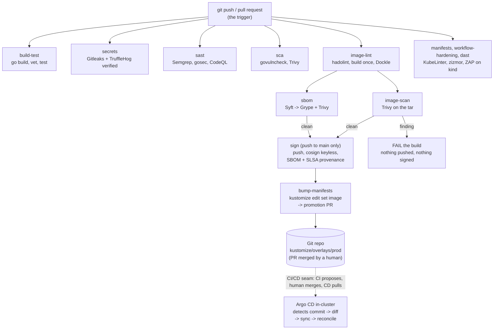

# 03 — CI/CD pipeline

> The **CI vs CD split** (CI proves an artifact good; CD makes the cluster
> match Git) and the ten stages that do the proving: secrets, SAST,
> dependency scan, image lint, image scan, SBOM, signing, manifest analysis,
> workflow hardening and DAST. One reusable GitHub Actions workflow runs them
> for each Bookstore service, a deliberately vulnerable fixture proves every
> scanner can still fail, and a last job commits the signed digests into the
> kustomize overlay so Argo CD ([ch.04](04-gitops-argocd.md)) deploys them.
> "**CI builds, CD deploys, Git is the trigger.**"

**Estimated time:** ~40 min read · ~120 min hands-on
**Prerequisites:** [Part 01 ch.01](../01-core-workloads/01-pods.md#baseline): the baseline the DAST stage runs under · [Part 05 ch.03](../05-security/03-supply-chain.md): scan, sign, verify; CI is where these get enforced · [Part 07 ch.02](02-packaging-kustomize.md): the overlays CI bumps digests in · [Part 00 ch.02](../00-foundations/02-containers-and-images.md): tags vs immutable digests
**You'll know after this:** • split CI (proves the artifact good) from CD (makes the cluster match Git) · • run the ten pipeline stages in order and say what each one catches and misses · • prove a scanner can still fail, so a clean result means something · • sign an image keyless, with the SBOM and provenance attached to its digest · • protect the pipeline itself: pinned actions, scoped tokens, a workflow linter · • bump kustomize overlay digests from a workflow and let Argo CD deploy them

<!-- tags: ci-cd, gitops, supply-chain, platform-engineering, security, devsecops -->

## Why this exists

[ch.01](01-packaging-helm.md) and [ch.02](02-packaging-kustomize.md) made the
Bookstore **packageable**. [Part 05 ch.03](../05-security/03-supply-chain.md)
made an image **trustworthy**: a scan, an SBOM, a keyless signature, and a
Kyverno policy that would require a digest and a verified signature. That
policy ships in **Audit**, because the guide's own `bookstore/<SVC>:dev`
images are tag-based and unsigned, and Enforce would blackhole the cluster.

Two gaps remain:

1. **Who runs build, scan, sign and push, the same way every time?** By hand
   on a laptop that is "works on my machine": unpinned tools, no record,
   secrets in shell history. **CI** is an automated, audited pipeline that
   takes source and **proves an artifact good**.
2. **How does a good artifact become a running Pod without a human typing
   `kubectl apply`?** That is **CD**: the cluster is continuously made to
   match Git. The **seam** between them is a **commit**: CI's last act bumps
   the deployment source, and [ch.04](04-gitops-argocd.md)'s Argo CD
   reconciles it.

CI is also the most privileged thing near your code. It reads the source,
holds a registry token, mints signing identities and decides what ships;
whoever owns the pipeline owns every image it produces. So the pipeline here
is something to **defend** as well as something that defends: it scans the
code, the images and the manifests, and it scans the workflow files that run
it. Audit to Enforce is then a pipeline milestone, not a YAML flip.

## Mental model

**CI and CD are two machines joined by Git, not one script.**

- **CI = "is this artifact good?"** Input: source. Output: an **immutable,
  signed image referenced by digest** plus evidence (scan reports, SBOM,
  signature in Rekor). CI **never touches the cluster**; its last step writes
  the new digest into **Git**.
- **CD = "does the cluster match Git?"** An in-cluster controller
  ([ch.04](04-gitops-argocd.md)'s Argo CD) renders the overlay, diffs and
  reconciles, triggered by **the commit CI made**.
- **The artifact is pinned by content, not by name.** `bookstore/catalog:dev`
  is a *mutable pointer*; `…@sha256:<HASH>` **is** the content, because the
  registry and the kubelet verify the bytes hash to exactly that. CI signs the
  *digest*; CD deploys the *digest*.
- **The pipeline is a set of gates that fail closed, and a gate that finds
  nothing is not a gate that works.** A scanner with renamed rules, a database
  that failed to load or a target path that moved reports "clean" just as
  happily. So each scanner also runs against a deliberately vulnerable
  [fixture](../examples/bookstore/ci/fixtures/vulnerable/README.md) and must
  report what was planted there.
- **Prefer no long-lived secret.** Cosign **keyless** trades a short-lived
  OIDC token for a certificate that lives minutes; the registry push uses the
  run's own token, not a stored PAT. A fork PR gets neither.

The trap: a pipeline that *deploys by reaching into the cluster* (a
`kubectl apply` with a long-lived kubeconfig secret) couples CI to CD, makes
cluster state un-auditable and hands every job cluster-admin-shaped
credentials. **Push to Git, let the cluster pull**, as in
[ch.04](04-gitops-argocd.md).

## Threats and controls

A pipeline turns source into a running workload, so each stage answers a way
that step can go wrong. The last three rows are about the pipeline itself.

| Threat | Control taught here | Goes deeper |
|---|---|---|
| A credential is committed and lives in history | Gitleaks in pre-commit and CI; TruffleHog verified mode as the gate; keyless OIDC, so there is little to leak | [03.02](../03-config-and-storage/02-secrets.md), [15.05](../15-day-to-day-production-ops/05-production-secrets-vault-eso.md) |
| Your own code carries an injection or a weak primitive | Semgrep with the Bookstore's rules, gosec, CodeQL | [15.02](../15-day-to-day-production-ops/02-application-cicd-pipelines.md) |
| A dependency you ship or call is vulnerable | govulncheck (what you call), Trivy (what you ship), Dependabot (the fix) | [05.03](../05-security/03-supply-chain.md) |
| The image runs as root, hides a secret or sits on an end-of-life base | hadolint, Dockle, Trivy on the image | [05.03](../05-security/03-supply-chain.md), [00.02](../00-foundations/02-containers-and-images.md) |
| Nobody can say what is inside an image when a CVE lands | A Syft SBOM, scanned by Grype and Trivy | [05.03](../05-security/03-supply-chain.md) |
| The image in the registry is not the one CI built | Push once, sign the digest keyless, attach SLSA provenance | [15.03](../15-day-to-day-production-ops/03-image-signing-and-provenance.md) |
| A manifest asks for more than the baseline allows | KubeLinter, kubesec and Trivy config on the rendered overlay | [01.01](../01-core-workloads/01-pods.md#baseline), policy as code in 05.07 <!-- link-later: 05.07 --> |
| The running service leaks through its responses | ZAP baseline against it on a throwaway kind cluster | [15.02](../15-day-to-day-production-ops/02-application-cicd-pipelines.md) |
| The pipeline is the attack: an injectable expression, a tag that moves, a token that can do too much | SHA-pinned actions, per-job `permissions`, zizmor, actionlint, Harden-Runner, Scorecard | [15.02](../15-day-to-day-production-ops/02-application-cicd-pipelines.md) |
| A scanner goes quiet and every build passes | A control per scanner against the vulnerable fixture | this chapter |
| CI holds a cluster credential | CI proposes a PR; the in-cluster controller applies it | [07.04](04-gitops-argocd.md) |

Verifying these signatures at admission (Kyverno `verifyImages`) is the other
half of the signing row. It arrives with 05.07 <!-- link-later: 05.07 -->;
until then the Audit policy from 05.03 is the only reader.

## Diagrams

### The pipeline for one service, then the seam (Mermaid)

The reusable workflow `.github/workflows/bookstore-pipeline.yml` runs the
stages below for one service, plus a `build-test` job (`go build`, `go vet`,
`go test`) that is not a security stage. `manifests`, `workflow-hardening`
and `dast` run beside the chain. The dashed boundary is the CI/CD seam: CI
ends at a **commit**, and the cluster's Argo CD
([ch.04](04-gitops-argocd.md)) pulls from there.



### Environment promotion (ASCII)

```
 build once  ──►  ONE signed digest  ──►  promoted, never rebuilt
      ├─ overlays/dev      latest main digest   (auto-sync, ch.04)
      ├─ overlays/staging  same digest, prod shape at half scale
      └─ overlays/prod     SAME digest, written by `kustomize edit set
                           image` in a PR (a human merges it)
 Promotion = a reviewed COMMIT moving a digest between overlays, not a
 rebuild: a rebuild is a different artifact, bits you never tested.
```

## Hands-on with the Bookstore

**Assumed working directory: the guide repo root (`full-guide/`).** You need
Docker; the last stage also needs a kind cluster and the image from
[Part 00 ch.02](../00-foundations/02-containers-and-images.md). The output
below was recorded on one Linux machine and is committed as
[`evidence/07-03.txt`](../examples/security-lab/evidence/07-03.txt).
Vulnerability counts drift as the databases move; the verdict lines do not.

The pipeline is two workflow files and one script:

- `.github/workflows/bookstore-pipeline.yml` is the reusable workflow: one
  job per stage, for one service. The stage names below are its job names.
- [`ci/github-actions.yml`](../examples/bookstore/ci/github-actions.yml) is
  the thin caller a Bookstore repo copies. It fans out over the four services
  and adds `bump-manifests`. GitHub only runs workflows from
  `.github/workflows/`, so a real repo copies both files there.
- [`ci/scan.sh`](../examples/bookstore/ci/scan.sh) runs one scanner from a
  container image **pinned by digest**. The workflow calls it and so do you,
  so the command on your laptop is the command in CI.

> **Honesty note.** Push, keyless signing, CodeQL and the promotion PR need a
> registry, GitHub's OIDC and GitHub's runners. They are real, valid steps
> that this chapter **reads, not runs**; every other stage runs below.
> `<OWNER>` stands for your GitHub user or organization.

### 0. The scanner runner

```sh
scan=examples/bookstore/ci/scan.sh
mkdir -p scan-out
```

Every stage is `$scan TOOL TARGET`. Exit 0 means clean and the script prints
one line saying so; the scanner's own output lands in `scan-reports/`.
`$scan --expect ID TOOL TARGET` is a **control**: it passes only if the
scanner flags the target *and* its report contains `ID`. Each stage ends with
a control against the
[`vulnerable` fixture](../examples/bookstore/ci/fixtures/vulnerable/README.md),
a service that is broken on purpose. Those steps are labelled **deliberate**.

### 1. Pre-commit: the cheapest gate, on your machine

The first reader of a change is your own laptop. Three hooks (Gitleaks,
hadolint, gosec) in
`examples/bookstore/.pre-commit-config.yaml`
run before a commit exists, so a leaked token never reaches history, which a
force-push cannot fully clean. Two hooks run the pinned scanner images; gosec
builds at its pinned version.

```sh
pip install -q pre-commit==4.7.0
cp -R examples/bookstore /tmp/bookstore && rm -rf /tmp/bookstore/ci/fixtures   # stands in for your repo
cd /tmp/bookstore && git init -q && git add -A
pre-commit run --all-files
```

<!-- gate: output -->

```text
gitleaks.................................................................Passed
hadolint.................................................................Passed
gosec....................................................................Passed
```

**Deliberate.** Stage a file that holds a token-shaped string, built at
run time so this page holds no token. The hook fails, and installed as a
commit hook it would stop the commit:

```sh
printf 'GITHUB_TOKEN=ghp_%s\n' "$(printf 'NOTAREALTOKEN%.0s' 1 2 3)" > .env
git add .env && pre-commit run gitleaks
```

<!-- gate: output -->

```text
gitleaks.................................................................Failed
- hook id: gitleaks
- exit code: 1
# ...
RuleID:      github-pat
# ...
File:        .env
```

### 2. `secrets`: Gitleaks and TruffleHog

A secret in Git is a secret in every clone, and deleting the file does not
unpublish it ([Part 03 ch.02](../03-config-and-storage/02-secrets.md)). Two
scanners, because they fail differently. **Gitleaks** matches the *shape* of a
credential, so it catches a token the day it is committed, live or not.
**TruffleHog's verified mode** asks the issuing service whether the
credential still works and reports only live ones, so it can fail a build
with almost no false positives. It stays quiet about a key already revoked.

```sh
$scan gitleaks examples/bookstore/app
$scan trufflehog examples/bookstore/app
```

<!-- gate: output -->

```text
scan.sh: gitleaks clean on examples/bookstore/app
scan.sh: trufflehog clean on examples/bookstore/app
```

**Deliberate.** The fixture holds two fake tokens. Without the repo's
allowlist Gitleaks refuses it. TruffleHog in verified mode does not, because a
fake token never verifies:

```sh
$scan gitleaks examples/bookstore/ci/fixtures/vulnerable; echo "exit $?"
jq -r '.[] | "\(.RuleID) \(.File)"' scan-reports/gitleaks.json
$scan trufflehog examples/bookstore/ci/fixtures/vulnerable
```

<!-- gate: output -->

```text
scan.sh: gitleaks flagged examples/bookstore/ci/fixtures/vulnerable (exit 1, report scan-reports/gitleaks.json)
exit 1
github-pat examples/bookstore/ci/fixtures/vulnerable/config.env
scan.sh: trufflehog clean on examples/bookstore/ci/fixtures/vulnerable
```

So the TruffleHog control turns verification off, to show the detectors still
match:

```sh
$scan --expect github-pat gitleaks examples/bookstore/ci/fixtures/vulnerable
$scan --expect Github trufflehog examples/bookstore/ci/fixtures/vulnerable
```

<!-- gate: output -->

```text
scan.sh: control ok, gitleaks reported github-pat on examples/bookstore/ci/fixtures/vulnerable
scan.sh: control ok, trufflehog reported Github on examples/bookstore/ci/fixtures/vulnerable
```

### 3. `sast`: Semgrep, gosec and CodeQL

Static analysis reads source for patterns that become bugs. **Semgrep** runs
the Bookstore's own rules,
[`ci/semgrep/bookstore.yml`](../examples/bookstore/ci/semgrep/bookstore.yml),
local files that need no network or account. **gosec** knows Go's pitfalls
(weak hashes, shell calls, missing server timeouts). **CodeQL** follows data
across functions, which the other two cannot; it runs only on GitHub's
runners, and the job counts its SARIF so a fork PR still gets the gate.

```sh
$scan semgrep examples/bookstore/app
$scan gosec examples/bookstore/app/catalog
```

<!-- gate: output -->

```text
scan.sh: semgrep clean on examples/bookstore/app
scan.sh: gosec clean on examples/bookstore/app/catalog
```

**Deliberate.** Both must flag the fixture, and name the planted rule:

```sh
$scan --expect bookstore-sql-string-concat semgrep examples/bookstore/ci/fixtures/vulnerable
$scan --expect G202 gosec examples/bookstore/ci/fixtures/vulnerable
jq -r '.Issues[] | "\(.rule_id) \(.details)"' scan-reports/gosec.json | sort -u
```

<!-- gate: output -->

```text
scan.sh: control ok, semgrep reported bookstore-sql-string-concat on examples/bookstore/ci/fixtures/vulnerable
scan.sh: control ok, gosec reported G202 on examples/bookstore/ci/fixtures/vulnerable
# ...
G202 SQL string concatenation
G204 Subprocess launched with a potential tainted input or cmd arguments
G401 Use of weak cryptographic primitive
```

### 4. `sca`: govulncheck and Trivy

A dependency is a stranger's code you ship. **govulncheck** reports only
vulnerabilities your code can reach ("do I call it?"). **Trivy** lists every
vulnerable module in `go.mod` ("do I ship it?"). Dependabot
([`ci/dependabot.yml`](../examples/bookstore/ci/dependabot.yml)) opens the
pull request that moves the version, and the pipeline runs on that PR.

```sh
$scan govulncheck examples/bookstore/app/catalog
$scan trivy-fs examples/bookstore/app/catalog
```

<!-- gate: output -->

```text
scan.sh: govulncheck clean on examples/bookstore/app/catalog
scan.sh: trivy-fs clean on examples/bookstore/app/catalog
```

**Deliberate.** The fixture pins `x/text` v0.3.6 and calls into it. The
control also shows what *reachable* means: govulncheck names the call.

```sh
$scan --expect GO-2021-0113 govulncheck examples/bookstore/ci/fixtures/vulnerable
grep -E 'GO-2021-0113|calls language' scan-reports/govulncheck.txt | head -4
$scan --expect CVE-2021-38561 trivy-fs examples/bookstore/ci/fixtures/vulnerable
```

<!-- gate: output -->

```text
scan.sh: control ok, govulncheck reported GO-2021-0113 on examples/bookstore/ci/fixtures/vulnerable
      #1: main.go:21:45: vulnerable.main calls language.ParseAcceptLanguage
Vulnerability #2: GO-2021-0113
  More info: https://pkg.go.dev/vuln/GO-2021-0113
      #1: main.go:21:45: vulnerable.main calls language.ParseAcceptLanguage
scan.sh: control ok, trivy-fs reported CVE-2021-38561 on examples/bookstore/ci/fixtures/vulnerable
```

### 5. `image-lint`: hadolint, then Dockle

**hadolint** reads the Dockerfile before anything is built. Then the image is
built **once, as a tar**, and every later stage reads that tar, so the image
you scan is the image you sign. **Dockle** reads the built image: the user it
runs as, credential-looking names in its environment, setuid files.

```sh
docker build -q -t bookstore/catalog:dev examples/bookstore/app/catalog >/dev/null
docker save -o scan-out/catalog.tar bookstore/catalog:dev
$scan hadolint examples/bookstore/app/catalog/Dockerfile
$scan dockle scan-out/catalog.tar
```

<!-- gate: output -->

```text
scan.sh: hadolint clean on examples/bookstore/app/catalog/Dockerfile
scan.sh: dockle clean on scan-out/catalog.tar
```

**Deliberate.** Build the fixture image the same way and let both flag it:

```sh
docker build -q -t bookstore/vulnerable:fixture -f examples/bookstore/ci/fixtures/vulnerable/vulnerable.Dockerfile examples/bookstore/ci/fixtures/vulnerable >/dev/null
docker save -o scan-out/vulnerable.tar bookstore/vulnerable:fixture
$scan --expect DL3002 hadolint examples/bookstore/ci/fixtures/vulnerable/vulnerable.Dockerfile
$scan --expect CIS-DI-0001 dockle scan-out/vulnerable.tar
```

<!-- gate: output -->

```text
scan.sh: control ok, hadolint reported DL3002 on examples/bookstore/ci/fixtures/vulnerable/vulnerable.Dockerfile
scan.sh: control ok, dockle reported CIS-DI-0001 on scan-out/vulnerable.tar
```

### 6. `image-scan`: Trivy on the image

The distroless Go images carry almost no packages, so the scan is normally
clean by construction. That minimal base **is** a supply-chain control: what
is not in the image cannot be vulnerable. `ignore-unfixed` is on, for the
reason under [How it works](#how-it-works-under-the-hood).

```sh
$scan trivy-image scan-out/catalog.tar
```

<!-- gate: output -->

```text
scan.sh: trivy-image clean on scan-out/catalog.tar
```

**Deliberate.** The fixture's base is an end-of-life Alpine:

```sh
$scan --expect CVE-2022-37434 trivy-image scan-out/vulnerable.tar
```

<!-- gate: output -->

```text
scan.sh: control ok, trivy-image reported CVE-2022-37434 on scan-out/vulnerable.tar
```

### 7. `sbom`: Syft, then Grype and Trivy

An SBOM answers "what is inside this digest?" long after the build, the
question you get the day a new CVE lands. **Syft** writes a CycloneDX
inventory; **Grype** and **Trivy** each scan it. Two scanners on purpose: they
read different vulnerability data, and where they disagree is worth a look.

```sh
$scan syft scan-out/catalog.tar
$scan grype scan-reports/sbom.cdx.json
$scan trivy-sbom scan-reports/sbom.cdx.json
```

<!-- gate: output -->

```text
scan.sh: syft clean on scan-out/catalog.tar
scan.sh: grype clean on scan-reports/sbom.cdx.json
scan.sh: trivy-sbom clean on scan-reports/sbom.cdx.json
```

**Deliberate.** The fixture's inventory, scanned by both:

```sh
$scan syft scan-out/vulnerable.tar
$scan --expect CVE-2021-38561 grype scan-reports/sbom.cdx.json
$scan --expect CVE-2021-38561 trivy-sbom scan-reports/sbom.cdx.json
```

<!-- gate: output -->

```text
scan.sh: syft clean on scan-out/vulnerable.tar
scan.sh: control ok, grype reported CVE-2021-38561 on scan-reports/sbom.cdx.json
scan.sh: control ok, trivy-sbom reported CVE-2021-38561 on scan-reports/sbom.cdx.json
```

### 8. `sign`: push, keyless signature, SBOM, provenance (read, not run)

This job runs only on a push to `main`, after `image-scan` and `sbom` passed.
It loads the tar, pushes it, **reads the digest the registry computed** and
signs that digest. `actions/attest-build-provenance` then adds a **SLSA
provenance** statement for the same digest.

```sh
cosign sign --yes "$REF"                                       # REF = image@sha256:<DIGEST>
cosign attest --yes --type cyclonedx --predicate sbom.cdx.json "$REF"
```

The job alone asks for `id-token: write`. What a *consumer* runs, and what
05.07 <!-- link-later: 05.07 --> turns into an admission rule, checks the
identity, not just the signature:

```sh
cosign verify \
  --certificate-identity-regexp '^https://github.com/<OWNER>/<REPO>/\.github/workflows/bookstore-pipeline\.yml@' \
  --certificate-oidc-issuer https://token.actions.githubusercontent.com \
  ghcr.io/<OWNER>/bookstore-catalog@sha256:<DIGEST>
```

This is the one stage with no run here; its first proof is the first CI run
on a repo with a registry. The identity names the reusable workflow's file
because that job requests the token.

### 9. `manifests`: KubeLinter, kubesec, Trivy config

Three readers of the **rendered** production overlay, because that is what
Argo CD applies. They overlap on purpose: KubeLinter checks shape, kubesec
scores Pod specs, and Trivy config checks its misconfiguration library, whose
five core checks are the baseline from
[Part 01 ch.01](../01-core-workloads/01-pods.md#baseline). Conftest policies
join them with 05.07 <!-- link-later: 05.07 -->.

```sh
kubectl kustomize examples/bookstore/kustomize/overlays/prod > scan-reports/prod-overlay.yaml
$scan kube-linter scan-reports/prod-overlay.yaml
$scan kubesec scan-reports/prod-overlay.yaml
$scan trivy-config scan-reports/prod-overlay.yaml
```

<!-- gate: output -->

```text
scan.sh: kube-linter clean on scan-reports/prod-overlay.yaml
scan.sh: kubesec clean on scan-reports/prod-overlay.yaml
scan.sh: trivy-config clean on scan-reports/prod-overlay.yaml
```

**Deliberate.** A privileged Pod with a host mount and a `latest` tag:

```sh
$scan --expect KSV-0017 trivy-config examples/bookstore/ci/fixtures/vulnerable/deployment.json
$scan --expect privileged-container kube-linter examples/bookstore/ci/fixtures/vulnerable/deployment.json
$scan --expect Privileged kubesec examples/bookstore/ci/fixtures/vulnerable/deployment.json
```

<!-- gate: output -->

```text
scan.sh: control ok, trivy-config reported KSV-0017 on examples/bookstore/ci/fixtures/vulnerable/deployment.json
scan.sh: control ok, kube-linter reported privileged-container on examples/bookstore/ci/fixtures/vulnerable/deployment.json
scan.sh: control ok, kubesec reported Privileged on examples/bookstore/ci/fixtures/vulnerable/deployment.json
```

### 10. `workflow-hardening`: zizmor, actionlint, Harden-Runner, Scorecard

The pipeline holds a registry token and a signing identity, so its own YAML
is a target. **zizmor** finds injectable `${{ }}` expressions, unpinned
actions and over-broad permissions; **actionlint** finds mistakes that make a
workflow misbehave. Both run from the repository root, above `full-guide/`.
**Harden-Runner** is the first step of every job and records the runner's
outbound calls. **Scorecard** grades the repository's habits, on the default
branch only.

```sh
cd ..
scan=full-guide/examples/bookstore/ci/scan.sh
$scan zizmor ".github/workflows/bookstore-pipeline.yml .github/workflows/bookstore-pipeline-check.yml"
$scan actionlint ".github/workflows/bookstore-pipeline.yml .github/workflows/bookstore-pipeline-check.yml"
```

<!-- gate: output -->

```text
scan.sh: zizmor clean on .github/workflows/bookstore-pipeline.yml .github/workflows/bookstore-pipeline-check.yml
scan.sh: actionlint clean on .github/workflows/bookstore-pipeline.yml .github/workflows/bookstore-pipeline-check.yml
```

**Deliberate.** The fixture's workflow pastes a PR title into a shell script
on a privileged trigger:

```sh
$scan --expect template-injection zizmor full-guide/examples/bookstore/ci/fixtures/vulnerable/bad-workflow.yml
$scan --expect 'potentially untrusted' actionlint full-guide/examples/bookstore/ci/fixtures/vulnerable/bad-workflow.yml
```

<!-- gate: output -->

```text
scan.sh: control ok, zizmor reported template-injection on full-guide/examples/bookstore/ci/fixtures/vulnerable/bad-workflow.yml
scan.sh: control ok, actionlint reported potentially untrusted on full-guide/examples/bookstore/ci/fixtures/vulnerable/bad-workflow.yml
```

Go back into `full-guide/` (`cd full-guide`) for the last stage.

### 11. `dast`: the ZAP baseline on a throwaway cluster

Everything so far read files. **DAST** reads a running service. The ZAP
*baseline* crawls the URL and reads the responses for missing or leaky
headers; it sends no attack traffic, so it is safe on every PR. The pipeline
starts the image on a kind cluster, in a namespace that enforces Pod Security
`restricted`, with the baseline from
[Part 01 ch.01](../01-core-workloads/01-pods.md#baseline). Do the same with
the catalog Pod from that chapter:

```sh
kubectl create namespace dast
kubectl label namespace dast pod-security.kubernetes.io/enforce=restricted pod-security.kubernetes.io/warn=restricted
kubectl create serviceaccount catalog-sa --namespace dast
kind load docker-image bookstore/catalog:dev --name bookstore
kubectl apply --namespace dast -f examples/bookstore/raw-manifests/01-catalog-pod.yaml
kubectl wait --namespace dast --for=condition=Ready pod/catalog --timeout=90s
```

<!-- gate: output -->

```text
namespace/dast created
namespace/dast labeled
serviceaccount/catalog-sa created
Image: "bookstore/catalog:dev" with ID "sha256:5c8f78461c5a94db0589f347ba76121dc185f0417025110c555a7f2b56f2d220" not yet present on node "bookstore-control-plane", loading...
pod/catalog created
pod/catalog condition met
```

Scan it through a port-forward. The run is clean, yet the report is not
empty: the baseline raised three rules on the catalog, and
[`ci/zap/baseline.conf`](../examples/bookstore/ci/zap/baseline.conf) lists
each as INFO with a reason and a revisit date (see the table below). Any rule
not listed still fails the build.

```sh
kubectl --namespace dast port-forward pod/catalog 8080:8080 >/dev/null &
sleep 2
$scan zap http://127.0.0.1:8080/books
grep -E '^(FAIL-NEW|WARN-NEW|INFO)' scan-reports/zap.log
```

<!-- gate: output -->

```text
scan.sh: zap clean on http://127.0.0.1:8080/books
INFO: X-Content-Type-Options Header Missing [10021] x 1 
INFO: Storable and Cacheable Content [10049] x 4 
INFO: Cross-Origin-Resource-Policy Header Missing or Invalid [90004] x 1 
FAIL-NEW: 0     FAIL-INPROG: 0  WARN-NEW: 0     WARN-INPROG: 0  INFO: 3 IGNORE: 0       PASS: 65
```

**Deliberate.** The fixture serves a session cookie without `HttpOnly`. Run
it and point the same scan at it:

```sh
docker run -d --name fixture -p 127.0.0.1:18080:8080 bookstore/vulnerable:fixture >/dev/null
sleep 2
$scan --expect 10010 zap http://127.0.0.1:18080/books
grep -E '^(FAIL-NEW|WARN-NEW|INFO)' scan-reports/zap.log
docker rm -f fixture >/dev/null
```

<!-- gate: output -->

```text
scan.sh: control ok, zap reported 10010 on http://127.0.0.1:18080/books
INFO: Missing Anti-clickjacking Header [10020] x 1 
INFO: X-Content-Type-Options Header Missing [10021] x 1 
INFO: Content Security Policy (CSP) Header Not Set [10038] x 1 
INFO: Storable and Cacheable Content [10049] x 4 
INFO: Permissions Policy Header Not Set [10063] x 1 
INFO: Cross-Origin-Embedder-Policy Header Missing or Invalid [90004] x 3 
WARN-NEW: Cookie No HttpOnly Flag [10010] x 1 
WARN-NEW: Cookie without SameSite Attribute [10054] x 1 
WARN-NEW: Session Management Response Identified [10112] x 1 
FAIL-NEW: 0     FAIL-INPROG: 0  WARN-NEW: 3     WARN-INPROG: 0  INFO: 6 IGNORE: 0       PASS: 59
```

### 12. The seam: from signed digest to Git (local approximation)

`bump-manifests` is the only job that writes to Git, and it writes a **pull
request**, not a push. You can run what it does against a placeholder digest
(it needs the standalone `kustomize` binary):

```sh
cd examples/bookstore/kustomize/overlays/prod
kustomize edit set image \
  bookstore/catalog=ghcr.io/<OWNER>/bookstore-catalog@sha256:0000000000000000000000000000000000000000000000000000000000000000
git diff kustomization.yaml     # THIS diff is what Argo CD would sync
git checkout -- kustomization.yaml
cd ../../../../..               # back to full-guide/
```

That edit and a merge are the whole "deploy". CI holds no cluster
credential. The job installs kustomize from a pinned release **and checks its
sha256**, then opens the PR with `peter-evans/create-pull-request`. Require a
review by branch protection, or the bot can merge its own promotion.

### 13. What the first run found

A pipeline that is green on day one has usually been tuned to be. This one was
run first and then dispositioned. Each decision is a file with a reason and a
date:

| Stage | First-run finding | Disposition |
|---|---|---|
| `image-scan`, `sbom` | The storefront's `nginx:1.27-alpine` base carried many fixable HIGH and CRITICAL CVEs | **Fixed**: base moved to `nginx:1.30-alpine`, pinned by digest |
| `image-scan`, `sbom` | `nginx:1.30-alpine` still shipped curl and libcurl, and Grype listed several curl CVEs that Trivy did not | **Fixed**: the Dockerfile removes both, since nothing depends on them |
| `image-scan`, `sbom` | A CRITICAL in brotli-libs, fixed by Alpine but not yet in the nginx image | Accepted until 2026-11-30 in `ci/trivyignore.yaml` and `ci/grype.yaml`; Trivy fails again on that date |
| `image-lint` | Dockle read `KEY_SHA512` in nginx's build script as a secret | Accepted in `scan.sh`: it is the checksum of nginx's public key |
| `manifests` | KubeLinter: `no-anti-affinity` on orders, `job-ttl-seconds-after-finished` on the cleanup CronJob | Excluded in `ci/kube-linter.yaml`: availability and operations, not the baseline |
| `dast` | Nine ZAP rules across catalog, orders and storefront | Accepted as INFO in `ci/zap/baseline.conf` |

Every dated entry lapses on its date, and any rule not listed still fails the
build.

### 14. How the guide's CI runs it

`.github/workflows/bookstore-pipeline-check.yml` calls the reusable workflow
on every PR that touches the services, the `ci/` directory or the pipeline
itself, once per service. Beside it, a matrix of **controls** runs every
scanner above through `scan.sh --expect` against the fixture. Both halves
matter: the first says the services are clean, the second says "clean" can
still be believed.

## How it works under the hood

- **CI's job is evidence, not deployment.** Each stage emits a verifiable
  fact: an exit code, a scan report, an SBOM, a **Rekor** entry (the signature
  in an append-only public log) and a **SLSA provenance** statement (who built
  it, from what, how). An admission policy can then decide trust on its own.
  The cluster never sees CI; it sees the registry and Git.
- **The registry computes the digest.** A push uploads layers and a manifest,
  and the registry returns `sha256:<hash over the manifest>`. It changes only
  if the bytes change. Cosign signs *that string*, and a kubelet pulling
  `name@sha256:…` re-verifies the bytes against it.
- **Scan first, push after.** The image is built once as a tar and every
  stage reads that tar. Only `sign` pushes, and only after `image-scan` and
  `sbom` passed, so a vulnerable image never reaches the registry. The earlier
  version of this workflow pushed first and scanned the pushed digest, which
  left a pullable vulnerable image behind on every failed run. The price: the
  digest exists only after the push, so signature and SBOM bind to the
  registry's manifest of the *same layers and config* that were scanned, not
  to bytes scanned one for one.
- **`ignore-unfixed` is a taught tradeoff.** It drops CVEs with no upstream
  fix. A rebuild cannot remediate those, so gating on them blocks every build
  for nothing. The cost is real exposure; the mitigation is to **rescan
  published images on a schedule**, which catches the day a fix appears even
  though the image never changed. Set it to `false` for the stricter gate.
- **Keyless signing has no key.** The platform mints a short-lived **OIDC**
  token naming the workflow identity. Cosign sends it to **Fulcio**, which
  issues a certificate that lives about ten minutes for a fresh key, then the
  key is discarded. Cosign signs the digest and records signature and
  certificate in **Rekor**. Verification checks the signature, the certificate
  identity against the *expected* workflow and issuer, and the Rekor entry.
  A fork PR cannot get a usable token, hence `publish` runs only on a push to
  `main`.
- **An action tag is a pointer anyone with write access can move.** In March
  2026 the version tags of a widely used scanner action were force-pushed to
  malicious commits (GHSA-69fq-xp46-6x23); only a commit SHA was safe. Every
  `uses:` here is a full SHA with the release in a comment, and Dependabot,
  not a human, moves the pin. GitHub's hardening guide gives the same advice.
- **Permissions are narrowed twice.** The reusable workflow starts from
  `permissions: {}` and each job asks for what it needs; the caller's job sets
  the ceiling, and GitHub checks it even for skipped jobs. `id-token: write`
  therefore exists only on `sign`.
- **No layer cache in the publishing workflow.** A cache restored from an
  earlier run is input no reviewer saw, and zizmor's `cache-poisoning` audit
  warns about cache reads in release workflows. The build starts cold and is
  a minute or two slower.

## Production notes

> **In production: CI must never hold cluster credentials.** The common
> anti-pattern is a `kubectl apply` or `helm upgrade` step with a long-lived
> kubeconfig secret. CI's last step is a **commit**; a pull-based controller
> ([ch.04](04-gitops-argocd.md)) alone applies. If you must push, use a
> short-lived, namespace-scoped, OIDC-federated credential, never a static
> admin kubeconfig.

> **In production: move Harden-Runner from `audit` to `block`.** The workflows
> ship with `egress-policy: audit`, which records every outbound call. After a
> few green runs, list the recorded endpoints under `allowed-endpoints` and
> switch to `block`, so a compromised step cannot send your token anywhere
> new. Branch protection on `main` (required review, required checks) is one
> of the things Scorecard checks.

## Quick Reference

```sh
scan=examples/bookstore/ci/scan.sh       # from full-guide/; pinned images, Docker only
mkdir -p scan-out
$scan gitleaks examples/bookstore/app    # secrets (trufflehog: same arguments)
$scan semgrep  examples/bookstore/app    # SAST (gosec, govulncheck: per Go module)
$scan trivy-fs examples/bookstore/app/catalog                 # dependencies
docker build -t bookstore/catalog:dev examples/bookstore/app/catalog
docker save -o scan-out/catalog.tar bookstore/catalog:dev
$scan dockle scan-out/catalog.tar        # image lint (hadolint: the Dockerfile)
$scan trivy-image scan-out/catalog.tar   # image scan, exit 1 on HIGH/CRITICAL
$scan syft scan-out/catalog.tar && $scan grype scan-reports/sbom.cdx.json
# $scan --expect ID TOOL TARGET runs a control: it must flag the target AND name ID
```

The CI to GitOps seam, as `bump-manifests` runs it (placeholder digest):

```sh
cd examples/bookstore/kustomize/overlays/prod
kustomize edit set image bookstore/catalog=ghcr.io/<OWNER>/bookstore-catalog@sha256:<DIGEST>
git add kustomization.yaml && git commit -m "ci: bump catalog digest"   # Argo CD (ch.04) syncs this
```

The shape of a Bookstore repo's caller (full file:
[`ci/github-actions.yml`](../examples/bookstore/ci/github-actions.yml)):

```yaml
name: bookstore-ci
on: { push: { branches: [main] }, pull_request: { branches: [main] } }
permissions: {}
jobs:
  pipeline:                       # the stages, once per service
    strategy: { matrix: { service: [catalog, orders, payments-worker, storefront] } }
    permissions: { contents: read, actions: read, packages: write, id-token: write, attestations: write }
    uses: ./.github/workflows/bookstore-pipeline.yml
    with: { service: "${{ matrix.service }}", publish: "${{ github.event_name == 'push' }}" }
  bump-manifests:                 # THE SEAM: digests into the overlay, as a PR
    needs: pipeline
    if: github.event_name == 'push'
    permissions: { contents: write, pull-requests: write }
    # download digest-* -> pinned, checksum-verified kustomize -> edit set image -> PR
```

Checklist:

- [ ] Every stage fails the build, and each scanner has a **control** that
      fails if it stops finding the planted issue
- [ ] Scan the built tar first; **push by digest** only after both scans pass
- [ ] **Cosign keyless** signature, SBOM and provenance on the pushed digest;
      no long-lived key or stored PAT; publish skipped on fork PRs
- [ ] Every `uses:` is a **commit SHA**; `permissions: {}` at the top, scoped
      per job; zizmor and actionlint clean; Harden-Runner on every job
- [ ] CI holds **no cluster credential**; its last step is a **pull request**
      that bumps the kustomize `images:` digest
- [ ] Promotion = the **same digest** moved overlay to overlay by reviewed
      commit; **never a rebuild**

## Test your understanding

> Try each before opening the answer drawer. The act of trying is the exercise; the answer is the check.

1. **The chapter insists "CI builds, CD deploys, Git is the trigger." Restate
   that as three actions the CI pipeline does and three it does *not* do.**
   <details><summary>Show answer</summary>

   **CI does**: (1) build and test the source, (2) scan, sign and push the
   image *by digest*, (3) commit the new digest into the GitOps source
   (`kustomize edit set image`). **CI does not**: (1) hold a kubeconfig or any
   cluster credential, (2) run `kubectl apply` or `helm upgrade`, (3) decide
   when to deploy; the commit triggers CD. The boundary moves from "every CI
   job has prod's keys" to "CI can open a PR; the in-cluster controller
   applies it".

   </details>

2. **A junior engineer asks "where is the private key?" about the keyless
   signature. Give the one-sentence answer, and say what you verify instead.**
   <details><summary>Show answer</summary>

   There is none: Fulcio issues a certificate that lives about ten minutes for
   a key that exists only for that run, and signature, certificate and
   identity go into the Rekor log. You verify the *identity*: the certificate
   must name this repository's pipeline workflow and the GitHub OIDC issuer
   (`cosign verify --certificate-identity-regexp … --certificate-oidc-issuer
   https://token.actions.githubusercontent.com`). A valid signature from any
   other identity is not trusted.

   </details>

3. **Hands-on extension: run `$scan trufflehog` on the fixture directory, then
   `$scan --expect Github trufflehog` on it. Why does the first pass while the
   second reports a secret, and which result tells you the scanner works?**
   <details><summary>What you should see</summary>

   Verified mode asks GitHub whether each token is live. The fixture's tokens
   are fake, so none verifies and the first run is clean, exactly as on a real
   repo whose old tokens are revoked. The control turns verification off, so
   the detectors report the pattern. Only the control shows the scanner still
   *sees*; a clean verified run cannot tell "nothing live" from "scanner
   broken", which is why the pipeline runs both.

   </details>

4. **A scan job has been green for months. Name two ways it could be green
   because the scanner is blind, and the check this chapter uses against
   both.**
   <details><summary>Show answer</summary>

   A renamed or removed rule ID (the scanner reports other findings, or none),
   and a target that moved or is empty (it reads nothing and reports clean).
   The check is the control: run the scanner on the vulnerable fixture and
   require a non-zero exit *and* the planted rule ID in the report. `scan.sh
   --expect ID` does this, so a quiet, crashed or renamed scanner fails the
   control instead of passing the real services by saying nothing.

   </details>

5. **Promotion from staging to prod is "moving the same digest between
   overlays, never a rebuild." Why is rebuilding for prod a bad pattern?**
   <details><summary>Show answer</summary>

   A rebuild produces a *different* image (layer timestamps, dependency
   resolution if the build is not perfectly reproducible). Staging's tests and
   every scan ran against image A, and prod would run image B, so you have no
   evidence that prod's bits passed your gates or carry your signature.
   **Build once, scan once, sign once, promote the artifact.**

   </details>

## Further reading

- **Davis, _Bootstrapping Microservices with Docker, Kubernetes, and
  Terraform_ (Manning, 2021), ch.7–8, automated testing and the continuous
  delivery pipeline.** The narrative this chapter's pipeline follows, from
  commit to running service.
- **Rosso et al., _Production Kubernetes_, ch.15, Software Supply Chain.**
  Build, scan, sign and admit as a production pipeline, and where the CI
  artifact meets the admission policy.
- Official and project docs: GitHub Actions security hardening
  <https://docs.github.com/en/actions/security-for-github-actions/security-guides/security-hardening-for-github-actions>,
  Sigstore Cosign keyless
  <https://docs.sigstore.dev/cosign/signing/overview/>, SLSA provenance
  <https://slsa.dev/spec/v1.0/provenance>, TruffleHog
  <https://github.com/trufflesecurity/trufflehog>, govulncheck
  <https://go.dev/doc/security/vuln/>, the ZAP baseline scan
  <https://www.zaproxy.org/docs/docker/baseline-scan/>, zizmor
  <https://docs.zizmor.sh/>, StepSecurity Harden-Runner
  <https://docs.stepsecurity.io/harden-runner>, OpenSSF Scorecard
  <https://github.com/ossf/scorecard>, and the Kubernetes image reference
  (digests vs tags, pull policy)
  <https://kubernetes.io/docs/concepts/containers/images/>.
