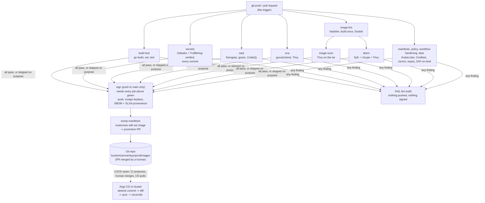

# 03 — CI/CD pipeline

> The **CI vs CD split** (CI proves an artifact good; CD makes the cluster
> match Git) and the ten stages that do the proving: secrets, SAST,
> dependency scan, image lint, image scan, SBOM, signing, manifest analysis,
> workflow hardening and DAST. One reusable GitHub Actions workflow runs them
> for each Bookstore service, a deliberately vulnerable fixture proves every
> scanner can still fail, and a last job commits the signed digests into the
> kustomize overlay so Argo CD ([ch.04](04-gitops-argocd.md)) deploys them.
> "**CI builds, CD deploys, Git is the trigger.**"

**Estimated time:** ~40 min read · ~120 min hands-on
**Prerequisites:** [Part 01 ch.01](../01-core-workloads/01-pods.md#baseline): the baseline the DAST stage runs under · [Part 05 ch.03](../05-security/03-supply-chain.md): scan, sign, verify; CI is where these get enforced · [Part 07 ch.02](02-packaging-kustomize.md): the overlays CI bumps digests in · [Part 00 ch.02](../00-foundations/02-containers-and-images.md): tags vs immutable digests
**You'll know after this:** • split CI (proves the artifact good) from CD (makes the cluster match Git) · • run the ten pipeline stages in order and say what each one catches and misses · • prove a scanner can still fail, so a clean result means something · • sign an image keyless, with the SBOM and provenance attached to its digest · • protect the pipeline itself: pinned actions, scoped tokens, a workflow linter · • bump kustomize overlay digests from a workflow and let Argo CD deploy them

<!-- tags: ci-cd, gitops, supply-chain, platform-engineering, security, devsecops -->

## Why this exists

[ch.01](01-packaging-helm.md) and [ch.02](02-packaging-kustomize.md) made the
Bookstore **packageable**. [Part 05 ch.03](../05-security/03-supply-chain.md)
made an image **trustworthy** on a lab cluster: a scan, an SBOM, a signature
and an attestation. [05.07](../05-security/07-admission-control-and-policy-as-code.md)
teaches the Kyverno policy that would require a digest and a verified
signature. It starts in **Audit**, because the guide's own
`bookstore/<SVC>:dev` images are tag-based and unsigned, and Enforce would
blackhole the cluster.

Two gaps remain:

1. **Who runs build, scan, sign and push, the same way every time?** By hand
   on a laptop that is "works on my machine": unpinned tools, no record,
   secrets in shell history. **CI** is an automated, audited pipeline that
   takes source and **proves an artifact good**.
2. **How does a good artifact become a running Pod without a human typing
   `kubectl apply`?** That is **CD**: the cluster is continuously made to
   match Git. The **seam** between them is a **commit**: CI's last act bumps
   the deployment source, and [ch.04](04-gitops-argocd.md)'s Argo CD
   reconciles it.

CI is also the most privileged thing near your code. It reads the source,
holds a registry token, mints signing identities and decides what ships;
whoever owns the pipeline owns every image it produces. So the pipeline here
is something to **defend** as well as something that defends: it scans the
code, the images and the manifests, and it scans the workflow files that run
it. What it hands the cluster is a digest, a signature, an SBOM and a
provenance statement, which is what an Enforce policy needs to check. Turning
Enforce on is a separate decision, taken where the policy lives
([05.07](../05-security/07-admission-control-and-policy-as-code.md)).

## Mental model

**CI and CD are two machines joined by Git, not one script.**

- **CI = "is this artifact good?"** Input: source. Output: an **immutable,
  signed image referenced by digest** plus evidence (scan reports, SBOM,
  signature in Rekor). CI **never touches the cluster**; its last step writes
  the new digest into **Git**.
- **CD = "does the cluster match Git?"** An in-cluster controller
  ([ch.04](04-gitops-argocd.md)'s Argo CD) renders the overlay, diffs and
  reconciles, triggered by **the commit CI made**.
- **The artifact is pinned by content, not by name.** `bookstore/catalog:dev`
  is a *mutable pointer*; `…@sha256:<HASH>` **is** the content, because the
  registry and the kubelet verify the bytes hash to exactly that. CI signs the
  *digest*; CD deploys the *digest*.
- **The pipeline is a set of gates that fail closed, and a gate that finds
  nothing is not a gate that works.** A scanner with renamed rules, a database
  that failed to load or a target path that moved reports "clean" just as
  happily. So each scanner also runs against a deliberately vulnerable
  [fixture](../examples/bookstore/ci/fixtures/vulnerable/README.md) and must
  report what was planted there. The signing job waits for every other job,
  so a signed digest is one whose whole run was green. Two jobs only report:
  Harden-Runner in audit mode and Scorecard stop nothing.
- **Prefer no long-lived secret.** Cosign **keyless** trades a short-lived
  OIDC token for a certificate that lives minutes; the registry push uses the
  run's own token, not a stored PAT. A fork PR gets neither.

The trap: a pipeline that *deploys by reaching into the cluster* (a
`kubectl apply` with a long-lived kubeconfig secret) couples CI to CD, makes
cluster state un-auditable and hands every job cluster-admin-shaped
credentials. **Push to Git, let the cluster pull**, as in
[ch.04](04-gitops-argocd.md).

## Threats and controls

A pipeline turns source into a running workload, so each stage answers a way
that step can go wrong. The last four rows are about the pipeline itself.

| Threat | Control taught here | Goes deeper |
|---|---|---|
| A credential is committed and lives in history | Gitleaks and TruffleHog verified mode read every commit in CI, and Gitleaks also runs in pre-commit; keyless OIDC, so there is little to leak | [03.02](../03-config-and-storage/02-secrets.md), [15.05](../15-day-to-day-production-ops/05-production-secrets-vault-eso.md) |
| Your own code carries an injection or a weak primitive | Semgrep with the Bookstore's rules, gosec, CodeQL | Step 3 here. [15.02](../15-day-to-day-production-ops/02-application-cicd-pipelines.md) covers the platform services' workflows, which run none of the three |
| A dependency you ship or call is vulnerable | govulncheck (what you call), Trivy (what you ship), Dependabot (the fix) | [05.03](../05-security/03-supply-chain.md) |
| The image runs as root, hides a secret or sits on an end-of-life base | hadolint, Dockle, Trivy on the image | Step 5 here for hadolint and Dockle; [00.02](../00-foundations/02-containers-and-images.md) teaches hadolint, and [05.03](../05-security/03-supply-chain.md) scans the image |
| Nobody can say what is inside an image when a CVE lands | A Syft SBOM, scanned by Grype and Trivy | [05.03](../05-security/03-supply-chain.md) |
| The image in the registry is not the one CI built, or is one that failed a gate | Push once, and only after every other job passed; sign the digest keyless; attach SLSA provenance | [15.03](../15-day-to-day-production-ops/03-image-signing-and-provenance.md) |
| A manifest asks for more than the baseline allows | KubeLinter, kubesec and Trivy config on the rendered overlay; Conftest rules, unit-tested with `opa test`, on the overlay and on a Terraform plan fixture | [01.01](../01-core-workloads/01-pods.md#baseline), policy as code in [05.07](../05-security/07-admission-control-and-policy-as-code.md) |
| The running service leaks through its responses | ZAP baseline against it on a throwaway kind cluster | Step 11 here. The platform services' workflows in 15.02 run no DAST |
| The pipeline is the attack: an injectable expression, a tag that moves, a token that can do too much | SHA-pinned actions, per-job `permissions`, zizmor and actionlint fail the build. Harden-Runner (audit mode) and Scorecard only report | Step 10 here. The platform services' workflows in [15.02](../15-day-to-day-production-ops/02-application-cicd-pipelines.md) pin actions by SHA and scope `permissions`, but run none of these four tools |
| A scanner goes quiet and every build passes | A control per scanner against the vulnerable fixture | this chapter |
| An accepted exception outlives its reason | Every exception carries a date; Trivy enforces its own, and an expiry check enforces the rest | this chapter |
| CI holds a cluster credential | CI proposes a PR; the in-cluster controller applies it | [07.04](04-gitops-argocd.md) |

This chapter makes the signatures and the evidence. It does not make the
cluster ask for them: checking a signature at admission (Kyverno
`verifyImages`, with the identity from step 8) is a separate control that
is taught in [05.07](../05-security/07-admission-control-and-policy-as-code.md),
and the Bookstore cluster does not run that rule: its manifests ship the
policy off, and its only `verifyImages` rule is a commented-out sketch. A
policy in Audit mode would report a Pod whose image is unsigned and block
nothing. So what you can rely on after this chapter is that a signed digest
came from this workflow with every gate green. It is not a guarantee that an
unsigned image cannot run.

## Diagrams

### The pipeline for one service, then the seam (Mermaid)

The reusable workflow `.github/workflows/bookstore-pipeline.yml` runs the
stages below for one service, plus a `build-test` job (`go build`, `go vet`,
`go test`) that is not a security stage. `manifests`, `policy`,
`workflow-hardening` and `dast` run beside the chain. `sign` waits for all of
them, so one red job anywhere means nothing is pushed and nothing is signed.
The dashed boundary is the CI/CD seam: CI ends at a **commit**, and the cluster's Argo CD
([ch.04](04-gitops-argocd.md)) pulls from there.



### Environment promotion (ASCII)

```
 build once  ──►  ONE signed digest  ──►  promoted, never rebuilt
      ├─ overlays/dev      latest main digest   (auto-sync, ch.04)
      ├─ overlays/staging  same digest, prod shape at half scale
      └─ overlays/prod     SAME digest, written by `kustomize edit set
                           image` into overlays/prod/images, in a PR
                           (a human merges it)
 Promotion = a reviewed COMMIT moving a digest between overlays, not a
 rebuild: a rebuild is a different artifact, bits you never tested.
```

## Hands-on with the Bookstore

**Assumed working directory: the guide repo root (`full-guide/`).** You need
Docker; the last stage also needs a kind cluster and the image from
[Part 00 ch.02](../00-foundations/02-containers-and-images.md). The output
below was recorded on one Linux machine and is committed as
[`evidence/07-03.txt`](../examples/security-lab/evidence/07-03.txt).
Vulnerability counts drift as the databases move, and ZAP's crawl can see a
response one time more or less; the verdict lines do not.

The pipeline is two workflow files and one script:

- `.github/workflows/bookstore-pipeline.yml` is the reusable workflow: one
  job per stage, for one service. The stage names below are its job names.
- [`ci/github-actions.yml`](../examples/bookstore/ci/github-actions.yml) is
  the thin caller a Bookstore repo copies. It fans out over the four services
  and adds `bump-manifests`. GitHub only runs workflows from
  `.github/workflows/`, so a real repo copies both files there.
- [`ci/scan.sh`](../examples/bookstore/ci/scan.sh) runs one scanner from a
  container image **pinned by digest**. The workflow calls it and so do you,
  so the command on your laptop is the command in CI.

The guide's own repository adds a third workflow file,
`.github/workflows/bookstore-release.yml`. A reader does not copy it. It is how
the guide proves `sign` and the promotion: one dispatch runs the pipeline for
one service with `publish` on, opens the promotion PR, and dispatches the
checks on it (steps 8 and 12).

> **Honesty note.** The guide's own pull-request CI runs four things that no
> laptop can: CodeQL, the ZAP baseline on a kind cluster, Harden-Runner in
> audit mode, and the permission ceiling. Each is reported where it appears
> below. Push, keyless signing, the SBOM attestation, provenance, the
> promotion PR and Scorecard need a registry, GitHub's OIDC token or the
> default branch, so a pull request cannot run them. The release workflow
> `bookstore-release.yml` does, and it was dispatched on `main` three times:
> for `catalog`, for `catalog` again, then for `orders`. The first run signed
> correctly and found five defects in the workflows around the signing. The
> second ran clean, but reading the promotion PR it opened found a sixth: the
> `gh attestation verify` in its body pinned only the repository. The third
> was the first run of the corrected body, whose commands exit 0 when pasted,
> and it found a seventh: the checks the workflow dispatches never appear in
> the PR's own Checks tab. One more defect, in the runtime gate, was found by
> reading before any run could hit it. The paragraph of the PR body that
> describes the checks was reworded after the third run and has not run since.
> Steps 8, 10 and 12 quote what the runs showed, in blocks the evidence check
> reads like the rest, and the end of step 12 lists what is still unproven.
> Those runs are the guide repository's own, so the output there names it; the
> commands use `<OWNER>` and `<REPO>`. Dependabot is not run. Every other stage
> runs below.

### 0. The scanner runner

```sh
scan=examples/bookstore/ci/scan.sh
mkdir -p scan-out
```

Every stage is `$scan TOOL TARGET`. Exit 0 means clean and the script prints
one line saying so; the scanner's own output lands in `scan-reports/`.
`$scan --expect ID TOOL TARGET` is a **control**: it passes only if the
scanner flags the target *and* its report contains `ID`. Each stage ends with
a control against the
[`vulnerable` fixture](../examples/bookstore/ci/fixtures/vulnerable/README.md),
a service that is broken on purpose. Those steps are labelled **deliberate**.

### 1. Pre-commit: the cheapest gate, on your machine

The first reader of a change is your own laptop. Three hooks (Gitleaks,
hadolint, gosec) in
`examples/bookstore/.pre-commit-config.yaml`
run before a commit exists, so a leaked token never reaches history, which a
force-push cannot fully clean. Two hooks run the pinned scanner images; gosec
builds at its pinned version.

```sh
pip install -q pre-commit==4.7.0
rm -rf /tmp/bookstore
cp -R examples/bookstore /tmp/bookstore && rm -rf /tmp/bookstore/ci/fixtures   # stands in for your repo
(cd /tmp/bookstore && git init -q && git add -A && pre-commit run --all-files)
```

<!-- gate: output -->

```text
gitleaks.................................................................Passed
hadolint.................................................................Passed
gosec....................................................................Passed
```

**Deliberate.** Stage a file that holds a token-shaped string, built at
run time so this page holds no token. The hook fails, and installed as a
commit hook it would stop the commit:

```sh
(cd /tmp/bookstore \
  && printf 'GITHUB_TOKEN=ghp_%s\n' "$(printf 'NOTAREALTOKEN%.0s' 1 2 3)" > .env \
  && git add .env && pre-commit run gitleaks)
rm -rf /tmp/bookstore
```

<!-- gate: output -->

```text
gitleaks.................................................................Failed
- hook id: gitleaks
- exit code: 1
# ...
RuleID:      github-pat
# ...
File:        .env
```

A hook is a convenience, not a gate. It does nothing until someone runs
`pre-commit install`, and `git commit --no-verify` skips it. The gate is the
`secrets` job in the next step, which runs on the server and not on the
author's machine.

### 2. `secrets`: Gitleaks and TruffleHog

A secret in Git is a secret in every clone, and deleting the file does not
unpublish it ([Part 03 ch.02](../03-config-and-storage/02-secrets.md)). Two
scanners, because they fail differently. **Gitleaks** matches the *shape* of a
credential, so it catches a token the day it is committed, live or not.
**TruffleHog's verified mode** asks the issuing service whether the
credential still works and reports only live ones, so it can fail a build
with almost no false positives. It stays quiet about a key already revoked.

Each runs in two modes. The first reads the **files on disk**, which suits the
code in front of you:

```sh
$scan gitleaks examples/bookstore/app
$scan trufflehog examples/bookstore/app
```

<!-- gate: output -->

```text
scan.sh: gitleaks clean on examples/bookstore/app
scan.sh: trufflehog clean on examples/bookstore/app
```

**Deliberate.** The fixture holds two fake tokens. Without the repo's
allowlist Gitleaks refuses it. TruffleHog in verified mode does not, because a
fake token never verifies:

```sh
$scan gitleaks examples/bookstore/ci/fixtures/vulnerable; echo "exit $?"
jq -r '.[] | "\(.RuleID) \(.File)"' scan-reports/gitleaks.json
$scan trufflehog examples/bookstore/ci/fixtures/vulnerable
```

<!-- gate: output -->

```text
scan.sh: gitleaks flagged examples/bookstore/ci/fixtures/vulnerable (exit 1, report scan-reports/gitleaks.json)
exit 1
github-pat examples/bookstore/ci/fixtures/vulnerable/config.env
scan.sh: trufflehog clean on examples/bookstore/ci/fixtures/vulnerable
```

So the TruffleHog control turns verification off, to show the detectors still
match:

```sh
$scan --expect github-pat gitleaks examples/bookstore/ci/fixtures/vulnerable
$scan --expect Github trufflehog examples/bookstore/ci/fixtures/vulnerable
```

<!-- gate: output -->

```text
scan.sh: control ok, gitleaks reported github-pat on examples/bookstore/ci/fixtures/vulnerable
scan.sh: control ok, trufflehog reported Github on examples/bookstore/ci/fixtures/vulnerable
```

The second mode, `gitleaks-history` and `trufflehog-history`, reads **every
commit**. The files on disk cannot show a token that one commit added and the
next deleted, and that token is still in every clone. The pipeline's `secrets`
job checks out with `fetch-depth: 0` so there is a history to read, and runs
only these two. Here is the case they exist for. `make-history.sh` builds a
throwaway repository whose first commit holds two fake tokens, assembled at
run time, and whose second commit deletes them:

```sh
examples/bookstore/ci/fixtures/make-history.sh scan-out/history
$scan gitleaks scan-out/history
$scan gitleaks-history scan-out/history; echo "exit $?"
```

<!-- gate: output -->

```text
scan.sh: gitleaks clean on scan-out/history
scan.sh: gitleaks-history flagged scan-out/history (exit 1, report scan-reports/gitleaks-history.json)
exit 1
```

**Deliberate.** `gitleaks` passed and `gitleaks-history` failed on the same
repository: that gap is the point. TruffleHog's history mode is quiet here for
the reason it was quiet above, since a fake token never verifies, so its
control turns verification off:

```sh
$scan trufflehog-history scan-out/history
$scan --expect github-pat gitleaks-history scan-out/history
$scan --expect Github trufflehog-history scan-out/history
```

<!-- gate: output -->

```text
scan.sh: trufflehog-history clean on scan-out/history
scan.sh: control ok, gitleaks-history reported github-pat on scan-out/history
scan.sh: control ok, trufflehog-history reported Github on scan-out/history
```

### 3. `sast`: Semgrep, gosec and CodeQL

Static analysis reads source for patterns that become bugs. **Semgrep** runs
the Bookstore's own rules,
[`ci/semgrep/bookstore.yml`](../examples/bookstore/ci/semgrep/bookstore.yml),
local files that need no network or account. **gosec** knows Go's pitfalls
(weak hashes, shell calls, missing server timeouts). **CodeQL** follows data
across functions, which the other two cannot; it runs only on GitHub's
runners, and the job counts its SARIF so a fork PR still gets the gate. It
has run there for each Go service (CodeQL CLI 2.27.3) and reported no results.
The release run's `catalog` leg shows the counts. Its first run also showed an
error annotation on a green job, because the analyze step tries to upload the
CodeQL database, the job has no `security-events` permission, and the upload
retried for nearly two minutes before giving up. The job counts the SARIF
itself, so the upload is now off (`upload-database: false`).

```sh
SAST=<ID of the "release (catalog) / sast" job in the second run>
gh api repos/$REPO/actions/jobs/$SAST/logs | sed -E 's/^[0-9T:.-]+Z //' | grep -E '^(\[36/36 eval|CodeQL results:|  upload-database:)'
gh api repos/$REPO/actions/jobs/<ID of the first run's job>/logs | sed -E 's/^[0-9T:.-]+Z //' | grep -E '^(CodeQL results:|##\[error\]|##\[warning\]Failed to upload)' | cut -c1-110
```

<!-- gate: output -->

```text
  upload-database: false
[36/36 eval 148ms] Evaluation done; writing results to codeql/go-queries/Security/CWE-681/IncorrectIntegerConversionQuery.bqrs.
CodeQL results: 0
```

<!-- gate: output -->

```text
##[error]Maximum retry attempts exhausted (4), aborting database upload
##[warning]Failed to upload database for go: Resource not accessible by integration - https://docs.github.com/
CodeQL results: 0
```

The first block is the second run: 36 of 36 queries evaluated, 0 results, no
database upload. The second is the first run: 0 results and the failed upload.

```sh
$scan semgrep examples/bookstore/app
$scan gosec examples/bookstore/app/catalog
```

<!-- gate: output -->

```text
scan.sh: semgrep clean on examples/bookstore/app
scan.sh: gosec clean on examples/bookstore/app/catalog
```

**Deliberate.** Both must flag the fixture, and name the planted rule:

```sh
$scan --expect bookstore-sql-string-concat semgrep examples/bookstore/ci/fixtures/vulnerable
$scan --expect G202 gosec examples/bookstore/ci/fixtures/vulnerable
jq -r '.Issues[] | "\(.rule_id) \(.details)"' scan-reports/gosec.json | sort -u
```

<!-- gate: output -->

```text
scan.sh: control ok, semgrep reported bookstore-sql-string-concat on examples/bookstore/ci/fixtures/vulnerable
scan.sh: control ok, gosec reported G202 on examples/bookstore/ci/fixtures/vulnerable
# ...
G202 SQL string concatenation
G204 Subprocess launched with a potential tainted input or cmd arguments
G401 Use of weak cryptographic primitive
```

### 4. `sca`: govulncheck and Trivy

A dependency is a stranger's code you ship. **govulncheck** reports only
vulnerabilities your code can reach ("do I call it?"). **Trivy** lists every
vulnerable module in `go.mod` ("do I ship it?"). Dependabot
([`ci/dependabot.yml`](../examples/bookstore/ci/dependabot.yml); how it works:
the
[GitHub docs](https://docs.github.com/en/code-security/dependabot/dependabot-version-updates/about-dependabot-version-updates))
opens the pull request that moves the version, and the pipeline runs on that
PR. This chapter does not run it.

```sh
$scan govulncheck examples/bookstore/app/catalog
$scan trivy-fs examples/bookstore/app/catalog
```

<!-- gate: output -->

```text
scan.sh: govulncheck clean on examples/bookstore/app/catalog
scan.sh: trivy-fs clean on examples/bookstore/app/catalog
```

**Deliberate.** The fixture pins `x/text` v0.3.6 and calls into it. The
control also shows what *reachable* means: govulncheck names the call.

```sh
$scan --expect GO-2021-0113 govulncheck examples/bookstore/ci/fixtures/vulnerable
grep -E 'GO-2021-0113|calls language' scan-reports/govulncheck.txt | head -4
$scan --expect CVE-2021-38561 trivy-fs examples/bookstore/ci/fixtures/vulnerable
```

<!-- gate: output -->

```text
scan.sh: control ok, govulncheck reported GO-2021-0113 on examples/bookstore/ci/fixtures/vulnerable
      #1: main.go:21:45: vulnerable.main calls language.ParseAcceptLanguage
Vulnerability #2: GO-2021-0113
  More info: https://pkg.go.dev/vuln/GO-2021-0113
      #1: main.go:21:45: vulnerable.main calls language.ParseAcceptLanguage
scan.sh: control ok, trivy-fs reported CVE-2021-38561 on examples/bookstore/ci/fixtures/vulnerable
```

### 5. `image-lint`: hadolint, then Dockle

**hadolint** reads the Dockerfile before anything is built. Then the image is
built **once, as a tar**, and every later stage reads that tar, so the image
you scan is the image you sign. **Dockle** reads the built image: the user it
runs as, credential-looking names in its environment, setuid files.

```sh
docker build -q -t bookstore/catalog:dev examples/bookstore/app/catalog >/dev/null
docker save -o scan-out/catalog.tar bookstore/catalog:dev
$scan hadolint examples/bookstore/app/catalog/Dockerfile
$scan dockle scan-out/catalog.tar
```

<!-- gate: output -->

```text
scan.sh: hadolint clean on examples/bookstore/app/catalog/Dockerfile
scan.sh: dockle clean on scan-out/catalog.tar
```

**Deliberate.** Build the fixture image the same way and let both flag it:

```sh
docker build -q -t bookstore/vulnerable:fixture -f examples/bookstore/ci/fixtures/vulnerable/vulnerable.Dockerfile examples/bookstore/ci/fixtures/vulnerable >/dev/null
docker save -o scan-out/vulnerable.tar bookstore/vulnerable:fixture
$scan --expect DL3002 hadolint examples/bookstore/ci/fixtures/vulnerable/vulnerable.Dockerfile
$scan --expect CIS-DI-0001 dockle scan-out/vulnerable.tar
```

<!-- gate: output -->

```text
scan.sh: control ok, hadolint reported DL3002 on examples/bookstore/ci/fixtures/vulnerable/vulnerable.Dockerfile
scan.sh: control ok, dockle reported CIS-DI-0001 on scan-out/vulnerable.tar
```

### 6. `image-scan`: Trivy on the image

The distroless Go images carry almost no packages, so the scan is normally
clean by construction. That minimal base **is** a supply-chain control: what
is not in the image cannot be vulnerable. `ignore-unfixed` is on, for the
reason under [How it works](#how-it-works-under-the-hood).

```sh
$scan trivy-image scan-out/catalog.tar
```

<!-- gate: output -->

```text
scan.sh: trivy-image clean on scan-out/catalog.tar
```

**Deliberate.** The fixture's base is an end-of-life Alpine:

```sh
$scan --expect CVE-2022-37434 trivy-image scan-out/vulnerable.tar
```

<!-- gate: output -->

```text
scan.sh: control ok, trivy-image reported CVE-2022-37434 on scan-out/vulnerable.tar
```

### 7. `sbom`: Syft, then Grype and Trivy

An SBOM answers "what is inside this digest?" long after the build, the
question you get the day a new CVE lands. **Syft** writes a CycloneDX
inventory; **Grype** and **Trivy** each scan it. Two scanners on purpose: they
read different vulnerability data, and where they disagree is worth a look.

```sh
$scan syft scan-out/catalog.tar
$scan grype scan-reports/sbom.cdx.json
$scan trivy-sbom scan-reports/sbom.cdx.json
```

<!-- gate: output -->

```text
scan.sh: syft clean on scan-out/catalog.tar
scan.sh: grype clean on scan-reports/sbom.cdx.json
scan.sh: trivy-sbom clean on scan-reports/sbom.cdx.json
```

**Deliberate.** The fixture's inventory, scanned by both:

```sh
$scan syft scan-out/vulnerable.tar
$scan --expect CVE-2021-38561 grype scan-reports/sbom.cdx.json
$scan --expect CVE-2021-38561 trivy-sbom scan-reports/sbom.cdx.json
```

<!-- gate: output -->

```text
scan.sh: syft clean on scan-out/vulnerable.tar
scan.sh: control ok, grype reported CVE-2021-38561 on scan-reports/sbom.cdx.json
scan.sh: control ok, trivy-sbom reported CVE-2021-38561 on scan-reports/sbom.cdx.json
```

### 8. `sign`: push, keyless signature, SBOM, provenance

This job runs only on a push to `main`, and only when **every other job**
passed. It loads the tar, pushes it, **reads the digest the registry computed**
and signs that digest. `actions/attest-build-provenance` then adds a **SLSA
provenance** statement for the same digest.

"Every other job" is the whole `needs` list: `build-test`, `secrets`, `sast`,
`sca`, `image-lint`, `image-scan`, `sbom`, `manifests`, `policy`,
`workflow-hardening` and `dast`. GitHub skips a job whose `needs` include a
skipped job unless its `if` says otherwise
([`needs`](https://docs.github.com/en/actions/reference/workflows-and-actions/workflow-syntax#jobsjob_idneeds)),
and five of these may be skipped on purpose: `secrets`, `manifests`, `policy`
and `workflow-hardening` look at the whole repository, so only one leg of the
matrix runs them, and `dast` is off for `payments-worker`, which has no web
surface. So `sign` opens with `always()` and then asks for the result itself:
`success` from the six jobs that always run, and `success` or `skipped` from
those five. A failed job, a cancelled one, or one skipped because `image-lint`
failed all leave the image unpushed and unsigned. An earlier version waited
for the two image scans only, so a build that failed Gitleaks, Semgrep or the
ZAP baseline was still pushed and signed.

One boundary remains. The repository-wide jobs run on the `catalog` leg, and
the other legs' `sign` jobs do not wait for them. If one of those jobs fails,
the other services' digests can still be signed, but the `pipeline` run is red
and `bump-manifests`, which needs every leg, opens no promotion PR. A signature
says that service's own gates passed. The promotion PR says all of them did.

```sh
cosign sign --yes "$REF"                                       # REF = image@sha256:<DIGEST>
cosign attest --yes --type cyclonedx --predicate sbom.cdx.json "$REF"
```

The job alone asks for `id-token: write`. What a *consumer* runs, and what
[05.07](../05-security/07-admission-control-and-policy-as-code.md) turns into an
admission rule, checks the
identity, not just the signature
([`cosign verify`](https://docs.sigstore.dev/cosign/verifying/verify/)):

```sh
cosign verify \
  --certificate-identity 'https://github.com/<OWNER>/<REPO>/.github/workflows/bookstore-pipeline.yml@refs/heads/main' \
  --certificate-oidc-issuer https://token.actions.githubusercontent.com \
  ghcr.io/<OWNER>/bookstore-catalog@sha256:<DIGEST>
```

The identity is the whole string, branch included, and it is matched exactly
rather than as a pattern. The branch matters because the `if:` that guards
`sign` lives in the workflow file: anyone who can push a branch can add a
caller that passes `publish: true`, and its signature would name
`@refs/heads/<their-branch>`. A match that stops at the file name accepts it.
This one does not. It is also only as strong as who can write to `main`; see
the Production notes. The identity names the reusable workflow's file because
that job requests the token.

**The first real run.** A pull request cannot run this stage, so the guide's
repository proves it with `bookstore-release.yml`, which refuses to run
anywhere but the default branch and sends one service through the pipeline
with `publish` on:

```sh
gh workflow run bookstore-release.yml --ref main -f service=catalog
REPO=<OWNER>/<REPO>
RUN=<RUN_ID>
gh run view $RUN --repo $REPO --json event,headBranch,conclusion,jobs --jq '"\(.event) on \(.headBranch): \(.conclusion)", (.jobs[] | "  \(.name): \(.conclusion)")'
```

It has been dispatched three times. The first run proved the signing and found
defects in the promotion that follows it (step 12). The second, for `catalog`
again, is the one quoted next, and every job in it passed, `sign` among them.
The third, for `orders`, is at the end of this step:

<!-- gate: output -->

```text
workflow_dispatch on main: success
  release (catalog) / workflow-hardening: success
  release (catalog) / secrets: success
  release (catalog) / sast: success
  release (catalog) / sca: success
  release (catalog) / image-lint: success
  release (catalog) / build-test: success
  release (catalog) / manifests: success
  release (catalog) / sbom: success
  release (catalog) / image-scan: success
  release (catalog) / dast: success
  release (catalog) / sign: success
  promote (catalog): success
  checks on the promotion PR (catalog): success
```

Inside `sign`, these are its steps and what the attestation step logged,
including the Rekor entry that makes the signature publicly auditable:

```sh
SIGN=<ID of the "release (catalog) / sign" job>
gh api repos/$REPO/actions/jobs/$SIGN --jq '.steps[] | select(.name | test("Push|Cosign|attest")) | "\(.name): \(.conclusion)"'
gh api repos/$REPO/actions/jobs/$SIGN/logs | sed -E 's/^[0-9T:.-]+Z //' | grep -E -A1 'Attestation (signature uploaded|uploaded to repository)'
```

<!-- gate: output -->

```text
Push, and read the digest the registry computed: success
Cosign, sign the digest and attach the SBOM: success
Run actions/attest-build-provenance@4d101475d8b20a2381f78447822ac1eab6504dd8: success
```

<!-- gate: output -->

```text
Attestation signature uploaded to Rekor transparency log
https://search.sigstore.dev?logIndex=3607069208
Attestation uploaded to repository
https://github.com/abd-ulbasit/bookstore-kubernetes-guide/attestations/62001352
```

The registry computed the digest, so the workflow read it back from its own
log, and so does a consumer. Verify from the outside, as a consumer would, with
an empty `DOCKER_CONFIG` so that no stored login helps. The identity is the
exact string from above:

```sh
IMAGE=ghcr.io/<OWNER>/bookstore-catalog@sha256:<DIGEST>
ID="https://github.com/$REPO/.github/workflows/bookstore-pipeline.yml@refs/heads/main"
cosign verify --certificate-identity "$ID" \
  --certificate-oidc-issuer https://token.actions.githubusercontent.com "$IMAGE" 2>&1 >/dev/null | grep -E '^(Verification for|  - )'
```

<!-- gate: output -->

```text
Verification for ghcr.io/abd-ulbasit/bookstore-catalog@sha256:eaa26ada0a2e1575026a5e71e74572ed0bfdde80f50012e91a7be28f0de16ced --
  - The cosign claims were validated
  - Existence of the claims in the transparency log was verified offline
  - The code-signing certificate was verified using trusted certificate authority certificates
```

The same command with the branch changed to `other` is refused, and the error
says what the certificate actually names. This tests the identity match. It
does not test a signature made from another branch, because the `if:` stops
one from existing:

```sh
cosign verify --certificate-identity "${ID%main}other" --certificate-oidc-issuer https://token.actions.githubusercontent.com "$IMAGE" 2>&1 | head -1; echo "exit status: ${PIPESTATUS[0]}"
```

<!-- gate: output -->

```text
Error: no matching attestations: failed to verify certificate identity: no matching CertificateIdentity found, last error: expected SAN value "https://github.com/abd-ulbasit/bookstore-kubernetes-guide/.github/workflows/bookstore-pipeline.yml@refs/heads/other", got "https://github.com/abd-ulbasit/bookstore-kubernetes-guide/.github/workflows/bookstore-pipeline.yml@refs/heads/main"
exit status: 1
```

The SBOM is attached to the same digest as a CycloneDX attestation signed by
the same identity. Verified, decoded and counted:

```sh
cosign verify-attestation --type cyclonedx --certificate-identity "$ID" --certificate-oidc-issuer https://token.actions.githubusercontent.com "$IMAGE" 2>/dev/null | jq -r .payload | base64 -d | jq '{bomFormat: .predicate.bomFormat, specVersion: .predicate.specVersion, components: (.predicate.components | length)}'
```

<!-- gate: output -->

```text
{
  "bomFormat": "CycloneDX",
  "specVersion": "1.7",
  "components": 972
}
```

The SLSA provenance is checked with `gh attestation verify`, which prints its
report only on a terminal, hence `GH_FORCE_TTY` here. `--repo` alone is looser
than the cosign check above: the policy it enforces ends at the repository
name, so it accepts any workflow and branch in the repository:

```sh
GH_FORCE_TTY=100 gh attestation verify oci://$IMAGE --repo $REPO 2>&1 | grep 'Subject Alternative Name'
```

<!-- gate: output -->

```text
- Subject Alternative Name must match regex: (?i)^https://github.com/abd-ulbasit/bookstore-kubernetes-guide/
```

So pin the identity here as well, with `--cert-identity`. The report says which
workflow built the image and which one signed it:

```sh
GH_FORCE_TTY=100 gh attestation verify oci://$IMAGE --repo $REPO --cert-identity "$ID"
```

<!-- gate: output -->

```text
- Subject Alternative Name must match:... https://github.com/abd-ulbasit/bookstore-kubernetes-guide/.github/workflows/bookstore-pipeline.yml@refs/heads/main
- OIDC Issuer must match:................ https://token.actions.githubusercontent.com
✓ Verification succeeded!
# ...
- Attestation #1
  - Build repo:..... abd-ulbasit/bookstore-kubernetes-guide
  - Build workflow:. .github/workflows/bookstore-release.yml@refs/heads/main
  - Signer repo:.... abd-ulbasit/bookstore-kubernetes-guide
  - Signer workflow: .github/workflows/bookstore-pipeline.yml@refs/heads/main
```

Last, the package is public. An anonymous token from ghcr.io fetches the
manifest without any login:

```sh
TOKEN=$(curl -fsS "https://ghcr.io/token?scope=repository:<OWNER>/bookstore-catalog:pull" | jq -r .token)
curl -fsS -o /dev/null -w '%{http_code}\n' -H "Authorization: Bearer $TOKEN" -H 'Accept: application/vnd.oci.image.index.v1+json, application/vnd.oci.image.manifest.v1+json' "https://ghcr.io/v2/<OWNER>/bookstore-catalog/manifests/$DIGEST"
```

<!-- gate: output -->

```text
200
```

What that shows: one workflow, on `main`, pushed this digest, signed it with
its own identity, and attached an SBOM and a provenance statement that a
consumer checks with public tools and no login. What it does not show is in the
list at the end of step 12.

**The same for a second service.** The third dispatch was for `orders`, from
`main`, after the promotion template had been corrected. Every job passed
again, `sign` among them, and the digest, the Rekor entry and the attestation
are new ones:

```sh
gh workflow run bookstore-release.yml --ref main -f service=orders
RUN=<RUN_ID>
gh run view $RUN --repo $REPO --json event,headBranch,conclusion,jobs --jq '"\(.event) on \(.headBranch): \(.conclusion)", (.jobs[] | "  \(.name): \(.conclusion)")'
```

<!-- gate: output -->

```text
workflow_dispatch on main: success
  release (orders) / sast: success
  release (orders) / build-test: success
  release (orders) / manifests: success
  release (orders) / image-lint: success
  release (orders) / secrets: success
  release (orders) / sca: success
  release (orders) / workflow-hardening: success
  release (orders) / sbom: success
  release (orders) / dast: success
  release (orders) / image-scan: success
  release (orders) / sign: success
  promote (orders): success
  checks on the promotion PR (orders): success
```

```sh
SIGN=<ID of the "release (orders) / sign" job>
gh api repos/$REPO/actions/jobs/$SIGN/logs | sed -E 's/^[0-9T:.-]+Z //' | grep -E -A1 'Attestation (signature uploaded|uploaded to repository)'
D=$(gh api repos/$REPO/actions/jobs/$SIGN/logs | grep -oE 'digest: sha256:[0-9a-f]{64}' | head -1 | cut -d' ' -f2)
echo $D
```

<!-- gate: output -->

```text
Attestation signature uploaded to Rekor transparency log
https://search.sigstore.dev?logIndex=3607767425
Attestation uploaded to repository
https://github.com/abd-ulbasit/bookstore-kubernetes-guide/attestations/62011300
```

<!-- gate: output -->

```text
sha256:78ad1a65b9647607b5903035685a864882f8f38f85a45c21d86089f4f7371caf
```

The SBOM attestation on that digest, verified, decoded and counted the same way:

```sh
IMAGE=ghcr.io/<OWNER>/bookstore-orders@$D
cosign verify-attestation --type cyclonedx --certificate-identity "$ID" --certificate-oidc-issuer https://token.actions.githubusercontent.com "$IMAGE" 2>/dev/null | jq -r .payload | base64 -d | jq '{bomFormat: .predicate.bomFormat, specVersion: .predicate.specVersion, components: (.predicate.components | length)}'
```

<!-- gate: output -->

```text
{
  "bomFormat": "CycloneDX",
  "specVersion": "1.7",
  "components": 971
}
```

The `cosign verify` and `gh attestation verify` of this digest are the two
commands its promotion PR carried. Step 12 runs them as pasted.

### 9. `manifests`: KubeLinter, kubesec, Trivy config

Three readers of the **rendered** production overlay, because that is what
Argo CD applies. They overlap on purpose: KubeLinter checks shape, kubesec
scores Pod specs, and Trivy config checks its misconfiguration library, whose
five core checks are the baseline from
[Part 01 ch.01](../01-core-workloads/01-pods.md#baseline).

The `policy` job runs beside them, on the repository-wide leg only. It runs the
Rego rules' own tests with `opa test`, so a rule that stopped firing fails
there. It then runs Conftest on the same rendered overlay and on
`examples/bookstore/policy/terraform/plan.json`. That plan file is a committed
fixture for a one-namespace Terraform root. It is not a plan of the platform
tree, whose pipeline runs no policy check
([14.07](../14-eks-in-production-a-to-z/07-infrastructure-cicd-and-drift.md)).
[05.07](../05-security/07-admission-control-and-policy-as-code.md) teaches the
rules.

```sh
kubectl kustomize examples/bookstore/kustomize/overlays/prod > scan-reports/prod-overlay.yaml
$scan kube-linter scan-reports/prod-overlay.yaml
$scan kubesec scan-reports/prod-overlay.yaml
$scan trivy-config scan-reports/prod-overlay.yaml
```

<!-- gate: output -->

```text
scan.sh: kube-linter clean on scan-reports/prod-overlay.yaml
scan.sh: kubesec clean on scan-reports/prod-overlay.yaml
scan.sh: trivy-config clean on scan-reports/prod-overlay.yaml
```

**Deliberate.** A privileged Pod with a host mount and a `latest` tag:

```sh
$scan --expect KSV-0017 trivy-config examples/bookstore/ci/fixtures/vulnerable/deployment.json
$scan --expect privileged-container kube-linter examples/bookstore/ci/fixtures/vulnerable/deployment.json
$scan --expect Privileged kubesec examples/bookstore/ci/fixtures/vulnerable/deployment.json
```

<!-- gate: output -->

```text
scan.sh: control ok, trivy-config reported KSV-0017 on examples/bookstore/ci/fixtures/vulnerable/deployment.json
scan.sh: control ok, kube-linter reported privileged-container on examples/bookstore/ci/fixtures/vulnerable/deployment.json
scan.sh: control ok, kubesec reported Privileged on examples/bookstore/ci/fixtures/vulnerable/deployment.json
```

### 10. `workflow-hardening`: zizmor, actionlint, expiry, Harden-Runner, Scorecard

The pipeline holds a registry token and a signing identity, so its own YAML
is a target. **zizmor** finds injectable `${{ }}` expressions, unpinned
actions and over-broad permissions; **actionlint** finds mistakes that make a
workflow misbehave. The third check reads the pipeline's own exception lists:
every accepted finding carries a `Revisit by` date, and the check fails when a
date has passed, when an entry has none, or when it finds no entries at all.
Step 13 says why it is needed. All three run from the repository root, above
`full-guide/`.

```sh
cd ..
scan=full-guide/examples/bookstore/ci/scan.sh
$scan zizmor ".github/workflows/bookstore-pipeline.yml .github/workflows/bookstore-pipeline-check.yml"
$scan actionlint ".github/workflows/bookstore-pipeline.yml .github/workflows/bookstore-pipeline-check.yml"
$scan expiry "full-guide/examples/bookstore/ci/zap/baseline.conf full-guide/examples/bookstore/ci/kube-linter.yaml"
```

<!-- gate: output -->

```text
scan.sh: zizmor clean on .github/workflows/bookstore-pipeline.yml .github/workflows/bookstore-pipeline-check.yml
scan.sh: actionlint clean on .github/workflows/bookstore-pipeline.yml .github/workflows/bookstore-pipeline-check.yml
scan.sh: expiry clean on full-guide/examples/bookstore/ci/zap/baseline.conf full-guide/examples/bookstore/ci/kube-linter.yaml
```

**Deliberate.** The fixture's workflow pastes a PR title into a shell script
on a privileged trigger, and its exception list has one entry whose date
passed in 2020 and one with no date:

```sh
$scan --expect template-injection zizmor full-guide/examples/bookstore/ci/fixtures/vulnerable/bad-workflow.yml
$scan --expect 'potentially untrusted' actionlint full-guide/examples/bookstore/ci/fixtures/vulnerable/bad-workflow.yml
$scan --expect 'lapsed on 2020-01-01' expiry full-guide/examples/bookstore/ci/fixtures/vulnerable/exceptions.conf
$scan --expect 'no Revisit by DATE' expiry full-guide/examples/bookstore/ci/fixtures/vulnerable/exceptions.conf
```

<!-- gate: output -->

```text
scan.sh: control ok, zizmor reported template-injection on full-guide/examples/bookstore/ci/fixtures/vulnerable/bad-workflow.yml
scan.sh: control ok, actionlint reported potentially untrusted on full-guide/examples/bookstore/ci/fixtures/vulnerable/bad-workflow.yml
scan.sh: control ok, expiry reported lapsed on 2020-01-01 on full-guide/examples/bookstore/ci/fixtures/vulnerable/exceptions.conf
scan.sh: control ok, expiry reported no Revisit by DATE on full-guide/examples/bookstore/ci/fixtures/vulnerable/exceptions.conf
```

Two more tools sit in the pipeline's jobs, and neither gates the build. Both
have run: Harden-Runner is the first step of every job in every run, and
Scorecard ran once, in the second release run. What is said about them here
comes from their documentation, except where it says a run showed it.

- **Harden-Runner** is the first step of every job, in `egress-policy: audit`.
  Per its [documentation](https://docs.stepsecurity.io/harden-runner), audit
  mode logs outbound traffic without blocking it, and each job links to the
  resulting insights. The one thing it blocks in audit mode is StepSecurity's
  list of domains tied to active supply-chain attacks. So a compromised step
  that sends the job's token to any other host gets through, and you find out
  afterwards, if you look. What limits the damage a stolen token can do is
  the narrow `permissions` and the SHA pins, not this. Its `block` mode
  refuses every host that is not in `allowed-endpoints`, and that list has to
  come from recorded runs of your own jobs. A run showed why: in the ZAP job
  the audit log recorded ZAP's Java process resolving `news.zaproxy.org`,
  `cfu.zaproxy.org` and `tel.zaproxy.org`, hosts a block-mode list would have
  to carry or ZAP's own options would have to switch off. The pipeline ships
  in `audit`; once you have a few green runs, the switch is:

  ```yaml
  - uses: step-security/harden-runner@<SHA> # <release>
    with:
      egress-policy: block
      allowed-endpoints: >
        <each host:port the audit runs recorded>
  ```

- **Scorecard** grades the repository's habits (branch protection, pinned
  dependencies, token permissions; the list of
  [checks](https://github.com/ossf/scorecard#scorecard-checks)). It produces a
  score and fails nothing, and it runs on the default branch only, on a push or
  a dispatch.

**What the release runs showed about Harden-Runner.** In the second run all
thirteen jobs ran it. For `workflow-hardening` it printed its three markers and
a link to the job's insights page:

```sh
HARDEN=<ID of the "release (catalog) / workflow-hardening" job>
gh api repos/$REPO/actions/jobs/$HARDEN/logs | sed -E 's/^[0-9T:.-]+Z //' | grep -E '^(\[harden-runner\]|https://app.stepsecurity.io)'
```

<!-- gate: output -->

```text
[harden-runner] pre-step
https://app.stepsecurity.io/github/abd-ulbasit/bookstore-kubernetes-guide/actions/runs/41154561661
[harden-runner] main-step
https://app.stepsecurity.io/github/abd-ulbasit/bookstore-kubernetes-guide/actions/runs/41154561661
[harden-runner] post-step
```

Its post step lists every outbound host, with the process that called it.
These are all the hosts `workflow-hardening` reached:

```sh
gh api repos/$REPO/actions/jobs/$HARDEN/logs | sed -E 's/^[0-9T:.-]+Z //' | grep -o 'domain: [^,]*' | sort | uniq -c
```

<!-- gate: output -->

```text
   1 domain: api.deps.dev.
   1 domain: api.github.com.
   1 domain: api.osv.dev.
   2 domain: auth.docker.io.
   1 domain: codeload.github.com.
   1 domain: gcr.io.
   1 domain: ghcr.io.
   1 domain: github.com.
   1 domain: index.docker.io.
   1 domain: oss-fuzz-build-logs.storage.googleapis.com.
   1 domain: pkg-containers.githubusercontent.com.
   1 domain: production.cloudfront.docker.com.
   1 domain: productionresultssa17.blob.core.windows.net.
   1 domain: registry-1.docker.io.
   1 domain: results-receiver.actions.githubusercontent.com.
   1 domain: tuf-repo-cdn.sigstore.dev.
   1 domain: www.bestpractices.dev.
```

Nine of those were called by the `scorecard-action` process, which reads
GitHub, OSV, deps.dev, the OpenSSF badge site, Docker Hub, gcr.io and OSS-Fuzz's
build logs to grade the repository:

```sh
gh api repos/$REPO/actions/jobs/$HARDEN/logs | sed -E 's/^[0-9T:.-]+Z //' | grep 'process: scorecard-action' | grep -o 'domain: [^,]*' | sort -u
```

<!-- gate: output -->

```text
domain: api.deps.dev.
domain: api.github.com.
domain: api.osv.dev.
domain: auth.docker.io.
domain: codeload.github.com.
domain: gcr.io.
domain: index.docker.io.
domain: oss-fuzz-build-logs.storage.googleapis.com.
domain: www.bestpractices.dev.
```

In `sign`, the hosts the `cosign` process called are Sigstore's (the TUF mirror,
Fulcio, the timestamp authority and Rekor), GitHub's OIDC endpoint and ghcr.io:

```sh
gh api repos/$REPO/actions/jobs/$SIGN/logs | sed -E 's/^[0-9T:.-]+Z //' | grep 'process: cosign' | grep -o 'domain: [^,]*' | sort -u
```

<!-- gate: output -->

```text
domain: fulcio.sigstore.dev.
domain: ghcr.io.
domain: rekor.sigstore.dev.
domain: run-actions-1-azure-eastus.actions.githubusercontent.com.
domain: timestamp.sigstore.dev.
domain: tuf-repo-cdn.sigstore.dev.
```

A block-mode list for either job would have to carry those. It would also be
one run's record, not a promise about the next run.

**What the release runs showed about Scorecard.** It did not run in the first
release run. Its step said `push`, a release is a dispatch, and the step was
`skipped`. The step now accepts a dispatch from the default branch, and ran in
the second run. The two runs, side by side:

```sh
gh api repos/$REPO/actions/jobs/<ID of the first run's job> --jq '.steps[] | select(.name | test("Scorecard")) | "\(.name): \(.conclusion)"'
gh api repos/$REPO/actions/jobs/$HARDEN --jq '.steps[] | select(.name | test("Scorecard")) | "\(.name): \(.conclusion)"'
```

<!-- gate: output -->

```text
OpenSSF Scorecard (default branch only): skipped
```

<!-- gate: output -->

```text
OpenSSF Scorecard (default branch only): success
Scorecard aggregate score: success
Scorecard produced no result: skipped
```

The action reported the trigger it saw, then the aggregate score the workflow
prints from Scorecard's JSON, and each check:

```sh
gh api repos/$REPO/actions/jobs/$HARDEN/logs | sed -E 's/^[0-9T:.-]+Z //' | grep -E '^  (Event name|Default branch|Publication enabled):'
gh api repos/$REPO/actions/jobs/$HARDEN/logs | sed -E 's/^[0-9T:.-]+Z //' | grep -A18 '^Scorecard aggregate score'
```

<!-- gate: output -->

```text
  Event name: workflow_dispatch
  Publication enabled: false
  Default branch: main
```

<!-- gate: output -->

```text
Scorecard aggregate score: 6.7 / 10
  10    Maintained
  0 Code-Review
  10    Security-Policy
  10    Dependency-Update-Tool
  10    Dangerous-Workflow
  10    Token-Permissions
  10    Binary-Artifacts
  0 CII-Best-Practices
  10    SAST
  10    Packaging
  10    License
  0 Vulnerabilities
  0 Fuzzing
  3 Branch-Protection
  -1    Signed-Releases
  0 Contributors
  6 Pinned-Dependencies
  10    CI-Tests
```

That is **6.7 out of 10** for this repository, Scorecard v5.6.0 run through the
v2.5.0 action: one run's reading, not a trend. The checks under 10 give their
reasons in Scorecard's own words:

```sh
gh api repos/$REPO/actions/jobs/$HARDEN/logs | sed -E 's/^[0-9T:.-]+Z //' | grep '^{"date"' | jq -r '.checks[] | select(.score < 10) | "\(.name) \(.score): \(.reason)"'
```

<!-- gate: output -->

```text
Code-Review 0: Found 0/2 approved changesets -- score normalized to 0
CII-Best-Practices 0: no effort to earn an OpenSSF best practices badge detected
Vulnerabilities 0: 49 existing vulnerabilities detected
Fuzzing 0: project is not fuzzed
Branch-Protection 3: branch protection is not maximal on development and all release branches
Signed-Releases -1: no releases found
Contributors 0: project has 0 contributing companies or organizations -- score normalized to 0
Pinned-Dependencies 6: dependency not pinned by hash detected -- score normalized to 6
```

Read them against the repository, not the number. Code-Review and
Branch-Protection describe how `main` is run; this repository's ruleset on it
blocks deleting the branch and force pushes and requires no review and no
check (step 12 records that). Vulnerabilities reports 49 known vulnerabilities
in the repository's dependencies. This chapter did not look into them, and a 0
there is a prompt to, not a finding about the Bookstore services, whose own
dependencies `sca` scans. Signed-Releases is -1 because the repository has no
releases.

Go back into `full-guide/` and reset the variable for the last stage:

```sh
cd full-guide
scan=examples/bookstore/ci/scan.sh
```

### 11. `dast`: the ZAP baseline on a throwaway cluster

Everything so far read files. **DAST** reads a running service. The ZAP
*baseline* crawls the URL and reads the responses for missing or leaky
headers; it sends no attack traffic, so it is safe on every PR. The pipeline
starts the image on a kind cluster, in a namespace that enforces Pod Security
`restricted` and denies all traffic by default, with the baseline from
[Part 01 ch.01](../01-core-workloads/01-pods.md#baseline). Do the same with
the catalog Pod from that chapter. The scan needs no allow rule, because a
port-forward is carried by the kubelet into the Pod, not across the Pod
network, so the default-deny policy leaves it alone:

```sh
kubectl create namespace dast
kubectl label namespace dast pod-security.kubernetes.io/enforce=restricted pod-security.kubernetes.io/warn=restricted
kubectl apply --namespace dast -f - <<'EOF'
apiVersion: networking.k8s.io/v1
kind: NetworkPolicy
metadata:
  name: default-deny
spec:
  podSelector: {}
  policyTypes: [Ingress, Egress]
EOF
kubectl create serviceaccount catalog-sa --namespace dast
kind load docker-image bookstore/catalog:dev --name bookstore
kubectl apply --namespace dast -f examples/bookstore/raw-manifests/01-catalog-pod.yaml
kubectl wait --namespace dast --for=condition=Ready pod/catalog --timeout=90s
```

<!-- gate: output -->

```text
namespace/dast created
namespace/dast labeled
networkpolicy.networking.k8s.io/default-deny created
serviceaccount/catalog-sa created
Image: "bookstore/catalog:dev" with ID "sha256:ed20b252119884dbb2d045629c2333e6c2d48c9660d98b0ed2ea5518cec66be2" not yet present on node "bookstore-control-plane", loading...
pod/catalog created
pod/catalog condition met
```

Scan it through a port-forward, which takes a moment to start answering, so
`curl` retries until it does. The run is clean, yet the report is not
empty: the baseline raised three rules on the catalog, and
[`ci/zap/baseline.conf`](../examples/bookstore/ci/zap/baseline.conf) lists
each as INFO with a reason and a revisit date (see the table below). Any rule
not listed still fails the build.

```sh
kubectl --namespace dast port-forward pod/catalog 8080:8080 >/dev/null &
curl --silent --fail --retry 15 --retry-delay 1 --retry-all-errors --output /dev/null http://127.0.0.1:8080/books
$scan zap http://127.0.0.1:8080/books
grep -E '^(FAIL-NEW|WARN-NEW|INFO)' scan-reports/zap.log
```

<!-- gate: output -->

```text
scan.sh: zap clean on http://127.0.0.1:8080/books
INFO: X-Content-Type-Options Header Missing [10021] x 1 
INFO: Storable and Cacheable Content [10049] x 4 
INFO: Cross-Origin-Resource-Policy Header Missing or Invalid [90004] x 1 
FAIL-NEW: 0     FAIL-INPROG: 0  WARN-NEW: 0     WARN-INPROG: 0  INFO: 3 IGNORE: 0       PASS: 65
```

**Deliberate.** The fixture serves a session cookie without `HttpOnly`. Run
it and point the same scan at it:

```sh
docker run -d --name fixture -p 127.0.0.1:18080:8080 bookstore/vulnerable:fixture >/dev/null
curl --silent --fail --retry 15 --retry-delay 1 --retry-all-errors --output /dev/null http://127.0.0.1:18080/books
$scan --expect 10010 zap http://127.0.0.1:18080/books
grep -E '^(FAIL-NEW|WARN-NEW|INFO)' scan-reports/zap.log
docker rm -f fixture >/dev/null
```

<!-- gate: output -->

```text
scan.sh: control ok, zap reported 10010 on http://127.0.0.1:18080/books
INFO: Missing Anti-clickjacking Header [10020] x 1 
INFO: X-Content-Type-Options Header Missing [10021] x 1 
INFO: Content Security Policy (CSP) Header Not Set [10038] x 1 
INFO: Storable and Cacheable Content [10049] x 3 
INFO: Permissions Policy Header Not Set [10063] x 1 
INFO: Cross-Origin-Embedder-Policy Header Missing or Invalid [90004] x 3 
WARN-NEW: Cookie No HttpOnly Flag [10010] x 1 
WARN-NEW: Cookie without SameSite Attribute [10054] x 1 
WARN-NEW: Session Management Response Identified [10112] x 1 
FAIL-NEW: 0     FAIL-INPROG: 0  WARN-NEW: 3     WARN-INPROG: 0  INFO: 6 IGNORE: 0       PASS: 59
```

### 12. The seam: from signed digest to Git

`bump-manifests` is the only job that writes to Git, and it writes a **pull
request**, not a push. In the guide's repository the same job is `promote` in
`bookstore-release.yml`. It edits one small file,
`overlays/prod/images/kustomization.yaml`: a Kustomize Component that holds only
the image pins, which the prod overlay lists under `components:`. The local form
needs the standalone `kustomize` binary and a placeholder digest. It was not
recorded for this chapter; the runner's own output below was:

```sh
cd examples/bookstore/kustomize/overlays/prod/images
kustomize edit set image \
  bookstore/catalog=ghcr.io/<OWNER>/bookstore-catalog@sha256:0000000000000000000000000000000000000000000000000000000000000000
git diff --stat .               # one file, a few lines
git checkout -- kustomization.yaml
cd ../../../../../..            # back to full-guide/
```

That edit and a merge are the whole "deploy". CI holds no cluster credential.
The job installs kustomize from a pinned release **and checks its sha256**,
then opens the PR with `peter-evans/create-pull-request`. Require a review by
branch protection, or nothing asks for one: neither promotion here had a
review (end of this step).

#### The first promotion could not be reviewed

The first dispatch signed and attested correctly, and then opened a pull
request nobody could review. Its job had run `kustomize edit set image` in
`overlays/prod`, on the file that held the pins together with the patches, the
comments and the namespace quota. `kustomize edit` writes a file back from its
own model of it; it does not change the one line you meant. The job logged what
it had done:

```sh
gh api repos/$REPO/actions/jobs/<ID of the first run's promote job>/logs | sed -E 's/^[0-9T:.-]+Z //' | grep -B1 -E '^ [0-9]+ files? changed' | head -2
```

<!-- gate: output -->

```text
 .../kustomize/overlays/prod/kustomization.yaml     | 288 ++++++++++-----------
 1 file changed, 143 insertions(+), 145 deletions(-)
```

One image pin had become 143 added and 145 removed lines: the lists
re-indented, the patches moved below the images, the comments left above
patches that were no longer there. Merging that pull request is the production
deploy, so this is a security defect, not a cosmetic one. A reviewer cannot see
what is about to be deployed in a rewrite of 288 lines.

It had two more defects. Its body held the template's `OWNER`, `REPO` and
`DIGEST` unfilled, so the verification command in it could not be pasted. And
that command matched the signing identity with a regular expression ending in
`@.*`, which accepts a signature from any branch, the mistake step 8 warns about:

```sh
gh pr view 8 --repo $REPO --json body --jq .body | grep -E 'OWNER|REPO|DIGEST'
```

<!-- gate: output -->

```text
    cosign verify ghcr.io/OWNER/bookstore-catalog@DIGEST \
      --certificate-identity-regexp 'https://github.com/OWNER/REPO/.github/workflows/bookstore-pipeline.yml@.*' \
```

And it showed no checks:

```sh
gh pr view 8 --repo $REPO --json statusCheckRollup --jq '.statusCheckRollup | length'
```

<!-- gate: output -->

```text
0
```

The docs say why. Events triggered by the `GITHUB_TOKEN` do not create new
workflow runs, except `workflow_dispatch` and `repository_dispatch`
([GITHUB_TOKEN](https://docs.github.com/en/actions/concepts/security/github_token),
section "When GITHUB_TOKEN triggers workflow runs"). The run list shows a little
more than that. When the second promotion PR opened, GitHub did create the five
`pull_request` runs, with no jobs, and left them at `action_required`; none of
them ever produced a check. The three `failure` rows are the same kind of run
from the first PR, as they read after it was closed:

```sh
gh run list --repo $REPO --branch ci/promote-catalog --limit 10 --json databaseId,workflowName,status,conclusion,event,headSha --jq '.[]|[.databaseId,.workflowName,.status,.conclusion,.event,.headSha[0:7]]|@tsv'
```

<!-- gate: output -->

```text
41155073279 security-gates  in_progress     workflow_dispatch   0a137b8
41155071392 example-trees-check in_progress     workflow_dispatch   0a137b8
41155056676 secret-scan completed   action_required pull_request    0a137b8
41155056641 security-gates  completed   action_required pull_request    0a137b8
41155056931 docs    completed   action_required pull_request    0a137b8
41155056744 security-scan   completed   action_required pull_request    0a137b8
41155056756 example-trees-check completed   action_required pull_request    0a137b8
41152171565 docs    completed   failure pull_request    0c95d61
41152171727 secret-scan completed   failure pull_request    0c95d61
41152171604 security-gates  completed   failure pull_request    0c95d61
```

The fixes are in `bookstore-release.yml` and the tree:

- **The pins live in their own file.** They moved out of the prod overlay into
  `overlays/prod/images/`, a Component that holds only an `images:` list, in
  the shape `kustomize edit` writes. The prod, staging and dev renders are
  byte-identical to before the move (`cmp` on `kubectl kustomize`), and prod is
  still 48 objects. The promote job fails before it opens the PR if its edit
  touches any other file or changes more than 8 lines.
- **The body is written from the run's own values**: owner, repository,
  digest, a link to the run and a `cosign verify` with the exact identity. The
  second promotion's body also carried a `gh attestation verify`, and that one
  pinned only the repository; the third promotion shows how it was corrected.
- **The checks run, on the PR's branch.** A separate `checks` job, with
  `actions: write` and no other permission, dispatches `example-trees-check.yml`
  (the prod overlay still renders 48 objects) and `security-gates.yml` (the
  gates, including the runtime gate that deploys the prod overlay) on the PR's
  branch. A dispatch is exempt from the `GITHUB_TOKEN` rule, and creating one
  needs the Actions permission at write level
  ([permissions](https://docs.github.com/en/rest/authentication/permissions-required-for-github-apps)).
  This fix was written to give the PR checks of its own. It does not: the third
  promotion shows the runs pass but stay out of the PR's Checks tab. Closing and
  reopening the PR as a person runs the `pull_request` workflows normally; the
  second PR was reopened to test that.

#### The second promotion

The same dispatch from the fixed `main` produced the run quoted in step 8. The
promote job logged its own guard: the diff stat, then the count it checks
against the limit of 8.

```sh
PROMOTE=<ID of the "promote (catalog)" job>
gh api repos/$REPO/actions/jobs/$PROMOTE/logs | sed -E 's/^[0-9T:.-]+Z //' | grep -B2 '^changed lines:'
```

<!-- gate: output -->

```text
 .../bookstore/kustomize/overlays/prod/images/kustomization.yaml     | 6 +++---
 1 file changed, 3 insertions(+), 3 deletions(-)
changed lines: 6
```

The whole pull request, as a reviewer saw it:

```sh
gh pr diff 10 --repo $REPO
```

<!-- gate: output -->

```text
diff --git a/full-guide/examples/bookstore/kustomize/overlays/prod/images/kustomization.yaml b/full-guide/examples/bookstore/kustomize/overlays/prod/images/kustomization.yaml
index 8e7c6f0..79b21a7 100644
--- a/full-guide/examples/bookstore/kustomize/overlays/prod/images/kustomization.yaml
+++ b/full-guide/examples/bookstore/kustomize/overlays/prod/images/kustomization.yaml
@@ -23,9 +23,9 @@
 apiVersion: kustomize.config.k8s.io/v1alpha1
 kind: Component
 images:
-- name: bookstore/catalog
-  newName: registry.example.com/bookstore/catalog
-  newTag: 1.0.0
+- digest: sha256:eaa26ada0a2e1575026a5e71e74572ed0bfdde80f50012e91a7be28f0de16ced
+  name: bookstore/catalog
+  newName: ghcr.io/abd-ulbasit/bookstore-catalog
 - name: bookstore/orders
   newName: registry.example.com/bookstore/orders
   newTag: 1.0.0
```

The digest is the one `sign` pushed, and the body has no placeholders left:

```sh
gh pr view 10 --repo $REPO --json body --jq .body | grep -c -E 'OWNER|REPO|DIGEST'
```

<!-- gate: output -->

```text
0
```

The `checks` job dispatched both workflows, using the `GITHUB_TOKEN` and the one
permission it holds:

```sh
CHECKS=<ID of the "checks on the promotion PR" job>
gh api repos/$REPO/actions/jobs/$CHECKS/logs | sed -E 's/^[0-9T:.-]+Z //' | grep '^dispatched'
```

<!-- gate: output -->

```text
dispatched example-trees-check.yml on ci/promote-catalog
dispatched security-gates.yml on ci/promote-catalog
```

Both finished green on the PR's branch. The security gates include the runtime
gate for `kustomize-prod`, which deploys the prod overlay into a `restricted`
namespace with the promoted digest in place:

```sh
gh run view <ID of the dispatched security-gates run> --repo $REPO --json jobs --jq '.jobs[] | select(.name | test("runtime")) | "\(.name): \(.conclusion)"'
```

<!-- gate: output -->

```text
G4 runtime (kustomize-prod): success
G4 runtime (kustomize-dev): success
G4 runtime (helm): success
G4 runtime (kustomize-staging): success
G4 runtime (raw): success
```

<!-- gate: output -->

```text
kustomize-counts: success
```

That gate needed a fix to survive this. It used to retag the local image to the
tag in the prod overlay, and a digest pin leaves no tag to retag to. This was
found by reading the gate before the promotion could break it, and the old form
was not run against a digest. The gate now deploys a copy of the tree in which
only `overlays/prod/images/kustomization.yaml` points each pin at the image the
gate built.

The PR was closed and reopened by a person to test the fallback. After that its
`pull_request` workflows ran for real, beside the bot's five that had failed
when the PR was closed:

```sh
gh api "repos/$REPO/actions/runs?branch=ci/promote-catalog&per_page=50" --jq '.workflow_runs[] | select(.event == "pull_request" and (.head_sha | startswith("<SHA>"))) | "\(.name) by \(.triggering_actor.login): \(.conclusion)"' | sort
```

<!-- gate: output -->

```text
docs by abd-ulbasit: success
docs by github-actions[bot]: failure
example-trees-check by abd-ulbasit: success
example-trees-check by github-actions[bot]: failure
secret-scan by abd-ulbasit: success
secret-scan by github-actions[bot]: failure
security-gates by abd-ulbasit: success
security-gates by github-actions[bot]: failure
security-scan by abd-ulbasit: success
security-scan by github-actions[bot]: failure
```

Merging it was the deploy. Right after that merge, `main` rendered the prod
overlay as 48 objects with the promoted digest:

```sh
git log -1 --format=%s
kubectl kustomize examples/bookstore/kustomize/overlays/prod | grep -c '^kind:'
kubectl kustomize examples/bookstore/kustomize/overlays/prod | grep 'image:.*catalog'
```

<!-- gate: output -->

```text
ci: promote catalog to prod (signed digest)
```

<!-- gate: output -->

```text
48
```

<!-- gate: output -->

```text
        image: ghcr.io/abd-ulbasit/bookstore-catalog@sha256:eaa26ada0a2e1575026a5e71e74572ed0bfdde80f50012e91a7be28f0de16ced
```

Reading that PR's body afterwards found two things wrong in it. Both are still
there, because the PR is merged:

```sh
gh pr view 10 --repo $REPO --json body --jq .body | grep -E 'attestation verify|triggers no workflows'
```

<!-- gate: output -->

```text
    gh attestation verify oci://ghcr.io/abd-ulbasit/bookstore-catalog@sha256:eaa26ada0a2e1575026a5e71e74572ed0bfdde80f50012e91a7be28f0de16ced --repo abd-ulbasit/bookstore-kubernetes-guide
because a pull request opened with GITHUB_TOKEN triggers no workflows. If
```

The first line pins the repository and nothing else. As step 8 shows, that
accepts any workflow and any branch in the repository, which the `cosign verify`
in the same body does not. The second says a PR opened this way triggers no
workflows, and the run list above shows what GitHub did: it created the five
runs and held them at `action_required`. The workflow was corrected after this
run. Nothing had run the corrected body yet.

#### The third promotion

The `orders` dispatch (step 8) is the first run of the corrected template. Its
promote job logged the same guard, one file and 6 changed lines:

```sh
PROMOTE=<ID of the "promote (orders)" job>
gh api repos/$REPO/actions/jobs/$PROMOTE/logs | sed -E 's/^[0-9T:.-]+Z //' | grep -B2 '^changed lines:'
```

<!-- gate: output -->

```text
 .../bookstore/kustomize/overlays/prod/images/kustomization.yaml     | 6 +++---
 1 file changed, 3 insertions(+), 3 deletions(-)
changed lines: 6
```

The body now pins the identity in both commands. PR 10 has no `--cert-identity`
and PR 12, the `orders` promotion, has one, next to the `cosign verify`'s
`--certificate-identity`:

```sh
gh pr view 10 --repo $REPO --json body --jq .body | grep -c -e '--cert-identity'
gh pr view 12 --repo $REPO --json body --jq .body | grep -c -e '--cert-identity'
gh pr view 12 --repo $REPO --json body --jq .body | grep -E -e '--(certificate|cert)-identity'
```

<!-- gate: output -->

```text
0
```

<!-- gate: output -->

```text
1
```

<!-- gate: output -->

```text
      --certificate-identity 'https://github.com/abd-ulbasit/bookstore-kubernetes-guide/.github/workflows/bookstore-pipeline.yml@refs/heads/main' \
      --cert-identity 'https://github.com/abd-ulbasit/bookstore-kubernetes-guide/.github/workflows/bookstore-pipeline.yml@refs/heads/main'
```

A command in a PR body is only worth anything if it runs when pasted. These
lines cut the two commands out of the body as they are written there, and run
them with the empty credential store:

```sh
gh pr view 12 --repo $REPO --json body --jq .body | awk '/^    cosign verify/,/^$/' | sed 's/^    //' > pasted-cosign.sh
gh pr view 12 --repo $REPO --json body --jq .body | awk '/^    gh attestation verify/,/^$/' | sed 's/^    //' > pasted-attest.sh
bash pasted-cosign.sh >/dev/null 2>&1; echo "cosign verify, as pasted: exit $?"
bash pasted-attest.sh >/dev/null 2>&1; echo "gh attestation verify, as pasted: exit $?"
GH_FORCE_TTY=100 bash pasted-attest.sh 2>&1 | grep -E "Subject Alternative Name|Verification succeeded|Signer workflow"
```

<!-- gate: output -->

```text
cosign verify, as pasted: exit 0
```

<!-- gate: output -->

```text
gh attestation verify, as pasted: exit 0
```

<!-- gate: output -->

```text
- Subject Alternative Name must match:... https://github.com/abd-ulbasit/bookstore-kubernetes-guide/.github/workflows/bookstore-pipeline.yml@refs/heads/main
✓ Verification succeeded!
  - Signer workflow: .github/workflows/bookstore-pipeline.yml@refs/heads/main
```

The `checks` job dispatched both workflows again, and they ran on the PR's
branch:

```sh
CHECKS=<ID of the "checks on the promotion PR (orders)" job>
gh api repos/$REPO/actions/jobs/$CHECKS/logs | sed -E 's/^[0-9T:.-]+Z //' | grep '^dispatched'
gh run list --repo $REPO --branch ci/promote-orders --limit 10 --json databaseId,workflowName,status,conclusion,event,headSha --jq '.[]|[.databaseId,.workflowName,.status,.conclusion,.event,.headSha[0:7]]|@tsv'
```

<!-- gate: output -->

```text
dispatched example-trees-check.yml on ci/promote-orders
dispatched security-gates.yml on ci/promote-orders
```

<!-- gate: output -->

```text
41159148867     security-gates  completed       success workflow_dispatch       64708d1
41159146728     example-trees-check     completed       success workflow_dispatch       64708d1
41159130086     docs    completed       action_required pull_request    64708d1
41159130026     security-gates  completed       action_required pull_request    64708d1
41159130033     secret-scan     completed       action_required pull_request    64708d1
41159130122     example-trees-check     completed       action_required pull_request    64708d1
41159130013     security-scan   completed       action_required pull_request    64708d1
```

Both dispatched runs passed. The PR itself did not show them. The head commit
has the check runs, and the PR reports none:

```sh
SHA=$(gh pr view 12 --repo $REPO --json headRefOid --jq .headRefOid)
gh api --paginate repos/$REPO/commits/$SHA/check-runs --jq '.check_runs[].conclusion' | sort | uniq -c
gh pr view 12 --repo $REPO --json statusCheckRollup --jq '.statusCheckRollup | length'
gh pr checks 12 --repo $REPO; echo "exit status: $?"
```

<!-- gate: output -->

```text
   1 skipped
  32 success
```

<!-- gate: output -->

```text
0
```

<!-- gate: output -->

```text
no checks reported on the 'ci/promote-orders' branch
exit status: 1
```

The skipped one is `rolling-failure-issue` in `example-trees-check`, which only
runs when a scheduled run fails. The PR's page read `Checks 0`. The body had said
the dispatched runs "appear below", and that was wrong: a dispatch attaches its
runs to the commit and to the branch's run list, not to the PR. This is the
seventh defect. The workflow's body now links the branch's runs page and says
the PR's Checks tab stays empty. That text has not run.

While PR 12 was open, another change landed on `main`, so its one commit was no
longer a fast-forward of it. The branch was brought up to date with the API's
rebase update, which leaves that single commit on top of `main`:

```sh
gh api -X PUT repos/$REPO/pulls/12/update-branch -f update_method=rebase
```

That was a push made with a person's token, and GitHub ran the five
`pull_request` workflows on the new head, as it had for the person's reopen of
the second PR. The bot's five, on the old head, are still at `action_required`:

```sh
gh api "repos/$REPO/actions/runs?branch=ci/promote-orders&per_page=50" --jq '.workflow_runs[] | select(.event == "pull_request") | "\(.name) \(.head_sha[0:7]) by \(.triggering_actor.login): \(.conclusion)"' | sort
```

<!-- gate: output -->

```text
docs 64708d1 by github-actions[bot]: action_required
docs a7f1148 by abd-ulbasit: success
example-trees-check 64708d1 by github-actions[bot]: action_required
example-trees-check a7f1148 by abd-ulbasit: success
secret-scan 64708d1 by github-actions[bot]: action_required
secret-scan a7f1148 by abd-ulbasit: success
security-gates 64708d1 by github-actions[bot]: action_required
security-gates a7f1148 by abd-ulbasit: success
security-scan 64708d1 by github-actions[bot]: action_required
security-scan a7f1148 by abd-ulbasit: success
```

With those green, the PR was merged by fast-forward: a push of its head to
`main`, so the merge commit is the head:

```sh
gh pr view 12 --repo $REPO --json state,headRefOid,mergeCommit --jq '"PR 12 (\(.state)): merge commit is the head: \(.mergeCommit.oid == .headRefOid)"'
```

<!-- gate: output -->

```text
PR 12 (MERGED): merge commit is the head: true
```

`main` now renders the prod overlay as 48 objects, with the catalog and orders
pins both on digests:

```sh
git log -2 --format=%s -- examples/bookstore/kustomize/overlays/prod/images
kubectl kustomize examples/bookstore/kustomize/overlays/prod | grep -c '^kind:'
kubectl kustomize examples/bookstore/kustomize/overlays/prod | grep -E 'image:.*(catalog|orders)'
```

<!-- gate: output -->

```text
ci: promote orders to prod (signed digest)
ci: promote catalog to prod (signed digest)
```

<!-- gate: output -->

```text
48
```

<!-- gate: output -->

```text
        image: ghcr.io/abd-ulbasit/bookstore-catalog@sha256:eaa26ada0a2e1575026a5e71e74572ed0bfdde80f50012e91a7be28f0de16ced
        image: ghcr.io/abd-ulbasit/bookstore-orders@sha256:78ad1a65b9647607b5903035685a864882f8f38f85a45c21d86089f4f7371caf
```

Merging left both promotion branches behind. Each was at its merged PR's head,
so both were deleted:

```sh
gh api repos/$REPO/branches --paginate --jq '.[].name | select(startswith("ci/"))'
gh api repos/$REPO/branches/ci/promote-catalog --jq .commit.sha[0:7]
gh pr view 10 --repo $REPO --json state,headRefOid --jq '"PR 10 (\(.state)): head \(.headRefOid[0:7])"'
gh api repos/$REPO/branches/ci/promote-orders --jq .commit.sha[0:7]
gh pr view 12 --repo $REPO --json state,headRefOid --jq '"PR 12 (\(.state)): head \(.headRefOid[0:7])"'
gh api -X DELETE repos/$REPO/git/refs/heads/ci/promote-catalog
gh api -X DELETE repos/$REPO/git/refs/heads/ci/promote-orders
gh api repos/$REPO/branches --paginate --jq '[.[].name | select(startswith("ci/"))] | length'
```

<!-- gate: output -->

```text
ci/promote-catalog
ci/promote-orders
```

<!-- gate: output -->

```text
0a137b8
```

<!-- gate: output -->

```text
PR 10 (MERGED): head 0a137b8
```

<!-- gate: output -->

```text
a7f1148
```

<!-- gate: output -->

```text
PR 12 (MERGED): head a7f1148
```

<!-- gate: output -->

```text
0
```

#### What is still unproven

- **A failing gate on a publishing run.** All three dispatches passed every
  gate. That a failed gate leaves nothing pushed and nothing signed rests on the
  `if:` of `sign`, which is read here, not run.
- **A cluster that pulls the digest.** The two merges changed what
  `overlays/prod` names. No Argo CD synced it and no cluster pulled either image
  from ghcr.io, and nothing at admission checks the signature (05.07 does that).
  The runtime gate runs images it builds itself from the same Dockerfiles, not
  the pushed digests.
- **The other two services.** Only `catalog` and `orders` were released. The
  `payments-worker` and `storefront` pins still name the placeholder registry.
- **The reworded checks paragraph.** The PR body's text about the dispatched
  checks was changed after the third run. It was rendered locally from the
  workflow's own step with that run's values, and it has not run in Actions.
- **Block mode and trend.** Harden-Runner has only run in audit mode, and the
  Scorecard result is a single reading.

And one gap that is a setting, not a test: **nothing on `main` requires a
review or a check.** The ruleset on `main` here is:

```sh
gh api repos/$REPO/rulesets/<ID> --jq '[.name, .enforcement, (.rules | map(.type) | join(", "))] | join(": ")'
```

<!-- gate: output -->

```text
protect main: active: deletion, non_fast_forward
```

It is the only ruleset, and the rules in force on `main` are the same two:

```sh
gh api repos/$REPO/rules/branches/main --jq '[.[].type] | join(", ")'
gh api repos/$REPO/rulesets --jq 'length'
```

<!-- gate: output -->

```text
deletion, non_fast_forward
```

<!-- gate: output -->

```text
1
```

It blocks deleting `main` and force pushes, and requires no pull request, no
review and no check. Both promotions were merged by a person pushing the PR's
head, and neither had a review:

```sh
gh pr view 12 --repo $REPO --json reviews,mergedBy --jq '"PR 12: \(.reviews | length) reviews, merged by \(.mergedBy.login)"'
gh pr view 10 --repo $REPO --json reviews,mergedBy --jq '"PR 10: \(.reviews | length) reviews, merged by \(.mergedBy.login)"'
```

<!-- gate: output -->

```text
PR 12: 0 reviews, merged by abd-ulbasit
# ...
PR 10: 0 reviews, merged by abd-ulbasit
```

The checks were waited for by hand. Nothing in the repository's settings asked
for a second person or a passing check first. Whether the workflow could
approve and merge its own PR has not been tried. The setting that lets Actions
open pull requests is one switch for two powers: it also lets a workflow
approve one. Pair it with a ruleset that requires a human review, as the
Production notes say.

### 13. What the runs found

A pipeline that is green on day one has usually been tuned to be. This one was
run first and then dispositioned. Each decision is written down with its
reason, and each one that accepts a risk carries a date:

| Stage | Finding | Found by | Disposition |
|---|---|---|---|
| `image-scan`, `sbom` | The storefront's `nginx:1.27-alpine` base carried many fixable HIGH and CRITICAL CVEs | the pipeline's first run | **Fixed**: base moved to `nginx:1.30-alpine`, pinned by digest |
| `image-scan`, `sbom` | `nginx:1.30-alpine` still shipped curl and libcurl, and Grype listed several curl CVEs that Trivy did not | the pipeline's first run | **Fixed**: the Dockerfile removes both, since nothing depends on them |
| `image-scan`, `sbom` | A CRITICAL in brotli-libs, fixed by Alpine but not yet in the nginx image | the pipeline's first run | Accepted until 2026-11-30 in `ci/trivyignore.yaml` and `ci/grype.yaml`; Trivy fails again on that date |
| `image-lint` | Dockle read `KEY_SHA512` in nginx's build script as a secret | the pipeline's first run | Accepted in `scan.sh`: it is the checksum of nginx's public key |
| `manifests` | KubeLinter: `no-anti-affinity` on orders, `job-ttl-seconds-after-finished` on the cleanup CronJob | the pipeline's first run | Excluded in `ci/kube-linter.yaml`: availability and operations, not the baseline |
| `dast` | Nine ZAP rules across catalog, orders and storefront | the pipeline's first run | Accepted as INFO in `ci/zap/baseline.conf` |
| `promote` | `kustomize edit set image` rewrote the whole prod overlay: 143 lines added and 145 removed for one pin | release run 1 | **Fixed**: the pins live in `overlays/prod/images/`, and the job fails on any other file or more than 8 changed lines |
| `promote` | The PR body kept `OWNER`, `REPO` and `DIGEST`, and its `cosign verify` accepted a signature from any branch | release run 1 | **Fixed**: written from the run's values, with the exact identity |
| `promote` | The PR showed no checks, because the `pull_request` runs GitHub created for it never started | release run 1 | **Partly fixed**: a `checks` job dispatches the overlay check and the gates on the PR's branch. They run and pass, but they do not show on the PR (the last `promote` row) |
| `workflow-hardening` | Scorecard was skipped: its condition said `push` and a release is a dispatch | release run 1 | **Fixed**: it runs on a dispatch from the default branch; the result is in step 10 |
| `sast` | The CodeQL database upload retried for nearly two minutes and left an error annotation on a green job | release run 1 | **Fixed**: `upload-database: false`, because the job counts the SARIF itself |
| `promote` | The body's `gh attestation verify` pinned only the repository, so any workflow or branch in it passed, and the body said a PR opened with `GITHUB_TOKEN` triggers no workflows | reading the PR that release run 2 opened | **Fixed**: `--cert-identity` with the exact identity, and the explanation reworded. Run 3 is its first run |
| `promote` | The body said the dispatched checks "appear below", but the PR's Checks tab read 0 while both had passed | release run 3 | **Fixed in the text, not yet run**: the body links the branch's runs page and says the tab stays empty. A person's push or reopen gives the PR real checks |
| G4, `kustomize-prod` | A digest pin leaves no tag for the gate to retag the local image to | reading the gate | **Fixed** before it failed: found by reading, not by a run |

The first six rows came from the pipeline's own first run. The next seven came
from the release workflow, which exercises what no pull request can: five from
release run 1, one from reading the promotion PR that run 2 opened, and one from
run 3. The last row was found by reading the gate before any run could break it,
which is why it is the only one that no run produced. The Honesty note above
counts the same ones.

Dates are enforced in two ways, and only two. Trivy honors `expired_at` itself,
so the brotli-libs entry stops applying on its date and the build goes red
again. The ZAP list and the KubeLinter exclusions have no expiry of their own,
and a bare `Revisit by` comment would let an INFO rule stay INFO for ever. So
the `expiry` check from step 10 reads those dates and fails the build the day
after one passes, and it fails an entry that has no date. Grype's ignore rule
has no date either; it is the same finding as Trivy's, and both files say to
delete the two entries together. Any rule not listed still fails the build.

### 14. How the guide's CI runs it

`.github/workflows/bookstore-pipeline-check.yml` calls the reusable workflow
on every PR that touches the services, the `ci/` directory or the pipeline
itself, once per service. Beside it, a matrix of **controls** runs every
scanner above through `scan.sh --expect` against the fixture. Both halves
matter: the first says the services are clean, the second says "clean" can
still be believed.

**What the pipeline covers.** The matrix holds four services: `catalog`,
`orders`, `payments-worker` and `storefront`. The other code in the tree does
not go through it: the admission-webhook operator, the Python images under
`ml/`, and the platform services (events, payments-gateway, recommendations,
search) have no pipeline call, their Makefiles run no scanner, and the
pre-commit `hadolint` hook and the Dependabot configuration list only the
`app/` services. The platform services' own workflows in
[15.02](../15-day-to-day-production-ops/02-application-cicd-pipelines.md) run
lint, Trivy, buildx, cosign, Syft and provenance, and do not call this pipeline.
The controls have gaps too. The fixture plants a flaw for Gitleaks,
TruffleHog, one Semgrep rule, gosec, govulncheck, Trivy, hadolint, KubeLinter,
kubesec, one Conftest rule (the Terraform one), zizmor, actionlint and the
expiry check. It plants none for CodeQL, the second Semgrep rule, Dockle, the
image scan, the SBOM scanners, ZAP or the Kubernetes Conftest rules.

## How it works under the hood

- **CI's job is evidence, not deployment.** Each stage emits a verifiable
  fact: an exit code, a scan report, an SBOM, a **Rekor** entry (the signature
  in an append-only public log) and a **SLSA provenance** statement (who built
  it, from what, how). An admission policy can then decide trust on its own.
  The cluster never sees CI; it sees the registry and Git.
- **The registry computes the digest.** A push uploads layers and a manifest,
  and the registry returns `sha256:<hash over the manifest>`. It changes only
  if the bytes change. Cosign signs *that string*, and a kubelet pulling
  `name@sha256:…` re-verifies the bytes against it.
- **Scan first, push after.** The image is built once as a tar and every
  stage reads that tar. Only `sign` pushes, and `sign` waits for every other
  job, so an image that fails any gate (the secret, SAST, dependency, manifest
  and DAST jobs as well as the two image scans) is never pushed. The earlier
  version of this workflow pushed first and scanned the pushed digest, which
  left a pullable vulnerable image behind on every failed run. The price: the
  digest exists only after the push, so signature and SBOM bind to the
  registry's manifest of the *same layers and config* that were scanned, not
  to bytes scanned one for one.
- **`ignore-unfixed` is a taught tradeoff, and its cost is not paid by
  anything here.** It drops CVEs with no upstream fix. A rebuild cannot
  remediate those, so gating on them blocks every build for nothing. But the
  scan runs when an image is built, and **this pipeline never looks at a
  published image again**: a fix that lands after the push does not flag the
  digest already in `overlays/prod`. Two things narrow the gap. Dependabot
  checks each base image weekly and opens a pull request when it moves, and
  the pipeline runs on that PR. And the SBOM that `sbom` keeps for 90 days answers "is this digest
  affected?" on the day a CVE lands. Rescanning what is deployed, on a
  schedule, belongs with vulnerability management
  ([05.09](../05-security/09-running-security-on-a-platform-team.md)
). Set `ignore-unfixed` to `false` for the
  stricter gate.
- **Keyless signing has no key.** The platform mints a short-lived **OIDC**
  token naming the workflow identity. Cosign sends it to **Fulcio**, which
  issues a certificate that lives about ten minutes for a fresh key, then the
  key is discarded. Cosign signs the digest and records signature and
  certificate in **Rekor**. Verification checks the signature, the certificate
  identity against the *expected* workflow and issuer, and the Rekor entry.
  A fork PR cannot get a usable token, hence `publish` runs only on a push to
  `main`.
- **An action tag is a pointer anyone with write access can move.** In March
  2026 the version tags of a widely used scanner action were force-pushed to
  malicious commits (GHSA-69fq-xp46-6x23); only a commit SHA was safe. Every
  `uses:` here is a full SHA with the release in a comment, and Dependabot,
  not a human, moves the pin. GitHub's hardening guide gives the same advice.
- **Permissions are narrowed twice.** The reusable workflow starts from
  `permissions: {}` and each job asks for what it needs; the caller's job sets
  the ceiling, and GitHub checks it even for skipped jobs. `id-token: write`
  therefore exists only on `sign`. A throwaway workflow showed the check: it
  called this pipeline with `publish: false` and a ceiling of `contents: read`
  and `actions: read`, and GitHub refused to start the run
  (`startup_failure`) because `sign`, though skipped, asks for more. The same
  call with `packages`, `id-token` and `attestations` write started normally.
- **No layer cache in the publishing workflow.** A cache restored from an
  earlier run is input no reviewer saw, and zizmor's `cache-poisoning` audit
  warns about cache reads in release workflows. The build starts cold and is
  a minute or two slower.

## Production notes

> **In production: CI must never hold cluster credentials.** The common
> anti-pattern is a `kubectl apply` or `helm upgrade` step with a long-lived
> kubeconfig secret. CI's last step is a **commit**; a pull-based controller
> ([ch.04](04-gitops-argocd.md)) alone applies. If you must push, use a
> short-lived, namespace-scoped, OIDC-federated credential, never a static
> admin kubeconfig.

> **In production: protect `main`.** The signing identity in step 8 ends in
> `@refs/heads/main`, so whoever can push to `main` can sign, and whoever can
> merge the promotion PR can deploy. Require a review and the pipeline's
> checks with a ruleset on `main`, and keep the number of people who can bypass
> it small. Scorecard reports whether you have.

## Quick Reference

```sh
scan=examples/bookstore/ci/scan.sh       # from full-guide/; pinned images, Docker only
mkdir -p scan-out
$scan gitleaks examples/bookstore/app    # secrets in the files (trufflehog: same arguments)
$scan gitleaks-history .                 # secrets in EVERY commit; run at a git repo root (trufflehog-history: same)
$scan semgrep  examples/bookstore/app    # SAST (gosec, govulncheck: per Go module)
$scan trivy-fs examples/bookstore/app/catalog                 # dependencies
docker build -t bookstore/catalog:dev examples/bookstore/app/catalog
docker save -o scan-out/catalog.tar bookstore/catalog:dev
$scan dockle scan-out/catalog.tar        # image lint (hadolint: the Dockerfile)
$scan trivy-image scan-out/catalog.tar   # image scan, exit 1 on HIGH/CRITICAL
$scan syft scan-out/catalog.tar && $scan grype scan-reports/sbom.cdx.json
# $scan --expect ID TOOL TARGET runs a control: it must flag the target AND name ID
```

The CI to GitOps seam, as `bump-manifests` runs it (placeholder digest):

```sh
cd examples/bookstore/kustomize/overlays/prod/images
kustomize edit set image bookstore/catalog=ghcr.io/<OWNER>/bookstore-catalog@sha256:<DIGEST>
git add kustomization.yaml && git commit -m "ci: bump catalog digest"   # Argo CD (ch.04) syncs this
```

The shape of a Bookstore repo's caller (full file:
[`ci/github-actions.yml`](../examples/bookstore/ci/github-actions.yml)):

```yaml
name: bookstore-ci
on: { push: { branches: [main] }, pull_request: { branches: [main] } }
permissions: {}
jobs:
  pipeline:                       # the stages, once per service
    strategy: { matrix: { service: [catalog, orders, payments-worker, storefront] } }
    permissions: { contents: read, actions: read, packages: write, id-token: write, attestations: write }
    uses: ./.github/workflows/bookstore-pipeline.yml
    with: { service: "${{ matrix.service }}", publish: "${{ github.event_name == 'push' }}" }
  bump-manifests:                 # THE SEAM: digests into the overlay, as a PR
    needs: pipeline
    if: github.event_name == 'push'
    permissions: { contents: write, pull-requests: write }
    # download digest-* -> pinned, checksum-verified kustomize -> edit set image -> PR
```

Checklist:

- [ ] Every gating stage fails the build, and each scanner has a **control**
      that fails if it stops finding the planted issue; Harden-Runner in
      audit mode and Scorecard only report
- [ ] The secret scanners read **every commit** (`fetch-depth: 0`), not only
      the files on disk
- [ ] `sign` **waits for every other job**, with `always()` and an explicit
      check of each result, so a skipped job on purpose is not a failure
- [ ] Scan the built tar first; **push by digest** only after every gate passes
- [ ] **Cosign keyless** signature, SBOM and provenance on the pushed digest;
      no long-lived key or stored PAT; publish skipped on fork PRs
- [ ] Every `uses:` is a **commit SHA**; `permissions: {}` at the top, scoped
      per job; zizmor and actionlint clean; Harden-Runner on every job,
      moved from `audit` to `block` once its allowlist is recorded
- [ ] The promotion edits a file that holds **only the pins** and fails if it
      changes anything else; a reviewer can read the whole diff
- [ ] The promotion PR gets **checks** (dispatch them, or have a person reopen
      it), and the signature is verified by **exact identity** before the merge
- [ ] Every accepted exception has a **date that something enforces**
      (Trivy's `expired_at`, or the `expiry` check)
- [ ] `cosign verify` names the **exact identity, branch included**
- [ ] CI holds **no cluster credential**; its last step is a **pull request**
      that bumps the kustomize `images:` digest
- [ ] Promotion = the **same digest** moved overlay to overlay by reviewed
      commit; **never a rebuild**

## Test your understanding

> Try each before opening the answer drawer. The act of trying is the exercise; the answer is the check.

1. **The chapter insists "CI builds, CD deploys, Git is the trigger." Restate
   that as three actions the CI pipeline does and three it does *not* do.**
   <details><summary>Show answer</summary>

   **CI does**: (1) build and test the source, (2) scan, sign and push the
   image *by digest*, (3) commit the new digest into the GitOps source
   (`kustomize edit set image`). **CI does not**: (1) hold a kubeconfig or any
   cluster credential, (2) run `kubectl apply` or `helm upgrade`, (3) decide
   when to deploy; the commit triggers CD. The boundary moves from "every CI
   job has prod's keys" to "CI can open a PR; the in-cluster controller
   applies it".

   </details>

2. **A junior engineer asks "where is the private key?" about the keyless
   signature. Give the one-sentence answer, and say what you verify instead.**
   <details><summary>Show answer</summary>

   There is none: Fulcio issues a certificate that lives about ten minutes for
   a key that exists only for that run, and signature, certificate and
   identity go into the Rekor log. You verify the *identity*: the certificate
   must name this repository's pipeline workflow on `main` and the GitHub OIDC
   issuer (`cosign verify --certificate-identity … --certificate-oidc-issuer
   https://token.actions.githubusercontent.com`). A valid signature from any
   other identity, or from the same workflow on another branch, is not
   trusted.

   </details>

3. **Hands-on extension: run `$scan trufflehog` on the fixture directory, then
   `$scan --expect Github trufflehog` on it. Why does the first pass while the
   second reports a secret, and which result tells you the scanner works?**
   <details><summary>What you should see</summary>

   Verified mode asks GitHub whether each token is live. The fixture's tokens
   are fake, so none verifies and the first run is clean, exactly as on a real
   repo whose old tokens are revoked. The control turns verification off, so
   the detectors report the pattern. Only the control shows the scanner still
   *sees*; a clean verified run cannot tell "nothing live" from "scanner
   broken", which is why the pipeline runs both.

   </details>

4. **A scan job has been green for months. Name two ways it could be green
   because the scanner is blind, and the check this chapter uses against
   both.**
   <details><summary>Show answer</summary>

   A renamed or removed rule ID (the scanner reports other findings, or none),
   and a target that moved or is empty (it reads nothing and reports clean).
   The check is the control: run the scanner on the vulnerable fixture and
   require a non-zero exit *and* the planted rule ID in the report. `scan.sh
   --expect ID` does this, so a quiet, crashed or renamed scanner fails the
   control instead of passing the real services by saying nothing.

   </details>

5. **Promotion from staging to prod is "moving the same digest between
   overlays, never a rebuild." Why is rebuilding for prod a bad pattern?**
   <details><summary>Show answer</summary>

   A rebuild produces a *different* image (layer timestamps, dependency
   resolution if the build is not perfectly reproducible). Staging's tests and
   every scan ran against image A, and prod would run image B, so you have no
   evidence that prod's bits passed your gates or carry your signature.
   **Build once, scan once, sign once, promote the artifact.**

   </details>

6. **A pull request adds a token in its first commit and deletes it in its
   second. A scan of the checked-out files is green. Which job fails, what
   does that do to the image, and what must still be done about the token?**
   <details><summary>Show answer</summary>

   The `secrets` job fails, because it checks out the full history
   (`fetch-depth: 0`) and runs `gitleaks-history` and `trufflehog-history`,
   which read every commit; the files on disk no longer hold the token, but
   the first commit does. Since `sign` waits for every other job, a red
   `secrets` job means nothing is pushed or signed from that run. The scan
   does not undo the exposure: the token is in every clone of the branch, so
   revoke it first. Deleting it from the tree does not unpublish it.

   </details>

7. **`sign` lists ten jobs under `needs` and begins its `if:` with
   `always()`. Without `always()`, which builds would never be signed, and
   which failure would `always()` alone let through if the explicit result
   checks were left out?**
   <details><summary>Show answer</summary>

   Without `always()`, `sign` is skipped whenever any needed job is skipped.
   `secrets`, `manifests` and `workflow-hardening` are skipped on every leg but
   one, and `dast` is skipped for `payments-worker`, so those services would
   never be signed. With `always()` and no result checks, `sign` would run
   after a failed `sast` or `dast` job too, which is the original bug: a build
   that failed a gate would still be pushed and signed. The explicit checks ask
   for `success` from the jobs that always run and `success` or `skipped` from
   the four that may be skipped.

   </details>

## Further reading

- **Davis, _Bootstrapping Microservices with Docker, Kubernetes, and
  Terraform_ (Manning, 2021), ch.7–8, automated testing and the continuous
  delivery pipeline.** The narrative this chapter's pipeline follows, from
  commit to running service.
- **Rosso et al., _Production Kubernetes_, ch.15, Software Supply Chain.**
  Build, scan, sign and admit as a production pipeline, and where the CI
  artifact meets the admission policy.
- Official and project docs: GitHub Actions security hardening
  <https://docs.github.com/en/actions/security-for-github-actions/security-guides/security-hardening-for-github-actions>,
  Sigstore Cosign keyless
  <https://docs.sigstore.dev/cosign/signing/overview/>, SLSA provenance
  <https://slsa.dev/spec/v1.0/provenance>, TruffleHog
  <https://github.com/trufflesecurity/trufflehog>, govulncheck
  <https://go.dev/doc/security/vuln/>, the ZAP baseline scan
  <https://www.zaproxy.org/docs/docker/baseline-scan/>, zizmor
  <https://docs.zizmor.sh/>, StepSecurity Harden-Runner
  <https://docs.stepsecurity.io/harden-runner>, OpenSSF Scorecard
  <https://github.com/ossf/scorecard>, GitHub's `needs` reference for jobs
  that depend on skipped jobs
  <https://docs.github.com/en/actions/reference/workflows-and-actions/workflow-syntax#jobsjob_idneeds>,
  `cosign verify` <https://docs.sigstore.dev/cosign/verifying/verify/>, and
  the Kubernetes image reference
  (digests vs tags, pull policy)
  <https://kubernetes.io/docs/concepts/containers/images/>.
