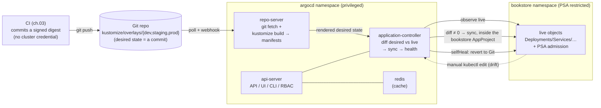

# 04 — GitOps with Argo CD

> **GitOps** makes Git the single source of truth: the desired state is a
> commit, an in-cluster agent pulls it, diffs it against live and reconciles.
> **Argo CD** is that agent, and it is the most privileged thing in the
> cluster. It writes every object a project allows and it holds the keys to
> every repository it reads. This chapter fences it: an AppProject for each
> trust level, Argo RBAC mapped from SSO groups, no admin password, read-only
> repository credentials, a manual gate on production and a root Application
> the tenant cannot write to. It reconciles the Bookstore's Kustomize overlays
> from [ch.02](02-packaging-kustomize.md), which [ch.03](03-cicd-pipeline.md)
> promotes by digest, and recovers by `git revert`.

**Estimated time:** ~30 min read · ~90 min hands-on
**Prerequisites:** [Part 07 ch.02](02-packaging-kustomize.md): the overlays Argo will reconcile · [Part 07 ch.03](03-cicd-pipeline.md): CI commits the digests Argo deploys · [Part 05 ch.01](../05-security/01-authn-authz-rbac.md): RBAC, which Argo's own RBAC follows · [Part 01 ch.01](../01-core-workloads/01-pods.md#baseline): the baseline the chart's pods are checked against
**You'll know after this:** • explain why the GitOps controller is a privileged system and fence it with AppProjects · • install Argo CD from a pinned chart with the local admin disabled and SSO in front · • write Argo RBAC so developers can sync dev and staging but not production · • keep production behind a manual sync and say why auto-sync is a blast radius · • recover by `git revert`, and say what a Git-only rollback cannot undo

<!-- tags: gitops, argo-cd, platform-engineering, ci-cd, drift, security -->

## Why this exists

[ch.01](01-packaging-helm.md) and [ch.02](02-packaging-kustomize.md) packaged
the Bookstore. [ch.03](03-cicd-pipeline.md) built a pipeline whose last act is
a commit: `kustomize edit set image …@sha256:<DIGEST>` into the prod overlay,
not a `kubectl apply`. This chapter is the other half of that seam, the
controller that turns the commit into running Pods.

The alternative is **push-based CD**, where CI holds a kubeconfig and runs
`kubectl apply` or `helm upgrade`. It has four problems, and the last one is
the security one:

1. **The cluster's truth is unknowable.** "What is running, and does it match
   what we intended?" has no answer when the truth is "whatever sequence of
   applies some pipeline ran".
2. **Drift is silent.** Someone runs `kubectl edit` at 2am to stop an incident
   and never reverts it. The next deploy may or may not overwrite it.
3. **CI holds production's keys.** A long-lived, broadly scoped kubeconfig in
   a CI secret can do anything to production, on every run.
4. **Rollback is improvised.** "Put it back to before the 14:00 deploy" means
   rebuilding an apply history nobody recorded.

**GitOps** inverts the direction. The desired state is declarative and lives
in Git, and an agent inside the cluster pulls it. CI holds no cluster
credential. The price is that the agent holds the credential instead, so the
agent becomes the target. This chapter is where that is secured.

## Mental model

**GitOps = a control loop whose desired state is a Git commit and whose
controller runs inside the cluster.**

- **Declarative.** The whole Bookstore is data (the Kustomize overlays), not a
  sequence of commands. "What should run" is a file, not a runbook.
- **Versioned.** That data lives in Git. Every change is a commit: reviewable,
  attributable, revertible. The deployed version is a Git SHA.
- **Pulled, not pushed.** An in-cluster agent reads Git and applies it.
  Nothing outside the cluster needs apply rights.
- **Continuously reconciled.** The agent fetches Git, renders it, diffs
  desired against live and syncs when they differ. Every few minutes and on a
  webhook. With `selfHeal` on, a manual `kubectl edit` is reverted too.
- **Git is the only write path.** Deploy is a commit. Rollback is `git revert`.
  Promotion is a commit that moves a digest. Disaster recovery is pointing a
  fresh Argo CD at the same Git.

**The controller is privileged, and that is the security model.** The chart's
application controller holds a ClusterRole with `*` on `*`, which is
cluster-admin in all but name. The API server holds a role that can get,
patch and delete any resource. Argo RBAC decides who may ask the controller to
do something. The AppProject decides what Git may ask it to write. Those two
fences are what this chapter builds, because the default install has neither.

The trap to keep in view: GitOps makes **Git the production control plane**,
so a plaintext Secret committed to Git is a plaintext Secret in your control
plane forever, because Git history is immutable too. The rule is **never
plaintext secrets in Git**: use Sealed Secrets, SOPS or External Secrets.
[Part 03 ch.02](../03-config-and-storage/02-secrets.md) gave the first warning
about demo Secrets, and GitOps makes it permanent.

## Threats and controls

Argo CD sits between Git and the cluster, so each threat below is a way one of
those two sides can be abused. The Pod-level baseline of the chart's own
components is [01.01](../01-core-workloads/01-pods.md#baseline).

| Threat | Control taught here | Goes deeper |
|---|---|---|
| The controller writes whatever Git asks, and its own RBAC allows any object | AppProjects fence what Git can ask for: destinations, kind allow-lists, no Argo kinds in the tenant project | admission, [05.07](../05-security/07-admission-control-and-policy-as-code.md) |
| A user syncs production, or edits a project they do not own | Argo RBAC by project, action and object, mapped from SSO groups, with no default access | [05.01](../05-security/01-authn-authz-rbac.md) |
| A standing admin password on the most privileged UI in the cluster | `admin.enabled: false`, so SSO is the only way in | [05.01](../05-security/01-authn-authz-rbac.md) |
| A repository credential that can push, or that reaches every repo | Read-only deploy key or GitHub App per repo; the credential is a Secret in the Argo namespace, so reading that namespace reads every repository credential | [03.02](../03-config-and-storage/02-secrets.md) |
| A merged commit reaches production with no human in the loop | Prod has no `automated` block; a platform role runs `argocd app sync` | [07.03](03-cicd-pipeline.md) |
| A commit under the tenant's path rewrites its own project | The root and the project objects belong to a `platform` project; the tenant project holds no Argo kinds | this chapter |
| A plaintext Secret in Git becomes permanent | Never plaintext in Git; SOPS, Sealed Secrets or External Secrets | [15.05](../15-day-to-day-production-ops/05-production-secrets-vault-eso.md) |
| Auto-sync fights the HPA, or erases an incident mitigation | `ignoreDifferences` on replicas; a mitigation becomes a commit | [07.05](05-progressive-delivery.md) |

This chapter secures the controller and its fences. It does not secure the
workloads the controller renders. [07.03](03-cicd-pipeline.md) checks their
manifests in CI, and admission (05.07) enforces them at the API server.

## Diagrams

### The GitOps reconcile loop and its trust boundaries (Mermaid)



### The App-of-Apps tree with two projects (ASCII)

```
 PLATFORM owns the root. TENANT owns the children.
   kubectl apply -n argocd -f argocd/00-appproject.yaml      (both projects)
   kubectl apply -n argocd -f argocd/01-app-of-apps.yaml     (the one bootstrap)
        │
   Application: bookstore-root     project: platform (may create Applications)
        │   source.path = argocd/apps/   ← the trust anchor: protect this path
        ├── Application: bookstore-dev      project: bookstore  automated
        ├── Application: bookstore-staging  project: bookstore  automated
        └── Application: bookstore-prod     project: bookstore  MANUAL sync
                                              ▲
                                              └─ a reviewed promotion, then a
                                                 platform role runs the sync

   The bookstore project may create the Bookstore's workload kinds in the
   bookstore namespace. It may not create Application or AppProject objects.
```

## Hands-on with the Bookstore

**Assumed working directory: the guide repository root (`full-guide/`).** The
chapter adds the [`examples/bookstore/argocd/`](../examples/bookstore/argocd/)
tree and operates it. It does not change the Kustomize tree: Argo CD consumes
[ch.02](02-packaging-kustomize.md)'s overlays unchanged.

> **What the captured run covers.** The
> [transcript](../examples/security-lab/evidence/07-04.txt) is the record.
> It came from a lab cluster with another name, and it used another namespace
> name, both recorded in its header. The first install attempt failed on a
> pre-install Job, and the lab identity was refused and then unreachable for a
> while. On retry the install succeeded, and the RBAC, admin and AppProject
> checks ran against it. Where a step below says **not run**, the lab did not
> reach it, and the claim rests on the cited upstream documentation.

### 1. Pin the chart and install with the secure values

Pin the chart by version and read it before you install it. The version is the
one the lab rendered, and its application version is `v3.5.6`:

```sh
helm show chart oci://ghcr.io/argoproj/argo-helm/argo-cd --version 10.11.6 \
  2>&1 | grep -E "^(name|version|appVersion|description|kubeVersion):"
```

<!-- gate: output -->

```text
appVersion: v3.5.6
description: A Helm chart for Argo CD, a declarative, GitOps continuous delivery tool
kubeVersion: '>=1.25.0-0'
name: argo-cd
version: 10.11.6
```

The values set the controls the chart exposes. Save them as
`argocd-values.yaml`:

```yaml
configs:
  cm:
    url: https://argocd.example.com        # replace with your Argo CD URL
    admin.enabled: false                   # no local admin account
    oidc.config: |
      name: SSO
      issuer: https://sso.example.com      # your OIDC provider
      clientID: argocd
      requestedScopes: ["openid", "profile", "email", "groups"]
  rbac:
    policy.default: ""                     # no access unless a group maps to a role
    policy.csv: |
      p, role:bookstore-viewer, applications, get, bookstore/*, allow
      p, role:bookstore-syncer, applications, get, bookstore/*, allow
      p, role:bookstore-syncer, applications, sync, bookstore/bookstore-dev, allow
      p, role:bookstore-syncer, applications, sync, bookstore/bookstore-staging, allow
      p, role:platform-admin, applications, *, */*, allow
      g, bookstore-developers, role:bookstore-viewer
      g, bookstore-developers, role:bookstore-syncer
      g, bookstore-platform, role:platform-admin
    scopes: "[groups]"
dex:
  enabled: false                           # OIDC direct, no bundled Dex
notifications:
  enabled: false
applicationSet:
  replicas: 0                              # no ApplicationSets in this chapter
repoServer:
  automountServiceAccountToken: false      # reads Git and renders; no API calls
redis:
  automountServiceAccountToken: false
```

Each line answers a threat from the table. `admin.enabled: false` removes the
built-in account. `policy.default: ""` means a user with no matching group gets
nothing. `dex` and `notifications` are off, so there are fewer components to
secure. The ApplicationSet controller runs no pods, because nothing here uses
one. The repo-server and redis do not need the API token, so the chart does not
mount it. The chart's pods set the container fields of the baseline:
`runAsNonRoot`, `seccompProfile: RuntimeDefault`, `capabilities.drop: ALL`,
`allowPrivilegeEscalation: false` and `readOnlyRootFilesystem`. Redis sets its
pod-level fields too.

Create the namespace and label it first. Label it at the strictest level the
components work under, and `restricted` is the target:

```sh
kubectl create namespace argocd
kubectl label namespace argocd \
  pod-security.kubernetes.io/enforce=restricted \
  pod-security.kubernetes.io/audit=restricted \
  pod-security.kubernetes.io/warn=restricted
helm install argocd oci://ghcr.io/argoproj/argo-helm/argo-cd@sha256:90f462a0695121f65a71cd053619f80023b4efef6bc211f750ffcaaa1628b5b6 \
  -n argocd -f argocd-values.yaml --wait
```

The captured run installed by version 10.11.6, and the digest in the output
below is the one Helm pulled for that version. The command above names that
digest directly, so the artifact you install is the one you reviewed in the
section 1b check of [ch.01](01-packaging-helm.md).

The captured output in this chapter came from Helm v4.1.4, the client the lab
had. [Chapter 01](01-packaging-helm.md) uses Helm v3.22.1. The commands are the
same, but the two versions word some errors differently, so expect Helm 4
wording in the output below.

The first attempt failed. The pre-install Job timed out, and the captured
error is below. The Job's pod was admitted under `restricted`, so the namespace
label did not block it. Its container then crashed on a TLS timeout to the API
service, which is a cluster problem and not a chart problem.

<!-- gate: output -->

```text
Pulled: ghcr.io/argoproj/argo-helm/argo-cd:10.11.6
Digest: sha256:90f462a0695121f65a71cd053619f80023b4efef6bc211f750ffcaaa1628b5b6
Error: INSTALLATION FAILED: failed pre-install: resource Job/p07-04-argocd/argocd-redis-secret-init not ready. status: InProgress, message: Job in progress
context deadline exceeded
```

The second attempt installed cleanly. The four Argo components were running:

<!-- gate: output -->

```text
NAME                                  READY   STATUS    RESTARTS        AGE
argocd-application-controller-0       1/1     Running   0               5m12s
argocd-redis-598cc56dc4-4q76k         1/1     Running   0               5m12s
argocd-repo-server-59b65b86b9-68wlf   1/1     Running   0               5m12s
argocd-server-7b4c5bdf58-b426h        1/1     Running   1 (3m20s ago)   5m12s
```

The captured install named the chart by version, and the helm pull printed
the digest that version resolved to, so a reader can compare it with the
registry. The server restarted once during the install. Read its logs if that happens
to you, rather than treating a restart as normal.

### 2. Read the blast radius before you trust the controller

The render shows what the controller may write. This needs no cluster:

```sh
helm template argocd oci://ghcr.io/argoproj/argo-helm/argo-cd@sha256:90f462a0695121f65a71cd053619f80023b4efef6bc211f750ffcaaa1628b5b6 \
  -n argocd -f argocd-values.yaml \
  | sed -n '/^kind: ClusterRole$/,/^---$/p' | sed -n '/^rules:/,$p' | head -10
```

<!-- gate: output -->

```text
rules:
  - apiGroups:
    - '*'
    resources:
    - '*'
    verbs:
    - '*'
  - nonResourceURLs:
    - '*'
    verbs:
```

That is the controller's ClusterRole with every verb on every resource. The
AppProject below does not change it. The AppProject limits what Git may
ask the controller to write, while this rule limits what a compromised
controller can do. The chart can narrow it through `controller.clusterRoleRules`,
and this chapter leaves that value at its default. A narrower rule set must
cover every kind the three overlays reconcile, and a set that is too narrow
stops the reconcile loop. The lab ran no sync, so it cannot show that a
narrower set works. The wildcard is therefore an accepted risk for this lab
install only, for the reason just given, until 2027-04-30, when the install is
reviewed again. It is not accepted for production.

The API server's role is also wide. Its own rules include a wildcard on
resources, with `get`, `patch` and `delete`:

```sh
helm template argocd oci://ghcr.io/argoproj/argo-helm/argo-cd@sha256:90f462a0695121f65a71cd053619f80023b4efef6bc211f750ffcaaa1628b5b6 \
  -n argocd -f argocd-values.yaml \
  | awk 'BEGIN{RS="\n---\n"} /\nkind: ClusterRole\n/ && /name: argocd-server\n/' \
  | sed -n '/^rules:/,$p' | head -24
```

<!-- gate: output -->

```text
rules:
  - apiGroups:
      - '*'
    resources:
      - '*'
    verbs:
      - delete  # supports deletion a live object in UI
      - get     # supports viewing live object manifest in UI
      - patch   # supports `argocd app patch`
```

The comments in the chart explain why: the UI reads and edits live objects.
That is also why the Argo namespace is the most sensitive namespace in the
cluster, and why a reader should treat its Secrets as cluster-admin material.

### 3. SSO in front, and Argo RBAC behind it

With `admin.enabled: false`, the only way in is the SSO provider. The
`oidc.config` block names an issuer and asks for the `groups` scope, so the
token carries group membership. `scopes: "[groups]"` tells Argo RBAC to read
that claim. The mapping is the part you own:

- `bookstore-developers` gets `bookstore-viewer` and `bookstore-syncer`. A
  syncer can sync `bookstore-dev` and `bookstore-staging` and nothing else.
- `bookstore-platform` gets `platform-admin`, the only role that can sync
  `bookstore-prod`.

Argo RBAC object format is `<project>/<application>`, so the `bookstore/*`
rules cover every Application in the project. The policy format and the
`policy.default` behaviour are in the upstream RBAC reference
(<https://argo-cd.readthedocs.io/en/stable/operator-manual/rbac/>).

Test the mapping without a login. Argo CD can evaluate its own policy:

```sh
kubectl -n argocd exec deploy/argocd-server -- \
  argocd admin settings rbac can role:bookstore-syncer sync applications bookstore/bookstore-prod
kubectl -n argocd exec deploy/argocd-server -- \
  argocd admin settings rbac can role:bookstore-syncer sync applications bookstore/bookstore-dev
```

The command prints `Yes` or `No`, and a denial exits with status 1. The lab
ran the production check, the dev check, and a viewer asking to sync dev. The
syncer is denied production and allowed dev. The viewer is denied the sync:

<!-- gate: output -->

```text
No
```

<!-- gate: output -->

```text
Yes
```

<!-- gate: output -->

```text
No
```

On the initial admin secret. Setting `admin.enabled: false` removes the built-in
account from use. The lab checked both the flag and the secret:

```sh
kubectl -n argocd get configmap argocd-cm -o jsonpath='{.data.admin\.enabled}{"\n"}'
kubectl -n argocd get secret argocd-initial-admin-secret
```

<!-- gate: output -->

```text
false
```

<!-- gate: output -->

```text
Error from server (NotFound): secrets "argocd-initial-admin-secret" not found
```

The chart did not create the password secret, so there is no initial password
to find. Upstream describes the admin account and its disablement in
<https://argo-cd.readthedocs.io/en/stable/operator-manual/user-management/>.

### 4. Apply the two AppProjects

The file
[`argocd/00-appproject.yaml`](../examples/bookstore/argocd/00-appproject.yaml)
holds two AppProjects, and the platform team owns it. Nothing syncs it.

```sh
kubectl apply -n argocd -f examples/bookstore/argocd/00-appproject.yaml
kubectl get appprojects -n argocd
```

The lab applied both projects, with the namespace changed to its own, and then
listed them. The `default` project is the one Argo CD creates on install:

<!-- gate: output -->

```text
Warning: metadata.finalizers: "resources-finalizer.argocd.argoproj.io": prefer a domain-qualified finalizer name including a path (/) to avoid accidental conflicts with other finalizer writers
appproject.argoproj.io/platform created
appproject.argoproj.io/bookstore created
```

<!-- gate: output -->

```text
NAME        AGE
bookstore   1s
default     2m32s
platform    1s
```

The **`bookstore`** project is the tenant. Three choices make it a fence:

- **Destinations are one namespace.** Only `bookstore` on the in-cluster API
  accepts a workload.
- **Cluster-scoped kinds are two.** `Namespace` and `PriorityClass`, the two
  kinds the base ships. Argo CD refuses any other cluster-scoped kind, so a
  tenant cannot create a CRD or a ClusterRole. A kind cannot name an object,
  though: a commit can still name a second Namespace. Name-level control is
  admission's job, in 05.07.
- **Namespaced kinds are an allow-list.** The allow-list lists the sixteen
  kinds the three overlays render, and no Argo kind. A tenant commit cannot
  create an `Application` or an `AppProject`, and that is what stops a
  tenant from rewriting its own fence.
  The Argo Rollouts kinds (`Rollout`, `AnalysisTemplate`) are not in this list,
  and [ch.05](05-progressive-delivery.md) says what adding them would widen.

The **`platform`** project holds the root Application and nothing else. It
may create Application objects in `argocd`, and it allows no cluster-scoped
kind. Only the root creates Applications. The tenant can never do that.

The fence is real only if Argo CD refuses an Application outside it. The
projects page sets the rule: a destination is valid only when an allow rule
permits it and no deny rule rejects it
(<https://argo-cd.readthedocs.io/en/stable/user-guide/projects/>). A child
Application that names a namespace outside `bookstore` is therefore refused.
The platform project lets the root manage Application objects in `argocd` and
nothing else. The reader should prove the first case with the deliberate
failure below. It is a probe Application that targets `kube-system`. Apply it,
then check that its status reports a destination error and that nothing is
synced:

```yaml
# Deliberate failure: the destination is outside the bookstore project.
# Replace your-org in repoURL. The project allows that repository, so only
# the destination is refused.
apiVersion: argoproj.io/v1alpha1
kind: Application
metadata:
  name: probe-kube-system
  namespace: argocd
spec:
  project: bookstore
  source:
    repoURL: https://github.com/your-org/bookstore.git   # PLACEHOLDER
    targetRevision: main
    path: examples/bookstore/kustomize/overlays/dev
  destination:
    server: https://kubernetes.default.svc
    namespace: kube-system
```

The lab applied a probe Application with the same project and destination
namespace. Its file was not kept, and its repository was the one the project
allows, so only the destination was out of scope. Argo CD refused it at
validation, before any sync:

<!-- gate: output -->

```text
[{"lastTransitionTime":"2026-10-31T03:21:39Z","message":"application destination server 'https://kubernetes.default.svc' and namespace 'kube-system' do not match any of the allowed destinations in project 'bookstore'","type":"InvalidSpecError"}]
```

The status reads `InvalidSpecError`, and the probe's sync status stayed
`Unknown`. The lab removed the probe afterwards.

> **Not run.** The kind-level refusal, a ClusterRole or a CRD that the project
> does not allow, needs a Git source with that object in it. The lab had none,
> so the check is still to do. The destination refusal above is what ran.

### 5. Production is a reviewed promotion followed by a sync

The development and staging Applications sync automatically. Production has
no `automated` block. Argo CD still shows the drift, and a platform role runs
the sync after reading the diff:

```sh
grep -n automated examples/bookstore/argocd/apps/*.yaml
```

<!-- gate: output -->

```text
examples/bookstore/argocd/apps/bookstore-dev.yaml:42:    automated:
examples/bookstore/argocd/apps/bookstore-prod.yaml:7:# reviews the diff and syncs prod (no automated sync; see syncPolicy below).
examples/bookstore/argocd/apps/bookstore-prod.yaml:40:  # NO `automated` block, on purpose. Argo CD shows the drift and waits. A
examples/bookstore/argocd/apps/bookstore-staging.yaml:35:    automated:
```

The output is the whole check. Production shows no `automated:` key. The two
comment lines match the word but not the key. The gate that protects prod is
the commit review plus the sync role, and it is not an automation flag.

Why this matters: with `automated`, a commit that reaches the branch is a
deploy within minutes. The branch then becomes the production approval, and a
compromised `main` ships. Upstream describes automated sync, prune and
self-heal in <https://argo-cd.readthedocs.io/en/stable/user-guide/auto_sync/>.
Without an `automated` block, Argo CD syncs only when someone asks it to, and
production keeps that behaviour.

Two properties of the manifest go with it. Production keeps the catalog HPA,
so `ignoreDifferences` on `/spec/replicas` stops Argo from fighting the
autoscaler. And `PruneLast=true` deletes old objects only after the new
revision is healthy.

### 6. Repository credentials: read-only, one per repo

Argo CD reads Git with a credential it stores as a Secret in its own
namespace. Three rules follow.

- **Read-only.** A deploy key with read access, or a GitHub App with
  `contents: read`. A token that can push turns the controller's read path
  into a write path.
- **One per repository.** A credential that reaches every repository lets one
  leak read everything. Scope it to the one repo that the project allows.
- **Not an admin's password.** Whoever can read the Argo namespace's Secrets
  holds every repository credential in it, so that namespace gets the
  strictest RBAC in the cluster.

Add a repository with a read-only credential and the project's `sourceRepos`
list. No repository was added in the lab, so this step is **not run**.

### 7. Drift and rollback: a commit is the only fix

With `selfHeal` on, a manual `kubectl edit` is reverted at the next
reconciliation, because Git is the truth. That is the feature. The cost is
that an incident mitigation done by hand disappears quietly. The rule is to
write the mitigation into Git as a commit, then let the loop deploy it.

Rollback is `git revert`. The revert is a new commit, the loop reconciles it,
and the repository and the cluster never disagree. Argo keeps its own history
of synced revisions, and `argocd app rollback` can go back to one. The durable
record is still Git, so prefer the revert.

> **Not run.** Both need a Git remote the lab did not have and a sync that did
> not run. The mechanism is upstream behaviour, and it is cited above.

### 8. Sync waves and hooks: the migration runs before the app

[ch.01](01-packaging-helm.md)'s chart ran the schema migration as a Helm hook.
Argo CD orders a sync with waves and hooks, set as annotations on the object:

```yaml
metadata:
  annotations:
    argocd.argoproj.io/hook: PreSync
    argocd.argoproj.io/hook-delete-policy: BeforeHookCreation
    # or order ordinary objects with a wave; lower runs first:
    # argocd.argoproj.io/sync-wave: "-1"
```

A `PreSync` Job runs to completion before the objects in the same sync. The
base applies its migration Job as an ordinary object, and the migration is
idempotent, so this is not required for correctness. It is the idiomatic way
to guarantee the order under Argo CD. This fragment is not applied, so it has
no `kind:`.

### 9. Clean up what the install left

The chart installs the CRDs first. Remove the install, then the CRDs it left,
and the namespace. Deleting the CRDs deletes every Application in the cluster,
so run this only on a cluster where Argo CD is yours alone.

```sh
helm uninstall argocd -n argocd
kubectl delete crd applications.argoproj.io appprojects.argoproj.io applicationsets.argoproj.io
kubectl delete namespace argocd
```

Delete the AppProjects and Applications before the uninstall if you can. Once
the controller is gone, an object with the Argo finalizer never clears, and the
CRD and namespace deletes hang. The lab hit exactly that. It removed the
finalizer with `kubectl patch ... --type merge -p '{"metadata":{"finalizers":null}}'`,
on its own objects only, and then the deletes finished.

## How it works under the hood

- **The components and their jobs.** The **api-server** serves the API, UI
  and CLI, and enforces Argo's RBAC. The **repo-server** clones Git and renders
  the source, which for the Bookstore is `kustomize build` (the
  [ch.02](02-packaging-kustomize.md) pipeline), or `helm template` for a Helm
  source. The **application-controller** is the reconcile loop: it compares
  rendered desired state with live, computes a diff, syncs when they differ,
  and reports sync status and health. **redis** caches rendered manifests.
  **dex** is optional SSO, and this chapter turns it off in favour of OIDC
  direct.
- **The reconcile loop.** Every few minutes, and on a webhook, the controller
  fetches the target revision, renders it, and compares it with live. It
  compares structured objects and ignores fields the server defaults. It
  applies a difference when `syncPolicy.automated` is set. `selfHeal: true`
  also re-applies when live drifts, which is what reverts a manual edit, and
  `prune: true` deletes live objects that Git no longer declares.
- **Why a deterministic source matters.** [ch.02](02-packaging-kustomize.md)
  built the overlays to render deterministically, with the default RootOnly
  loader and a vendored base. A non-deterministic render would diff against
  itself every loop, which is permanent false `OutOfSync`. A source that needs
  loader flags would fail in the repo-server as it fails in `kubectl apply -k`.
- **`Application` versus `AppProject`.** An **Application** is one
  source-to-destination reconciliation unit. An **AppProject** is the trust
  boundary a set of Applications runs inside: allowed repositories,
  destinations, cluster and namespaced kinds, and project roles. The
  controller refuses any Application that strays outside its project.
- **Why an allow-list, not a deny-list.** A deny-list fails open: any kind
  that is not on it is allowed, including the next kind a CRD adds. An
  allow-list fails closed, so a new kind stays refused until someone lists it.
  The cost is maintenance. An overlay change that adds a kind is also an
  AppProject change, and the sixteen kinds above are the set the three
  overlays render today.
- **Why the root belongs to its own project.** The root syncs a directory of
  Application manifests. Whoever can commit to that directory chooses every
  child's project and source. If the tenant project could create Applications,
  a tenant commit could create one in project `default`, which allows
  everything. The `platform` project is the only one that creates Applications,
  and the protection of `argocd/apps/` is the trust anchor. In the same repo as
  the tenant, use CODEOWNERS and a ruleset that requires platform review. In
  production, move that path to a repository the tenant cannot write to.
- **ApplicationSet.** An ApplicationSet is a controller that turns a generator
  into many Applications. It is another write path that creates Application
  objects, so it needs the same project fence. This chapter sets its replicas
  to zero, since nothing uses it.
- **Sync waves and hooks.** Argo orders a sync by wave (ascending) and by the
  PreSync, Sync and PostSync phases. This is the Argo form of
  [ch.01](01-packaging-helm.md)'s migration hook.
- **Health and status.** Sync status ("does live equal Git?") and health ("is
  what runs OK?") are separate, and both are surfaced. A Deployment is Healthy
  when its rollout completes.

## Production notes

> **In production: never commit plaintext Secrets.** The prod overlay deletes
> the demo `db-credentials`. A Secret of the same name is supplied out of band
> by Sealed Secrets, SOPS or External Secrets Operator. Plaintext in Git is
> plaintext in the control plane for as long as the history exists.

> **In production: separate the config repo from the app repo.** CI commits
> digests to the config repo without touching code. Production config then
> needs its own approval path, and the root's path lives where the tenant
> cannot write.

> **In production: SSO and groups, not accounts.** Map every group to a role,
> keep `policy.default` empty, and run the `argocd admin settings rbac can`
> checks in step 3 in CI, so a policy edit that loosens access fails the
> build.

> **In production: multi-cluster and progressive sync.** One Argo CD can manage
> many clusters. An ApplicationSet with a cluster generator and a progressive
> sync strategy rolls a change cluster by cluster, which is the fleet-level
> analogue of [ch.05](05-progressive-delivery.md)'s canary.

> **In production: disaster recovery is "re-point Argo at Git".** Recovering a
> lost cluster is: create a cluster, install Argo CD from the pinned chart,
> apply the two AppProjects and the root, and wait. Git is the source of truth.
> Stateful data, such as the postgres volume, still needs its own backup
> ([Part 08 ch.02](../08-day-2-operations/02-backup-and-dr.md)).

## Quick Reference

```sh
# Pin and install Argo CD, with the local admin disabled
helm show chart oci://ghcr.io/argoproj/argo-helm/argo-cd --version 10.11.6
kubectl create namespace argocd
kubectl label namespace argocd pod-security.kubernetes.io/enforce=restricted
helm install argocd oci://ghcr.io/argoproj/argo-helm/argo-cd@sha256:90f462a0695121f65a71cd053619f80023b4efef6bc211f750ffcaaa1628b5b6 \
  -n argocd -f argocd-values.yaml --wait

# Fence, then bootstrap (platform applies both; no tenant credential)
kubectl apply -n argocd -f examples/bookstore/argocd/00-appproject.yaml
kubectl apply -n argocd -f examples/bookstore/argocd/01-app-of-apps.yaml

# Operate
argocd app list
argocd app diff bookstore-prod                # desired (Git) vs live
argocd app sync bookstore-prod                # a platform role, after review
kubectl -n argocd exec deploy/argocd-server -- \
  argocd admin settings rbac can role:bookstore-syncer sync applications bookstore/bookstore-prod
argocd app history bookstore-dev              # rollback = git revert, not this
```

The production Application's `spec`: a project, a source, and no `automated`
block. The full object is in
[`apps/bookstore-prod.yaml`](../examples/bookstore/argocd/apps/bookstore-prod.yaml).

```yaml
spec:
  project: bookstore                              # the tenant fence
  source:
    repoURL: https://github.com/your-org/bookstore.git
    targetRevision: main
    path: examples/bookstore/kustomize/overlays/prod
  destination: { server: https://kubernetes.default.svc, namespace: bookstore }
  syncPolicy:
    syncOptions: [ CreateNamespace=false, PruneLast=true ]   # no automated
  ignoreDifferences:                              # the HPA owns replicas
    - { group: apps, kind: Deployment, name: catalog, jsonPointers: [ /spec/replicas ] }
```

Checklist:

- [ ] The chart is pinned by digest, and the install is labelled `restricted`
      and confirmed on a live cluster.
- [ ] `admin.enabled: false`, SSO on, `policy.default` empty, groups mapped to
      roles.
- [ ] The controller's ClusterRole is wide. Section 2 records it as an accepted
      risk for the lab install only, with its expiry.
- [ ] Two AppProjects: the tenant holds no Argo kinds and an allow-list of
      namespaced kinds; the platform owns the root.
- [ ] The root's path is protected by review, and the tenant cannot write to it.
- [ ] Prod has no `automated` block; dev and staging do.
- [ ] Repository credentials are read-only and scoped to one repository.
- [ ] No plaintext Secret in Git.

## Test your understanding

> Try each before opening the answer drawer. The act of trying is the exercise; the answer is the check.

1. **A developer on the `bookstore-developers` group can sync dev. Name the three policy lines that let that happen, and say which line stops them syncing prod.**
   <details><summary>Show answer</summary>

   The three lines are the grant `g, bookstore-developers, role:bookstore-syncer`, the read line `p, role:bookstore-syncer, applications, get, bookstore/*, allow` that lets the group see the Applications, and the dev sync line `p, role:bookstore-syncer, applications, sync, bookstore/bookstore-dev, allow`. No line permits a sync of prod: prod is not in any sync line for that role. The absence is the control: `policy.default` is empty, so an action with no matching line is denied.

   </details>

2. **An operator runs `kubectl edit deployment catalog -n bookstore` at 2am to stop an incident. Dev has `selfHeal: true`. What happens at the next reconcile, and why is that both good and a risk?**
   <details><summary>Show answer</summary>

   The controller sees live differ from Git and reverts the edit. The good part is that the cluster stays the way Git says. The risk is that the mitigation disappears without a record, in the middle of an incident. The fix is to commit the mitigation first, then let the loop deploy it. Upstream describes self-heal in the auto-sync page.

   </details>

3. **The HPA on catalog sets `spec.replicas` to 5, and Git says 3. Without `ignoreDifferences`, what happens?**
   <details><summary>Show answer</summary>

   Argo and the autoscaler fight. Argo resets the count to 3, the HPA sees load and sets it back to 5, and the loop never settles. `ignoreDifferences` on `/spec/replicas` hands that one field to the HPA and leaves the rest of the object under Git.

   </details>

4. **A tenant commits an Application manifest into `argocd/apps/` that names project `default` and a repo of the tenant's choice. Why does the tenant project not stop it, and what does?**
   <details><summary>Show answer</summary>

   The `bookstore` project forbids creating Application objects, but the root syncs `argocd/apps/` from the `platform` project, which may create them. The root is the one that creates the child. The only control is who can commit to that path: CODEOWNERS and a ruleset that requires platform review, or a separate repo the tenant cannot write to. A deny-list in the tenant project cannot close this, which is why the project is an allow-list.

   </details>

5. **Argo's own ClusterRole grants `*` on `*`. Does the AppProject fence reduce that? Say what each fence limits.**
   <details><summary>Show answer</summary>

   No. The AppProject limits what Git may ask the controller to write: destinations, cluster and namespaced kinds, and which Argo kinds a tenant can create. The ClusterRole limits what a compromised controller can do, and it stays wide here. Narrowing it through `controller.clusterRoleRules` is a separate control, with its own test. Section 2 records the accepted risk and its expiry.

   </details>

## Further reading

- **_Argo CD Up & Running_ (O'Reilly).** The primary reference for the App,
  Project and sync model, RBAC, and App-of-Apps and ApplicationSet at scale.
- **Rosso et al., _Production Kubernetes_, ch.11, Building Platform Services.**
  GitOps as the delivery interface of an internal platform.
- Argo CD docs: <https://argo-cd.readthedocs.io/en/stable/>. The sections used
  here are declarative setup
  (<https://argo-cd.readthedocs.io/en/stable/operator-manual/declarative-setup/>),
  RBAC (<https://argo-cd.readthedocs.io/en/stable/operator-manual/rbac/>), user
  management (<https://argo-cd.readthedocs.io/en/stable/operator-manual/user-management/>),
  projects (<https://argo-cd.readthedocs.io/en/stable/user-guide/projects/>),
  auto-sync (<https://argo-cd.readthedocs.io/en/stable/user-guide/auto_sync/>)
  and sync waves (<https://argo-cd.readthedocs.io/en/stable/user-guide/sync-waves/>).
- The GitOps principles from the CNCF OpenGitOps project: <https://opengitops.dev/>.
