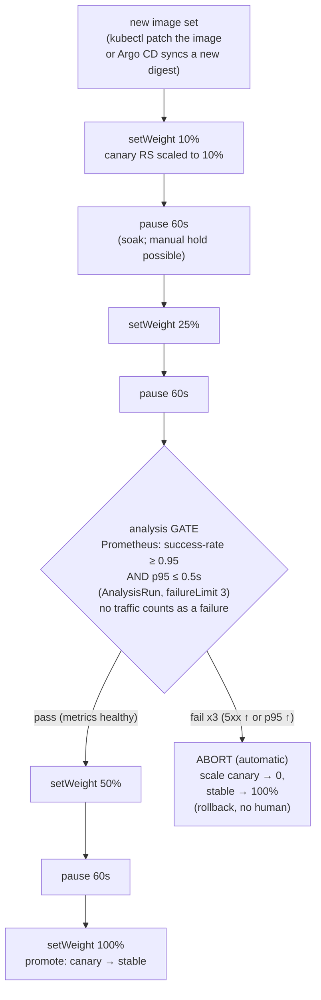

# 05 — Progressive delivery

> Why a RollingUpdate is **not** a safe release (it shifts 100% of users onto
> unverified code, just gradually); **blue-green vs canary vs experiment**;
> **Argo Rollouts** architecture (the `Rollout` CRD replacing a Deployment,
> ReplicaSet management, traffic routing options, the controller); **analysis**
> (`AnalysisTemplate`/`AnalysisRun`, metric providers — **Prometheus** using
> the Part 06 catalog metrics: success-rate = 1−rate(5xx)/rate(total), p95 from
> the duration histogram), automated promotion and **automated rollback on
> failed analysis**; **Flagger** as the mesh-operator alternative; the
> **Argo CD + Rollouts** story (a `Rollout` is just a CRD Argo syncs); manual
> gates; metric honesty — applied by converting the **catalog** Deployment
> ([ch.04](04-gitops-argocd.md) syncs it) into a metric-gated canary `Rollout`
> with automatic rollback.

**Estimated time:** ~30 min read · ~90 min hands-on
**Prerequisites:** [Part 07 ch.04](04-gitops-argocd.md) — Argo syncs the `Rollout` CRD just like a Deployment · [Part 01 ch.08](../01-core-workloads/08-deployment-strategies.md) — RollingUpdate gradually shifts 100% of users · [Part 06 ch.01](../06-production-readiness/01-observability-metrics.md) — Prometheus is the analysis-metric source · [Part 05 ch.03](../05-security/03-supply-chain.md) — a canary does not verify signatures; admission does
**You'll know after this:** • distinguish blue-green, canary and experiment release strategies · • convert a Deployment into an Argo Rollouts `Rollout` with traffic steps · • write `AnalysisTemplate`/`AnalysisRun` against Prometheus (success-rate and p95) · • set up automated promotion and automated rollback on failed analysis · • run the catalog as a metric-gated canary, and watch a silent canary fail closed

<!-- tags: argo-rollouts, gitops, observability, ci-cd -->

## Why this exists

[ch.04](04-gitops-argocd.md) made the Bookstore deploy itself from Git — Argo
CD reconciles the Kustomize overlays, CI ([ch.03](03-cicd-pipeline.md)) commits
signed digests, drift self-heals. But *how* a new catalog image reaches 100% of
users is still the Part 01 ch.08 **RollingUpdate**: `maxSurge: 1,
maxUnavailable: 0` replaces old Pods with new ones, a few at a time, until
**every** request hits the new version. That is a safe *availability*
mechanism (no downtime) — it is **not** a safe *release* mechanism. If the new
catalog image has a latency regression or a 5xx bug, RollingUpdate cheerfully
moves **all** of production onto it; the only feedback is users complaining and
a human racing to `kubectl rollout undo`. "Gradual" is not "verified".

A real release wants the opposite default: send the new version a **small
slice** of traffic, **measure it against the old one** with the very signals
Part 06 ch.01 built (error rate, p95 latency), and **only proceed if the
metrics say it's healthy** — otherwise **roll back automatically, before most
users ever saw it**. That is **progressive delivery**: limit the blast radius,
gate progression on evidence, automate the rollback. Part 01 ch.08 taught the
*manual* form (`30-catalog-canary.yaml`: two Deployments, traffic ≈ replica
ratio, ramp/abort by `kubectl scale`). This chapter automates it and adds the
metric gate — the *Application Considerations* concern; Argo Rollouts is the
tool, with Flagger as the alternative.

## Mental model

**Progressive delivery = a release is a controlled experiment with an
automatic abort, not a state transition.**

- **RollingUpdate vs progressive.** RollingUpdate's goal is *stay available
  while replacing Pods*; progress is unconditional. A **canary** /
  **blue-green** rollout's goal is *prove the new version on a slice before
  committing*; progress is **conditional on metrics**.
- **Three shapes.** **Canary** — run vN+1 alongside vN, send it a growing
  fraction (10→25→50→100%), measure each step, promote or abort.
  **Blue-green** — stand up vN+1 fully (green) beside vN (blue), cut 100% over
  at once after a check, instant rollback by cutting back. **Experiment** —
  run vN+1 (and variants) for a fixed window purely to *measure*, not to
  release (A/B). The Bookstore uses **canary** — the natural successor to Part
  01 ch.08's manual canary.
- **The `Rollout` replaces the Deployment.** Argo Rollouts is a controller +
  the **`Rollout`** CRD. A `Rollout` *is* a Deployment-shaped object (same
  `spec.template` Pod template) plus a `strategy.canary` of **steps**
  (`setWeight`, `pause`, `analysis`). The controller manages the stable and
  canary **ReplicaSets**, scaling them to match the step weights.
- **Analysis is the gate.** An **`AnalysisTemplate`** is a reusable query
  against a **metric provider** (Prometheus here) with a `successCondition`
  and a `failureLimit`. A canary `analysis` step spawns an **`AnalysisRun`**;
  while it passes, the rollout proceeds; when it fails `failureLimit` times,
  the rollout **aborts and the controller automatically scales the canary to
  zero and the stable back to 100%** — automated rollback, no human.
- **It composes with everything prior.** A `Rollout` is just a CRD — Argo CD
  ([ch.04](04-gitops-argocd.md)) syncs it from Git like any object (GitOps +
  progressive delivery, together). The metric queries are the *same PromQL*
  Part 06 ch.01 wrote, restricted to the canary's Pods. The Pod template is
  catalog's *exact restricted* template.

The trap to keep in view: the gate is only as honest as the metrics. A canary
with no traffic emits no errors and no latency, so a naive analysis would
"pass" on silence. The discipline (and the *metric honesty* this chapter is
explicit about): **fail closed** when there is no evidence, **measure the
canary's own Pods** rather than the blend, and **drive real traffic during
analysis**. The demo catalog binary emits `http_requests_total` and a duration
histogram for real. It does not emit **5xx on demand**, so this chapter shows
the silent-canary failure and the passing canary, and leaves the 5xx path to
the query.

## Threats and controls

A canary is a control over how far a build spreads. It limits what a bad build
can do and how long it runs, and it is only as good as the metrics it reads.
Each row names a threat that gets past the canary alone.

| Threat | Control taught here | Goes deeper |
|---|---|---|
| A bad or malicious image reaches every user at once | A staged canary: 10% of the replicas first, then a metric gate. A failed gate scales the canary to 0 | [01.08](../01-core-workloads/08-deployment-strategies.md) for the manual form, [15.06](../15-day-to-day-production-ops/06-progressive-delivery-in-production.md) for production |
| The canary runs a digest nobody verified | Not this chapter. The Rollout runs whatever digest it names, and a canary does not check it. Admission must refuse unsigned digests | [05.03](../05-security/03-supply-chain.md) for signing and the admission policy, [07.03](03-cicd-pipeline.md) for the signed digest, policy as code in 05.07 <!-- link-later: 05.07 --> |
| Analysis passes because nothing was measured | Fail closed: the canary must serve at least one request per second, and no data is a failure | this chapter |
| Stable traffic hides a failing canary | The queries filter on the canary's pod-template hash, so only the canary's Pods are judged | this chapter |
| The gate is weakened by an edit to an AnalysisTemplate or a Rollout | Who may edit either is an RBAC question, and every change goes through the GitOps review | [05.01](../05-security/01-authn-authz-rbac.md), [07.04](04-gitops-argocd.md) |
| The canary is looser than the stable build | The canary's Pod template is the stable template, and the restricted namespace refuses any Pod that lacks the baseline | [01.08](../01-core-workloads/08-deployment-strategies.md), [05.02](../05-security/02-pod-security.md) |

Two limits remain. A canary limits which users get a bad build and for how
long. It does not undo what the build did to them, so a rollback restores code
and not state, which [01.08](../01-core-workloads/08-deployment-strategies.md)
covers for credentials. And a build that stays under the thresholds is
promoted, so the thresholds are part of the security decision.

## Diagrams

### Canary step + analysis-gate progression, with the auto-rollback branch (Mermaid)

The catalog Rollout's actual flow
([`examples/bookstore/argocd/rollouts/catalog-rollout.yaml`](../examples/bookstore/argocd/rollouts/catalog-rollout.yaml)).



### Blue-green vs canary (ASCII)

```
 BLUE-GREEN ─────────────────────────────────────────────────────────────────
   vN (blue)  ████████████  100% traffic
   vN+1(green) ░░░░░░░░░░░░  0%  (fully deployed, idle, smoke-tested)
        │ cutover (flip the Service/route)        rollback = flip back (instant)
   vN (blue)  ░░░░░░░░░░░░  0%
   vN+1(green) ████████████  100%
   + instant switch & rollback   − 2x resources during; blast radius = ALL at cut

 CANARY (the Bookstore) ─────────────────────────────────────────────────────
   vN  ██████████ 90 │ ███████▌ 75 │ █████ 50 │ ░ 0
   vN+1 █ 10         │ ██▌ 25      │ █████ 50 │ ██████████ 100
        └ measure ──┘ └ ANALYSIS ─┘ └ measure┘   promote
   each step gated by metrics; FAIL → auto scale canary→0, stable→100
   + tiny blast radius, evidence-gated   − slower; needs good metrics + traffic

 EXPERIMENT — run variants for a fixed window to MEASURE only (A/B), not release.
```

## Hands-on with the Bookstore

**Tier A (kind).** Run this only against a cluster you own.

**Assumed working directory: the guide repo root (`full-guide/`).** This
chapter adds
[`examples/bookstore/argocd/rollouts/`](../examples/bookstore/argocd/rollouts/)
(the catalog `Rollout` + two `AnalysisTemplate`s). The `Rollout` **replaces**
the catalog Deployment; its Pod template is `10-catalog-deploy.yaml`'s
template **verbatim** (same restricted SC, scheduling layer, probes,
ConfigMap/Secret env, byte-identical `DB_DSN`).

We will: (0) fresh cluster + images; (1) install Argo Rollouts; (2) catalog
prereqs and a trimmed Prometheus; (3) a canary with real traffic that
promotes; (4) a canary with no traffic that fails closed and rolls back. The
outputs marked as captured were recorded on a lab kind cluster named
`sf-pilot`, not the `bookstore` cluster these commands create. They are chart
renders, so they involve no namespace. During the run the lab cluster stopped
accepting the run's credentials, so the server dry runs are not captured, and
the Argo Rollouts controller and Prometheus were not installed. The rollout
behaviour in steps 3 and 4 is cited to the Argo Rollouts analysis
documentation rather than captured.

### 0. Prerequisites — fresh cluster + the four images (self-bootstrapping)

```sh
kind delete cluster --name bookstore 2>/dev/null || true
kind create cluster --name bookstore
kubectl cluster-info

cd examples/bookstore/app
for s in catalog orders payments-worker storefront; do docker build -t bookstore/$s:dev ./$s; done
cd ../../..
for s in catalog orders payments-worker storefront; do kind load docker-image bookstore/$s:dev --name bookstore; done
```

> **Self-bootstrapping note.** After any `kind delete && kind create` you must
> re-`kind load` the four images and re-run the install + apply chain below
> (install Argo Rollouts → apply prereqs + Postgres + Prometheus → apply the
> AnalysisTemplates → apply the Rollout). A fresh cluster has none of it.

### 1. Install Argo Rollouts

Per this guide's rule — **Helm / official-stable, never a
`releases/latest/download/<PINNED-FILE>.yaml`** (it 404s on a new release).
Argo Rollouts' Helm chart is in the same `argo` repo as Argo CD
([ch.04](04-gitops-argocd.md)). The chart is pinned to `2.43.8`, which ships
the v1.10.1 controller. Its namespace enforces `restricted`: the chart's own
security values already set `runAsNonRoot`, `allowPrivilegeEscalation: false`,
all capabilities dropped, a read-only root filesystem and the `RuntimeDefault`
seccomp profile, so the controller needs no exception:

```sh
helm repo add argo https://argoproj.github.io/argo-helm
helm repo update
kubectl create namespace argo-rollouts
kubectl label namespace argo-rollouts pod-security.kubernetes.io/enforce=restricted
helm install argo-rollouts argo/argo-rollouts --version 2.43.8 \
  -n argo-rollouts --wait
kubectl -n argo-rollouts rollout status deploy/argo-rollouts
```

The `kubectl argo rollouts` plugin is optional. It adds a friendlier `get
--watch` view, but every command in this chapter uses plain `kubectl`. To
install it on macOS, run `brew install argoproj/tap/kubectl-argo-rollouts`.
On Linux, download the binary from the project's releases page, which is
listed in the Argo Rollouts installation docs.

Installing the controller created the `argoproj.io` Rollout CRDs. **That is
what makes the manifests dry-runnable** — before this, a client dry-run prints
`no matches for kind "Rollout"` (the documented CRD-intrinsic behaviour; see
the section after the lab).

Before installing, the lab rendered the chart and listed what it creates. The
CRDs are the `argoproj.io` objects. The `ClusterRole` and `ClusterRoleBinding`
objects are the controller's cluster-scoped RBAC, which the chart creates by
default (`clusterInstall: true`). The controller Deployment sets every field
the restricted profile checks. The captured output is below. Two short helper
scripts read the rendered YAML to produce it; they are not in the repository.

<!-- gate: output -->
```text
CustomResourceDefinition analysisruns.argoproj.io
CustomResourceDefinition analysistemplates.argoproj.io
CustomResourceDefinition clusteranalysistemplates.argoproj.io
CustomResourceDefinition experiments.argoproj.io
CustomResourceDefinition rollouts.argoproj.io
ClusterRole argo-rollouts-aggregate-to-view
ClusterRole argo-rollouts-aggregate-to-edit
ClusterRole argo-rollouts-aggregate-to-admin
ClusterRole argo-rollouts
ClusterRoleBinding argo-rollouts
```

<!-- gate: output -->
```text
Deployment/argo-rollouts: runAsNonRoot=ok no privilege escalation=ok drop ALL=ok seccomp=ok no host namespaces=ok no hostPath=ok
restricted-field check: 1 of 1 workloads have every field set
```

The restricted field check reads each workload's rendered fields. It covers
`runAsNonRoot`, no privilege escalation, all capabilities dropped, a seccomp
profile, and no host namespaces or `hostPath`. It is a render check, not an
admission test. The admission test is the namespace label itself, and the
Pods in step 3 are what it admits or refuses.

### 2. Catalog prereqs + Postgres + Prometheus (the analysis needs real metrics)

The analysis queries Prometheus for catalog metrics, so the metrics pipeline
must exist **before** the rollout demo (per the rule: enable what a demo
depends on *first*, not as a trailing caveat). Apply catalog's dependencies,
install a trimmed Prometheus (Part 06 ch.01), and point its ServiceMonitor at
catalog:

```sh
# catalog prereqs (NOT 10-catalog-deploy.yaml — the Rollout REPLACES it; and
# NOT 82-hpa-catalog.yaml — the Rollout owns replicas, see the §4 HPA note):
kubectl apply -f examples/bookstore/raw-manifests/00-namespace.yaml
kubectl apply -f examples/bookstore/raw-manifests/05-serviceaccounts-rbac.yaml
kubectl apply -f examples/bookstore/raw-manifests/15-catalog-config.yaml
kubectl apply -f examples/bookstore/raw-manifests/16-db-credentials.yaml
kubectl apply -f examples/bookstore/raw-manifests/35-priorityclasses.yaml
kubectl apply -f examples/bookstore/raw-manifests/40-services.yaml      # the shared `catalog` Service
kubectl apply -f examples/bookstore/raw-manifests/20-postgres-statefulset.yaml
kubectl -n bookstore rollout status statefulset/postgres
# catalog's /readyz pings Postgres when DB_DSN is set, so without this step
# no canary Pod can become Ready.

# Prometheus (Part 06 ch.01's chart, pinned, with only the parts the gate reads):
helm repo add prometheus-community https://prometheus-community.github.io/helm-charts
helm repo update
kubectl create namespace monitoring
kubectl label namespace monitoring pod-security.kubernetes.io/enforce=restricted
helm install kube-prometheus-stack prometheus-community/kube-prometheus-stack \
  --version 92.16.1 -n monitoring --wait \
  --set alertmanager.enabled=false \
  --set grafana.enabled=false \
  --set kubeStateMetrics.enabled=false \
  --set nodeExporter.enabled=false
# Scrape catalog (the ServiceMonitor's `release: kube-prometheus-stack` label
# MUST match Prometheus's selector — Part 06 ch.01's load-bearing note):
kubectl apply -f examples/bookstore/raw-manifests/80-servicemonitor.yaml
```

The trimmed install keeps the Prometheus server and the Operator that reads
ServiceMonitors, which is all the gate needs. The node exporter needs host
networking and host paths, which `restricted` refuses. It feeds node
dashboards, not the catalog gate, so it is off rather than granted.
Alertmanager, Grafana and kube-state-metrics are off for the same reason: the
gate reads catalog's own series. A privilege that only an optional feature needs is turned
off, not granted.

The captured render, from the same helper scripts, shows no DaemonSet and no
host-level workload. The operator and the admission Jobs set every field the
restricted profile checks. The Prometheus server Pod is generated from its
custom resource and is not in that check, so the `restricted` label on
`monitoring` is a claim the live install still has to pass.

<!-- gate: output -->
```text
  3 ClusterRole
  3 ClusterRoleBinding
  1 Deployment
  2 Job
  1 MutatingWebhookConfiguration
  1 Prometheus
 35 PrometheusRule
  1 Role
  1 RoleBinding
  1 Secret
  7 Service
  3 ServiceAccount
  9 ServiceMonitor
  1 ValidatingWebhookConfiguration
```

<!-- gate: output -->
```text
Deployment/kube-prometheus-stack-operator: runAsNonRoot=ok no privilege escalation=ok drop ALL=ok seccomp=ok no host namespaces=ok no hostPath=ok
Job/kube-prometheus-stack-admission-create: runAsNonRoot=ok no privilege escalation=ok drop ALL=ok seccomp=ok no host namespaces=ok no hostPath=ok
Job/kube-prometheus-stack-admission-patch: runAsNonRoot=ok no privilege escalation=ok drop ALL=ok seccomp=ok no host namespaces=ok no hostPath=ok
restricted-field check: 3 of 3 workloads have every field set
```

### 3. Apply the Rollout — watch a canary with traffic promote

```sh
kubectl apply -f examples/bookstore/argocd/rollouts/analysistemplate-success-rate.yaml
kubectl apply -f examples/bookstore/argocd/rollouts/analysistemplate-latency.yaml
kubectl apply -f examples/bookstore/argocd/rollouts/catalog-rollout.yaml

# First apply = the initial revision (canary steps are SKIPPED on the very
# first rollout — there is no "stable" to canary against yet). It comes up at
# `replicas: 4`, all restricted-admitted:
kubectl get rollout catalog -n bookstore
kubectl get pods -n bookstore -l app=catalog --show-labels   # 4/4 Running (PSA restricted OK)
```

A canary needs traffic during analysis, or the gate fails closed (see the
next section). The load generator is a complete Pod with the baseline, so it
can run in the restricted namespace. Its image is pinned by digest, with the
tag in a comment:

```sh
kubectl apply -f - <<'EOF'
apiVersion: v1
kind: ServiceAccount
metadata:
  name: loadgen
  namespace: bookstore
automountServiceAccountToken: false
---
apiVersion: v1
kind: Pod
metadata:
  name: loadgen
  namespace: bookstore
  labels:
    app: loadgen
spec:
  serviceAccountName: loadgen
  automountServiceAccountToken: false
  restartPolicy: Never
  securityContext:
    runAsNonRoot: true
    runAsUser: 65534
    runAsGroup: 65534
    seccompProfile:
      type: RuntimeDefault
  containers:
    - name: loadgen
      image: curlimages/curl@sha256:d9b4541e214bcd85196d6e92e2753ac6d0ea699f0af5741f8c6cccbfcf00ef4b  # curlimages/curl:8.10.1
      command: ["sh", "-c", "while true; do curl -s -o /dev/null http://catalog.bookstore.svc.cluster.local/books; done"]
      securityContext:
        allowPrivilegeEscalation: false
        readOnlyRootFilesystem: true
        capabilities:
          drop: ["ALL"]
      resources:
        requests:
          cpu: 50m
          memory: 32Mi
        limits:
          cpu: 200m
          memory: 64Mi
      volumeMounts:
        - name: tmp
          mountPath: /tmp
  volumes:
    - name: tmp
      emptyDir: {}
EOF
```

Now trigger a **real canary** with a new image reference. A new tag is a new
Pod template, so the Rollout starts the canary steps. The bytes are the same as
the stable image, so healthy metrics should promote it. In production CI pushes
a new **digest** instead ([ch.03](03-cicd-pipeline.md)), and Argo CD syncs it
([ch.04](04-gitops-argocd.md)):

```sh
docker tag bookstore/catalog:dev bookstore/catalog:canary
kind load docker-image bookstore/catalog:canary --name bookstore

kubectl patch rollout catalog -n bookstore --type=json \
  -p='[{"op":"replace","path":"/spec/template/spec/containers/0/image","value":"bookstore/catalog:canary"}]'

#  10% → pause 60s → 25% → pause 60s → ANALYSIS (success-rate ≥0.95 &&
#  p95 ≤0.5s, sampled 5x/20s, canary Pods only) → 50% → pause → 100% promote.
timeout 300 kubectl get rollout catalog -n bookstore -w
kubectl get analysisrun -n bookstore                 # Successful
kubectl delete pod loadgen -n bookstore              # stop the load
```

### 4. A canary with no traffic fails closed — and rolls back

This is the security property the gate exists for. Start a canary and send it
nothing. A naive gate passes on silence. This one fails.

```sh
kubectl patch rollout catalog -n bookstore --type=json \
  -p='[{"op":"add","path":"/spec/template/metadata/annotations","value":{"example.bookstore/trial":"silent"}}]'
# A new annotation is a new pod template, so the Rollout starts a canary with
# the same image. The loadgen Pod is gone, so the Service sees no traffic.

timeout 400 kubectl get rollout catalog -n bookstore -w
kubectl get analysisrun -n bookstore                 # Failed
kubectl get replicaset -n bookstore -l app=catalog   # canary scaled to 0
```

The sequence: the canary takes 10% and pauses, then 25% and pauses. At
analysis, every measurement reads 0 because the canary served no requests. The
success check is false, each measurement counts as a failure, and once failures
exceed `failureLimit` the AnalysisRun fails. The Rollout aborts, the canary
ReplicaSet goes to zero, and the stable ReplicaSet keeps 100% of its replicas.
Nobody ran `kubectl rollout undo`.

To see the latency gate fail the same way, saturate the catalog with a load
tool running about 200 concurrent clients. The canary's p95 then breaks the
0.5 s threshold, and the AnalysisRun fails. This lab does not capture that run.
It is the same mechanism with a different query.

### CRD-intrinsic dry-run (documented, like every prior CRD object)

On a cluster **without** the Argo Rollouts controller, the client dry run
prints an error like the following. The lines are illustrative and were not
captured in this lab run, because the server dry runs were not accepted:

```sh
kubectl apply --dry-run=client -f examples/bookstore/argocd/rollouts/catalog-rollout.yaml
# error: ... no matches for kind "Rollout" in version "argoproj.io/v1alpha1"
kubectl apply --dry-run=client -f examples/bookstore/argocd/rollouts/analysistemplate-success-rate.yaml
# error: ... no matches for kind "AnalysisTemplate" in version "argoproj.io/v1alpha1"
```

**Expected and correct** — the exact precedent of raw
[`83-keda-scaledobject.yaml`](../examples/bookstore/raw-manifests/83-keda-scaledobject.yaml)
(`18-`, `51-`, `70-`, `80-`), the Helm CRD toggles
([ch.01](01-packaging-helm.md)), the Kustomize components
([ch.02](02-packaging-kustomize.md)), and ch.04's Argo CD
`Application`/`AppProject`: the manifests are **schema-correct**; the CRDs must
exist first (step 1). After install, `kubectl apply --dry-run=server` validates
cleanly. Each file's header documents this.

Clean up:

```sh
kubectl delete -f examples/bookstore/argocd/rollouts/
helm uninstall argo-rollouts -n argo-rollouts
helm uninstall kube-prometheus-stack -n monitoring
kind delete cluster --name bookstore
```

## How it works under the hood

- **The `Rollout` replaces the Deployment; the controller owns the
  ReplicaSets.** A `Rollout` is reconciled by the argo-rollouts controller
  exactly as a Deployment is by the Deployment controller — but instead of one
  RollingUpdate it executes `strategy.canary.steps`. It maintains a **stable
  ReplicaSet** and a **canary ReplicaSet** of the new pod-template hash, and
  at each `setWeight: N` scales the canary toward `N%` of `spec.replicas`
  (`maxSurge`/`maxUnavailable` bound the churn, like a Deployment). `pause`
  halts until a duration elapses (or, with no duration, until a human
  `promote`s).
- **Replica-based vs traffic-routed canary.** Without `trafficRouting`, the
  *traffic* split is the *endpoint* split: the shared `catalog` Service (40-)
  selects `app: catalog`, so it load-balances over stable+canary Pods and
  ~`N%` of Pods ⇒ ~`N%` of requests (kube-proxy is per-connection, so it's
  approximate — exactly Part 01 ch.08's manual-canary math, now automated).
  With a mesh/Ingress (`trafficRouting:` + a canary/stable Service pair) the
  controller programs **exact** percentage weights independent of replica
  counts. The Bookstore stays mesh-free for a self-contained lab; the
  `trafficRouting` knob is where Istio/NGINX/Gateway/SMI would plug in.
- **AnalysisTemplate → AnalysisRun.** A canary `analysis` step instantiates
  the referenced `AnalysisTemplate`s into a live **`AnalysisRun`**. Each
  `metric` runs its provider query every `interval`, `count` times; the
  measurement is `result` (`result[0]` = the first/only scalar). It is
  **Successful** while `successCondition` holds; a measurement that violates
  it counts toward `failureLimit`; once failures exceed `failureLimit` the
  AnalysisRun is **Failed**.
- **Automated rollback is the controller's reaction to a Failed run.** When
  the AnalysisRun fails, the Rollout enters **Aborted**: the controller scales
  the **canary ReplicaSet to 0** and the **stable ReplicaSet back to 100%** —
  the new version is removed *before* it ever reached full traffic, with **no
  `kubectl rollout undo`** and no human. (`abortScaleDownDelaySeconds` can keep
  the canary briefly for forensics.) This is the property RollingUpdate
  structurally cannot provide: its progress is unconditional.
- **The Prometheus queries are the Part 06 ch.01 RED queries, fail-closed and
  filtered to the canary.** success-rate = `1 − rate(5xx)/rate(all)` over
  `http_requests_total{handler,code}` (`handler!="metrics"` excludes the
  deliberately-uninstrumented `/metrics` endpoint — `app/catalog/main.go`); p95
  = `histogram_quantile(0.95, sum by (le) (rate(..._bucket[2m])))` over the
  duration histogram. Two changes make them safe to gate on. First, each query
  is restricted to `rollouts_pod_template_hash="{{args.canary-hash}}"`, the
  canary's own Pods. The hash is a Rollout argument, `valueFrom:
  podTemplateHashValue: Latest`, and the catalog ServiceMonitor copies the Pod
  label onto each series with `podTargetLabels`. Without that filter, stable
  traffic dilutes a failing canary: at 10% weight, a canary whose requests all
  fail still reads about 90% success overall, below the threshold, but a canary
  that fails half its requests reads about 95%, and that passes. Second, the
  query fails closed. The `and on()` clause demands at least one request per
  second, and `or on() vector(0)` (`vector(1000)` for latency) turns an empty
  result into a value that breaks the threshold. A query that returns nothing
  would otherwise leave the gate with nothing to judge.
- **The controller is a privileged system.** The chart's default,
  `clusterInstall: true`, creates a cluster controller role, which its own
  values comment says requires cluster RBAC. Set `clusterInstall: false` to run
  it in namespaced mode, which needs no cluster RBAC. The controller also makes
  outbound calls on the analysis's behalf. The Prometheus provider calls the
  address in the template, and the web provider calls the URL in the template.
  Whoever can write an AnalysisTemplate therefore chooses where the controller
  connects, and the template is as sensitive as the Rollout it gates.
- **GitOps + progressive delivery compose because a Rollout is just a CRD.**
  Argo CD ([ch.04](04-gitops-argocd.md)) syncs the `Rollout`/`AnalysisTemplate`
  objects from Git like any manifest; Argo CD ships a health check for
  `Rollout` (Progressing during a canary, Healthy when promoted, Degraded when
  aborted), so the GitOps status reflects the rollout state. CI commits a new
  digest → Argo CD syncs the `Rollout` → the Rollout controller runs the
  metric-gated canary → auto-promote or auto-rollback. The whole Part 07 chain
  is one pipeline.
- **Flagger — the alternative, and the contrast.** **Flagger** is a separate
  operator that drives a canary by **mutating a standard Deployment + a
  service mesh** (Istio/Linkerd/App Mesh/Gateway API/NGINX) — it does **not**
  introduce a new workload CRD; it reads the mesh's metrics and shifts mesh
  weights, promoting/rolling-back on Prometheus checks just like Rollouts.
  Trade-off: Flagger **requires a mesh/ingress** (its traffic primitive) but
  keeps your Deployment; Argo Rollouts **replaces the Deployment with a
  `Rollout`** but needs **no mesh** for a basic canary (replica-based, as
  here) and integrates natively with Argo CD. The Bookstore uses Rollouts
  precisely because it stays mesh-free and GitOps-native; Flagger is the right
  call when a mesh already exists and you don't want a workload-type change.
  (Service mesh itself is out of scope per the guide — introduced
  conceptually only, here and in Part 02 ch.02.)

## Production notes

> **In production: a RollingUpdate is not a release strategy.** Default
> user-facing services to a **metric-gated canary** (or blue-green for
> stateless cutover). RollingUpdate has no notion of "is the new version
> actually good" — it always finishes. The catalog Rollout's
> success-rate + p95 gate with automatic rollback is the minimum bar for a
> service users depend on.

> **In production: the gate is only as good as the metrics and the traffic.**
> An analysis over a canary with no traffic, unbounded-cardinality labels, or
> a query that can return nothing is theater. The queries in this chapter fail
> closed and filter to the canary's Pods; keep both properties when you adapt
> them. Drive representative load during analysis (or rely on real production
> traffic at a small weight), query **bounded RED signals** (the Part 06 ch.01
> discipline), and set `failureLimit`/`count`/`interval` so a transient blip
> doesn't abort but a real regression does. Add a `pause: {}` (indefinite) step
> for a human gate before 100% on the riskiest services.

> **In production: an AnalysisTemplate is code with network reach.** The
> controller calls the metric endpoint a template names, and a web provider
> calls its URL, so whoever can write a template chooses where the controller
> connects. Keep templates in Git behind review ([ch.04](04-gitops-argocd.md)),
> restrict who can create or edit them with RBAC
> ([Part 05 ch.01](../05-security/01-authn-authz-rbac.md)), and keep the
> Rollout's image a signed digest from CI ([ch.03](03-cicd-pipeline.md)) that
> admission verifies ([Part 05 ch.03](../05-security/03-supply-chain.md)). A
> canary that skips signature verification is a hole, however well it measures.

> **In production: decide who owns `.spec.replicas` — Rollout, HPA, or KEDA —
> never two.** A `Rollout` manages its ReplicaSets' replicas. An HPA/KEDA must
> therefore target the **Rollout** (`scaleTargetRef`/`workloadRef`
> `{apiVersion: argoproj.io/v1alpha1, kind: Rollout}`), **not** a Deployment —
> Argo Rollouts is HPA-aware and reconciles the two. Pointing the old
> `82-` HPA at a `Deployment/catalog` that the Rollout replaced **orphans the
> autoscaler** (the exact KEDA-owns-replicas / canary-orphans-HPA failure from
> Part 06 ch.04 & [ch.02](02-packaging-kustomize.md), and the `ignoreDifferences`
> rule in [ch.04](04-gitops-argocd.md)). This chapter's Rollout **owns
> replicas** (the HPA is out); to keep autoscaling, retarget the HPA at the
> Rollout — one owner, always.

> **In production: pair progressive delivery with GitOps, and keep rollback
> declarative.** The `Rollout` lives in Git; Argo CD syncs it; promotion is
> the canary completing (or a human `promote`); rollback is the analysis
> failing **or** `git revert` of the image bump ([ch.04](04-gitops-argocd.md)).
> Don't drive prod rollouts with imperative `kubectl patch` or
> `kubectl argo rollouts` as the source of truth — that re-introduces the
> un-auditable state ch.04 eliminated.

> **In production (managed — EKS/GKE/AKS):** Argo Rollouts and Flagger run
> identically on managed clusters; the only variable is the **traffic
> provider** — a cloud load balancer / mesh (App Mesh, Istio on GKE, AGIC) for
> exact-weight routing, vs. the replica-based approximation used here. The
> metric provider is portable (managed Prometheus speaks the same PromQL —
> Part 06 ch.01); your AnalysisTemplates move unchanged.

## Quick Reference

```sh
# Install (Helm, pinned — never releases/latest/download/<PINNED>.yaml)
helm repo add argo https://argoproj.github.io/argo-helm && helm repo update
kubectl create namespace argo-rollouts
kubectl label namespace argo-rollouts pod-security.kubernetes.io/enforce=restricted
helm install argo-rollouts argo/argo-rollouts --version 2.43.8 -n argo-rollouts --wait

# Drive a rollout (plain kubectl; the kubectl-argo-rollouts plugin is optional)
kubectl apply -f examples/bookstore/argocd/rollouts/        # AnalysisTemplates + Rollout
kubectl get rollout catalog -n bookstore -w
kubectl patch rollout catalog -n bookstore --type=json \
  -p='[{"op":"replace","path":"/spec/template/spec/containers/0/image","value":"bookstore/catalog:canary"}]'
kubectl get analysisrun -n bookstore                       # Successful / Failed
```

The canary steps and the gate, as a fragment. The complete Rollout is
[`catalog-rollout.yaml`](../examples/bookstore/argocd/rollouts/catalog-rollout.yaml),
and the complete AnalysisTemplates sit beside it:

```yaml
strategy:
  canary:
    steps:
      - setWeight: 10
      - pause: { duration: 60s }
      - setWeight: 25
      - pause: { duration: 60s }
      - analysis:                       # the GATE: no traffic fails it
          templates:
            - templateName: catalog-success-rate
            - templateName: catalog-latency-p95
          args:
            - name: canary-hash
              valueFrom:
                podTemplateHashValue: Latest
      - setWeight: 100
```

Checklist:

- [ ] User-facing rollout is a **metric-gated canary**, not a bare
      RollingUpdate; `analysis` step gates progression
- [ ] `AnalysisTemplate` queries the **canary's own Pods** (`rollouts_pod_template_hash`)
      and **fails closed**: a minimum request rate, and no data is a failure
- [ ] Failed analysis ⇒ **automatic rollback** (canary→0, stable→100); no
      `kubectl rollout undo`
- [ ] `Rollout` Pod template = catalog's **exact restricted** template (SC,
      scheduling, probes, byte-identical `DB_DSN`) — PSA `restricted` clean
- [ ] **One** owner of `.spec.replicas`: the Rollout (HPA/KEDA, if any,
      target the **Rollout**, never the replaced Deployment)
- [ ] Real traffic driven during analysis (a silent canary fails the gate);
      riskiest services get a human `pause: {}` gate
- [ ] AnalysisTemplates and Rollouts are reviewed in Git and edit access is
      restricted by RBAC; the image is a signed digest that admission verifies
- [ ] `Rollout` is GitOps-managed (Argo CD syncs the CRD); rollback also
      `git revert`-able; CRDs installed (else documented `no matches for kind`)

## Test your understanding

> Try each before opening the answer drawer. The act of trying is the exercise; the answer is the check.

1. **The chapter argues that a Deployment's RollingUpdate is "not a safe release". Why not — it does avoid downtime, doesn't it?**
   <details><summary>Show answer</summary>

   RollingUpdate is a safe **availability** mechanism (no downtime during the swap), but it shifts **100% of traffic** onto the new version, just gradually — there's no test gate, no "10% then check metrics", no automatic rollback. If the new image has a regression, every user hits it eventually, and the only feedback is users complaining + a human running `kubectl rollout undo`. Progressive delivery (canary + analysis) adds the metric gate and the automatic abort RollingUpdate lacks. See §Why this exists.

   </details>

2. **A teammate says: "The analysis passed, so the canary is healthy." The canary took no traffic during the analysis window. What happens, and why?**
   <details><summary>Show answer</summary>

   The gate fails, and the rollout aborts. The success-rate query has an `and on()` clause that requires at least one request per second on the canary's Pods. Below that the clause is empty, and the outer `or on() vector(0)` turns the result into 0. Then `result[0] >= 0.95` is false, each measurement counts as a failure, and once failures exceed `failureLimit` the AnalysisRun fails. The Rollout aborts and scales the canary to zero. Silence is not evidence, so the gate treats it as a failure. A quiet canary will abort, and that is the right trade for a gate: drive representative load, or the gate has nothing to judge.

   </details>

3. **The team wants to remove Argo CD and "just use Argo Rollouts to deploy". What's wrong with that mental model?**
   <details><summary>Show answer</summary>

   Argo Rollouts is **not a deploy mechanism** — it's a *strategy CRD that replaces a Deployment*. Something still has to apply the `Rollout` object to the cluster, and that something is Argo CD (or Flux, or `kubectl apply`). The complete picture is: **GitOps** (Argo CD) syncs the `Rollout` from Git; **Argo Rollouts** controller turns the strategy steps into ReplicaSet weights; **Analysis** gates progression on Prometheus. They compose — Argo CD owns "what the cluster runs", Argo Rollouts owns "how a release advances".

   </details>

4. **Hands-on extension — see automated rollback. With a canary on catalog and a Prometheus analysis at `successCondition: result[0] >= 0.95`, ship an image that returns 500 on every 10th request (success ~90%). Apply, then watch `kubectl get rollout catalog -n bookstore -w`. What do you observe?**
   <details><summary>What you should see</summary>

   The canary advances through `setWeight: 10` and pauses. The `AnalysisRun` queries Prometheus, computes ~0.90 success, fails `>= 0.95`, accrues failures up to `failureLimit`, then transitions to `Failed`. Argo Rollouts **automatically aborts** — scales the canary ReplicaSet to 0 and the stable to its full replica count. No human pressed `rollout undo`. `kubectl get analysisrun -n bookstore` shows the failed run with the exact query result that triggered the abort. This is the load-bearing claim of the chapter, demonstrable in ~5 minutes.

   </details>

5. **Why does the chapter say HPA/KEDA must target the `Rollout`, not the `Deployment` it replaces?**
   <details><summary>Show answer</summary>

   When you convert a Deployment to a Rollout, the `Rollout` becomes the owner of the ReplicaSets and `.spec.replicas`; if the HPA still targets the old `Deployment` (which may not even exist anymore or is unmanaged), it has no effect on the running canary. The HPA's `scaleTargetRef` must point at `kind: Rollout, name: catalog` so it scales the active version. Same rule for KEDA's `scaleTargetRef`. Argo Rollouts documents this explicitly — one owner of `spec.replicas` per workload.

   </details>

## Further reading

- **Rosso et al., _Production Kubernetes_, ch.14 — Application Considerations**
  (rollout strategies, progressive delivery, health-gated promotion and
  automated rollback as production application concerns — the framing this
  chapter operationalises).
- **_Argo CD Up & Running_, ch.5 — Synchronizing Applications** (how Argo CD
  drives and observes syncs, the substrate a `Rollout` plugs into as just
  another synced CRD — the GitOps + progressive-delivery seam).
- Official / project docs: Argo Rollouts —
  <https://argoproj.github.io/argo-rollouts/> (canary:
  <https://argoproj.github.io/argo-rollouts/features/canary/>; analysis:
  <https://argoproj.github.io/argo-rollouts/features/analysis/>), Flagger —
  <https://docs.flagger.app/>, and the Kubernetes Deployment strategy
  reference <https://kubernetes.io/docs/concepts/workloads/controllers/deployment/#strategy>.
