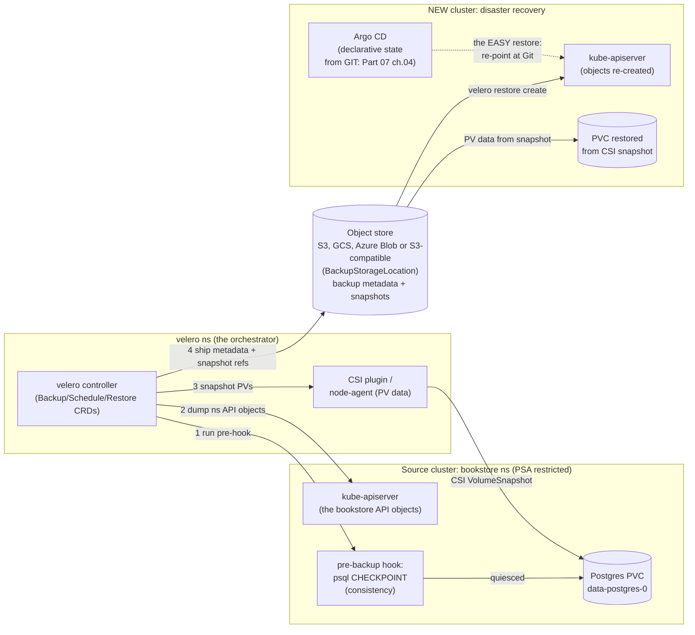

# 02: Backup and disaster recovery

> The three things you actually back up and why they differ: **etcd** (cluster
> state: `etcdctl snapshot save` / `etcdutl snapshot restore`, where the
> certs/endpoints live on a kubeadm node, the
> stop-apiserver→restore→repoint-data-dir sequence; managed = the provider's,
> you *can't* `etcdctl` it); **PV data** (app state: the Postgres PVC, via
> CSI VolumeSnapshot, ties to [Part 03
> ch.05](../03-config-and-storage/05-stateful-data-patterns.md)); **Git**
> (desired state: the *easiest* restore, [Part 07
> ch.04](../07-delivery/04-gitops-argocd.md)). **Velero**'s architecture
> (controller + object store + the CSI-snapshot / node-agent path;
> Backup/Restore/Schedule/BackupStorageLocation CRDs), a namespaced backup of
> `bookstore` **including the PV** with a Postgres pre-backup **consistency
> hook**, **RPO/RTO**, the **GitOps-DR insight**, and a concrete, ordered
> **Bookstore DR runbook** for the three real loss scenarios.

**Estimated time:** ~30 min read · ~90 min hands-on
**Lab tier:** A (kind). Run this chapter's commands only against clusters you own.
**Prerequisites:** [Part 03 ch.05](../03-config-and-storage/05-stateful-data-patterns.md): storage durability ≠ data safety · [Part 03 ch.04](../03-config-and-storage/04-persistent-storage.md): CSI VolumeSnapshot is the PV backup primitive · [Part 07 ch.04](../07-delivery/04-gitops-argocd.md): Git holds the desired state Velero doesn't need to re-back-up
**You'll know after this:** • distinguish the three things to back up: etcd, PV data and Git · • run `etcdctl snapshot save` / `etcdutl snapshot restore` and the stop-apiserver → repoint sequence on kubeadm · • configure Velero with object storage and the CSI-snapshot or node-agent path · • use Postgres pre-backup consistency hooks and reason about RPO/RTO · • execute the Bookstore DR runbook for namespace, cluster and region loss
> • treat a backup as a copy of your Secrets: a private store, scoped keys,
> and restore rights granted like cluster-admin

<!-- tags: day-2, backup, dr, velero, stateful -->

## Why this exists

[Part 03 ch.05](../03-config-and-storage/05-stateful-data-patterns.md) made one
thing brutally clear: *storage durability is not data safety*. A bound PV
survives a Pod reschedule; it does **not** survive a deleted PVC, a failed
disk, a `DROP TABLE`, or a lost cluster, and a snapshot of corruption is just
durable corruption. [Part 07 ch.04](../07-delivery/04-gitops-argocd.md) ended
on the other half: a fresh Argo CD pointed at Git rebuilds every environment:
*"GitOps recovers the **declarative** state, not the **data**; that is Part 08
ch.02."* This is that chapter, and it is where the guide stops assuming the
cluster and its data simply persist.

Disaster recovery fails in production in two specific, avoidable ways:

1. **You backed up the wrong layer.** Teams snapshot etcd and feel safe: but
   etcd holds *cluster state* (objects, RBAC, Secrets-as-objects), **not the
   bytes inside the Postgres PVC**. Restore etcd and you get the PVC *object*
   pointing at a volume whose data is gone. The layers: cluster state, PV
   data, desired state: need **separate** backups with **separate**
   mechanisms.
2. **The backup was never restore-tested.** A backup you have never restored is
   a hypothesis, not a backup. The classic outage is discovering at 3am that
   the nightly job has been writing 0-byte snapshots, or that nobody knows the
   restore order, or that the snapshot is crash-consistent mid-transaction.

A third failure is about access rather than recovery. A backup holds the
namespace's Secrets as the API server returns them, so the backup store is as
sensitive as the Secrets themselves. [Backup security](#backup-security) covers
the store, the keys and the right to restore.

This chapter separates the layers, gives each its real mechanism (etcd
snapshot, Velero + CSI for PV data, Git for desired state), and ends with an
**ordered, runnable runbook** so recovery is a procedure, not an improvisation.
The reference is *Production Kubernetes* (Container Storage); etcd backup and
Velero are cited from their own docs.

## Mental model

**Three independent state layers, three independent backups, restored in
order: cluster → declarative → data (and Git makes the middle one free).**

- **Layer 1: cluster state lives in etcd.** Every object (Deployments, RBAC,
  Secrets, the PVC *object*) is a key in etcd ([Part 00
  ch.04](../00-foundations/04-control-plane-deep-dive.md)). Back it up with
  `etcdctl snapshot save`. Restoring etcd resurrects *the API objects*,
  **not** the contents of any external disk those objects reference.
- **Layer 2: desired state lives in Git.** With GitOps, the declarative truth
  isn't *in* the cluster at all: it's a commit. "Restoring" Layer 1's objects
  is then almost free: install Argo CD, point it at Git, it reconciles the
  whole app back. **This is the cheapest, most reliable recovery in the
  guide** and it needs *no cluster snapshot*.
- **Layer 3: application data lives in the PV.** The bytes in Postgres's
  `data-postgres-0` PVC are **not** in etcd and **not** in Git. They need a
  *data* backup: a CSI **VolumeSnapshot** (crash-consistent point copy: [Part
  03 ch.05](../03-config-and-storage/05-stateful-data-patterns.md)) and/or a
  logical dump, orchestrated and shipped off-cluster by **Velero**.
- **Velero is the orchestrator for Layers 1+3 of an *app*.** It backs up a
  *namespace's* API objects **and** triggers CSI VolumeSnapshots (or its
  node-agent file backup) for that namespace's PVs, stores backup metadata in
  an **object store** (S3, GCS, Azure Blob or another S3-compatible store),
  and can restore the lot into the same or a new cluster. Hooks let it
  **quiesce the database** first so the snapshot is consistent, not mid-write.
- **RPO and RTO are the two numbers that define "recovered".** **RPO** = how
  much data you can afford to lose = roughly your *backup interval*. **RTO** =
  how long recovery may take = your *restore + readiness* time. A snapshot
  every 24h is a 24h RPO; sub-snapshot RPO needs WAL/PITR, which is the
  operator/managed-DB story ([ch.05](05-operators-and-crds.md)).

The trap: **a crash-consistent snapshot faithfully preserves whatever was
there: including a `DROP TABLE` that already ran.** Snapshots protect against
*losing the disk*; they do not protect against *logical corruption you
replicated into the snapshot*. That gap is exactly why production layers
snapshots **plus** logical/PITR backups, and why the runbook validates *data
integrity*, not just *pod readiness*.

## Threats and controls

| Threat | Control in this chapter | Goes deeper |
|---|---|---|
| A backup copy exposes the Secrets it holds | Private, encrypted, versioned, object-locked store; the Secret demo in Backup security | [14.14](../14-eks-in-production-a-to-z/14-backup-and-restore-velero.md) |
| Someone who can write to the bucket plants objects that a restore applies | Write access for the Velero key only; restores run from a named group | [05.01](../05-security/01-authn-authz-rbac.md) |
| A restore recreates Secrets or RBAC with more power than the source had | Restore rights granted like cluster-admin; drills into a scratch namespace | [05.04](../05-security/04-secrets-and-cluster-hardening.md) |
| The chart binds Velero's ServiceAccount to cluster-admin | The chart keeps the binding, because the controller restores cluster-scoped objects. Limit who can drive it: restore rights go to one named group, and no one is granted `pods/exec` in `velero` (the Backup security section) | [05.01](../05-security/01-authn-authz-rbac.md) |
| An untested backup fails when it is needed | A scheduled restore drill that checks rows, not Pod readiness | Step 4 |

## Diagrams

### Diagram A: Velero backup & restore flow (Mermaid)

The real Velero architecture: controller in its own namespace, API objects +
CSI snapshots out to an object store, restored into a new cluster.



### Diagram B: RPO / RTO time axis (ASCII)

```
 RPO vs RTO: two different numbers, two different controls ─────────────────

   RPO = how much DATA you can lose   (set by BACKUP interval)
   RTO = how long RECOVERY may take   (set by RESTORE + readiness speed)

   time ───────────────────────────────────────────────────────────────────▶
        backup        backup        backup            X  failure
        02:00         08:00         14:00              | (data after 14:00
          |             |             |                |  backup is LOST)
          ▼             ▼             ▼                 ▼
   ===[ B ]=========[ B ]=========[ B ]===============[!!]......restore......[ready]
                                    └─────── RPO ───────┘   └──── RTO ────┘
                                    (up to one backup       (Velero restore
                                     interval of data        + Postgres ready
                                     lost: tighten the       + app available:
                                     Schedule to shrink)     pre-stage to shrink)

   Lab defaults (Schedule "0 2 * * *"): RPO ≤ 24h, RTO ≈ minutes (small DB).
   Tighten RPO  → more frequent Velero Schedule (e.g. "0 */6 * * *" → 6h),
                  or WAL/PITR via an operator/managed DB (ch.05) → seconds.
   Tighten RTO  → pre-staged cluster/images, GitOps for declarative (≈instant),
                  rehearsed runbook (DR-RUNBOOK.md).

   The three layers, restored in this ORDER:
     1. cluster (etcd snapshot): self-managed only; managed = provider's
     2. declarative (Git → Argo): the cheap one; needs NO cluster snapshot
     3. data (Velero + CSI snap): the only layer that TRULY needs a backup
```

## Hands-on with the Bookstore

**Assumed working directory: the guide repo root (`full-guide/`).** This
chapter adds [`examples/bookstore/operators/velero-backup.yaml`](../examples/bookstore/operators/velero-backup.yaml),
[`velero-schedule.yaml`](../examples/bookstore/operators/velero-schedule.yaml),
and [`DR-RUNBOOK.md`](../examples/bookstore/operators/DR-RUNBOOK.md). It does
**not** modify the canonical app: Velero backs the live `bookstore` namespace
*up*; recovery uses GitOps + restore, never an edit of `raw-manifests/*`.

> **What the lab run covered.** The lab for this chapter ran on a shared kind
> cluster on Kubernetes 1.37.0, under the shared heavy-install lock. The output
> in this chapter came from a cluster with a different name, and its namespaces
> carried a `p08-02-` prefix, which the commands here leave out. The run
> installed the pinned Velero chart on the default path (CSI snapshots, no node
> agent) into a `restricted` namespace, with placeholder credentials and an
> object-store endpoint that does not resolve. The controller ran and reported
> its storage location unavailable. The run read the Pod's settings back,
> asked the API server to validate the node-agent exception without installing
> it, validated the three Velero objects with strict field checks, and removed
> the chart and its CRDs. It ran no object store, no snapshot-capable CSI
> driver, no backup and no restore: the cluster's storage class cannot take
> snapshots. Steps 3 and 4 are reader steps, and the `velero` CLI step is cited.
> Steps 0 and 1, the cluster setup and etcd, are not run either.
>
> **MinIO is not installed here.** Its community repository was archived on
> 2026-04-25 and says it is no longer maintained, and the chart's last release
> packages a server from December 2024. Point Velero at an S3-compatible bucket
> that you run, or at a bucket in your own cloud account.
> [14.14](../14-eks-in-production-a-to-z/14-backup-and-restore-velero.md)
> covers cloud buckets, keys and IAM.

### 0. Prerequisites: fresh cluster + the four images + the app (self-bootstrapping)

```sh
kind delete cluster --name bookstore 2>/dev/null || true
kind create cluster --name bookstore
kubectl cluster-info

cd examples/bookstore/app
for s in catalog orders payments-worker storefront; do docker build -t bookstore/$s:dev ./$s; done
cd ../../..
for s in catalog orders payments-worker storefront; do kind load docker-image bookstore/$s:dev --name bookstore; done

# the standard prereq → workload chain (same as ch.01 step 1):
kubectl apply -f examples/bookstore/raw-manifests/00-namespace.yaml
kubectl apply -f examples/bookstore/raw-manifests/05-serviceaccounts-rbac.yaml
kubectl apply -f examples/bookstore/raw-manifests/15-catalog-config.yaml
kubectl apply -f examples/bookstore/raw-manifests/16-db-credentials.yaml
kubectl apply -f examples/bookstore/raw-manifests/35-priorityclasses.yaml
kubectl apply -f examples/bookstore/raw-manifests/12-redis.yaml
kubectl apply -f examples/bookstore/raw-manifests/13-rabbitmq.yaml
kubectl apply -f examples/bookstore/raw-manifests/20-postgres-statefulset.yaml
kubectl apply -f examples/bookstore/raw-manifests/40-services.yaml
kubectl apply -f examples/bookstore/raw-manifests/10-catalog-deploy.yaml
kubectl apply -f examples/bookstore/raw-manifests/11-storefront-deploy.yaml
kubectl apply -f examples/bookstore/raw-manifests/14-orders-deploy.yaml
kubectl apply -f examples/bookstore/raw-manifests/19-payments-worker-deploy.yaml
kubectl apply -f examples/bookstore/raw-manifests/21-db-migrate-job.yaml
# the migration Job must COMPLETE (creates the `books` schema) before
# catalog/orders can become Ready: wait for it BEFORE the deploy wait:
kubectl wait --for=condition=complete job/db-migrate -n bookstore --timeout=120s
kubectl wait --for=condition=available deploy --all -n bookstore --timeout=180s

# seed a row so "data loss" is observable later:
kubectl exec -n bookstore postgres-0 -- psql -U bookstore -d bookstore -c \
  "CREATE TABLE IF NOT EXISTS dr_demo(note text); INSERT INTO dr_demo VALUES ('before-backup');"
```

> **Self-bootstrapping note.** After any `kind delete && kind create`:
> re-`kind load` the four images, re-run the chain above, then re-install Velero (step
> 2), since a fresh cluster has none of it.

### 1. Layer 1: the etcd snapshot (conceptual on kind; runnable on kubeadm)

On a **self-managed kubeadm** control-plane node, etcd runs as a static Pod and
its client certs are on disk. The snapshot is one command:

```sh
# ON the control-plane node (etcdctl talks to the local etcd over mTLS):
ETCDCTL_API=3 etcdctl \
  --endpoints=https://127.0.0.1:2379 \
  --cacert=/etc/kubernetes/pki/etcd/ca.crt \
  --cert=/etc/kubernetes/pki/etcd/server.crt \
  --key=/etc/kubernetes/pki/etcd/server.key \
  snapshot save /var/backups/etcd-$(date +%F).db
# etcd 3.6 removed `etcdctl snapshot status` and `etcdctl snapshot restore`;
# etcdutl does both, and ships in the same etcd release tarball.
etcdutl snapshot status /var/backups/etcd-$(date +%F).db -w table

# RESTORE (control-plane outage): the exact ordered sequence:
#   1. STOP the apiserver + etcd static Pods (move their manifests out of
#      /etc/kubernetes/manifests/ so the kubelet stops them).
#   2. etcdutl snapshot restore /var/backups/etcd-<DATE>.db \
#        --data-dir /var/lib/etcd-restored
#   3. repoint etcd's static-Pod manifest at the NEW data-dir
#      (/var/lib/etcd-restored), move the manifests back → kubelet restarts
#      etcd from the restored data, then the apiserver comes up on it.
```

The snapshot file holds every object, Secrets included, in the form etcd
stores them. Unless the API server encrypts Secrets at rest, those values are
plain. Store snapshots like the Secrets they contain; see
[Backup security](#backup-security).

> **Why this is narrated, not run on kind.** kind runs etcd inside the
> control-plane *container*; you do not have a kubeadm node with
> `/etc/kubernetes/pki/etcd/` and a static-Pod manifest to move. The sequence
> above is the real one on a self-managed cluster and is shown so the order
> (stop apiserver+etcd → restore → repoint data-dir) is concrete. **On managed
> EKS/GKE/AKS you cannot do *any* of this**: etcd is the provider's, there is
> no etcd endpoint or cert for you, and the provider snapshots/restores it
> behind their SLA. For the Bookstore the practical Layer-1 recovery is **not**
> etcd at all, it is Git (step 4 / Scenario 3): GitOps makes the etcd snapshot
> *optional* for a declaratively-managed app.

### 2. Install Velero (Helm, pinned, with security values)

Install through Helm with pinned versions, never `releases/latest`. The
versions below were checked on 2026-10-31:

- **Chart 12.2.2** from `vmware-tanzu/velero`, which packages Velero 1.18.2.
  It is the newest chart in the repository index.
- **Image 1.18.4**, pinned by digest. The chart's default tag is 1.18.2, and
  1.18.4 is the newest 1.18 patch release.
- **AWS plugin v1.14.4**, pinned by digest. The plugin's compatibility table
  pairs plugin 1.14.x with Velero 1.18.x. The plugin repository now lives at
  `velero-io/velero-plugin-for-aws`.

The lab read the chart version and the digests from the chart repository and
the registries:

<!-- gate: output -->
```
appVersion: 1.18.2
version: 12.2.2
```

<!-- gate: output -->
```
sha256:c89fb5b6d1fd6afd368e0f483e6f5555fd62851a1eada8ac5c72482e674ca17b
```

<!-- gate: output -->
```
sha256:c85a7fa803569e3128c33e4f5766f84ab156c8d171c9f1dd2715581d45ce98fa
```

These pins are not a Kubernetes compatibility claim. Velero's
[README](https://github.com/vmware-tanzu/velero#velero-compatibility-matrix)
lists Velero 1.18 as expected to work on Kubernetes 1.18 and later, and as
tested on 1.33.7, 1.34.1 and 1.35.0. Kubernetes 1.37 is not on that list. In
the lab, on Kubernetes 1.37.0, the controller started and checked its storage
location (below). No backup or restore ran there, so those two operations are
unverified on 1.37. Read the Velero release notes before you move the cluster
to a new minor version.

```sh
# Pins, checked 2026-10-31. Digests are the multi-architecture index digests.
VELERO_CHART_VERSION=12.2.2
VELERO_IMAGE_DIGEST=sha256:c89fb5b6d1fd6afd368e0f483e6f5555fd62851a1eada8ac5c72482e674ca17b  # velero/velero:v1.18.4
VELERO_AWS_PLUGIN=docker.io/velero/velero-plugin-for-aws@sha256:c85a7fa803569e3128c33e4f5766f84ab156c8d171c9f1dd2715581d45ce98fa  # v1.14.4
```

**The `velero` CLI.** The chart installs the server. The CLI, which the
`velero backup describe` and `velero backup logs` commands below need, is a
separate binary, and it is a program you run with your own credentials. Pin
it to the release of the image and check its SHA-256 before it runs. The
release page publishes a `CHECKSUM` file and a digest for each asset. The
digests below came from the release's asset list on 2026-10-31. The lab did
not download or run the CLI, so this step is cited, not captured. The chart's
own install notes name an older CLI (1.18.2); use the one that matches the
image.

```sh
VELERO_CLI_VERSION=v1.18.4
# linux/amd64. On macOS with Apple silicon use the darwin-arm64 asset, whose
# digest is e51ce875fb3e47996b0b425edefff72f4106ad891b4e6577c21bda20c41f27c3,
# and check it with `shasum -a 256 -c -`. Other platforms: the release page.
VELERO_CLI_SHA256=e520c17d8997e1c9d0a28ae013592e4473ca3bd82cb3acd132e51286263f74bf
ASSET="velero-$VELERO_CLI_VERSION-linux-amd64.tar.gz"
curl -fsSLO "https://github.com/vmware-tanzu/velero/releases/download/$VELERO_CLI_VERSION/$ASSET"
echo "$VELERO_CLI_SHA256  $ASSET" | sha256sum -c -
tar -xzf "$ASSET"        # then put the unpacked velero binary on your PATH
velero version --client-only
```

Every status command in this chapter has a `kubectl` form
(`kubectl -n velero get backup,restore`), so the CLI is a convenience. Its
`backup logs` command, which downloads the log from the bucket, has no
`kubectl` equivalent.

Velero gets its own namespace, and the namespace is the first thing to label.
The default install takes volume snapshots through the cluster's CSI driver
and runs no node agent, so nothing in the namespace needs a host path, root or
a capability. The namespace is therefore `restricted` like the Bookstore's,
and it has no entry in the exceptions registry. The lab admitted the
controller and the chart's one-shot CRD job under this label, as the install
output below shows.

The chart's CRD job has no `resources` value, so it would run without a
request or a memory limit. The namespace carries a LimitRange that gives every
container in it a default request and a memory limit. The lab read those
defaults back from the CRD job's Pod and from the plugin init container.

Save this block as `velero-namespace.yaml`:

```yaml
apiVersion: v1
kind: Namespace
metadata:
  name: velero
  labels:
    pod-security.kubernetes.io/enforce: restricted
    pod-security.kubernetes.io/audit: restricted
    pod-security.kubernetes.io/warn: restricted
---
apiVersion: v1
kind: LimitRange
metadata:
  name: velero-defaults
  namespace: velero
spec:
  limits:
    - type: Container
      defaultRequest: {cpu: 50m, memory: 64Mi}
      default: {memory: 256Mi}
```

The namespace is default-deny, as the baseline requires from
[02.06](../02-networking/06-network-policies.md) on. The second policy allows
only what Velero needs: DNS, the API server and the object store. The address
ranges below are placeholders. Replace them with your API server's addresses
(port 6443, or 443 on a managed control plane) and your store's address, and
apply the file after the install below: with the placeholders in place the
controller could not reach the API server. The policy does not allow metrics
scraping, which needs its own ingress rule from your monitoring namespace.

Save these two policies as `velero-netpol.yaml`:

```yaml
apiVersion: networking.k8s.io/v1
kind: NetworkPolicy
metadata:
  name: default-deny-all
  namespace: velero
spec:
  podSelector: {}
  policyTypes: ["Ingress", "Egress"]
---
apiVersion: networking.k8s.io/v1
kind: NetworkPolicy
metadata:
  name: velero-egress
  namespace: velero
spec:
  podSelector: {}
  policyTypes: ["Egress"]
  egress:
    # DNS, through the cluster resolver.
    - to:
        - namespaceSelector:
            matchLabels:
              kubernetes.io/metadata.name: kube-system
          podSelector:
            matchLabels:
              k8s-app: kube-dns
      ports:
        - { port: 53, protocol: UDP }
        - { port: 53, protocol: TCP }
    # The API server. Replace the range with your control-plane addresses.
    - to:
        - ipBlock:
            cidr: 192.0.2.0/24
      ports:
        - { port: 6443, protocol: TCP }
    # The object store. Replace the range with your store's address.
    - to:
        - ipBlock:
            cidr: 198.51.100.0/24
      ports:
        - { port: 443, protocol: TCP }
```

The chart's own values set the Velero Pod to run as UID 1002, with
`runAsNonRoot` and the `RuntimeDefault` seccomp profile. The UID is the `cnb`
user the image declares in its `/etc/passwd`. The image has no shell, so the
lab read that file through a probe Pod that mounted the image as a volume. The
container values drop every capability and make the root filesystem read-only.
The chart already mounts writable `emptyDir` volumes at `/tmp` and `/scratch`,
so the read-only root does not stop the server from writing. The plugin init
container gets the same container values. `automountServiceAccountToken` stays
`true`, because the controller calls the API server and runs under its own
ServiceAccount, which is the case the baseline allows. The chart leaves
`resources` empty, so the install sets a request of 500m CPU and 128Mi memory
and a 512Mi memory limit, the figures Velero's own install documentation lists
for its Deployment ([customize
installation](https://velero.io/docs/v1.18/customize-installation/)). Size
them to your cluster.

The lab read the UID with the probe Pod, and its output was:

<!-- gate: output -->
```
cnb:1002:1000
```

Three more values choose the CSI path:

- `configuration.features=EnableCSI` turns on Velero's CSI snapshot support.
  Velero's [CSI page](https://velero.io/docs/v1.18/csi/) says to enable the
  flag, and that the CSI plugin is built into Velero since 1.14.
- `deployNodeAgent=false` runs no node agent, which is the only Velero
  component that needs host paths.
- `snapshotsEnabled=false` leaves out the chart's `VolumeSnapshotLocation`.
  That object belongs to provider plugins that snapshot disks themselves. CSI
  snapshots do not use it, and with the chart's default list the lab's render
  produced one with an empty provider.

Velero finds a snapshot class by label, so the cluster needs a CSI driver with
snapshot support, the snapshot CRDs and controller, and one
`VolumeSnapshotClass` per driver labelled `velero.io/csi-volumesnapshot-class:
"true"` (`kubectl label volumesnapshotclass <class>
velero.io/csi-volumesnapshot-class=true`). Check what your cluster has before
you rely on this path: the lab cluster's default storage class is
`rancher.io/local-path`, which cannot snapshot.

Create the namespace and the credentials Secret, then install the chart. The
store's bucket, region, endpoint and key come from your store. The key should
write to the Velero bucket and nothing else. The prompts keep the values out of
shell history, and the Secret keeps them out of the chart values, so
`helm get values` never shows them.

```sh
kubectl apply -f velero-namespace.yaml

printf 'Bucket name: '; read -r VELERO_BUCKET
printf 'Store region: '; read -r VELERO_REGION
printf 'S3 endpoint URL: '; read -r VELERO_S3_URL
printf 'Access key ID: '; read -rs VELERO_ACCESS_KEY; echo
printf 'Secret access key: '; read -rs VELERO_SECRET_KEY; echo

umask 077
CREDS_FILE="$(mktemp)"
printf '[default]\naws_access_key_id=%s\naws_secret_access_key=%s\n' \
  "$VELERO_ACCESS_KEY" "$VELERO_SECRET_KEY" > "$CREDS_FILE"
kubectl create secret generic velero-cloud-credentials -n velero \
  --from-file=cloud="$CREDS_FILE"
rm -f "$CREDS_FILE"
unset VELERO_ACCESS_KEY VELERO_SECRET_KEY

helm repo add vmware-tanzu https://vmware-tanzu.github.io/helm-charts
helm repo update vmware-tanzu
helm install velero vmware-tanzu/velero -n velero \
  --version "$VELERO_CHART_VERSION" --wait \
  --set image.digest="$VELERO_IMAGE_DIGEST" \
  --set-json 'initContainers=[{"name":"velero-plugin-for-aws","image":"'"$VELERO_AWS_PLUGIN"'","imagePullPolicy":"IfNotPresent","securityContext":{"allowPrivilegeEscalation":false,"readOnlyRootFilesystem":true,"capabilities":{"drop":["ALL"]}},"volumeMounts":[{"mountPath":"/target","name":"plugins"}]}]' \
  --set-json 'podSecurityContext={"runAsNonRoot":true,"runAsUser":1002,"runAsGroup":1000,"seccompProfile":{"type":"RuntimeDefault"}}' \
  --set-json 'containerSecurityContext={"allowPrivilegeEscalation":false,"readOnlyRootFilesystem":true,"capabilities":{"drop":["ALL"]}}' \
  --set resources.requests.cpu=500m \
  --set resources.requests.memory=128Mi \
  --set resources.limits.memory=512Mi \
  --set configuration.features=EnableCSI \
  --set deployNodeAgent=false \
  --set snapshotsEnabled=false \
  --set 'configuration.backupStorageLocation[0].name=default' \
  --set 'configuration.backupStorageLocation[0].provider=aws' \
  --set "configuration.backupStorageLocation[0].bucket=$VELERO_BUCKET" \
  --set "configuration.backupStorageLocation[0].config.region=$VELERO_REGION" \
  --set "configuration.backupStorageLocation[0].config.s3Url=$VELERO_S3_URL" \
  --set 'configuration.backupStorageLocation[0].config.s3ForcePathStyle=true' \
  --set credentials.existingSecret=velero-cloud-credentials

kubectl -n velero rollout status deploy/velero
kubectl -n velero get pods
kubectl -n velero get backupstoragelocation
```

The lab ran this install with placeholder credentials and an endpoint that
does not resolve, so it had no bucket to use. The controller started under
`restricted`, and so did the chart's CRD job. The controller reported the
storage location unavailable, which is the right answer for an endpoint that
does not exist:

<!-- gate: output -->
```
secret/velero-cloud-credentials created
# ...
STATUS: deployed
# ...
deployment "velero" successfully rolled out
NAME                     READY   STATUS    RESTARTS   AGE
velero-cb65f7cf8-hzkfz   1/1     Running   0          38s
# ...
NAME      PHASE         LAST VALIDATED   AGE   DEFAULT
default   Unavailable   28s              38s   true
```

The same Deployment, read back from the cluster after the install, shows what
the Pod runs with. The listing has no DaemonSet, because no node agent runs:

```sh
kubectl -n velero get deploy,daemonset
kubectl -n velero get deploy velero -o jsonpath='{range .spec.template.spec.containers[*]}{.name}{" resources: "}{.resources}{"\n"}{end}'
kubectl -n velero get pod -l name=velero -o jsonpath='{range .items[0].spec.initContainers[*]}{.name}{" resources (from the LimitRange): "}{.resources}{"\n"}{end}'
kubectl -n velero get deploy velero -o jsonpath='pod securityContext: {.spec.template.spec.securityContext}{"\n"}'
kubectl -n velero get deploy velero -o jsonpath='container securityContext: {.spec.template.spec.containers[0].securityContext}{"\n"}'
kubectl -n velero get deploy velero -o jsonpath='server args: {.spec.template.spec.containers[0].args}{"\n"}'
```

<!-- gate: output -->
```
NAME                     READY   UP-TO-DATE   AVAILABLE   AGE
deployment.apps/velero   1/1     1            1           38s
# ...
velero resources: {"limits":{"memory":"512Mi"},"requests":{"cpu":"500m","memory":"128Mi"}}
velero-plugin-for-aws resources (from the LimitRange): {"limits":{"memory":"256Mi"},"requests":{"cpu":"50m","memory":"64Mi"}}
pod securityContext: {"runAsGroup":1000,"runAsNonRoot":true,"runAsUser":1002,"seccompProfile":{"type":"RuntimeDefault"}}
container securityContext: {"allowPrivilegeEscalation":false,"capabilities":{"drop":["ALL"]},"readOnlyRootFilesystem":true}
server args: ["server","--uploader-type=kopia","--features=EnableCSI","--repo-maintenance-job-configmap=velero-repo-maintenance"]
```

Installing Velero created the `velero.io` CRDs (`Backup`, `Restore`,
`Schedule`, `BackupStorageLocation` and the rest). This is what makes the
manifests below dry-runnable. Before the install, a client dry-run prints `no
matches for kind "Backup"`.

Apply the NetworkPolicies once you have replaced the placeholder ranges:

```sh
kubectl apply -f velero-netpol.yaml
```

#### The exceptions: storage that cannot keep snapshots

The default path leans on the storage system keeping the snapshot. Storage
that cannot, which is common on-premises, needs the node agent. There are two
ways to run it, and each costs a different exception.

**Data movement, without a host path.** Velero's built-in data mover copies the
snapshot's data to the bucket. Upstream says it "doesn't require the host path
for pod volumes", and the chart's `nodeAgent.disableHostPath` removes the host
paths ([CSI snapshot data
movement](https://velero.io/docs/v1.18/csi-snapshot-data-movement/)). The agent
still runs as root. The lab rendered it with the chart's security values and
asked the API server to validate it in the restricted namespace. Root was the
only thing it named, besides the capabilities the render leaves open:

```sh
helm template velero vmware-tanzu/velero -n velero --version "$VELERO_CHART_VERSION" \
  --show-only templates/node-agent-daemonset.yaml \
  --set image.digest="$VELERO_IMAGE_DIGEST" \
  --set deployNodeAgent=true --set snapshotsEnabled=false \
  --set configuration.features=EnableCSI \
  --set credentials.existingSecret=velero-cloud-credentials \
  --set nodeAgent.disableHostPath=true \
  --set-json 'nodeAgent.podSecurityContext={"runAsUser":0,"seccompProfile":{"type":"RuntimeDefault"}}' \
  --set-json 'nodeAgent.containerSecurityContext={"allowPrivilegeEscalation":false}' \
  --set nodeAgent.resources.requests.cpu=500m \
  --set nodeAgent.resources.requests.memory=512Mi \
  --set nodeAgent.resources.limits.memory=1Gi \
  | kubectl apply --dry-run=server -f -
```

<!-- gate: output -->
```
Warning: would violate PodSecurity "restricted:latest": unrestricted capabilities (container "node-agent" must set securityContext.capabilities.drop=["ALL"]), runAsNonRoot != true (pod or container "node-agent" must set securityContext.runAsNonRoot=true), runAsUser=0 (pod must not set runAsUser=0)
daemonset.apps/node-agent created (server dry run)
```

The Pod Security Standards forbid host paths at `baseline` and allow root, so
the `baseline` level should admit this agent. The lab did not run it in a
`baseline` namespace and did not run the data mover. If you adopt it, label
the namespace for that level and register the exception.

**File-system backup, with a host path.** Kopia reads each Pod's volume files
through the node's kubelet directory, so the agent mounts
`/var/lib/kubelet/pods` from the host. The `baseline` level forbids `hostPath`,
so this variant needs a `privileged` namespace. The same command without
`--set nodeAgent.disableHostPath=true` renders the host paths, and the dry run
says so:

<!-- gate: output -->
```
Warning: would violate PodSecurity "restricted:latest": unrestricted capabilities (container "node-agent" must set securityContext.capabilities.drop=["ALL"]), restricted volume types (volumes "host-pods", "host-plugins" use restricted volume type "hostPath"), runAsNonRoot != true (pod or container "node-agent" must set securityContext.runAsNonRoot=true), runAsUser=0 (pod must not set runAsUser=0)
daemonset.apps/node-agent created (server dry run)
```

The exception is registered in `security/namespace-exceptions.yaml` with its
reason and expiry. Audit and warn stay at `restricted`, so the namespace keeps
reporting what it excuses. Save this block as `velero-namespace-fs.yaml` and
apply it in place of the Namespace in `velero-namespace.yaml`. Keep the
LimitRange:

```yaml
apiVersion: v1
kind: Namespace
metadata:
  name: velero
  labels:
    pod-security.kubernetes.io/enforce: privileged
    pod-security.kubernetes.io/audit: restricted
    pod-security.kubernetes.io/warn: restricted
```

Then add these values to the install above, and set `snapshotsEnabled=false` as
before. The pod values add the seccomp profile that the chart leaves out. The
container value forbids privilege escalation. The capabilities stay at the
runtime default, because the agent reads files that belong to other users, and
an untested `drop: ["ALL"]` could stop it reading them. Test a tighter set
against your own volumes before you adopt one. Upstream's [file-system backup
page](https://velero.io/docs/v1.18/file-system-backup/) also says the agent
needs root and, in some environments, privileged mode, which these values do
not set. The lab dry-ran these values and did not install the agent:

```sh
  --set deployNodeAgent=true \
  --set-json 'nodeAgent.podSecurityContext={"runAsUser":0,"seccompProfile":{"type":"RuntimeDefault"}}' \
  --set-json 'nodeAgent.containerSecurityContext={"allowPrivilegeEscalation":false}' \
  --set nodeAgent.resources.requests.cpu=500m \
  --set nodeAgent.resources.requests.memory=512Mi \
  --set nodeAgent.resources.limits.memory=1Gi
```

The Backup in step 3 changes with the path: set `snapshotVolumes: false` and
`defaultVolumesToFsBackup: true` in it. File-system backup is opt-in by
default. Without that flag, each Pod needs the annotation
`backup.velero.io/backup-volumes=<volume name>`, and Velero does not add it for
you.

### 3. Back up the Bookstore namespace (with the consistency hook)

The on-demand backup is the saved manifest: the `bookstore` namespace, its
objects and its volumes, with a Postgres pre-backup hook that runs `CHECKPOINT`
so the data is captured clean. The backup includes the `db-credentials` Secret.
That is deliberate, and it is the reason for [Backup security](#backup-security)
below. Read that section before you store a backup anywhere.

This step and the next are reader steps. They need a cluster whose CSI driver
can snapshot, with a labelled `VolumeSnapshotClass` (step 2), and a bucket
that Velero can reach. The lab cluster had neither, so it ran neither step.
Check first that a snapshot class exists for the driver behind the Postgres
PVC:

```sh
kubectl get volumesnapshotclass
kubectl get pvc -n bookstore data-postgres-0 -o jsonpath='{.spec.storageClassName}{"\n"}'
```

```sh
kubectl apply -f examples/bookstore/operators/velero-backup.yaml
velero backup describe bookstore-now --details
velero backup logs bookstore-now                 # hook executed; ns objects + PV
kubectl get backup bookstore-now -n velero -o jsonpath='{.status.phase}{"\n"}'
#   → Completed
```

The saved manifest matches the default install: `snapshotVolumes: true` takes
a VolumeSnapshot of each volume, and `defaultVolumesToFsBackup` is `false`.
The node-agent exception in step 2 changes both fields. Applied to a cluster
installed the default way, the other combination backs up no volume data.

The recurring posture is the one you run in production, because it sets the RPO:

```sh
kubectl apply -f examples/bookstore/operators/velero-schedule.yaml
velero schedule describe bookstore-daily
```

### 4. Restore drill into a scratch namespace

A drill restores into a new namespace, never over the live one. Restoring over a
live namespace means deleting the controllers while keeping the PVCs, and
Velero's upstream guide describes that step for file-system backups. A scratch
namespace proves the same backup without touching the database that serves the
Bookstore, and it lets you compare the two side by side.

Save these blocks as `drill.yaml`. The scratch namespace is `restricted`, so a
restored Pod meets the same rule as a live one, and it is default-deny like the
rest.

```yaml
apiVersion: v1
kind: Namespace
metadata:
  name: bookstore-drill
  labels:
    pod-security.kubernetes.io/enforce: restricted
    pod-security.kubernetes.io/audit: restricted
    pod-security.kubernetes.io/warn: restricted
---
apiVersion: networking.k8s.io/v1
kind: NetworkPolicy
metadata:
  name: drill-default-deny
  namespace: bookstore-drill
spec:
  podSelector: {}
  policyTypes: ["Ingress", "Egress"]
---
apiVersion: velero.io/v1
kind: Restore
metadata:
  name: bookstore-drill
  namespace: velero
spec:
  backupName: bookstore-now
  # The bookstore namespace comes back as bookstore-drill. The live one is untouched.
  namespaceMapping:
    bookstore: bookstore-drill
  restorePVs: true
```

```sh
kubectl apply -f drill.yaml
kubectl -n velero get restore bookstore-drill -o jsonpath='{.status.phase}{"\n"}'
#   → Completed
kubectl get pvc -n bookstore-drill          # data-postgres-0 is Bound, from a snapshot
kubectl exec -n bookstore-drill postgres-0 -- \
  psql -U bookstore -d bookstore -c 'SELECT * FROM dr_demo;'
#   → before-backup
```

Check the row, not the Pod. A Ready Pod shows that Postgres started, and a
drill that passes on readiness alone can pass on an empty database. If a
restored Pod stays Pending, read the events in `bookstore-drill` first. Pod
Security admission checks the restored Pods too. On the file-system exception
path, that includes the `restore-wait` init container that Velero adds to Pods
that restore file-system data, and `kubectl -n velero get podvolumerestores`
lists those restores.

When the drill is done, delete it:

```sh
kubectl delete namespace bookstore-drill
kubectl -n velero delete restore bookstore-drill
```

The drill is the rehearsal for
[DR-RUNBOOK.md](../examples/bookstore/operators/DR-RUNBOOK.md). A production
restore creates the PVC from the snapshot, and the snapshot class decides how
the snapshot is taken. The `Restore` object is the same on the exception path.

**Honest scope of the drill.** The lab did not run it, because it needs a
bucket and a snapshot-capable driver, and the lab had neither. The `Restore`
in it passed the strict server-side check in step 6. The drill is the step to
run first on a new cluster, and the RPO and RTO it measures are the numbers to
write down.

### 5. The GitOps-DR insight (why Layer 2 is nearly free)

Steps 1–4 recovered *data*. The *declarative* state: Deployments, Services,
the PSA-labelled Namespace, NetworkPolicies: is recovered with **no Velero
restore and no etcd snapshot** because it is in Git
([Part 07 ch.04](../07-delivery/04-gitops-argocd.md)):

```sh
# Total-loss recovery of the DECLARATIVE state is two applies (Scenario 3):
#   kubectl apply -n argocd -f examples/bookstore/argocd/00-appproject.yaml
#   kubectl apply -n argocd -f examples/bookstore/argocd/01-app-of-apps.yaml
#   → a fresh Argo CD rebuilds the entire app from Git. Only the DATA (the
#     Postgres PVC) then needs a Velero restore (step 4). GitOps collapses
#     Layer-1+2 recovery into "re-point at Git"; Velero handles Layer 3.
```

This is the chapter's core operational claim: **separate the layers and the
hard part shrinks to just the data.** The full ordered procedure for all three
scenarios is [`DR-RUNBOOK.md`](../examples/bookstore/operators/DR-RUNBOOK.md).

### 6. The CRD check, and cleanup

`Backup`, `Schedule` and `Restore` are `velero.io/v1` custom resources. On a
cluster without Velero, a client dry-run fails with `no matches for kind
"Backup"`. That is expected, and it is the same for every CRD-backed object in
this guide. After step 2, `kubectl apply --dry-run=server --validate=strict`
checks the three files against the installed schema. Strict validation makes an
unknown field name an error, so a typo fails instead of being dropped.

The lab did this while its install from step 2 was running, under the shared
heavy-install lock. It asked the API server to validate the three files with
strict server-side validation, and removed the chart and the CRDs afterwards.
The first output is the three files accepted. The second is the same
strict check catching a misspelt field name:

<!-- gate: output -->
```
backup.velero.io/bookstore-now created (server dry run)
schedule.velero.io/bookstore-daily created (server dry run)
restore.velero.io/bookstore-drill created (server dry run)
```

<!-- gate: output -->
```
Error from server (BadRequest): error when creating "restore-typo.yaml": Restore in version "v1" cannot be handled as a Restore: strict decoding error: unknown field "spec.namespaceMappng"
```

Clean up the chapter's objects, then the chart, and check for leftover
cluster-scoped objects. Helm leaves the CRDs, because the chart's job created
them. The lab's check printed that nothing was left:

```sh
kubectl delete -f examples/bookstore/operators/velero-schedule.yaml --ignore-not-found
kubectl delete -f examples/bookstore/operators/velero-backup.yaml --ignore-not-found
helm uninstall velero -n velero
kubectl get crd -o name | grep '\.velero\.io' | xargs -r kubectl delete
kubectl get crd,clusterrole,clusterrolebinding -o name | grep -i velero || echo "no velero cluster objects left"
kind delete cluster --name bookstore
```

<!-- gate: output -->
```
no velero cluster objects left
```

## How it works under the hood

- **etcd snapshot = a consistent copy of the whole key space.** `etcdctl
  snapshot save` asks the etcd leader for a point-in-time, internally
  consistent dump of the entire MVCC keyspace (every Kubernetes object lives
  there as a protobuf value under a registry key: [Part 00
  ch.04](../00-foundations/04-control-plane-deep-dive.md)). Restore (`etcdutl
  snapshot restore` since etcd v3.6) rebuilds an etcd data-dir from that file;
  you then **must** stop the old apiserver + etcd, restore into a *new*
  data-dir, and repoint etcd at it: restoring "live" under a running apiserver
  corrupts state. It captures *objects*, never the contents of any external PV
  those objects reference, which is the entire reason Layer 3 (Velero/CSI)
  exists separately.
- **Why managed clusters can't be `etcdctl`'d.** On EKS/GKE/AKS the control
  plane (etcd included) is the provider's; there is no etcd endpoint, no
  `/etc/kubernetes/pki/etcd/`, no static-Pod manifest you can move. The
  provider snapshots/restores etcd under their SLA. Your DR for a managed
  cluster is therefore **Git (declarative) + Velero (data)**, which is exactly
  the posture that also works for self-managed, so the Bookstore standardises
  on it.
- **Velero's anatomy.** A controller in the `velero` namespace watches its
  CRDs. On a `Backup` it: (1) runs any **pre hooks** (`exec` into a pod: the
  Bookstore's `psql CHECKPOINT`) to quiesce; (2) lists and serialises the
  target namespace's API objects; (3) for each PVC, triggers a **CSI
  VolumeSnapshot** (via the CSI plugin) *or* a **node-agent filesystem
  backup** (Kopia copies the volume's files, opt-in per Pod or for every Pod
  with `defaultVolumesToFsBackup`) when no snapshot-capable driver exists; (4)
  writes the object manifests + snapshot references to the
  **BackupStorageLocation** (object store). A `Restore` reverses it: recreate
  objects, then provision PVCs from the snapshot/backup. A `Schedule` is a
  cron whose `template` *is* a Backup spec, which is why the Bookstore's
  `velero-schedule.yaml` template is byte-aligned with `velero-backup.yaml`.
- **The consistency hook is why the snapshot isn't garbage.** A raw CSI
  snapshot is crash-consistent: correct for Postgres (it replays WAL on
  restore) but a `CHECKPOINT` first flushes dirty buffers so the snapshot is a
  maximally-recovered point; a `pg_dump`-to-mounted-volume pre-hook would give
  a *logical* backup; `fsfreeze` quiesces the filesystem. All three are the
  same `hooks.resources[].pre[].exec` shape: the manifest demonstrates the
  mechanism the production choice plugs into. The hook runs *in the postgres
  container*, which has a shell; the distroless app containers do **not** (you
  would never hook into them: ch.03).
- **Crash-consistent ≠ PITR: the hard limit.** A VolumeSnapshot restores
  *exactly the snapshot instant*, including a `DROP TABLE` that already
  committed. Point-in-time recovery (replay WAL to "30 seconds before the bad
  migration") is **not** a snapshot capability, it is continuous WAL
  archiving, which a bare StatefulSet does not do and an **operator**
  (CloudNativePG: [ch.05](05-operators-and-crds.md)) or **managed DB** does.
  This is the precise boundary [Part 03
  ch.05](../03-config-and-storage/05-stateful-data-patterns.md) drew, now
  operationalised: snapshots bound your RPO at the snapshot interval; WAL/PITR
  bounds it at seconds.
- **GitOps changes the math.** Because the declarative state is a Git commit,
  Layer-1+2 recovery doesn't need an etcd snapshot at all: a fresh Argo CD
  reconciles the world from Git ([Part 07
  ch.04](../07-delivery/04-gitops-argocd.md)). DR collapses to: provision a
  cluster, install Argo CD + Velero, `git`-bootstrap (declarative back),
  Velero restore (data back). The only irreplaceable artifact is the **data
  backup in the object store**: everything else is regenerable from Git.

## Backup security

A backup is a copy of the namespace as the API server returns it. The API server
returns each Secret's `data` as base64, so the backup holds every value in a
form any reader can decode. Base64 is an encoding, not encryption. The lab wrote
a generated value into a Secret and read it back from the object the way a
backup stores it:

```sh
kubectl create secret generic db-demo -n bookstore \
  --from-literal=password="$(openssl rand -hex 16)"
kubectl get secret db-demo -n bookstore -o jsonpath='{.data}'; echo
kubectl get secret db-demo -n bookstore -o jsonpath='{.data.password}' | base64 -d; echo
```

<!-- gate: output -->
```
{"password":"YmI5YWIzNDhhM2FkMTVlZDRiNjcwMjE1YWZmY2U0NWY="}
```

<!-- gate: output -->
```
bb9ab348a3ad15ed4b670215affce45f
```

Encryption at rest does not change this. The API server can encrypt Secrets in
etcd with an `EncryptionConfiguration`, which the Kubernetes documentation
covers ([encrypting confidential data at rest](https://kubernetes.io/docs/tasks/administer-cluster/encrypt-data/)).
The API server still decrypts a Secret for any client that may read it, and
Velero is such a client. The copy in the bucket is plain. The controls are on
the store, the keys and the right to restore:

- **Store.** No public access and no anonymous reads. Encrypt with a key that
  only the backup and restore identities can use. Turn on versioning and
  object lock, so a stolen Velero key cannot delete or rewrite old backups.
  Replicate to a second region, so one regional failure does not take every
  copy. The details belong to
  [14.14](../14-eks-in-production-a-to-z/14-backup-and-restore-velero.md).
- **Keys.** The Velero key writes to its own bucket and reads nothing else.
  Keep a separate read identity for restores. Never reuse the key in CI, in an
  app or on a laptop profile.
- **Restore rights.** A restore is privilege. Velero applies the objects in a
  backup with its own cluster-admin binding, which the chart creates by
  default (`rbac.clusterAdministrator: true`). Someone who can create a
  `Restore` can have Velero recreate anything the named backup holds, Roles,
  RoleBindings and Secrets included, in the target namespace. Whoever can write
  to the bucket decides what a backup holds. With `includeClusterResources`
  set, cluster-scoped objects come back too. The same goes for `pods/exec` in
  the `velero` namespace, because a shell in a Velero Pod holds that binding's
  token. Grant restore rights to a named group, as the Role below does, and
  review that group the way you review cluster-admin.
- **What you back up.** If an external secret manager restores your Secrets
  ([11.05](../11-advanced-production-patterns/05-secrets-at-scale.md)),
  exclude them from the Backup with `excludedResources: ["secrets"]`, and
  write down how they come back. Otherwise every Secret in the namespace sits
  in the bucket.

The Role gives a restore group the right to create and read `Restore` objects in
the `velero` namespace, and nothing else:

```yaml
apiVersion: rbac.authorization.k8s.io/v1
kind: Role
metadata:
  name: velero-restorer
  namespace: velero
rules:
  - apiGroups: ["velero.io"]
    resources: ["restores"]
    verbs: ["create", "get", "list", "watch"]
---
apiVersion: rbac.authorization.k8s.io/v1
kind: RoleBinding
metadata:
  name: velero-restorers
  namespace: velero
roleRef:
  apiGroup: rbac.authorization.k8s.io
  kind: Role
  name: velero-restorer
subjects:
  - apiGroup: rbac.authorization.k8s.io
    kind: Group
    name: velero-restorers
```

Save the Role and the RoleBinding above as `velero-restorers.yaml` and apply it:

```sh
kubectl apply -f velero-restorers.yaml
```

Then check the grant with `kubectl auth can-i`, after the install in step 2. The
CRDs must exist first: before they do, `kubectl auth can-i` warns that the server
has no such resource type, and its answer for a group is not reliable.

```sh
kubectl auth can-i create restores.velero.io -n velero --as=alice
kubectl auth can-i create restores.velero.io -n velero --as=alice --as-group=velero-restorers
kubectl auth can-i get secrets -n bookstore --as=alice --as-group=velero-restorers
```

<!-- gate: output -->
```
no
yes
no
```

The third line is the point. A restorer cannot read the Secret directly, but a
restore can recreate a copy of it in a namespace the restorer chooses. Scope the
group to restores you have reviewed, and read the bucket with the same care.
## Production notes

> **In production: back up all three layers, with the right tool for each.**
> etcd snapshots (self-managed; managed = the provider's) for cluster state;
> **Git** for desired state (the cheapest, most reliable recovery: [Part 07
> ch.04](../07-delivery/04-gitops-argocd.md)); **Velero + CSI VolumeSnapshots**
> (or node-agent fs-backup) for PV data, shipped to an **object store that
> physically outlives the cluster** (an in-cluster PVC is *not* a backup of
> that cluster). For the database specifically, layer **logical/PITR backups**
> (`pg_dump` + WAL archiving, or an operator/managed DB) on *top* of snapshots
> Snapshots don't protect against logical corruption you replicated.

> **In production: an untested backup is not a backup: drill the restore on a
> schedule.** The only proof a backup works is a completed restore. Run a
> recurring restore drill (Velero restore into a throwaway namespace/cluster,
> then *validate data integrity*: row counts / app smoke test, not just pod
> readiness). Track **actual RPO/RTO achieved vs target** every drill; a
> backup job that has been silently failing is the canonical 3am outage. The
> Bookstore's [`DR-RUNBOOK.md`](../examples/bookstore/operators/DR-RUNBOOK.md)
> is the rehearsable procedure.

> **In production: managed DBs and managed clusters move the backup boundary.**
> RDS/Cloud SQL/Azure Database give you **automated backups + PITR + snapshots
> as a provider SLA**: the app becomes a Deployment talking to an endpoint and
> the *data* backup is largely the provider's job (you still test restore and
> own retention/region policy). Managed *clusters* own etcd backup. What stays
> **yours** regardless: the **declarative state** (Git) and any **in-cluster
> PV** you still run (Velero). Prefer pushing stateful data to a managed
> service or an operator so DR is mostly "re-point Argo at Git".

## Quick Reference

```sh
# Layer 1: etcd (self-managed control-plane node only; managed = provider's)
ETCDCTL_API=3 etcdctl --endpoints=https://127.0.0.1:2379 \
  --cacert=/etc/kubernetes/pki/etcd/ca.crt \
  --cert=/etc/kubernetes/pki/etcd/server.crt \
  --key=/etc/kubernetes/pki/etcd/server.key snapshot save snap.db
etcdutl snapshot status snap.db -w table   # etcd 3.6+: etcdutl, not etcdctl
etcdutl snapshot restore snap.db --data-dir <NEW>

# Layer 3: Velero (Helm, pinned chart and image digest; never releases/latest).
# Default path: restricted namespace (step 2), node agent off, CSI snapshots.
kubectl apply -f velero-namespace.yaml
helm install velero vmware-tanzu/velero -n velero --version "$VELERO_CHART_VERSION" \
  --set image.digest="$VELERO_IMAGE_DIGEST" \
  --set configuration.features=EnableCSI --set deployNodeAgent=false \
  --set snapshotsEnabled=false ...    # plus the security values and resources: step 2
kubectl apply -f examples/bookstore/operators/velero-backup.yaml      # on demand
kubectl apply -f examples/bookstore/operators/velero-schedule.yaml    # recurring
velero backup describe bookstore-now --details ; velero backup logs bookstore-now
# Restore drill: a scratch namespace, never the live one (step 4)
kubectl apply -f drill.yaml
# Scope a backup by namespace, and check what a label selector matches before
# you rely on it: an object without the label is skipped.
kubectl get all,configmap,secret,pvc -n bookstore -l app=postgres

# Layer 2: declarative (the cheap one): re-point Argo CD at Git
kubectl apply -n argocd -f examples/bookstore/argocd/01-app-of-apps.yaml
```

Minimal `Backup` skeleton (the shape; full set in `examples/bookstore/operators/`):

```yaml
apiVersion: velero.io/v1                 # CRD: needs Velero installed
kind: Backup
metadata: { name: bookstore-now, namespace: velero }
spec:
  includedNamespaces: [ bookstore ]      # namespaced app backup (not whole-cluster)
  snapshotVolumes: true                  # PV data via CSI VolumeSnapshot
  ttl: 168h0m0s
  hooks:
    resources:
      - name: postgres-consistency
        labelSelector: { matchLabels: { app: postgres } }
        pre:
          - exec:
              container: postgres
              command: ["/bin/sh","-c","PGPASSWORD=\"$POSTGRES_PASSWORD\" psql -U \"$POSTGRES_USER\" -d \"$POSTGRES_DB\" -c 'CHECKPOINT;'"]
              onError: Fail
```

Checklist:

- [ ] **Three layers backed up:** etcd (self-managed), **Git** (declarative,
  the easy restore), and **Velero with CSI** (PV data). Use the right tool for
  each layer.
- [ ] Backups go to an **object store that outlives the cluster**, not an
  in-cluster PVC. The store is private, encrypted, versioned, object-locked
  and replicated to a second region
  ([14.14](../14-eks-in-production-a-to-z/14-backup-and-restore-velero.md)).
- [ ] The Velero key **writes only** to its bucket. Restore rights sit in a
  named Role and are reviewed like cluster-admin.
- [ ] Backups are treated as copies of Secrets: excluded where an external
  secret manager restores them, and stored under the same controls.
- [ ] The `velero` namespace is `restricted` on the default path: CSI
  snapshots and no node agent. A node agent is an exception, and the
  file-system variant needs `privileged`, registered with its reason and
  expiry.
- [ ] The `velero` CLI is pinned to the image's release and checked against its
  published SHA-256 before it runs.
- [ ] The database backup has a **consistency hook** (CHECKPOINT, `pg_dump` or
  `fsfreeze`). Snapshots are **crash-consistent, not PITR**, so layer WAL or
  PITR on top for that.
- [ ] **RPO** equals the backup interval (the Velero `Schedule` cadence).
  **RTO** is the restore plus readiness time, which pre-staging and GitOps
  shrink.
- [ ] **Restore drilled on a schedule** into a scratch namespace, validating
  rows and not just Pod readiness. Record the RPO and RTO achieved, and rehearse
  [DR-RUNBOOK.md](../examples/bookstore/operators/DR-RUNBOOK.md).
- [ ] Velero objects pass the **CRD-intrinsic dry-run** check (step 6), and
  restore Pods are `restricted`-compliant.
- [ ] Managed database or managed cluster: know which layer the **provider**
  owns and which you own. Declarative state is always yours.

## Test your understanding

> Try each before opening the answer drawer. The act of trying is the exercise; the answer is the check.

1. **An ops engineer says "we back up etcd nightly, so we're safe." Why are they wrong, and what are the three things you actually need to back up?**
   <details><summary>Show answer</summary>

   etcd holds **cluster state** (Deployments, RBAC, Secrets *as API objects*, the PVC *object*), it does **not** hold the bytes inside any PV. Restoring etcd resurrects the API objects pointing at a volume whose contents are gone. The three layers are: (1) **etcd** = cluster state, (2) **PV data** = application data (Postgres bytes), backed via CSI VolumeSnapshot / Velero, (3) **Git** = declarative state (the cheapest restore: install Argo, point at Git, rebuild). Each layer needs its own mechanism. See §Mental model.

   </details>

2. **A teammate scopes a backup with `--selector app=postgres`. Name one kind of object in the namespace that such a selector can miss, and the command that shows what the selector matches before the backup runs.**
   <details><summary>Show answer</summary>

   Any object that does not carry the `app=postgres` label is skipped. A
   ConfigMap or a Secret that the database reads, created without the label, is
   one example. Run `kubectl get all,configmap,secret,pvc -n bookstore -l
   app=postgres` and compare its output with `kubectl get all,configmap,secret,pvc
   -n bookstore`, which lists everything. Scope the backup by namespace, and
   check any selector against the full list before you rely on it.

   </details>

3. **A `pg_dump` "backup" of Postgres is running. What's the difference between that and a `VolumeSnapshot`, and which one is consistent during a transaction?**
   <details><summary>Show answer</summary>

   `pg_dump` is a **logical** dump, it queries Postgres for a consistent view of every table via a long-running read transaction (or replication snapshot). A `VolumeSnapshot` is a **block-level** copy of the volume bytes, taken in milliseconds, it captures whatever happens to be on disk at that instant, including in-flight writes (**crash-consistent**, not transaction-consistent). For Postgres safety: use a pre-backup hook to `CHECKPOINT` (flush dirty buffers) and snapshot; for PITR, you need WAL archiving on top of either. The hook + snapshot is the standard CNPG/Velero pattern.

   </details>

4. **Hands-on extension: restore-test the cheap layer. Spin up a fresh kind cluster, install Argo CD, and apply only `examples/bookstore/argocd/01-app-of-apps.yaml`. Time how long until the Bookstore namespace, all Deployments, and all Services are reconciled. Now imagine you'd had to apply 29 raw manifests in order by hand.**
   <details><summary>What you should see</summary>

   Within 2-5 minutes: namespace, RBAC, NetworkPolicies, ConfigMaps, Deployments, Services, PVCs: all reconciled from Git via Argo CD. The only thing missing is the **data** in the Postgres PV (Layer 3). That's the GitOps-DR insight: Layer 2 (declarative state) is *almost free* to restore because Git is the source of truth, and the value of GitOps is exactly this drill. The PV data restore is a separate Velero step; the *cluster + app shape* is one `kubectl apply` of an Application.

   </details>

5. **Define RPO and RTO in one sentence each, and explain how they drive your Velero `Schedule` cadence.**
   <details><summary>Show answer</summary>

   **RPO** (Recovery Point Objective) = how much data loss you can tolerate (e.g., "no more than 1 hour of writes lost"). **RTO** (Recovery Time Objective) = how long the recovery may take (e.g., "back online within 30 min"). RPO drives the **backup interval**: if RPO is 1h, run a Velero `Schedule` at least hourly; if RPO is 5min, use database-level WAL-archive-PITR (not just snapshots). RTO drives the **restore procedure**: pre-stage Argo CD's recovery cluster, automate the Velero restore, and rehearse: RTO is the metric measured during the restore drill on the DR-RUNBOOK.

   </details>

6. **Your backup bucket is encrypted with a KMS key, and only the Velero
   account can write to it. A developer with read access to the bucket, and no
   cluster access, asks whether that protects the Secrets. What do you tell
   them?** <details><summary>Show answer</summary>

   Read access to the bucket is read access to the Secrets. Encryption at rest
   protects the stored bytes from anyone without the key, but it does not stop
   a principal the key policy lets decrypt. The backup holds each Secret as
   base64, so anyone who can read a backup object can decode its values with
   one command. Limit read to the restore identities, keep the key policy to
   the same group, and exclude Secrets from the backup where another system
   restores them. See [Backup security](#backup-security).

   </details>

## Further reading

- **Rosso et al., _Production Kubernetes_, ch.4: Container Storage** (stateful
  data, snapshots, and the backup/restore posture for PVs in production) and
  **ch.2: Deployment Models** (the cluster-lifecycle/etcd backup framing
  around recovery of the cluster itself).
- **Lukša, _Kubernetes in Action_ 2e, ch.8** (PersistentVolumes: the storage
  layer a CSI VolumeSnapshot copies, the basis for *why* PV data is a separate
  backup from etcd).
- Official: etcd backup and restore for a Kubernetes cluster
  <https://kubernetes.io/docs/tasks/administer-cluster/configure-upgrade-etcd/#backing-up-an-etcd-cluster>.
- Official: VolumeSnapshots
  <https://kubernetes.io/docs/concepts/storage/volume-snapshots/>.
- Official: encrypting Secrets at rest
  <https://kubernetes.io/docs/tasks/administer-cluster/encrypt-data/>.
- Velero: file-system backup
  <https://velero.io/docs/main/file-system-backup/>.
- Velero: backup hooks
  <https://velero.io/docs/main/backup-hooks/>.
- Velero: CSI snapshots
  <https://velero.io/docs/main/csi/>.
- Pod Security:
  <https://kubernetes.io/docs/concepts/security/pod-security-standards/>.
