# 03: Troubleshooting playbook

> A **systematic method** (observe → isolate → hypothesize → test → fix;
> `describe` → events → logs → `kubectl debug`) and a **decision tree per
> symptom**: `Pending`, `ImagePullBackOff`, `CrashLoopBackOff`, `OOMKilled`,
> `Evicted`, `CreateContainerConfigError`, readiness-fail / no Endpoints, DNS
> failures, NetworkPolicy block, PSA rejection. The centerpiece is **debugging
> the Bookstore's distroless containers without weakening the controls that
> protect them**: `kubectl debug` ephemeral containers, the `--profile` choices,
> what a `restricted` namespace admits, and why `kubectl exec catalog -- sh`
> *cannot* work (distroless: no shell). The hands-on induces three failures in
> the live Bookstore **without editing any canonical manifest**, diagnoses each
> with the method, and **reverts each** so the cluster returns to known-good.

**Estimated time:** ~30 min read · ~90 min hands-on
**Prerequisites:** [Part 01 ch.02](../01-core-workloads/02-health-and-lifecycle.md): probes and lifecycle as the failure signal · [Part 06 ch.01](../06-production-readiness/01-observability-metrics.md): alerts are the trigger, and this chapter is the response · [Part 02 ch.06](../02-networking/06-network-policies.md): NetworkPolicy is one symptom in the decision tree
**You'll know after this:** • run the observe → isolate → hypothesize → test → fix loop on a live failure · • read events, logs and `describe` output to diagnose Pending / ImagePullBackOff / CrashLoopBackOff / OOMKilled · • use `kubectl debug` ephemeral containers against distroless images without relaxing the namespace · • diagnose readiness-fail, NetworkPolicy block, PSA rejection and DNS failure separately · • explain what node-level debugging grants, and where it may run · • induce three Bookstore failures, fix each with the method, and revert to known-good

<!-- tags: day-2, troubleshooting, postmortem, observability -->

## Why this exists

Every prior part *built* the Bookstore correctly. Production is mostly the
opposite activity: something that *was* working isn't, an alert fired
([Part 06 ch.01](../06-production-readiness/01-observability-metrics.md)), and
you have minutes to find out why across Pods, Services, config, network policy,
and admission. The reflex, "tail the logs" or "`kubectl exec` in and poke",
fails in exactly this codebase: **`catalog`, `orders`, and `payments-worker`
are distroless `gcr.io/distroless/static:nonroot` images
([Part 00 ch.02](../00-foundations/02-containers-and-images.md)) with no shell,
no `ps`, no `curl`**. `kubectl exec catalog -- sh` returns
`exec: "sh": executable file not found`. The correct tool is `kubectl debug`,
and the `bookstore` namespace's PSA-`restricted` enforcement constrains *that*
too.

Two failure modes make this its own chapter:

1. **No method → flailing.** Without a fixed sequence (events before logs,
   `describe` before guesses, isolate before fix) an incident becomes random
   `kubectl` commands. A **decision tree per symptom** turns "it's broken" into
   a short, deterministic path to the cause.
2. **The wrong debug tool for the workload.** `kubectl exec … sh` is muscle
   memory and it *fails on the Bookstore's own services*. The right answer,
   `kubectl debug` with an **ephemeral container** that shares the target's
   process and network namespaces, is a distinct skill. It is also the place
   where a shortcut can quietly weaken a control, which the second half of this
   chapter covers.

This is the operator's playbook: a method, a per-symptom tree, the *correct*
distroless debugging, and a hands-on that breaks the live app safely and puts
it back. The references are *Production Kubernetes* (Observability) and Lukša's
debugging material; `kubectl debug` is cited from the official docs.

## Mental model

**Triage is a fixed pipeline; the symptom selects the branch; `kubectl debug`
is how you get a shell when the container has none.**

- **One method, always the same order.** **Observe** (what is the symptom:
  `kubectl get` phase/status) → **isolate** (which object/layer: Pod? Service?
  config? network? admission?) → **hypothesize** (what would produce *this*
  symptom) → **test** (one cheap check that confirms or refutes) → **fix** (the
  smallest change) → **verify** (the symptom is gone, nothing else broke).
  Skipping "isolate" is how you spend an hour on the wrong layer.
- **`describe` → events → logs → debug, in that order.** `kubectl describe`
  (and its **Events**) explains *scheduling/lifecycle* failures (Pending,
  ImagePull, config errors) before any log exists. `kubectl logs
  --previous` explains *in-container* failures (CrashLoop, bad config the app
  rejected). `kubectl debug` is the **last** resort, for when you need a shell,
  tools, or the process/network view the container itself can't give you.
- **The symptom is the index into the tree.** `Pending` ≠ `CrashLoopBackOff` ≠
  `ImagePullBackOff`. Each has a *small, specific* set of causes and a
  *deterministic* check order. You don't "debug Kubernetes"; you follow the
  branch the Pod's status names.
- **Distroless changes the debug primitive, not the method.** `catalog` has no
  shell, so the step "get a shell to look around" becomes **`kubectl debug -it
  <POD> --image=<TOOLING> --target=<CTR>`**: an *ephemeral container* injected
  into the running Pod, sharing its process and network namespaces, with tools
  the distroless image lacks. The method is unchanged; only the tool that
  realises "look inside" differs.
- **PSA-`restricted` constrains the debugger too.** An ephemeral container
  joins the *target Pod's* namespace, so in `bookstore` it must satisfy
  `restricted` as well ([Part 05 ch.02](../05-security/02-pod-security.md)).
  The restricted table requires `allowPrivilegeEscalation: false`, a
  `capabilities.drop` of `ALL`, a seccomp profile of `RuntimeDefault` or
  `Localhost`, and a non-root user, and it applies all of that to ephemeral
  containers too. Upstream documents `--profile=restricted` as compatible with
  that standard. Admission still judges the container that actually results, so
  check it rather than trusting the profile name.
- **The Pod supplies part of the answer.** The catalog Pod sets
  `runAsNonRoot: true` and `runAsUser: 65532` at pod level
  ([the baseline, field by field](../01-core-workloads/01-pods.md#baseline)).
  A container that sets no UID of its own inherits the pod-level UID, so a
  debug container in the catalog Pod runs as 65532 even when its image, here
  busybox, runs as root. Where a Pod has no pod-level `runAsUser`, the debug
  container needs its own non-zero `runAsUser`, set with `--custom` (section 2).

The trap to internalise: **`kubectl exec catalog -- sh` is the wrong reflex in
this codebase and it will waste your first two minutes.** The Bookstore's Go
services are distroless on purpose (tiny attack surface, fewer CVEs,
[Part 00 ch.02](../00-foundations/02-containers-and-images.md)). The cost is
paid back *here*, in knowing the debug primitive that actually works on them,
and in not reaching for a weaker namespace when the primitive is refused.

## Threats and controls

Debugging adds four threats on top of the failure itself. Each row names the
control this chapter teaches and where the topic goes deeper.

| Threat | Control in this chapter | Deeper |
|---|---|---|
| Relaxing the namespace's Pod Security level to get a debug step through | Never relax `bookstore`. Debug under `restricted` with a restricted-shaped container, or copy the Pod inside the same namespace | [Part 05 ch.02](../05-security/02-pod-security.md) |
| A debug container that runs as root, keeps capabilities or joins host namespaces | Restricted profile and the Pod's inherited UID; other profiles are for namespaces that register them | section 2 below |
| Reading another container's memory and environment through the shared process namespace | The debug container runs as the target's UID with no added capabilities, so the kernel refuses other reads | section 2 below |
| `pods/exec` and `pods/ephemeralcontainers` as hidden privilege | Grant both by RBAC to on-call only, and audit them (ephemeral containers are not logged unless the policy names them) | [Part 05 ch.01](../05-security/01-authn-authz-rbac.md); Part 05 ch.08 (audit) <!-- link-later: 05.08 --> |

Node-level debugging has its own threat, a Pod that reaches the host itself.
It is covered in the section on node-level debugging below.

## Diagrams

### Diagram A: the master troubleshooting decision tree (Mermaid)

Symptom → check → cause → fix. Every branch is exercised in the Hands-on or
cited from its Production notes.

```mermaid
flowchart TD
    start["Alert / 'it's broken'<br/>kubectl get pods -n bookstore"]
    start --> phase{"Pod status?"}

    phase -->|Pending| pend["kubectl describe pod → Events"]
    pend --> pendc{"Why unschedulable?"}
    pendc -->|Insufficient cpu/mem| f1["raise limits / scale node /<br/>check ResourceQuota (Part 04/05)"]
    pendc -->|no node matches<br/>affinity/taint| f2["fix nodeSelector/affinity/<br/>toleration (Part 04)"]
    pendc -->|PVC unbound /<br/>WaitForFirstConsumer| f3["check PVC/StorageClass<br/>(Part 03 ch.04)"]
    pendc -->|"violates PodSecurity restricted"| f4["fix securityContext<br/>(Part 05 ch.02)"]

    phase -->|ImagePullBackOff| ipb["describe → Events: image ref"]
    ipb --> ipbc{"Cause?"}
    ipbc -->|typo / wrong tag| f5["fix image: ; kubectl set image"]
    ipbc -->|"not kind-loaded"| f6["kind load docker-image"]
    ipbc -->|private registry| f7["imagePullSecrets / IRSA"]

    phase -->|CrashLoopBackOff| clb["kubectl logs --previous"]
    clb --> clbc{"Why exiting?"}
    clbc -->|bad/missing config| f8["fix ConfigMap/Secret/env"]
    clbc -->|dependency down| f9["check the dep (DB/redis/mq)"]
    clbc -->|OOM exit 137| f10["→ OOMKilled branch"]

    phase -->|"Running, not Ready"| nr["describe → readiness probe<br/>+ kubectl get endpoints"]
    nr --> nrc{"Cause?"}
    nrc -->|probe path/port wrong| f11["fix readinessProbe"]
    nrc -->|"Endpoints empty:<br/>selector ≠ labels"| f12["align Service selector /<br/>pod labels (Part 02 ch.02)"]
    nrc -->|NetworkPolicy blocks probe/dep| f13["add the allow<br/>(Part 02 ch.06)"]

    phase -->|"OOMKilled / Evicted /<br/>CreateContainerConfigError"| other["describe → Reason"]
    other --> otherc{"Which?"}
    otherc -->|OOMKilled 137| f14["limit < working set:<br/>raise mem limit (Part 01 ch.03)"]
    otherc -->|Evicted| f15["node pressure: capacity /<br/>requests (Part 06 ch.06)"]
    otherc -->|"CreateContainerConfigError"| f16["missing ConfigMap/Secret KEY"]

    note["Need a shell/tools/process view?<br/>distroless catalog/orders → NOT exec sh<br/>kubectl debug --profile=restricted"]
    clb -.-> note
    nr -.-> note
```



### Diagram B: per-symptom quick table (ASCII)

```
 SYMPTOM → FIRST CHECK → LIKELY CAUSE → FIX  (xref = where it's taught) ──────

 STATUS / Reason            FIRST COMMAND                 LIKELY CAUSE → FIX
 ───────────────────────────────────────────────────────────────────────────
 Pending                    describe pod → Events         no fit: resources/
                                                          quota/affinity/taint/
                                                          PVC/PSA → fix that
                                                          (Part 04/05/03)
 ImagePullBackOff /          describe → Events (image)     bad tag | not
   ErrImagePull                                            kind-loaded | private
                                                          → fix ref / kind load
 CrashLoopBackOff            logs --previous               bad config | dep down
                                                          | OOM → fix cause
 OOMKilled (exit 137)        describe → Last State         limit < working set
                                                          → raise mem limit
                                                          (Part 01 ch.03)
 Evicted                     describe node → Conditions    node mem/disk
                                                          pressure → capacity/
                                                          requests (P06 ch.06)
 CreateContainerConfigError  describe → Events             missing ConfigMap/
                                                          Secret KEY → add key
 Running, 0/1 READY          describe → Readiness +        probe wrong | no
                             get endpoints <SVC>           Endpoints (selector
                                                          ≠ labels) → align
                                                          (Part 02 ch.02)
 No Endpoints                get endpoints; get pods       Service selector ≠
                             --show-labels                 pod labels → fix
 DNS failure (name lookup)   debug → nslookup; check       CoreDNS down |
                             ndots/resolv.conf             egress-DNS denied
                                                          (Part 02 ch.03/06)
 Conn refused/timeout to dep debug → nc; get netpol        NetworkPolicy missing
                                                          an allow (BOTH ends)
                                                          (Part 02 ch.06)
 "violates PodSecurity        the apply/admission error    securityContext not
   restricted"                itself                       restricted → fix
                                                          (Part 05 ch.02)

 NEED A SHELL on catalog/orders/payments-worker (DISTROLESS, no shell)?
   ✗ kubectl exec catalog -- sh        → "sh: not found"  (WRONG reflex)
   ✓ kubectl debug -n bookstore <POD> --image=<DBG> --profile=restricted \
       --target=catalog -c debug -- sleep 3600     (ephemeral container)
   ✓ kubectl exec -it -n bookstore <POD> -c debug -- sh
   ✓ kubectl debug -n bookstore <POD> --copy-to=dbg --set-image=catalog=<DBG>
       --profile=restricted                        (debug a COPY, same namespace)
   ✓ kubectl debug node/<NODE> --profile=sysadmin  (node-level: see section
       "Node-level debugging" before you run this; it is not a shell tool)
```

## Hands-on with the Bookstore

**Assumed working directory: the guide repo root (`full-guide/`).** This
chapter adds **no** manifests. It induces failures in the **live** Bookstore
using `kubectl set image` / `kubectl patch` / `kubectl set env`, diagnoses each
with the method, and **reverts each** so the cluster is returned to known-good.
It never edits `raw-manifests/*`, which stay the known-good source of truth.

> **Discipline note (read this first).** Every induced failure below is applied
> with an *imperative* command, and every one shows its **exact revert**. No
> file under `examples/bookstore/` is modified. After the chapter the Bookstore
> is the canonical app again, checked by a final `kubectl rollout status`.

> **Illustrative output.** The output shown in the steps below is illustrative.
> It has not been captured in a lab transcript yet. The commands are the ones
> to run. Where a step's output decides the lesson, check your own output
> against the description in the prose.

### 0. Prerequisites: a cluster you own and the catalog's dependencies

Create a kind cluster you own (tier A; run this only against clusters you
own), build the catalog image, and load it:

```sh
kind delete cluster --name bookstore 2>/dev/null || true
kind create cluster --name bookstore
cd examples/bookstore/app
docker build -t bookstore/catalog:dev ./catalog
cd ../../..
kind load docker-image bookstore/catalog:dev --name bookstore
```

Apply what the catalog needs to become Ready: its ServiceAccount and config,
its database credentials, the Redis cache and Postgres, and the migration Job
that creates the `books` schema. The catalog's readiness probe pings both
Postgres and Redis (`handleReadyz` in `app/catalog/main.go`), so both must be up
before `catalog` can be Ready:

```sh
kubectl apply -f examples/bookstore/raw-manifests/00-namespace.yaml
kubectl apply -f examples/bookstore/raw-manifests/05-serviceaccounts-rbac.yaml
kubectl apply -f examples/bookstore/raw-manifests/15-catalog-config.yaml
kubectl apply -f examples/bookstore/raw-manifests/16-db-credentials.yaml
kubectl apply -f examples/bookstore/raw-manifests/35-priorityclasses.yaml   # cluster-scoped; skip if present
kubectl apply -f examples/bookstore/raw-manifests/12-redis.yaml
kubectl apply -f examples/bookstore/raw-manifests/20-postgres-statefulset.yaml
kubectl apply -f examples/bookstore/raw-manifests/40-services.yaml
kubectl rollout status statefulset/postgres -n bookstore --timeout=420s
kubectl apply -f examples/bookstore/raw-manifests/21-db-migrate-job.yaml
kubectl wait --for=condition=complete job/db-migrate -n bookstore --timeout=180s
kubectl apply -f examples/bookstore/raw-manifests/10-catalog-deploy.yaml
kubectl rollout status deployment/catalog -n bookstore --timeout=180s
kubectl get pods -n bookstore   # catalog and redis Ready, postgres Ready
```

Two timing notes. Postgres can take several minutes to accept connections on a
small or busy host: its startup probe allows 60 attempts at 5-second intervals
(`failureThreshold: 60` in `20-postgres-statefulset.yaml`), so the rollout wait
is longer than the others. And the migration Job has a 120-second
`activeDeadlineSeconds` (`21-db-migrate-job.yaml`), so wait for Postgres before
you apply it. The remaining Bookstore services (storefront, orders,
payments-worker, RabbitMQ) are not needed for these failures, so this chapter
does not apply them.

The `bookstore` namespace is labelled `pod-security.kubernetes.io/enforce:
restricted` in `00-namespace.yaml`. Every workload above passes that label.

### 1. The distroless reality check

Before inducing anything, prove *why* the rest of the chapter uses `kubectl
debug`:

```sh
kubectl exec -n bookstore deploy/catalog -- sh
# exec: "sh": executable file not found in $PATH
# catalog is distroless (gcr.io/distroless/static:nonroot, Part 00 ch.02):
# NO shell, NO coreutils, NO package manager. `exec ... sh` CANNOT work here.
kubectl exec -n bookstore statefulset/postgres -- sh -c 'echo postgres has a shell'
# postgres has a shell  ← the official postgres image is not distroless, so
#   exec sh works there. The Bookstore is mixed: know which containers are which.
```

The primitive that works on the distroless services is an **ephemeral
container**. It needs a tool image, and the tool image must run as a non-root
user under the restricted rules. This chapter uses busybox, pinned by digest.
The digest was read from the image store of a lab cluster node and must be
checked against the tag before you rely on it:

```sh
DBG='busybox:1.36@sha256:73aaf090f3d85aa34ee199857f03fa3a95c8ede2ffd4cc2cdb5b94e566b11662'
POD=$(kubectl get pod -n bookstore -l app=catalog -o jsonpath='{.items[0].metadata.name}')
kubectl debug -n bookstore "$POD" --image="$DBG" --profile=restricted \
  -c debug --target=catalog -- sleep 600
kubectl exec -it -n bookstore "$POD" -c debug -- sh
```

Inside the shell, these work because busybox ships the applets:
`wget -qO- http://localhost:8080/healthz` (the debug container shares the Pod's
network namespace, so `localhost` is the catalog), `nslookup postgres` and
`nc -vz postgres 5432`, and `ps` (the process namespace is shared, so the
catalog is PID 1). `--target=catalog` joins the catalog's process namespace.
Exit the shell; the ephemeral container stays in the Pod's spec until the Pod
is replaced, because ephemeral containers cannot be removed. Check it is there:

```sh
kubectl get pod -n bookstore "$POD" \
  -o jsonpath='{range .spec.ephemeralContainers[*]}{.name}{"\n"}{end}'
```

Confirm the UID the debug container runs as. Pod-level `runAsUser: 65532`
applies unless the container sets its own:

```sh
kubectl exec -n bookstore "$POD" -c debug -- id -u                      # 65532
kubectl exec -n bookstore "$POD" -c debug -- sh -c \
  "tr '\0' '\n' < /proc/1/environ | grep -c '^DB_DSN='"                  # 1
```

The second check prints the count of `DB_DSN` entries in the catalog's
environment and never prints a value. It works only because the debug container
runs as the catalog's UID. Linux lets a process read another process's
environment only when it owns that process or holds `CAP_SYS_PTRACE`
([proc(5)](https://man7.org/linux/man-pages/man5/proc.5.html)); the debug
container has every capability dropped.

> **Why not `--image=busybox` with no profile.** A bare debug container sets
> none of the fields the restricted table asks for. Admission is expected to
> refuse it in `bookstore`, and the error names the control that failed. Read
> the error; do not reach for a weaker namespace.

### 2. Debug profiles and what a restricted namespace admits

`kubectl debug --profile` selects a preset security shape for the debug
container. The `kubectl debug --help` output for kubectl 1.37.2 lists five
profiles and gives `general` as the default. The upstream page describes a
sixth, `legacy`, as the profile used when `--profile` is omitted, and calls it
planned for deprecation. Run `kubectl debug --help` on your own kubectl version
to see the default it reports.

| Profile | Upstream description (paraphrased) | Expected in a `restricted` namespace |
|---|---|---|
| `general` | A reasonable set of generic properties | Refused: the restricted controls are not all set |
| `baseline` | Compatible with the baseline standard | Refused: baseline is weaker than restricted |
| `restricted` | Compatible with the restricted standard | Admitted in the catalog Pod, which supplies the UID |
| `netadmin` | Includes network administrator privileges | Refused: adds capabilities beyond the restricted set |
| `sysadmin` | Includes system administrator (root) privileges | Refused: privileged, so it fails every restricted control |

The "expected" column follows from the restricted rules (cited in the Mental
model), not from a captured run. The upstream pages do not list the exact fields
each profile sets, so read the container back after you add it, rather than
trusting the table:

```sh
for p in general baseline restricted netadmin sysadmin; do
  kubectl debug -n bookstore "$POD" --image="$DBG" --profile="$p" \
    -c "dbg-$p" --target=catalog -- sleep 600
done
kubectl get pod -n bookstore "$POD" \
  -o jsonpath='{range .spec.ephemeralContainers[*]}{.name}{"\n"}{end}'
```

Each refused attempt returns an admission error from the API server. The
message names the Pod Security control the container failed, for example that
`allowPrivilegeEscalation` is not `false`, or that capabilities are not dropped.
An attempt that is admitted leaves a container behind. Check that the pod's
ephemeral containers are the ones you expect, and remove nothing; delete the
Pod's namespace or replace the Pod to clear them.

> **Admitted is not the same as running.** The API server checks the security
> fields. The kubelet then checks the image user at start-up. The catalog Pod
> avoids that problem because its pod-level UID is inherited. Where a Pod has no
> pod-level `runAsUser`, the debug container needs its own non-zero UID. The
> kubectl help describes `--custom` as "a partial container spec to customize
> built-in debug profiles", so you can merge a UID in:
>
> ```sh
> printf '%s\n' '{"securityContext":{"runAsUser":65532}}' > debug-uid.json
> kubectl debug -n bookstore "$POD" --image="$DBG" --profile=restricted \
>   --custom=debug-uid.json -c debug-uid --target=catalog -- sleep 600
> rm -f debug-uid.json
> ```
>
> Check that the merged container still carries the restricted fields, by
> reading `spec.ephemeralContainers` back with `kubectl get pod -o yaml`.
> A merge that drops them would be refused, so the read-back is the proof.

When you need to change the debug container's command, not just look at the
process, use a copy. `--copy-to` creates a new Pod **in the same namespace**, so
the copy is held to the same rules as the original:

```sh
kubectl debug -n bookstore "$POD" --copy-to=catalog-debug \
  --set-image=catalog="$DBG" --profile=restricted -- sleep 600
kubectl delete pod -n bookstore catalog-debug
```

The copy inherits the catalog Pod's pod-level securityContext, so its busybox
container runs as 65532 for the same reason the ephemeral container does. Delete
the copy when you finish, since it is a second Pod that holds the same Secrets.

### 3. Induced failure A: ImagePullBackOff (and its revert)

```sh
# DELIBERATE FAILURE: point catalog at a tag that does not exist.
kubectl set image deploy/catalog catalog=bookstore/catalog:nonexistent -n bookstore

# DIAGNOSE (method: observe, then describe and Events; no logs, the container never ran):
kubectl get pods -n bookstore -l app=catalog     # the new Pod: ImagePullBackOff
kubectl describe pod -n bookstore -l app=catalog | sed -n '/^Events:/,$p'
#   Failed to pull image "bookstore/catalog:nonexistent": ... not found
#   → cause: an image reference the registry cannot serve. In real life a typo,
#     a missing tag, or a missing imagePullSecret. Events, not logs, because the
#     container never started.

# REVERT (back to the canonical image, known-good):
kubectl set image deploy/catalog catalog=bookstore/catalog:dev -n bookstore
kubectl rollout status deploy/catalog -n bookstore
```

Notice what did not happen. With `maxUnavailable: 0` in
`10-catalog-deploy.yaml`, the Deployment keeps the old Ready Pods serving and
creates the new Pod one at a time. The rollout stalls and the old Pods keep
the Service's Endpoints. The failure shows as a stuck rollout, not as an
outage.

### 4. Induced failure B: CrashLoopBackOff from a malformed DSN (and its revert)

Catalog reads `DB_DSN` once, at start-up. In `app/catalog/main.go`,
`pgxpool.New` parses the DSN and the process exits with status 1 if parsing
fails. The DSN below sets an invalid `sslmode` and no password, so no secret is
printed:

```sh
# DELIBERATE FAILURE: a DSN that does not parse. No password in the command.
kubectl set env deploy/catalog -n bookstore \
  "DB_DSN=host=postgres.bookstore.svc.cluster.local port=5432 sslmode=bogus"

# DIAGNOSE (method: status, then PREVIOUS logs, because the process exits):
kubectl get pods -n bookstore -l app=catalog     # the new Pod: CrashLoopBackOff
CRASH=$(kubectl get pods -n bookstore -l app=catalog \
  -o jsonpath='{.items[?(@.status.containerStatuses[0].restartCount>0)].metadata.name}' | awk '{print $1}')
kubectl logs -n bookstore "$CRASH" --previous --tail=5
#   the "connect postgres" error from main.go, followed by the process exit
#   → cause: configuration the app rejects at start-up. --previous shows the
#     last crashed container, which is the one with the error.

# REVERT: re-apply the canonical Deployment, which restores DB_DSN from the manifest.
kubectl apply -f examples/bookstore/raw-manifests/10-catalog-deploy.yaml
kubectl rollout status deploy/catalog -n bookstore
```

The revert is an `apply`, not `kubectl set env DB_DSN-`. Removing the variable
with `set env` deletes it from the live Deployment and does not bring back the
one in the manifest. Re-applying the file is the one revert that restores the
canonical object.

Notice what this failure is *not*. A DSN whose host does not resolve does not
crash catalog: `pgxpool.New` connects lazily, so the process starts, and
`/readyz` reports the database as unavailable. A readiness failure looks
different from a crash, and the next section shows it.

### 5. Induced failure C: readiness fails, and the Endpoints tell the rest

```sh
# DELIBERATE FAILURE: point the readiness probe at a path the app does not serve.
kubectl patch deploy/catalog -n bookstore --type=json -p='[
  {"op":"replace","path":"/spec/template/spec/containers/0/readinessProbe/httpGet/path","value":"/wrong"}]'

# DIAGNOSE (method: Running but not Ready, then describe the probe, then Endpoints):
kubectl get pods -n bookstore -l app=catalog     # one new Pod 0/1 READY; old Pods 1/1
kubectl describe pod -n bookstore -l app=catalog | sed -n '/^Events:/,$p'
#   Readiness probe failed: HTTP probe failed with statuscode: 404
kubectl get endpoints catalog -n bookstore       # still lists the old, Ready Pods
```

The old Pods are still Ready, so they stay in the Service's Endpoints. The
Deployment's `maxUnavailable: 0` keeps them serving while the new Pod sits at
0/1. That is the protection working: a bad probe on a rolling update stalls the
rollout and leaves traffic where it was. A Service with *no* Endpoints needs a
different cause, which is the next case: every Pod that matches the selector is
not Ready, or the selector matches no Pod (a label mismatch). Check both with
`kubectl get pods --show-labels` and the Service selector.

```sh
# REVERT: restore the canonical readiness path, which the app serves.
kubectl patch deploy/catalog -n bookstore --type=json -p='[
  {"op":"replace","path":"/spec/template/spec/containers/0/readinessProbe/httpGet/path","value":"/readyz"}]'
kubectl rollout status deploy/catalog -n bookstore
```

> **Bonus branch: NetworkPolicy block ([Part 02
> ch.06](../02-networking/06-network-policies.md)).** With
> `60-networkpolicy.yaml` applied, omitting the DNS-egress allow (or a
> one-sided app allow) presents as "name resolution failed" or "connection
> timed out" with healthy Pods and correct Endpoints. That pattern is the tell
> that the network layer is the cause. Diagnose from a debug container in the
> same Pod:
>
> ```sh kubectl debug -n bookstore "$POD" --image="$DBG" --profile=restricted
> -c netcheck --target=catalog -- sleep 600 kubectl exec -n bookstore "$POD"
> -c netcheck -- nslookup postgres     # fails → DNS egress denied kubectl
> exec -n bookstore "$POD" -c netcheck -- nc -vz postgres 5432  # DNS ok, this
> fails → an allow is missing ```
>
> NetworkPolicy needs the allow on **both** ends. Revert by re-applying the
> whole `60-networkpolicy.yaml`, which is the whitelist-correct file. A
> default kind CNI does not enforce NetworkPolicy, so this branch is only
> visible on a policy-enforcing CNI ([Part 02
> ch.06](../02-networking/06-network-policies.md)).

### 6. OOMKilled: diagnosed, not induced

This chapter does not induce OOMKilled. The bookstore LimitRange sets a 16Mi
floor on memory requests and limits (`00-namespace.yaml`), so a throwaway copy
cannot use the very small limit an OOM drill would need. Diagnose OOMKilled
from the same fields the tree names:

```sh
kubectl describe pod -n bookstore <POD> | grep -A3 'Last State'
#   Last State: Terminated   Reason: OOMKilled   Exit Code: 137
```

Exit 137 is 128 + SIGKILL, the kernel's OOM killer reaping a container over its
memory limit. The fix is to raise the limit to the real working set, which
[Part 01 ch.03](../01-core-workloads/03-resources-and-qos.md) explains.

### 7. Verify the cluster is back to known-good (the discipline check)

```sh
kubectl rollout status deploy/catalog -n bookstore
kubectl get pods -n bookstore                    # all Running and Ready, as in step 0
kubectl get deploy catalog -n bookstore -o jsonpath='{.spec.template.spec.containers[0].image}{"\n"}'
#   bookstore/catalog:dev   ← reverted; NO canonical manifest was ever edited
git status --porcelain examples/bookstore/ 2>/dev/null || \
  echo "examples/bookstore/ unchanged (induced failures were imperative only)"
kind delete cluster --name bookstore
```

Ephemeral containers are removed only when their Pod goes, so a Pod you debugged
keeps them until its ReplicaSet replaces it or the cluster is deleted.

## Node-level debugging

`kubectl debug node/<NODE>` is not a debug container in an existing Pod. It
creates a new Pod that runs in the node's host IPC, network and PID namespaces,
with the node's root filesystem mounted at `/host`. The upstream debug page
describes this node example. With the default profile that Pod is not
privileged, so some process and kernel views fail. `--profile=sysadmin` makes
it privileged.

Treat that as what it is. The Pod reads the host filesystem and the processes
of every container on the node, and the node's own credentials sit on that
filesystem. A user who can create that Pod has root-equivalent access to the
node and to every workload scheduled there, which is more than any single
workload's Secret. That is why:

- The Pod must run in a namespace that admits host access, and the namespace
  must be one you register in the exceptions registry
  (`security/namespace-exceptions.yaml`) with a reason and an expiry. Never
  relax `bookstore` for it. A `restricted` namespace refuses host namespaces and
  `hostPath` volumes, so the node Pod cannot be created there at all, which is
  the control working.
- Grant `pods/create` for that namespace to on-call only, and treat each use
  as a breakglass event ([Part 15
  ch.09](../15-day-to-day-production-ops/09-hotfix-workflow-and-breakglass.md)).
- A sick node is usually cordoned, drained and replaced, not nursed. The
  cordon and drain discipline is in [ch.01](01-cluster-lifecycle.md). On a
  managed cluster the node belongs to the provider, so node debugging there is
  observation, with remediation done by replacing the node.

## How it works under the hood

- **Why `describe`/Events before logs.** Pod lifecycle failures (Pending,
  ImagePull, CreateContainerConfigError) happen **before the container's
  process ever runs**, so there is no log. The explanation is in the
  kubelet/scheduler **Events** on the Pod object, which `describe` surfaces.
  Logs only exist once the container started. For CrashLoop you want
  `--previous`, because the *current* container is in backoff (often with no
  fresh log) while the *crashed* one's stderr holds the cause.
- **What each status actually means.** `Pending` = the **scheduler** found no
  node (resources, affinity, taint or an unbound PVC), *or* **admission**
  rejected the Pod (PSA, quota, a webhook). It never bound to a node.
  `ImagePullBackOff` = the **kubelet** cannot pull the image (bad reference,
  auth, or not present) and is backing off. `CrashLoopBackOff` = the container
  **starts, then exits**, repeatedly, with exponential backoff. `OOMKilled`
  (exit 137 = 128 + SIGKILL) = the cgroup memory **limit** was exceeded and
  the kernel OOM killer reaped the container ([Part 01
  ch.03](../01-core-workloads/03-resources-and-qos.md)). `Evicted` = the
  **kubelet** reclaimed the Pod under **node pressure** (memory or disk).
  `CreateContainerConfigError` = a referenced **ConfigMap or Secret key is
  missing**, so the container spec cannot be materialised.
- **No Endpoints is a labels or readiness fact.** A Service's EndpointSlice is
  the set of Pods that **match its selector** *and* are **Ready**. So a Service
  with no backends is one of: (a) a `Service.spec.selector` that matches no
  Pod's labels ([Part 02 ch.02](../02-networking/02-services.md)), or (b) every
  matching Pod is **not Ready**, so the readiness probe pulled them out
  ([Part 01 ch.02](../01-core-workloads/02-health-and-lifecycle.md)). During a
  rolling update the old Ready Pods remain, which is why section 5 still shows
  Endpoints. `kubectl get endpoints <SVC>` and `kubectl get pods --show-labels`
  separate the two in two commands.
- **`kubectl debug` ephemeral containers: the mechanism.** An ephemeral
  container is added to a **running** Pod through the Pod's
  `ephemeralcontainers` subresource. Nothing restarts and the workload's spec is
  unchanged. With `--target` it joins the target container's **PID namespace**,
  so you see its process tree and can read its `/proc` entries that the kernel
  allows. It shares the Pod's **network namespace**, so `localhost`, the Pod's
  DNS view and its NetworkPolicy view are the same. That is why it works for a
  distroless container: the tools arrive in a sidecar that can see the target's
  namespaces. `--copy-to` creates a **copy** of the Pod that you can change
  freely, which is the right tool when you need a different entrypoint rather
  than an observation.
- **Why PSA gates the debugger, and what inheritance does.** Admission
  ([Part 05 ch.02](../05-security/02-pod-security.md)) evaluates the Pod's
  ephemeral containers as it does its containers. The container's effective
  security context is its own fields plus anything it inherits from the Pod. A
  pod-level `runAsUser` therefore covers a debug container that sets none. The
  kubelet then checks that the effective user is not root, and the image's
  declared user matters only when neither the container nor the Pod sets a UID.
  The API reference for `runAsNonRoot` documents this check. Admission and the
  kubelet are separate gates, so an admitted container can still fail to start.
- **Node debugging is a different privilege.** The mechanism is described
  above. Because the node Pod asks for host namespaces and a `hostPath` mount,
  the `restricted` standard refuses it, and the baseline standard refuses host
  namespaces and `hostPath` as well ([Pod Security
  Standards](https://kubernetes.io/docs/concepts/security/pod-security-standards/)).

## Production notes

> **In production: the alert must link to the runbook branch.** An alert that
> just says "catalog down" restarts the flailing this chapter eliminates. Wire
> each alert ([Part 06
> ch.01](../06-production-readiness/01-observability-metrics.md)) to the
> **specific decision-tree branch** and the relevant `kubectl describe`/`logs
> --previous`/`kubectl debug` commands, and for data loss to
> [`DR-RUNBOOK.md`](../examples/bookstore/operators/DR-RUNBOOK.md). The method
> is only fast if it's *attached to the page*, not in someone's head.

> **In production: `kubectl debug` is a privilege, and RBAC plus PSA gate
> it.** Creating ephemeral containers needs `pods/ephemeralcontainers`, and
> `pods/exec` is a separate grant. Many orgs scope both to on-call and SRE
> only ([Part 05 ch.01](../05-security/01-authn-authz-rbac.md)), because an
> ephemeral container with the right image is a powerful in-cluster foothold.
> In a `restricted` namespace, insist on the restricted profile with a pinned,
> non-root tool image, and for tooling that genuinely needs more, debug a copy
> in the same namespace rather than weakening the namespace.
>
> **Audit it.** Ephemeral containers leave a trace only if the audit policy
> names them. A rule on `pods` does not match subresources
> ([Auditing](https://kubernetes.io/docs/tasks/debug/debug-cluster/audit/)), so
> the policy needs its own entry for `pods/ephemeralcontainers` and for
> `pods/exec`. A debug session in production is a security event, not a free
> action. The policy itself is Part 05 ch.08 (audit) <!-- link-later: 05.08 -->.

> **In production: distroless means `kubectl debug` is the *only* in-Pod
> option, so design for it.** You cannot `exec sh` into `catalog`, `orders` or
> `payments-worker`, by design: a smaller attack surface ([Part 00
> ch.02](../00-foundations/02-containers-and-images.md)). Standardise a
> vetted, non-root debug image pinned by digest, allowed by policy, and make
> sure process-namespace sharing is acceptable in your threat model: the debug
> container can read the target's `/proc` entries that the kernel allows.
> Prefer fixing forward through the **declarative source** (Git, re-synced by
> [Part 07 ch.04](../07-delivery/04-gitops-argocd.md)) over a live `kubectl
> edit`. A live edit is exactly the drift GitOps self-heals away.

> **In production: node access is the most powerful debug primitive you
> have.** `kubectl debug node/<N> --profile=sysadmin` is the node window when
> SSH is closed. Keep it in a registered privileged namespace that holds
> nothing else, grant it to on-call only, and audit every use (section
> "Node-level debugging").

## Quick Reference

```sh
# THE METHOD: observe → describe(+Events) → logs(--previous) → debug → fix → verify
kubectl get pods -n bookstore                          # 1. observe (status)
kubectl describe pod -n bookstore <POD>                # 2. Events (pre-run fails)
kubectl logs -n bookstore <POD> --previous             # 3. crashed-container log
kubectl get endpoints <SVC> -n bookstore               #    no-Endpoints check
kubectl get pods -n bookstore --show-labels            #    selector vs labels

# DISTROLESS debug (catalog/orders/payments-worker: NEVER `exec ... sh`):
DBG='busybox:1.36@sha256:73aaf090f3d85aa34ee199857f03fa3a95c8ede2ffd4cc2cdb5b94e566b11662'
kubectl debug -n bookstore <POD> --image="$DBG" --profile=restricted \
  -c debug --target=catalog -- sleep 600              # ephemeral container
kubectl exec -it -n bookstore <POD> -c debug -- sh    # a shell in it
kubectl debug -n bookstore <POD> --copy-to=<DBG> \
  --set-image=catalog="$DBG" --profile=restricted     # a copy, same namespace

# REVERT primitives used above (no canonical manifest is ever edited):
kubectl set image deploy/<D> <C>=<GOOD-IMAGE> -n bookstore
kubectl apply -f examples/bookstore/raw-manifests/10-catalog-deploy.yaml   # restores env
kubectl patch deploy/<D> -n bookstore --type=json -p='[…restore…]'
```

Checklist:

- [ ] Followed the **method** (observe → isolate → hypothesize → test → fix →
      verify); used `describe`/**Events** for pre-run failures, `logs
      --previous` for crashes, not random commands
- [ ] Used the **per-symptom branch** (Pending, ImagePull, CrashLoop, OOM,
      Evicted, ConfigError, no-Endpoints, DNS, NetPol, PSA) for a deterministic
      path
- [ ] For **distroless** `catalog`/`orders`/`payments-worker`: `kubectl debug`
      with `--profile=restricted` and a non-root tool image, never `exec sh`;
      verified the shell-less reality once
- [ ] Never relaxed the namespace label to debug. Node debugging ran only in a
      registered privileged namespace, under on-call RBAC
- [ ] Any debug container in `bookstore` passes `restricted`; read the result
      back with `kubectl get pod -o yaml` rather than trusting the profile name
- [ ] Induced failures were imperative, each with an explicit revert; no
      `raw-manifests/*` edited; cluster verified back to known-good
- [ ] Fix forward via the declarative source (GitOps re-sync) over live
  `kubectl edit`; `kubectl debug` RBAC scoped and ephemeral containers audited

## Test your understanding

> Try each before opening the answer drawer. The act of trying is the
> exercise; the answer is the check.

1. **A pod shows `Pending` for ten minutes. Without doing anything else, list
   the four most likely categories of root cause and the *one* `kubectl`
   command that distinguishes between them.**
   <details><summary>Show answer</summary>

The four categories: (1) **No node fits** (insufficient CPU/memory, no node
matches affinity/tolerations), (2) **PVC unbound** (the requested StorageClass
has no provisioner or volume), (3) **Admission rejection** (PSA,
ResourceQuota, webhook), (4) **Something other than scheduling**, such as a
PVC that is still provisioning. One command: `kubectl describe pod <POD>`. The
`Events:` section names which of these is blocking, with the specific reason.
**Always `describe` first**; logs don't exist for a pod that hasn't started.

   </details>

2. **You run `kubectl exec -it catalog-xyz -- sh` to debug and it returns
   `exec: "sh": executable file not found in $PATH`. What changed about the
   Bookstore that made this fail, and what's the correct command?**
   <details><summary>Show answer</summary>

catalog, orders and payments-worker run on **distroless** images
(`gcr.io/distroless/static:nonroot`). By design they have no shell, no `ps`,
no `curl`, nothing but the Go binary. That is a security feature ([Part 00
ch.02](../00-foundations/02-containers-and-images.md)), not a bug. The correct
approach is an **ephemeral container** that shares the Pod's process and
network namespaces, with a tool image pinned by digest and a non-root user,
admitted by `--profile=restricted`: `kubectl debug -n bookstore <POD>
--image="$DBG" --profile=restricted -c debug --target=catalog -- sleep 600`,
then `kubectl exec -it -n bookstore <POD> -c debug -- sh`.

   </details>

3. **A teammate runs `kubectl edit deployment catalog` at 2am to mitigate an
   outage by raising the CPU limit. Why is this almost always the wrong
   action, even when it "fixes" the symptom?**
   <details><summary>Show answer</summary>

Three reasons: (1) **Drift**: the change isn't in Git, so the next Argo CD
reconcile (or any future apply from Helm or Kustomize) erases it. With
`selfHeal: true` the mitigation is gone within minutes. (2) **No audit trail
that anyone reads**: the postmortem will be confused about what changed and
when. (3) **It hides the root cause**: the symptom is silenced without finding
the bug. The right path is to triage (perhaps a temporary replica scale
through the proper API) **and** open a PR with the durable fix, so GitOps
deploys it.

   </details>

4. **Hands-on extension: run `kubectl set image deploy/catalog
   catalog=bookstore/catalog:nonexistent -n bookstore`. Watch `kubectl get
   pods` and `kubectl describe pod`. Then revert. What does each phase look
   like?**
   <details><summary>What you should see</summary>

The new ReplicaSet creates a Pod that goes to `ImagePullBackOff` or
`ErrImagePull`. `kubectl describe pod` shows `Failed to pull image
"bookstore/catalog:nonexistent"`. Because `maxUnavailable: 0`, the old Pods
keep serving and the rollout stalls. `kubectl rollout status` times out
instead of completing. Revert with `kubectl set image deploy/catalog
catalog=bookstore/catalog:dev -n bookstore`. The new ReplicaSet pulls, scales
up, and the broken one scales down. The cluster is back to known-good with no
manifest edited.

   </details>

5. **The method is "observe → isolate → hypothesize → test → fix → verify".
   Which step do most engineers skip under incident pressure, and what is the
   consequence?**
   <details><summary>Show answer</summary>

**Isolate.** They jump from "observe a 500" straight to "hypothesize the
database is down", or to whatever they fixed last time. The consequence is
thirty minutes spent on the wrong layer while the real failure is, say, a
NetworkPolicy block or a PSA rejection on a sidecar. Isolation should be
cheap: `kubectl get endpoints svc/catalog` (is the Service empty, or are the
Pods?) takes five seconds and rules out half the tree.

   </details>

6. **Security question: the catalog Pod sets `runAsUser: 65532` at pod level,
   and a debug container there sets no UID. Why does that matter for
   admission, and what would change if the Pod had no pod-level `runAsUser`
   and the debug image runs as root?**
   <details><summary>Show answer</summary>

The debug container inherits the pod-level UID, so its effective user is
65532, which is non-root. Admission checks that `runAsNonRoot` is true, and
the pod sets it, so the container is admitted. Now suppose the Pod had no
pod-level `runAsUser`. Admission would still pass if `runAsNonRoot` is true,
but the effective user would come from the image, which runs as root. The
kubelet then refuses to start the container, because it runs as UID 0 under
`runAsNonRoot`. The fix is a non-zero `runAsUser` on the debug container,
merged in with `--custom`, and the namespace label stays where it is.

   </details>

## Further reading

- **Rosso et al., _Production Kubernetes_, ch.9: Observability** (turning
  signals into a diagnosis: the operational debugging posture, alert→runbook
  linkage, and how production teams isolate failures across layers).
- **Lukša, _Kubernetes in Action_ 2e**: the **debugging material across the
  Pod-lifecycle and Services chapters (ch.5/6 and ch.11)**: reading Pod
  status and Events, probes and Endpoints, and why a not-Ready Pod leaves a
  Service.
- Official: debug running Pods (ephemeral containers and `kubectl debug`)
  <https://kubernetes.io/docs/tasks/debug/debug-application/debug-running-pod/>,
  the debug-Pods task
  <https://kubernetes.io/docs/tasks/debug/debug-application/>, and
  troubleshooting Services
  <https://kubernetes.io/docs/tasks/debug/debug-application/debug-service/>.
- Official: the Pod Security Standards, which define the restricted and
  baseline controls the admission checks run against
  <https://kubernetes.io/docs/concepts/security/pod-security-standards/>, and
  the auditing guide for subresource rules
  <https://kubernetes.io/docs/tasks/debug/debug-cluster/audit/>.
