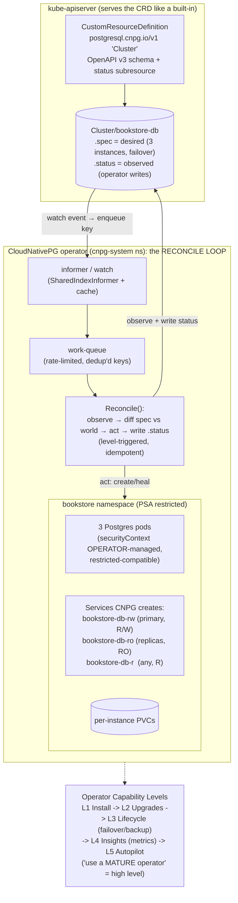

# 05: Operators and CRDs

> Extending the API: **CustomResourceDefinitions** (OpenAPI v3 schema/
> validation, versions/conversion, the status subresource; the apiserver
> serves them like built-ins); the **controller pattern** (the reconcile loop:
> observe → diff → act, level-triggered, idempotent; the [Part 00
> declarative model](../00-foundations/06-declarative-api-model.md) made
> programmable); what an **Operator** *is* (CRD + controller encoding
> operational knowledge: provisioning, failover, backup, upgrade); the
> **Operator Capability Levels**, **OLM/OperatorHub**, the **build-vs-buy**
> decision (the Bookstore Postgres is the case study), and a conceptually
> accurate tour of a controller's internals (informers / work-queue /
> SharedIndexInformer). Then the **Bookstore re-platform**: the DIY Postgres
> StatefulSet → a **CloudNativePG `Cluster`** (an *additive alternative*, not a
> deletion: analogous to Gateway-vs-Ingress) with the **`DB_DSN` rewire** to
> the operator-created `-rw` Service shown reversibly. The operator's RBAC and
> the CRD schema are the input validation you read before you install either.

**Estimated time:** ~30 min read · ~90 min hands-on
**Lab tier:** A (kind). Run the hands-on only against a cluster you own.
**Prerequisites:** [Part 00 ch.06](../00-foundations/06-declarative-api-model.md): the declarative model an operator extends · [Part 01 ch.05](../01-core-workloads/05-statefulsets.md): the DIY Postgres StatefulSet a CNPG Cluster replaces · [Part 03 ch.05](../03-config-and-storage/05-stateful-data-patterns.md): operator-managed stateful patterns
**You'll know after this:** • write a CRD with OpenAPI v3 schema, versions and the status subresource · • explain the controller reconcile loop (observe → diff → act; level-triggered, idempotent) · • read the build-vs-buy framework via the Operator Capability Levels · • read an operator's ClusterRole before you install it · • re-platform Postgres from a StatefulSet to a CNPG `Cluster` reversibly · • rewire the Bookstore `DB_DSN` to the operator-managed `-rw` Service

<!-- tags: core-objects, platform-engineering, stateful, day-2, cnpg -->

## Why this exists

The guide has now used a dozen CRD-backed APIs: `VolumeSnapshot`
([Part 03 ch.05](../03-config-and-storage/05-stateful-data-patterns.md)),
`HTTPRoute` ([Part 02 ch.05](../02-networking/05-gateway-api.md)), Kyverno
`ClusterPolicy`, Prometheus `ServiceMonitor`, KEDA `ScaledObject`, Argo CD
`Application` ([Part 07 ch.04](../07-delivery/04-gitops-argocd.md)), Velero
`Backup` ([ch.02](02-backup-and-dr.md)): each carrying the same intrinsic
"`no matches for kind` until the operator is installed" note. Every one is the
**same pattern**: someone taught the Kubernetes API a new noun (a CRD) and ran
a controller that makes that noun *mean something*. This chapter is that
pattern, named and understood: and it answers the question
[Part 03 ch.05](../03-config-and-storage/05-stateful-data-patterns.md)
explicitly deferred: *the Bookstore's teaching Postgres StatefulSet is wrong
for production: what is the operator that replaces it, and how does the
swap actually work?*

Two reasons this is the part's penultimate chapter, not a footnote:

1. **Operators are how Kubernetes is actually extended in production.** The
   declarative model ([Part 00
   ch.06](../00-foundations/06-declarative-api-model.md)) isn't only for
   built-in objects: it's a *framework*: CRD + controller lets you manage
   *anything* (a Postgres cluster, a Kafka, a certificate, a cloud bucket) with
   the same `kubectl apply` + reconcile semantics. Not understanding this
   leaves every CRD in the guide as magic.
2. **"Should you run a database on Kubernetes?" has had a deferred answer since
   Part 03.** [Part 01 ch.05](../01-core-workloads/05-statefulsets.md) and
   [Part 03 ch.05](../03-config-and-storage/05-stateful-data-patterns.md) both
   ended on: the DIY StatefulSet is correct for *learning* and a SPOF with no
   failover/PITR/managed upgrades for *production*: use a **managed DB** or a
   **mature operator (CloudNativePG)**. This chapter is where that operator
   becomes concrete, presented (like Gateway-vs-Ingress) as an **additive
   alternative**, not a rewrite of the canonical app.

The reference is *Kubernetes Patterns* ch.27 (Controller) + ch.28 (Operator),
with *Production Kubernetes* for the operational framing.

## Mental model

**CRD = a new noun the apiserver serves; controller = a loop that makes the
noun true; Operator = a controller that encodes an expert's operational
playbook for a stateful thing.**

- **A CRD adds a first-class API type.** Register a `CustomResourceDefinition`
  and the apiserver serves `kubectl get cluster`, validates it against your
  **OpenAPI v3 schema**, version-converts it, stores it in etcd, and runs RBAC
  on it: **exactly like a built-in**. The only difference from `Deployment` is
  that *you* shipped the type. (This is *why* every CRD object in the guide
  prints `no matches for kind` until its CRD is installed: the noun literally
  doesn't exist yet.)
- **A controller is a reconcile loop.** It **watches** objects of some kind,
  compares **desired** (`.spec`) to **observed** (the real world), and **acts**
  to close the gap, then writes **observed back** (`.status`). It is
  **level-triggered** (it reconciles to the *current* desired state, not a
  *stream of edits*: it self-corrects after a missed event) and **idempotent**
  (reconciling an already-correct object is a no-op). This *is* the [Part 00
  declarative model](../00-foundations/06-declarative-api-model.md): built-in
  controllers (Deployment→ReplicaSet→Pods) work this exact way; an operator is
  the same machinery for *your* CRD.
- **An Operator = CRD + controller that encodes operational knowledge.** A bare
  StatefulSet gives identity+storage and **stops there**: *you* are the DBA
  (backups, failover, PITR, version upgrades are manual runbooks). An
  **operator** *is* that DBA as software: its controller watches a
  `postgresql.cnpg.io/v1 Cluster` and continuously *does* the DBA job: 
  provision replicas, stream replication, **fail over** the primary on loss,
  archive WAL for **PITR**, perform **rolling minor upgrades**.
- **Operator Capability Levels** grade how much of that playbook is encoded:
  L1 Basic Install → L2 Seamless Upgrades → L3 Full Lifecycle (backup/
  failover) → L4 Deep Insights (metrics/alerts) → L5 Autopilot (auto-tuning/
  remediation). "Use a mature operator" means **high level**, not "any
  operator".
- **Build vs buy is the real decision.** A Helm chart/StatefulSet suffices when
  the operational logic is trivial (stateless app, or a DB you'll let a
  *managed service* run). You need (or buy) an **operator** when the
  operational logic is hard and stateful: *exactly* the Bookstore Postgres:
  failover + PITR + upgrades are too much to encode in a StatefulSet, so you
  **buy** CloudNativePG rather than **build** that controller yourself.

The trap to keep in view: **an operator is not free magic: it is software you
now run and must trust.** It has a controller Pod, RBAC (often broad: it
manages Pods/PVCs/Secrets), CRD versioning, and its own upgrade story. "Buy a
mature operator" is right *because writing the failover controller yourself is
harder and riskier*: not because operators have no cost.

## Threats and controls

An operator adds three threats a StatefulSet does not have: the operator's own
privilege, the custom resource as untrusted input, and the image the operator
runs for you.

| Threat | Control in this chapter | Deeper |
|---|---|---|
| The operator's ServiceAccount reads every Secret in the cluster | Read the rendered ClusterRole before you install (step 1). The default install grants Secret access in every namespace. The namespaced option removes that rule. | [05.01](../05-security/01-authn-authz-rbac.md), [11.02](../11-advanced-production-patterns/02-operator-development.md) |
| A Cluster author makes the operator create a privileged Pod | The CRD schema accepts `privileged: true`, so schema validation cannot stop it. Pod Security `restricted` on the namespace refuses the Pod the operator would create (step 3). | [05.02](../05-security/02-pod-security.md) |
| A custom resource names an image the platform never reviewed | Pin the operator and Postgres images by digest. For shared clusters, choose images through a `ClusterImageCatalog` the platform owns, not a free `imageName` (step 5). | [05.03](../05-security/03-supply-chain.md) |
| Malformed or out-of-range input reaches the controller | The OpenAPI schema and its enums reject bad values at the API server, before the controller sees them (steps 2 and 6). | [11.01](../11-advanced-production-patterns/01-admission-webhooks.md) |

## Diagrams

### Diagram A: CRD + controller reconcile loop / operator capability levels (Mermaid)



### Diagram B: StatefulSet vs Operator decision (ASCII)

```
 RUN POSTGRES ON KUBERNETES: StatefulSet vs Operator vs Managed ───────────

  Q1: Is it customer/production data?
        NO  (a lab, ephemeral, learning the primitives)
             → DIY StatefulSet is FINE  ◄── the Bookstore's canonical
               (20-postgres-statefulset.yaml: identity/PVC/ordering/snapshot;
                ONE replica, NO failover/PITR/managed upgrade: and that's OK
                for teaching)
        YES → Q2
  Q2: Can you use a MANAGED database (RDS / Cloud SQL / Azure DB)?
        YES → MANAGED  (provider's operator + SLA: backups, HA, PITR, patching;
                         app becomes a Deployment + ExternalName Service.
                         LEAST operational burden: prefer this.)
        NO  (must run in-cluster: data residency, cost, air-gapped) → Q3
  Q3: In-cluster → use a MATURE OPERATOR, not a bigger StatefulSet
        → CloudNativePG `Cluster`  ◄── cnpg-cluster.yaml (THIS chapter)
          encodes as software: streaming replication, AUTOMATED failover,
          WAL archiving + PITR, rolling minor upgrades, metrics
          (see the capability levels above). DO NOT hand-build this controller.

  StatefulSet  ─────────────────────────────────────────────▶  Operator
   you ARE the DBA (manual runbooks)        the operator IS the DBA (software)
   identity + storage, then STOPS           + failover + PITR + upgrades
   1 replica = SPOF                         primary + replicas + auto-failover
   crash-consistent snapshot only           continuous WAL → PITR (seconds RPO)

  ON DISK: cnpg-cluster.yaml is ADDITIVE. 20-postgres-statefulset.yaml is
  KEPT unchanged (alternative, like 51-gateway vs 50-ingress). Mutually
  exclusive at RUNTIME; never a deletion of the canonical app.
```

## Hands-on with the Bookstore

**Assumed working directory: the guide repo root (`full-guide/`).** This chapter
adds [`examples/bookstore/operators/cnpg-cluster.yaml`](../examples/bookstore/operators/cnpg-cluster.yaml).
It does **not** modify `20-postgres-statefulset.yaml` or any canonical
manifest. CloudNativePG is presented as an *additive alternative* data tier
(the Gateway-vs-Ingress precedent), and the `DB_DSN` rewire is shown
reversibly, never by editing `10-`, `14-` or `16-`.

> **Captured output.** Blocks marked *captured* come from a lab run. Its
> transcript is in the guide's evidence folder. That run used a cluster with a
> different name, and its namespaces carried a run prefix, so captured lines
> show prefixed names. The commands here use the names the chapter prints.
> Steps 4 to 9 are reader steps with no captured output: check their results
> on your own cluster.

> **The honest local story.** CloudNativePG's production value is failover plus
> WAL-archived point-in-time recovery (PITR) to an object store. This Hands-on
> runs a real three-instance Cluster and a real failover. It leaves the backup
> stanza out: a kind cluster has no bucket, and a WAL archive that cannot write
> keeps WAL on the data volume until it fills. [Chapter 08.02](02-backup-and-dr.md)
> covers backup and restore.

### 0. Prerequisites: fresh cluster, images and the Bookstore namespace

```sh
kind delete cluster --name bookstore 2>/dev/null || true
kind create cluster --name bookstore
cd examples/bookstore/app
for s in catalog orders payments-worker storefront; do docker build -t bookstore/$s:dev ./$s; done
cd ../../..
for s in catalog orders payments-worker storefront; do kind load docker-image bookstore/$s:dev --name bookstore; done

# We need the bookstore ns + config/secret + the app's stateless tier; the
# CANONICAL postgres StatefulSet (20-) is intentionally NOT applied here: 
# this chapter stands up the OPERATOR-managed Postgres as the alternative.
kubectl apply -f examples/bookstore/raw-manifests/00-namespace.yaml
kubectl apply -f examples/bookstore/raw-manifests/05-serviceaccounts-rbac.yaml
kubectl apply -f examples/bookstore/raw-manifests/15-catalog-config.yaml
kubectl apply -f examples/bookstore/raw-manifests/16-db-credentials.yaml
kubectl apply -f examples/bookstore/raw-manifests/35-priorityclasses.yaml
```

> **Self-bootstrapping note.** After any `kind delete && kind create`, re-`kind
> load` the four images, re-run the chain above, and re-install the operator
> (step 4). A fresh cluster has neither the images nor CNPG.

### 1. Read the ClusterRole before you install the operator

An operator's RBAC is what it can do in your cluster, and the chart renders it
before anything runs. Read it first. The commands below render the ClusterRole
with the chart defaults this guide uses, and they install nothing.

Label the operator's namespace before the install. Save this as
`cnpg-namespace.yaml`, then apply it. The restricted labels mean the operator's
own pods meet the same admission rules as the Bookstore.

```yaml
apiVersion: v1
kind: Namespace
metadata:
  name: cnpg-system
  labels:
    pod-security.kubernetes.io/enforce: restricted
    pod-security.kubernetes.io/audit: restricted
    pod-security.kubernetes.io/warn: restricted
```

```sh
kubectl apply -f cnpg-namespace.yaml
helm repo add cnpg https://cloudnative-pg.github.io/charts
helm repo update cnpg
helm template cnpg cnpg/cloudnative-pg --version 0.29.1 \
  --namespace cnpg-system --show-only templates/rbac.yaml > rbac.yaml
awk '/^kind: ClusterRole$/{on=1} /^---$/{on=0} on' rbac.yaml \
  | grep -B3 -A9 '^  - secrets$'
```

<!-- gate: output -->
```
  - ""
  resources:
  - configmaps
  - secrets
  - services
  verbs:
  - create
  - delete
  - get
  - list
  - patch
  - update
  - watch
```

The rule grants seven verbs on Secrets. The ClusterRoleBinding in the same
render gives it to the operator's ServiceAccount, so it applies in every
namespace, not only the one the operator runs in. The same ClusterRole also
lets the operator create, delete and get Pods, execute into them through the
`pods/exec` subresource, and create and patch Roles and RoleBindings:

```sh
awk '/^kind: ClusterRole$/{on=1} /^---$/{on=0} on' rbac.yaml \
  | grep -B3 -A4 '^  - pods/exec$'
awk '/^kind: ClusterRole$/{on=1} /^---$/{on=0} on' rbac.yaml \
  | grep -B3 -A6 '^  - rolebindings$'
```

<!-- gate: output -->
```
  resources:
  - persistentvolumeclaims
  - pods
  - pods/exec
  verbs:
  - create
  - delete
  - get
- apiGroups:
  - rbac.authorization.k8s.io
  resources:
  - rolebindings
  - roles
  verbs:
  - create
  - get
  - list
  - patch
```

The RBAC escalation check stops the operator from binding a role that carries
more rights than it holds, so it cannot hand itself `cluster-admin`. Its
reach is the list above: Secrets everywhere, Pods and `pods/exec` everywhere.
The [Kubernetes RBAC reference](https://kubernetes.io/docs/reference/access-authn-authz/rbac/#restrictions-on-role-creation-or-update)
sets out that rule.

Two options narrow this. The first is the chart's `config.clusterWide=false`.
Its ClusterRole has no Secret rule, and the chart renders one namespaced Role
in the operator's own namespace instead:

```sh
helm template cnpg cnpg/cloudnative-pg --version 0.29.1 \
  --namespace cnpg-system --set config.clusterWide=false \
  --show-only templates/rbac.yaml > rbac-namespaced.yaml
awk '/^kind: ClusterRole$/{on=1} /^---$/{on=0} on' rbac-namespaced.yaml \
  | grep -c '^  - secrets$'
grep -c '^kind: Role$' rbac-namespaced.yaml
```

<!-- gate: output -->
```
0
1
```

The first count is the Secret rules left in the ClusterRole, and it is 0. The
second is the namespaced Roles, and it is 1. The namespaced Role lives in
`cnpg-system`. A namespaced install that must manage `bookstore` needs its own
Role and RoleBinding there, plus `WATCH_NAMESPACE` set so the operator watches
that namespace. That work is the cost of the narrower option. The lab keeps the
cluster-wide default, and the production notes say when to pay that cost.

The chart's pod template also bounds the operator itself. Its container runs
non-root, with a read-only root filesystem, RuntimeDefault seccomp, no
privilege escalation and all capabilities dropped (the `containerSecurityContext`
and `podSecurityContext` values). The Deployment does not set
`automountServiceAccountToken`, so the token is mounted. The operator needs it
to reach the API, and its ServiceAccount is dedicated to it. That is the case
the [baseline](../01-core-workloads/01-pods.md#baseline) allows.

### 2. Check the CRDs with the server before you install them

The CRD schema is the operator's input validation. It decides which `Cluster`
objects the API server will store. Read what it accepts before you apply one.
The two fields that matter here are `privileged`, under the container security
context, and the `primaryUpdateStrategy` enum.

```sh
helm template cnpg cnpg/cloudnative-pg --version 0.29.1 \
  --namespace cnpg-system --show-only templates/crds/crds.yaml > crds.yaml
grep -m1 -A4 'privileged:' crds.yaml
grep -m1 -A10 'primaryUpdateStrategy:' crds.yaml | tail -n 4
```

<!-- gate: output -->
```
                  privileged:
                    description: |-
                      Run container in privileged mode.
                      Processes in privileged containers are essentially equivalent to root on the host.
                      Defaults to false.
                - unsupervised
                - supervised
                type: string
              priorityClassName:
```

`privileged` is a boolean, and the schema accepts `true`. Schema validation
checks types, enums and required fields. It does not judge whether a container
should be privileged, so the schema cannot stop a Cluster from asking for one.
Admission can, and step 3 shows it. The enum accepts only `unsupervised` and
`supervised`, and the API server enforces that on every write.

Until the CRDs exist, the API server does not know the kind at all. A
client-side dry run shows that before any install:

```sh
kubectl apply --dry-run=client -f examples/bookstore/operators/cnpg-cluster.yaml
```

<!-- gate: output -->
```
error: resource mapping not found for name: "bookstore-db" namespace: "p08-05-bookstore" from "STDIN": no matches for kind "Cluster" in version "postgresql.cnpg.io/v1"
ensure CRDs are installed first
```

The same `no matches for kind` result appears for every CRD-backed file in the
guide, such as [`velero-backup.yaml`](../examples/bookstore/operators/velero-backup.yaml).
It means the type is missing, not that the file is wrong. Now dry-run the
chart's CRDs against the server. Both commands store nothing:

```sh
kubectl apply --dry-run=server -f crds.yaml
kubectl apply --dry-run=server --server-side -f crds.yaml
```

<!-- gate: output -->
```
customresourcedefinition.apiextensions.k8s.io/backups.postgresql.cnpg.io created (server dry run)
customresourcedefinition.apiextensions.k8s.io/clusterimagecatalogs.postgresql.cnpg.io created (server dry run)
customresourcedefinition.apiextensions.k8s.io/databaseroles.postgresql.cnpg.io created (server dry run)
customresourcedefinition.apiextensions.k8s.io/databases.postgresql.cnpg.io created (server dry run)
customresourcedefinition.apiextensions.k8s.io/failoverquorums.postgresql.cnpg.io created (server dry run)
customresourcedefinition.apiextensions.k8s.io/imagecatalogs.postgresql.cnpg.io created (server dry run)
customresourcedefinition.apiextensions.k8s.io/publications.postgresql.cnpg.io created (server dry run)
customresourcedefinition.apiextensions.k8s.io/scheduledbackups.postgresql.cnpg.io created (server dry run)
customresourcedefinition.apiextensions.k8s.io/subscriptions.postgresql.cnpg.io created (server dry run)
Error from server (Invalid): error when creating "crds.yaml": CustomResourceDefinition.apiextensions.k8s.io "clusters.postgresql.cnpg.io" is invalid: metadata.annotations: Too long: may not be more than 262144 bytes
Error from server (Invalid): error when creating "crds.yaml": CustomResourceDefinition.apiextensions.k8s.io "poolers.postgresql.cnpg.io" is invalid: metadata.annotations: Too long: may not be more than 262144 bytes
```

The second command, server-side apply, prints the following:

<!-- gate: output -->
```
customresourcedefinition.apiextensions.k8s.io/backups.postgresql.cnpg.io serverside-applied (server dry run)
customresourcedefinition.apiextensions.k8s.io/clusterimagecatalogs.postgresql.cnpg.io serverside-applied (server dry run)
customresourcedefinition.apiextensions.k8s.io/clusters.postgresql.cnpg.io serverside-applied (server dry run)
customresourcedefinition.apiextensions.k8s.io/databaseroles.postgresql.cnpg.io serverside-applied (server dry run)
customresourcedefinition.apiextensions.k8s.io/databases.postgresql.cnpg.io serverside-applied (server dry run)
customresourcedefinition.apiextensions.k8s.io/failoverquorums.postgresql.cnpg.io serverside-applied (server dry run)
customresourcedefinition.apiextensions.k8s.io/imagecatalogs.postgresql.cnpg.io serverside-applied (server dry run)
customresourcedefinition.apiextensions.k8s.io/poolers.postgresql.cnpg.io serverside-applied (server dry run)
customresourcedefinition.apiextensions.k8s.io/publications.postgresql.cnpg.io serverside-applied (server dry run)
customresourcedefinition.apiextensions.k8s.io/scheduledbackups.postgresql.cnpg.io serverside-applied (server dry run)
customresourcedefinition.apiextensions.k8s.io/subscriptions.postgresql.cnpg.io serverside-applied (server dry run)
```

Client-side apply refuses two of the eleven CRDs. kubectl stores the applied
object in a last-applied annotation, and the `clusters` and `poolers`
definitions are too large for that annotation's 256 KiB limit. Server-side
apply writes no such annotation and accepts all eleven, so use `--server-side`
for these CRDs.

### 3. Refuse a privileged Pod at admission

The operator creates Pods from the Cluster's spec. Pod Security admission on the
namespace checks those Pods at the API server, whatever the CRD allowed. The
Bookstore namespace from the prerequisites carries `restricted`. Dry-run a Pod
that asks for privilege, as the admin, to see the refusal. Nothing is created.
This is a deliberate action: the request is refused.

```sh
kubectl run privileged-probe -n bookstore --restart=Never --dry-run=server \
  --image=ghcr.io/cloudnative-pg/postgresql:16.10-minimal-trixie@sha256:294fd7631f8d66fa54bf6ffa2948af685a20fb695fe748a6bafa71c42f1233b7 \
  --overrides='{"spec":{"containers":[{"name":"privileged-probe","image":"ghcr.io/cloudnative-pg/postgresql:16.10-minimal-trixie@sha256:294fd7631f8d66fa54bf6ffa2948af685a20fb695fe748a6bafa71c42f1233b7","securityContext":{"privileged":true}}]}}'
```

If the dry run reports that the `default` ServiceAccount is missing, the
namespace was created a moment ago. Wait a second and run it again.

<!-- gate: output -->
```
Error from server (Forbidden): pods "privileged-probe" is forbidden: violates PodSecurity "restricted:latest": privileged (container "privileged-probe" must not set securityContext.privileged=true), allowPrivilegeEscalation != false (container "privileged-probe" must set securityContext.allowPrivilegeEscalation=false), unrestricted capabilities (container "privileged-probe" must set securityContext.capabilities.drop=["ALL"]), runAsNonRoot != true (pod or container "privileged-probe" must set securityContext.runAsNonRoot=true), seccompProfile (pod or container "privileged-probe" must set securityContext.seccompProfile.type to "RuntimeDefault" or "Localhost")
```

The refusal lists every rule the Pod breaks, not only privilege. The same check
runs on the Pods CloudNativePG creates, so an instance that the Cluster asks to
run privileged never starts in this namespace.

The migration Pod that step 7 runs passes the same check. It carries the
[baseline](../01-core-workloads/01-pods.md#baseline) in full. The fields to
confirm for this image are the UID and the GID. Read the UID the image declares
on a running instance, with
`kubectl get pod <primary> -n bookstore -o jsonpath='{.spec.containers[0].securityContext.runAsUser}'`,
and match it here before you apply the Pod:

```yaml
apiVersion: v1
kind: Pod
metadata:
  name: db-migrate-cnpg
  namespace: bookstore
spec:
  restartPolicy: Never
  automountServiceAccountToken: false
  securityContext:
    runAsNonRoot: true
    runAsUser: 26                  # the UID the image declares: confirm it
    runAsGroup: 26
    seccompProfile:
      type: RuntimeDefault
  containers:
    - name: migrate
      image: ghcr.io/cloudnative-pg/postgresql:16.10-minimal-trixie@sha256:294fd7631f8d66fa54bf6ffa2948af685a20fb695fe748a6bafa71c42f1233b7
      command: ["/bin/sh", "-c"]
      args:
        - |
          until pg_isready -q; do sleep 2; done
          psql -v ON_ERROR_STOP=1 -c "CREATE TABLE IF NOT EXISTS books (id SERIAL PRIMARY KEY, title TEXT, author TEXT, price NUMERIC); CREATE TABLE IF NOT EXISTS orders (id SERIAL PRIMARY KEY, book_id INT, qty INT, created_at TIMESTAMPTZ);"
          echo migration complete
      env:
        - name: PGHOST
          value: bookstore-db-rw.bookstore.svc.cluster.local
        - name: PGDATABASE
          value: bookstore
        - name: PGUSER
          valueFrom: {secretKeyRef: {name: cnpg-app-credentials, key: username}}
        - name: PGPASSWORD
          valueFrom: {secretKeyRef: {name: cnpg-app-credentials, key: password}}
      securityContext:
        allowPrivilegeEscalation: false
        readOnlyRootFilesystem: true
        capabilities:
          drop: ["ALL"]
      resources:
        requests: {cpu: 50m, memory: 64Mi}
        limits: {memory: 128Mi}
      volumeMounts:
        - name: tmp
          mountPath: /tmp
  volumes:
    - name: tmp
      emptyDir: {}
```

```sh
kubectl apply --dry-run=server -f migrate.yaml
```

<!-- gate: output -->
```
pod/db-migrate-cnpg created (server dry run)
```

The [CloudNativePG security page](https://github.com/cloudnative-pg/cloudnative-pg/blob/main/docs/src/security.md)
says the instance pods run with a read-only root filesystem, as non-root, with
RuntimeDefault seccomp when the Cluster leaves it unset, and with privilege
escalation off and all capabilities dropped by default. The same page says the
admission chain, not the operator, enforces Pod Security profiles. The
restricted namespace is that chain, so it is the backstop when a Cluster asks
for more.

### 4. Install the operator with its version and digest pinned

Dry-run the chart's objects into the restricted namespace first. Nothing is
stored. A Pod Security violation in the operator's pod template would appear
here as a warning, because the namespace sets `warn` to restricted:

```sh
OP_TAG='1.30.1@sha256:923c267ec29636db3bee20f993d0ec4973fa22998e1adad37da79e4d32b5bc07'
helm template cnpg cnpg/cloudnative-pg --version 0.29.1 \
  --namespace cnpg-system --set image.tag="$OP_TAG" \
  --show-only templates/deployment.yaml | grep -m1 'image:'
helm template cnpg cnpg/cloudnative-pg --version 0.29.1 \
  --namespace cnpg-system --set image.tag="$OP_TAG" \
  --show-only templates/rbac.yaml --show-only templates/config.yaml \
  --show-only templates/deployment.yaml --show-only templates/service.yaml \
  > operator.yaml
kubectl apply --dry-run=server -n cnpg-system -f operator.yaml
```

<!-- gate: output -->
```
        image: "ghcr.io/cloudnative-pg/cloudnative-pg:1.30.1@sha256:923c267ec29636db3bee20f993d0ec4973fa22998e1adad37da79e4d32b5bc07"
serviceaccount/cnpg-cloudnative-pg created (server dry run)
clusterrole.rbac.authorization.k8s.io/cnpg-cloudnative-pg created (server dry run)
clusterrole.rbac.authorization.k8s.io/cnpg-cloudnative-pg-view created (server dry run)
clusterrole.rbac.authorization.k8s.io/cnpg-cloudnative-pg-edit created (server dry run)
clusterrolebinding.rbac.authorization.k8s.io/cnpg-cloudnative-pg created (server dry run)
configmap/cnpg-controller-manager-config created (server dry run)
deployment.apps/cnpg-cloudnative-pg created (server dry run)
service/cnpg-webhook-service created (server dry run)
```

No warning appears, so the operator's pod template meets the restricted rules.
The image line carries the version and the digest together. The chart joins
`image.tag` to the repository with a colon, which gives the reference above.
Now install the chart, with the version pinned in the command:

```sh
helm install cnpg cnpg/cloudnative-pg --version 0.29.1 \
  --namespace cnpg-system \
  --set image.tag="$OP_TAG" \
  --wait --timeout 5m
kubectl -n cnpg-system rollout status deploy/cnpg-cloudnative-pg
```

Upgrading the operator is a change of its own. Bump the chart version and the
digest in one reviewed change, and read the new ClusterRole render from step 1
before you apply it. Watch the operator's own pod as well as the database. If
the operator is down, existing instances keep running, but nothing fails over.

### 5. Apply the Cluster and read its status

Create the basic-auth Secret first, with a password generated now. The Cluster
reads it at bootstrap, and the manifest carries no password:

```sh
PGPASS=$(openssl rand -hex 16)
kubectl create secret generic cnpg-app-credentials -n bookstore \
  --type=kubernetes.io/basic-auth \
  --from-literal=username=bookstore --from-literal=password="$PGPASS"
kubectl apply -f examples/bookstore/operators/cnpg-cluster.yaml
kubectl wait cluster/bookstore-db -n bookstore \
  --for=jsonpath='{.status.readyInstances}'=3 --timeout=420s
kubectl get cluster bookstore-db -n bookstore
kubectl get svc -n bookstore -l cnpg.io/cluster=bookstore-db
```

The file pins the Postgres image by digest and sets `enableSuperuserAccess` to
`false`, so the operator creates no superuser Secret. The `monitoring` field
asks for a PodMonitor, a type that comes from the Prometheus Operator's CRDs
([Part 06](../06-production-readiness/01-observability-metrics.md)). On a cluster
without those CRDs, set it to `false`.

Creating a `Cluster` is a privileged act. Once it exists, the
operator runs the image and the settings the Cluster names. Limit who may
create `clusters.postgresql.cnpg.io` with ordinary RBAC, as
[Part 05 ch.01](../05-security/01-authn-authz-rbac.md) describes. On a shared
cluster, name images through a `ClusterImageCatalog` the platform team owns
(`spec.imageCatalogRef`) rather than a free `imageName`.

The Services `bookstore-db-rw`, `-ro` and `-r` are CloudNativePG's names for the
primary, the replicas and any instance. The rewire in step 7 uses `-rw`. Check
the instance pods on your cluster as well:

```sh
PRIMARY=$(kubectl get cluster bookstore-db -n bookstore -o jsonpath='{.status.currentPrimary}')
kubectl get pod "$PRIMARY" -n bookstore -o jsonpath='{.spec.containers[0].securityContext}'
```

### 6. Test the schema on the live Cluster

The API server checks every write against the schema from step 2. Try a value
outside the enum with a server dry run, which stores nothing:

```sh
kubectl patch cluster bookstore-db -n bookstore --type merge --dry-run=server \
  -p '{"spec":{"primaryUpdateStrategy":"yolo"}}'
```

The server should refuse `yolo`, because the CRD's enum allows only
`unsupervised` and `supervised`. The check comes from the schema, so every
client gets the same answer. Kubernetes describes how CRD schemas validate in
[Extend the Kubernetes API with CustomResourceDefinitions](https://kubernetes.io/docs/tasks/extend-kubernetes/custom-resources/custom-resource-definitions/).
The `privileged` field passes the same validation as any boolean. That is why
step 3 exists.

### 7. Migrate the database, then rewire catalog and orders

The CloudNativePG database starts empty. `initdb` created the database and its
owner, not the Bookstore tables. The canonical migrate Job
(`21-db-migrate-job.yaml`) points at the DIY Service, which this chapter does
not create. Run the same idempotent SQL as the restricted Pod from step 3,
against the `-rw` Service:

```sh
kubectl apply -f migrate.yaml
kubectl wait pod/db-migrate-cnpg -n bookstore \
  --for=jsonpath='{.status.phase}'=Succeeded --timeout=300s
kubectl logs pod/db-migrate-cnpg -n bookstore
kubectl delete pod db-migrate-cnpg -n bookstore
```

Next, deploy catalog and orders. They still carry the canonical `DB_DSN`, which
names the DIY host, so they are not Ready yet. Redis stays because the catalog
config sets `REDIS_ADDR`. RabbitMQ is left out: orders publishes only when
`AMQP_URL` is set, and this chapter leaves it unset.

```sh
kubectl apply -f examples/bookstore/raw-manifests/12-redis.yaml
kubectl apply -f examples/bookstore/raw-manifests/40-services.yaml
kubectl apply -f examples/bookstore/raw-manifests/10-catalog-deploy.yaml
kubectl apply -f examples/bookstore/raw-manifests/14-orders-deploy.yaml
```

The rewire moves only the host, and it keeps the password out of the
Deployment spec. The DSN goes into a Secret, and `kubectl set env --from
--keys` makes the Deployment read that key from the Secret:

```sh
PGPASS=$(kubectl get secret cnpg-app-credentials -n bookstore \
  -o jsonpath='{.data.password}' | base64 -d)
kubectl create secret generic bookstore-db-dsn -n bookstore \
  --from-literal=DB_DSN="host=bookstore-db-rw.bookstore.svc.cluster.local port=5432 user=bookstore password=$PGPASS dbname=bookstore sslmode=require"
kubectl set env deploy/catalog deploy/orders -n bookstore \
  --from=secret/bookstore-db-dsn --keys=DB_DSN
kubectl set env deploy/catalog -n bookstore --list | grep '^DB_DSN'
kubectl rollout status deploy/catalog -n bookstore
kubectl rollout status deploy/orders -n bookstore
kubectl logs deploy/catalog -n bookstore | grep 'postgres configured'
```

`sslmode=require` encrypts the connection but does not check the server's
certificate. Production should verify the certificate against the operator's
CA, which is a Secret and trust change, not a flag flip.

### 8. Fail the primary over

A bare StatefulSet cannot do this, which is the point of the operator. Delete
the primary and watch the operator promote a replica and move the `-rw`
Service:

```sh
PRIMARY=$(kubectl get cluster bookstore-db -n bookstore -o jsonpath='{.status.currentPrimary}')
kubectl delete pod "$PRIMARY" -n bookstore
kubectl get cluster bookstore-db -n bookstore -w
```

Stop the watch when `currentPrimary` names a different pod and the Cluster
reports three ready instances again. Catalog and orders reach the new primary
through the same name, `bookstore-db-rw`, because their DSN names the Service
and not a pod. That is the rewire's purpose.

### 9. Revert the rewire, then clean up

Revert by restoring the previous pod template, which carries the canonical
`DB_DSN` value. Do not unset the variable instead. With `DB_DSN` unset, the
catalog silently serves its built-in sample books.

```sh
kubectl rollout undo deploy/catalog -n bookstore
kubectl rollout undo deploy/orders -n bookstore
```

The canonical host has no Service in this chapter, so these pods stop being
Ready until the canonical database returns. That is the expected state without
the DIY StatefulSet.

On a kind cluster you own, `kind delete cluster --name bookstore` is the quick
reset. On a cluster you share, delete what this chapter created:

```sh
kubectl delete cluster bookstore-db -n bookstore --wait=true
kubectl delete namespace bookstore --wait=true
helm uninstall cnpg -n cnpg-system
kubectl get crd -o name | grep 'cnpg.io' | while read -r c; do kubectl delete "$c"; done
kubectl delete namespace cnpg-system --wait=true
```

The CRD line removes any CloudNativePG CRD that the uninstall left behind.
Deleting a CRD deletes every object of its kind, so run it only after the
Cluster is gone, as above.

## How it works under the hood

- **A CRD is a real API type, served by the apiserver.** Applying a
  `CustomResourceDefinition` makes the apiserver dynamically serve a new
  REST path; requests are **validated against the CRD's OpenAPI v3 schema**
  (the same structural-schema machinery that validates built-ins), persisted in
  **etcd** like any object, **version-converted** on read (a `v1beta1`→`v1`
  conversion webhook, mirroring the built-in API lifecycle of
  [ch.01](01-cluster-lifecycle.md)), and subject to **RBAC** and **admission**.
  A `status` **subresource** splits writes so a controller updating `.status`
  doesn't fight a user editing `.spec`. The CR is inert data until a controller
  acts on it: which is precisely *why* every CRD object in this guide
  dry-runs as `no matches for kind` until its operator is installed: without
  the CRD the *type does not exist*; with the CRD but no controller the object
  exists but *nothing makes it true*.
- **A controller is `for { reconcile() }`.** It establishes a **watch** on its
  kind, maintained by an **informer**: a `SharedIndexInformer` does one watch,
  keeps a local **cache (store/indexer)**, and on every add/update/delete
  enqueues the object's **key** (`namespace/name`) onto a **rate-limited,
  de-duplicating work-queue**. Workers pop a key and call **`Reconcile(key)`**,
  which reads *current* desired+observed state and drives the world toward
  desired: then writes `.status`. It is **level-triggered** (it always
  reconciles to the *latest* desired state from the cache, so a missed/duplicate
  event is harmless: contrast edge-triggered, which would lose a missed edit)
  and **idempotent** (an already-correct object reconciles to a no-op). This is
  the **identical machinery** as the built-in Deployment→ReplicaSet→Pod
  controllers: the operator pattern is "this loop, for *your* CRD" and is the
  [Part 00 declarative model](../00-foundations/06-declarative-api-model.md)
  made programmable.
- **An operator encodes a human runbook as that loop.** CloudNativePG's
  `Reconcile` for a `Cluster` *is* a DBA: ensure N instances exist, configure
  streaming replication, **on primary loss promote the healthiest replica and
  repoint the `-rw` Service**, archive WAL continuously for **PITR**, and
  perform **rolling minor upgrades** (drain a replica, upgrade, rejoin,
  finally switch the primary per `primaryUpdateStrategy`). A StatefulSet's
  controller reconciles *only* "N pods with stable identity + PVCs" and
  **stops**: every DBA action above is *your* manual runbook. The operator is
  that runbook, level-triggered and always-on. It also sets the instance pods'
  `securityContext` itself, which is operational correctness encoded, not
  hand-maintained. The admission chain still judges the result.
- **Capability Levels are a maturity claim, not a label.** L1 install only → L2
  seamless upgrades → L3 full lifecycle (backup/restore/failover) → L4 deep
  insights (metrics/alerts) → L5 autopilot (auto-tune/auto-remediate). Check an
  operator's own documentation for the levels it claims, then test the ones you
  depend on. This chapter tests failover. [Chapter 08.02](02-backup-and-dr.md)
  covers PITR. "Use a *mature* operator" ([Part 03
  ch.05](../03-config-and-storage/05-stateful-data-patterns.md)) means pick a
  high level, because a low-level operator hands the hard parts (failover)
  back to you while still adding a controller to operate.
- **OLM & OperatorHub.** Hand-installing operators (CRDs + RBAC + the
  controller Deployment, here via Helm) is fine at small scale. **Operator
  Lifecycle Manager** manages *operators themselves*: discovery
  (**OperatorHub**), versioned channels, dependency resolution, and **operator
  upgrades**: the "operator for your operators". Relevant at fleet scale; the
  Helm install is the right depth for one cluster.
- **Why CNPG is *additive*, not a replacement (the on-disk discipline).**
  `cnpg-cluster.yaml` is a **new file**; `20-postgres-statefulset.yaml` is
  **kept unchanged**: the *exact* relationship `51-gateway.yaml` has to
  `50-ingress.yaml` ([Part 02 ch.05](../02-networking/05-gateway-api.md)): two
  ways to provide the same capability, the modern one shipped alongside the
  teaching one, neither deleting the other. They are mutually exclusive *at
  runtime* (don't run both as the Bookstore's Postgres) but purely additive *on
  disk*. The credentials are an **additive** basic-auth Secret created at run
  time (CNPG's `initdb.secret` expects a `kubernetes.io/basic-auth` Secret), so
  the canonical `db-credentials` is not mutated. The `DB_DSN` rewire
  (`postgres` → `bookstore-db-rw`) is an **operational/overlay** change shown
  reversibly, so the canonical app on disk is byte-for-byte unchanged.

## Production notes

> **In production: prefer managed > mature operator > DIY StatefulSet for
> stateful data.** The Bookstore's `20-postgres-statefulset.yaml` is correct
> for *learning the primitives* and a SPOF with no failover/PITR/managed
> upgrades for *production* ([Part 01
> ch.05](../01-core-workloads/05-statefulsets.md), [Part 03
> ch.05](../03-config-and-storage/05-stateful-data-patterns.md)). Reach for a
> **managed DB** (RDS/Cloud SQL/Azure DB: the provider's operator + SLA) when
> you can; if you must run in-cluster, a **mature, high-capability operator**
> (CloudNativePG/Zalando/Crunchy; Strimzi for Kafka): never a *bigger*
> StatefulSet. The decision (Diagram B) constrains your cluster and DR for
> years; make it deliberately.

> **In production: the DB_DSN rewire is a GitOps change, and it's a real
> migration, not a flag flip.** Repointing `DB_DSN` from `postgres` to
> `bookstore-db-rw` is a **Kustomize overlay/Helm-value change reviewed and
> rolled out via Argo CD** ([Part 07
> ch.04](../07-delivery/04-gitops-argocd.md)), *not* a hand `kubectl set env`
> (that is drift GitOps self-heals away). And moving the *data* from the old
> StatefulSet to the CNPG cluster is a genuine **data migration** (logical
> dump/restore or `pg_basebackup`/replication cutover, with a backup and a
> tested rollback: [ch.02](02-backup-and-dr.md)), planned with an RPO/RTO and
> a maintenance window: not just changing a hostname.

> **In production: the operator's RBAC is a standing decision.** The
> cluster-wide default in step 1 is the right trade for a shared platform that
> wants one operator for every namespace, and the wrong one for a cluster where
> teams should not share a controller's Secret read. Choose it on purpose:
> render the namespaced option, add the Role and RoleBinding each managed
> namespace needs, and record which option you picked and why, in the same
> review as the chart version.

> **In production: build a CRD/operator only when buying genuinely doesn't fit.**
> The pattern (CRD + controller-runtime reconcile loop) is also how *you*
> encode *your* org's operational knowledge (a "TenantEnvironment" CRD, a
> certificate workflow). But **build-vs-buy strongly favours buy**: a mature
> operator is years of encoded failure-handling. Build when no operator covers
> your domain: and then treat your controller as production software (leader
> election for HA, bounded reconcile, tested idempotency, RBAC least-privilege,
> the same rigor as any service).

## Quick Reference

```sh
# CRDs the cluster serves (each = a new API noun a controller makes true)
kubectl get crd
kubectl explain cluster.spec --api-version=postgresql.cnpg.io/v1   # CRD schema

# Read the RBAC an operator asks for, before you install it
helm template cnpg cnpg/cloudnative-pg --version 0.29.1 \
  --namespace cnpg-system --show-only templates/rbac.yaml > rbac.yaml

# Install an operator: pinned chart and image digest, restricted namespace
helm repo add cnpg https://cloudnative-pg.github.io/charts && helm repo update cnpg
helm install cnpg cnpg/cloudnative-pg --version 0.29.1 \
  --namespace cnpg-system --set image.tag="$OP_TAG" --wait

# Check CRD validation on the server (stores nothing)
kubectl apply --dry-run=server --server-side -f crds.yaml

# The Bookstore re-platform (ADDITIVE: 20-postgres-statefulset.yaml unchanged)
kubectl apply -f examples/bookstore/operators/cnpg-cluster.yaml
kubectl get cluster bookstore-db -n bookstore
kubectl get svc -n bookstore -l cnpg.io/cluster=bookstore-db

# DB_DSN rewire to the operator primary (reversible; no canonical edit)
kubectl set env deploy/catalog deploy/orders -n bookstore \
  --from=secret/bookstore-db-dsn --keys=DB_DSN
kubectl rollout undo deploy/catalog -n bookstore     # REVERT
kubectl rollout undo deploy/orders -n bookstore
```

Checklist:

- [ ] Understand CRD (= a new apiserver-served type, OpenAPI-validated, in
      etcd) + controller (= level-triggered, idempotent reconcile loop) =
      Operator (= that loop encoding an operational runbook)
- [ ] **Build vs buy:** stateless/managed → StatefulSet/managed-DB; hard
      stateful in-cluster → a **mature (high-capability) operator**, not a
      bigger StatefulSet
- [ ] Read the operator's ClusterRole before install: Secret, Pod, exec and
      binding rights, and whether the namespaced option fits
- [ ] The CRD schema is input validation: check its enums and its boolean
      security fields, and remember that admission, not the schema, judges
      intent
- [ ] The operator and the Postgres image are pinned by version and digest;
      Pods run in a `restricted` namespace
- [ ] The operator runs in its **own namespace**, chart **pinned**, operator
      upgrade ≠ DB upgrade, both tested
- [ ] CNPG is **additive** (`cnpg-cluster.yaml` new; `20-postgres-statefulset.yaml`
      unchanged on disk); the password is generated at run time, not committed
- [ ] `DB_DSN` rewire (`postgres` → `bookstore-db-rw`) is a **GitOps overlay
      change** in production, shown **reversibly** here; data move is a planned
      **migration** (backup + tested rollback: [ch.02](02-backup-and-dr.md))

## Test your understanding

> Try each before opening the answer drawer. The act of trying is the exercise; the answer is the check.

1. **In one sentence each, define CRD, Controller, and Operator, and explain how they compose.**
   <details><summary>Show answer</summary>

   **CRD** = a `CustomResourceDefinition` registered with the apiserver: teaches the API a new noun (e.g., `kind: Cluster`) with OpenAPI v3 validation, served like a built-in. **Controller** = a reconcile loop (observe → diff → act, level-triggered + idempotent) watching some object kind and making the world match `.spec`. **Operator** = a CRD + controller pair encoding an expert's operational knowledge for a stateful thing (Postgres failover, certificate renewal, backup orchestration). Operator = CRD + Controller + Domain Expertise. See §Mental model.

   </details>

2. **Why does the chapter say a controller is "level-triggered, not edge-triggered", and why does that matter?**
   <details><summary>Show answer</summary>

   Level-triggered = the controller reconciles to the **current** state of `.spec`, regardless of how many edits happened or in what order; if it misses an event it self-corrects on the next poll. Edge-triggered = it reacts to *each delta* in sequence; one missed event leaves it desynced forever. Kubernetes is level-triggered because controllers crash, get rate-limited, or lag: and the cluster must still converge. This is why `kubectl apply` is idempotent and why "reconcile every 30s" is correct (boring is good): the controller catches up on its own. The whole declarative model rests on this property.

   </details>

3. **A team wants to "just write our own Postgres controller" because they have specific HA needs. What's the build-vs-buy framework, and what do you tell them?**
   <details><summary>Show answer</summary>

   The Operator Capability Levels (1=install, 2=upgrade, 3=lifecycle, 4=insights, 5=autopilot) give you a target. **Buy** (CloudNativePG, Zalando Postgres Operator, Stackgres) when a mature L4-L5 operator covers your domain: you get years of failure-handling for free. **Build** only when no operator covers your *unique* requirements (a domain-specific CRD like "TenantEnvironment", an internal-only workflow). And then treat your controller as production software (leader election for HA, bounded reconcile, tested idempotency, RBAC). The reality is that 99% of Postgres needs are met by CNPG; build is almost always wrong for general-purpose stateful systems.

   </details>

4. **Hands-on extension: see the additive swap. With the Bookstore deployed, apply `cnpg-cluster.yaml` (CNPG installed). Now run `kubectl get pods -n bookstore -l cnpg.io/cluster=bookstore-db` and `kubectl get svc -n bookstore -l cnpg.io/cluster=bookstore-db`. What does the operator create that you didn't write?**
   <details><summary>What you should see</summary>

   3 pods (`bookstore-db-1`, `-2`, `-3`): one primary, two replicas with streaming replication. Three Services: `bookstore-db-rw` (writes go to primary), `bookstore-db-ro` (reads load-balanced across replicas), `bookstore-db-r` (any healthy instance). The operator handled: HA topology, replica seeding, failover logic, role tracking, Service selectors. You wrote about 25 lines of YAML; CNPG handled hundreds of lines of operational logic that a hand-rolled StatefulSet would have to encode. That's the value proposition of buying an operator over building a StatefulSet.

   </details>

5. **A teammate sees `apiVersion: postgresql.cnpg.io/v1` in a YAML file and asks "is this a real Kubernetes type?" What's the precise answer, and why does it print `no matches for kind` until CNPG is installed?**
   <details><summary>Show answer</summary>

   It's a **real Kubernetes type** in every sense: the apiserver serves it, RBAC applies to it, kubectl handles it, etcd stores it: **once the CNPG CRD is registered**. CRDs add API types **dynamically**; before the CNPG operator is installed, that `Cluster` kind literally doesn't exist in the apiserver, so `kubectl apply` returns `no matches for kind: "Cluster"`. After the CRD is registered (via the operator's Helm install), it's indistinguishable from a built-in type. This is why every CRD-backed object in the guide carries an explicit "needs the operator installed" note: the cluster's API surface is *programmable*.

   </details>

6. **A Cluster manifest sets `spec.securityContext.privileged: true`, and the CRD schema accepts it. What refuses the Pod the operator would then create, and where does that check run?**
   <details><summary>Show answer</summary>

   The namespace's Pod Security admission (the `restricted` level), at the API server, when the operator submits the Pod. The CRD schema only checks that `privileged` is a boolean, so it cannot judge intent. Step 3 ran the same check on a Pod with that setting and got the refusal shown in the captured output.

   </details>

## Further reading

- Ibryam & Huß, _Kubernetes Patterns_ 2e: *Controller* (ch.27) and
  *Operator* (ch.28): the primary reference for the reconcile loop
  (level-triggered, idempotent) and for CRD + controller = operational
  knowledge as software: the conceptual backbone of this chapter.
- Rosso et al., _Production Kubernetes_, ch.11: Building Platform Services
  (operators as the building blocks of an internal platform; the build-vs-buy
  and operate-the-operator framing around the pattern mechanics).
- Official: CustomResourceDefinitions
  <https://kubernetes.io/docs/concepts/extend-kubernetes/api-extension/custom-resources/>
  and the operator pattern
  <https://kubernetes.io/docs/concepts/extend-kubernetes/operator/>, plus the
  CloudNativePG documentation <https://cloudnative-pg.io/documentation/> (the
  operator that re-platforms the Bookstore Postgres).
- CloudNativePG security model (the operator's own page on what it sets, and
  what admission must enforce):
  <https://github.com/cloudnative-pg/cloudnative-pg/blob/main/docs/src/security.md>.
- Kubernetes RBAC restrictions on role creation (the escalation rule in step
  1): <https://kubernetes.io/docs/reference/access-authn-authz/rbac/#restrictions-on-role-creation-or-update>.
