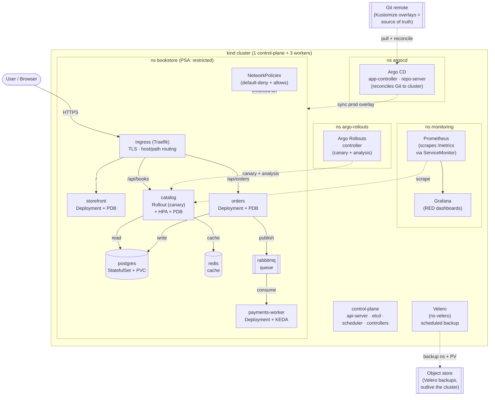

# 01: Bookstore end-to-end

> From an empty machine to a GitOps-delivered, observed, autoscaled, secured,
> backed-up Bookstore, every Part, one run. This is the whole guide as a
> single, ordered, runnable session: stand the system up from nothing, prove
> each production concern with its own check, then tear it down, orchestrating
> only artifacts the earlier parts already built.

**Estimated time:** ~45 min read · half-day hands-on
**Lab tier:** A (kind). Run this chapter's commands only against clusters you own.
**Prerequisites:** [Part
07 ch.04](../07-delivery/04-gitops-argocd.md), Argo CD reconciles the
Kustomize overlays · [Part 07
ch.05](../07-delivery/05-progressive-delivery.md), the catalog Rollout for
canary delivery · [Part 06
ch.01](../06-production-readiness/01-observability-metrics.md), Prometheus /
Alertmanager assertions · [Part 08
ch.02](../08-day-2-operations/02-backup-and-dr.md), Velero is part of the run
· [Part 05 ch.02](../05-security/02-pod-security.md), restricted PSA
throughout **You'll know after this:** • stand up the full Bookstore from an
empty machine via GitOps, in one ordered run · • verify each production
concern (security, observability, autoscaling, DR) with its own check · •
reason about the same 49-object system rendered three ways (raw / Helm /
Kustomize 45-49-48) · • drive a canary release end-to-end and watch Argo
Rollouts roll back on bad metrics · • tear down the cluster cleanly and
explain what each Part contributed

<!-- tags: capstone, bookstore-v1, gitops, observability, security, day-2 -->

## Why this exists

Parts 00–08 taught one concern per chapter and grew **one** application, the
Bookstore, to carry each. By the end, the example tree holds a complete
production shape: a 4-service app plus 3 stateful backends
(Postgres/Redis/RabbitMQ) ([Part 00
ch.02](../00-foundations/02-containers-and-images.md)), the raw manifests, a
Helm chart, Kustomize overlays, Argo CD Applications, an Argo Rollout, Velero
backups, a DR runbook, and operator manifests. Each was proven *in isolation*,
in the chapter that introduced it. (The `raw-manifests/` files are numbered up
to `84-` but total **49 deployable objects**; the Helm chart renders the same
49, the prod Kustomize overlay renders **48**, minus the demo Secret, and dev
**45**. Those three numbers recur below and are the same system rendered three
ways.)

That leaves one question a learner cannot answer from the chapters alone, and
it is the question production actually asks: **do the pieces compose?** A
Deployment that rolls cleanly, an HPA that scales, a NetworkPolicy that
isolates, an Argo CD that reconciles, a Velero that restores, each works on
its own. This end-to-end walkthrough exists to prove they work **together, in
one cluster, in the right order**, with nothing hand-tuned between them. It is
three things at once:

1. **A composition proof.** Every layer is switched on against the same
   live system and checked, so "it all fits" stops being an assumption.
2. **A reference runbook.** The exact ordered sequence to bring the whole
   Bookstore up on a fresh cluster, the canonical fresh-cluster path the rest
   of the guide pointed forward to (it is what [Part 08
   ch.02](../08-day-2-operations/02-backup-and-dr.md)'s Scenario 3 "rebuild
   from zero" *is*, made explicit).
3. **The "did I actually learn this" capstone.** If you can run this
   end-to-end and explain *why* each step is where it is, you have the
   zero-to-production skill the guide set out to teach.

It introduces **no new application manifests**. Every command below
`kubectl apply`s, `helm install`s, `kubectl apply -k`s, or Argo-syncs a file
that already exists, plus verification and observation commands. Composition,
not construction.

## Mental model

The finished Bookstore is **one platform made of independent reconciled
layers, none of which knows about the others**, all driven from a single
source of truth.

- **Everything is a reconciliation loop.** The kubelet reconciles Pods to
PodSpecs ([Part 00 ch.05](../00-foundations/05-node-components.md)); the
Deployment/ReplicaSet controllers reconcile Pods to a template ([Part 01
ch.04](../01-core-workloads/04-replicasets-and-deployments.md)); the HPA
reconciles replica count to a metric ([Part 06
ch.04](../06-production-readiness/04-autoscaling.md)); Argo CD reconciles the
live cluster to Git ([Part 07 ch.04](../07-delivery/04-gitops-argocd.md));
Argo Rollouts reconciles traffic to an analysis verdict ([Part 07
ch.05](../07-delivery/05-progressive-delivery.md)); Velero reconciles backup
existence to a Schedule ([Part 08
ch.02](../08-day-2-operations/02-backup-and-dr.md)). The same level-triggered
idea ([Part 00 ch.06](../00-foundations/06-declarative-api-model.md)) at every
layer is *why* the system self-heals: a deleted Pod, a drifted Deployment, a
lost canary, a scaled-down node, each is just "observed ≠ desired" and a
controller fixes it without a human.
- **Git is the source of truth.** The cluster is *derived* state. The truth of
  "what should run" lives in the Kustomize overlays
  ([Part 07 ch.02](../07-delivery/02-packaging-kustomize.md)); Argo CD makes
  the cluster match and self-heals drift. Recovering the cluster is therefore
  *re-pointing Argo at Git*, except for the **data**, which Git cannot hold
  and Velero must.
- **Each layer is one orthogonal concern that composes by contract, not by
coupling.** Workloads don't know they're being scraped; the NetworkPolicy
doesn't know about the HPA; the Rollout doesn't know Velero exists. They
compose because they all act on the *same declarative objects* through the
*same API server*, each watching only its slice. That decoupling is the whole
reason the stack is operable: you can reason about, and break, and fix, one
layer at a time. The eight Parts map 1:1 onto eight such layers (workloads,
networking, config/storage, scheduling, security, observability, delivery,
day-2), and this end-to-end walkthrough is the demonstration that stacking all
eight on one app yields a coherent system rather than a pile of YAML.

## Threats and controls

The composed system inherits each layer's threats. This table lists the ones
that show up when the layers meet, with the control this chapter exercises
and the chapter that owns the topic.

| Threat | Control in this chapter | Goes deeper |
|---|---|---|
| A third-party chart creates an unlabelled namespace, which then runs privileged | Label each namespace before its install, at the lowest level the component needs (c) | [05.02](../05-security/02-pod-security.md) |
| A Pod passes the scanner and then fails on a read-only root filesystem | Every workload carries the baseline, and the readiness waits in (d) check it | [01.01](../01-core-workloads/01-pods.md) |
| A demo override left live becomes the state | The kind-only image override is reverted in the working tree, and the prod render drops the demo Secret (d). A running cluster keeps the kind images until the next sync | [07.04](../07-delivery/04-gitops-argocd.md) |
| A Pod outside the edge reaches the data tier | A bookstore Pod with no allow rule is refused on its way to Postgres (e) | [02.06](../02-networking/06-network-policies.md) |
| An image other than the signed digest reaches prod | Check that the release workflow signed the pinned catalog digest before the apply (d). Admission-time enforcement is in [05.03](../05-security/03-supply-chain.md) and <!-- link-later: 05.07 -->05.07 | [07.03](../07-delivery/03-cicd-pipeline.md) |
| An exception reused by another namespace | One registry entry per namespace, with a reason and an expiry (c) | [00.08](../00-foundations/08-security-foundations.md) |
| A restore returns objects without their data | Check the rows after a restore, not the Pod status (j) | [08.02](../08-day-2-operations/02-backup-and-dr.md) |

## Diagrams

### The final system (Mermaid)



### Part → concern → where it lives (ASCII)

```text
PART                  CONCERN(S)                      ARTIFACT IT LIVES IN
────────────────────  ──────────────────────────────  ──────────────────────────────────
00 Foundations        cluster + container model       kind config; app/ Dockerfiles
01 Core Workloads     Deployments/StatefulSet/Job,    raw-manifests 10-/11-/14-/19-/
                      health, resources/QoS           20-/21-/22-  (Helm/Kustomize base)
02 Networking         Services, DNS, Ingress,         40-services / 50-ingress /
                      NetworkPolicy                   60-networkpolicy
03 Config & Storage   ConfigMap, Secret, PV/PVC       15-catalog-config / 16-db-creds /
                                                      20- volumeClaim  (StorageClass =
                                                      kind default; 17- not applied here)
04 Scheduling         affinity/taint/topology,        spread+antiAffinity in 10-/...;
                      priority                        35-priorityclasses
05 Security           RBAC, Pod Security, supply      05-serviceaccounts-rbac;
                      chain                           restricted SC in every workload;
                                                      70-kyverno-policy
06 Prod Readiness     metrics, autoscale, PDB         80-servicemonitor / 81-rule /
                                                      82-hpa / 83-keda / 84-pdb
07 Delivery           Helm, Kustomize, GitOps,        helm/bookstore; kustomize/*;
                      progressive delivery            argocd/*; argocd/rollouts/*
08 Day-2 Ops          backup/DR, troubleshooting,     operators/velero-*;
                      multi-tenancy, operators        operators/DR-RUNBOOK.md;
                                                      operators/cnpg-cluster.yaml
09 Capstone           compose ALL of the above        THIS chapter (orchestration only)
```

## Hands-on with the Bookstore

This is the run. It is **self-bootstrapping**: it starts from no cluster and
ends with a teardown. After `kind delete` and `kind create`, every step below
re-runs identically, which is the point: it is the canonical fresh-cluster
path. All paths are **relative to the guide repo root** (`full-guide/`). A
step that `cd`s into `examples/bookstore/app` says so.

The bookstore namespace enforces **Pod Security `restricted`**. Every
throwaway Pod below is restricted-compliant and carries the
[baseline](../01-core-workloads/01-pods.md#baseline). A distroless service is
debugged with `kubectl debug --profile=restricted`, never with `exec ... sh`.

**Pin every chart version.** Each `helm install` takes a `*_CHART_VERSION`
variable. Each value is the version its home chapter pins, and `helm show
chart` prints the same number. The Kyverno pin has no home chapter yet, so (c)5
checks it with `helm show chart` as well:

```sh
export TRAEFIK_CHART_VERSION=42.2.0     # 02.04
export KPS_CHART_VERSION=92.16.1        # 06.01
export KEDA_CHART_VERSION=2.21.0        # 06.04
export KYVERNO_CHART_VERSION=3.9.2      # (c)5, no home chapter yet
export VELERO_CHART_VERSION=12.2.2      # 08.02
```

Argo CD and Argo Rollouts install from OCI charts that their home chapters pin
by digest ([07.04](../07-delivery/04-gitops-argocd.md),
[07.05](../07-delivery/05-progressive-delivery.md)). Never use
`kubectl apply -f .../releases/latest/download/<FILE>.yaml`: it 404s when a
release ships. Install operators from their pinned Helm chart, each into its
own namespace.

**What is illustrative.** Three things differ from a real environment. (1) The
Git remote Argo CD pulls from needs a hosted repo and a deploy key or SSO.
This walkthrough applies the same overlay directly, and
[07.04](../07-delivery/04-gitops-argocd.md) gives the GitOps form. (2) The
object store Velero writes to needs a real bucket. The lab has none, so the
backup drill is cited to [08.02](../08-day-2-operations/02-backup-and-dr.md).
(3) kind fakes the machines, not the API: there is no OIDC, no cloud load
balancer and no managed etcd ([Part 00
ch.07](../00-foundations/07-local-cluster-setup.md)). Everything else is real
Kubernetes.

**The captured run.** The outputs marked as captured came from a lab cluster
with a different name and one node. Its namespaces carried a lab prefix, which
the commands here do not print, and the transcript header records that
substitution. Each step that needs more than one worker, a metrics pipeline or
an object store is labelled **cited, not run**, and so is any step the lab did
not execute.

### (a) Cluster: a multi-node kind cluster

**Cited, not run.** The lab cluster already existed. Steps (b) to (f) and (h)
to (l) need only one node. The scheduling spread in [Part 04
ch.02](../04-scheduling/02-affinity-taints-topology.md) and the PDB-respecting
drains in [Part 06
ch.05](../06-production-readiness/05-reliability-and-disruptions.md) need at
least two worker nodes. The config below is the multi-node pattern from Part 04
ch.02: one control-plane and three workers, synthetic zone labels, and one
dedicated, tainted DB node. It also adds `extraPortMappings`, so Traefik's
NodePorts answer on `localhost` ([Part 02
ch.04](../02-networking/04-ingress.md)). Save as `kind-capstone.yaml` (infra,
**not** a Bookstore manifest):

```yaml
# kind-capstone.yaml: Part 04 ch.02 multi-node pattern + Part 02 ch.04 ingress
# port mappings. Worker-3 is the dedicated DB node (label + NoSchedule taint
# registered at join via kubeadmConfigPatches). Synthetic zone labels let us
# demo zone spread locally (real clusters get topology.kubernetes.io/zone from
# the cloud provider: Part 00 ch.07 In-production note).
kind: Cluster
apiVersion: kind.x-k8s.io/v1alpha4
nodes:
  - role: control-plane
    extraPortMappings:
      - { containerPort: 30080, hostPort: 80,  protocol: TCP }   # Traefik web NodePort
      - { containerPort: 30443, hostPort: 443, protocol: TCP }   # Traefik websecure NodePort
  - role: worker
    labels:
      topology.kubernetes.io/zone: zone-a
  - role: worker
    labels:
      topology.kubernetes.io/zone: zone-b
  - role: worker
    labels:
      topology.kubernetes.io/zone: zone-b
      dedicated: database          # postgres' nodeAffinity prefers this
    kubeadmConfigPatches:
      - |
        kind: JoinConfiguration
        nodeRegistration:
          taints:
            - key: dedicated
              value: database
              effect: NoSchedule    # repels everything lacking the toleration
```

```sh
kind delete cluster --name bookstore 2>/dev/null || true
kind create cluster --name bookstore --config kind-capstone.yaml
kubectl get nodes -L topology.kubernetes.io/zone,dedicated   # 1 cp + 3 workers
```

> Single-node fallback: `kind create cluster --name bookstore` is enough for
> steps (b) to (f) and (h) to (l). The spread and drain checks in (g) need the
> multi-node config above, so the full run uses it.
> Cluster lifecycle (versions, upgrades, the "rebuild from zero" property) is
> [Part 08 ch.01](../08-day-2-operations/01-cluster-lifecycle.md); the
> create/teardown contract is [Part 00
> ch.07](../00-foundations/07-local-cluster-setup.md).

### (b) Images: build and load the four services

**Cited, not run.** The lab cluster already held these four images, so the build
and load were not repeated.

The Bookstore images are local (`bookstore/<SVC>:dev`); a kind node cannot
pull them from a registry, so they must be **loaded** into the node
([Part 00 ch.02](../00-foundations/02-containers-and-images.md) /
[ch.07](../00-foundations/07-local-cluster-setup.md)). This step `cd`s into the
app dir and `cd`s back:

```sh
cd examples/bookstore/app
for s in catalog orders payments-worker storefront; do
  docker build -t bookstore/$s:dev ./$s
done
cd ../../..                                  # back to guide repo root
for s in catalog orders payments-worker storefront; do
  kind load docker-image bookstore/$s:dev --name bookstore
done
docker exec bookstore-control-plane crictl images | grep bookstore  # loaded
```

Three of the images are Go binaries on `gcr.io/distroless/static:nonroot`,
running as UID 65532. `storefront` is `nginx:1.30-alpine` with the chapter's
`nginx.conf` and `index.html`, runs as UID 101, and keeps a shell. Each
workload meets `restricted` through the `securityContext` in its manifest, not
through its base image. Step (k) debugs catalog with `kubectl debug`, because
catalog has no shell, so `exec sh` fails.

### (c) Platform components: a labelled namespace before each install

Install in dependency order. Each component gets its own namespace, created
and labelled **before** its chart, at the lowest Pod Security level the
component works under. Do not pass `--create-namespace`: the chart then
creates the namespace with no labels, and nothing labels it afterwards. Each
exception above `restricted` gets one entry in
`security/namespace-exceptions.yaml`, with its reason and an expiry within 12
months ([00.08](../00-foundations/08-security-foundations.md)).

**1) Traefik, the edge.** [02.04](../02-networking/04-ingress.md) owns this
install. Traefik runs under `restricted`, so its namespace carries those labels:

```yaml
apiVersion: v1
kind: Namespace
metadata:
  name: traefik
  labels:
    app.kubernetes.io/name: traefik
    pod-security.kubernetes.io/enforce: restricted
    pod-security.kubernetes.io/enforce-version: latest
    pod-security.kubernetes.io/audit: restricted
    pod-security.kubernetes.io/audit-version: latest
    pod-security.kubernetes.io/warn: restricted
    pod-security.kubernetes.io/warn-version: latest
```

Save the values block from 02.04 as `traefik-values.yaml`, unchanged. Its
watch lists name `bookstore`, which is this chapter's namespace. Then install
the pinned chart:

```sh
kubectl apply -f traefik-namespace.yaml
helm repo add traefik https://traefik.github.io/charts
helm repo update traefik
helm show chart traefik/traefik --version "$TRAEFIK_CHART_VERSION" \
  | grep -E '^(appVersion|name|version):'
helm install traefik traefik/traefik --version "$TRAEFIK_CHART_VERSION" \
  --namespace traefik -f traefik-values.yaml --wait
kubectl -n traefik get pods,svc
kubectl get ingressclass traefik
```

The chart's version and its Traefik release line up:

<!-- gate: output -->
```text
appVersion: v3.7.16
name: traefik
version: 42.2.0
```

The `--wait` install admits the Traefik Pod at `restricted`. A Pod that broke
the level would never reach `Running`: the ReplicaSet could not create it, so
`--wait` would time out. A `--dry-run=server` install never reaches admission,
so it cannot show a PodSecurity warning, and this chapter does not rely on one.

<!-- gate: output -->
```text
NAME                           READY   STATUS    RESTARTS   AGE
pod/traefik-5ddfff7755-n28rx   1/1     Running   0          29s

NAME              TYPE       CLUSTER-IP     EXTERNAL-IP   PORT(S)                      AGE
service/traefik   NodePort   10.96.170.98   <none>        80:30080/TCP,443:30443/TCP   29s
```

<!-- gate: output -->
```text
NAME      CONTROLLER                      PARAMETERS   AGE
traefik   traefik.io/ingress-controller   <none>       29s
```

**2) kube-prometheus-stack, metrics.**
[06.01](../06-production-readiness/01-observability-metrics.md) owns this
install. Its node-exporter reads host paths, so node-exporter gets a
namespace of its own, `node-exporter`, through the chart's
`prometheus-node-exporter.namespaceOverride`. That namespace takes the
`privileged` level, with `audit` and `warn` at `restricted`, and the registry
entry is 06.01's. The rest of the stack runs in `monitoring`, labelled
`restricted`. **Cited, not run:** the same install in 06.01 did not finish
on the shared lab cluster. Use the pinned chart from 06.01 with `--version
"$KPS_CHART_VERSION"`.

**3) Argo CD and Argo Rollouts, delivery.** Label both namespaces
`restricted`, then install from the pinned charts in
[07.04](../07-delivery/04-gitops-argocd.md) and
[07.05](../07-delivery/05-progressive-delivery.md). **Cited, not run.**

```sh
kubectl create namespace argocd
kubectl label namespace argocd pod-security.kubernetes.io/enforce=restricted \
  pod-security.kubernetes.io/audit=restricted \
  pod-security.kubernetes.io/warn=restricted
kubectl create namespace argo-rollouts
kubectl label namespace argo-rollouts pod-security.kubernetes.io/enforce=restricted
```

**4) KEDA, event-driven scaling.** Label `keda` `restricted`, then install
with `--version "$KEDA_CHART_VERSION"` as
[06.04](../06-production-readiness/04-autoscaling.md) does. **Cited, not
run.**

**5) Kyverno, policy.** Label `kyverno` `restricted`, then install with
`--version "$KYVERNO_CHART_VERSION"`. The policy set and its Audit report belong
to <!-- link-later: 05.07 -->05.07. **Cited, not run.** The chart version is
checked against its repository with `helm show chart`, which was run below.
The install is not run. Kyverno's upstream documentation is at
<https://kyverno.io/docs/>, and this chart ships Kyverno v1.19.2.

```sh
helm repo add kyverno https://kyverno.github.io/kyverno/
helm show chart kyverno/kyverno --version "$KYVERNO_CHART_VERSION" \
  | grep -E '^(appVersion|name|version):'
```

<!-- gate: output -->
```text
appVersion: v1.19.2
name: kyverno
version: 3.9.2
```

**6) Velero, backup.** Install from
[08.02](../08-day-2-operations/02-backup-and-dr.md), which owns the
CSI-snapshot path in a `restricted` namespace and the one registered
node-agent exception. It needs a bucket, and the lab has none, so it is
**cited, not run**.

Each install registers its CRDs: Traefik registers the Middleware the rewrite
uses, and the other charts register theirs. Before an install, a client dry run
of a manifest that uses one of those kinds prints `no matches for kind`, which
is expected. After the install
the same manifests validate. This walkthrough installs the operators first, so
every later step applies cleanly.

### (d) Deliver the prod overlay: GitOps, or the direct path

The desired state is the Kustomize prod overlay,
`examples/bookstore/kustomize/overlays/prod`: 48 objects, the 49 of the base
minus the demo Secret, which prod removes. Argo CD's job is to make the
cluster match it and to self-heal drift ([Part 07
ch.04](../07-delivery/04-gitops-argocd.md)). The GitOps form is cited, not
run.

**Argo CD needs a Git remote.** The `AppProject` and the App-of-Apps root in
`examples/bookstore/argocd/` point `repoURL` at the placeholder
`https://github.com/your-org/bookstore.git`. Argo CD's repo-server clones that
URL. It does not read your working copy. The real form is to push this repo to
your Git host, replace `your-org`, and apply the two Argo manifests. The lab
had no remote and ran the direct path in (d.2), which applies the same
overlay. The direct path is also the supported fallback in the DR runbook.

#### (d.1) Bootstrap order: non-negotiable

Whether Argo applies it or you do, the cumulative **bootstrap invariant** holds
(every flow that brings up catalog/orders must respect it, or you get
schema-missing CrashLoop and a `kubectl wait` timeout):

```text
00-namespace (+ PSA labels)  →  05-serviceaccounts-rbac  →  15-catalog-config
  →  16-db-credentials  →  35-priorityclasses  →  workloads
  →  21-db-migrate-job  →  kubectl wait --for=condition=complete job/db-migrate
  →  THEN kubectl wait deploy --all
```

The migration Job `21-` hardcodes `PGHOST=postgres`, so it only works against
the DIY Postgres StatefulSet path (the CNPG path rewires differently, 
[Part 08 ch.05](../08-day-2-operations/05-operators-and-crds.md)).

**Argo CD handles this with sync waves.** As
[Part 07 ch.04](../07-delivery/04-gitops-argocd.md) covers (the db-migrate Job
as a PreSync/Sync-wave example, contrasted with the Helm hook from
[ch.01](../07-delivery/01-packaging-helm.md)), the Namespace/RBAC/config land
in an early wave, the StatefulSet/Deployments next, and the migration Job in a
wave after Postgres is up, Argo waits for each wave's resources to be healthy
before the next, which *is* the invariant, enforced declaratively. The base
manifests carry the wave annotations; Argo replays them on every sync.

#### (d.2) Direct path: the same overlay, no Git

This is the path the lab ran. Apply the prerequisites in the invariant order,
then the overlay, then gate on the migration Job before waiting on the
Deployments.

**Traefik's prefix strip.** The Ingress sends `/api/books` to catalog, which
serves `/books`. Without a rewrite, Traefik forwards `/api/books` as it is, and
catalog answers 404. The rewrite is a Middleware plus an annotation, shipped as
the `traefik-rewrite` component ([02.04](../02-networking/04-ingress.md),
step 6). Add `../../components/traefik-rewrite` under `components:` in
`examples/bookstore/kustomize/overlays/prod/kustomization.yaml`. With the
component, the prod render has 49 objects: the 48 of the plain overlay plus the
Middleware.

**kind only: the image override.** The prod overlay pins catalog and orders by
digest from `ghcr.io`, and storefront and payments-worker by tag from
`registry.example.com`, which a kind node cannot pull. Replace the four
entries in
`examples/bookstore/kustomize/overlays/prod/images/kustomization.yaml` with
`newTag: dev` entries for `bookstore/catalog`, `bookstore/orders`,
`bookstore/payments-worker` and `bookstore/storefront`. The images from (b)
then serve the run. This is a local override, and its revert is at the end of
the block.

**kind only: the database Secret.** The prod overlay removes the in-repo demo
Secret in `16-db-credentials.yaml`, because prod receives `db-credentials` from
External Secrets, Sealed Secrets or Vault
([Part 05 ch.04](../05-security/04-secrets-and-cluster-hardening.md)). kind has
none of those, so this run creates the Secret by hand with a generated password
and the same three keys the demo file carries. Nothing is committed, and this
chapter never applies the demo file, which holds a fixed password. `kubectl
apply -k` does not prune, so the hand-made Secret stays when the overlay
renders without it.

**Verify the pinned digest before the apply.** Catalog's prod pin is a digest
in `ghcr.io`. [07.03](../07-delivery/03-cicd-pipeline.md) signs each release
image without a long-lived key, bound to the release workflow's identity. The
check confirms who built that digest, not only that the digest exists. It runs
first and covers the registry pin. On kind the apply uses the local `:dev`
images from the override above, so this check does not cover the images the
kind run serves. Admission-time enforcement, which refuses an unsigned image
inside the cluster, is in [05.03](../05-security/03-supply-chain.md) and
<!-- link-later: 05.07 -->05.07.

```sh
set -o pipefail
cosign verify \
  --certificate-identity 'https://github.com/abd-ulbasit/bookstore-kubernetes-guide/.github/workflows/bookstore-pipeline.yml@refs/heads/main' \
  --certificate-oidc-issuer https://token.actions.githubusercontent.com \
  ghcr.io/abd-ulbasit/bookstore-catalog@sha256:eaa26ada0a2e1575026a5e71e74572ed0bfdde80f50012e91a7be28f0de16ced \
  | jq -r '.[0].critical | .identity["docker-reference"], .image["docker-manifest-digest"], .type'
echo "exit=$?"
```

<!-- gate: output -->
```text
Verification for ghcr.io/abd-ulbasit/bookstore-catalog@sha256:eaa26ada0a2e1575026a5e71e74572ed0bfdde80f50012e91a7be28f0de16ced --
The following checks were performed on each of these signatures:
  - The cosign claims were validated
  - Existence of the claims in the transparency log was verified offline
  - The code-signing certificate was verified using trusted certificate authority certificates
ghcr.io/abd-ulbasit/bookstore-catalog@sha256:eaa26ada0a2e1575026a5e71e74572ed0bfdde80f50012e91a7be28f0de16ced
sha256:eaa26ada0a2e1575026a5e71e74572ed0bfdde80f50012e91a7be28f0de16ced
https://sigstore.dev/cosign/sign/v1
exit=0
```

The negative control names the branch `feature-x` in the identity, which the
release workflow never signed from. cosign refuses the signature, the pipeline
exits 1, and `jq` prints nothing:

```sh
set -o pipefail
cosign verify \
  --certificate-identity 'https://github.com/abd-ulbasit/bookstore-kubernetes-guide/.github/workflows/bookstore-pipeline.yml@refs/heads/feature-x' \
  --certificate-oidc-issuer https://token.actions.githubusercontent.com \
  ghcr.io/abd-ulbasit/bookstore-catalog@sha256:eaa26ada0a2e1575026a5e71e74572ed0bfdde80f50012e91a7be28f0de16ced \
  | jq -r '.[0].critical | .identity["docker-reference"], .image["docker-manifest-digest"], .type'
echo "exit=$?"
```

<!-- gate: output -->
```text
Error: no matching attestations: failed to verify certificate identity: no matching CertificateIdentity found, last error: expected SAN value "https://github.com/abd-ulbasit/bookstore-kubernetes-guide/.github/workflows/bookstore-pipeline.yml@refs/heads/feature-x", got "https://github.com/abd-ulbasit/bookstore-kubernetes-guide/.github/workflows/bookstore-pipeline.yml@refs/heads/main"
# ...
exit=1
```

The identity names the release workflow on `main`, so only a signature made on
that ref passes. Both checks need only the registry, so they run before any
cluster change.

```sh
# Namespace first: the labelled manifest, so the restricted level is in place
kubectl apply -f examples/bookstore/raw-manifests/00-namespace.yaml
kubectl apply -f examples/bookstore/raw-manifests/05-serviceaccounts-rbac.yaml
kubectl apply -f examples/bookstore/raw-manifests/15-catalog-config.yaml
# kind only: db-credentials, generated here and never committed
kubectl -n bookstore create secret generic db-credentials \
  --from-literal=POSTGRES_USER=bookstore \
  --from-literal=POSTGRES_PASSWORD="$(openssl rand -hex 16)" \
  --from-literal=POSTGRES_DB=bookstore
kubectl apply -f examples/bookstore/raw-manifests/35-priorityclasses.yaml

# A self-signed certificate stands in for the one cert-manager issues in prod
openssl req -x509 -newkey rsa:2048 -nodes -days 30 \
  -subj "/CN=bookstore.example.com" -keyout tls.key -out tls.crt
kubectl -n bookstore create secret tls bookstore-tls --cert=tls.crt --key=tls.key

# The overlay (48 objects, 49 with the rewrite component), then the gates
kubectl apply -k examples/bookstore/kustomize/overlays/prod
kubectl wait --for=condition=complete job/db-migrate -n bookstore --timeout=180s
kubectl wait --for=condition=available deploy --all -n bookstore --timeout=300s
kubectl get pods,svc,netpol -n bookstore
```

<!-- gate: output -->
```text
job.batch/db-migrate condition met
```

A migration Job that starts before Postgres accepts connections can use up its
`backoffLimit` and report `Failed`. The lab hit this once. Delete the Job with
`kubectl delete job db-migrate -n bookstore`, then apply the overlay again. The
Job is recreated. The other objects may report `configured` with no change: the
lab run showed that for two PriorityClasses, the Deployments, the StatefulSet
and three PodDisruptionBudgets.

<!-- gate: output -->
```text
NAME                                   READY   STATUS      RESTARTS        AGE
pod/catalog-59fb44df7d-knjnt           1/1     Running     0               15m
pod/catalog-59fb44df7d-v5xwl           1/1     Running     0               15m
pod/catalog-59fb44df7d-vz7bs           1/1     Running     0               15m
pod/catalog-59fb44df7d-w8wm7           1/1     Running     0               15m
pod/db-migrate-65dff                   0/1     Completed   0               5m21s
pod/orders-674c456f4d-2gmv4            1/1     Running     0               15m
pod/orders-674c456f4d-52svx            1/1     Running     0               15m
pod/orders-674c456f4d-nks6g            1/1     Running     0               15m
pod/payments-worker-568c996856-t5ngm   1/1     Running     0               15m
pod/postgres-0                         1/1     Running     0               15m
pod/rabbitmq-5997cbcb5d-5gsl7          1/1     Running     1 (7m53s ago)   15m
pod/redis-574bb544f-wjm2l              1/1     Running     0               15m
pod/storefront-76cbb89847-2j5fg        1/1     Running     0               15m
pod/storefront-76cbb89847-9z2ws        1/1     Running     0               15m
pod/storefront-76cbb89847-hdp24        1/1     Running     0               15m
```

**Revert the local override.** The overlay goes back to the registry pins. The
Traefik component stays, because the Ingress needs the rewrite. The revert
changes the working tree only. The running Deployments keep the `:dev` images
until a sync applies the registry pins, so the kind cluster keeps them until
then:

```sh
git checkout -- examples/bookstore/kustomize/overlays/prod/images/kustomization.yaml
```

### (e) Verify networking

Three checks ([Part 02](../02-networking/02-services.md)): the edge serves the
route, the NetworkPolicy refuses a Pod it should refuse, and the rule that
admits the edge is the one doing the work.

**The edge.** The Ingress is TLS only, and Traefik redirects plain HTTP to
HTTPS ([02.04](../02-networking/04-ingress.md)). On kind, with the port
mappings from (a), `https://localhost` reaches Traefik:

```sh
curl -sk -o /dev/null -w '%{http_code}\n' \
  -H 'Host: bookstore.example.com' https://localhost/api/books
```

The lab node has no port mapping, so the captured check ran from a client Pod
in its own restricted namespace, which calls the Traefik Service:

```sh
kubectl create namespace client
kubectl label namespace client pod-security.kubernetes.io/enforce=restricted \
  pod-security.kubernetes.io/audit=restricted \
  pod-security.kubernetes.io/warn=restricted
kubectl apply -f edge-client.yaml
kubectl wait --for=jsonpath='{.status.phase}'=Succeeded pod/edge-client \
  -n client --timeout=120s
kubectl logs pod/edge-client -n client
```

The Pod is restricted and carries the baseline. It uses a digest-pinned
`curlimages/curl` (8.10.1):

```yaml
apiVersion: v1
kind: Pod
metadata:
  name: edge-client
  namespace: client
spec:
  restartPolicy: Never
  automountServiceAccountToken: false
  securityContext:
    runAsNonRoot: true
    runAsUser: 65532
    runAsGroup: 65532
    seccompProfile:
      type: RuntimeDefault
  containers:
    - name: client
      image: curlimages/curl@sha256:d9b4541e214bcd85196d6e92e2753ac6d0ea699f0af5741f8c6cccbfcf00ef4b  # curlimages/curl:8.10.1
      command:
        - sh
        - -c
        - |
          curl -sk -o /tmp/body -w 'HTTP %{http_code}\n' \
            -H 'Host: bookstore.example.com' \
            https://traefik.traefik.svc.cluster.local/api/books
          head -c 160 /tmp/body; echo
      securityContext:
        allowPrivilegeEscalation: false
        readOnlyRootFilesystem: true
        capabilities:
          drop: ["ALL"]
      resources:
        requests:
          cpu: 10m
          memory: 16Mi
        limits:
          memory: 64Mi
      volumeMounts:
        - name: tmp
          mountPath: /tmp
  volumes:
    - name: tmp
      emptyDir: {}
```

<!-- gate: output -->
```text
pod/edge-client condition met
```

<!-- gate: output -->
```text
HTTP 200
[]
```

The 200 shows three things at once: the Ingress host and path match, the
rewrite Middleware turns `/api/books` into `/books`, and the NetworkPolicy
`allow-ingress-to-http-tiers` admits traffic from the Traefik namespace on
port 8080. The empty list is correct: the migration created the schema and
loaded no books.

**The refusal.** The data tier admits only the tiers that use it. A Pod in the
bookstore namespace that matches no allow rule has no path to Postgres. DNS
still resolves, because `allow-dns-egress` admits it, so the Pod fails at the
TCP connect. This is a deliberate action: the Pod is built to be refused, and
its `|| echo` lets it exit cleanly, so the wait and the log can read the result:

```yaml
apiVersion: v1
kind: Pod
metadata:
  name: npblock
  namespace: bookstore
spec:
  restartPolicy: Never
  automountServiceAccountToken: false
  securityContext:
    runAsNonRoot: true
    runAsUser: 65532
    runAsGroup: 65532
    seccompProfile:
      type: RuntimeDefault
  containers:
    - name: client
      image: curlimages/curl@sha256:d9b4541e214bcd85196d6e92e2753ac6d0ea699f0af5741f8c6cccbfcf00ef4b  # curlimages/curl:8.10.1
      command:
        - sh
        - -c
        - |
          curl -m 5 -sS http://postgres.bookstore.svc.cluster.local:5432 || echo BLOCKED-AS-EXPECTED
      securityContext:
        allowPrivilegeEscalation: false
        readOnlyRootFilesystem: true
        capabilities:
          drop: ["ALL"]
      resources:
        requests:
          cpu: 10m
          memory: 16Mi
        limits:
          memory: 64Mi
      volumeMounts:
        - name: tmp
          mountPath: /tmp
  volumes:
    - name: tmp
      emptyDir: {}
```

```sh
kubectl apply -f npblock.yaml
kubectl wait --for=jsonpath='{.status.phase}'=Succeeded pod/npblock -n bookstore --timeout=120s
kubectl logs pod/npblock -n bookstore
kubectl delete pod npblock -n bookstore
```

<!-- gate: output -->
```text
curl: (28) Connection timed out after 5000 milliseconds
BLOCKED-AS-EXPECTED
```

A refusal means something only on a CNI that enforces NetworkPolicy. The lab's
kindnet enforced it, which this timeout shows.
[02.06](../02-networking/06-network-policies.md) covers how to check the CNI
on your own cluster.

### (f) Verify observability (cited, not run)

The lab did not install kube-prometheus-stack (see (c)), so these checks are
cited to [06.01](../06-production-readiness/01-observability-metrics.md).
Prometheus discovers catalog through the ServiceMonitor, which the Operator
turns into scrape configuration. The PrometheusRule arms the alert. The RED
signals come from the PromQL below, which is the series catalog's Go binary
exports:

```text
request rate : sum(rate(http_requests_total{namespace="bookstore"}[5m]))
error ratio  : sum(rate(http_requests_total{namespace="bookstore",code=~"5.."}[5m]))
                 / sum(rate(http_requests_total{namespace="bookstore"}[5m]))
p95 latency  : histogram_quantile(0.95, sum by (le)
                 (rate(http_request_duration_seconds_bucket{handler="books"}[5m])))
```

### (g) Verify scaling and reliability (cited, not run)

Three mechanisms, each owned by its chapter: the HPA scales catalog on CPU
([06.04](../06-production-readiness/04-autoscaling.md)), KEDA scales
payments-worker on queue depth (06.04), and a PodDisruptionBudget keeps
catalog available through a node drain
([06.05](../06-production-readiness/05-reliability-and-disruptions.md)). The
prod overlay sets the HPA to 4 to 12 replicas. A drain needs at least two
worker nodes, and the lab has one, so none of these ran here.

### (h) Verify security posture

Two checks ([Part 05](../05-security/02-pod-security.md)) ran in the lab:
restricted admission refuses a privileged Pod, and the catalog ServiceAccount
holds only the rights it needs. The policy engine's report on the workloads
belongs to <!-- link-later: 05.07 -->05.07 and is not run here.

**Admission refuses a privileged Pod.** This is a deliberate action. The Pod
asks for `privileged: true` in a restricted namespace. A server-side dry run
sends the request through admission and creates nothing:

```sh
# busybox:1.36, pinned by digest as 08.03 does
kubectl run psa-bad -n bookstore --restart=Never --dry-run=server \
  --image=busybox@sha256:73aaf090f3d85aa34ee199857f03fa3a95c8ede2ffd4cc2cdb5b94e566b11662 \
  --overrides='{"spec":{"containers":[{"name":"psa-bad","image":"busybox@sha256:73aaf090f3d85aa34ee199857f03fa3a95c8ede2ffd4cc2cdb5b94e566b11662","securityContext":{"privileged":true}}]}}'
```

<!-- gate: output -->
```text
Error from server (Forbidden): pods "psa-bad" is forbidden: violates PodSecurity "restricted:latest": privileged (container "psa-bad" must not set securityContext.privileged=true), allowPrivilegeEscalation != false (container "psa-bad" must set securityContext.allowPrivilegeEscalation=false), unrestricted capabilities (container "psa-bad" must set securityContext.capabilities.drop=["ALL"]), runAsNonRoot != true (pod or container "psa-bad" must set securityContext.runAsNonRoot=true), seccompProfile (pod or container "psa-bad" must set securityContext.seccompProfile.type to "RuntimeDefault" or "Localhost")
```

**The catalog ServiceAccount is least-privilege.** Its own grant is one Role:
`get` on the ConfigMap `catalog-config`, by name. The list starts with the
discovery rules every authenticated identity has, so the check reads the rows
below them. The named ConfigMap has its own row, and a Secret read is refused:

```sh
kubectl auth can-i --list --as=system:serviceaccount:bookstore:catalog-sa -n bookstore \
  | grep -E '^(Resources|configmaps)'
kubectl auth can-i get secrets --as=system:serviceaccount:bookstore:catalog-sa -n bookstore
```

<!-- gate: output -->
```text
Resources                                       Non-Resource URLs                      Resource Names     Verbs
configmaps                                      []                                     [catalog-config]   [get]
```

<!-- gate: output -->
```text
no
```

The second command prints `no` and exits with status 1. The Role comes from
`raw-manifests/05-serviceaccounts-rbac.yaml`.

### (i) Progressive delivery (cited, not run)

The catalog Rollout (`argocd/rollouts/catalog-rollout.yaml`) replaces the
catalog Deployment with a metric-gated canary: 10, then 25, then 50, then 100
percent of traffic, with an AnalysisTemplate gate on success rate and p95
latency from the PromQL in (f). A passing analysis promotes. A failing one
aborts, and the stable ReplicaSet returns to full replicas, with no `kubectl
rollout undo`. [Part 07 ch.05](../07-delivery/05-progressive-delivery.md) owns
the install, the Argo Rollouts namespace label and the stand-in metric. This
run did not install Argo Rollouts (see (c)).

The Rollout owns `.spec.replicas`. Do not apply the `82-` HPA next to it: the
HPA targets a Deployment the Rollout replaces, which orphans the autoscaler.

### (j) Backup & DR drill: a marker row, then a scratch-namespace restore

**Cited, not run.** The drill needs a bucket and a snapshot-capable CSI driver,
and the lab had neither. Velero is installed in step (c) from
[08.02](../08-day-2-operations/02-backup-and-dr.md), which owns the install and
the drill. The schedule is
[`operators/velero-schedule.yaml`](../examples/bookstore/operators/velero-schedule.yaml),
a recurring, PV-inclusive `bookstore` backup with a pre-backup Postgres
CHECKPOINT consistency hook ([Part 08 ch.02](../08-day-2-operations/02-backup-and-dr.md)).
After the marker row is written, the restore lands in a scratch namespace, so
the live database is only read.

The backup takes CSI volume snapshots. The cluster needs a CSI driver with
snapshot support, the snapshot CRDs and controller, and a `VolumeSnapshotClass`
labelled `velero.io/csi-volumesnapshot-class=true`. kind's default
`rancher.io/local-path` class cannot snapshot, so a backup on a stock kind
cluster holds no volume data, and the marker check below would fail there.
[08.02](../08-day-2-operations/02-backup-and-dr.md) has the check.

**1) A marker row, written before the backup:**

```sh
kubectl exec -n bookstore postgres-0 -- \
  psql -U bookstore -d bookstore -c \
  "CREATE TABLE IF NOT EXISTS dr_demo(note text); INSERT INTO dr_demo VALUES ('before-backup');"
```

**2) The scheduled backup, triggered now instead of at the next cron time:**

```sh
kubectl apply -f examples/bookstore/operators/velero-schedule.yaml
velero schedule describe bookstore-daily
velero backup create bookstore-marker --from-schedule bookstore-daily
velero backup describe bookstore-marker --details        # Phase: Completed
```

**3) Restore into a scratch namespace.** Apply the drill from
[08.02, step 4](../08-day-2-operations/02-backup-and-dr.md) with `backupName`
set to `bookstore-marker`. It creates the restricted, default-deny namespace
`bookstore-drill` and a `Restore` that maps `bookstore` onto it:

```sh
kubectl apply -f drill.yaml
kubectl -n velero get restore bookstore-drill -o jsonpath='{.status.phase}{"\n"}'   # Completed
kubectl exec -n bookstore-drill postgres-0 -- \
  psql -U bookstore -d bookstore -c 'SELECT * FROM dr_demo;'                          # before-backup
```

**4) Check the row, not the Pod.** A Ready Postgres shows only that the server
started. The marker row shows that the data came back. A green Pod with an
empty database is not a recovery, so a query that returns no row fails the drill.

**5) Promote only after the drill passes.** If the live data is lost, follow DR
Scenario 2 in the [runbook](../examples/bookstore/operators/DR-RUNBOOK.md): stop
the writers, delete the Postgres controller while keeping its PVC and PV, then
restore with the controller included and check the rows again. Scaling the
controller to zero is not enough, because it ends the restored Pod that carries
Velero's restore-wait init container, so the data is not restored. Never delete
the live PVC to make room for a restore.

**6) Clean up the drill:**

```sh
kubectl delete namespace bookstore-drill
kubectl -n velero delete restore bookstore-drill
```

### (k) Day-2 sampler: diagnose one symptom

Diagnose one failure with the right tool ([Part 08
ch.03](../08-day-2-operations/03-troubleshooting-playbook.md)). The catalog
image is distroless and has no shell, so `kubectl exec catalog -- sh` fails
with `executable file not found`. Use `kubectl debug` with an ephemeral
container. It shares catalog's process and network namespaces, so it sees what
catalog sees:

```sh
POD=$(kubectl get pods -n bookstore -l app=catalog -o jsonpath='{.items[0].metadata.name}')
# gcr.io/distroless/static:debug-nonroot, pinned by the digest below
kubectl debug -n bookstore pod/$POD --target=catalog --profile=restricted \
  --image=gcr.io/distroless/static@sha256:c7b8faacc4439b8f5c41ca7ce4a3f8ff3e8520cb0c3444fae7292f687b00d0dd \
  --container=debugger -i --quiet -- /busybox/sh -c \
  'id -u; nc -z -w 3 postgres.bookstore.svc.cluster.local 5432 && echo PG-REACHABLE'
```

The debug container runs as 65532 without declaring a user of its own. The
catalog Pod sets `runAsUser: 65532` at pod level, and a container that sets no
UID inherits it, so the image's own user does not decide the result.
[08.03](../08-day-2-operations/03-troubleshooting-playbook.md) explains the same
rule for busybox. The `:debug-nonroot` tag carries the busybox shell that the
probe runs. `--target` makes the container share catalog's namespaces, so the
probe leaves from catalog's identity and its NetworkPolicy path. The ephemeral
container goes away with the Pod, and the Deployment is never touched.

<!-- gate: output -->
```text
# ...
65532
PG-REACHABLE
```

**The production-grade Postgres alternative.** The DIY Postgres StatefulSet is
the teaching shape; production uses an **operator**. CloudNativePG
([`operators/cnpg-cluster.yaml`](../examples/bookstore/operators/cnpg-cluster.yaml),
[Part 08 ch.05](../08-day-2-operations/05-operators-and-crds.md)) is the
**additive alternative** (not a deletion, Gateway-vs-Ingress precedent):
install the CNPG operator (its own ns, pinned Helm chart), apply the
`Cluster`, and the `DB_DSN` rewires from `postgres` to the operator-created
`bookstore-db-rw` Service, shown reversibly in ch.05. It brings HA, failover,
and WAL/PITR (sub-snapshot RPO needs WAL/PITR, which the crash-consistent
Velero snapshot path cannot give). Not run in the main capstone (the
StatefulSet path keeps the run self-contained); it is the documented next step
toward real production.

### (l) Teardown

On the lab, delete the namespaces and the Traefik release:

```sh
helm uninstall traefik -n traefik
kubectl delete namespace client bookstore traefik
kubectl get namespace bookstore
kubectl get ingressclass traefik
```

<!-- gate: output -->
```text
release "traefik" uninstalled
# ...
No resources found
```

On a kind cluster you own, delete the whole cluster instead:

```sh
kind delete cluster --name bookstore
```

The cluster, and everything in it, is gone. **What persists is what should:**
the Git remote, which is the source of truth, and an object store outside the
cluster, where Velero backups live so they outlive it. That is why DR works.
Two things stay behind on purpose. Helm leaves the Traefik CRDs in place, and
the cluster-scoped PriorityClasses from (c) stay too. On a shared cluster,
other runs may use either, so delete them only on a cluster you own.

## How it works under the hood

This walkthrough is interesting precisely because nothing in it is new, it is
the **composition** that is the lesson.

- **Reconciliation, all the way down.** Every moving part is the same control
  loop ([Part 00 ch.06](../00-foundations/06-declarative-api-model.md)) at a
  different layer: kubelet→PodSpec, ReplicaSet→template, HPA→metric,
  KEDA→queue, Argo CD→Git, Argo Rollouts→analysis verdict, Velero→Schedule.
  None polls another; each watches its own desired/observed pair through the
  API server and acts. That is why the order in step (c) matters (a controller
  must exist before the objects it reconciles) and why nothing else needs
  orchestrating, once the loops are running, the system *converges itself*.
- **Level-triggered self-healing is emergent, not coded.** Delete a catalog
  Pod → the ReplicaSet observes `observed<desired` and remakes it. `kubectl
  edit` a Deployment at 2am → Argo CD observes `live≠Git` and reverts it.
  Saturate the canary → Rollouts observes the analysis fail and aborts. No
  component has "if X then heal" logic; each just continuously drives its slice
  toward desired. The system is robust because *every* layer has this property,
  so a perturbation at any layer is absorbed at that layer.
- **Git as source of truth splits the world cleanly into two recoverables.**
Everything declarative, Namespace, RBAC, Deployments, Services,
NetworkPolicies, the StatefulSet *object*, is in Git; a fresh Argo CD rebuilds
it for free (step (d), DR Scenario 3). The **data** inside the Postgres PVC is
*not* in Git and cannot be, it needs Velero (step (j)). This is exactly why
backup and DR is two mechanisms, not one: GitOps-DR for desired state, Velero
for data. Conflating them is the classic "I snapshotted etcd, I'm safe" outage
([Part 08 ch.02](../08-day-2-operations/02-backup-and-dr.md)).
- **The layers compose without coupling because they share substrate, not
  code.** The HPA, the NetworkPolicy, the ServiceMonitor, the Rollout, the PDB
  never call each other. They interact only through declarative objects on one
  API server, each watching its own kind. That is what lets you bring them up
  in sequence, verify each independently, break one and fix it, and swap one
  (StatefulSet→CNPG) without touching the rest. Decoupling-via-shared-
  declarative-state is the single architectural idea the whole guide has been
  building toward; the capstone is its proof.

## Production notes

> **In production:** what is different from this lab, at real scale.
>
> - **Control plane and etcd are managed.** EKS, GKE and AKS run and back up
>   the API server and etcd. You cannot `etcdctl` them and do not need to
>   ([Part 08 ch.01](../08-day-2-operations/01-cluster-lifecycle.md)). The kind
>   control plane is the laptop substitute.
> - **A real object store.** Velero writes to S3, GCS or Azure Blob with
>   lifecycle policies and cross-region replication, not to a single in-cluster
>   pod. The lab had none.
> - **A real Git remote and identity.** Argo CD pulls from a hosted repo over a
>   deploy key or app token. Humans authenticate through SSO or OIDC. Prod often
>   points at a protected branch or a separate config repo that the app repo
>   cannot push to ([Part 07 ch.04](../07-delivery/04-gitops-argocd.md)). The
>   placeholder `your-org` repo is the lab approximation.
> - **Multi-cluster delivery.** One `Application` per environment on one
>   cluster becomes **ApplicationSets** that generate Applications across many
>   clusters (ch.04). The App-of-Apps here is the single-cluster form.
> - **Mesh for exact canary traffic.** The replica-ratio canary in step (i),
>   which uses a shared Service, becomes precise percentage traffic shifting
>   through a service mesh or Gateway API with Argo Rollouts `trafficRouting`
>   ([Part 07 ch.05](../07-delivery/05-progressive-delivery.md)). The lab stays
>   mesh-free on purpose.
> - **External secrets.** The prod overlay `$patch: delete`s the demo Secret. The
>   real `db-credentials` comes from External Secrets Operator, Sealed Secrets or
>   Vault ([Part 05 ch.04](../05-security/04-secrets-and-cluster-hardening.md)).
>   Never ship a real password in Git.
> - **HA everything and a real DB operator.** Multi-replica, zone-spread,
>   anti-affinity workloads and control plane. The spread is demonstrated here
>   on synthetic zones only. Postgres runs under **CloudNativePG** with WAL and
>   PITR, not the teaching StatefulSet ([Part 08 ch.05](../08-day-2-operations/05-operators-and-crds.md)).
> - **Capacity and cost.** Real clusters tune requests and limits with VPA
>   recommendations, and run a node autoscaler (Cluster Autoscaler or Karpenter)
>   so nodes track pod demand ([Part 06 ch.06](../06-production-readiness/06-capacity-and-cost.md)).
>
> **Honest recap of every lab approximation used here** (each an established
> precedent, never hidden): (1) kind fakes the machines, not the API
> ([Part 00 ch.07](../00-foundations/07-local-cluster-setup.md)); (2) the Git
> remote is a placeholder URL, and the run used the direct path; (3) the object
> store is absent on the lab, so the backup drill is cited; (4) the prod overlay
> is applied with a kind-only image override and a hand-made database Secret,
> both scoped to kind; (5) the canary is replica-ratio, not mesh-percentage, and
> is cited; (6) zones are synthetic node labels on a multi-node config, and the
> lab has one node, so spread and drain are cited. None of these change the
> Kubernetes mechanics being demonstrated.

## Quick Reference

### Run the whole thing (compact ordered command list)

```sh
# (a) CLUSTER: multi-node kind with the Traefik NodePort mappings -----------------
kind create cluster --name bookstore --config kind-capstone.yaml

# (b) IMAGES ----------------------------------------------------------------------
cd examples/bookstore/app
for s in catalog orders payments-worker storefront; do docker build -t bookstore/$s:dev ./$s; done
cd ../../..
for s in catalog orders payments-worker storefront; do kind load docker-image bookstore/$s:dev --name bookstore; done

# (c) PLATFORM: labelled namespace first, pinned chart, never --create-namespace ---
kubectl apply -f traefik-namespace.yaml
helm install traefik traefik/traefik --version "$TRAEFIK_CHART_VERSION" -n traefik -f traefik-values.yaml --wait
# + kube-prometheus-stack (06.01), Argo CD (07.04), Argo Rollouts (07.05), KEDA (06.04),
#   Kyverno (see (c)5), Velero (08.02): each labelled first, each at its pinned version

# (d) DELIVER: direct path. Verify the pin, then apply. The kind-only edits
#     (newTag: dev for the four bookstore/* images in images/kustomization.yaml,
#     and ../../components/traefik-rewrite under components:) are in (d.2).
set -o pipefail
cosign verify --certificate-identity 'https://github.com/abd-ulbasit/bookstore-kubernetes-guide/.github/workflows/bookstore-pipeline.yml@refs/heads/main' \
  --certificate-oidc-issuer https://token.actions.githubusercontent.com \
  ghcr.io/abd-ulbasit/bookstore-catalog@sha256:eaa26ada0a2e1575026a5e71e74572ed0bfdde80f50012e91a7be28f0de16ced \
  | jq -r '.[0].critical.identity["docker-reference"]'   # 07.03
kubectl apply -f examples/bookstore/raw-manifests/00-namespace.yaml
kubectl apply -f examples/bookstore/raw-manifests/05-serviceaccounts-rbac.yaml
kubectl apply -f examples/bookstore/raw-manifests/15-catalog-config.yaml
# kind only: db-credentials, created by hand with a generated password (d.2)
kubectl -n bookstore create secret generic db-credentials \
  --from-literal=POSTGRES_USER=bookstore \
  --from-literal=POSTGRES_PASSWORD="$(openssl rand -hex 16)" \
  --from-literal=POSTGRES_DB=bookstore
kubectl apply -f examples/bookstore/raw-manifests/35-priorityclasses.yaml
openssl req -x509 -newkey rsa:2048 -nodes -days 30 \
  -subj "/CN=bookstore.example.com" -keyout tls.key -out tls.crt
kubectl -n bookstore create secret tls bookstore-tls --cert=tls.crt --key=tls.key
kubectl apply -k examples/bookstore/kustomize/overlays/prod
kubectl wait --for=condition=complete job/db-migrate -n bookstore --timeout=180s
kubectl wait --for=condition=available deploy --all -n bookstore --timeout=300s
# Revert the kind-only image edit in the working tree. Running Deployments keep the
# :dev images until a sync applies the registry pins.
git checkout -- examples/bookstore/kustomize/overlays/prod/images/kustomization.yaml

# (e) NET: the edge answers 200; the NetworkPolicy refuses (see (e)) ----------------
# (f) OBS and (g) SCALE + PDB: cited to 06.01, 06.04 and 06.05
# (h) SEC: a restricted refusal; the ServiceAccount's rules -----------------------
# (i) CANARY: cited to 07.05   (j) BACKUP + DR: cited to 08.02
# (k) DAY-2: kubectl debug --profile=restricted with a numeric non-root image

# (l) TEARDOWN --------------------------------------------------------------------
kind delete cluster --name bookstore
```

### Production-readiness checklist: concern → chapter that covers it

| Concern | Chapter |
|---|---|
| Workloads (Deployment/StatefulSet/Job) | [01-core-workloads/04](../01-core-workloads/04-replicasets-and-deployments.md), [05](../01-core-workloads/05-statefulsets.md), [07](../01-core-workloads/07-jobs-and-cronjobs.md) |
| Health (probes, lifecycle) | [01-core-workloads/02](../01-core-workloads/02-health-and-lifecycle.md) |
| Resources & QoS | [01-core-workloads/03](../01-core-workloads/03-resources-and-qos.md) |
| Deployment strategies | [01-core-workloads/08](../01-core-workloads/08-deployment-strategies.md) |
| Networking (Services) | [02-networking/02](../02-networking/02-services.md) |
| DNS & service discovery | [02-networking/03](../02-networking/03-dns-and-discovery.md) |
| Ingress | [02-networking/04](../02-networking/04-ingress.md) |
| Config (ConfigMaps) | [03-config-and-storage/01](../03-config-and-storage/01-configmaps.md) |
| Secrets | [03-config-and-storage/02](../03-config-and-storage/02-secrets.md) |
| Storage (PV/PVC) | [03-config-and-storage/04](../03-config-and-storage/04-persistent-storage.md) |
| Scheduling (affinity/taint/topology/priority) | [04-scheduling/02](../04-scheduling/02-affinity-taints-topology.md), [03](../04-scheduling/03-priority-and-preemption.md) |
| RBAC (authn/authz) | [05-security/01](../05-security/01-authn-authz-rbac.md) |
| Pod security | [05-security/02](../05-security/02-pod-security.md) |
| Supply chain | [05-security/03](../05-security/03-supply-chain.md) |
| Observability (metrics) | [06-production-readiness/01](../06-production-readiness/01-observability-metrics.md) |
| Logging | [06-production-readiness/02](../06-production-readiness/02-logging.md) |
| Tracing | [06-production-readiness/03](../06-production-readiness/03-tracing.md) |
| Autoscaling (HPA/VPA/KEDA) | [06-production-readiness/04](../06-production-readiness/04-autoscaling.md) |
| Reliability & PDB | [06-production-readiness/05](../06-production-readiness/05-reliability-and-disruptions.md) |
| Capacity & cost | [06-production-readiness/06](../06-production-readiness/06-capacity-and-cost.md) |
| Packaging (Helm) | [07-delivery/01](../07-delivery/01-packaging-helm.md) |
| Packaging (Kustomize) | [07-delivery/02](../07-delivery/02-packaging-kustomize.md) |
| CI/CD | [07-delivery/03](../07-delivery/03-cicd-pipeline.md) |
| GitOps | [07-delivery/04](../07-delivery/04-gitops-argocd.md) |
| Progressive delivery | [07-delivery/05](../07-delivery/05-progressive-delivery.md) |
| Cluster lifecycle | [08-day-2-operations/01](../08-day-2-operations/01-cluster-lifecycle.md) |
| Backup & DR | [08-day-2-operations/02](../08-day-2-operations/02-backup-and-dr.md) |
| Troubleshooting | [08-day-2-operations/03](../08-day-2-operations/03-troubleshooting-playbook.md) |
| Multi-tenancy & namespaces | [08-day-2-operations/04](../08-day-2-operations/04-multi-tenancy-and-namespaces.md) |
| Operators & CRDs | [08-day-2-operations/05](../08-day-2-operations/05-operators-and-crds.md) |

## Test your understanding

> Try each before opening the answer drawer. The act of trying is the
> exercise; the answer is the check. These are *capstone synthesis* questions,
> each pulls together multiple Parts.

1. **The chapter calls the system "one platform made of independent
   reconciled layers, none of which knows about the others." Pick three layers
   (e.g., HPA, NetworkPolicy, Argo CD) and explain in two sentences each how
   they remain independent yet compose into one coherent operation.**
   <details><summary>Show answer</summary>

   HPA watches `metrics.k8s.io` and patches `.spec.replicas`; it knows nothing
   about NetworkPolicy or Argo CD. NetworkPolicy is realized by the CNI's
   eBPF/iptables rules at packet time; it knows nothing about replicas or Git.
   Argo CD watches Git, renders Kustomize, and reconciles the live cluster; it
   knows nothing about HPA decisions (in fact, `ignoreDifferences` *prevents*
   it from touching `.spec.replicas`). They all act on the **same API
   objects** through the **same apiserver**, each watching only its slice, the
   apiserver is the shared coordination point; composition is by contract
   (object schema), not coupling. That's why you can debug one layer at a
   time. See §Mental model.

   </details>

2. **Scenario, the day starts with Prometheus paging on
   `BookstoreCatalogHighErrors`. Walk through the diagnostic path using the
   right tool from the right Part for each step, in order.**
   <details><summary>Show answer</summary>

   (1) **Prometheus UI** (Part 06 ch.01): confirm the alert and look at the
   5xx rate / latency PromQL, is it widespread or one handler? (2) **`kubectl
   get pods -n bookstore` + describe + events** (Part 08 ch.03 method): are
   pods unhealthy / restarting / unscheduled? (3) **`kubectl logs --previous`
   on the affected pods** (Part 06 ch.02 / Part 08 ch.03): in-container error?
   (4) **Tempo/Jaeger** by `trace_id` from a failing log line (Part 06 ch.03):
   which span failed, Postgres, RabbitMQ, payments-worker? (5) **`kubectl
   debug --profile=restricted`** (Part 08 ch.03) if you need a shell in
   distroless. (6) Fix forward via **PR + Argo CD sync** (Part 07 ch.04), not
   `kubectl edit`. Each tool answers a different scope; the order is method.

   </details>

3. **The capstone deliberately renders the same 49-object app three ways:
   raw manifests (49), Helm chart (49), Kustomize overlays (45 dev / 49
   staging / 48 prod). Why are these numbers exactly these, what's the dev
   minus, the prod minus, and what does this teach about packaging?**
   <details><summary>Show answer</summary>

   Dev (45) is the base minus the HPA (1) and the three PodDisruptionBudgets
   (3). A single-node kind cluster has no use for autoscaling or disruption
   budgets, and the dev overlay says so in its comments. Staging (49) keeps the
   whole base, including the demo Secret, the HPA and the PDBs, with smaller
   resource ceilings. Prod (48) is the base minus **the demo Secret**
   (`16-db-credentials.yaml`), because in production the credentials come from
   External Secrets, Sealed Secrets or Vault, not Git. `kubectl kustomize`
   renders 45, 49 and 48 objects. The lesson: packaging is the same app
   rendered differently per environment via *small, declarative overlays*
   (Kustomize), and the **delta is visible** in version control, not hidden in
   chart conditionals. The raw manifests prove the base is real, applyable
   YAML, with no templating language needed to read it.

   </details>

4. **A new engineer asks "why do we need both Velero *and* Argo CD for DR?
   Couldn't Argo just restore everything from Git?" Give the precise answer
   that names which layers each tool owns.**
   <details><summary>Show answer</summary>

   Argo CD restores the **declarative state** (Layer 2): all Kubernetes
   objects, Deployments, Services, ConfigMaps, PVCs (the *object*),
   NetworkPolicies, RBAC. That covers everything *defined in Git*. Velero
   restores **PV data** (Layer 3): the bytes inside `data-postgres-0` PVC,
   books, orders, customer records, which Git **cannot hold** and Argo cannot
   recreate. They are complementary: `git revert` is a perfect rollback for
   declarative state; Velero+CSI is the only path for application data.
   Forgetting Velero means restoring an empty Postgres pointing at a clean
   PVC. The GitOps-DR insight is "Layer 2 is almost free"; the chapter's
   honesty is "Layer 3 still requires real backup mechanics."

   </details>

5. **Hands-on extension, induce a complete rollback, end-to-end. With the
   catalog Rollout running (Part 07 ch.05) and Velero scheduled (Part 08
   ch.02), deploy a broken catalog image (e.g., one with deliberately injected
   latency). Watch the full chain react. What do you see in (a) Argo Rollouts,
   (b) Prometheus, (c) the catalog Service, (d) `git log` after a `git
   revert`?**
   <details><summary>What you should see</summary>

   (a) Argo Rollouts: canary advances to `setWeight: 10`, `AnalysisRun`
   queries Prometheus, fails the success-rate gate, transitions `AnalysisRun:
   Failed`, automatically aborts, canary ReplicaSet → 0, stable → 100%. (b)
   Prometheus: a brief 5xx spike on the 10% canary slice, then back to
   baseline as traffic returns to stable. (c) Service: never went down,
   `kubectl get endpoints catalog` shows healthy backends throughout because
   the Rollout kept the stable RS at full replicas. (d) `git revert HEAD` of
   the digest bump commit, push, Argo CD syncs the revert within minutes. The
   audit trail is `git log`; rollback was automatic; no human ran `kubectl
   rollout undo`. That's six chapters' worth of machinery composing into one
   verifiable property.

   </details>

6. **Why is "everything is a reconciliation loop" (kubelet, Deployment,
   HPA, Argo CD, Argo Rollouts, Velero) more than a stylistic observation,
   what concrete operational property does it give the platform?**
   <details><summary>Show answer</summary>

   **Self-healing convergence**: every layer is level-triggered + idempotent,
   so any transient failure (controller crash, missed event, network blip,
   manual mistake) is *not* terminal, the next reconcile fixes it. A deleted
   Pod gets recreated. A drifted Deployment gets reverted. An aborted canary
   scales the stable back. A failed Velero run retries from its Schedule.
   **You can break things and the system fixes itself**, which is the only
   sustainable property for a platform that survives 3am outages with sleepy
   operators. This is also why "kubectl edit" at 2am is bad, the same
   self-healing reverts your manual mitigation. The model only works if Git is
   the single write surface. The whole guide's through-line, Part 00's
   declarative model, is the property exercised here at scale.

   </details>

7. **The capstone is also a *teaching* checkpoint. If you can run this
   end-to-end and articulate *why* each step is where it is, you have the
   zero-to-production skill the guide set out to teach. Pick the step you
   found *least* obvious, name the chapter that should have prepared you, and
   write one sentence on what you'd reread.**
   <details><summary>What you should see</summary>

   (Open-ended, this is a self-assessment question; the answer is *your*
   answer.) Common ones: "Why does Argo Rollouts need `ignoreDifferences` on
   Deployment replicas?" → Part 07 ch.05 + Part 06 ch.04 on multi-owner
   conflict on `.spec.replicas`. "Why does the Velero backup need a pre-hook?"
   → Part 08 ch.02 / Part 03 ch.05 on crash-consistent vs
   transaction-consistent snapshots. "Why are images pinned by digest in prod
   and tag in dev?" → Part 05 ch.03 + Part 07 ch.03 on supply-chain
   provenance. The point of this question is: notice your gaps, name the
   chapter, reread that chapter, run that chapter's hands-on. The guide is a
   graph; the capstone is the test that the graph is connected for you.

   </details>

8. **Security dimension.** A teammate sees `restricted` block the Velero
   node-agent, and labels the `velero` namespace `privileged` so it runs. Name
   what must be true before that label is acceptable, and say what stops the
   same exception from covering the `bookstore` namespace.
   <details><summary>Show answer</summary>

   Before the label is acceptable, the namespace needs one entry in
   `security/namespace-exceptions.yaml`. The entry names the level, the reason,
   the upstream document, the chapter and an expiry no more than 12 months out.
   Pod Security labels apply to the whole namespace, so the enforce level rises
   for every Pod in it. Only audit and warn stay at `restricted`, as the velero
   entry says, and the Velero controller itself still runs under `restricted`.
   The label goes on before the install, not after. The exception covers only
   the namespace it names. The gate refuses an entry registered twice, a block
   that reaches another namespace, and a workload that breaks the registered
   level. The bookstore namespace has no entry, so it stays `restricted`. The
   node-agent exception itself is owned by
   [08.02](../08-day-2-operations/02-backup-and-dr.md).

   </details>

## Further reading

- **Rosso, Lander, Brand & Harris, _Production Kubernetes_, ch.1, "A Path to
  Production"**: the primary citation for this chapter. The capstone *is* the
  book's central thesis enacted, production is not a feature you add at the
  end but the sum of many composed concerns (deployment, networking, secrets,
  observability, supply chain, day-2), each of which the guide built and this
  chapter stacks on one app. Re-read it with the Bookstore in mind.
- **_Argo CD Up & Running_ (whole book)**: the GitOps spine of steps (d), (i),
  (j), App-of-Apps, sync waves/hooks, drift/self-heal, `git revert` as
  rollback, and ApplicationSets for the multi-cluster form noted in Production
  notes.
- **The earlier parts, as the real reference.** Every step here cross-links the
  chapter it came from; that chapter is the depth. This is the index; Parts
  00–08 are the content.
- **Official, Kubernetes "Production environment" / configuration best
  practices**: <https://kubernetes.io/docs/setup/production-environment/> and
  <https://kubernetes.io/docs/concepts/configuration/overview/>, the upstream
  checklist this guide operationalized end-to-end.
- **The CNCF Landscape**: <https://landscape.cncf.io/>, every operator
  installed in step (c) (Traefik, Prometheus, Argo CD/Rollouts, KEDA,
  Kyverno, Velero, CloudNativePG) sits here; the map of what to reach for next.
- **Appendix (canonical paths):**
[A, kubectl cheatsheet](../appendix/A-kubectl-cheatsheet.md) (keep open as you
run this), [B, Glossary](../appendix/B-glossary.md), [C, YAML and API
conventions](../appendix/C-yaml-and-api-conventions.md), [D, Further
reading](../appendix/D-further-reading.md), and [E, Learning
paths](../appendix/E-learning-paths.md) for the next steps after this guide.
