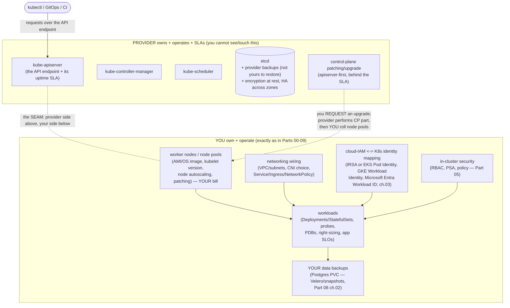

# 01 — The managed Kubernetes model

> What you actually buy with **EKS / GKE / AKS**: the **shared-responsibility
> split** (the provider owns, runs, scales, backs up, and *SLAs* the control
> plane + etcd; **you** own nodes, workloads, networking wiring, cloud-IAM
> mapping, in-cluster security, and the app SLOs), how managed
> control-plane **versioning / auto-upgrade / skew** differs from the
> self-managed flow of [Part 08 ch.01](../08-day-2-operations/01-cluster-lifecycle.md),
> the **managed-vs-self-managed** (kubeadm / Cluster API) decision,
> **regions/AZs** and zonal-vs-regional control planes + node spread, and the
> **cost shape** (a flat control-plane fee vs the node bill) — applied by
> placing each Bookstore tier on a managed cluster and naming which failures
> the provider absorbs versus which stay yours.

**Estimated time:** ~45 min read · ~60 min hands-on
**Prerequisites:** [Part 08 ch.01](../08-day-2-operations/01-cluster-lifecycle.md) — cluster lifecycle baseline this chapter contrasts with · [Part 00 ch.04](../00-foundations/04-control-plane-deep-dive.md) — control-plane components the provider now hides
**You'll know after this:** • articulate the EKS/GKE/AKS shared-responsibility split in concrete terms · • compare managed control-plane upgrade flow against the self-managed kubeadm flow · • choose between managed and self-managed (kubeadm / Cluster API) for a given workload · • size a zonal vs regional control plane against an AZ-failure scenario · • read a cloud bill and separate control-plane fee from node spend

<!-- tags: cloud, eks, gke, aks, foundations, day-2 -->

## Why this exists

Every chapter so far ran on **kind** — one machine, one container "cluster",
*you* are the entire control plane and the entire data plane. [Part 08
ch.01](../08-day-2-operations/01-cluster-lifecycle.md) already drew the line:
provisioning is a spectrum of *"who runs the control plane"*, and at the far
end the **managed** providers hide it entirely. This Part is where the guide
crosses that line and goes deep on the real thing: the Bookstore on a cloud
cluster.

The first thing that breaks when you move off kind is not a manifest — it is
an **assumption about ownership**. On kind you patch the apiserver, you snapshot
etcd ([Part 08 ch.02](../08-day-2-operations/02-backup-and-dr.md)), you choose
the CNI. On EKS/GKE/AKS you do *none* of that — and trying to is the first
mistake (there is no apiserver Pod to `kubectl get`, no etcd endpoint, no
`/etc/kubernetes/pki`). But the inverse mistake is worse: assuming "managed"
means "the provider handles reliability". It does not. The provider SLAs the
**control plane's availability**; the moment a Bookstore Pod is `CrashLooping`,
a NetworkPolicy is silently a no-op, a zonal disk pins `postgres-0` to a dead
AZ, or you over-provisioned nodes into a five-figure bill — that is **entirely
yours**, and no SLA covers it.

So this chapter exists to draw the **shared-responsibility boundary** precisely,
before any provisioning ([ch.02](02-provisioning-and-iac.md)), identity
([ch.03](03-cloud-identity.md)), networking ([ch.04](04-cloud-networking-and-load-balancing.md)),
storage ([ch.05](05-cloud-storage-and-data.md)), or cost/autoscaling
([ch.06](06-node-autoscaling-cost-multicloud.md)) work — because every one of
those chapters is an instance of "this side of the line is the provider's,
that side is yours, and confusing them is the production incident". The
reference is *Production Kubernetes* (Deployment Models / A Path to
Production).

> **Nothing in this Part runs on a cloud.** A managed control plane cannot run
> in a kind cluster, and no AWS, GCP or Azure cluster was created for this
> Part. Provider behaviour is therefore **cited, not run**: each claim links to
> the provider's own documentation, checked on 2026-10-31. Cloud commands are
> **illustrative** and are for clusters you own. Wherever a piece can still be
> shown locally (the boundary reasoning, the Bookstore manifests that are
> unchanged on cloud, a client dry-run) it is. No output is ever faked.

## Mental model

**A managed Kubernetes cluster is a cleaved machine: the provider operates the
half above the API, you operate the half below it, and the API server is the
seam.**

- **The provider owns and *SLAs* the control plane.** kube-apiserver,
  kube-controller-manager, kube-scheduler, and **etcd** (with its backups,
  encryption at rest, and HA) run in the provider's account, invisible to you.
  You get an **API endpoint** and an uptime SLA. EKS, and AKS on a paid tier
  with zones, both commit **99.95%** for that endpoint. Read the exact SLA:
  it covers the API endpoint, **not** your workloads. You cannot SSH the
  control plane, cannot `etcdctl` it, and cannot change apiserver flags. AKS
  states that customers cannot alter its managed components.
- **You own everything that runs your app.** Worker **nodes** (their OS image/
  AMI, kubelet version, autoscaling, patching cadence — even "managed node
  groups" are *your* EC2/Compute instances on *your* bill), every **workload**,
  the **networking wiring** (VPC/subnets, the CNI choice where offered,
  Services/Ingress/NetworkPolicy), the **cloud-IAM ↔ Kubernetes-identity**
  mapping ([ch.03](03-cloud-identity.md)), **in-cluster security** (RBAC, PSA,
  policy — Part 05 is unchanged on cloud), and the **application SLOs**.
- **Versioning becomes a negotiation, not a command.** [Part 08
  ch.01](../08-day-2-operations/01-cluster-lifecycle.md)'s rule still holds —
  apiserver first, never skip a minor, kubelet within n-3, the deprecated-API
  audit is *still yours*. What changes: you no longer run `kubeadm upgrade
  apply`; you **request** a control-plane upgrade (the provider performs the
  apiserver→cm/sched→etcd dance behind its SLA) and then **you** roll the node
  pools. The provider also imposes a **supported-version window** (a minor
  gets 12 to 14 months of standard support: AKS 12, EKS and GKE 14; a paid
  extended support or LTS option stretches that to about 24 to 26 months) and
  **maintenance windows** — drift onto an end-of-support minor and you get a
  *forced* upgrade.
- **Region / AZ topology is now a first-class design input.** A cloud region
  is several **Availability Zones** (independent failure domains). Who sets
  the control plane's zone spread depends on the provider: EKS runs it across
  three AZs, AKS on the Standard tier spreads it across zones where the region
  has them, and GKE lets you choose a **zonal** cluster (one zone, so an outage
  there can take the API with it) or a **regional** one (control plane
  replicated across zones). **Your nodes** must *also* be spread across AZs (a
  node pool per AZ, or a multi-AZ pool) or a single-AZ failure takes the
  Bookstore down regardless of how HA the control plane is.
- **The cost shape inverts.** kind is free. A managed cluster is **a flat
  control-plane fee per cluster**. EKS publishes **$0.10 per cluster-hour**,
  about $73 a month at 730 hours; the other providers set their own rates, and
  GKE Autopilot bills Pod resources rather than nodes (check each pricing
  page). On top of that come **the node bill** (the large, variable part),
  data egress, load balancers ([ch.04](04-cloud-networking-and-load-balancing.md)),
  and disks ([ch.05](05-cloud-storage-and-data.md)). The control-plane fee is
  the *small, predictable* number; **nodes are where the money is and where
  [ch.06](06-node-autoscaling-cost-multicloud.md)/[Part 06
  ch.06](../06-production-readiness/06-capacity-and-cost.md) FinOps applies**.

The trap to hold onto: **"managed" removes the *control-plane* toil, not the
*operational* responsibility.** Every Part 00–09 discipline (probes, PDBs,
NetworkPolicy, RBAC, right-sizing, backups of *your data*) is exactly as much
your job on EKS as on kind — the provider just stopped you from also having to
babysit etcd.

## Threats and controls

| Threat | Control this chapter teaches | Goes deeper |
|---|---|---|
| Misreading who secures a layer, so a gap has no owner | The split per provider in [Who secures what](#who-secures-what) | RBAC: [Part 05 ch.01](../05-security/01-authn-authz-rbac.md) |
| An API endpoint open to the internet by default | Check the endpoint access setting on day one, since EKS starts public | [10.04](04-cloud-networking-and-load-balancing.md) |
| Secrets read with no record of who read them | Know what the provider encrypts, and turn on the logs that are yours | KMS: [Part 05 ch.04](../05-security/04-secrets-and-cluster-hardening.md); audit: Part 05 ch.08 <!-- link-later: 05.08 --> |
| An out-of-support minor that the provider upgrades for you | Track each end-of-support date and upgrade on your own schedule | [Part 08 ch.01](../08-day-2-operations/01-cluster-lifecycle.md) |

## Who secures what

Each provider draws the line in its own documentation. The matrix gives the
default for each area, and the notes under it name the provider page behind
each row. Checked 2026-10-31.

```
 AREA                     EKS            GKE            AKS
 Control plane and etcd   provider       provider       provider
 Audit logs               you, opt in    on by default  shared
 Node OS and patching     you            shared         shared
 Kubernetes upgrades      shared         shared         shared
 RBAC and IAM mapping     you            you            you
 Workload security        you            you            you
 Secrets management       you            you            you
```

- **Control plane.** EKS runs and secures the control plane, including its
  nodes and etcd. GKE hardens and patches it. AKS maintains and operates all
  of its Kubernetes components, etcd included.
- **Audit logs.** EKS sends control plane logs to CloudWatch only for the log
  types you enable, and they are off by default. GKE's Admin Activity logs for
  the API server are always on; its Data Access logs stay off until you enable
  them. AKS shares platform monitoring with you: you enable the diagnostic
  settings.
- **Control-plane trust.** The provider can see your objects, so know what it
  can reach. EKS says no person can access the plaintext keys that protect
  etcd. GKE audit-logs the SSH sessions of its Site Reliability Engineers.
  AKS support cannot sign in to your agent nodes without your permission, and
  its cluster role is granted only under an active ticket, with just-in-time
  access.
- **Node OS.** On EKS managed node groups AWS builds patched AMIs and you
  deploy them. Self-managed nodes are entirely yours. GKE hardens and patches
  the node OS and expects Standard node pools to stay on automatic upgrades.
  AKS publishes node images weekly and expects them applied within 90 days.
- **Upgrades.** Shared on all three. You trigger or schedule them, and each
  provider upgrades a version that has run out of support (see
  [How it works](#how-it-works-under-the-hood)).
- **Secrets.** EKS encrypts all Kubernetes API data with envelope encryption
  by default from 1.28, under an AWS-owned key unless you bring your own. GKE
  encrypts cluster state at the file-system layer by default. On AKS, secrets
  management is yours.
- **Workload security.** Yours on every provider. AKS lists RBAC, Pod security
  and secrets management as customer areas. GKE leaves RBAC and IAM policy,
  container images and data with you. EKS leaves node and container
  configuration and platform IAM with you.

## Diagrams

### Diagram A — the shared-responsibility boundary (Mermaid)

The seam is the API server. Everything in the provider box you cannot see or
touch and it is SLA'd; everything in your box is your job exactly as in Parts
00–09.



### Diagram B — managed vs self-managed decision matrix (ASCII)

```
 WHO RUNS THE CONTROL PLANE? — pick by who must own etcd/upgrades ───────────

  dimension              MANAGED (EKS/GKE/AKS)     SELF-MANAGED (kubeadm /
                                                    Cluster API)
  ─────────────────────────────────────────────────────────────────────────
  control plane + etcd   provider's job + SLA       YOURS (run, patch, back
                         (you can't etcdctl it)      up, HA, cert-rotate it)
  control-plane upgrade  request it; provider does  YOU: kubeadm upgrade
                         apiserver->cm/sched->etcd   apply (Part 08 ch.01)
  node pools/upgrades    yours (surge/rolling)      yours (drain/uncordon)
  deprecated-API audit   YOURS (always)             YOURS (always)
  CNI / dataplane        provider default OR your   fully your choice
                         choice (ch.04)
  cost                   flat CP fee + nodes        nodes only (no CP fee)
                                                     — but you pay in OPS toil
  version freedom        provider-supported window  any version you can run
                         (12-14 mo standard/minor,  (you own EOL risk)
                         24-26 mo w/ paid extended
                         or LTS; then forced upgrade)
  air-gapped / on-prem   no (cloud only)*           yes (kubeadm/CAPI on prem)
  team to run it         small (no CP on-call)      a real cluster-ops team

  CHOOSE MANAGED when: you run on a cloud, want etcd/CP off your on-call,
    and accept the version window + CP fee. (The default for ~all cloud
    Kubernetes — Bookstore targets this.)
  CHOOSE SELF-MANAGED when: on-prem/air-gapped, need a version/flag the
    provider won't allow, or fleet-of-clusters via Cluster API (ch.02).
  * provider "on-prem" editions (EKS Anywhere / GKE on-prem(Anthos) / AKS
    Arc/hybrid) blur this — out of scope here; the model still applies.
```

## Hands-on with the Bookstore

**Assumed working directory: the guide repo root (`full-guide/`).** This
chapter adds **no manifests** — it is the conceptual map for the Part. The
Bookstore manifests do **not change** to run on a managed cluster (that is the
point of standardising on portable Kubernetes APIs); what changes is *which
side of the boundary* each operational concern lives on. This Hands-on is
**illustrative** (provisioning a managed cluster is
[ch.02](02-provisioning-and-iac.md) and needs an account of your own); the
parts that *are* runnable locally are marked.

### 1. Where each Bookstore tier lands on a managed cluster (runnable: the reasoning)

The Bookstore's seven tiers map onto the boundary like this. Nothing here is a
manifest edit — it is the placement decision you make per tier:

```
 TIER (Bookstore)        WHERE IT RUNS          PROVIDER ABSORBS    YOU OWN
 ─────────────────────────────────────────────────────────────────────────────
 storefront (web)        your node pool         CP reachability     pods, HPA,
 catalog   (Go API)      (stateless, spot-OK    (apiserver up so     PDB, the
 orders    (Go API)       — ch.06); spread      kubectl/controllers  Ingress/LB
 payments-worker          across AZs            keep working)        wiring,
                                                                     app SLOs
 ─────────────────────────────────────────────────────────────────────────────
 postgres (StatefulSet)  your node pool +       CP reachability     the DATA
                         a CLOUD block disk      ONLY. NOT your      backup
                         (EBS/PD/AzDisk, ch.05)  Postgres data,      (Velero/
                         — ZONAL: pins the Pod   NOT the PVC bytes,  snapshot,
                         to one AZ               NOT a DROP TABLE    Part 08
                                                                     ch.02)
 redis / rabbitmq        your node pool         CP reachability     these are
 (in-cluster here)                              (if in-cluster)      yours
 ─────────────────────────────────────────────────────────────────────────────
 etcd / apiserver /      PROVIDER's account     ALL of it (run,     nothing —
 scheduler / cm           (you never see it)     patch, HA, back     you can't
                                                  up, SLA)            even see it
```

The decisive subtlety: **`postgres-0`'s data is your responsibility even
though the cluster is "managed".** A managed control plane means a provider
restores *etcd* after a control-plane failure — it does **not** mean your
Bookstore catalogue rows come back. [Part 08
ch.02](../08-day-2-operations/02-backup-and-dr.md) already proved this with the
three-layers model; on a managed cluster Layer 1 (etcd) becomes the provider's
and Layers 2 (Git) + 3 (the Postgres PVC, via Velero/CSI snapshot) stay
**yours** — which is *exactly* the DR posture the Bookstore standardised on.

### 2. Which failures the provider absorbs vs which are yours (the table that matters)

```
 FAILURE                                   WHO HANDLES IT
 ─────────────────────────────────────────────────────────────────────────────
 an etcd member dies                       PROVIDER (you never know)
 apiserver instance crashes                PROVIDER (LB'd; SLA covers it)
 control-plane minor upgrade               PROVIDER performs it — but YOU
                                            choose WHEN + roll the node pools
 a worker node dies                        YOU (cluster autoscaler / the
                                            scheduler reschedule — ch.06; the
                                            provider only supplies the VM)
 a Bookstore Pod CrashLoops                YOU (probes/rollback — Part 01)
 a NetworkPolicy is a silent no-op         YOU (CNI must enforce — ch.04 /
                                            Part 02 ch.06)
 zonal disk pins postgres-0 to a dead AZ   YOU (topology + restore — ch.05 /
                                            Part 08 ch.02)
 a DROP TABLE / logical data corruption    YOU (Velero/PITR — Part 08 ch.02;
                                            the SLA never covers your data)
 you over-provisioned nodes -> huge bill   YOU (right-sizing/FinOps — ch.06 /
                                            Part 06 ch.06)
 the whole REGION goes down                shared: provider runs the CP
                                            multi-AZ, but a multi-REGION app
                                            is YOUR architecture (ch.06)
```

> **Honest cloud-account note.** Standing up the managed cluster these tiers
> run on is [ch.02](02-provisioning-and-iac.md) (`eksctl`/`gcloud`/`az`/
> Terraform/Cluster API) and requires a real account; deploying the Bookstore
> onto it is shown there with the established registry-image caveat. What is
> **runnable now, on kind**: every Bookstore manifest is *unchanged* for
> managed clusters (only GA APIs — proven by the [Part 08
> ch.01](../08-day-2-operations/01-cluster-lifecycle.md) deprecated-API audit),
> so `kubectl apply -k examples/bookstore/kustomize/overlays/dev` on kind is a
> faithful rehearsal of the *workload* half of the boundary; only the
> *provider* half (etcd, the CP upgrade, the cloud LB/disk) is what a cloud
> account adds.

## How it works under the hood

- **The three managed offerings, structurally.** **Amazon EKS** runs the
  control plane in an AWS-owned account across three AZs, exposed as an API
  endpoint that is public by default on new clusters (private access and
  public CIDR limits are options); nodes are EC2 via *self-managed*,
  *managed node groups*, or *Fargate* (serverless Pods). **Google GKE** has
  two modes: **Standard** (you manage node pools; per-cluster management fee)
  and **Autopilot** (Google manages nodes too — you only declare Pods, billed
  per Pod resource; the boundary shifts further toward the provider but the
  *app SLO is still yours*). **Azure AKS** runs a managed control plane (free
  tier or an SLA-backed paid tier); nodes are VM Scale Sets. In all three the
  **control plane is the provider's and the API server is the seam** — the
  differences (node modes, fee model, default CNI) are *below* the seam and
  are the subject of [ch.02](02-provisioning-and-iac.md)–[ch.06](06-node-autoscaling-cost-multicloud.md).
- **Why you cannot `etcdctl` a managed cluster.** etcd lives in the provider's
  account, and you get no etcd endpoint to use, as [Part 08
  ch.02](../08-day-2-operations/02-backup-and-dr.md) describes. The provider
  keeps its own etcd backups for its recovery, and you cannot restore your
  cluster from them: AKS documents automated etcd backups every 30 minutes
  that customers cannot access. The consequence is *not* a limitation
  to work around — it is *why* the Bookstore's DR is Git (declarative) +
  Velero (data): that posture is identical on self-managed and managed, so the
  app does not care who runs etcd.
- **Managed control-plane versioning and the skew policy.** The [Part 08
  ch.01](../08-day-2-operations/01-cluster-lifecycle.md) version-skew rules are
  *upstream policy* and apply unchanged: the apiserver is the reference,
  controller-manager/scheduler within n-1, **kubelet within n-3 and never
  ahead**, kubectl ±1. The mechanical difference on managed: the provider
  upgrades the control plane (apiserver→cm/sched→etcd) as one SLA'd operation
  you *trigger* (a console click / `eksctl upgrade cluster` / `gcloud
  container clusters upgrade` / `az aks upgrade`), then **you** upgrade each
  **node pool** — a *surge or rolling* replacement (new-version nodes added,
  old ones cordoned/drained honoring **PDBs** — [Part 06
  ch.05](../06-production-readiness/05-reliability-and-disruptions.md) — then
  deleted). GKE **release channels** (rapid/regular/stable) and AKS
  auto-upgrade channels can upgrade the control plane *and* nodes
  automatically. EKS managed node groups are not upgraded when the control
  plane is, so the node step stays yours. Opt in deliberately, and keep
  manifests on **GA APIs** so an auto-upgrade is a non-event (the property the
  Bookstore already has).
- **The supported-version window is a hard constraint, not advice.** EKS gives
  a minor 14 months of standard support and then 12 months of extended
  support. Extended support is on by default and billed per cluster-hour.
  When the last window closes, EKS upgrades the control plane on its own
  schedule, at any time, with no notice before the update. GKE gives at least
  14 months of standard support and up to 24 with its Extended channel, which
  carries an extra per-cluster fee. AKS gives 12 months of community support,
  and LTS adds a year on the Premium tier, which you must opt into. After a
  60-day grace period AKS upgrades an out-of-support cluster itself. It
  notifies you first, but that upgrade ignores your maintenance window, does
  not stop for deprecated APIs, and can override a PDB that blocks a node
  drain. A cluster you "never touch" therefore *still* moves, which is why the
  [Part 08 ch.01](../08-day-2-operations/01-cluster-lifecycle.md) deprecated-API
  audit (`pluto`/`kubent`, `apiserver_requested_deprecated_apis`) is *more*
  important on managed, not less. The Bookstore is deliberately clean here
  (only `apps/v1`, `batch/v1`, `networking.k8s.io/v1`, `policy/v1`,
  `autoscaling/v2`, `rbac.authorization.k8s.io/v1`, `scheduling.k8s.io/v1`,
  plus documented CRD groups), so a forced minor bump is a non-event.
- **Zonal vs regional control plane, and node spread, are *separate*
  decisions.** A multi-AZ control plane (the usual production choice: EKS
  always; GKE *regional* clusters; AKS on the Standard tier where the region
  has zones) survives a single-AZ outage *for the API*. It does **nothing** for your
  workloads unless your **node pools are also AZ-spread** and your stateful
  Pods tolerate the zonal-disk pin ([ch.05](05-cloud-storage-and-data.md)).
  The Bookstore's existing `topologySpreadConstraints` and
  `podAntiAffinity` ([Part 04 ch.02](../04-scheduling/02-affinity-taints-topology.md))
  are exactly the workload-side mechanism that makes multi-AZ *nodes*
  actually deliver HA — they were written for kind's single node "preferred",
  and on a real multi-AZ cluster a `topologyKey:
  topology.kubernetes.io/zone` constraint makes them bite (the existing
  manifests already carry the hostname-spread; zone-spread is the cloud
  refinement).
- **The cost shape, mechanically.** Control-plane fee = a flat hourly charge
  per cluster. EKS publishes $0.10 per cluster-hour. AKS's **Free tier** has no
  cluster fee and no financially backed uptime SLA; the Standard and Premium
  tiers carry the SLA, and their rates are on AKS's pricing page. GKE's
  per-cluster fee and Autopilot's Pod billing are on its pricing page.
  **Nodes** = standard
  VM pricing × node count × time — the dominant, variable cost, and the one
  the cluster autoscaler/Karpenter and right-sizing
  ([ch.06](06-node-autoscaling-cost-multicloud.md), [Part 06
  ch.06](../06-production-readiness/06-capacity-and-cost.md)) actually move.
  Plus **data egress** (cross-AZ and internet traffic — a real, often
  surprising line item), **load balancers** ([ch.04](04-cloud-networking-and-load-balancing.md)),
  and **EBS/PD/Azure-Disk volumes** ([ch.05](05-cloud-storage-and-data.md)).
  The lesson: optimising the CP fee is pointless; optimising nodes is where
  FinOps lives.

## Production notes

> **In production: read the SLA — it covers the API endpoint, not your app.**
> The provider's 99.95% (or similar) is **control-plane reachability**: that
> `kubectl`/controllers can talk to the API. Your *application* availability is
> the sum of *your* probes, PDBs, replica counts, AZ spread, and the data
> tier's resilience — entirely your SLO to define and meet. Treat the managed
> SLA as "etcd and the apiserver are someone else's pager", not "my service is
> now reliable".

> **In production: a managed control plane is not a managed *application*.**
> Every Part 00–09 discipline still applies, unchanged: probes
> ([Part 01 ch.02](../01-core-workloads/02-health-and-lifecycle.md)), PDBs
> ([Part 06 ch.05](../06-production-readiness/05-reliability-and-disruptions.md)),
> NetworkPolicy with an enforcing CNI ([Part 02 ch.06](../02-networking/06-network-policies.md)),
> least-privilege RBAC + PSA (Part 05), right-sized requests
> ([Part 06 ch.06](../06-production-readiness/06-capacity-and-cost.md)), and
> backups of *your* data ([Part 08 ch.02](../08-day-2-operations/02-backup-and-dr.md)).
> "We're on EKS" is not a reliability strategy.

> **In production: plan the upgrade cadence — the version window is shorter
> than you think.** A minor leaves standard provider support in 12 to 14
> months (later only if you pay for extended support or LTS), and you *will*
> be force-upgraded if you drift. Run the
> [Part 08 ch.01](../08-day-2-operations/01-cluster-lifecycle.md) deprecated-API
> audit on a schedule, keep manifests/charts/GitOps on GA APIs (the Bookstore
> does), stagger control-plane then node-pool upgrades within a maintenance
> window, and adopt a release channel deliberately rather than discovering an
> auto-upgrade in production.

> **In production: design for AZ failure explicitly — regional CP is not
> enough.** Use a **regional/multi-AZ control plane** *and* spread node pools
> across AZs *and* give stateful Pods (Bookstore Postgres) a topology that
> survives one AZ dying ([ch.05](05-cloud-storage-and-data.md): a zonal disk
> pins the Pod to its AZ; reschedule blocks until that AZ recovers or you
> restore elsewhere). The Bookstore's
> `topologySpreadConstraints`/`podAntiAffinity`
> ([Part 04 ch.02](../04-scheduling/02-affinity-taints-topology.md)) are the
> workload half of this — refine the topology key to
> `topology.kubernetes.io/zone` on a real multi-AZ cluster.

> **In production: the node bill, not the cluster fee, is the cost lever.**
> The control-plane fee is a small fixed line; nodes (× count × time), egress,
> LBs, and disks are the variable spend. Apply
> [Part 06 ch.06](../06-production-readiness/06-capacity-and-cost.md)
> right-sizing and [ch.06](06-node-autoscaling-cost-multicloud.md)
> node-autoscaler + spot strategy there. Cost-allocate per namespace/workload
> (OpenCost / the providers' cost tooling) so the Bookstore's spend is owned,
> not discovered.

> **In production: avoid lock-in where it is free, accept it where it pays.**
> The portable layer (Kubernetes API, Helm/Kustomize, GitOps, the Bookstore
> manifests) costs nothing to keep portable — and does not change between
> clouds. The *non-portable* layer (cloud LB annotations, IAM mapping, CSI
> driver, CNI specifics — [ch.03](03-cloud-identity.md)–[ch.06](06-node-autoscaling-cost-multicloud.md))
> is where you deliberately spend lock-in for managed value. Know which is
> which ([ch.06](06-node-autoscaling-cost-multicloud.md) tabulates it).

## Quick Reference

```sh
# What am I connected to? (works on ANY cluster incl. managed)
kubectl cluster-info                               # the API endpoint
kubectl version                                    # Server = the managed apiserver minor
kubectl get nodes -o wide                          # YOUR nodes (kubelet ver, AZ via label)
kubectl get nodes -L topology.kubernetes.io/zone   # node AZ spread (yours to ensure)

# Provider control-plane ops you TRIGGER (provider performs CP; you roll nodes):
# One minor per step (Part 08 ch.01); here 1.36 -> 1.37. eksctl only plans
# until --approve is given:
eksctl upgrade cluster --name $CLUSTER_NAME --version 1.37 --approve  # AWS EKS
# List the versions GKE offers, then pick one for $GKE_VERSION:
gcloud container get-server-config --location $LOCATION
gcloud container clusters upgrade $CLUSTER_NAME --master \
  --cluster-version $GKE_VERSION --location $LOCATION  # Google GKE (CP)
az aks upgrade -g $RG -n $CLUSTER_NAME --kubernetes-version 1.37  # Azure AKS
# then upgrade each NODE POOL (surge/rolling, honors PDBs) — provider-specific (ch.02)

# The audit that is STILL yours on managed (Part 08 ch.01):
kubectl api-versions | sort
# pluto detect-files -d examples/bookstore/ ; kubent     # before any (forced) upgrade
```

There is **no manifest skeleton** for this chapter — the deliverable is the
boundary, not an object. The minimal artifact is the responsibility split
itself:

```
PROVIDER (SLA'd):  apiserver · controller-manager · scheduler · etcd (+backup,
                   HA, encryption, cert-rotation, CP patch/upgrade execution)
YOU (Parts 00-09): nodes · workloads · networking wiring · cloud-IAM mapping ·
                   in-cluster security · app SLOs · YOUR data backups · cost
SEAM:              the API server. Confusing the two sides = the incident.
```

Checklist:

- [ ] Know **exactly** what the provider SLA covers (API endpoint uptime) vs
      not (your workloads, your data, your SLOs)
- [ ] Control plane is **regional/multi-AZ**; node pools **AZ-spread**;
      stateful Pods have an AZ-survivable topology ([ch.05](05-cloud-storage-and-data.md))
- [ ] Upgrade cadence planned within the **supported-version window**;
      deprecated-API audit on a schedule ([Part 08 ch.01](../08-day-2-operations/01-cluster-lifecycle.md));
      release channel chosen deliberately
- [ ] Every Part 00–09 discipline still applied (probes/PDB/NetworkPolicy/
      RBAC/PSA/right-sizing/**your-data backups**) — "managed" did not remove them
- [ ] DR is **Git (declarative) + Velero (data)** — etcd is the provider's
      ([Part 08 ch.02](../08-day-2-operations/02-backup-and-dr.md))
- [ ] Control-plane audit logs are on and readable by you (EKS: opt in per log
      type; GKE: Admin Activity is always on, Data Access is off; AKS: enable
      diagnostic settings)
- [ ] API endpoint reviewed: EKS clusters start public, so restrict it (private
      endpoint or public CIDR limits; [10.04](04-cloud-networking-and-load-balancing.md))
- [ ] Cost owned at the **node** layer (not the CP fee); spend allocated per
      workload ([ch.06](06-node-autoscaling-cost-multicloud.md))
- [ ] Lock-in is deliberate: portable layer kept portable, non-portable layer
      a conscious trade ([ch.06](06-node-autoscaling-cost-multicloud.md))

## Test your understanding

> Try each before opening the answer drawer. The act of trying is the exercise; the answer is the check.

1. **Your EKS control plane spans three Availability Zones. What failure modes does that absorb, and what does it leave to you?**
   <details><summary>Show answer</summary>

   AWS runs the API server, controller manager, scheduler, and etcd across three AZs and commits to 99.95% uptime for the API endpoint, so an AZ outage does not take the control plane down. What stays yours: nodes pinned to a single AZ (workloads die when that AZ dies), zonal EBS volumes that pin a StatefulSet Pod to its AZ, and the application SLOs. The provider absorbs control-plane HA; you still own node and data AZ-spread.

   </details>

2. **The provider just auto-upgraded the control plane from 1.36 to 1.37
   overnight. Your nodes are still on 1.36, and a manifest in Git still uses
   `autoscaling/v2beta2`. What do you check and in what order?**
   <details><summary>Show answer</summary>

   First, `kubectl version` to confirm the skew (server 1.37, nodes 1.36 is
   supported: a 1.37 apiserver accepts kubelets 1.34 to 1.37, and a kubelet
   may never be newer). Second, run `pluto detect-files` or `kubent` against
   your manifests/cluster: `autoscaling/v2beta2` was removed in 1.26, so the
   next sync or `kubectl apply` of that manifest fails until it moves to
   `autoscaling/v2`. Third, plan a node-pool surge upgrade to align kubelet
   with the new minor before the skew widens further. The control plane
   upgrade is the provider's; the deprecated-API audit and node roll are
   yours.

   </details>

3. **Your GKE cluster is zonal, and its zone goes down. What stops working, what keeps running, and what would a regional cluster change?**
   <details><summary>Show answer</summary>

   A zonal control plane lives in that one zone, so the API endpoint goes with it. `kubectl` fails, and nothing new is scheduled until the zone recovers. Pods on nodes in the other zones keep running, because they do not need the API to keep serving. A regional cluster replicates its control plane across zones, so the API survives the loss. It does nothing for your Pods unless your node pools also span zones and your stateful Pods can survive a zone loss ([ch.05](05-cloud-storage-and-data.md)). EKS has no zonal option to compare with, since its control plane always spans three AZs. See the GKE regional clusters page in Further reading.

   </details>

4. **A teammate says "we're on managed EKS, so we don't need Velero." How do you respond?**
   <details><summary>Show answer</summary>

   The provider keeps etcd backups (the cluster's control state) for its own recovery, and you cannot restore your cluster from them. AKS, for example, documents automated etcd backups every 30 minutes that customers cannot access. The provider does not back up your PersistentVolumes, your data inside Postgres or MySQL, or secrets you keep in an external store. Velero covers the data side: PVCs, snapshots, and namespace-scoped resources. Managed EKS plus Velero is the actual DR posture; managed alone gives you a working control plane with empty disks. See [Part 08 ch.02](../08-day-2-operations/02-backup-and-dr.md).

   </details>

5. **You inherit a managed cluster and the cloud bill shows $0.10/hour for the CP and $4,800/month in node costs. The CTO asks "why is the cloud bill so high — isn't managed Kubernetes supposed to be cheap?" Frame the answer.**
   <details><summary>Show answer</summary>

   The control-plane fee is the small, flat, predictable line item — EKS publishes $0.10 per cluster-hour, about $73 a month, and the other providers charge their own per-cluster rates. The node bill is the real spend and lives entirely on the customer's side of the seam: instance types chosen, count, AZ-spread, on-demand vs spot, idle capacity from over-sized requests, and headroom for HPA bursts. Managed kubernetes did not change node economics — it only removed the operational burden of running the control plane. [ch.06](06-node-autoscaling-cost-multicloud.md) drills into the node-tier cost levers.

   </details>

6. **A teammate says: "The provider encrypts etcd, so our Secrets are safe in the cluster." What is true, and what stays yours?**
   <details><summary>Show answer</summary>

   Partly true. By default the provider encrypts the cluster's data at rest: EKS envelope-encrypts all Kubernetes API data from 1.28 with an AWS-owned key unless you bring your own, and GKE encrypts etcd at the file-system layer. That protects the storage. It does not limit who can read through the API. Anyone your RBAC lets `get` a Secret reads its plaintext, so scoping RBAC ([Part 05 ch.01](../05-security/01-authn-authz-rbac.md)) is yours. Choosing a customer-managed key and its policy is yours too ([Part 05 ch.04](../05-security/04-secrets-and-cluster-hardening.md)). Whether you can later show who read a Secret depends on audit logs, and the defaults differ: EKS control plane logs are off until you enable them, GKE Admin Activity logs are always on, and AKS needs diagnostic settings.

   </details>

## Further reading

- **Rosso et al., _Production Kubernetes_, ch.2 — Deployment Models**
  (managed vs self-managed, who operates the control plane, the operational
  posture of a production cluster) and **ch.1 — A Path to Production** (the
  maturity framing for which responsibilities you are actually taking on).
- **Lukša, _Kubernetes in Action_ 2e, ch.3** (how the control plane is
  composed — the structural basis for *why* the API server is the seam and
  what the provider is actually running for you).
- Provider sources, checked 2026-10-31 (cited, not run):
  - EKS: security and shared responsibility
    <https://docs.aws.amazon.com/eks/latest/userguide/security.html>; control
    plane across three AZs
    <https://docs.aws.amazon.com/eks/latest/best-practices/reliability.html>;
    control plane logs
    <https://docs.aws.amazon.com/eks/latest/userguide/control-plane-logs.html>;
    envelope encryption
    <https://docs.aws.amazon.com/eks/latest/userguide/envelope-encryption.html>;
    version lifecycle
    <https://docs.aws.amazon.com/eks/latest/userguide/kubernetes-versions.html>;
    endpoint access
    <https://docs.aws.amazon.com/eks/latest/userguide/cluster-endpoint.html>;
    SLA <https://aws.amazon.com/eks/sla/>; pricing
    <https://aws.amazon.com/eks/pricing/>.
  - GKE: shared responsibility
    <https://docs.cloud.google.com/kubernetes-engine/docs/concepts/shared-responsibility>;
    control plane security
    <https://docs.cloud.google.com/kubernetes-engine/docs/concepts/control-plane-security>;
    audit logging
    <https://docs.cloud.google.com/kubernetes-engine/docs/how-to/audit-logging>;
    regional clusters
    <https://docs.cloud.google.com/kubernetes-engine/docs/concepts/regional-clusters>;
    versioning <https://docs.cloud.google.com/kubernetes-engine/versioning>;
    pricing <https://cloud.google.com/kubernetes-engine/pricing>.
  - AKS: support policies
    <https://learn.microsoft.com/en-us/azure/aks/support-policies>; supported
    versions
    <https://learn.microsoft.com/en-us/azure/aks/supported-kubernetes-versions>;
    long-term support <https://learn.microsoft.com/en-us/azure/aks/long-term-support>;
    pricing tiers and SLA
    <https://learn.microsoft.com/en-us/azure/aks/free-standard-pricing-tiers>.
  - Upstream: the version skew policy
    <https://kubernetes.io/releases/version-skew-policy/>, and the deprecation
    guide <https://kubernetes.io/docs/reference/using-api/deprecation-guide/>.
- Overviews: EKS <https://docs.aws.amazon.com/eks/latest/userguide/what-is-eks.html>,
  GKE <https://cloud.google.com/kubernetes-engine/docs/concepts/kubernetes-engine-overview>,
  AKS <https://learn.microsoft.com/en-us/azure/aks/what-is-aks>.
