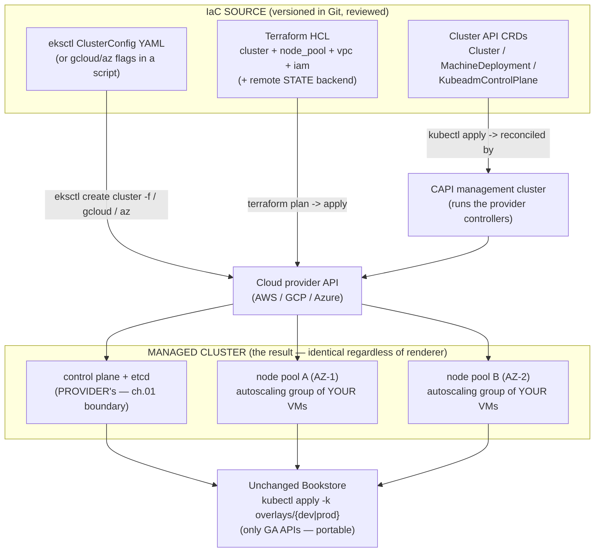

# 02 — Provisioning and infrastructure-as-code

> Standing the *same* managed cluster up three ways and choosing between them:
> the provider CLIs (**`eksctl`** cluster+managed-nodegroup YAML,
> **`gcloud container clusters create`**, **`az aks create`**), **Terraform**
> (cluster + node pool as declarative HCL, **remote state**, modules,
> plan/apply, destroy), and **Cluster API** (clusters *as Kubernetes objects*:
> a **management** cluster reconciling **workload** clusters via
> infrastructure providers, `clusterctl`); managed **node groups/pools** and
> their autoscaling-group wiring, **surge/rolling node upgrades**, reproducible
> **cluster IaC + GitOps-for-clusters**, and **teardown / cost hygiene** — then
> deploying the unchanged Bookstore onto the cluster you provisioned.

**Estimated time:** ~45 min read · ~120 min hands-on
**Prerequisites:** [Part 10 ch.01](01-managed-kubernetes-model.md) — managed-cluster model this chapter provisions · [Part 07 ch.04](../07-delivery/04-gitops-argocd.md) — GitOps pattern extended here to clusters themselves
**You'll know after this:** • choose between provider CLIs, Terraform, and Cluster API for a given scenario · • author a Terraform module that creates an EKS/GKE/AKS cluster + node pool with remote state · • configure managed node-group rolling upgrades safely · • model "clusters as Kubernetes objects" via Cluster API + clusterctl · • tear down a cloud cluster cleanly and confirm nothing is left billing

<!-- tags: cloud, terraform, gitops, day-2, eks, aks -->

## Why this exists

[ch.01](01-managed-kubernetes-model.md) drew the boundary: the provider runs
the control plane, **you own the cluster's existence and its nodes**. "Owning
its existence" raises the question every prior chapter dodged by saying *"a
cluster exists"* — **where did it come from, and can you make an identical one
on demand?** On kind that was `kind create cluster`. On a cloud it is an
infrastructure decision with real failure modes:

1. **The click-ops cluster.** Someone created the prod cluster in the console,
   by hand, eighteen months ago. Nobody can reproduce it; the staging cluster
   drifted from it within a week; "rebuild it in another region for DR" has no
   answer. A cluster you cannot recreate from source is the same anti-pattern
   as the [Part 07 ch.01](../07-delivery/01-packaging-helm.md) "templating with
   `sed`" pile — unversioned, undocumented, un-reviewable infrastructure.
2. **The orphaned bill.** A test cluster, its three node groups, two load
   balancers, and a fistful of EBS volumes outlive the experiment because
   teardown was manual and partial. Cloud Kubernetes makes *creating* spend
   one command and *finding* the spend you forgot a forensic exercise.

The fix is the same idea Parts 06–07 applied to workloads, applied one layer
down to the **cluster itself**: describe it as **code**, version it, review
it, apply it reproducibly, and tear it down by the same code path. This
chapter shows the three mainstream ways to do that for the *same* cluster, the
trade-offs, and how the **unchanged Bookstore** then deploys onto it. The
reference is *Production Kubernetes* (Deployment Models).

> **Scope of this chapter.** No cluster here runs on a cloud. The provider and
> IaC commands are cited to their upstream documentation, checked 2026-10-31,
> and are stated as **cited, not run**. What ran locally is named where it
> appears: the Terraform root module passes `terraform fmt`, `terraform init
> -backend=false` and `terraform validate`, and Trivy config scans it. Run the
> cloud commands only against clusters you own. Placeholders only:
> `$CLUSTER_NAME`, `your-org`, `123456789012`, `us-east-1`,
> `registry.example.com`.

## Mental model

**Provisioning is "render an infrastructure spec into a cloud control-plane +
node pools", and you choose the renderer on the same axes you chose Helm vs
Kustomize: speed, reproducibility, multi-cloud, and day-2.**

- **Provider CLI (`eksctl` / `gcloud` / `az`)** — the *imperative-with-a-config-file*
  option. Fastest to a cluster, provider-native, a single tool. `eksctl`
  uniquely takes a **declarative cluster YAML** (`ClusterConfig`) so it is
  semi-IaC; `gcloud`/`az` are flag-driven commands (wrap them in scripts for
  repeatability). Best for: a quick cluster, a single cloud, learning.
- **Terraform** — the *declarative, multi-cloud, stateful* option. HCL
  describes the cluster + node pool(s) + VPC + IAM as resources; `terraform
  plan` diffs desired-vs-real; `apply` converges; **state** (in a remote
  backend — S3+DynamoDB / GCS / Azure Blob) is the source of truth; `destroy`
  is exact teardown. **Modules** package a cluster definition for reuse across
  envs/regions. Best for: production, fleets, the same workflow across clouds.
- **Cluster API (CAPI)** — the *Kubernetes-native, reflexive* option. A
  **management cluster** runs controllers that reconcile `Cluster` /
  `MachineDeployment` / `KubeadmControlPlane`-style CRDs into real **workload
  clusters** on an **infrastructure provider** (CAPA for AWS, CAPG for GCP,
  CAPZ for Azure). A cluster becomes *a declarative object you `kubectl
  apply`* — and an upgrade is a field change (the
  [Part 08 ch.01](../08-day-2-operations/01-cluster-lifecycle.md) idea, made
  literal). Best for: many clusters managed *as Kubernetes*, GitOps-for-clusters.

The unifying picture: an **IaC source** (CLI config / HCL / CAPI CRDs) →
**applied by a tool** → the **cloud provider API** creates a **managed control
plane + node pool(s)** → you point `kubectl` at it → the **portable Bookstore**
deploys on top, *unchanged*. The renderer differs; the cluster, and the app on
it, do not.

The trap: **a node pool is an autoscaling group of *your* VMs.** "Managed node
group" still means EC2/Compute/VMSS instances on your bill, in an
autoscaling group the **cluster autoscaler** ([ch.06](06-node-autoscaling-cost-multicloud.md))
can grow/shrink — provisioning it correctly (size, AZ spread, surge settings)
is your job, not the provider's.

## Threats and controls

| Threat | Control in this chapter | Goes deeper |
|---|---|---|
| Secrets in state. State and plan files hold values in plain text, and `sensitive = true` only hides them from CLI output. | An encrypted, locked backend (`encrypt` and `use_lockfile`) in the root module. Who may read the state bucket is a bucket-policy decision, and a saved plan is handled as a secret. | [14.01](../14-eks-in-production-a-to-z/01-terraform-state-in-production.md), [14.07](../14-eks-in-production-a-to-z/07-infrastructure-cicd-and-drift.md) |
| Unpinned providers and modules. A floating version can change the cluster's shape on the next `apply`. | Exact pins in the HCL and a committed `.terraform.lock.hcl` that records the provider hashes. | [14.07](../14-eks-in-production-a-to-z/07-infrastructure-cicd-and-drift.md) |
| Drift and unreviewed change. A console edit, or an apply nobody read. | `terraform plan -out` reviewed before `apply`, and a drift check that exits 2 when the plan has changes (step 2). | [14.07](../14-eks-in-production-a-to-z/07-infrastructure-cicd-and-drift.md) |
| An over-broad provisioning identity. A role that can create or change anything in the account. | No cluster-admin access for the identity that runs Terraform (`enable_cluster_creator_admin_permissions = false`), with named access entries instead (step 2). | [10.03](03-cloud-identity.md), [14.07](../14-eks-in-production-a-to-z/07-infrastructure-cicd-and-drift.md) for the pipeline's scoped role |

The public endpoint and the network path to it belong to
[10.04](04-cloud-networking-and-load-balancing.md). The root module below sets
the endpoint private and does not restate that chapter.

## Diagrams

### Diagram A — IaC source → tool → provider API → cluster + node pools (Mermaid)

Three renderers, one outcome. The provider always builds the control plane;
the node pools are the autoscaling-group VMs you own.



### Diagram B — provisioning-tool trade-off (ASCII)

```
 SAME CLUSTER, THREE RENDERERS — pick on speed/repro/multi-cloud/day-2 ──────

  axis              eksctl/gcloud/az      Terraform            Cluster API
  ─────────────────────────────────────────────────────────────────────────
  speed to a        fastest (1 cmd /      medium (write HCL,   slowest (stand
   cluster           1 config file)        plan, apply)         up a mgmt cl.)
  reproducibility   eksctl: good (YAML);  excellent (HCL +     excellent (CRDs
                     gcloud/az: only as    state + plan diff)    in Git, recon-
                     good as your script                         ciled)
  multi-cloud       no (one provider      yes (one workflow,   yes (one API,
   (one workflow)    per tool)             per-cloud provider)   per-cloud infra
                                                                  provider)
  day-2 (upgrade,   provider-native, ok;  declarative, drift   declarative; an
   drift, scale)     state lives in the    detected via plan;    upgrade = edit
                     cloud, not tracked    explicit destroy      a CRD field
  fleet of many     painful (loop the     ok (modules + work-  excellent (it's
   clusters          CLI per cluster)      spaces per cluster)   literally for
                                                                  this)
  who runs it       anyone (a dev)        infra/platform team  a platform team
                                                                  with a mgmt cl.
  teardown          eksctl delete /       terraform destroy    kubectl delete
                     gcloud/az delete      (exact, from state)   cluster <NAME>
  ─────────────────────────────────────────────────────────────────────────
  PICK eksctl/CLI: a quick/learning cluster, one cloud.
  PICK Terraform : production, the same workflow across clouds, a few clusters.
  PICK CAPI      : a FLEET managed as Kubernetes / GitOps-for-clusters.
  ALL THREE produce the same cluster; the UNCHANGED Bookstore runs on any.
```

## Hands-on with the Bookstore

**Assumed working directory: the guide repo root (`full-guide/`).** This
chapter adds **no workload manifests**. The Bookstore is *unchanged* on a
managed cluster, which is the point of standardising on portable Kubernetes
APIs. The cluster-creation steps are cited, not run. The Terraform root module
is the one part checked locally.

> **Cited, not run.** The `eksctl`, `gcloud`, `az` and `clusterctl` behaviour
> below comes from upstream documentation, checked 2026-10-31. None of it was
> run against a cloud. Creating a cluster costs money from the first minute,
> so run these steps only in an account you own, with a unique cluster name
> (`$CLUSTER_NAME`), and tear down with step 5.

### 1. Provision the same cluster via the provider CLI

**AWS — `eksctl` with a declarative `ClusterConfig`** (this is semi-IaC: a
versionable YAML, not a pile of flags). Save as `cluster-eks.yaml`:

```yaml
# Cited, not run. Apply with: eksctl create cluster -f cluster-eks.yaml
apiVersion: eksctl.io/v1alpha5
kind: ClusterConfig
metadata:
  name: bookstore                 # $CLUSTER_NAME
  region: us-east-1
  version: "1.37"                 # in EKS standard support (checked 2026-10-31)
  tags:
    owner: your-org               # the bill and the orphan sweep find it
vpc:
  clusterEndpoints:
    privateAccess: true           # the API is reachable inside the VPC
    publicAccess: false           # no internet endpoint; the path is 10.04's
availabilityZones: [us-east-1a, us-east-1b, us-east-1c]   # multi-AZ (ch.01)
iam:
  withOIDC: true                  # OIDC provider for IRSA (ch.03); enable before workloads need it
managedNodeGroups:
  - name: ng-stateless
    instanceType: m6i.large
    privateNetworking: true       # nodes in private subnets
    disablePodIMDS: true          # Pods off the host network get no instance metadata (03)
    minSize: 2
    maxSize: 6                    # the autoscaling-group bounds (ch.06)
    desiredCapacity: 3
    availabilityZones: [us-east-1a, us-east-1b, us-east-1c]   # spread the VMs
    volumeSize: 50
    updateConfig:
      maxUnavailablePercentage: 33   # at most a third of nodes out during an
                                     # upgrade; PDBs still gate each eviction
```

```sh
eksctl create cluster -f cluster-eks.yaml
aws eks update-kubeconfig --name $CLUSTER_NAME --region us-east-1
# Run from inside the VPC: the API endpoint is private.
kubectl get nodes -L topology.kubernetes.io/zone
```

**Google, `gcloud` (flag-driven, so wrap it in a script for repeatability):**

```sh
# Regional cluster: --num-nodes is per zone, so 1 here means 3 nodes in total.
# The regular channel is the default; the cluster is enrolled in it.
# Private nodes and a private endpoint keep the nodes and the API off the
# internet (the network design is 04's). Workload Identity is ch.03's.
gcloud container clusters create $CLUSTER_NAME \
  --region us-central1 \
  --release-channel regular \
  --num-nodes 1 \
  --machine-type e2-standard-4 \
  --enable-autoscaling --min-nodes 1 --max-nodes 3 \
  --enable-ip-alias \
  --enable-private-nodes \
  --enable-private-endpoint \
  --workload-pool=$(gcloud config get-value project).svc.id.goog
gcloud container clusters get-credentials $CLUSTER_NAME --region us-central1
```

**Azure, `az aks create`:**

```sh
# List the versions AKS offers in your region, then set AKS_VERSION to one.
az aks get-versions -l eastus -o table
az group create -n $RG -l eastus
# --enable-private-cluster gives the API server a private endpoint. The OIDC
# issuer and the workload identity flag are the Microsoft Entra Workload ID
# switches that ch.03 uses.
az aks create -g $RG -n $CLUSTER_NAME \
  --kubernetes-version "$AKS_VERSION" \
  --node-count 3 --node-vm-size Standard_D4s_v5 \
  --enable-cluster-autoscaler --min-count 2 --max-count 6 \
  --zones 1 2 3 \
  --enable-private-cluster \
  --enable-oidc-issuer --enable-workload-identity
az aks get-credentials -g $RG -n $CLUSTER_NAME
```

### 2. The same cluster as Terraform (declarative, stateful, multi-cloud workflow)

Terraform makes the cluster a reviewable diff with exact teardown. The root
module below is complete. It declares its own variables, pins the Terraform
binary, the AWS provider and the community `terraform-aws-modules/eks` module,
and keeps state in an encrypted, locked S3 backend. Save it as `main.tf` in an
empty directory. Equivalent `google` and `azurerm` roots follow the same shape.

```hcl
terraform {
  # The exact Terraform binary this chapter was checked with.
  required_version = "1.14.8"

  # State holds secrets in plain text, so the backend encrypts it and locks it.
  backend "s3" {
    bucket       = "your-org-tf-state"
    key          = "bookstore/eks.tfstate"
    region       = "us-east-1"
    encrypt      = true
    kms_key_id   = "arn:aws:kms:us-east-1:123456789012:key/your-state-key-id"
    use_lockfile = true # S3 lock file; DynamoDB locking is deprecated
  }

  required_providers {
    aws = {
      source  = "hashicorp/aws"
      version = "6.71.0" # exact pin; .terraform.lock.hcl records the hashes
    }
  }
}

provider "aws" {
  region = var.region

  default_tags {
    tags = {
      owner = var.owner
    }
  }
}

variable "region" {
  type    = string
  default = "us-east-1"
}

variable "owner" {
  type        = string
  description = "The team accountable for the cluster and its bill"
}

variable "cluster_name" {
  type = string
}

variable "cluster_version" {
  type        = string
  default     = "1.37"
  description = "An EKS minor version in standard support"
}

variable "vpc_id" {
  type = string
}

variable "private_subnet_ids" {
  type        = list(string)
  description = "Private subnets, one or more per Availability Zone"
}

variable "admin_role_arn" {
  type        = string
  description = "The IAM role that administers the cluster, for example an IAM Identity Center admin role"
}

module "eks" {
  source  = "terraform-aws-modules/eks/aws"
  version = "21.29.0"

  name               = var.cluster_name
  kubernetes_version = var.cluster_version
  vpc_id             = var.vpc_id
  subnet_ids         = var.private_subnet_ids

  # Private API endpoint: the control plane is not reachable from the internet.
  endpoint_public_access = false

  # The identity that runs Terraform gets no cluster-admin access entry.
  # The named admin role below gets access instead.
  enable_cluster_creator_admin_permissions = false

  # Named access: the admin role gets the EKS cluster-admin access policy.
  access_entries = {
    admin = {
      principal_arn = var.admin_role_arn
      policy_associations = {
        admin = {
          policy_arn   = "arn:aws:eks::aws:cluster-access-policy/AmazonEKSClusterAdminPolicy"
          access_scope = { type = "cluster" }
        }
      }
    }
  }

  # Creates the OIDC provider that IAM roles for ServiceAccounts need.
  enable_irsa = true

  eks_managed_node_groups = {
    stateless = {
      ami_type       = "AL2023_x86_64_STANDARD"
      instance_types = ["m6i.large"]
      min_size       = 2
      max_size       = 6
      desired_size   = 3

      update_config = {
        max_unavailable_percentage = 33
      }

      # The module's defaults, written out for review: IMDSv2 is required and
      # the hop limit is 1, so a Pod cannot reach the node role's credentials
      # through instance metadata (03 explains what this blocks).
      metadata_options = {
        http_endpoint               = "enabled"
        http_tokens                 = "required"
        http_put_response_hop_limit = 1
      }
    }
  }
}

output "cluster_name" {
  value = module.eks.cluster_name
}
```

These checks need no cloud account. This chapter ran them on 2026-10-31 with
Terraform 1.14.8 and Trivy 0.76.1:

```sh
terraform fmt -check                  # formatting is part of review
terraform init -backend=false         # pinned providers and module, no state
terraform validate                    # pure HCL check
trivy config --tf-exclude-downloaded-modules --skip-dirs .terraform \
  --severity HIGH,CRITICAL .
```

`fmt` and `validate` report no problems, and the root module scan is clean.
The `--skip-dirs .terraform` flag matters. After `init`, the downloaded module
ships example Kubernetes manifests under `.terraform/modules/eks/examples`.
Trivy reads those as YAML, so without the flag it reports HIGH findings
(KSV-0014 and KSV-0118) on an example Deployment that the root module does not
contain. Scan the downloaded module separately, skipping only its examples:

```sh
trivy config --skip-dirs .terraform/modules/eks/examples --severity HIGH,CRITICAL .
```

That scan reports one CRITICAL, AWS-0104, on the module's node security group
rule, which allows all egress to `0.0.0.0/0`. The module creates that rule by
default ([AVD-AWS-0104](https://avd.aquasec.com/misconfig/aws-0104)).
Restricting node egress depends on how nodes reach the image registry and AWS
APIs, which is the design in
[14.08](../14-eks-in-production-a-to-z/08-vpc-endpoints-and-egress.md). Until
you make that choice, accept the finding on purpose: put it in your exceptions
registry with its reason, its chapter and an expiry within 12 months, and
remove the entry when the egress design is in place.

**This root module is a self-contained illustration, and it is not the
platform tree.** It pins `terraform-aws-modules/eks` at 21.29.0, which takes
the v21 input names (`name`, `kubernetes_version`, `endpoint_public_access`)
and needs AWS provider 6.59 or later, so the root pins provider 6.71.0. The
platform tree of Part 14,
[`examples/bookstore-platform/terraform`](../examples/bookstore-platform/terraform/eks.tf),
pins the module at `~> 20.31` and uses the v20 names (`cluster_name`,
`cluster_version`, `cluster_endpoint_public_access`). It stays on v20 on
purpose. Module 20.37.2 needs a provider below 6.0, and that tree pins the
provider at `~> 5.95` and uses the module's Karpenter sub-module at the same
v20 line. [14.03](../14-eks-in-production-a-to-z/03-eks-addon-management.md)
cites 20.37.2 for its add-on ordering. Moving the tree to v21 changes the
provider major, the input names and the sub-module together, and the check
that counts is a plan against a real account, which this chapter did not run.
So do not copy input names from one to the other.

The cloud steps follow. They are cited, not run:

```sh
terraform init                        # configures the S3 backend
terraform plan -out tf.plan           # the reviewable diff: desired vs real
terraform apply tf.plan               # applies exactly the plan you reviewed
terraform plan -detailed-exitcode -input=false  # scheduled drift check: 0 none, 2 drift, 1 error
aws eks update-kubeconfig --name $CLUSTER_NAME --region us-east-1
```

Four things in the file are the controls. The backend encrypts state with
`encrypt` and locks it with `use_lockfile`. `dynamodb_table` is deprecated, so
the chapter does not use it ([S3 backend](https://developer.hashicorp.com/terraform/language/backend/s3)).
Values in state are stored in plain text whatever the variables say.
`sensitive = true` hides them from CLI output and logs, but Terraform still
writes them to state and plan files ([sensitive data in state](https://developer.hashicorp.com/terraform/language/state/sensitive-data)),
so the bucket and any saved plan need the same access rules. The provider and
module pins are exact, and `terraform init` writes `.terraform.lock.hcl`, which
you commit so every run gets the same provider hashes. The module sets
`endpoint_public_access = false`, so the control plane is reachable only from
inside the VPC. The `kubectl` steps below run from a host there. Without an
access entry the cluster has no Kubernetes admin principal, so those steps fail
with Unauthorized. `admin_role_arn` names the role that gets access.

`terraform plan` is the cluster-level analogue of `helm diff` / `kubectl
--dry-run`: **review the infrastructure change before it happens**. The checks
above run in CI with `terraform init -backend=false`, so the HCL is verified
before anyone can apply it.

### 3. The same cluster as a Cluster API object (clusters as Kubernetes)

CAPI inverts it: a **management cluster** (often a small kind/managed cluster)
runs controllers; a **workload cluster** is a `kubectl apply`. The
[Part 08 ch.01](../08-day-2-operations/01-cluster-lifecycle.md) "an upgrade is
a declarative version bump" becomes literal here.

Cited, not run. The AWS quick start needs the infrastructure provider's
credentials bootstrap, and these variables before it generates a cluster:
`AWS_REGION`, `AWS_SSH_KEY_NAME`, `AWS_CONTROL_PLANE_MACHINE_TYPE` and
`AWS_NODE_MACHINE_TYPE`. See the [Cluster API quick start](https://cluster-api.sigs.k8s.io/user/quick-start),
checked 2026-10-31.

```sh
# On the MANAGEMENT cluster: initialise CAPI and the AWS provider.
clusterctl init --infrastructure aws

# Generate a WORKLOAD cluster manifest, then apply it like any object. The
# version is the quick start's example; pick one your provider supports.
clusterctl generate cluster bookstore \
  --kubernetes-version v1.37.0 \
  --control-plane-machine-count 3 \
  --worker-machine-count 3 > workload-cluster.yaml
kubectl apply -f workload-cluster.yaml      # controllers reconcile -> a real cluster
clusterctl describe cluster bookstore       # watch it converge
clusterctl get kubeconfig bookstore > bookstore.kubeconfig
```

A `Cluster` + `MachineDeployment` + a control-plane object are now Kubernetes
resources; **GitOps-for-clusters** is then Argo CD/Flux
([Part 07 ch.04](../07-delivery/04-gitops-argocd.md)) watching a repo of these
CRDs — the cluster fleet reconciled exactly as the Bookstore is.

### 4. Deploy the unchanged Bookstore onto the provisioned cluster

The point of the whole guide: **the app does not change.** Once `kubectl`
targets the managed cluster (any of the three paths above), the Bookstore
deploys with the *same* manifests Parts 00–09 built:

```sh
# kubectl context now points at the MANAGED cluster (step 1, 2 or 3).
# The prod overlay pins registry.example.com images. Push the Bookstore images
# to your registry first, then point the overlay at them with
# `kustomize edit set image` (see the kustomize README). For a local rehearsal,
# use the dev overlay:
kubectl apply -k examples/bookstore/kustomize/overlays/dev
kubectl get pods -n bookstore -w
# A real cluster also needs a StorageClass for postgres (ch.05), a load balancer
# or Ingress for storefront (ch.04), and cloud IAM for any tier that uses a
# bucket (ch.03). The workload itself does not change.
```

> **Scope.** The dev overlay renders the same Bookstore on any cluster, and the
> repo's `validate-kustomize` target asserts its manifest count. It hard-codes
> the namespace `bookstore` in its manifests, because the database DSN and the
> service DNS names depend on that name. This chapter's own checks did not apply
> it to a shared lab cluster. Rehearse the apply on a local kind cluster. The
> manifests are identical on the managed cluster, and that is the deliverable.

### 5. Teardown and cost hygiene (the step people skip — and regret)

A cloud cluster bills from minute one. Tear it down by the **same code path**
that created it:

```sh
# eksctl: deletes the cluster, node groups, AND the CFN-managed VPC/IAM:
eksctl delete cluster --name $CLUSTER_NAME --region us-east-1
# gcloud / az equivalents:
gcloud container clusters delete $CLUSTER_NAME --region us-central1
az aks delete -g $RG -n $CLUSTER_NAME --yes ; az group delete -n $RG --yes
# Terraform: exact, state-driven teardown (removes EXACTLY what it created):
terraform destroy
# Cluster API: the cluster is an object — deleting it deletes the infra:
kubectl delete cluster bookstore        # CAPI controllers tear down the cloud infra

# THEN sweep the orphans IaC/CLI may NOT remove (the bill that outlives you):
#  • LoadBalancer Services -> cloud LBs (ch.04): `kubectl delete svc` BEFORE
#    deleting the cluster, or the LB + its EIP leak.
#  • Retain-policy PVs -> EBS/PD/Azure disks (ch.05) survive on purpose.
#  • Snapshots, NAT gateways, unattached EIPs. Confirm in the cloud console /
#    `aws elbv2 describe-load-balancers` / cost explorer.
```

## How it works under the hood

- **`eksctl` is a CloudFormation front-end (and friends are similar).**
  `eksctl create cluster -f` translates the `ClusterConfig` into
  CloudFormation stacks (VPC/subnets, the EKS control plane, each managed node
  group's autoscaling group + launch template, IAM roles, the OIDC provider if
  `withOIDC`). `gcloud`/`az` call the GKE/AKS APIs directly with Deployment
  Manager/ARM underneath. The control plane is created in the provider's
  account ([ch.01](01-managed-kubernetes-model.md)); what `eksctl` *manages
  for you* is the **node-group autoscaling group + IAM + VPC** — i.e. the
  "your side of the boundary" plumbing.
- **A managed node group *is* an autoscaling group.** Provider-side, a managed
  node group = an ASG/MIG/VMSS with a launch template (AMI/image, instance
  type, user-data that joins the kubelet to the cluster) and min/max/desired.
  The **cluster autoscaler** ([ch.06](06-node-autoscaling-cost-multicloud.md))
  changes *desired* within min/max when Pods are unschedulable; the provider
  health-replaces failed instances. "Managed" means the provider keeps the
  kubelet/bootstrap correct and offers a one-click AMI/version bump — **the
  VMs and their cost are still yours** ([ch.01](01-managed-kubernetes-model.md)
  boundary).
- **Surge / rolling node upgrades.** Bumping a node group's version does **not**
  mutate running nodes. It does a **replacement**. The group first grows by up
  to twice its Availability Zone count, or by `maxUnavailable` if that is
  larger. Then old nodes are **cordoned and drained** through the eviction API,
  so **PDBs are honored**: a PDB that blocks every eviction fails the upgrade
  with `PodEvictionFailure` unless the update is forced ([Part 06
  ch.05](../06-production-readiness/05-reliability-and-disruptions.md)). The old
  nodes are then terminated. EKS managed node groups have `maxUnavailable` and
  `maxUnavailablePercentage` but no `maxSurge` ([EKS node update
  phases](https://docs.aws.amazon.com/eks/latest/userguide/managed-node-update-behavior.html),
  checked 2026-10-31). This is the [Part 08
  ch.01](../08-day-2-operations/01-cluster-lifecycle.md) "drain → upgrade
  kubelet → uncordon" loop, automated by the provider — which is why the
  Bookstore's `84-pdb.yaml` is what keeps it available *through* a cluster
  upgrade on cloud, not just on paper.
- **Terraform state is the source of truth, and it must be remote + locked.**
  `terraform apply` reconciles real infra to the HCL and records the result in
  **state**. Local state on a laptop is unshareable and a lost-state =
  lost-cluster-tracking incident; production uses a **remote backend**
  (S3 with a lock file via `use_lockfile`, GCS or Azure Blob) so the team
  shares one state and concurrent applies are serialised. `plan` is the diff
  (desired vs state vs real); `destroy` removes exactly what state records,
  *exact* teardown, unlike a manual click-sweep. **Modules** are
  parameterised cluster definitions (the IaC analogue of a Helm chart /
  Kustomize base) so dev/staging/prod/region clusters are one definition with
  different variables.
- **Cluster API: the controller pattern applied to clusters.** CAPI is the
  [Part 08 ch.05](../08-day-2-operations/05-operators-and-crds.md) operator
  idea pointed at infrastructure. A **management cluster** runs the **core**
  controllers (`Cluster`, `Machine`, `MachineDeployment`, `MachineSet`), a
  **bootstrap** provider (Kubeadm — generates node bootstrap data), a
  **control-plane** provider (`KubeadmControlPlane` — manages the CP machines),
  and an **infrastructure** provider (CAPA/CAPG/CAPZ — creates the cloud VMs/
  network). You `kubectl apply` a `Cluster` + `MachineDeployment`; the
  controllers reconcile it into a real **workload cluster**. An upgrade is a
  declarative field change (`version:` on the control-plane object, then the
  `MachineDeployment`) and the controllers perform the rolling
  control-plane-then-nodes replacement — the [Part 08
  ch.01](../08-day-2-operations/01-cluster-lifecycle.md) sequence, expressed as
  the [Part 00 ch.06](../00-foundations/06-declarative-api-model.md) declarative
  model. Note: CAPI manages *self-managed-style* clusters (it runs the
  Kubeadm control plane on your VMs) — distinct from a *provider-managed*
  control plane (EKS/GKE/AKS); some infrastructure providers also offer a
  provider-managed control-plane mode. Check the provider's docs before you
  rely on one.
- **GitOps-for-clusters.** Because a CAPI cluster (or a Terraform plan, or an
  `eksctl` config) is *just versioned text*, the [Part 07
  ch.04](../07-delivery/04-gitops-argocd.md) reconcile loop applies one level
  down: Argo CD/Flux (or Terraform Cloud / Atlantis for HCL) watches a repo of
  cluster definitions and reconciles the **fleet** — clusters created,
  upgraded, and torn down by Git history, exactly as the Bookstore is. This is
  the cluster-level form of the guide's recurring control-loop theme.

## Production notes

> **In production: never click-ops a production cluster — it must be
> reproducible from versioned source.** Use `eksctl` *config files* (not bare
> flags), Terraform HCL, or CAPI CRDs, all in Git and code-reviewed like any
> change. The test is brutal and concrete: *"recreate this exact cluster in
> another region for DR"* must be a command, not an archaeology project — the
> same standard [Part 08 ch.02](../08-day-2-operations/02-backup-and-dr.md)
> sets for the app.

> **In production: Terraform state is production-critical infrastructure.**
> Use a **remote, locked, versioned, encrypted** backend (S3 with
> `use_lockfile`, GCS or Azure Blob); never local state for a team; restrict
> who can `apply`; gate `apply` behind a reviewed `plan` (Atlantis / Terraform
> Cloud / a CI plan comment). A corrupted or lost state file detaches
> Terraform from reality. Treat it with the same care as etcd ([Part 08 ch.02](../08-day-2-operations/02-backup-and-dr.md)).

> **In production: size node groups for AZ failure and surge upgrades.** Spread
> node pools across AZs ([ch.01](01-managed-kubernetes-model.md)); set
> `maxUnavailable` (EKS's upgrade setting) so a version bump is a *rolling,
> always-available*
> replacement that respects the Bookstore's `84-pdb.yaml`
> ([Part 06 ch.05](../06-production-readiness/05-reliability-and-disruptions.md));
> separate pools by workload class (stateless/spot vs the data tier) — the
> sizing/spot detail is [ch.06](06-node-autoscaling-cost-multicloud.md).

> **In production: pin every version — tool, provider, module, and Kubernetes.**
> Pin the Terraform/`eksctl`/`clusterctl` binary, the provider/module versions
> (a floating `terraform-aws-modules/eks` can change cluster shape on the next
> `apply`), and the cluster's Kubernetes minor within the
> [ch.01](01-managed-kubernetes-model.md) supported window. Unpinned IaC is the
> infra-layer version of the `:latest` image anti-pattern (Part 05 ch.03).

> **In production: teardown is part of the lifecycle — automate cost hygiene.**
> Tear down by the same code path (`terraform destroy` / `eksctl delete` /
> `kubectl delete cluster`), then **sweep the orphans IaC does not own**:
> `LoadBalancer` Services leak cloud LBs+IPs if the cluster is deleted before
> the Service ([ch.04](04-cloud-networking-and-load-balancing.md)),
> `Retain`-policy PVs leave disks ([ch.05](05-cloud-storage-and-data.md)),
> plus snapshots/NAT/EIPs. Tag everything with an owner/TTL and run a
> cost-anomaly alert ([ch.06](06-node-autoscaling-cost-multicloud.md) / [Part 06
> ch.06](../06-production-readiness/06-capacity-and-cost.md)) — an orphaned
> cluster is a silent recurring bill.

> **In production: GitOps the clusters, not just the apps.** Manage the cluster
> fleet (CAPI CRDs / Terraform) through the same reconcile loop as the
> Bookstore ([Part 07 ch.04](../07-delivery/04-gitops-argocd.md)) so cluster
> creation/upgrade/teardown is auditable Git history with review and rollback —
> the cluster-level form of the guide's control-loop theme.

## Quick Reference

```sh
# Provider CLI (fastest; eksctl config = semi-IaC)
eksctl create cluster -f cluster-eks.yaml          # AWS (declarative YAML)
gcloud container clusters create $CLUSTER_NAME --region <R> \
  --release-channel regular --enable-ip-alias --enable-private-nodes \
  --enable-private-endpoint
az aks create -g $RG -n $CLUSTER_NAME --zones 1 2 3 --enable-cluster-autoscaler \
  --enable-private-cluster --enable-oidc-issuer --enable-workload-identity

# Terraform (declarative, stateful, multi-cloud workflow)
terraform fmt -check && terraform init -backend=false && terraform validate
terraform plan -out tf.plan && terraform apply tf.plan
terraform destroy                                  # exact, state-driven teardown

# Cluster API (clusters AS Kubernetes objects)
clusterctl init --infrastructure aws
clusterctl generate cluster $CLUSTER_NAME --kubernetes-version v1.37.0 \
  | kubectl apply -f -
clusterctl describe cluster $CLUSTER_NAME ; kubectl delete cluster $CLUSTER_NAME

# Deploy the UNCHANGED Bookstore (identical on any of the above)
kubectl apply -k examples/bookstore/kustomize/overlays/dev
```

Minimal IaC skeletons (the shape, with pins in real use):

```yaml
# eksctl ClusterConfig (versionable)
apiVersion: eksctl.io/v1alpha5
kind: ClusterConfig
metadata: { name: bookstore, region: us-east-1, version: "1.37" }
vpc: { clusterEndpoints: { privateAccess: true, publicAccess: false } }
iam: { withOIDC: true }                 # for IRSA (ch.03); enable before workloads need it
managedNodeGroups:
  - { name: ng1, instanceType: m6i.large, privateNetworking: true, disablePodIMDS: true, minSize: 2, maxSize: 6, desiredCapacity: 3 }
```

```hcl
# Terraform: the shape only. The complete root module is in step 2.
terraform {
  required_version = "1.14.8"
  backend "s3" {
    bucket       = "your-org-tf-state"
    key          = "bookstore/eks.tfstate"
    region       = "us-east-1"
    encrypt      = true
    use_lockfile = true
  }
}

module "eks" {
  source                 = "terraform-aws-modules/eks/aws"
  version                = "21.29.0"
  name                   = var.cluster_name
  kubernetes_version     = var.cluster_version
  endpoint_public_access = false
  enable_irsa            = true
  eks_managed_node_groups = {
    stateless = { ami_type = "AL2023_x86_64_STANDARD", min_size = 2, max_size = 6, desired_size = 3 }
  }
}
```

Checklist:

- [ ] Cluster defined as **versioned, reviewed code** (eksctl config / HCL /
      CAPI CRDs), with **no click-ops** for anything that matters
- [ ] Terraform **state encrypted, locked and limited** to the provisioning
      role; `apply` gated behind a reviewed `plan`
- [ ] Tool, provider/module, and **Kubernetes minor** all **pinned** (within
      the [ch.01](01-managed-kubernetes-model.md) supported window), with
      `.terraform.lock.hcl` committed
- [ ] API endpoint **private**, or a CIDR-limited public path you chose and
      recorded ([10.04](04-cloud-networking-and-load-balancing.md))
- [ ] `trivy config` run on the root module; any module finding recorded with
      its reason
- [ ] Node pools **AZ-spread**, `maxUnavailable` set so an upgrade honors
      **PDBs** ([Part 06 ch.05](../06-production-readiness/05-reliability-and-disruptions.md))
- [ ] OIDC issuer enabled before a workload needs it (`withOIDC` /
      `--workload-pool` / `--enable-oidc-issuer`) for IRSA, GKE and Entra
      ([ch.03](03-cloud-identity.md)); Pod Identity needs none
- [ ] **Teardown by the same code path** + an orphan sweep (LBs/disks/
      snapshots/EIPs); resources tagged owner/TTL; cost-anomaly alert on
- [ ] The **Bookstore manifests are unchanged** on the provisioned cluster
      (only GA APIs — [Part 08 ch.01](../08-day-2-operations/01-cluster-lifecycle.md))

## Test your understanding

> Try each before opening the answer drawer. The act of trying is the exercise; the answer is the check.

1. **When would you choose Cluster API over Terraform for cluster provisioning?**
   <details><summary>Show answer</summary>

   When the number of clusters you operate makes a "cluster as a Kubernetes object reconciled by a controller" model cheaper than running `terraform apply` per cluster. CAPI shines for fleet scenarios — a management cluster that reconciles N workload clusters across providers, GitOps-driven cluster lifecycles, ephemeral CI clusters — because creating a new cluster is just creating a `Cluster` resource. Terraform shines for low-cluster-count, day-1 provisioning where you also need to manage the surrounding VPC/IAM/DNS in the same plan. See [Part 11 ch.06](../11-advanced-production-patterns/06-multi-cluster-and-fleet.md) for the fleet case.

   </details>

2. **`terraform apply` succeeded, but a teammate created a node group via the console afterwards. Now `terraform plan` shows that node group as "to be deleted." What happened and what do you do?**
   <details><summary>Show answer</summary>

   Drift — the console change is real on the cloud side but absent from Terraform state, so the next plan reconciles toward the desired state declared in HCL by deleting the un-declared node group. Options: (a) `terraform import` the node group into state, then add the matching `resource` block in HCL; (b) delete the console-created node group and recreate it via HCL; (c) treat the console action as the incident — write it up, lock the cloud account to "Terraform only" with an IAM policy, and add a drift-detection job. (a) preserves the workloads, (c) prevents the next incident.

   </details>

3. **Hands-on: provision an EKS cluster with `eksctl` (one command), then re-provision the *same* cluster shape with Terraform, in an account you own. Time both end-to-end and compare. Now do `terraform destroy` and `eksctl delete cluster`. Which one leaves orphaned resources?**
   <details><summary>What you should see</summary>

   `eksctl create` is faster to first node-Ready (one CloudFormation stack, opinionated defaults). Terraform forces you to declare every resource (VPC subnets, NAT, route tables, OIDC provider) so it is slower but more explicit. Both `destroy` paths usually leave at least one orphan: an unattached LB created by an in-cluster controller (AWS Load Balancer Controller making an NLB), an unattached EBS volume from a `Retain` reclaim-policy PV, a Route53 record from ExternalDNS, or an EFS access point. The orphan sweep is the production-readiness gate, not the destroy command.

   </details>

4. **A managed node group upgrade with `maxUnavailablePercentage: 33` is stuck: a replacement node never goes Ready, and an old node cannot be drained. What three things do you check?**
   <details><summary>Show answer</summary>

   First, the new node's bootstrap logs — `aws ec2 get-console-output` or the equivalent — is the image pulling, is the kubelet starting, is the node joining? Second, a PDB on the old node's Pods that blocks the drain. The Bookstore's catalog PDB sets `minAvailable: 2`, so with only two ready replicas no eviction is allowed. Third, a stuck PreStop or terminationGracePeriodSeconds set too high causing eviction timeouts. The pattern is "new node won't come up" XOR "old node won't go down" — instrument both sides.

   </details>

5. **Security: a teammate says `sensitive = true` keeps a generated database password out of Terraform state. Is that right, and what do you change?**
   <details><summary>Show answer</summary>

   No. `sensitive = true` hides the value from CLI output and logs. Terraform still writes it to the state file and to any saved plan, so anyone who can read those files can recover the password. Change three things: an encrypted, locked backend whose access is limited to the provisioning role; a saved plan handled as a secret; and an ephemeral value (`ephemeral = true` on the variable), which Terraform leaves out of state and plan files. See the [Terraform guidance on sensitive data in state](https://developer.hashicorp.com/terraform/language/state/sensitive-data), checked 2026-10-31.

   </details>

## Further reading

Cited upstream, checked 2026-10-31:

- Terraform S3 backend (`encrypt`, `kms_key_id`, `use_lockfile`, and the
  `dynamodb_table` deprecation): <https://developer.hashicorp.com/terraform/language/backend/s3>
- Terraform sensitive data in state: <https://developer.hashicorp.com/terraform/language/state/sensitive-data>
- EKS Kubernetes version lifecycle: <https://docs.aws.amazon.com/eks/latest/userguide/kubernetes-versions.html>
- EKS managed node group update phases: <https://docs.aws.amazon.com/eks/latest/userguide/managed-node-update-behavior.html>
- EKS-optimized AMIs (AL2023 is the default from Kubernetes 1.30): <https://docs.aws.amazon.com/eks/latest/userguide/eks-optimized-ami.html>
- eksctl `ClusterConfig` types: <https://github.com/eksctl-io/eksctl/blob/main/pkg/apis/eksctl.io/v1alpha5/types.go>
- terraform-aws-modules/eks, version 21.29.0: <https://registry.terraform.io/modules/terraform-aws-modules/eks/aws/21.29.0>
- GKE regional clusters: <https://docs.cloud.google.com/kubernetes-engine/docs/how-to/creating-a-regional-cluster>
- GKE private clusters: <https://docs.cloud.google.com/kubernetes-engine/docs/how-to/private-clusters>
- AKS private clusters: <https://learn.microsoft.com/en-us/azure/aks/private-clusters>
- AKS Microsoft Entra Workload ID: <https://learn.microsoft.com/en-us/azure/aks/workload-identity-deploy-cluster>
- Cluster API quick start: <https://cluster-api.sigs.k8s.io/user/quick-start>
- Trivy check AWS-0104: <https://avd.aquasec.com/misconfig/aws-0104>

Background:

- **Rosso et al., _Production Kubernetes_, ch.2 — Deployment Models**
  (provisioning a production cluster, the operational trade-offs of CLI vs IaC
  vs Cluster API, and reproducibility as a production requirement).
- **Lukša, _Kubernetes in Action_ 2e, ch.3** (how a cluster is composed — the
  structural basis for what these tools are actually creating).
- Official: `eksctl` <https://eksctl.io/>, GKE cluster creation
  <https://cloud.google.com/kubernetes-engine/docs/how-to/creating-a-zonal-cluster>,
  AKS cluster creation
  <https://learn.microsoft.com/en-us/azure/aks/learn/quick-kubernetes-deploy-cli>,
  Terraform on Kubernetes/EKS
  <https://registry.terraform.io/modules/terraform-aws-modules/eks/aws/latest>,
  and the Cluster API book <https://cluster-api.sigs.k8s.io/>.
