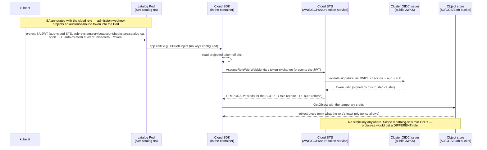

# 03 — Cloud identity for workloads

> The workload-to-cloud-IAM problem (a Pod needs to call S3, GCS or Blob
> Storage with **no static keys**), solved by **OIDC federation**: the
> projected, audience-bound ServiceAccount token of [Part 05
> ch.01](../05-security/01-authn-authz-rbac.md) exchanged for *scoped,
> short-lived* cloud credentials. The four mechanisms are **EKS IRSA**,
> **EKS Pod Identity**, **GKE Workload Identity** and **Microsoft Entra
> Workload ID** on AKS. The chapter covers per-workload scoping, token
> projection and rotation, the metadata service a Pod can use to take the
> node's identity, and the pitfalls (trust conditions, audience, node versus
> Pod identity). It applies them by giving the Bookstore `catalog`
> ServiceAccount read access to a cloud bucket with **zero** stored secrets.

**Estimated time:** ~45 min read · ~90 min hands-on
**Prerequisites:** [Part 05 ch.01](../05-security/01-authn-authz-rbac.md) — projected SA tokens this chapter exchanges for cloud creds · [Part 10 ch.01](01-managed-kubernetes-model.md) — managed-cluster OIDC issuer the federation depends on
**You'll know after this:** • explain OIDC federation between a Kubernetes SA and a cloud IAM role · • configure EKS IRSA and EKS Pod Identity, and name the trust object each one needs · • compare IRSA, EKS Pod Identity, GKE Workload Identity and Microsoft Entra Workload ID · • debug the audience and trust-condition mismatch class of identity failures · • close the metadata-service path that lets a Pod take the node's role · • scope a workload's cloud permissions to least privilege per SA

<!-- tags: cloud, security, irsa, eks, gke, aks -->

## Why this exists

[Part 05 ch.01](../05-security/01-authn-authz-rbac.md) ended on a sentence this
chapter cashes in: *"the projected, audience-bound SA token is exchanged for a
cloud credential — so the bound-token mechanics are not academic, they are how
Pods get cloud access without static keys."* Now the Bookstore is on a managed
cluster ([ch.01](01-managed-kubernetes-model.md)–[ch.02](02-provisioning-and-iac.md)),
a real cloud need appears: say `catalog` must read book-cover images from an S3/
GCS/Azure bucket, or `orders` must write receipts there. How does that Pod
authenticate to the cloud?

The wrong answers are the reasons this chapter exists:

1. **A static access key in a Secret.** An `AWS_ACCESS_KEY_ID` /
   `GOOGLE_APPLICATION_CREDENTIALS` JSON / Azure client secret baked into a
   Kubernetes Secret. It is base64, not encryption ([Part 03
   ch.02](../03-config-and-storage/02-secrets.md)); it **never expires**; it
   leaks via `helm get values`, a repo commit, a compromised Pod, an over-broad
   `get secrets` ([Part 05 ch.01](../05-security/01-authn-authz-rbac.md)); and
   rotating it across every workload is a project. A long-lived cloud key in a
   cluster is the single highest-value thing an attacker can steal.
2. **The node's identity.** Giving the *node's* instance role the S3
   permission "works", but now **every Pod on that node** (storefront,
   payments-worker, a compromised sidecar, a noisy neighbour in another
   namespace) inherits it. That is the [Part 05
   ch.01](../05-security/01-authn-authz-rbac.md) `default`-ServiceAccount
   anti-pattern, at cloud-IAM scale: an ambient, shared, over-broad identity
   nobody scoped.

The right answer is **OIDC workload identity federation**: the cluster is an
**OIDC identity provider**, each Pod gets a **projected, audience-scoped,
short-lived SA token** (the *exact* mechanism from [Part 05
ch.01](../05-security/01-authn-authz-rbac.md)), and the cloud is configured to
**trust that issuer** and exchange the token for **temporary, least-privilege
credentials scoped to that one ServiceAccount**. No static key exists anywhere;
the credential rotates; the scope is per-workload. This is the [Access
Control](#further-reading) pattern extended across the cluster/cloud trust
boundary. The reference is *Production Kubernetes* (Identity).

> **Nothing in this chapter runs on a cloud.** Cloud behaviour is cited
> upstream, not run. Each source in [Further reading](#further-reading) has
> its URL and the date it was checked, 2026-10-31. The Kubernetes-side objects
> were applied, or dry-run, on a kind cluster at the `restricted` Pod Security
> level, and the output shown here was captured there. That lab cluster has a
> different name from the one this chapter prints, and the lab used its own
> namespace; the commands below print `bookstore`, and the lab transcript
> records both substitutions. Placeholders only: `123456789012`, `your-org`
> and `$CLUSTER_NAME`.

## Mental model

**The cluster signs a short-lived "this is ServiceAccount X in namespace Y"
JWT; the cloud is told to trust that signer and hand back temporary
credentials scoped to exactly X/Y. No shared, no static, no node-wide.**

- **The cluster is an OIDC provider.** A managed cluster exposes an **OIDC
  issuer URL** with a public JWKS (set at create time —
  [ch.02](02-provisioning-and-iac.md): `eksctl … withOIDC` /
  `--workload-pool` / `--enable-oidc-issuer`). The kubelet projects a
  **ServiceAccount token** into the Pod that is *signed by the cluster*,
  *time-limited*, *bound to the Pod*, and *audience-scoped*: the bound/
  projected token of [Part 05 ch.01](../05-security/01-authn-authz-rbac.md),
  now with the cloud's STS as the audience.
- **The cloud trusts that issuer for specific subjects.** You register the
  cluster's OIDC issuer as a federated identity provider in the cloud IAM and
  write a **trust/condition** that says: *a token from this issuer whose
  `sub` claim is `system:serviceaccount:bookstore:catalog-sa` (and whose
  `aud` is the cloud STS) may assume **this** IAM role*. The
  `sub`/`aud`/`iss` triple is the entire security boundary. Get any of the
  three wrong and it fails closed, which is the most common pitfall.
- **The exchange yields temporary, scoped credentials.** The cloud SDK in the
  Pod reads the projected token off disk, asks the cloud token service for
  credentials, and gets back **short-lived credentials for that one role**
  with **that role's least-privilege policy** (for example `s3:GetObject` on
  exactly `arn:aws:s3:::your-org-book-covers/*`). They expire and the SDK
  refreshes them. No key is ever stored.
- **It is per-ServiceAccount, therefore per-workload.** Because the boundary
  is the SA's `sub` claim, **`catalog-sa` and `orders-sa` get different cloud
  roles** with different policies: the [Part 05
  ch.01](../05-security/01-authn-authz-rbac.md) "one identity per workload,
  least privilege" rule, extended to cloud IAM. A compromised `catalog` Pod
  can do *only* what `catalog`'s role allows, and nothing `orders` can.
- **Four flavours, one idea.** **EKS IRSA** (an IAM OIDC provider for the
  cluster, an IAM role whose trust policy names the `sub` and `aud`, and the
  `eks.amazonaws.com/role-arn` annotation on the ServiceAccount, which a
  webhook acts on). **EKS Pod Identity** (an agent on each node plus a
  `PodIdentityAssociation` that maps a namespace and ServiceAccount to a role;
  no OIDC provider and no annotation). **GKE Workload Identity** (a Kubernetes
  ServiceAccount bound to a Google service account through an IAM policy and
  the `iam.gke.io/gcp-service-account` annotation; GKE now recommends
  Workload Identity Federation for GKE, which grants roles to the ServiceAccount
  principal instead). **Microsoft Entra Workload ID on AKS** (the cluster's
  OIDC issuer, a federated credential on a managed identity, the
  `azure.workload.identity/client-id` annotation on the ServiceAccount and a
  pod label). Same federation, four configuration surfaces.

The trap to hold onto: **the credential lives in the *token exchange*, not in
the cluster.** There is nothing to rotate, nothing to leak, nothing to put in
a Secret. If you find yourself creating a Secret with a cloud key on a managed
cluster, you have skipped this entire chapter.

## Threats and controls

The threats below are specific to cloud identity. The fields that every Pod
carries are explained once, in the
[baseline](../01-core-workloads/01-pods.md#baseline).

| Threat | Control in this chapter | Goes deeper |
|---|---|---|
| A long-lived cloud key in a Secret, environment variable or file is copied and reused | Federation: no key is stored; credentials come from a projected token and expire | Token lifetimes and projection: [05.01](../05-security/01-authn-authz-rbac.md) |
| A Pod takes the node's cloud role through the instance metadata service | Per-ServiceAccount roles; IMDSv2 with hop limit 1 on AWS; metadata concealment and Workload Identity Federation on GKE; a NetworkPolicy egress rule that leaves the metadata address out | The NetworkPolicy block: [02.06](../02-networking/06-network-policies.md) |
| A token from another ServiceAccount, namespace or audience is accepted | Exact `sub`, `aud` and issuer conditions on every trust object | Mental model and How it works, below |
| A cloud role grants wildcard actions or resources | One action on one resource per role; trust and policy changes reviewed like RBAC | Review of cloud permissions: 05.09 <!-- link-later: 05.09 --> |
| A removed workload keeps cloud access after its manifests are gone | Delete the trust object: role trust, association, binding or federated credential | Audit of who assumed which role: 05.08 <!-- link-later: 05.08 --> |

## Diagrams

### Diagram A — Pod → projected SA token → cloud STS → scoped creds (Mermaid)

The runtime exchange. Nothing static is stored; the token is minted per-Pod
and traded for short-lived, role-scoped credentials.



### Diagram B — IRSA vs Pod Identity vs GKE WI vs Entra WI (ASCII)

```
 SAME FEDERATION, FOUR CONFIG SURFACES ───────────────────────────────────────

  aspect         EKS IRSA          EKS Pod Identity  GKE WI             Entra WI
  ────────────────────────────────────────────────────────────────────────────────
  cluster side   OIDC provider     EKS Pod Identity  OIDC issuer        OIDC issuer
   prerequisite   registered in     Agent (add-on)    (--workload-pool)  (--enable-
                  IAM (withOIDC)    on the cluster                       oidc-issuer)
  trust object   IAM role trust    IAM role trust    IAM policy on the  Entra federated
                  (sub and aud      for pods.eks...  GSA, or a direct   credential
                  conditions)       plus an           principal grant    (issuer, subject)
                                    association
  SA annotation  eks.amazonaws.    none: the         iam.gke.io/gcp-    azure.workload.
                 com/role-arn      association is    service-account    identity/client-id
                                    API-side
  pod opt-in     webhook (auto)    EKS adds env      none (the KSA      pod label
                                   (auto)            binding is enough) azure.workload.
                                                                        identity/use
  credential     STS Assume-       agent serves      GKE metadata       Entra token
   path          RoleWithWebId...  creds at a link-  server answers     exchange
                                   local address
  scope unit     per ServiceAcct   per association   per KSA           per federated
   (= per SA)                                                          credential
  best when      existing IRSA;    new setups; many  GKE-native;        AKS-native;
                 fine-grained      clusters/accounts; GSA reuse or      Entra-centric
                 OIDC control      less bookkeeping   direct grants
  ────────────────────────────────────────────────────────────────────────────────
  ALL FOUR: the cluster mints a short-lived ServiceAccount token, and the cloud
  trades it for credentials that last a short time and cover one ServiceAccount.
  NONE stores a static key. The anti-pattern all four replace: a static key in
  a Secret, or the NODE's role.
```

## Hands-on with the Bookstore

**Assumed working directory: the guide repo root (`full-guide/`).** This
chapter adds **no canonical manifests**. It shows the SA *annotation* each
provider needs and the IAM/role side, as overlays on the existing
`catalog-sa`/`orders-sa` from
[`05-serviceaccounts-rbac.yaml`](../examples/bookstore/raw-manifests/05-serviceaccounts-rbac.yaml)
(Part 05 ch.01). It does **not** edit that canonical file. The goal: give
`catalog` read access to a cloud bucket with **zero static keys**.

> **Cloud steps are cited, not run.** The IAM role, policy, association and
> binding commands below are the provider's documented forms. They need an
> account you own, so read them rather than running them against anything
> shared. The Kubernetes steps are the ones the lab ran; their output is shown.

### 1. The problem, made concrete

`catalog` currently has no cloud access and **no static key**. That is the
clean starting state to preserve while adding cloud access:

```sh
# from the repo root (full-guide/): bring catalog up (any cluster; kind ok):
kubectl apply -f examples/bookstore/raw-manifests/00-namespace.yaml
kubectl apply -f examples/bookstore/raw-manifests/05-serviceaccounts-rbac.yaml
# catalog-sa has automountServiceAccountToken:false and NO cloud annotation yet.
kubectl get sa catalog-sa -n bookstore -o yaml | grep -A3 'annotations:' || echo "no annotations yet"
# There is NO Secret with a cloud key anywhere in the app — verify (stays true):
kubectl get secrets -n bookstore        # db-credentials (DEMO) only; NO cloud key
```

The `automountServiceAccountToken: false` line is a baseline field: it stops
the kubelet mounting the default API token. The
[baseline](../01-core-workloads/01-pods.md#baseline-service-account) explains
it. It does not block the cloud identity below, which uses its own projected
token. Step 3 checks that with a dry run.

The objective: add bucket read for `catalog` **without** ever introducing a
cloud key into that list.

### 2a. EKS — IRSA (OIDC provider, role trust and SA annotation)

The cluster's OIDC provider was registered at create time
([ch.02](02-provisioning-and-iac.md): `iam.withOIDC: true`). Create an IAM
role whose **trust policy** federates the cluster issuer for *exactly*
`catalog-sa`, attach a least-privilege bucket policy, then annotate the SA:

```sh
# (illustrative — your account 123456789012, region us-east-1, $CLUSTER_NAME)
OIDC=$(aws eks describe-cluster --name $CLUSTER_NAME \
  --query 'cluster.identity.oidc.issuer' --output text | sed 's~https://~~')

# Trust policy: ONLY catalog-sa in ns bookstore, ONLY the STS audience.
cat > trust.json <<EOF
{ "Version": "2012-10-17", "Statement": [{
  "Effect": "Allow",
  "Principal": { "Federated": "arn:aws:iam::123456789012:oidc-provider/$OIDC" },
  "Action": "sts:AssumeRoleWithWebIdentity",
  "Condition": { "StringEquals": {
    "$OIDC:aud": "sts.amazonaws.com",
    "$OIDC:sub": "system:serviceaccount:bookstore:catalog-sa" } } }] }
EOF
aws iam create-role --role-name bookstore-catalog-s3 \
  --assume-role-policy-document file://trust.json
# Least-privilege: READ ONLY, ONE bucket prefix (not s3:* , not all buckets):
aws iam put-role-policy --role-name bookstore-catalog-s3 \
  --policy-name read-covers --policy-document '{"Version":"2012-10-17",
   "Statement":[{"Effect":"Allow","Action":["s3:GetObject"],
   "Resource":"arn:aws:s3:::your-org-book-covers/*"}]}'
```

The only Kubernetes-side change is the annotation. The manifest below is the
canonical `catalog-sa` with that annotation added. It is complete, so applying
it keeps `automountServiceAccountToken: false`. Save it as
`catalog-sa-irsa.yaml`, and apply it in place of the canonical ServiceAccount.
The canonical file is not edited.

```yaml
apiVersion: v1
kind: ServiceAccount
metadata:
  name: catalog-sa
  namespace: bookstore
  labels:
    app: catalog
    app.kubernetes.io/part-of: bookstore
  annotations:
    eks.amazonaws.com/role-arn: arn:aws:iam::123456789012:role/bookstore-catalog-s3
automountServiceAccountToken: false
```

```sh
kubectl apply -f catalog-sa-irsa.yaml
kubectl rollout restart deployment/catalog -n bookstore   # new Pods get the token
# The app code is UNCHANGED, and there is STILL no key in any Secret.
```

The IRSA webhook adds a projected token and the variables the AWS SDKs read
for web identity, to Pods that use an annotated ServiceAccount. The IRSA pages
checked for this chapter do not say how the webhook behaves when
`automountServiceAccountToken` is `false`, so the chapter does not assume it
works either way. Keep the setting, restart the Pods, and confirm on your EKS
cluster that a catalog Pod has the web identity variables and a token file. If
it does not, the setting needs a reviewed exception, not a silent change.

### 2b. EKS — Pod Identity (an association, no annotation)

Pod Identity removes the OIDC provider and the annotation. Its role trust names
`pods.eks.amazonaws.com` and the actions `sts:AssumeRole` and `sts:TagSession`,
so the role from 2a cannot be reused as it is. Create a second role for it:

```sh
cat > pod-identity-trust.json <<EOF
{ "Version": "2012-10-17", "Statement": [{
  "Sid": "AllowEksAuthToAssumeRoleForPodIdentity",
  "Effect": "Allow",
  "Principal": { "Service": "pods.eks.amazonaws.com" },
  "Action": ["sts:AssumeRole", "sts:TagSession"] }] }
EOF
aws iam create-role --role-name bookstore-catalog-s3-podid \
  --assume-role-policy-document file://pod-identity-trust.json
aws iam put-role-policy --role-name bookstore-catalog-s3-podid \
  --policy-name read-covers --policy-document '{"Version":"2012-10-17",
   "Statement":[{"Effect":"Allow","Action":["s3:GetObject"],
   "Resource":"arn:aws:s3:::your-org-book-covers/*"}]}'

# The agent runs on every node, in kube-system. The node role must allow
# eks-auth:AssumeRoleForPodIdentity; the AWS managed policy
# AmazonEKSWorkerNodePolicy grants it.
aws eks create-addon --cluster-name $CLUSTER_NAME --addon-name eks-pod-identity-agent
aws eks create-pod-identity-association --cluster-name $CLUSTER_NAME \
  --namespace bookstore --service-account catalog-sa \
  --role-arn arn:aws:iam::123456789012:role/bookstore-catalog-s3-podid
```

No SA annotation and no OIDC-provider trust are needed. The Pod keeps
`serviceAccountName: catalog-sa`, and the association matches on namespace and
ServiceAccount. The association lives in the AWS API, not in a Kubernetes
object. EKS adds two variables to the Pod: `AWS_CONTAINER_CREDENTIALS_FULL_URI`,
which points at the agent at `http://169.254.170.23/v1/credentials`, and
`AWS_CONTAINER_AUTHORIZATION_TOKEN_FILE`, which names a projected token with
the audience `pods.eks.amazonaws.com` and a 24-hour expiry. The agent trades
that token for credentials through the EKS Auth API (cited in Further reading).

### 2c. GKE — Workload Identity (KSA bound to a Google service account)

GKE now recommends Workload Identity Federation for GKE, which grants roles to
the ServiceAccount principal directly and needs no Google service account. The
commands below use the Google service account method, which GKE still
documents. The annotation belongs to that method.

```sh
# Bind the Kubernetes SA to a Google service account (GSA) with bucket read:
gcloud iam service-accounts create bookstore-catalog
gcloud storage buckets add-iam-policy-binding gs://your-org-book-covers \
  --member="serviceAccount:bookstore-catalog@$PROJECT.iam.gserviceaccount.com" \
  --role="roles/storage.objectViewer"          # READ ONLY, this bucket
gcloud iam service-accounts add-iam-policy-binding \
  bookstore-catalog@$PROJECT.iam.gserviceaccount.com \
  --role roles/iam.workloadIdentityUser \
  --member "serviceAccount:$PROJECT.svc.id.goog[bookstore/catalog-sa]"
kubectl annotate sa catalog-sa -n bookstore \
  iam.gke.io/gcp-service-account=bookstore-catalog@$PROJECT.iam.gserviceaccount.com
```

Both the IAM binding and the annotation are required for this method. The
member name `PROJECT.svc.id.goog[NS/KSA]` names the cluster's workload identity
pool and the one ServiceAccount inside it.

### 2d. Microsoft Entra Workload ID on AKS (a federated credential)

Microsoft's current name for this feature is **Microsoft Entra Workload ID**.
On AKS Standard, workload identity and the OIDC issuer must be enabled on the
cluster before Pods can use it ([ch.02](02-provisioning-and-iac.md) covers
cluster creation).

```sh
ISSUER=$(az aks show -g $RG -n $CLUSTER_NAME --query oidcIssuerProfile.issuerUrl -o tsv)
az identity create -g $RG -n bookstore-catalog
CID=$(az identity show -g $RG -n bookstore-catalog --query clientId -o tsv)
# Federate the cluster issuer for EXACTLY catalog-sa:
az identity federated-credential create --identity-name bookstore-catalog -g $RG \
  --name catalog-fed --issuer "$ISSUER" \
  --subject system:serviceaccount:bookstore:catalog-sa \
  --audience api://AzureADTokenExchange
# Grant the identity 'Storage Blob Data Reader' on the one container (least privilege).
kubectl annotate sa catalog-sa -n bookstore azure.workload.identity/client-id=$CID
```

The Pod template also needs this label. Without it the webhook does not
project the token into the Pod:

```yaml
metadata:
  labels:
    azure.workload.identity/use: "true"
```

Restart the Pods after you change the annotation.

### 3. Prove the scope holds

The boundary is the SA's `sub` claim, so `orders` cannot use `catalog`'s access
and the reverse holds too. The three checks below are read-only or dry runs:
nothing is created in a cloud, and the probe Pod is never run.

**The stored shape.** The IRSA webhook adds a projected ServiceAccount token to
the catalog Pod. The Pod below stands in for that shape: the projected token
with the STS audience, the default API token switched off, and the baseline in
full. Save it as `catalog-cloud-probe.yaml`:

```yaml
apiVersion: v1
kind: Pod
metadata:
  name: catalog-cloud-probe
  namespace: bookstore
  labels:
    app: catalog
spec:
  serviceAccountName: catalog-sa
  automountServiceAccountToken: false
  securityContext:
    runAsNonRoot: true
    runAsUser: 65532
    runAsGroup: 65532
    seccompProfile:
      type: RuntimeDefault
  containers:
    - name: catalog
      image: bookstore/catalog:dev
      imagePullPolicy: IfNotPresent
      securityContext:
        allowPrivilegeEscalation: false
        readOnlyRootFilesystem: true
        capabilities:
          drop: ["ALL"]
      resources:
        requests:
          cpu: 50m
          memory: 64Mi
        limits:
          cpu: 250m
          memory: 128Mi
      volumeMounts:
        - name: tmp
          mountPath: /tmp
        - name: aws-iam-token
          mountPath: /var/run/secrets/aws
          readOnly: true
  volumes:
    - name: tmp
      emptyDir: {}
    - name: aws-iam-token
      projected:
        sources:
          - serviceAccountToken:
              audience: sts.amazonaws.com
              expirationSeconds: 3600
              path: token
```

A server-side dry run sends the Pod through the API server's admission, under
the namespace's `restricted` label, and prints the stored fields. Nothing is
created or run:

```sh
kubectl apply --dry-run=server -f catalog-cloud-probe.yaml \
  -o jsonpath='{.spec.automountServiceAccountToken}{"\n"}{range .spec.volumes[*]}{.name}{" "}{.projected.sources[0].serviceAccountToken.audience}{"\n"}{end}'
```

<!-- gate: output -->
```
false
tmp
aws-iam-token sts.amazonaws.com
```

The stored Pod has no default token volume, and it has the projected token
with the STS audience. The dry run does not show a token file inside a running
container. That needs a Pod that runs on your cluster, and the lab did not run
one.

**The deliberate failure.** Save a copy as `catalog-hostnet-probe.yaml`, with
`name: catalog-hostnet-probe` and `hostNetwork: true` added under `spec:`.
This step shows a refusal on purpose. The API server rejects the copy:

```sh
kubectl apply --dry-run=server -f - < catalog-hostnet-probe.yaml
```

<!-- gate: output -->
```
Error from server (Forbidden): error when creating "STDIN": pods "catalog-hostnet-probe" is forbidden: violates PodSecurity "restricted:latest": host namespaces (hostNetwork=true)
```

A Pod on the host network shares the node's network namespace. The IRSA guide
notes that such Pods always have IMDS access, although the SDKs use IRSA
credentials when IRSA is enabled (cited in Further reading). The Pod Security
Standards forbid host namespaces at the baseline level, and the restricted
level builds on the baseline (cited). That is why the namespace label in the baseline matters: it refuses
the Pod that would skip the metadata controls below.

**The other ServiceAccount.** `orders-sa` has no cloud annotation, association
or binding, so its Pods get no cloud identity from this chapter:

```sh
kubectl get sa orders-sa -n bookstore -o yaml | grep -c -E 'role-arn|gcp-service-account|client-id' || true
```

<!-- gate: output -->
```
0
```

A count of `0` means none of the three ServiceAccount annotations is set. A
Pod Identity association is not stored in the cluster, so check those in the
EKS console or with the AWS CLI for the cluster. A compromised `catalog` Pod can
use only `catalog`'s role, which allows `s3:GetObject` on one bucket prefix:
not write, not delete, not other buckets, not `orders`' scope. This is the same
property as `kubectl auth can-i --list --as=...:catalog-sa` in
[Part 05 ch.01](../05-security/01-authn-authz-rbac.md), extended across the
cloud trust boundary.

> **Lineage note.** This builds directly on
> [`05-serviceaccounts-rbac.yaml`](../examples/bookstore/raw-manifests/05-serviceaccounts-rbac.yaml)
> ([Part 05 ch.01](../05-security/01-authn-authz-rbac.md)). The SAs already
> exist and are already one-per-workload. Cloud identity is one annotation (or
> an API-side association) on top, with the canonical file unedited. The
> in-cluster RBAC of Part 05 ch.01 (what a SA may do *to the Kubernetes API*)
> and cloud identity (what it may do *to the cloud*) are orthogonal layers on
> the same ServiceAccount, and both are least-privilege and per-workload.

## The metadata service is the thief's shortcut

A cloud's instance metadata service hands out the node's credentials to any
process that can reach it. Workload identity does not close that path by
itself. This section closes it on AWS and GKE. The NetworkPolicy block is
taught in [02.06](../02-networking/06-network-policies.md).

### The node role is the last link in the chain

An EKS Pod with an IRSA or Pod Identity association uses those credentials
first. A Pod without one falls through the SDK's credential chain to the node's
instance profile. The EKS best practices guide says Pods can inherit that role
unless access to instance metadata is blocked (cited). The node role is then
the credential a compromised Pod steals, unless the path is closed.

### AWS: IMDSv2 and the hop limit

Require IMDSv2, so that a request without a session token is refused. Set the
hop limit to 1, so that the session-token response cannot cross the extra hop
a Pod's network adds (cited in Further reading):

```sh
aws ec2 modify-instance-metadata-options --instance-id <instance-id> \
  --http-tokens required --http-put-response-hop-limit 1
```

Put the same settings in the launch template for managed node groups, so that
new nodes match. Do not turn instance metadata off: node components rely on it
(cited). The eksctl and CloudFormation node templates set the hop limit to 2 so
that Pods can reach IMDS through the extra hop (cited). A node built from those
templates stays open to Pods until you change this. Requiring IMDSv2 also means
that IMDSv1 requests fail, so check that your agents use IMDSv2 first (cited).

### GKE: the metadata server and concealment

On GKE the metadata server intercepts Pod requests to metadata endpoints, so a
Pod reaches that server rather than the Compute Engine one (cited). Metadata
concealment hides `kube-env`, which holds kubelet credentials, and the node's
instance identity token. It does **not** hide the node's service account
credentials, which stay exposed to workloads (cited). The GKE page marks the
older concealment flag, `--workload-metadata=SECURE`, as deprecated, so check
the metadata setting on each node pool in the console or with `gcloud`.

Two things follow. Keep the node service account to what the node needs; GKE's
own logging and monitoring agents still use it (cited). And move Pods to
Workload Identity Federation for GKE, which replaces the need for concealment
(cited).

### NetworkPolicy: the metadata address as an egress decision

A NetworkPolicy can stop a Pod reaching the metadata address, but only on a
cluster whose network plugin enforces policy. The Kubernetes docs say a
NetworkPolicy with no enforcing controller has no effect (cited). A
NetworkPolicy has no deny rule: policies only add allowed flows, and a namespace
that has a default-deny egress policy reaches a destination only if a rule
allows it ([02.06](../02-networking/06-network-policies.md)). Where a policy has
to allow broad egress, add the metadata address to the `except` list of the
`ipBlock`:

```yaml
# A fragment of an egress rule, for a policy that allows broad egress.
to:
  - ipBlock:
      cidr: 0.0.0.0/0
      except:
        - 169.254.169.254/32
```

The EKS Pod Identity agent listens on `169.254.170.23`, not on the metadata
address. So a block on `169.254.169.254` leaves Pod Identity working (cited).

## How it works under the hood

- **The projected token is the [Part 05 ch.01](../05-security/01-authn-authz-rbac.md)
  bound token, re-aimed at the cloud.** The kubelet uses the **TokenRequest**
  API to mint a ServiceAccount JWT that is **audience-scoped** (the cloud
  STS) and **bound to the Pod**. The token stops working against the API when
  the Pod or its ServiceAccount is deleted (cited). It is mounted at a
  projected-volume path. The cloud SDK's default credential chain looks there
  through the variables the cloud sets: the AWS web identity variables, the
  Google external-account file, and for Entra `AZURE_FEDERATED_TOKEN_FILE`,
  which Microsoft asks applications to read rather than hard-code (cited). The
  kubelet refreshes the file before it expires (cited), so the app code does
  not change: the SDK does the exchange transparently.
- **The trust is `iss` + `aud` + `sub`, and it fails closed.** The cloud checks
  the JWT's signature against the cluster's public keys, fetched from the
  registered OIDC issuer. It then checks that `aud` is the expected audience
  and that `sub` equals `system:serviceaccount:<NS>:<SA>`. A wrong namespace, a
  misspelt ServiceAccount, a missing OIDC provider or the wrong audience makes
  the exchange fail. The STS API documents `InvalidIdentityToken` for a token
  it cannot validate, and `IDPRejectedClaim` for a claim the provider rejected
  (cited). A trust condition that does not match is a refused assume-role call,
  not a weaker credential. When a Pod reports that it has no identity, check
  the trust object first.
- **Credentials leave an audit trail that names the ServiceAccount.** An
  `AssumeRoleWithWebIdentity` call can write a CloudTrail entry that includes
  the token's subject, so the trail shows which ServiceAccount assumed the role
  (cited). Use the trail for review. The audit practice itself is 05.08
  <!-- link-later: 05.08 -->.
- **Why this beats a static key, structurally.** A static key is a *bearer
  secret*: possession is access, forever, from anywhere. A federated credential
  is *minted on demand from an identity the cluster vouches for, scoped to one
  SA*, and it expires. The default session for `AssumeRoleWithWebIdentity` lasts
  one hour (cited), up to the role's maximum. There is **no secret at rest**
  (nothing to encrypt, leak, commit, or rotate), the **blast radius is one
  workload's role**, and **revocation is quick** (delete the trust,
  association, binding or credential; there is no key to hunt down). This is why [Part 05
  ch.04](../05-security/04-secrets-and-cluster-hardening.md)'s "no long-lived
  secrets" principle holds here by architecture, not by policy.
- **The node's role is a second, shared identity.** The node's instance role is
  also an IAM principal. Its path to Pods is closed by the metadata section
  above. Keep the node role to what the kubelet, the CNI and the CSI driver
  need, and never add a workload's permissions to it.
- **IRSA vs Pod Identity, mechanically.** IRSA: an IAM **OIDC provider** per
  cluster, a per-role **trust policy** with `sub`/`aud` conditions, and a
  webhook that acts on the ServiceAccount's `role-arn` annotation. Pod
  Identity: an agent on each node, reached at the link-local address EKS puts
  in the Pod's environment, and an API-side **PodIdentityAssociation** (SA to
  role). The role trust names `pods.eks.amazonaws.com`, and the Pod gets its own
  projected token for that audience (cited). Pod Identity needs no OIDC provider
  and no annotation, which removes bookkeeping at scale (cited). **GKE WI** uses
  an IAM binding: `roles/iam.workloadIdentityUser` on the Google service account
  for the member `PROJECT.svc.id.goog[NS/KSA]`, and Workload Identity Federation
  grants roles to the principal directly (cited). **Entra WI** uses a federated
  credential keyed on the issuer and the subject, with the token audience
  `api://AzureADTokenExchange` (cited). Four surfaces, the same federation
  underneath.
- **Scope is per-SA, which is *why* one-SA-per-workload (Part 05 ch.01) pays
  off here.** Because the trust matches the `sub` claim, the unit of cloud
  authorization is the ServiceAccount. The Bookstore already has `catalog-sa`,
  `orders-sa`, `storefront-sa` and so on, one per workload ([Part 05
  ch.01](../05-security/01-authn-authz-rbac.md)). Cloud least-privilege is
  therefore nearly free: annotate only the SAs that need cloud, each with its
  own minimal role. The AWS guide recommends one IAM role per application for
  the same reason (cited). A shared SA would force a shared, over-broad cloud
  role, which is the reason that anti-pattern was rejected in Part 05.
- **Revocation is deleting the trust object.** Revoke a workload's access by
  deleting its IAM role trust, its Pod Identity association, its GKE binding or
  its federated credential. Credentials already issued stay valid until they
  expire, so a revocation takes effect for new sessions at once and for old ones
  within the session length. Audit the trust objects, not a key inventory.

## Production notes

> **In production: pick one identity model per platform.** Mixing IRSA, Pod
> Identity and Workload Identity Federation across clusters adds an audit and
> debugging tax. The AWS guide makes the same point about one role per
> application (cited above). Choose a model, document it, and apply it to every
> cluster in the same way.

## Quick Reference

```sh
# EKS IRSA — OIDC provider exists (ch.02 withOIDC); role trust + SA annotation:
aws eks describe-cluster --name $CLUSTER_NAME --query cluster.identity.oidc.issuer
kubectl annotate sa <SA> -n <NS> eks.amazonaws.com/role-arn=arn:aws:iam::<ACCT>:role/<R>
# EKS Pod Identity — agent add-on + an association (no annotation):
aws eks create-addon --cluster-name $CLUSTER_NAME --addon-name eks-pod-identity-agent
aws eks create-pod-identity-association --cluster-name $CLUSTER_NAME \
  --namespace <NS> --service-account <SA> --role-arn arn:aws:iam::<ACCT>:role/<R>
# GKE Workload Identity (GSA method):
kubectl annotate sa <SA> -n <NS> iam.gke.io/gcp-service-account=<GSA>@<PROJ>.iam.gserviceaccount.com
# Microsoft Entra Workload ID on AKS:
az identity federated-credential create --identity-name <ID> -g $RG --name <N> \
  --issuer "$ISSUER" --subject system:serviceaccount:<NS>:<SA> --audience api://AzureADTokenExchange
kubectl annotate sa <SA> -n <NS> azure.workload.identity/client-id=<CLIENT-ID>

# Metadata path (AWS): IMDSv2 only, hop limit 1
aws ec2 modify-instance-metadata-options --instance-id <instance-id> \
  --http-tokens required --http-put-response-hop-limit 1

# Verify NO static cloud key exists (it should never):
kubectl get secrets -n <NS>          # there must be NO cloud-key Secret
```

The only Kubernetes-side artifact is an annotated ServiceAccount, with the
baseline's automount line kept. One provider's annotation per ServiceAccount:

```yaml
apiVersion: v1
kind: ServiceAccount
metadata:
  name: catalog-sa
  namespace: bookstore
  annotations:
    # One cloud annotation per ServiceAccount, for the provider in use.
    # EKS Pod Identity needs none: its association is API-side.
    eks.amazonaws.com/role-arn: arn:aws:iam::123456789012:role/bookstore-catalog-s3
    # iam.gke.io/gcp-service-account: bookstore-catalog@your-org.iam.gserviceaccount.com
    # azure.workload.identity/client-id: your-entra-client-id
automountServiceAccountToken: false
```

The IAM role, Google service account or identity carries a least-privilege
policy: one action on one resource. Trust is scoped to
`system:serviceaccount:<NS>:<APP>-sa`. No key is stored anywhere.

Checklist:

- [ ] **No static cloud key** anywhere (no Secret, no env, no file): workload
      identity only
- [ ] Trust, association or binding scoped to the **exact**
      `system:serviceaccount:<NS>:<SA>` and the **exact** audience
- [ ] The role, GSA or identity policy is **least-privilege** (one action,
      one resource), not `*`
- [ ] **One SA per workload** ([Part 05 ch.01](../05-security/01-authn-authz-rbac.md));
      annotate only those that need cloud
- [ ] OIDC issuer enabled **at cluster create** ([ch.02](02-provisioning-and-iac.md));
      for IRSA the webhook fires after a Pod restart, and the automount setting
      is confirmed on your cluster
- [ ] Entra Pods carry the `azure.workload.identity/use` label; Pod Identity
      associations exist in the AWS API
- [ ] **AWS:** IMDSv2 required and hop limit 1 on the node template and the
      running nodes; the node role is minimal
- [ ] **GKE:** Workload Identity Federation, or concealment with a minimal node
      service account
- [ ] Egress rules leave `169.254.169.254` out, with an enforcing CNI
      ([02.06](../02-networking/06-network-policies.md))
- [ ] `restricted` refuses host networking (the refusal in Hands-on step 3)
- [ ] Revocation tested = delete the trust object (no key inventory to chase)

## Test your understanding

> Try each before opening the answer drawer. The act of trying is the exercise; the answer is the check.

1. **Explain in two sentences why IRSA is "zero stored secrets": what replaces the AWS access key that lived in a Secret before?**
   <details><summary>Show answer</summary>

   The Pod's projected ServiceAccount token (a short-lived, OIDC-signed JWT with the audience `sts.amazonaws.com`) is exchanged at runtime via `sts:AssumeRoleWithWebIdentity` for temporary AWS credentials scoped to the IAM role named by the SA annotation. No static key ever exists: the projected token is refreshed, and STS issues short-lived sessions, one hour by default. The trust relationship is set up once per cluster (the OIDC provider) and once per workload (the role trust policy), then it is keyless.

   </details>

2. **The `catalog` Pod has a web identity token file and the variables the SDK reads, but its calls fail with an error from STS. What three things do you check?**
   <details><summary>Show answer</summary>

   (1) Does the trust policy's `sub` condition equal `system:serviceaccount:bookstore:catalog-sa`? A namespace or ServiceAccount typo is the most common cause. (2) Does the `aud` condition equal `sts.amazonaws.com`, the audience the token carries? (3) Is the OIDC provider registered in IAM for this cluster's issuer URL? A cluster recreated without re-registering the issuer fails here. Each one is a denied assume-role call, which is the safe failure: the Pod gets no credentials rather than a broader ones.

   </details>

3. **You are migrating from IRSA to EKS Pod Identity. Which guarantees do you keep, and which mechanics change?**
   <details><summary>Show answer</summary>

   Kept: per-workload least privilege, no static keys, short-lived credentials, and a boundary per ServiceAccount. Changed: the role needs a new trust for `pods.eks.amazonaws.com`, so the OIDC trust from IRSA is not reused. The association moves to the EKS API and the annotation goes. The node role must allow `eks-auth:AssumeRoleForPodIdentity`. The Pod's variables change: `AWS_CONTAINER_CREDENTIALS_FULL_URI` points at the agent, and the Pod gets a projected token for the Pod Identity audience. Application code is unchanged in both models.

   </details>

4. **Hands-on, against an AWS account you own: create the IRSA role from 2a, annotate the SA, and check that `aws s3 ls` works from a Pod. Then change the `aud` condition in the trust policy to `wrong-audience`. What do you see?**
   <details><summary>What you should see</summary>

   The Pod still has a token file, and the token is still issued. STS refuses the assume-role call, because the trust condition on `aud` no longer matches the token. The SDK reports an error from STS, and the error names the failed check. The exact text varies, so read it rather than match a string from this page. The lesson: the audience is part of the trust contract, not a free string.

   </details>

5. **GKE binds a Google service account to a Kubernetes ServiceAccount with an IAM policy. Why is the Pod-side code simpler than IRSA's?**
   <details><summary>Show answer</summary>

   With GKE's Google service account method, the SDK asks the GKE metadata server for a token, and the server answers with credentials for the bound identity. With IRSA, the SDK exchanges the projected token itself with STS. Both rest on the same federation idea: the member `PROJECT.svc.id.goog[NS/KSA]` names the cluster's workload identity pool. The difference is who performs the exchange. Workload Identity Federation for GKE goes further and grants the role to the ServiceAccount principal, with no Google service account.

   </details>

6. **A Pod has no IRSA or Pod Identity association, on an EKS node with hop limit 2 and IMDSv1 allowed. What can it reach, and which two settings close it?**
   <details><summary>Show answer</summary>

   It can request the node's instance-profile credentials from IMDS. The Pod falls through the SDK's credential chain to the node role, and the hop limit of 2 lets its requests reach IMDS (cited in Further reading). Require IMDSv2 (`--http-tokens required`) and set the hop limit to 1 (`--http-put-response-hop-limit 1`). Either setting alone leaves a path open. The hop limit applies only to the IMDSv2 token (PUT) response, so with IMDSv1 still allowed a Pod's plain GET is answered whatever the hop limit. With IMDSv2 required but hop limit 2, a Pod can still fetch a session token. A Pod on the host network still reaches IMDS, so the `restricted` refusal in Hands-on step 3 has to stay in place.

   </details>

## Further reading

- **Rosso et al., _Production Kubernetes_, ch.10 — Identity** (workload
  identity, token mechanics, and bridging Kubernetes identity to cloud IAM in
  production, the production framing for this whole chapter) and **ch.7 —
  Secret Management** (why a static cloud key in a Secret is the wrong model).
- **Ibryam & Huß, _Kubernetes Patterns_ 2e, ch.26 — Access Control** (the
  authentication/authorization model and least-privilege identity as a
  pattern, extended here across the cloud trust boundary).
- Checked 2026-10-31. Cloud behaviour cited, not run.
  - EKS IAM roles for service accounts (IRSA)
    <https://docs.aws.amazon.com/eks/latest/userguide/iam-roles-for-service-accounts.html>
  - EKS Pod Identity: association
    <https://docs.aws.amazon.com/eks/latest/userguide/pod-id-association.html>,
    how it works
    <https://docs.aws.amazon.com/eks/latest/userguide/pod-id-how-it-works.html>,
    and the agent add-on
    <https://docs.aws.amazon.com/eks/latest/userguide/pod-id-agent-setup.html>
  - EKS best practices, identity and access management
    <https://docs.aws.amazon.com/eks/latest/best-practices/identity-and-access-management.html>
    (instance profile restriction, hop limit, automount)
  - EC2 instance metadata options
    <https://docs.aws.amazon.com/AWSEC2/latest/UserGuide/configuring-instance-metadata-options.html>
  - STS AssumeRoleWithWebIdentity
    <https://docs.aws.amazon.com/STS/latest/APIReference/API_AssumeRoleWithWebIdentity.html>
  - GKE Workload Identity
    <https://docs.cloud.google.com/kubernetes-engine/docs/how-to/workload-identity>
    and its concepts
    <https://docs.cloud.google.com/kubernetes-engine/docs/concepts/workload-identity>
  - GKE metadata concealment
    <https://docs.cloud.google.com/kubernetes-engine/docs/how-to/protecting-cluster-metadata>
  - Microsoft Entra Workload ID on AKS
    <https://learn.microsoft.com/en-us/azure/aks/workload-identity-overview>
  - Kubernetes ServiceAccounts and token projection
    <https://kubernetes.io/docs/tasks/configure-pod-container/configure-service-account/>
  - Kubernetes NetworkPolicy
    <https://kubernetes.io/docs/concepts/services-networking/network-policies/>
  - Kubernetes Pod Security Standards
    <https://kubernetes.io/docs/concepts/security/pod-security-standards/>
