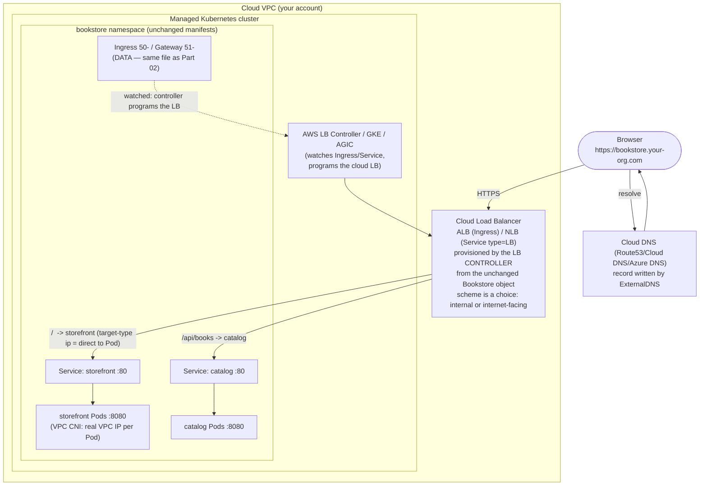

# 04 — Cloud networking and load balancing

> What changes about [Part 02](../02-networking/01-networking-model.md) on a
> real cloud: the **cloud CNI landscape** (AWS **VPC CNI** = a real VPC IP per
> Pod, **ENI/IP density limits** and **prefix delegation**; GKE/AKS CNIs;
> **Cilium** as a cloud CNI — the eBPF depth), Pod/Service **CIDRs and IP
> exhaustion**, **private clusters / egress** (NAT, private endpoints); cloud
> **L4/L7 load balancing** — the **AWS Load Balancer Controller**
> (`Service type=LoadBalancer`→NLB, Ingress→ALB, `IngressClass`/annotations),
> GKE **GCLB / container-native (NEG)**, AKS **LB / AGIC**;
> `Service` annotations vs **Gateway API** on cloud; **ExternalDNS**; and
> **which managed CNIs actually enforce NetworkPolicy** — applied by exposing
> the Bookstore `storefront` through a cloud LB + an ExternalDNS hostname,
> conceptually mapped onto the existing
> [`50-ingress.yaml`](../examples/bookstore/raw-manifests/50-ingress.yaml) /
> [`51-gateway.yaml`](../examples/bookstore/raw-manifests/51-gateway.yaml).

**Estimated time:** ~60 min read · ~90 min hands-on
**Prerequisites:** [Part 02 ch.01](../02-networking/01-networking-model.md): networking model this chapter maps onto cloud CNIs · [Part 02 ch.05](../02-networking/05-gateway-api.md): Gateway API contrasted with cloud LB annotations · [ch.03](03-cloud-identity.md): workload identity for the controllers
**You'll know after this:** • compare AWS VPC CNI / Cilium / GKE / AKS CNIs and their NetworkPolicy support · • diagnose Pod-IP exhaustion and apply prefix delegation as the fix · • wire AWS Load Balancer Controller for NLB (L4) and ALB (L7) traffic · • restrict the API server endpoint and each load balancer to the networks that need them · • configure ExternalDNS to keep DNS records in sync with Service/Ingress changes · • choose between cloud-LB annotations and Gateway API for a given exposure

<!-- tags: cloud, networking, cilium, vpc-cni, eks, aks -->

## Why this exists

[Part 02](../02-networking/01-networking-model.md) built the Bookstore's whole
network on kind: a flat Pod LAN, ClusterIP Services, an ingress-nginx
controller behind `kind`'s port-map, NetworkPolicy enforced by Calico. Every
one of those pieces *changes shape* on EKS/GKE/AKS — and the changes are
exactly where cloud networking incidents come from:

1. **`type: LoadBalancer` does nothing on kind — and the wrong thing on a
   misconfigured cloud.** [Part 02 ch.02](../02-networking/02-services.md)
   noted a `LoadBalancer` Service stays `<pending>` with no cloud. On a cloud
   it provisions a *real, billed* load balancer — and one per Service unless
   you front them with an Ingress/Gateway ([Part 02 ch.04](../02-networking/04-ingress.md)).
   Getting the *type*, the *scheme* and the *source ranges* right is the
   difference between an internal NLB and an accidental public database.
2. **Pod IPs come from the VPC now, and you can run out.** kind's Pod CIDR is
   imaginary. AWS's **VPC CNI** gives every Pod a **real routable VPC IP** out
   of your subnets — so subnet sizing, ENI limits, and **IP exhaustion** are
   suddenly a hard scaling ceiling the Bookstore never hit on kind.
3. **NetworkPolicy can be a silent no-op — again, but for cloud reasons.**
   [Part 02 ch.06](../02-networking/06-network-policies.md) hammered "the CNI
   must enforce policy or it does nothing". On managed clusters the *default*
   CNI may not enforce: enforcement is a separate switch, so
   `60-networkpolicy.yaml` applies cleanly and protects nothing until the right
   dataplane or add-on is on.
4. **The control plane is reachable from the internet unless you close it.**
   EKS creates a public API endpoint by default, AKS gives the API server a
   public IP by default, and a GKE control plane accepts any external address
   until authorised networks are set. The API server is the most powerful door
   in the cluster, so its exposure is the first decision, not the last.

This chapter is the cloud refraction of Part 02: the same Services/Ingress/
Gateway/NetworkPolicy objects (**unchanged** — that is the point), wired into
the cloud's VPC, CNI, and load balancers. The reference is *Production
Kubernetes* (Pod Networking / Service Routing).

> **Nothing in this chapter runs on a cloud.** Load balancer, DNS and CNI
> behaviour is cited from each provider's documentation (checked 2026-10-31,
> links under Further reading), not run. What runs is on the kind lab cluster:
> the dry-runs that show the Bookstore objects are unchanged, and one Service
> that shows what a cloud controller is asked to build. Placeholders only: no
> account IDs, certificate ARNs or public addresses.

## Mental model

**On a cloud the Kubernetes network objects don't change — they become
*instructions to a controller that programs cloud infrastructure*. The CNI
puts Pods in your VPC; a load-balancer controller turns Service/Ingress into a
real cloud LB; ExternalDNS turns the LB's address into a DNS name.**

- **The CNI is now a VPC integration, not an overlay.** kind's kindnet is a
  toy. On EKS the **Amazon VPC CNI** assigns each Pod a **real secondary IP on
  an ENI** in your subnet — Pods are first-class VPC citizens (great for
  security-group/routing integration, but **Pod density per node is bounded by
  ENI×IP limits**, and **subnet IPs are a finite, shareable pool**). GKE/AKS
  default CNIs are VPC-native too (alias IP ranges / Azure CNI). **Cilium**
  (eBPF) is the high-performance, policy-rich choice across all three —
  kube-proxy-free, identity-aware, with FQDN policy.
- **A Service/Ingress is a *request for cloud infrastructure*.** `Service
  type=LoadBalancer` → the cloud LB controller provisions an **L4 LB** (AWS
  **NLB**, GCP/Azure L4 LB) pointing at the Service. An **Ingress** ([Part 02
  ch.04](../02-networking/04-ingress.md)) → an **L7 LB** (AWS **ALB**, GCP
  **GCLB**, Azure **App Gateway via AGIC**) — *or* an in-cluster controller
  (ingress-nginx) fronted by an L4 LB. The object is desired state; the
  **controller reconciles real cloud LBs** — the [Part 02
  ch.04](../02-networking/04-ingress.md) reconcile loop, with the cloud as the
  dataplane.
- **Annotations are the cloud-specific tuning surface (and the lock-in).**
  Internal-vs-internet, TLS cert (ACM/Google-managed/Key Vault), health-check
  path, target-type (instance vs **IP/`ip-target`** = direct-to-Pod), idle
  timeout — all **provider-specific annotations** on the Service/Ingress. This
  is exactly the [Part 02 ch.04](../02-networking/04-ingress.md)→[ch.05](../02-networking/05-gateway-api.md)
  portability problem; **Gateway API** ([Part 02 ch.05](../02-networking/05-gateway-api.md))
  is the typed, portable alternative, with managed implementations (GKE
  Gateway, AWS Gateway API / VPC Lattice).
- **ExternalDNS closes the last gap.** A cloud LB gets a generated address
  (`a1b2…elb.amazonaws.com`). **ExternalDNS** watches Services/Ingresses and
  writes the **DNS records** (Route 53 / Cloud DNS / Azure DNS) so
  `bookstore.your-org.com` resolves to the LB — declaratively, no manual DNS.
- **Private clusters and egress are a deliberate posture.** Production
  clusters often have **private nodes/endpoint** (no public node IPs); Pods
  reach the internet via a **NAT gateway**, and the apiserver via a **private
  endpoint**. Egress is then a designed path (NAT + tight NetworkPolicy
  `ipBlock` — [Part 02 ch.06](../02-networking/06-network-policies.md)), not an
  open default.

The trap to hold onto: **the Bookstore's `40-services.yaml`/`50-ingress.yaml`/
`51-gateway.yaml`/`60-networkpolicy.yaml` do not change** — what changes is the
*controller* that interprets them and the *cloud infra* it builds. Confusing
"the object" with "the cloud thing the controller built from it" is the source
of most cloud-networking confusion (and orphaned-LB bills).

## Threats and controls

| Threat | Control in this chapter | Goes deeper |
|---|---|---|
| The API server answers the whole internet | A private endpoint, or a public endpoint limited to authorised networks (Hands-on step 1) | Who may act once connected: [ch.03](03-cloud-identity.md), [05.01](../05-security/01-authn-authz-rbac.md) |
| A `type: LoadBalancer` Service exposes an internal workload | An internal scheme chosen on purpose, and source ranges on any public one (Hands-on step 3) | The Pod-level rules behind it: [Part 02 ch.06](../02-networking/06-network-policies.md) |
| Nodes with public IPs are reachable directly | Private nodes, with egress through NAT (Mental model) | Egress rules: [Part 02 ch.06](../02-networking/06-network-policies.md) |
| A NetworkPolicy is accepted but never enforced | Turn on the enforcer and prove a denied connection is refused (How it works) | [Part 02 ch.06](../02-networking/06-network-policies.md) |

Only threats specific to cloud exposure are listed. The baseline for the
workloads behind these Services is in
[01.01](../01-core-workloads/01-pods.md#baseline).

## Diagrams

### Diagram A — internet → cloud LB → controller → Service → Pod (Mermaid)

The north-south path on a managed cluster. The Bookstore objects are
unchanged; the cloud LB + DNS are what the controllers add.



### Diagram B — LB type → annotation/controller table (ASCII)

```
 WHAT KUBERNETES OBJECT -> WHAT CLOUD LB -> VIA WHICH CONTROLLER ────────────

  K8s object             AWS                 GCP (GKE)          Azure (AKS)
  ─────────────────────────────────────────────────────────────────────────
  Service type=          NLB (L4)            L4 LB              L4 LB (Standard
   LoadBalancer           via AWS LB Ctrl     (built-in)         LB) (built-in)
  Ingress (L7)           ALB                 GCLB (External/    App Gateway via
                          via AWS LB Ctrl     Internal Ingress)  AGIC, OR
                          (IngressClass=alb)  (built-in Ingress) ingress-nginx+LB
  in-cluster nginx       ingress-nginx       ingress-nginx      ingress-nginx
   (Part 02 ch.04)        + an NLB in front   + an L4 LB         + an L4 LB
  Gateway API            AWS Gateway API     GKE Gateway        Istio/Envoy/
   (Part 02 ch.05)        (VPC Lattice) /     (GCLB, native)     Cilium Gateway
                          Envoy/Cilium GW
  ─────────────────────────────────────────────────────────────────────────
  KEY ANNOTATIONS (provider-specific = lock-in; Gateway API = portable):
   internal      :  AWS  aws-load-balancer-scheme: "internal" (also the default)
                    GKE  spec.loadBalancerClass: networking.gke.io/l4-regional-internal
                    AKS  service.beta.kubernetes.io/azure-load-balancer-internal:"true"
   direct-to-Pod :  AWS  alb.ingress.kubernetes.io/target-type: ip (Ingress)
                    AWS  aws-load-balancer-nlb-target-type: ip (Service)
                    GKE  NEG (container-native) | AKS  cloud-provider-azure annotations
   TLS cert      :  AWS ACM ARN | GKE ManagedCertificate | AKS Key Vault/AGIC
   DNS name      :  external-dns.alpha.kubernetes.io/hostname (ExternalDNS, all)

  RULE: type=LoadBalancer = ONE cloud LB + bill PER Service. Front many
        Services with ONE Ingress/Gateway (Part 02 ch.04/05) to share an LB,
        TLS, and a hostname — exactly why the Bookstore uses 50-/51-.
```

## Hands-on with the Bookstore

**Assumed working directory: the guide repo root (`full-guide/`).** This
chapter edits **none** of
[`40-services.yaml`](../examples/bookstore/raw-manifests/40-services.yaml),
[`50-ingress.yaml`](../examples/bookstore/raw-manifests/50-ingress.yaml),
[`51-gateway.yaml`](../examples/bookstore/raw-manifests/51-gateway.yaml), or
[`60-networkpolicy.yaml`](../examples/bookstore/raw-manifests/60-networkpolicy.yaml).
Cloud settings go in overlays. The overlays are **illustrative** and need a
cloud account to run, so only the kind steps were run.

The manifests here are Services, Ingress and NetworkPolicy objects with no pod
template, so the workload baseline
([01.01](../01-core-workloads/01-pods.md#baseline)) has nothing to attach to.
Overlays are fragments that a Kustomize patch or Helm value merges into the
canonical object. The one complete manifest the reader applies is the
`storefront-lb` Service in step 3.

### 1. Set who can reach the API server

The API server endpoint belongs to the cluster, not to a Service, so it is set
first. Each cloud offers two controls: a **private endpoint**, reachable only
from the VPC or a connected network, and a list of **authorised networks** for
the public endpoint. The settings below are cited, not run.

- **EKS.** New clusters have the public endpoint on and the private endpoint
  off ([EKS endpoint access][eks-endpoint]). Turn the public endpoint off for
  a cluster that CI and operators reach over a connected network. If you keep
  it, the public access CIDRs restrict it. They do not touch the private
  endpoint. EKS recommends enabling the private endpoint too, or including the
  addresses that nodes use to reach the public one. The cluster security group
  guards the private endpoint.
- **GKE.** `--enable-private-nodes` gives nodes no external IP addresses.
  `--enable-private-endpoint` turns off the external endpoint. Without
  `--enable-master-authorized-networks` and `--master-authorized-networks`, the
  control plane accepts any external address. Private nodes need Cloud NAT for
  outbound internet access ([GKE private clusters][gke-private]).
- **AKS.** `--enable-private-cluster` puts the API server behind a private
  endpoint in the cluster's virtual network
  ([AKS private clusters][aks-private]).
  Authorised IP ranges limit only the public API server, so they do not apply
  to a private cluster. They need the Standard load balancer, allow up to 200
  ranges, and take up to two minutes to take effect
  ([AKS authorised ranges][aks-ip-ranges]).

Before you tighten any of these, confirm that your CI runners and admin
networks are on the list, or you lock yourself out. A sketch of the AKS
restriction, with a placeholder for your admin range:

```sh
# AKS, cited and not run: limit the public API server to one network.
az aks update \
  --resource-group $RESOURCE_GROUP \
  --name $CLUSTER_NAME \
  --api-server-authorized-ip-ranges $ADMIN_CIDR
```

### 2. Install the cloud LB controller + ExternalDNS (Helm, pinned)

Per the guide's hard rule — **add-ons via Helm with a pinned chart version,
never `kubectl apply -f .../releases/latest/download/<PINNED-FILE>.yaml`**
(that 404s the moment a newer release ships; the same rule Part 06/07/08 used
for KEDA, kube-prometheus-stack, Velero):

```sh
# Chart versions are the current releases from `helm show chart`, checked
# 2026-10-31. Run `helm show chart` again before you copy them.

# AWS Load Balancer Controller (lead path). It needs an IRSA role (ch.03) so
# the controller Pod can call ELB APIs with NO static key:
helm repo add eks https://aws.github.io/eks-charts && helm repo update
helm install aws-load-balancer-controller eks/aws-load-balancer-controller \
  -n kube-system --version 3.6.2 \
  --set clusterName=$CLUSTER_NAME \
  --set serviceAccount.create=true \
  --set serviceAccount.annotations."eks\.amazonaws\.com/role-arn"=arn:aws:iam::123456789012:role/aws-lb-controller
# (the role's policy is AWS's published least-priv LB-controller policy; the
#  SA→role trust is IRSA from ch.03 — zero static keys, same pattern.)

# ExternalDNS (writes Route53 records from Ingress/Service hosts), also IRSA:
helm repo add external-dns https://kubernetes-sigs.github.io/external-dns/ && helm repo update
# txtOwnerId names this instance in a TXT "registry" record. It is mandatory
# when more than one ExternalDNS shares a zone, and it lets policy=sync delete
# only the records this instance created. The chart requires policy and gives
# it no default, so it is set explicitly.
helm install external-dns external-dns/external-dns -n kube-system --version 1.23.0 \
  --set provider=aws \
  --set "domainFilters[0]=your-org.com" \
  --set policy=sync \
  --set "txtOwnerId=$CLUSTER_NAME" \
  --set serviceAccount.annotations."eks\.amazonaws\.com/role-arn"=arn:aws:iam::123456789012:role/external-dns
```

GKE/AKS equivalents: GKE's Ingress/Gateway controllers are built in (no
controller to install; annotate the object); AKS uses the **App Gateway
Ingress Controller (AGIC)** add-on or ingress-nginx; ExternalDNS installs the
same way with `provider=google` or `provider=azure`.

### 3. The unchanged Bookstore objects + cloud annotations (as an overlay)

The Bookstore's edge is already
[`50-ingress.yaml`](../examples/bookstore/raw-manifests/50-ingress.yaml) (or
[`51-gateway.yaml`](../examples/bookstore/raw-manifests/51-gateway.yaml)) from
[Part 02 ch.04](../02-networking/04-ingress.md)/[ch.05](../02-networking/05-gateway-api.md).
On cloud it needs **only added annotations + a cloud `IngressClass`** — shown
as an *illustrative overlay*, **canonical files unedited** (this is what a
prod Kustomize overlay patch or a Helm value would inject):

```yaml
# illustrative overlay fragment: a Kustomize patch or a Helm value merges it
# into the EXISTING Ingress from 50-ingress.yaml. The base file is not
# modified. The fragment has no kind of its own, so nothing applies it alone.
metadata:
  annotations:
    alb.ingress.kubernetes.io/scheme: internet-facing   # a choice: the default is internal
    alb.ingress.kubernetes.io/target-type: ip           # direct to Pod (VPC CNI)
    alb.ingress.kubernetes.io/certificate-arn: arn:aws:acm:us-east-1:123456789012:certificate/abcd
    alb.ingress.kubernetes.io/listen-ports: '[{"HTTPS":443}]'
    # 0.0.0.0/0 and ::/0 are the defaults, and they fit a public storefront.
    # Narrow them for an Ingress that only admins should reach.
    alb.ingress.kubernetes.io/inbound-cidrs: '0.0.0.0/0,::/0'
    external-dns.alpha.kubernetes.io/hostname: bookstore.your-org.com   # ExternalDNS
spec:
  ingressClassName: alb                  # the cloud controller (NOT nginx) owns it
  # routing rules: unchanged from 50-ingress.yaml (same hosts and paths)
```

```sh
# Cited, not run: needs a cloud account. Applying the overlay makes the
# controller provision an ALB, and ExternalDNS writes bookstore.your-org.com
# to point at it.
kubectl get ingress bookstore -n bookstore     # ADDRESS = the ALB DNS name
kubectl describe ingress bookstore -n bookstore  # events: ALB provisioned/programmed
# ExternalDNS log shows the Route53 upsert; then:
curl https://bookstore.your-org.com/api/books   # internet -> ALB -> catalog
```

For a pure L4 exposure of just `storefront` (no L7 routing), the Service
`type: LoadBalancer` form is the alternative. It gets one cloud load balancer
and one bill per Service, which is why the Bookstore prefers the shared
Ingress above. The manifest below is complete, and it is the one manifest in
this chapter that you apply. It is internal on purpose. A public NLB is one
changed annotation away, and that change is a decision you make, not a default.
Save it as `storefront-lb.yaml`.

```yaml
apiVersion: v1
kind: Service
metadata:
  name: storefront-lb
  namespace: bookstore
  annotations:
    service.beta.kubernetes.io/aws-load-balancer-type: external
    service.beta.kubernetes.io/aws-load-balancer-nlb-target-type: ip
    service.beta.kubernetes.io/aws-load-balancer-scheme: internal
    service.beta.kubernetes.io/load-balancer-source-ranges: 10.0.0.0/16
spec:
  type: LoadBalancer
  loadBalancerSourceRanges:
    - 10.0.0.0/16                       # the clients allowed through: replace
  allocateLoadBalancerNodePorts: false  # the NLB targets Pod IPs directly
  selector:
    app: storefront                     # same selector as 40-services.yaml
  ports:
    - name: http
      port: 80
      targetPort: http                  # -> container's named port 8080
```

- `aws-load-balancer-type: external` hands the Service to the AWS Load Balancer
  Controller instead of the in-tree provider. Do not add it to a Service that
  already exists ([AWS Service annotations][aws-lb-svc]).
- `aws-load-balancer-scheme: internal` keeps the NLB private. The controller
  defaults to internal too, so the line records the decision. Internet-facing
  would expose every port in `spec.ports` to the internet, filtered only by the
  source ranges.
- `loadBalancerSourceRanges` is the Kubernetes field for the client CIDRs
  allowed through, and the AWS annotation sets the same control. The AWS
  default is `0.0.0.0/0`, so setting it is what narrows access. On AKS the
  check runs before traffic is rewritten, so the rule sees the client address
  ([AKS network policies][aks-netpol]).
- `allocateLoadBalancerNodePorts: false` stops Kubernetes from opening a
  NodePort on every node for each Service port. By default it does. Turn it
  off only when the load balancer sends traffic straight to Pods, as
  `target-type: ip` does ([Kubernetes Services][k8s-svc]).

The output below was captured on the lab cluster, a kind cluster with a
different name, in a throwaway namespace named `p10-04-expose`. The commands
here use `bookstore`. kind has no cloud controller, so nothing provisions a
load balancer. The run shows that the API stores the source range and the
missing NodePort, and that the Service stays `<pending>`.

```sh
kubectl apply -f storefront-lb.yaml
kubectl get svc storefront-lb -n bookstore -o wide
kubectl get svc storefront-lb -n bookstore -o jsonpath='{.spec.loadBalancerSourceRanges}{"\n"}{.spec.allocateLoadBalancerNodePorts}{"\n"}'
```

<!-- gate: output -->
```
NAME            TYPE           CLUSTER-IP      EXTERNAL-IP   PORT(S)   AGE   SELECTOR
storefront-lb   LoadBalancer   10.96.114.109   <pending>     80/TCP    6s    app=storefront
```

<!-- gate: output -->
```
["10.0.0.0/16"]
false
```

### 4. Prove the Bookstore objects are unchanged (RUNNABLE on kind now)

The deliverable of the whole guide — the network objects are portable; only
the cloud wiring is added. Verify the canonical files are pure GA Kubernetes
that dry-run cleanly with no cloud:

```sh
# from the repo root (full-guide/) — RUNNABLE on kind, no cloud account:
kubectl apply --dry-run=client -f examples/bookstore/raw-manifests/40-services.yaml
kubectl apply --dry-run=client -f examples/bookstore/raw-manifests/50-ingress.yaml
kubectl apply --dry-run=client -f examples/bookstore/raw-manifests/60-networkpolicy.yaml
#   all: "<OBJ> created (dry run)" — built-in kinds, ZERO cloud-specific fields
#   in the canonical files. The cloud annotations/IngressClass in step 3 are an
#   OVERLAY (a prod Kustomize patch / Helm value), never baked into the base.
# (51-gateway.yaml is CRD-backed — `no matches for kind "Gateway"` until the
#  Gateway API CRDs are installed: the intrinsic behaviour Part 02 ch.05
#  already documents; the schema is correct.)
```

> **Lineage / honest scope.** `storefront` is exposed via the **existing**
> [`50-ingress.yaml`](../examples/bookstore/raw-manifests/50-ingress.yaml) (or
> the Gateway-API [`51-gateway.yaml`](../examples/bookstore/raw-manifests/51-gateway.yaml))
> — *no app change, no Service-type change, no edit to those files*; cloud
> behaviour is added via annotations in a prod overlay. The ALB/Route53
> provisioning is cited, not run. The proof that the objects are unchanged is
> the kind dry-run above. On a real cluster, also keep
> [Part 02 ch.06](../02-networking/06-network-policies.md)'s
> `60-networkpolicy.yaml` in force, and first confirm the cloud CNI enforces
> it (see How it works).

## How it works under the hood

- **The Amazon VPC CNI: a real VPC IP per Pod, with a hard density ceiling.**
  The VPC CNI attaches **Elastic Network Interfaces (ENIs)** to the node and
  assigns each Pod a **secondary private IP from your subnet**. Pods are
  routable VPC endpoints (security groups, VPC flow logs, direct routing all
  "just work") — but **max Pods per node = (ENIs × IPs-per-ENI) − overhead**,
  an instance-type-bound limit, and **every Pod consumes a real subnet IP**.
  Two scaling failures follow: a node hits its ENI/IP cap (Pods `Pending` for
  *no schedulable IP*, not no CPU) and the **subnet runs out of IPs**
  cluster-wide. **Prefix delegation** (assign /28 prefixes to ENIs instead of
  single IPs) raises per-node density dramatically and is the standard fix;
  large or secondary CIDRs address subnet exhaustion. None of this exists on
  kind — it is a genuinely new cloud scaling dimension. GKE (alias IP ranges)
  and Azure CNI are VPC-native with analogous CIDR-planning concerns; GKE
  Dataplane V2 / Azure CNI Powered by Cilium use eBPF.
- **Cilium as a cloud CNI (the eBPF depth).** Cilium replaces iptables-based
  Pod networking and (optionally) **kube-proxy** ([Part 02
  ch.02](../02-networking/02-services.md)) with **eBPF** programs in the
  kernel datapath: Service load-balancing, NetworkPolicy, and observability
  (Hubble) without per-Service iptables chains — lower latency at scale and
  **identity-aware** enforcement (policy by Kubernetes identity, plus
  **L7/FQDN** policy beyond NetworkPolicy's L3/L4, the limit [Part 02
  ch.06](../02-networking/06-network-policies.md) called out). It runs on
  EKS/GKE/AKS (and is the engine under GKE Dataplane V2 / Azure CNI Powered by
  Cilium). It is the high-performance, policy-rich option when the default CNI
  is insufficient — pinned-Helm-installed like any add-on.
- **The AWS Load Balancer Controller, mechanically.** It watches **Ingress**
  (and `Service type=LoadBalancer`) objects and reconciles real AWS LBs:
  Ingress (`ingressClassName: alb`) → an **ALB** (L7: host/path → target
  groups), `Service type=LoadBalancer` → an **NLB** (L4). **`target-type:
  ip`** registers **Pod IPs directly** in the target group (possible
  *because* the VPC CNI gives Pods VPC IPs) — bypassing the node/NodePort hop,
  so the LB load-balances straight to Pods (the cloud analogue of
  ingress-nginx proxying to endpoints, [Part 02 ch.04](../02-networking/04-ingress.md)).
  `target-type: instance` uses NodePorts instead. Health checks, TLS (an
  **ACM** cert ARN — no in-cluster TLS Secret needed), scheme
  (internet-facing/internal), and timeouts are all **annotations** on the
  object — the [Part 02 ch.04](../02-networking/04-ingress.md) "annotation
  string-soup, controller-specific" problem, at cloud scale, and the strongest
  argument for **Gateway API** ([Part 02 ch.05](../02-networking/05-gateway-api.md)).
- **Security groups are the second layer.** The AWS Load Balancer Controller
  creates a security group for each load balancer unless you name one. The
  `inbound-cidrs` annotation (Ingress) and the source-range annotation (Service)
  limit who may reach it. Naming your own groups with
  `alb.ingress.kubernetes.io/security-groups` or
  `service.beta.kubernetes.io/aws-load-balancer-security-groups` makes
  `manage-backend-security-group-rules` default to false, so set it to true
  explicitly if the controller should keep the backend rules current. Once you
  name security groups, `inbound-cidrs` is ignored. The EKS cluster security
  group is a third, separate control, and it guards the private endpoint from
  step 1 ([AWS Ingress annotations][aws-lb-ing]).
- **GKE container-native LB (NEG) and AKS AGIC.** GKE's built-in Ingress
  programs **Google Cloud Load Balancing**; **container-native load
  balancing** via **Network Endpoint Groups (NEGs)** registers **Pod
  endpoints directly** in the LB backend (GKE's equivalent of `target-type:
  ip`: better health-checking and traffic distribution than the old
  NodePort path). AKS uses the **App Gateway Ingress Controller (AGIC)** to
  drive an Azure Application Gateway
  from Ingress objects, or ingress-nginx behind an Azure L4 LB. Same pattern
  everywhere: a controller turns the **unchanged** Ingress object into the
  cloud's L7 LB; only the `IngressClass`/annotations differ.
- **`Service` annotations vs Gateway API on cloud.** Every cloud LB knob is a
  provider-specific annotation — non-portable, unvalidated strings ([Part 02
  ch.04](../02-networking/04-ingress.md)). **Gateway API** ([Part 02
  ch.05](../02-networking/05-gateway-api.md)) expresses the same routing as
  typed, validated, portable spec fields, with managed implementations: **GKE
  Gateway** (GCLB), **AWS Gateway API controller** (VPC Lattice), and
  Envoy/Cilium/Istio Gateways. The Bookstore ships both
  [`50-ingress.yaml`](../examples/bookstore/raw-manifests/50-ingress.yaml) and
  [`51-gateway.yaml`](../examples/bookstore/raw-manifests/51-gateway.yaml)
  precisely so the cloud edge can be the portable one — the app-facing
  Gateway/HTTPRoute objects don't change between clouds; only the
  `GatewayClass`/`controllerName` does.
- **A NetworkPolicy is only as real as its enforcer.** The API accepts the
  object either way. On EKS, the VPC CNI enforces standard and admin network
  policies from version 1.21.0. A third-party engine such as Calico or Cilium
  also works, but it must not manage the same policies as the VPC CNI
  ([EKS network policies][eks-vpc-cni-netpol]). On GKE Standard, enforcement is
  two settings, the NetworkPolicy add-on and enforcement on the nodes, and the
  add-on alone enforces nothing. Dataplane V2 enforces with no separate switch
  ([GKE network policy][gke-netpol]). On AKS, `--network-policy` chooses the
  engine (azure, calico or cilium), at creation or later with `az aks update`.
  Azure's own Linux policy manager retires on 2028-09-30, and AKS recommends
  Cilium for new clusters ([AKS network policies][aks-netpol]). Confirm the
  enforcer, then prove that a denied connection is refused, as taught in
  [Part 02 ch.06](../02-networking/06-network-policies.md). Source-IP rewriting
  can also stop a policy from matching traffic that arrives through a
  LoadBalancer Service, so filter that traffic with
  `spec.loadBalancerSourceRanges`, which runs before the rewrite.
- **ExternalDNS, mechanically.** A controller that watches Ingresses/Services
  carrying a hostname (the `external-dns.alpha.kubernetes.io/hostname`
  annotation, or the Ingress `host`) and reconciles **DNS records** in the
  cloud DNS provider (Route 53 / Cloud DNS / Azure DNS) to point at the LB's
  address — the [Part 00 ch.06](../00-foundations/06-declarative-api-model.md)
  reconcile loop applied to DNS. It uses **IRSA/Workload Identity**
  ([ch.03](03-cloud-identity.md)) for DNS-write permission — **no static
  cloud key**, same federation as everything else in this Part. Ownership is
  tracked via a **TXT "registry" record** keyed by **`--txt-owner-id`**: each
  managed A/CNAME gets a companion TXT record stamped with that owner id, so
  an ExternalDNS instance only mutates/deletes records *it* created — which is
  what makes `policy=sync` (prune stale records) safe and multi-instance /
  multi-cluster sharing a zone correct (the default owner id is `default`, so
  instances that keep it can delete each other's records).
- **Private clusters and the egress path.** A *private* cluster has nodes with
  **no public IPs** and a **private API endpoint**. Pod→internet egress goes
  through a **NAT gateway** (a billed, throughput-bounded resource); the
  apiserver is reached over the private endpoint or a bastion. This makes
  egress a **designed, least-privilege path**: a default-deny egress
  NetworkPolicy ([Part 02 ch.06](../02-networking/06-network-policies.md)) plus
  tight `ipBlock` allows (and DNS egress, the Part 02 ch.06 gotcha) — and it
  is where the [ch.03](03-cloud-identity.md) "block the node metadata
  endpoint" rule and FQDN-aware Cilium policy pay off.

## Production notes

> **In production: `type: LoadBalancer` is one billed cloud LB per Service —
> front many Services with one Ingress/Gateway.** A `LoadBalancer` Service per
> microservice is N cloud LBs, N IPs, N bills, no shared TLS or hostname
> routing — exactly why the Bookstore uses a single
> [`50-ingress.yaml`](../examples/bookstore/raw-manifests/50-ingress.yaml)/
> [`51-gateway.yaml`](../examples/bookstore/raw-manifests/51-gateway.yaml)
> edge ([Part 02 ch.04](../02-networking/04-ingress.md)). Reserve
> `type: LoadBalancer` for a deliberate single L4 entrypoint; delete the
> Service **before** the cluster or the LB+IP **orphans and keeps billing**
> ([ch.02](02-provisioning-and-iac.md) teardown).

> **In production: plan VPC CIDRs and Pod density before you scale.** With the
> AWS VPC CNI, **every Pod is a subnet IP** and **Pods/node is ENI-bounded** —
> subnet exhaustion and per-node IP caps are hard scaling ceilings that show
> up as `Pending` Pods with *no IP* (not no CPU). Enable **prefix
> delegation**, size subnets generously, and account for the Bookstore's
> autoscaled/Karpenter-provisioned Pods
> ([ch.06](06-node-autoscaling-cost-multicloud.md)) in the IP plan. GKE/AKS:
> size alias-IP/CNI ranges the same way.

> **In production: prove the enforcer in CI.** The enforcement settings for
> each cloud are under How it works. Add a test that a forbidden connection is
> refused, and run it on every cluster change. A cluster that looks segmented
> but is not is worse than a known-open one
> ([Part 02 ch.06](../02-networking/06-network-policies.md)).

> **In production: prefer direct-to-Pod LB targeting (IP target-type / NEG).**
> `target-type: ip` (AWS) and container-native LB / **NEGs** (GKE) register
> Pod IPs directly in the cloud LB — better health-checking, even traffic
> distribution, and one fewer hop than NodePort `instance` targeting. It is
> available *because* cloud CNIs give Pods routable VPC IPs; use it for the
> Bookstore edge, and pair with PDBs ([Part 06 ch.05](../06-production-readiness/05-reliability-and-disruptions.md))
> so LB target draining is graceful during rollouts/upgrades.

> **In production: standardise the edge on Gateway API to escape annotation
> lock-in.** Cloud LB behaviour via provider annotations is non-portable,
> unvalidated string-soup ([Part 02 ch.04](../02-networking/04-ingress.md)).
> **Gateway API** ([Part 02 ch.05](../02-networking/05-gateway-api.md)) with a
> managed implementation (GKE Gateway, AWS Gateway API, Envoy/Cilium) makes
> the app-facing routing portable across clouds and gates on `Programmed`/
> `ResolvedRefs` conditions — the Bookstore already ships
> [`51-gateway.yaml`](../examples/bookstore/raw-manifests/51-gateway.yaml) for
> exactly this.

> **In production: use ExternalDNS and cloud-managed certs, not manual DNS/
> TLS.** Manual DNS records and hand-cut certs ([Part 02
> ch.04](../02-networking/04-ingress.md): "don't `openssl` by hand") are
> outage generators. ExternalDNS reconciles DNS from the Ingress/Service;
> ACM/Google-managed-cert/Key-Vault provide auto-renewing TLS at the cloud LB.
> Both use **workload identity** ([ch.03](03-cloud-identity.md)) — no static
> cloud key for DNS/cert permissions.

> **In production: make egress a designed path on private clusters.** Private
> nodes + a NAT gateway + a default-deny egress NetworkPolicy with tight
> `ipBlock`/FQDN allows (and the mandatory DNS-egress allow — [Part 02
> ch.06](../02-networking/06-network-policies.md)) turns egress from an open
> default into a least-privilege, exfiltration-resistant boundary. Combine
> with the [ch.03](03-cloud-identity.md) metadata-endpoint block.

## Quick Reference

```sh
# Add-ons via Helm, PINNED (never releases/latest/download/<PINNED>.yaml):
helm install aws-load-balancer-controller eks/aws-load-balancer-controller \
  -n kube-system --version 3.6.2 --set clusterName=$CLUSTER_NAME ...   # IRSA SA (ch.03)
helm install external-dns external-dns/external-dns -n kube-system --version 1.23.0 \
  --set provider=aws --set "domainFilters[0]=your-org.com" --set policy=sync ...

# Inspect the cloud edge (managed cluster):
kubectl get ingress -n <NS>                 # ADDRESS = the cloud LB DNS name
kubectl describe ingress <ING> -n <NS>      # events: LB provisioned/programmed
kubectl get svc -n <NS> -o wide             # EXTERNAL-IP = LB; NodePort shows unless disabled
kubectl get nodes -L topology.kubernetes.io/zone   # LB targets AZ-spread?

# Is an enforcer running? A running agent is not proof: prove a denied
# connection instead (Part 02 ch.06).
kubectl get pods -n kube-system | grep -Ei 'aws-node|calico|cilium|azure-cni'

# Prove the Bookstore network objects are UNCHANGED (RUNNABLE on kind):
kubectl apply --dry-run=client -f examples/bookstore/raw-manifests/50-ingress.yaml
```

Minimal cloud-edge overlay fragment (annotations on the **unchanged** object,
with no kind):

```yaml
metadata:
  annotations:
    alb.ingress.kubernetes.io/scheme: internal              # internet-facing only on purpose
    alb.ingress.kubernetes.io/target-type: ip               # direct-to-Pod
    alb.ingress.kubernetes.io/certificate-arn: <ACM-ARN>    # cloud-managed TLS
    external-dns.alpha.kubernetes.io/hostname: <HOST>       # ExternalDNS
spec:
  ingressClassName: alb                    # the CLOUD controller (not nginx)
  # routing rules: unchanged from the base Ingress
```

Checklist:

- [ ] API server **private**, or public with **authorised networks**; nodes
      private with NAT egress (Hands-on step 1)
- [ ] Load balancers **internal by default**; internet-facing and source
      ranges set on purpose; `allocateLoadBalancerNodePorts: false` where the
      LB targets Pods
- [ ] Edge is a **shared Ingress/Gateway**, not N `type: LoadBalancer`
      Services; the LB is **deleted before the cluster** (no orphan bill)
- [ ] LB controller + ExternalDNS installed via **pinned Helm**, using
      **workload identity** ([ch.03](03-cloud-identity.md)) — no static key
- [ ] **VPC CIDRs / Pod density planned** (prefix delegation; subnet sizing) —
      no `Pending`-for-no-IP at scale
- [ ] Managed CNI **actually enforces** `60-networkpolicy.yaml` (VPC CNI
      1.21.0 or later, Dataplane V2, or an AKS `--network-policy` engine),
      proven by a refused connection in CI
      ([Part 02 ch.06](../02-networking/06-network-policies.md))
- [ ] **Direct-to-Pod** LB targeting (IP target-type / NEG) + PDBs for graceful
      target draining ([Part 06 ch.05](../06-production-readiness/05-reliability-and-disruptions.md))
- [ ] Edge standardised on **Gateway API** for portability where possible
      ([Part 02 ch.05](../02-networking/05-gateway-api.md)); cloud-managed TLS
- [ ] Private cluster: NAT egress + **default-deny egress + tight ipBlock/FQDN**
      + DNS-egress allow + metadata-endpoint block ([ch.03](03-cloud-identity.md))
- [ ] Bookstore `40-/50-/51-/60-` files **unchanged** (cloud config is an
      overlay) — verified by the kind dry-run

## Test your understanding

> Try each before opening the answer drawer. The act of trying is the exercise; the answer is the check.

1. **Why does AWS VPC CNI assign one VPC IP per Pod, and what's the operational consequence?**
   <details><summary>Show answer</summary>

   Each Pod gets a real, routable VPC IP allocated from the ENI/secondary-IP pool attached to its node. The benefit is native VPC routing: no overlay, no encapsulation, security groups can match Pods directly. The consequence is **IP exhaustion**: m5.large nodes only support a fixed number of secondary IPs per ENI, so a node has a hard Pod-IP cap regardless of CPU/memory. The fix is **prefix delegation**: each ENI slot holds an IPv4 /28 block of 16 addresses instead of one.

   </details>

2. **Your `Service type=LoadBalancer` provisioned an ELB Classic, but you wanted an NLB with Pod-IP targets (not node-IP). What changes?**
   <details><summary>Show answer</summary>

   You need (a) the AWS Load Balancer Controller to reconcile the Service. On current versions its mutating webhook sets the load balancer class for new Services, and the controller docs warn against adding the type annotation to an existing one. (b) The annotations `service.beta.kubernetes.io/aws-load-balancer-type: external` and `aws-load-balancer-nlb-target-type: ip`. (c) A deliberate `aws-load-balancer-scheme`. The controller defaults to `internal`, so set `internet-facing` only when the NLB should be public. The `ip` target type registers Pod IPs directly, which skips the node-port hop.

   </details>

3. **You apply `NetworkPolicy` to deny ingress to `catalog`, but traffic from `storefront` still works on GKE. What is happening?**
   <details><summary>Show answer</summary>

   Enforcement is a separate setting. On GKE Standard the NetworkPolicy add-on and enforcement on the nodes must both be on, and enabling only the add-on enforces nothing. The fix is to enable Dataplane V2, which enforces with no separate switch, or to turn on both settings. The lesson: `kubectl apply` accepting the object says nothing about enforcement, so prove it with a connection that must be refused. On AKS the same check applies, because the engine is set with `--network-policy`.

   </details>

4. **Hands-on: install ExternalDNS in dry-run mode against your hosted zone, deploy a `Service type=LoadBalancer` with an `external-dns.alpha.kubernetes.io/hostname` annotation, and watch the controller logs. Now delete the Service. What DNS record state do you see?**
   <details><summary>What you should see</summary>

   ExternalDNS reconciles a Route53 A/ALIAS record pointing at the LB's DNS name when the Service is created. When the Service is deleted, `--policy=sync` removes the record. The chart requires `policy` and gives it no default, so the choice is explicit. With `--policy=upsert-only`, the record stays and needs a manual cleanup. The pattern matters because orphaned DNS records pointing at recycled LBs is a classic phishing/hijack vector: make sure your DNS lifecycle matches your Service lifecycle.

   </details>

5. **When would you choose Gateway API over the AWS Load Balancer Controller's `Ingress` annotations?**
   <details><summary>Show answer</summary>

   Gateway API gives you a portable, cloud-neutral abstraction for north-south traffic (works on EKS, GKE, AKS, on-prem with NGINX/Envoy/Istio) and separates concerns: cluster operator owns `GatewayClass`/`Gateway`, app team owns `HTTPRoute`. The ALB annotation soup is AWS-specific and bleeds infrastructure concerns into app YAML. Choose Gateway API when portability or role separation matters; stick with annotations when you need an ALB-specific feature (e.g. WAF integration, Cognito auth) that Gateway API does not yet abstract. See [Part 02 ch.05](../02-networking/05-gateway-api.md).

   </details>

6. **Your EKS cluster has the public endpoint on, with the public access CIDRs set to your office range. CI runners outside that range time out on `kubectl`. A colleague proposes turning on private endpoint access and leaving the rest alone. Will that fix CI, and what is the safer fix?**
   <details><summary>Show answer</summary>

   No. The private endpoint answers only from inside the VPC or a connected network, so runners on the internet still cannot reach it. The public access CIDRs change only the public endpoint, so the choice is to add the runners' egress range, which widens exposure, or to run CI inside the VPC or a connected network and turn public access off. The safer fix is the second: then nothing outside the VPC can reach the API.

   </details>

## Further reading

- **Rosso et al., _Production Kubernetes_, ch.5 — Pod Networking** (the CNI,
  IPAM, and policy enforcement in production) and **ch.6 — Service Routing**
  (edge routing, cloud LB integration, ingress controllers at production
  scale).
- **Lukša, _Kubernetes in Action_ 2e, ch.11–12** (Services and Ingress — the
  portable objects the cloud controllers reconcile into real LBs).
- Official: AWS Load Balancer Controller
  <https://kubernetes-sigs.github.io/aws-load-balancer-controller/latest/>,
  Amazon VPC CNI
  <https://docs.aws.amazon.com/eks/latest/userguide/managing-vpc-cni.html>,
  GKE container-native load balancing
  <https://cloud.google.com/kubernetes-engine/docs/concepts/container-native-load-balancing>,
  AKS networking
  <https://learn.microsoft.com/en-us/azure/aks/concepts-network>, ExternalDNS
  <https://kubernetes-sigs.github.io/external-dns/>, and Cilium
  <https://docs.cilium.io/>.
- Cited for the cloud behaviour in this chapter, checked 2026-10-31:
  [EKS cluster endpoint access][eks-endpoint],
  [EKS network policies with the VPC CNI][eks-vpc-cni-netpol],
  [GKE private clusters][gke-private],
  [GKE internal load balancing][gke-internal-lb],
  [GKE network policy][gke-netpol],
  [AKS private clusters][aks-private],
  [AKS authorised IP ranges][aks-ip-ranges],
  [AKS internal load balancers][aks-internal],
  [AKS standard load balancer][aks-lb-standard],
  [AKS network policies][aks-netpol],
  [AWS Load Balancer Controller Service annotations][aws-lb-svc],
  [AWS Load Balancer Controller Ingress annotations][aws-lb-ing],
  [ExternalDNS flags][external-dns-flags],
  [Kubernetes Services][k8s-svc], and
  [creating an external load balancer][k8s-lb-svc].

[eks-endpoint]: https://docs.aws.amazon.com/eks/latest/userguide/cluster-endpoint.html
[eks-vpc-cni-netpol]: https://docs.aws.amazon.com/eks/latest/userguide/cni-network-policy.html
[gke-private]: https://docs.cloud.google.com/kubernetes-engine/docs/how-to/private-clusters
[gke-internal-lb]: https://docs.cloud.google.com/kubernetes-engine/docs/how-to/internal-load-balancing
[gke-netpol]: https://docs.cloud.google.com/kubernetes-engine/docs/how-to/network-policy
[aks-private]: https://learn.microsoft.com/en-us/azure/aks/private-clusters
[aks-ip-ranges]: https://learn.microsoft.com/en-us/azure/aks/api-server-authorized-ip-ranges
[aks-internal]: https://learn.microsoft.com/en-us/azure/aks/internal-lb
[aks-lb-standard]: https://learn.microsoft.com/en-us/azure/aks/load-balancer-standard
[aks-netpol]: https://learn.microsoft.com/en-us/azure/aks/use-network-policies
[aws-lb-svc]: https://kubernetes-sigs.github.io/aws-load-balancer-controller/latest/guide/service/annotations/
[aws-lb-ing]: https://kubernetes-sigs.github.io/aws-load-balancer-controller/latest/guide/ingress/annotations/
[external-dns-flags]: https://kubernetes-sigs.github.io/external-dns/latest/docs/flags/
[k8s-svc]: https://kubernetes.io/docs/concepts/services-networking/service/
[k8s-lb-svc]: https://kubernetes.io/docs/tasks/access-application-cluster/create-external-load-balancer/
