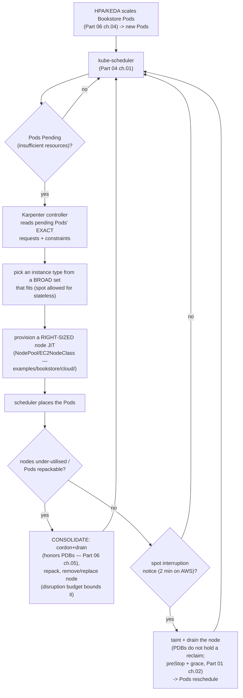

# 06 — Node autoscaling, cost & multi-cloud

> The node tier under the Pod tier, on a real cloud, plus what it costs and
> what is portable: **Cluster Autoscaler** (ASG/MIG-bound, scale-from-
> unschedulable, scale-down on utilisation) vs **Karpenter** (NodePool/
> EC2NodeClass, just-in-time *right-sized* nodes, consolidation, spot,
> disruption budgets) vs **GKE node auto-provisioning / Autopilot** vs **AKS**;
> **spot/preemptible** strategy and interruption handling (taints, the [Part 06
> ch.05](../06-production-readiness/05-reliability-and-disruptions.md) PDBs,
> checkpointing); **cloud cost & FinOps** (cost-allocation tags, dashboards,
> Reserved/Savings/committed-use, requests-rightsizing tied to [Part 06
> ch.06](../06-production-readiness/06-capacity-and-cost.md), scale-to-zero);
> **multi-cloud / hybrid portability** (what is portable: the K8s API/Helm/
> Kustomize/GitOps; what is not: LB/IAM/CSI/CNI); and a **cloud
> production-readiness checklist** mapping each cloud concern to its Part-10
> chapter — applied with a Bookstore Karpenter `NodePool`/`EC2NodeClass` and
> the spot+PDB story for the stateless tiers.

**Estimated time:** ~60 min read · ~120 min hands-on
**Prerequisites:** [Part 06 ch.04](../06-production-readiness/04-autoscaling.md) — Pod-tier autoscaling the node tier serves · [Part 06 ch.05](../06-production-readiness/05-reliability-and-disruptions.md) — PDBs that gate spot interruption handling · [Part 06 ch.06](../06-production-readiness/06-capacity-and-cost.md) — cost/requests-rightsizing framing
**You'll know after this:** • compare Cluster Autoscaler vs Karpenter vs GKE auto-provisioning vs AKS for a workload · • author a Karpenter NodePool/EC2NodeClass for right-sized, just-in-time nodes · • design a spot/preemptible strategy with PDBs + checkpointing + interruption handlers · • identify what is portable (K8s API, Helm, Kustomize, GitOps) and what is not (LB/IAM/CSI/CNI) · • run a cloud production-readiness check across the Part 10 concerns

<!-- tags: cloud, autoscaling, karpenter, cost, finops, day-2 -->

## Why this exists

[Part 06 ch.04](../06-production-readiness/04-autoscaling.md) introduced the
node tier as a callout: HPA/KEDA create Pods, and *"if no node has room they
stay `Pending`"* — Cluster Autoscaler or Karpenter then add nodes;
[Part 06 ch.06](../06-production-readiness/06-capacity-and-cost.md) added the
FinOps loop and named spot/preemptible as the largest saving *after* requests
are right. Both deferred the depth to "the cloud chapter". This is that
chapter — and on a real cloud the node tier is no longer a callout, it is
**the cost centre** ([ch.01](01-managed-kubernetes-model.md): the
control-plane fee is small; nodes are the bill).

The failure modes that make this its own chapter:

1. **The Pending Pod with nowhere to go.** The Bookstore catalog HPA
   ([Part 06 ch.04](../06-production-readiness/04-autoscaling.md)) scales out
   under a sale; on kind there were "fixed nodes" so this was conceptual. On a
   cloud, with no node autoscaler, the new Pods sit `Pending` forever and the
   sale fails — the HPA scaled, nothing caught the overflow.
2. **The fleet of air.** [Part 06 ch.06](../06-production-readiness/06-capacity-and-cost.md)'s
   "fleet of air": over-provisioned nodes running over-requested Pods, billed
   24/7. A node autoscaler sized to *wrong* requests is still wasteful — and
   the wrong autoscaler (fixed groups vs right-sized JIT) leaves money on the
   table even with right requests.
3. **The accidental lock-in (and the accidental rewrite).** Believing
   everything is portable, then discovering the LB annotations, IAM mapping,
   CSI driver, and CNI are all cloud-specific ([ch.03](03-cloud-identity.md)–
   [ch.05](05-cloud-storage-and-data.md)) — *or* the opposite: rewriting the
   portable layer (the Bookstore manifests/Helm/Kustomize/GitOps) "for the
   cloud" when it never needed to change.

This chapter closes Part 10: the node-scaling depth Parts 06 deferred, the
cloud cost levers, the honest portability boundary, and a checklist that maps
every cloud concern back to its Part-10 chapter. The reference is *Production
Kubernetes* (Autoscaling / Multitenancy) and the Karpenter docs.

> **Nothing in this chapter runs on a cloud.** Node autoscaling and spot act
> on cloud VM APIs, and this guide's lab has no cloud account, so node
> behaviour is cited with its check date (2026-10-31) and not run. The checks
> ran on the lab cluster, a kind cluster named `sf-pilot`. Its captured output
> keeps that name, and `examples/security-lab/evidence/10-06.txt` records the
> namespace substitution. The Karpenter objects were checked against the CRD
> schema of the pinned chart. The controller was checked by a server dry-run
> of its rendered manifests. The CRDs were not installed, because the lab's
> heavy-install lock was held by another run (section 6).

## Mental model

**The node tier reacts to the scheduler's verdict: Pods don't fit → add
nodes; nodes underused → remove them. Cluster Autoscaler does this by
resizing *fixed groups*; Karpenter does it by provisioning *right-sized nodes
just-in-time* and consolidating. Cost = which nodes × how many × how long ×
the pricing model; portability = the K8s API is, the cloud plumbing isn't.**

- **Cluster Autoscaler (CA)** — scales **pre-defined node groups** (ASG/MIG/
  VMSS, [ch.02](02-provisioning-and-iac.md)). When Pods are `Pending` for
  *insufficient resources*, CA increases a group's desired count within
  min/max; when a node sits below the **scale-down utilisation threshold
  (default 0.5, that is 50% of allocatable requested, set by
  `--scale-down-utilization-threshold`)** and its Pods can move (honoring
  **PDBs** — [Part 06 ch.05](../06-production-readiness/05-reliability-and-disruptions.md)),
  it removes the node. Simple, mature, but **node *shape* is fixed by the
  group** — you pick instance types up front; CA only changes *count*.
- **Karpenter (AWS/EKS)** — scales by **provisioning individual right-sized
  nodes** from a broad instance-type set, JIT, to fit the *exact* pending
  Pods' requests/constraints; then **consolidates** (replaces/removes
  under-used nodes, repacking Pods) and handles **spot** + **disruption
  budgets**. No pre-defined groups — node *shape* is chosen per need, so less
  waste and faster scale. Configured by `NodePool` + `EC2NodeClass` CRDs.
- **GKE node auto-provisioning / Autopilot; AKS** — GKE NAP creates/sizes node
  pools automatically (CA-plus-shape); **GKE Autopilot** removes node
  management entirely (you declare Pods, Google sizes/bills the nodes —
  [ch.01](01-managed-kubernetes-model.md) boundary shifts further to the
  provider). AKS offers the cluster autoscaler and Node Autoprovision (NAP),
  which installs Karpenter on the cluster through the AKS Karpenter provider.
  Same idea, provider-shaped.
- **Spot/preemptible is the big lever, for the *right* tier.** On AWS, Spot
  capacity is up to 90% cheaper than On-Demand, and it can be **reclaimed at
  short notice**: 2 minutes on AWS, 30 seconds on Azure (Scheduled Events,
  best effort), and a preemption notice you configure on GCP (0 or 120
  seconds). Correct for the **fault-tolerant stateless** Bookstore tiers
  (storefront/catalog/orders/payments-worker), protected by **replicas and
  spread** ([Part 04 ch.02](../04-scheduling/02-affinity-taints-topology.md))
  and graceful shutdown ([Part 01
  ch.02](../01-core-workloads/02-health-and-lifecycle.md)). A
  PodDisruptionBudget does not hold a reclaim (section 4 below). **Wrong** for
  the data tier ([Part 03
  ch.05](../03-config-and-storage/05-stateful-data-patterns.md)): a reclaimed
  Postgres node is an outage. Keep it on a pool that is on-demand only, and
  make Postgres require that pool (section 4).
- **Cost = requests × node price × time, and the FinOps loop still rules.**
  [Part 06 ch.06](../06-production-readiness/06-capacity-and-cost.md): the
  scheduler reserves *requests*, the autoscaler buys *nodes for requests* —
  so **right-sizing requests first** is the highest-leverage action; *then*
  node strategy (autoscaler + spot + committed-use discounts) multiplies it.
  Cost-allocation tags + OpenCost/cloud tooling make the Bookstore's spend
  owned, not discovered. Scale-to-zero (KEDA, [Part 06
  ch.04](../06-production-readiness/04-autoscaling.md)) + node consolidation
  removes idle cost entirely.
- **Portability is a real, knowable line.** **Portable** (zero change between
  clouds): the Kubernetes API, the Bookstore manifests, Helm, Kustomize
  overlays, GitOps ([Part 07](../07-delivery/01-packaging-helm.md)). **Not
  portable** (deliberate per-cloud config): LB annotations
  ([ch.04](04-cloud-networking-and-load-balancing.md)), IAM mapping
  ([ch.03](03-cloud-identity.md)), CSI driver/StorageClass
  ([ch.05](05-cloud-storage-and-data.md)), CNI specifics, and the node
  autoscaler (Karpenter's AWS provider is AWS-only; AKS and GKE ship their
  own). Multi-cloud = keep the portable layer
  pristine and isolate the non-portable layer in overlays/values.

The trap to hold onto: **a node autoscaler does not fix bad requests, and
spot does not fix the data tier.** Sequence: right-size requests ([Part 06
ch.06](../06-production-readiness/06-capacity-and-cost.md)) → pick the right
node autoscaler → spot the stateless tiers (PDB-protected) → apply
committed-use discounts. Out of order, you optimise air.

## Threats and controls

| Threat | Control taught here | Goes deeper in |
|---|---|---|
| A node provisioner that can pass any role launches nodes under a role it should not hold | Scope `iam:PassRole` to the one node role ARN, with `iam:PassedToService` (the statement below) | The node role itself: [ch.03](03-cloud-identity.md) |
| A scale-up as a cost attack: a flood of requests, or a runaway HPA, buys nodes | Bound the pool (`limits`, which Karpenter checks eventually, so it can overrun) and the Pods (namespace ResourceQuota) | [Part 06 ch.04](../06-production-readiness/04-autoscaling.md) |
| `alias: al2023@latest` moves every node to a new image with no review | Pin a reviewed AMI alias release, and roll it on purpose | [Part 08 ch.01](../08-day-2-operations/01-cluster-lifecycle.md) |
| Spot capacity under the data tier | An on-demand pool, tainted, and a required node-affinity term in the Postgres overlay (section 4) | [ch.05](05-cloud-storage-and-data.md) |

The controller is the most privileged piece in this chapter, and its scope is
set in two places. Its IAM role must pass the node role and nothing else. AWS
describes `iam:PassRole` as the permission that lets a principal hand a role to
a service, and it advises limiting that permission with the `Resource` element,
not a tag condition, because tag conditions on PassRole do not give reliable
results ([AWS IAM, checked 2026-10-31](https://docs.aws.amazon.com/IAM/latest/UserGuide/id_roles_use_passrole.html)).

The scoped statement goes on the Karpenter controller's role. It names the one
node role, and it passes that role only to EC2, using the `iam:PassedToService`
condition key that the same AWS page documents. This is a fragment of the
controller's policy, cited and not run. The node role name is the placeholder
from `karpenter-nodepool.yaml`.

```json
{
  "Effect": "Allow",
  "Action": "iam:PassRole",
  "Resource": "arn:aws:iam::123456789012:role/KarpenterNodeRole-bookstore",
  "Condition": {
    "StringEquals": { "iam:PassedToService": "ec2.amazonaws.com" }
  }
}
```

Its in-cluster RBAC is wide as well. The chart's `karpenter-core` ClusterRole
can create `pods/eviction`, delete Pods in every namespace, and patch or delete
Nodes. Its only namespaced grant in `kube-system` is `get` on the `kube-dns` Service. Keep the
chart's ClusterRoles as they are, and do not widen them to make a NodePool work.

## Diagrams

### Diagram A — the Karpenter loop: pending Pod → right-sized node → consolidate (Mermaid)

Karpenter's reconcile loop. It reacts to the scheduler's `Pending` verdict
with a *right-sized* node, then continuously consolidates to shrink the bill.



### Diagram B — Cluster Autoscaler vs Karpenter + cost-lever table (ASCII)

```
 NODE AUTOSCALERS + THE COST LEVERS ────────────────────────────────────────

  aspect            Cluster Autoscaler    Karpenter (AWS)    GKE NAP/Autopilot
  ─────────────────────────────────────────────────────────────────────────
  scales            fixed node GROUPS     individual nodes,  node pools auto
                     (ASG/MIG/VMSS)        JIT right-sized     (NAP); Autopilot
                                                                = no nodes at all
  node SHAPE        fixed by the group    chosen per pending  auto-chosen
                     (you pick up front)   Pod (broad set)
  trigger           Pending Pods ->        Pending Pods ->    Pending Pods ->
                     resize group           new right-sized    new/sized pool
                                            node
  scale-DOWN        underused node ->      consolidation      underused ->
                     remove (PDB-honored)   (repack+replace,    remove (PDB)
                                            PDB+budget-honored)
  spot              via spot node groups   first-class        via spot pools /
                                            (capacity-type)     Autopilot Spot
  portability       all clouds (the CA     AWS provider;      GCP ONLY
                     project; per-cloud     AKS NAP on Azure)
                     provider)
  best for          fixed, predictable     variable/spiky,    GCP-native;
                     fleets; multi-cloud    spot-heavy, cost-   hands-off (Auto-
                     consistency           sensitive (Book-    pilot)
                                            store stateless)

 COST LEVERS (apply IN THIS ORDER — Part 06 ch.06):
  1. RIGHT-SIZE requests (Part 06 ch.06) ........ biggest single win
  2. NODE AUTOSCALER sized to real requests ..... no fleet of air
  3. SPOT for stateless (spread + grace) ........ up to 90% off (AWS)
  4. CONSOLIDATION / scale-to-zero (KEDA) ....... remove idle cost
  5. COMMITTED-USE discounts (Reserved/Savings/   AWS Compute Savings
     CUD) for the steady baseline ..............   Plans: up to 66%
  6. COST-ALLOCATE per ns/workload (OpenCost/     spend owned, not
     cloud tooling) ............................   discovered
  WRONG ORDER = optimising air (cheap nodes running over-requested Pods).
```

## Hands-on with the Bookstore

**Assumed working directory: the guide repo root (`full-guide/`).** This
chapter adds **one new file** —
[`examples/bookstore/cloud/karpenter-nodepool.yaml`](../examples/bookstore/cloud/karpenter-nodepool.yaml)
, and edits **nothing** canonical. The file runs only on an EKS cluster with
Karpenter installed. Its client dry-run runs on kind and shows the CRD gap
(section 6).

### 1. The problem made concrete: the catalog HPA needs somewhere to scale

[Part 06 ch.04](../06-production-readiness/04-autoscaling.md) added the
catalog HPA ([`82-hpa-catalog.yaml`](../examples/bookstore/raw-manifests/82-hpa-catalog.yaml),
`maxReplicas: 6`) and the KEDA-scaled `payments-worker`
([`83-keda-scaledobject.yaml`](../examples/bookstore/raw-manifests/83-keda-scaledobject.yaml),
`maxReplicaCount: 10`). On a cloud cluster with no node autoscaler, a sale
drives the HPA to 6 catalog Pods (an illustrative sale, not a measurement),
the cluster has room for 3, and **3 Pods sit
`Pending`** — the HPA worked, nothing caught the overflow. The node tier is
what makes the [Part 06 ch.04](../06-production-readiness/04-autoscaling.md)
Pod autoscaling actually deliver capacity.

You can reproduce the overflow on the lab cluster. This step is deliberate: the
manifest below is a complete workload with the baseline, and its one container
asks for 64 CPUs. Check the lab node's allocatable CPU first:

```sh
kubectl get nodes -o jsonpath='{.items[*].status.allocatable.cpu}{"\n"}'
```

<!-- gate: output -->
```
4
```

So the scheduler cannot place a 64-CPU Pod. Run the demo in a throwaway
namespace, not `bookstore`. The Bookstore namespace carries a ResourceQuota
(`requests.cpu: "2"`) and a LimitRange (container maximum of 2 CPUs), so the
ReplicaSet cannot create a 64-CPU Pod at all, and no `Pending` Pod appears.
Create a quota-free namespace with restricted labels:

```sh
kubectl create namespace overflow-lab
kubectl label namespace overflow-lab pod-security.kubernetes.io/enforce=restricted \
  pod-security.kubernetes.io/audit=restricted pod-security.kubernetes.io/warn=restricted
```

Delete the demo as soon as you have seen the result. On a cloud cluster the same
`Pending` Pod makes Karpenter buy a node.

```yaml
apiVersion: v1
kind: ServiceAccount
metadata:
  name: overflow-demo
  namespace: overflow-lab
automountServiceAccountToken: false
---
apiVersion: apps/v1
kind: Deployment
metadata:
  name: overflow-demo
  namespace: overflow-lab
spec:
  replicas: 1
  selector:
    matchLabels:
      app: overflow-demo
  template:
    metadata:
      labels:
        app: overflow-demo
    spec:
      serviceAccountName: overflow-demo
      automountServiceAccountToken: false
      securityContext:
        runAsNonRoot: true
        runAsUser: 65532
        runAsGroup: 65532
        seccompProfile:
          type: RuntimeDefault
      containers:
        - name: app
          image: bookstore/catalog:dev
          securityContext:
            allowPrivilegeEscalation: false
            readOnlyRootFilesystem: true
            capabilities:
              drop: ["ALL"]
          resources:
            requests:
              cpu: "64"          # more than the lab node has: stays Pending
              memory: 96Mi
            limits:
              memory: 128Mi
          volumeMounts:
            - name: tmp
              mountPath: /tmp
      volumes:
        - name: tmp
          emptyDir: {}
```

```sh
kubectl apply -f overflow-demo.yaml
kubectl -n overflow-lab describe pod -l app=overflow-demo | sed -n '/^Events:/,$p'
kubectl -n overflow-lab get pods
```

<!-- gate: output -->
```
Events:
  Type     Reason            Age   From               Message
  ----     ------            ----  ----               -------
  Warning  FailedScheduling  1s    default-scheduler  0/1 nodes are available: 1 Insufficient cpu. preemption: 0/1 nodes are available: 1 Preemption is not helpful for scheduling.
```

<!-- gate: output -->
```
NAME                             READY   STATUS    RESTARTS   AGE
overflow-demo-5cc95fb7fc-v7crw   0/1     Pending   0          11s
```

The Pod stays `Pending` because the scheduler found no node with 64 free CPUs.
The lab has no node autoscaler, so nothing else happens. On EKS with the
Bookstore NodePool (illustrative, not captured), Karpenter reads the same
`Pending` Pod and launches a node that fits it, if the requirements and
`limits` allow an instance that large. One request buys one large node. That
is the cost attack in miniature. The `limits` block caps the pool's total, so a
runaway scale-up stops at the cap, not at the price. Karpenter checks `limits`
eventually, so a rapid scale-out can overrun the cap, and its docs say so
([Karpenter NodePools](https://karpenter.sh/docs/concepts/nodepools/), checked
2026-10-31, cited not run). Remove the demo with
`kubectl delete namespace overflow-lab`.

### 2. Install Karpenter (pinned Helm) — the lead path on EKS

Per the guide's hard rule — **pinned Helm, never
`releases/latest/download/<PINNED-FILE>.yaml`** (the same rule Parts 06/07/08
used for KEDA/kube-prometheus-stack/Velero):

```sh
# Karpenter's chart is pinned to 1.15.1. Karpenter's compatibility matrix
# lists 1.15.x for Kubernetes 1.37 (checked 2026-10-31; cited, not run). The
# controller calls EC2 through IRSA or Pod Identity (ch.03), so no static key
# is needed. The node IAM role, the karpenter.sh/discovery tags and the SQS
# interruption queue must already exist (ch.02).
helm registry logout public.ecr.aws    # anonymous pull, as Karpenter's docs do

# Namespace first, labelled restricted. The chart's template already sets the
# restricted fields (runAsNonRoot, no privilege escalation, all capabilities
# dropped, seccomp RuntimeDefault), so no chart values change. Karpenter must
# not run on nodes it manages: give the namespace a managed node group or
# Fargate, as Karpenter's getting-started guide advises.
kubectl create namespace karpenter
kubectl label namespace karpenter pod-security.kubernetes.io/enforce=restricted pod-security.kubernetes.io/audit=restricted pod-security.kubernetes.io/warn=restricted

# The CRDs come from their own chart. The controller chart does not ship them.
helm upgrade --install karpenter-crd oci://public.ecr.aws/karpenter/karpenter-crd \
  --version 1.15.1 -n karpenter
helm upgrade --install karpenter oci://public.ecr.aws/karpenter/karpenter \
  --version 1.15.1 -n karpenter \
  --set "settings.clusterName=$CLUSTER_NAME" \
  --set "settings.interruptionQueue=$CLUSTER_NAME" \
  --set "serviceAccount.annotations.eks\.amazonaws\.com/role-arn=arn:aws:iam::123456789012:role/KarpenterController" \
  --wait
kubectl -n karpenter rollout status deploy/karpenter
kubectl get crd | grep karpenter        # nodepools, ec2nodeclasses now registered
```

The controller's ServiceAccount keeps its API token, because the controller
calls the Kubernetes API. That is the one place this chapter sets
`automountServiceAccountToken: true`, and it is allowed only because the
ServiceAccount is dedicated to the controller ([baseline](../01-core-workloads/01-pods.md#baseline)).

### 3. Apply the Bookstore NodePool/EC2NodeClass (the new file)

[`examples/bookstore/cloud/karpenter-nodepool.yaml`](../examples/bookstore/cloud/karpenter-nodepool.yaml)
has two pools and one node template. The stateless pool takes a **broad
instance set** (c/m/r families, no nano/micro), **spot and on-demand** capacity
(the `capacity-type` requirement), a **consolidation** policy and **disruption
budget** that works *with* the Bookstore's `84-pdb.yaml` ([Part 06
ch.05](../06-production-readiness/05-reliability-and-disruptions.md)), and
**`limits`** that cap what the pool may provision. The limits cap the total,
not the price of each node. The data pool is on-demand only, tainted
`dedicated=database:NoSchedule` and labelled `dedicated=database`, which the
Postgres manifest must require (section 4). The `EC2NodeClass` has a **minimal
node role** and **IMDSv2 with hop limit 1**: a container on the pod network
cannot reach the node's metadata and take its role
([ch.03](03-cloud-identity.md)).
Its AMI alias is one you pin. The fragment below shows the stateless pool's
core fields. The file holds the complete objects, and this fragment has no
`kind:`, so it is not a manifest.

```yaml
spec:
  template:
    spec:
      requirements:
        - { key: karpenter.sh/capacity-type, operator: In, values: ["spot","on-demand"] }
        - { key: karpenter.k8s.aws/instance-category, operator: In, values: ["c","m","r"] }
      nodeClassRef: { group: karpenter.k8s.aws, kind: EC2NodeClass, name: bookstore-default }
  disruption:
    consolidationPolicy: WhenEmptyOrUnderutilized
    budgets: [ { nodes: "10%" } ]          # voluntary disruption only; honours PDBs
  limits: { cpu: "200", memory: 200Gi }    # caps what the pool may provision
```

```sh
# Set <RELEASE> in the file to the AL2023 release you reviewed first; the file
# header explains why.
kubectl apply -f examples/bookstore/cloud/karpenter-nodepool.yaml   # Karpenter-EKS only
kubectl get nodepool,ec2nodeclass
# Now drive the catalog HPA (the Part 06 ch.04 load test) so Pods go Pending;
# watch Karpenter provision a RIGHT-SIZED node JIT, place them, then
# consolidate when load drops:
kubectl get nodeclaims -w        # Karpenter creating/removing nodes
kubectl get nodes -L karpenter.sh/capacity-type -L topology.kubernetes.io/zone
#   stateless Pods land on SPOT nodes, AZ-spread. Postgres stays on the data
#   pool only with the section 4 overlay; without it, it can land on any node
#   its tolerations allow, spot included.
```

### 4. The spot + PDB story for the stateless tiers (no app change)

The Bookstore is **already built for spot** — no manifest change needed:

- `storefront`/`catalog`/`orders`/`payments-worker` are **stateless** and
  fault-tolerant; a reclaimed node reschedules them.
- [`84-pdb.yaml`](../examples/bookstore/raw-manifests/84-pdb.yaml) ([Part 06
  ch.05](../06-production-readiness/05-reliability-and-disruptions.md)) bounds
  how many go down at once during **voluntary** disruption: consolidation and
  drains, which use the eviction API ([Part 08
  ch.01](../08-day-2-operations/01-cluster-lifecycle.md)). A PDB does not hold
  back a node that Karpenter is terminating. A NodePool's
  `terminationGracePeriod` bypasses blocked PDBs, and Karpenter deletes the
  Pods before it ends ([Karpenter disruption docs](https://karpenter.sh/docs/concepts/disruption/),
  checked 2026-10-31, cited not run). A reclaim gets the same limited window.
- `topologySpreadConstraints`/`podAntiAffinity` ([Part 04
  ch.02](../04-scheduling/02-affinity-taints-topology.md)) keep replicas off
  one node/AZ so a single spot reclamation can't take the tier.
- Native `preStop` sleep + `terminationGracePeriodSeconds`
  ([Part 01 ch.02](../01-core-workloads/02-health-and-lifecycle.md)) make the
  ~2-min spot drain graceful — in-flight requests finish, the worker drains
  its RabbitMQ message ([Part 06 ch.04](../06-production-readiness/04-autoscaling.md)).
  The stateless pool's `terminationGracePeriod` (1m in the file) must be at
  least the longest `preStop` plus grace period these tiers rely on, or the
  drain cuts them short.

The **data tier stays off spot**, and the cloud overlay below is part of that
control. The `bookstore-data` pool is on-demand only and tainted
`dedicated=database:NoSchedule`, so only Pods that tolerate that taint can land
on it. The canonical Postgres manifest tolerates the taint, but it only
*prefers* the `dedicated=database` label, and a preference alone lets Postgres
land on a spot node in the stateless pool.
[`20-postgres-statefulset.yaml`](../examples/bookstore/raw-manifests/20-postgres-statefulset.yaml)
is canonical, so this chapter does not edit it. The cloud overlay adds a
required term beside the preferred one:

```yaml
# illustrative overlay fragment: a Kustomize patch on the Postgres StatefulSet
# (20-postgres-statefulset.yaml). It has no kind of its own.
spec:
  template:
    spec:
      affinity:
        nodeAffinity:
          requiredDuringSchedulingIgnoredDuringExecution:
            nodeSelectorTerms:
              - matchExpressions:
                  - key: dedicated
                    operator: In
                    values: ["database"]
```

With the overlay applied, Postgres can land only on the data pool, which is
on-demand only. The lab's single-node kind cluster has no node with that label,
so the overlay is cited and not applied there: the Pod would stay `Pending`.
The data pool's zonal disk still pins Postgres to one zone
([ch.05](05-cloud-storage-and-data.md)).

### 5. Cost & FinOps on the Bookstore (the loop, cloud-priced)

[Part 06 ch.06](../06-production-readiness/06-capacity-and-cost.md)'s loop is
*observe → right-size → enforce → re-measure*; on cloud it gains real dollars:

```sh
# 1. RIGHT-SIZE requests FIRST (Part 06 ch.06) — the catalog recommendation
#    there (cpu 40m, mem 96Mi==limit) shrinks what the autoscaler must buy.
# 2. NODE autoscaler sized to real requests (steps 2-3) — no fleet of air.
# 3. SPOT the stateless tiers (step 4): up to 90% off those nodes (AWS).
# 4. SCALE-TO-ZERO: payments-worker via KEDA (Part 06 ch.04) + Karpenter
#    consolidation removes the idle node entirely at 3am.
# 5. COMMITTED-USE: cover the steady baseline (postgres + min HPA replicas)
#    with Savings Plans / Reserved / CUD (AWS Compute Savings Plans: up to 66%
#    off On-Demand; other providers' terms differ).
# 6. COST-ALLOCATE: tag nodes/resources by owner; OpenCost (Part 06 ch.06) or
#    the cloud's split-cost/cost-allocation tooling attributes $ per
#    namespace/workload -> the Bookstore's spend is OWNED, not discovered.
kubectl get nodes -L karpenter.sh/capacity-type    # spot vs on-demand mix (priced)
```

On kind the dollars are synthetic ([Part 06
ch.06](../06-production-readiness/06-capacity-and-cost.md) said this); the
*efficiency ratio* (usage ÷ request) and the spot/consolidation behaviour are
real on the managed cluster.

### 6. Checking the objects before the CRDs exist

```sh
# from the repo root (full-guide/), on a cluster without Karpenter installed:
kubectl apply --dry-run=client -f examples/bookstore/cloud/karpenter-nodepool.yaml
```

<!-- gate: output -->
```
resource mapping not found for name: "bookstore-stateless" namespace: "" from "examples/bookstore/cloud/karpenter-nodepool.yaml": no matches for kind "NodePool" in version "karpenter.sh/v1"
ensure CRDs are installed first
resource mapping not found for name: "bookstore-data" namespace: "" from "examples/bookstore/cloud/karpenter-nodepool.yaml": no matches for kind "NodePool" in version "karpenter.sh/v1"
ensure CRDs are installed first
resource mapping not found for name: "bookstore-default" namespace: "" from "examples/bookstore/cloud/karpenter-nodepool.yaml": no matches for kind "EC2NodeClass" in version "karpenter.k8s.aws/v1"
ensure CRDs are installed first
```

That output is from the lab cluster, which had no Karpenter CRDs. It is the
expected result, not a defect in the file. It is the same precedent as
[`51-gateway.yaml`](../examples/bookstore/raw-manifests/51-gateway.yaml),
[`83-keda-scaledobject.yaml`](../examples/bookstore/raw-manifests/83-keda-scaledobject.yaml),
[`70-kyverno-policy.yaml`](../examples/bookstore/raw-manifests/70-kyverno-policy.yaml),
[`18-postgres-snapshot.yaml`](../examples/bookstore/raw-manifests/18-postgres-snapshot.yaml),
the `argocd/` tree, and
[`operators/velero-backup.yaml`](../examples/bookstore/operators/velero-backup.yaml).
The file's header explains it.

The schema check needs the CRDs, and the lab could not install them: the
cluster's heavy-install lock was held by another run, and Karpenter is a heavy
install in this guide. So the objects were checked two other ways.

- **Offline, against the pinned chart.** `helm template` of
  `oci://public.ecr.aws/karpenter/karpenter-crd` at 1.15.1 yields the CRDs. The
  three objects were checked against their schemas for unknown fields, types,
  required fields and enums. The CEL rules were read by hand. The
  restricted-label rule exempts `karpenter.sh/capacity-type` by name, and every
  requirement has the values its operator needs.
- **Once the CRDs exist.** `kubectl apply --dry-run=server -f` on the file runs
  the same schema and the CEL rules inside the API server. Run it before the
  first real apply.

The controller needs no CRDs to render. Its rendered manifests passed a server
dry-run in a namespace labelled `restricted`, with no PodSecurity warning:

```sh
helm template karpenter oci://public.ecr.aws/karpenter/karpenter --version 1.15.1 \
  --namespace karpenter --set settings.clusterName=$CLUSTER_NAME \
  --set settings.interruptionQueue=$CLUSTER_NAME \
  --set "serviceAccount.annotations.eks\.amazonaws\.com/role-arn=arn:aws:iam::123456789012:role/KarpenterController" > rendered.yaml
kubectl apply --dry-run=server -n karpenter -f rendered.yaml
```

<!-- gate: output -->
```
poddisruptionbudget.policy/karpenter created (server dry run)
serviceaccount/karpenter created (server dry run)
clusterrole.rbac.authorization.k8s.io/karpenter-admin created (server dry run)
clusterrole.rbac.authorization.k8s.io/karpenter-core created (server dry run)
clusterrole.rbac.authorization.k8s.io/karpenter created (server dry run)
clusterrolebinding.rbac.authorization.k8s.io/karpenter-core created (server dry run)
clusterrolebinding.rbac.authorization.k8s.io/karpenter created (server dry run)
role.rbac.authorization.k8s.io/karpenter created (server dry run)
rolebinding.rbac.authorization.k8s.io/karpenter created (server dry run)
service/karpenter created (server dry run)
deployment.apps/karpenter created (server dry run)
# ...
```

The chart also has two objects in `kube-system`: a Role and a RoleBinding that
let Karpenter `get` the `kube-dns` Service, and nothing else there.
`kubectl` refuses them under a different `-n`, so read them in `rendered.yaml`
rather than dry-running them. The two refusals are omitted above.

> **Lineage note.** This is the node tier the [Part 06
> ch.04](../06-production-readiness/04-autoscaling.md) HPA/KEDA callouts and
> the [Part 06 ch.06](../06-production-readiness/06-capacity-and-cost.md)
> FinOps loop pointed at: a node autoscaler for the Pod growth, and spot for the
> fault-tolerant tiers. It deepens those callouts. Where it narrows one, the
> narrower statement wins: a PDB bounds voluntary disruption and does not hold
> a spot reclaim (section 4). The Bookstore
> manifests, `84-pdb.yaml`, and the scheduling layer are **unchanged** — spot
> is a Karpenter-config decision, not an app edit.

## How it works under the hood

- **Cluster Autoscaler: count, not shape.** CA watches for Pods unschedulable
  due to insufficient resources and, per node group, **increases the cloud
  ASG/MIG/VMSS desired count** within min/max ([ch.02](02-provisioning-and-iac.md));
  when a node's requested utilisation stays below
  `--scale-down-utilization-threshold` (**default 0.5**, that is 50% of allocatable) for
  `--scale-down-unneeded-time` (default 10 minutes) and its Pods can be evicted (eviction API →
  **PDBs honored**, [Part 06
  ch.05](../06-production-readiness/05-reliability-and-disruptions.md)), it
  scales the group down. It reacts to the **scheduler's** verdict ([Part 04
  ch.01](../04-scheduling/01-scheduler-and-nodes.md)) — it never re-shapes
  nodes, only counts, so node *type* is a pre-commitment ([Part 06
  ch.04](../06-production-readiness/04-autoscaling.md)'s description, deepened).
- **Karpenter: shape *and* count, from the pending Pods backward.** Karpenter
  watches **`Pending` Pods directly**, computes a node that satisfies their
  *exact* aggregate requests + affinities/taints/topology, and **launches that
  instance** from a broad type set (the `NodePool.requirements` /
  `EC2NodeClass`), choosing a type from the ones the requirements allow.
  It then runs **consolidation**: if Pods can be repacked onto fewer/cheaper
  nodes, it cordons+drains the loser (eviction API → **PDBs + disruption
  budgets** honored) and removes/replaces it. The result is closer-to-optimal
  bin-packing with far less pre-planning than fixed groups — the [Part 06
  ch.04](../06-production-readiness/04-autoscaling.md) Karpenter callout,
  mechanised. `consolidationPolicy`/`budgets`/`expireAfter` (in the Bookstore
  file) bound how aggressive and how disruptive it is.
- **Why spot needs spread and graceful shutdown, and the data tier doesn't get
  spot.** Spot reclamation is an involuntary disruption, with a 2-minute
  notice on AWS. The Bookstore survives it on the stateless tiers because
  **spread** ([Part 04 ch.02](../04-scheduling/02-affinity-taints-topology.md))
  means no single node or AZ hosts a whole tier, and **`preStop` + grace**
  ([Part 01 ch.02](../01-core-workloads/02-health-and-lifecycle.md)) lets
  in-flight work finish in the notice window. **`84-pdb.yaml`**
  ([Part 06 ch.05](../06-production-readiness/05-reliability-and-disruptions.md))
  bounds voluntary disruption, and does not hold a reclaim. The data tier has
  **none of these guarantees against node loss**. Postgres is a singleton on a
  zonal disk ([ch.05](05-cloud-storage-and-data.md)), and a reclaimed Postgres
  node is an outage and a restore ([Part 08
  ch.02](../08-day-2-operations/02-backup-and-dr.md)). So it must run on the
  on-demand data pool, which Postgres requires (section 4). This is exactly
  the [Part 06 ch.06](../06-production-readiness/06-capacity-and-cost.md)
  "spot-ize the stateless, not the data" rule, made mechanical.
- **The cost equation, and why request-rightsizing comes first.** The cloud
  bill for compute ≈ Σ(node price × time), and the **node count is driven by
  Σ requests** ([Part 06 ch.06](../06-production-readiness/06-capacity-and-cost.md):
  the scheduler reserves requests; the autoscaler buys nodes for requests).
  So over-requested Pods inflate the node count *regardless* of the
  autoscaler — which is why the [Part 06
  ch.06](../06-production-readiness/06-capacity-and-cost.md) sequence is
  immutable: **right-size requests, then** add a node autoscaler, then spot,
  then consolidation/scale-to-zero, then committed-use discounts on the steady
  baseline. Cost-allocation tags + OpenCost/cloud tooling ([Part 06
  ch.06](../06-production-readiness/06-capacity-and-cost.md)) turn the
  Bookstore's requests-vs-usage gap into a per-workload dollar number an owner
  reduces. Committed-use (Reserved Instances / Savings Plans / CUDs) discounts
  the *predictable baseline* (Postgres + the HPA `minReplicas`); spot
  discounts the *elastic, fault-tolerant* part — they are complementary, not
  alternatives.
- **GKE Autopilot / NAP and AKS — the boundary shifts, the SLO doesn't.** GKE
  **NAP** is CA that also *creates and sizes* node pools (shape + count);
  **Autopilot** removes node management and bills per Pod resource — the
  [ch.01](01-managed-kubernetes-model.md) responsibility boundary moves
  further to Google, but **the app SLO, PDBs, requests, and the FinOps loop
  stay yours**. AKS offers the cluster autoscaler and NAP, which installs
  Karpenter through the AKS Karpenter provider. The Pod-tier autoscaling (HPA/KEDA/VPA, [Part 06
  ch.04](../06-production-readiness/04-autoscaling.md)) is fully portable; the
  **node tier is provider-specific** — which is the headline of the
  portability section.
- **Portability — the precise line.** What is **byte-identical across
  EKS/GKE/AKS and kind**: the Kubernetes API objects (the Bookstore
  `raw-manifests/`), Helm charts, Kustomize overlays, GitOps repos ([Part
  07](../07-delivery/01-packaging-helm.md)) — proven by the [Part 08
  ch.01](../08-day-2-operations/01-cluster-lifecycle.md) deprecated-API audit
  (only GA APIs). What is **deliberately per-cloud**: the LB controller +
  annotations ([ch.04](04-cloud-networking-and-load-balancing.md)), the
  identity mapping ([ch.03](03-cloud-identity.md)), the CSI driver +
  StorageClass `parameters` ([ch.05](05-cloud-storage-and-data.md)), the CNI
  specifics ([ch.04](04-cloud-networking-and-load-balancing.md)), and the node
  autoscaler (Karpenter's AWS provider is AWS-only; AKS and GKE have their own
  provisioners). Multi-cloud/hybrid strategy = keep the
  portable layer untouched and confine the non-portable layer to overlays/
  values/per-cluster add-ons — exactly the Kustomize/Helm structure Part 07
  already gave the Bookstore. "Portable Kubernetes" is true *for the workload*
  and false *for the cloud plumbing*; conflating the two causes both the
  accidental-lock-in and the accidental-rewrite failures.

## Production notes

> **In production: every cluster needs a node autoscaler — HPA/KEDA without
> one strands Pods.** The Bookstore catalog HPA / payments-worker KEDA ([Part
> 06 ch.04](../06-production-readiness/04-autoscaling.md)) only deliver
> capacity if `Pending` Pods trigger nodes. Use **Karpenter** on EKS
> (right-sized JIT + consolidation + spot — the Bookstore file), **NAP/
> Autopilot** on GKE, **NAP** (or the **cluster autoscaler**) on AKS. Bound it (`limits` /
> ASG max / namespace ResourceQuota — [Part 06
> ch.04](../06-production-readiness/04-autoscaling.md)) so scaling can't
> exhaust the bill.

> **In production: spot the fault-tolerant tiers (spread + graceful),
> never the data tier.** Spot is up to 90% off on AWS, and it is safe for the
> Bookstore stateless tiers *because* of topology spread, replicas, and
> `preStop` grace ([Part 04 ch.02](../04-scheduling/02-affinity-taints-topology.md)
> / [Part 01 ch.02](../01-core-workloads/02-health-and-lifecycle.md)).
> `84-pdb.yaml` bounds voluntary disruption, and it does not hold a reclaim
> ([Part 06 ch.05](../06-production-readiness/05-reliability-and-disruptions.md)).
> Keep Postgres on the on-demand data pool, which its manifest must require
> (section 4). A reclaimed DB node on a zonal disk
> ([ch.05](05-cloud-storage-and-data.md)) is an outage + restore ([Part 08
> ch.02](../08-day-2-operations/02-backup-and-dr.md)). Handle interruption
> with a node-termination handler / Karpenter's native draining.

> **In production: requests first, then nodes, then spot, then commitments —
> in that order.** Cheap nodes running over-requested Pods are still wasted
> ([Part 06 ch.06](../06-production-readiness/06-capacity-and-cost.md)).
> Right-size from measured usage ([Part 06
> ch.06](../06-production-readiness/06-capacity-and-cost.md)), size the
> autoscaler to that, spot the stateless, consolidate + scale-to-zero (KEDA,
> [Part 06 ch.04](../06-production-readiness/04-autoscaling.md)), then cover
> the steady baseline with Reserved/Savings/CUD. Reversing the order optimises
> air.

> **In production: make cloud cost visible and owned per workload.** Tag
> nodes/resources by owner/team; use OpenCost ([Part 06
> ch.06](../06-production-readiness/06-capacity-and-cost.md)) or the cloud's
> split-cost/cost-allocation tooling so the Bookstore's spend (and its
> efficiency = usage ÷ request) is a number a team reduces, not a surprise on
> the invoice. Run the FinOps loop continuously — usage drifts every release.

> **In production: know exactly what is portable and isolate what is not.**
> The Bookstore manifests/Helm/Kustomize/GitOps are byte-identical across
> clouds ([Part 08 ch.01](../08-day-2-operations/01-cluster-lifecycle.md)) —
> never rewrite them "for the cloud". The LB/IAM/CSI/CNI/node-autoscaler layer
> *is* per-cloud ([ch.03](03-cloud-identity.md)–[ch.05](05-cloud-storage-and-data.md))
> — confine it to overlays/values/per-cluster add-ons (the Part 07 structure).
> Multi-cloud is "one portable app, N thin cloud adapters", not "N forks".

> **In production: Autopilot/serverless-nodes trade control for less toil —
> the SLO stays yours.** GKE Autopilot / EKS Fargate remove node management
> and shift the [ch.01](01-managed-kubernetes-model.md) boundary further to
> the provider, but PDBs, requests, the app SLO, and the FinOps discipline are
> still yours. Choose it deliberately for hands-off operation; do not assume
> it makes reliability or cost someone else's problem.

## Quick Reference

```sh
# Install Karpenter (pinned Helm; never releases/latest/download/<PINNED>.yaml)
kubectl create namespace karpenter
kubectl label namespace karpenter pod-security.kubernetes.io/enforce=restricted pod-security.kubernetes.io/audit=restricted pod-security.kubernetes.io/warn=restricted
helm upgrade --install karpenter-crd oci://public.ecr.aws/karpenter/karpenter-crd \
  --version 1.15.1 -n karpenter
helm upgrade --install karpenter oci://public.ecr.aws/karpenter/karpenter \
  --version 1.15.1 -n karpenter \
  --set settings.clusterName=$CLUSTER_NAME ...           # IRSA SA (ch.03), no key
kubectl apply -f examples/bookstore/cloud/karpenter-nodepool.yaml   # EKS only; set <RELEASE> first

# Watch the node tier react to the Part 06 ch.04 HPA/KEDA Pod growth
kubectl get nodeclaims -w                                  # Karpenter add/remove
kubectl get nodes -L karpenter.sh/capacity-type -L topology.kubernetes.io/zone
kubectl get pdb -n bookstore                               # 84-pdb.yaml bounds drains

# Cost levers (Part 06 ch.06 order): right-size -> autoscaler -> spot ->
#   consolidate/scale-to-zero -> committed-use -> allocate (OpenCost/cloud)

# Before the CRDs exist, a client dry-run reports no matches for the kinds
# (section 6). Once they exist, validate on the server:
kubectl apply --dry-run=server -f examples/bookstore/cloud/karpenter-nodepool.yaml
```

Fragments of the two Karpenter objects, secure fields only (no `kind:`, so
these are not manifests; the complete objects are in
[`examples/bookstore/cloud/karpenter-nodepool.yaml`](../examples/bookstore/cloud/karpenter-nodepool.yaml)):

```yaml
spec:                                      # EC2NodeClass: the node template
  amiFamily: AL2023
  amiSelectorTerms:
    - alias: al2023@v<RELEASE>             # a reviewed release, never @latest
  role: "KarpenterNodeRole-<CLUSTER>"      # MINIMAL node role (ch.03)
  metadataOptions: { httpTokens: required, httpPutResponseHopLimit: 1 }  # ch.03
```

```yaml
spec:                                      # NodePool: the policy
  template:
    spec:
      nodeClassRef: { group: karpenter.k8s.aws, kind: EC2NodeClass, name: bookstore-default }
  disruption: { consolidationPolicy: WhenEmptyOrUnderutilized, budgets: [ { nodes: "10%" } ] }
  limits: { cpu: "200", memory: 200Gi }    # caps what the pool may provision
```

Cloud production-readiness checklist (each concern → its Part-10 chapter):

- [ ] Provider SLA vs your responsibility understood; control plane
      regional/multi-AZ ([ch.01](01-managed-kubernetes-model.md))
- [ ] Cluster from **versioned IaC**; teardown + orphan sweep; OIDC at create
      ([ch.02](02-provisioning-and-iac.md))
- [ ] **No static cloud key** — workload identity, scoped per-SA, metadata
      endpoint blocked ([ch.03](03-cloud-identity.md))
- [ ] Shared Ingress/Gateway (not N LBs); CNI **enforces** NetworkPolicy; VPC
      CIDRs planned ([ch.04](04-cloud-networking-and-load-balancing.md))
- [ ] Block SC `WaitForFirstConsumer`+`Retain`+encrypted; zonal-disk AZ-pin
      designed for; snapshot+Velero ([ch.05](05-cloud-storage-and-data.md) /
      [Part 08 ch.02](../08-day-2-operations/02-backup-and-dr.md))
- [ ] **Node autoscaler** (Karpenter/NAP/CA) bounded; **spot** the stateless
      (spread + grace); **right-size first**, then commitments; cost allocated
      ([ch.06](06-node-autoscaling-cost-multicloud.md) / [Part 06
      ch.06](../06-production-readiness/06-capacity-and-cost.md))
- [ ] Portable layer (manifests/Helm/Kustomize/GitOps) **unchanged**;
      non-portable layer isolated in overlays/values ([ch.06](06-node-autoscaling-cost-multicloud.md))

## Test your understanding

> Try each before opening the answer drawer. The act of trying is the exercise; the answer is the check.

1. **In one sentence each, distinguish Cluster Autoscaler from Karpenter.**
   <details><summary>Show answer</summary>

   Cluster Autoscaler scales pre-defined ASGs up or down based on unschedulable Pods and node utilization; it picks from the node shapes you declared. Karpenter dynamically provisions just-in-time, right-sized nodes by reading the requirements of unschedulable Pods (CPU, memory, GPU, arch, capacity-type) and choosing an instance type that fits from the ones its requirements allow, then consolidates underutilized nodes. CA is "bounded by your ASG choices"; Karpenter is "bounded by your NodePool requirements."

   </details>

2. **AWS reclaims a spot node that holds one of the three `catalog` Pods, and the catalog PDB is `minAvailable: 2` (from `84-pdb.yaml`). Does the PDB stop the reclaim? What keeps the catalog up, and what would a 2-second SIGTERM handler change?**
   <details><summary>Show answer</summary>

   No. A PDB bounds voluntary disruption, and it does not stop a node that is being terminated. A NodePool's `terminationGracePeriod` bypasses blocked PDBs, and Karpenter deletes the Pods before that period ends, even Pods a PDB would block. What keeps the catalog up is spread across nodes (one reclaim should take at most one of the three replicas), the `preStop` and graceful shutdown that let in-flight requests finish inside AWS's 2-minute notice, and clients that retry. With a 2-second handler that ignores the grace period, in-flight requests are cut off mid-flight. The fix is a handler that uses the window, not a stricter PDB.

   </details>

3. **You're spending $14,000/month on GPU nodes that show ~12% utilization. Walk through the cost-attack order before touching commitments (RIs/SP).**
   <details><summary>Show answer</summary>

   First, right-size requests: VPA-recommend the actual GPU memory and CPU each workload uses, drop oversized requests. Second, enable MIG or time-slicing where workloads are GPU-fractional. Third, move dev/notebook GPU work to spot with checkpointing. Fourth, scale-to-zero serving when idle (KServe Knative, see [Part 12 ch.06](../12-kubernetes-for-machine-learning/06-model-serving-and-inference.md)). Fifth, consolidation: a NodePool with `consolidationPolicy: WhenEmptyOrUnderutilized` repacks Pods onto fewer nodes. Only *then*, with the utilization curve in hand, commit to Savings Plans for the steady baseline, sized to the part of the curve that never drops. Committing before right-sizing locks in waste.

   </details>

4. **What is portable across EKS/GKE/AKS, and what is not?**
   <details><summary>Show answer</summary>

   Portable: the Kubernetes API itself (Deployments, Services, StatefulSets, PVCs by abstract StorageClass), Helm/Kustomize/GitOps tooling, RBAC, NetworkPolicy resources, Prometheus metrics names, Istio/Linkerd manifests, application code. Not portable: load-balancer Service annotations (ALB/NLB/GCLB/AGIC), CSI driver names (`ebs.csi.aws.com` vs `pd.csi.storage.gke.io`), CNI specifics (VPC CNI vs Calico vs Cilium), cloud IAM bindings (IRSA vs Workload Identity vs Federated Credential), node autoscaler (the Karpenter AWS provider is AWS-only; AKS and GKE have their own). The discipline: keep the portable layer in `base/`, isolate non-portable in `overlays/aws/` and `overlays/gcp/`.

   </details>

5. **Hands-on, on an EKS cluster with Karpenter installed: write a NodePool that allows `amd64` nodes of 4 to 16 vCPU, on spot or on-demand, with consolidation. Apply it and scale a 10-replica Deployment. Which instance types did Karpenter pick?**
   <details><summary>What you should see (illustrative, not captured)</summary>

   Bound the vCPU range with the `karpenter.k8s.aws/instance-cpu` label, using the `Gt` and `Lt` operators: a requirement with `Gt` and `values: ["3"]`, and another with `Lt` and `values: ["17"]`. Karpenter then chooses among the types the requirements allow. Which types appear depends on region, price and capacity at the time, so the answer is what `kubectl get nodeclaims` shows on your cluster, not a fixed list. After load drops, consolidation removes nodes that are underused or empty.

   </details>

6. **Security: the node provisioner's IAM role allows `iam:PassRole` on `Resource: "*"`, and a Pod in the Bookstore is compromised. What can the attacker reach, and which settings stop the escalation?**
   <details><summary>Show answer</summary>

   The compromised Pod cannot call AWS on its own. The Bookstore uses IRSA or Pod Identity with no static key, and the hop limit of 1 keeps a pod-network container off the node's metadata endpoint. The dangerous route is the controller's identity. If that identity can pass any role, an attacker who obtains the controller's credentials can launch an instance under a role with more power than the node role, then read that role's credentials from the new instance. Scope `iam:PassRole` to the one node role ARN, and keep the node role minimal. AWS advises against tag conditions on PassRole, because they are not reliable. The two settings in this chapter are that scoped `Resource`, and `httpPutResponseHopLimit: 1` with `httpTokens: required` on the EC2NodeClass.

   </details>

## Further reading

- **Rosso et al., _Production Kubernetes_, ch.13 — Autoscaling** (the node
  tier in a production platform, autoscaler trade-offs, the requests-vs-usage
  cost gap) and **ch.12 — Multitenancy** (quota/limits as the cost +
  isolation guardrail, the basis for the spend ceiling).
- **Ibryam & Huß, _Kubernetes Patterns_ 2e, ch.29 — Elastic Scale** (Pod and
  cluster autoscaling as one elasticity pattern — the node tier under the Pod
  tier).
- Official: Karpenter <https://karpenter.sh/docs/>, the Kubernetes Cluster
  Autoscaler
  <https://github.com/kubernetes/autoscaler/tree/master/cluster-autoscaler>,
  GKE node auto-provisioning
  <https://cloud.google.com/kubernetes-engine/docs/how-to/node-auto-provisioning>,
  AKS cluster autoscaler
  <https://learn.microsoft.com/en-us/azure/aks/cluster-autoscaler>, AKS Node
  Autoprovision
  <https://learn.microsoft.com/en-us/azure/aks/node-auto-provisioning>, and AWS
  cost-optimisation for Kubernetes (a 2019 post)
  <https://aws.amazon.com/blogs/containers/cost-optimization-for-kubernetes-on-aws/>.
- Cited, not run (checked 2026-10-31): Karpenter disruption
  <https://karpenter.sh/docs/concepts/disruption/>, Karpenter NodeClasses
  <https://karpenter.sh/docs/concepts/nodeclasses/>, Karpenter compatibility
  <https://karpenter.sh/docs/upgrading/compatibility/>, Karpenter instance
  labels <https://karpenter.sh/docs/reference/instance-types/>, Cluster
  Autoscaler FAQ
  <https://github.com/kubernetes/autoscaler/blob/master/cluster-autoscaler/FAQ.md>,
  EC2 Spot interruption notices
  <https://docs.aws.amazon.com/AWSEC2/latest/UserGuide/spot-instance-termination-notices.html>,
  EC2 Spot pricing <https://aws.amazon.com/ec2/spot/pricing/>, Compute Savings
  Plans <https://aws.amazon.com/savingsplans/compute-pricing/>, IAM PassRole
  <https://docs.aws.amazon.com/IAM/latest/UserGuide/id_roles_use_passrole.html>,
  EC2 instance metadata options
  <https://docs.aws.amazon.com/AWSEC2/latest/UserGuide/configuring-instance-metadata-options.html>,
  Google Cloud Spot VMs <https://docs.cloud.google.com/compute/docs/instances/spot>,
  and Azure Spot VMs <https://learn.microsoft.com/en-us/azure/virtual-machines/spot-vms>.
