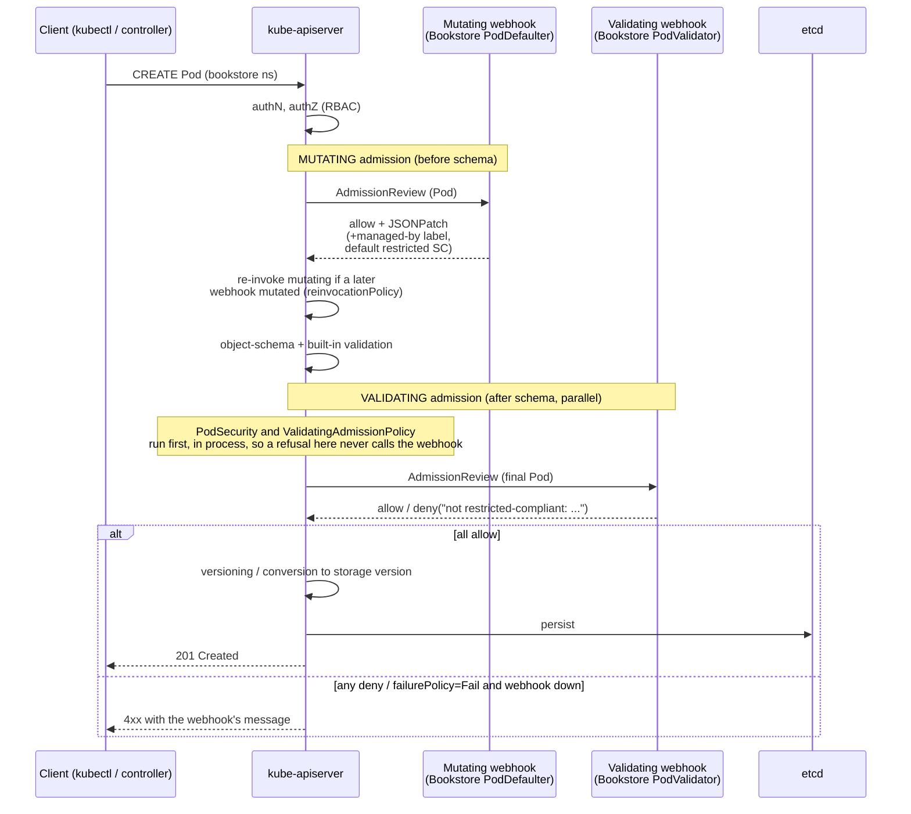

# 01 — Admission webhooks

> The admission pipeline at the level *below* Kyverno/Gatekeeper: the fixed
> order (authN → authZ → **mutating webhooks** → object-schema validation →
> **validating webhooks** → persist) from [Part 00
> ch.04](../00-foundations/04-control-plane-deep-dive.md), and how to *build*
> the webhook server those policy engines are themselves built on — a real Go
> `MutatingWebhookConfiguration` (inject the recommended `app.kubernetes.io/*`
> label + a default restricted `securityContext`) **and**
> `ValidatingWebhookConfiguration` (reject non-`restricted` Pods in the
> `bookstore` namespace, reinforcing [Part 05
> ch.02](../05-security/02-pod-security.md) PSA at the app layer); TLS via
> cert-manager (pinned) or a documented self-signed `caBundle`; the knobs that
> decide whether a webhook is *safe* (`failurePolicy`, `sideEffects`,
> `matchConditions` CEL, `namespaceSelector`/`objectSelector`,
> `reinvocationPolicy`, `timeoutSeconds`, ordering, idempotency, the
> own-namespace **deadlock footgun**); and the in-tree
> **ValidatingAdmissionPolicy + CEL** (v1.30 GA), with its mutating sibling
> **MutatingAdmissionPolicy** (stable since v1.36), as the webhook-less modern
> alternative — applied by shipping a real distroless webhook server in
> [`examples/bookstore/operator/`](../examples/bookstore/operator/README.md).

**Tier A (kind).** The hands-on runs on a kind cluster that you own. Run it
only against clusters you own. The captured output in this chapter came from
a lab cluster with a different name; the transcript header records the names
it used.

**Estimated time:** ~60 min read · ~120 min hands-on
**Prerequisites:** [Part 00 ch.04](../00-foundations/04-control-plane-deep-dive.md) — admission pipeline order this chapter writes into · [Part 05 ch.02](../05-security/02-pod-security.md) — PSA-restricted baseline the webhook reinforces · [Part 05 ch.03](../05-security/03-supply-chain.md) — Kyverno layer this chapter sits below
**You'll know after this:** • describe the admission pipeline order (mutating → schema → validating → persist) · • author a MutatingWebhookConfiguration that injects PSA-restricted defaults · • configure failurePolicy / sideEffects / matchConditions / namespaceSelector safely · • avoid the own-namespace deadlock footgun in webhook scoping · • choose between webhooks and ValidatingAdmissionPolicy + CEL

<!-- tags: security, platform-engineering, psa-restricted, day-2 -->

## Why this exists

[Part 05 ch.07](../05-security/07-admission-control-and-policy-as-code.md)
teaches **Kyverno** and the Audit-to-Enforce lifecycle; [Part 05
ch.02](../05-security/02-pod-security.md) leaned on **Pod Security Admission**.
Both are *admission controllers* — they intercept a request at the API server
*before* it reaches etcd and either mutate it or say no. The guide used them as
black boxes ("write a policy, it gets enforced"). This chapter opens the box:
**Kyverno, Gatekeeper, and PSA are all consumers of one extension point — the
admission webhook — and sometimes you need to build that primitive yourself.**

You reach for a hand-written webhook (or its in-tree successors,
ValidatingAdmissionPolicy and, since v1.36, MutatingAdmissionPolicy) when:

1. **The rule is real code, not a policy expression.** "Default a Pod's
   `securityContext` from a per-team profile looked up in a ConfigMap", "inject
   a sidecar only when an annotation and a namespace label both hold", "call an
   external inventory before admitting an image" — logic a declarative policy
   language cannot cleanly express. (A service mesh's sidecar injector, the
   Istio/Linkerd one, *is* exactly a mutating webhook.)
2. **You are already shipping a controller.** [ch.02](02-operator-development.md)
   builds the `BookstoreTenant` operator; its **conversion webhook** is an
   admission-adjacent webhook served by the *same* binary. Once you run a
   controller-runtime manager, adding a defaulting/validating webhook is one
   more registration — the natural place project-specific invariants live.
3. **You must enforce a project rule the platform's policy engine doesn't.**
   The Bookstore's `bookstore` namespace is PSA-`restricted`
   ([Part 05 ch.02](../05-security/02-pod-security.md)). PSA is the *floor*;
   this chapter adds an *app-layer* validating webhook that re-checks
   restricted-compliance and rejects with a project-specific message — defense
   in depth, and a concrete vehicle for every webhook footgun.

Crucially this is **lower-level** than [Part 05
ch.07](../05-security/07-admission-control-and-policy-as-code.md), not a
contradiction of it: Kyverno
*registers a `ValidatingWebhookConfiguration` for itself* and runs its policy
engine behind it. Most teams should use Kyverno/Gatekeeper/VAP and never write
this code. You learn it so the policy layer is no longer magic — and so you can
build the cases it can't. The reference is *Production Kubernetes* ch.8
(Admission Control) and *Kubernetes Patterns* (Access Control / Secure
Configuration).

## Mental model

**A webhook is an HTTPS server the API server calls mid-request. The apiserver
sends it an `AdmissionReview` (the object + who/what/where); the server replies
"allow / allow-with-a-JSON-patch / deny-with-a-message". Mutating webhooks run
*before* schema validation and may patch; validating webhooks run *after* and
may only judge.**

- **Two phases, fixed order** (the [Part 00
  ch.04](../00-foundations/04-control-plane-deep-dive.md) pipeline, zoomed in):
  authN → authZ → **mutating admission** (built-in plugins *then* your mutating
  webhooks, in `reinvocationPolicy` rounds) → **object-schema + built-in
  validation** → **validating admission** (built-in plugins, **PSA**, *then*
  your validating webhooks, **in parallel**) → versioning/conversion → etcd.
  Mutate-before-validate is *guaranteed*: a mutating webhook cannot dodge
  validation, and a validating webhook always sees the final, mutated,
  schema-checked object.
- **The contract is `AdmissionReview` in, `AdmissionReview` out.** Allow:
  `{allowed: true}`. Deny: `{allowed: false, status: {message: "..."}}` — that
  message is what the user sees. Mutate: `{allowed: true, patch: <base64
  JSONPatch>, patchType: JSONPatch}`. controller-runtime's generic
  `admission.Defaulter[T]`/`admission.Validator[T]` hide the wire format: you
  mutate a typed Go object or return an `error`.
- **`failurePolicy` is the single most consequential setting.** It decides what
  happens when the webhook is **unreachable/timeout/erroring**: `Fail` =
  *fail-closed* (reject the request — safe for security enforcement, but a
  broken webhook is now an **outage**); `Ignore` = *fail-open* (admit anyway —
  safe for convenience defaulting, but the rule silently stops applying). There
  is no third option; you choose which failure you can tolerate **per webhook**.
- **`sideEffects` and idempotency are correctness, not nicety.** A webhook
  should be a **pure function of the request** with `sideEffects: None` (so the
  apiserver may call it during a dry-run safely). It must be **idempotent** —
  the apiserver can call a mutating webhook **more than once** (a later
  webhook mutates the object → `reinvocationPolicy: IfNeeded` re-invokes
  yours). "Set the label if absent" is idempotent; "append the label" is a bug
  that grows the object every round.
- **Scope is a safety device, and the own-namespace deadlock is the footgun.**
  `namespaceSelector`/`objectSelector`/`matchConditions` (CEL) restrict *which
  requests* the apiserver even sends. A Pod-validating webhook that can block
  Pods **in its own namespace** (or `kube-system`) is a self-inflicted outage:
  if the webhook Pod dies, nothing can schedule the Pod that would bring it
  back. **Always exclude `kube-system` and the webhook's own namespace.**
- **VAP is the webhook-less alternative.** `ValidatingAdmissionPolicy` +
  `ValidatingAdmissionPolicyBinding` (CEL, **in-tree, GA in v1.30**) run
  validation *inside the apiserver* — no server to run, no TLS, no
  `failurePolicy`-as-outage, no network hop. It cannot mutate and CEL is not
  general code, but for "deny if <EXPRESSION>" it is now the **default
  choice**. For CEL-expressible mutation, use its sibling
  **MutatingAdmissionPolicy** (`admissionregistration.k8s.io/v1`, stable and on
  by default since v1.36). A webhook is for logic CEL can't express
  (external I/O, lookups).

The trap to keep in view: **a webhook is privileged, on the hot path of every
matching API write, and a new failure domain for the control plane.** "Just add
a webhook" is rarely just — `failurePolicy: Fail` + a too-broad scope is the
classic way to take down a cluster. Build the narrowest webhook that does the
job, or use VAP/Kyverno and avoid running the server at all.

## Threats and controls

A webhook is code on the write path, so it adds attack surface of its own. The
rows below are specific to this subject. Their IDs are in the
[Bookstore threat model](../examples/bookstore/THREAT-MODEL.md), which this
chapter extends. The Pod that runs the webhook server carries the baseline from
[01.01](../01-core-workloads/01-pods.md#baseline); this chapter does not repeat
it.

| Threat | Control in this chapter | Deeper |
|---|---|---|
| T5: a webhook configuration is edited, or its backend fails, so a check stops running | RBAC on the configurations, reviewed files applied from Git, a `failurePolicy` chosen per webhook, and a selector scoped to the app namespace | [Failure modes](#failure-modes-as-attack-surface); [05.01](../05-security/01-authn-authz-rbac.md) for RBAC |
| E7: a mutation adds privilege the Pod did not ask for | The mutating webhook sets only restrictive fields, and only when they are absent, and a validating check runs after it | [Mental model](#mental-model); [05.02](../05-security/02-pod-security.md) |
| EP9: the webhook Service takes calls from anything that can reach it | A ClusterIP Service only, a NetworkPolicy that admits the apiserver's calls on the webhook port (and the kubelet's probes on the health port), and a `caBundle` that lets the apiserver check the server's certificate | [Who may call the webhook](#who-may-call-the-webhook); [authenticate API servers](https://kubernetes.io/docs/reference/access-authn-authz/extensible-admission-controllers/#authenticate-api-servers); [02.06](../02-networking/06-network-policies.md) |

## Diagrams

### Diagram A — the admission pipeline: where mutate, validate, and VAP sit (Mermaid)



### Diagram B — webhook vs ValidatingAdmissionPolicy: which to use (ASCII)

```
 ADMISSION ENFORCEMENT — pick the lowest-power tool that fits ──────────────

  Need to MUTATE the object (inject label/sidecar/default SC)?
    YES → is general code / external I/O / cross-object lookup needed?
            NO  ──────────────────────► MutatingAdmissionPolicy (CEL)
                  in-tree (stable v1.36): set-if-absent label, default a
                  field; NO server, NO TLS, NO network hop.
            YES ──────────────────────► MUTATING WEBHOOK
                  (ConfigMap profile lookup, external I/O; controller-
                   runtime admission.Defaulter[T]; failurePolicy: Ignore;
                   idempotent set-if-absent; reinvocationPolicy: IfNeeded)
    NO  → it is a pure ALLOW/DENY rule → next question

  Can the rule be expressed as a CEL boolean over the object/oldObject?
    YES → is general code / external I/O / cross-object lookup needed?
            NO  ──────────────────────► ValidatingAdmissionPolicy (CEL)   ◄═ PREFER
                  in-tree (GA v1.30): NO server, NO TLS, NO network hop,
                  NO failurePolicy-as-outage. Bind with a Binding;
                  validationActions: Deny and/or Warn/Audit (the
                  Audit→Enforce lifecycle, Part 05 ch.07, without an add-on).
            YES ──────────────────────► VALIDATING WEBHOOK
                  (logic CEL can't do: call inventory, read a ConfigMap
                   profile, complex cross-field). failurePolicy: Fail
                   for security; scope tightly.
    NO (it's policy-as-data at fleet scale, many rules, reporting)
        ───────────────────────────────► Kyverno / Gatekeeper
              (Part 05 ch.03 — they REGISTER a validating webhook for
               themselves; you write YAML/Rego, not a server)

  ALWAYS, for any webhook:
    • namespaceSelector EXCLUDES kube-system + the webhook's OWN ns
      (own-namespace block = un-recoverable outage — THE footgun)
    • sideEffects: None  • idempotent  • timeoutSeconds small (≤5–10)
    • TLS caBundle current (cert-manager injects + rotates it)
    • roll out failurePolicy: Ignore → observe → flip to Fail
```

## Hands-on with the Bookstore

**Assumed working directory: the guide repo root (`full-guide/`).** This
chapter adds the **new** [`examples/bookstore/operator/`](../examples/bookstore/operator/README.md)
tree (shared with [ch.02](02-operator-development.md)/[ch.03](03-api-priority-and-fairness.md))
— the webhook server is `internal/webhook/v1/pod_webhook.go`, its
configurations `config/webhook/manifests.yaml`, its TLS in `config/certmanager/`.
It does **not** modify any canonical Bookstore manifest, Helm chart, Kustomize
overlay, or other `examples/bookstore/**` file — it is purely additive (the
same discipline as the Gateway-vs-Ingress and CloudNativePG precedents).

We will: (0) build and vet the server; (1) read the two webhook configs and
their scoping; (2) install cert-manager, pinned, into a restricted namespace;
(3) deploy the operator and see both webhooks act, on your own cluster; (4)
break the webhook on purpose and watch how each failure mode shows up; (5)
write the same kind of rule as a **ValidatingAdmissionPolicy** with no server.

### 0. Build and vet the webhook server (no cluster needed)

The server is real Go (controller-runtime), built into a distroless image with
the **exact** pattern of
[`examples/bookstore/app/catalog`](../examples/bookstore/app/catalog/Dockerfile):

```sh
cd examples/bookstore/operator
go vet ./...                                  # prints nothing and exits 0
docker build -t bookstore/operator:dev .      # multi-stage, distroless nonroot
cd ../../..
```

`internal/webhook/v1/pod_webhook.go` implements two generic controller-runtime
interfaces on `core/v1` Pod and registers both through
`ctrl.NewWebhookManagedBy(mgr, &corev1.Pod{})` with `.WithDefaulter(...)`
and `.WithValidator(...)`. In controller-runtime v0.25.2 (the version this
tree pins) the older `CustomDefaulter`/`CustomValidator` names are
deprecated aliases for the `runtime.Object` forms of these interfaces.

- `PodDefaulter` (`admission.Defaulter[*corev1.Pod]`): the **mutating**
  webhook. `Default(ctx, pod)` sets `app.kubernetes.io/managed-by` **if
  absent** (idempotent) and fills a default restricted pod-level
  `securityContext` (`runAsNonRoot`, `seccompProfile: RuntimeDefault`) **only
  when unset**. It is a *convenience default*, not the enforcement.
- `PodValidator` (`admission.Validator[*corev1.Pod]`): the **validating**
  webhook. `ValidateCreate`/`ValidateUpdate` reject any Pod in the
  `bookstore` namespace that is not restricted-compliant (`runAsNonRoot`,
  per-container `allowPrivilegeEscalation: false`, `drop: ["ALL"]`) with a
  precise message; `ValidateDelete` allows. It never mutates.

### 1. Read the two configurations — and the deadlock-avoidance scoping

[`config/webhook/manifests.yaml`](../examples/bookstore/operator/config/webhook/manifests.yaml)
holds the `MutatingWebhookConfiguration` and `ValidatingWebhookConfiguration`.
The settings are the chapter, so read them deliberately:

```sh
kubectl apply --dry-run=client -f examples/bookstore/operator/config/webhook/manifests.yaml
# mutatingwebhookconfiguration.../bookstore-operator-mutating-webhook-configuration created (dry run)
# validatingwebhookconfiguration.../bookstore-operator-validating-webhook-configuration created (dry run)
# service/bookstore-operator-webhook-service created (dry run)
```

That dry-run is **clean**: `Mutating`/`ValidatingWebhookConfiguration` and
`Service` are built-in `admissionregistration.k8s.io/v1` / `v1` kinds, valid on
any v1.30+ cluster. What it does **not** prove is that the webhook *works* —
that needs the operator Pod + the Service + a serving cert (step 3). The file
header documents this **webhook-intrinsic** behaviour explicitly (the same
class of note as the guide's CRD-backed `raw-manifests/51-`/`70-`,
`operators/cnpg-`, `cloud/karpenter-` files): the *objects* are schema-correct;
the *webhook* is "not present" until its backend exists, and with the
configured `failurePolicy` an unreachable validating webhook (`Fail`) rejects
matching `bookstore` Pods while the mutating one (`Ignore`) is skipped — taught,
not hidden.

The settings, and **why each is exactly this**:

| Setting | Mutating (`mpod`) | Validating (`vpod`) | Why |
|---|---|---|---|
| `failurePolicy` | `Ignore` | `Fail` | Defaulting is convenience → fail-open (broken webhook ≠ outage). Enforcement is security → fail-closed (no silent bypass). The asymmetry is the point. |
| `sideEffects` | `None` | `None` | Pure function of the request → safe under dry-run; no out-of-band writes. |
| `reinvocationPolicy` | `IfNeeded` | n/a | If a *later* mutating webhook changes the Pod, re-run this one so the default still holds. Demands idempotency. |
| `timeoutSeconds` | `5` | `5` | A webhook on the hot path must be fast; a long timeout turns latency into apiserver latency for *every* matching write. |
| `namespaceSelector` | **only** `bookstore` | **only** `bookstore` | **The deadlock footgun:** the webhook must not gate Pods in its own namespace or kube-system, or a webhook outage is unrecoverable. Both selectors name only the app namespace, so neither reaches kube-system or the operator's own namespace. |
| `matchConditions` (CEL) | — | skip Pods labelled `webhook-exempt` | A v1.30-GA cheap, expression-level pre-filter *after* selectors — shrinks blast radius and latency without code. |
| `admissionReviewVersions` | `["v1"]` | `["v1"]` | Pin the wire version; `v1` is the only non-deprecated one. |
| `clientConfig.service` + `caBundle` | the in-cluster Service | same | The apiserver reaches the webhook via a Service; cert-manager injects the matching `caBundle` (next step). |

**Both configurations name only `bookstore`.** The defaulter sets
`runAsNonRoot: true` on any Pod that has no `securityContext`. If the mutating
selector matched every other namespace, an image that runs as root would fail
to start in another team's namespace with `CreateContainerConfigError`. Scoped
to `bookstore`, the mutation runs only where the validating check runs after
it. The scope is the first control: a webhook can harm only what its selector
sends it. The failure-mode lab below applies only the validating configuration,
and only to the namespaces it names.

### 2. The honest local story + TLS (cert-manager, pinned)

> **What is and isn't locally reproducible.** The Go server, `go vet`,
> `docker build`, and every manifest dry-run run **anywhere with no cluster**.
> Seeing the webhook *fire* needs a kind cluster + cert-manager + the operator
> deployed (below) — fully reproducible locally, just not zero-setup. Webhook
> TLS is **mandatory** (the apiserver only calls HTTPS endpoints whose cert
> chains to the configured `caBundle`); there is no insecure mode. This is the
> same honesty stance as the guide's other "needs a cluster" hands-on.

The apiserver must trust the webhook's serving certificate.
[`config/certmanager/certificate.yaml`](../examples/bookstore/operator/config/certmanager/certificate.yaml)
declares a self-signed cert-manager `Issuer` + a `Certificate` whose Secret the
manager mounts; the `cert-manager.io/inject-ca-from` annotation on the webhook
configs makes cert-manager stamp the matching `caBundle` in and **auto-rotate**
it. Install cert-manager via its **pinned Helm chart** — per this guide's rule,
**never** a `releases/latest/download/<PINNED-FILE>.yaml` URL (it 404s when a
new release ships; same precedent as Kyverno/KEDA/CNPG installs):

Label the namespace before the chart puts anything in it. The chart's Pods
already meet `restricted`: in the v1.21.3 chart, each Deployment sets
`runAsNonRoot`, the `RuntimeDefault` seccomp profile, no privilege escalation,
a read-only root file system and every capability dropped. The namespace needs
no exception.

```yaml
apiVersion: v1
kind: Namespace
metadata:
  name: cert-manager
  labels:
    pod-security.kubernetes.io/enforce: restricted
    pod-security.kubernetes.io/enforce-version: latest
    pod-security.kubernetes.io/audit: restricted
    pod-security.kubernetes.io/warn: restricted
```

Save that as `cert-manager-namespace.yaml`, then install the pinned chart. The
chart installs cluster-scoped CRDs and webhooks, so run this only on a cluster
you own.

```sh
CERT_MANAGER_CHART_VERSION=v1.21.3        # jetstack/cert-manager chart (pin)
kubectl apply -f cert-manager-namespace.yaml
helm repo add jetstack https://charts.jetstack.io
helm repo update
helm install cert-manager jetstack/cert-manager \
  --namespace cert-manager \
  --version "$CERT_MANAGER_CHART_VERSION" \
  --set crds.enabled=true --wait
kubectl -n cert-manager rollout status deploy/cert-manager-webhook
```

> **The self-signed `caBundle` alternative (no cert-manager).** If you cannot
> run cert-manager, generate a CA + serving cert (`openssl`/`cfssl`), mount the
> serving pair into the manager, and put the **base64 CA** in each webhook
> config's `clientConfig.caBundle` (replacing the
> `cert-manager.io/inject-ca-from` annotation). It works identically but you
> own **rotation** by hand (an expired `caBundle` makes a `Fail` webhook reject
> everything — a classic outage). cert-manager exists precisely to remove that
> operational footgun, which is why it is the default path here.

### 3. Deploy the operator and watch both webhooks act

**Run this on your own kind cluster.** The deployment needs the
BookstoreTenant CRD and the operator's cluster RBAC. Both are cluster-scoped,
so the lab cluster used for the captured output in this chapter did not take
them on. The output shown in this step is illustrative and was not captured.
The failure modes below were captured, using the same validating configuration
with no operator behind it.

`make deploy` renders [`config/default`](../examples/bookstore/operator/config/default/kustomization.yaml)
(CRD + RBAC + the restricted-compliant manager Deployment + the webhook configs
+ the Certificate) into the operator's **own** namespace
`bookstore-operator-system` (the manager Pod is itself fully
restricted-compliant — `runAsNonRoot`, UID 65532, `drop: ["ALL"]`, seccomp
`RuntimeDefault`, read-only root FS — the same hardening it imposes on others;
[ch.02](02-operator-development.md) covers the operator side in depth):

```sh
# fresh cluster + the operator image loaded (the four app images aren't needed
# for THIS chapter — the webhook acts on ANY Pod):
kind create cluster --name bookstore
cd examples/bookstore/operator
docker build -t bookstore/operator:dev .
cd ../../..
kind load docker-image bookstore/operator:dev --name bookstore
# (cert-manager installed in step 2)

kubectl apply -f examples/bookstore/raw-manifests/00-namespace.yaml   # the PSA-restricted bookstore ns
kubectl apply -k examples/bookstore/operator/config/default
kubectl -n bookstore-operator-system rollout status deploy/bookstore-operator-controller-manager
kubectl get mutatingwebhookconfiguration,validatingwebhookconfiguration | grep bookstore
```

**See the mutating webhook stamp a Pod.** Save the Pod below as `probe.yaml`
and apply it to `bookstore`. It carries the whole baseline, so PSA admits it
without help from the webhook. It does not set the `managed-by` label, so the
webhook adds it. The image is the catalog image the earlier chapters build and
load, and the Pod is never meant to serve traffic.

```yaml
apiVersion: v1
kind: ServiceAccount
metadata:
  name: probe
  namespace: bookstore
automountServiceAccountToken: false
---
apiVersion: v1
kind: Pod
metadata:
  name: probe
  namespace: bookstore
  labels:
    app.kubernetes.io/part-of: bookstore
spec:
  serviceAccountName: probe
  automountServiceAccountToken: false
  securityContext:
    runAsNonRoot: true
    runAsUser: 65532
    runAsGroup: 65532
    seccompProfile:
      type: RuntimeDefault
  containers:
    - name: app
      image: bookstore/catalog:dev
      imagePullPolicy: IfNotPresent
      securityContext:
        allowPrivilegeEscalation: false
        readOnlyRootFilesystem: true
        capabilities:
          drop: ["ALL"]
      resources:
        requests: { cpu: 10m, memory: 32Mi }
        limits: { memory: 64Mi }
      volumeMounts:
        - name: tmp
          mountPath: /tmp
  volumes:
    - name: tmp
      emptyDir: {}
```

```sh
kubectl apply -f probe.yaml
kubectl get pod probe -n bookstore -o jsonpath='{.metadata.labels}'; echo
kubectl delete pod probe -n bookstore
```

Illustrative output, not captured on the lab cluster. The label line is the one
the webhook adds, because the Pod did not set it:

```text
{"app.kubernetes.io/managed-by":"bookstore-webhook","app.kubernetes.io/part-of":"bookstore"}
```

**See the validating webhook refuse a non-compliant Pod.** Change a copy of
`probe.yaml` so that `allowPrivilegeEscalation` is `true`. Do not apply it
while `bookstore` enforces `restricted`. PodSecurity runs before the webhook,
refuses this Pod, and the webhook is never called, so you would see a PSA
message and not the project's. To reach the webhook's own refusal, set the
namespace to warn-only for this step by removing its `enforce` label. The
`warn` label stays, so PSA still reports the violation and admits the Pod.
Then apply the copy, and restore the namespace from the reviewed file:

```sh
kubectl label namespace bookstore pod-security.kubernetes.io/enforce-
sed 's/allowPrivilegeEscalation: false/allowPrivilegeEscalation: true/' probe.yaml | kubectl apply -f -
kubectl apply -f examples/bookstore/raw-manifests/00-namespace.yaml
```

Illustrative output for the apply, not captured on the lab cluster. The
operator is not deployed there, so no webhook answered. kubectl also prints a
PodSecurity warning that this block leaves out:

```text
Error from server: admission webhook "vpod.bookstore.example.com" denied the request: pod "probe" is not restricted-PodSecurity-compliant: [container "app": allowPrivilegeEscalation must be false]
```

That refusal is the **app-layer reinforcement** of [Part 05
ch.02](../05-security/02-pod-security.md): PSA is the cluster floor, and this
webhook adds a project message. Kyverno, from [Part 05
ch.03](../05-security/03-supply-chain.md), registers a webhook of the same
kind. This time you own the server.

The scoping is the part that matters when things break. The operator's own
namespace is outside the validating selector, so a Pod there never reaches the
webhook. The failure-mode lab below proves what happens when that exclusion is
missing.

### 4. The same kind of rule with no server: ValidatingAdmissionPolicy

For a pure deny, the modern answer needs no webhook at all.
`ValidatingAdmissionPolicy` and its `ValidatingAdmissionPolicyBinding` evaluate
CEL inside the apiserver. There is no Pod, no TLS, no `failurePolicy` outage
and no network hop. The API is built in (`admissionregistration.k8s.io/v1`, GA
in v1.30).

The rule below requires the `app.kubernetes.io/part-of` label on Pods in
`bookstore`. PSA does not check labels, so a refusal for a missing label comes
from this policy. The policy alone does nothing: the binding decides where it
applies. Save this as `vap.yaml`:

```yaml
apiVersion: admissionregistration.k8s.io/v1
kind: ValidatingAdmissionPolicy
metadata:
  name: bookstore-require-part-of
spec:
  failurePolicy: Fail
  matchConstraints:
    resourceRules:
      - apiGroups: [""]
        apiVersions: ["v1"]
        operations: ["CREATE", "UPDATE"]
        resources: ["pods"]
  validations:
    - expression: "has(object.metadata.labels) && 'app.kubernetes.io/part-of' in object.metadata.labels"
      message: "pods in the Bookstore namespace must carry app.kubernetes.io/part-of"
---
apiVersion: admissionregistration.k8s.io/v1
kind: ValidatingAdmissionPolicyBinding
metadata:
  name: bookstore-require-part-of
spec:
  policyName: bookstore-require-part-of
  validationActions: ["Audit", "Warn"]   # start here; ["Deny"] comes after the label is on every Pod
  matchResources:
    namespaceSelector:
      matchLabels:
        kubernetes.io/metadata.name: bookstore
```

Apply both, then apply the probe with its label removed. The label is the only
thing that differs from the probe in step 3. Start in `Audit` and `Warn` mode:
the Pod is admitted, and the apiserver returns the policy's message as a
warning. A policy that was created a moment ago can miss the first request, so
wait a few seconds before the apply:

```sh
kubectl apply -f vap.yaml
sleep 10
sed '/app.kubernetes.io\/part-of/d' probe.yaml | kubectl apply -f -
```

<!-- gate: output -->

```text
serviceaccount/probe created
Warning: Validation failed for ValidatingAdmissionPolicy 'bookstore-require-part-of' with binding 'bookstore-require-part-of': pods in the Bookstore namespace must carry app.kubernetes.io/part-of
pod/probe created
```

The Pod now exists without the label, and nothing has been refused yet. List
the Pods in `bookstore` that lack the label before you switch to `Deny`:

```sh
kubectl get pods -n bookstore -l '!app.kubernetes.io/part-of' -o name
```

Then delete this Pod, switch the binding to `Deny`, and apply the label-less
Pod again. Delete the Pod first. A second `kubectl apply` of the unchanged
object makes no change that the policy would refuse.

```sh
kubectl delete pod probe -n bookstore --wait=true
kubectl patch validatingadmissionpolicybinding bookstore-require-part-of --type=merge \
  -p '{"spec":{"validationActions":["Deny"]}}'
sleep 10
sed '/app.kubernetes.io\/part-of/d' probe.yaml | kubectl apply -f -
```

<!-- gate: output -->

```text
serviceaccount/probe unchanged
The pods "probe" is invalid: : ValidatingAdmissionPolicy 'bookstore-require-part-of' with binding 'bookstore-require-part-of' denied request: pods in the Bookstore namespace must carry app.kubernetes.io/part-of
```

**What `Deny` does to the real `bookstore` namespace.** The binding refuses
every Pod in `bookstore` that lacks the label, including the namespace's own
Pods. The Helm chart sets the label on its Pod templates through the
`bookstore.labels` helper. The workloads in `raw-manifests/` set it only on
their own metadata, not on the Pod templates, so their Pods lack it. With
`Deny`, applying those manifests to `bookstore` refuses every Pod they create,
and so does every later rollout, scale-up and Job run. Add the label to each Pod
template before you switch, or keep `Audit` and `Warn` and read the warnings
until no Pod lacks the label.

VAP cannot change an object, and it cannot call out to anything. For
mutation, **MutatingAdmissionPolicy** can change objects with CEL. The
[Kubernetes docs](https://kubernetes.io/docs/reference/access-authn-authz/mutating-admission-policy/)
state that it has been stable since v1.36 and is enabled by default. Keep a
**webhook** for mutation or validation that needs general code or external
I/O. The `PodDefaulter` stays a webhook in this chapter to teach the
mechanics. Diagram B draws the decision. Policy as code at fleet scale, with
VAP and MAP, is in [Part 05
ch.07](../05-security/07-admission-control-and-policy-as-code.md).

## Failure modes as attack surface

A webhook can fail in three ways: it is down, it is slow, or it answers wrongly.
The failure has a direction. With `failurePolicy: Fail`, the apiserver refuses
every matching write while the call fails. With `Ignore`, it admits the write
and the check does not run. Either way, the direction is a setting in a file.
Anyone who can change that file, or stop the backend, gets a say in what the
cluster enforces. The table lists the failure modes this chapter covers.

| Failure | What the apiserver does | The outage or the bypass | Control |
|---|---|---|---|
| Backend down, `Fail` | Refuses every matching create and update | An outage for every namespace in scope | Narrow selector; restore from the reviewed file |
| Backend down, `Ignore` | Admits the request without running the check | The rule stops applying, and anyone who can stop the backend gets past it | `Ignore` only for convenience defaults, or for a short observation window while PSA still enforces the baseline |
| Selector covers the webhook's own namespace | Refuses the Pod that would bring the webhook back | An outage the cluster cannot recover from by itself | Exclude the webhook's namespace |
| `caBundle` does not match the serving certificate | Refuses the TLS handshake, the same as an outage | Every matching write fails until the bundle is fixed | cert-manager `inject-ca-from` |
| Backend hangs | Waits `timeoutSeconds`, then applies `failurePolicy` | Every matching write waits up to that long | A small `timeoutSeconds` |
| A mutation runs more than once | Calls a mutating webhook again after a later one changed the Pod | Duplicated or growing fields, if the webhook is not idempotent | Set-if-absent; `reinvocationPolicy: IfNeeded` |

### Lab: break the webhook on purpose

Run these steps on your own cluster after step 3. Each one is deliberate: it
shows a failure so you can see its shape. The lab run used the same validating
configuration with no operator behind it. Its Service had no Pods, so every
call failed the same way. The lab used its own namespaces. The output below
uses the chapter's names. Lines that name a lab
namespace or the Service's address appear here as quotes from the transcript,
not as blocks.

**Deliberate: the backend goes away and `Fail` refuses everything.** Scale the
operator to zero, then apply the probe to `bookstore`:

```sh
kubectl -n bookstore-operator-system scale deploy/bookstore-operator-controller-manager --replicas=0
kubectl apply -f probe.yaml
```

The probe is compliant, and PSA would admit it. The apiserver still refuses it.
In the lab, the refusal read
`failed calling webhook "vpod.bookstore.example.com"` and ended in
`connect: connection refused` on the Service's address. The Pod was never
created.

**Deliberate: a selector that covers the webhook's own namespace.** Widen the
selector to include `bookstore-operator-system`. This is the mistake the
scoping prevents, so run it only on a cluster you own:

```sh
kubectl patch validatingwebhookconfiguration bookstore-operator-validating-webhook-configuration \
  --type=json \
  -p '[{"op":"replace","path":"/webhooks/0/namespaceSelector/matchExpressions/0/values","value":["bookstore","bookstore-operator-system"]}]'
```

Apply the probe to the operator's namespace. The selector now covers that
namespace, so the apiserver calls the webhook, and the call fails because the
webhook is down:

```sh
sed 's/namespace: bookstore$/namespace: bookstore-operator-system/' probe.yaml | kubectl apply -f -
```

The lab run was refused the same way, with the same failed call. The webhook's
own Pod cannot be created while the webhook is down, so the cluster cannot
heal itself. Recovery is a change by someone with rights on the configuration.
Restore the reviewed file, which removes the widened entry:

```sh
kubectl apply -f examples/bookstore/operator/config/webhook/manifests.yaml
```

Then apply the probe to the operator's namespace again. The namespace is outside
the restored selector, so the webhook is never called and the Pod is admitted:

```sh
sed 's/namespace: bookstore$/namespace: bookstore-operator-system/' probe.yaml | kubectl apply -f -
```

<!-- gate: output -->

```text
serviceaccount/probe unchanged
pod/probe created
```

**Deliberate: `Ignore` during an outage.** Set `failurePolicy` to `Ignore`, then
apply the probe to `bookstore` while the backend is still down:

```sh
kubectl patch validatingwebhookconfiguration bookstore-operator-validating-webhook-configuration \
  --type=json -p '[{"op":"replace","path":"/webhooks/0/failurePolicy","value":"Ignore"}]'
kubectl apply -f probe.yaml
```

<!-- gate: output -->

```text
serviceaccount/probe unchanged
pod/probe created
```

The Pod is admitted, and the call was skipped. This probe passes PSA, so it
shows only that the webhook stopped running. A rule that only the webhook
enforces would be admitted the same way. PSA is the floor that stays in place.

Restore the reviewed file. Re-applying it is the control that matters: the
cluster's state goes back to what Git says, and `kubectl diff` shows any drift
first.

```sh
kubectl apply -f examples/bookstore/operator/config/webhook/manifests.yaml
```

### Who may call the webhook

The webhook Service accepts a connection from anything that can reach it. The
operator's server asks no caller for a certificate, so it does not check who is
calling. The `caBundle` works in the other direction: it lets the apiserver
check the server's certificate. Authenticating the apiserver to the webhook is
a separate setting, the `authentication` section of an `AdmissionConfiguration`
([authenticate API servers](https://kubernetes.io/docs/reference/access-authn-authz/extensible-admission-controllers/#authenticate-api-servers)).
This chapter does not configure it, so the network is the control that narrows
the callers. The policy below admits the apiserver's calls on the webhook port, and
the kubelet's probes on the health port, and no other ingress:

```yaml
apiVersion: networking.k8s.io/v1
kind: NetworkPolicy
metadata:
  name: webhook-apiserver-only
  namespace: bookstore-operator-system
spec:
  podSelector:
    matchLabels:
      control-plane: controller-manager
  policyTypes: ["Ingress"]
  ingress:
    - from:
        - ipBlock:
            cidr: 172.18.0.2/32   # kind: the control-plane node's address
      ports:
        - protocol: TCP
          port: 9443
    - ports:                      # no "from": the kubelet's probes, from any source
        - protocol: TCP
          port: 8081
```

The first rule's address is the one the lab saw for a host-network process on
the control-plane node calling the webhook Service. The apiserver also runs on
that node in the host network, so its calls should take the same path, but the
lab did not call the webhook from the apiserver itself. Check that on your
cluster before you rely on the rule. The rule admits every host-network process
on that node, not the apiserver alone. The second rule is needed because the
kubelet probes the Pod directly, not through the Service, so a rule limited to
9443 would fail the probes. Other clusters have other node addresses. A CNI
without NetworkPolicy support accepts the object and enforces nothing, so run
the test below on your cluster before you rely on the policy.

The lab cluster enforces the policy. The test used a stand-in server with the
webhook's labels and port, a Service with the webhook's name, a client Pod in
an unlabelled namespace, and a host-network Pod. Run the two clients as Pods
that sleep and carry `curl` (the `curlimages/curl` image does), one of them
with `hostNetwork: true`, both in a `webhook-test` namespace that has no Pod
Security label. On your cluster, the operator's own Pod plays the stand-in's
role:

```sh
CIP=$(kubectl get service bookstore-operator-webhook-service -n bookstore-operator-system -o jsonpath='{.spec.clusterIP}')
SRV=$(kubectl get pod -n bookstore-operator-system -l control-plane=controller-manager -o jsonpath='{.items[0].status.podIP}')
kubectl exec -n webhook-test client -- curl -s -o /dev/null -w '%{http_code}\n' -m 3 http://$CIP:443/
kubectl exec -n webhook-test host-client -- curl -s -o /dev/null -w '%{http_code}\n' -m 3 http://$CIP:443/
kubectl exec -n webhook-test client -- curl -s -o /dev/null -w '%{http_code}\n' -m 3 http://$SRV:8081/healthz
```

Before the policy, the client Pod got a response:

<!-- gate: output -->

```text
404
```

With the policy applied, the client Pod's connection was dropped:

<!-- gate: output -->

```text
000
command terminated with exit code 28
```

The host-network Pod still got a response, because its traffic arrives from
the admitted address:

<!-- gate: output -->

```text
404
```

The health port was not dropped. In the lab nothing listened on it, so the
client got a refusal. A refusal means the packet reached the Pod, so the policy
let it through. On your cluster the operator answers on that port instead:

<!-- gate: output -->

```text
000
command terminated with exit code 7
```

### Who may change the configuration

A `failurePolicy` change is one `patch` away, so the question is who holds
that verb. Check it for the identity a workload runs as, and for yourself:

```sh
kubectl auth can-i patch validatingwebhookconfigurations.admissionregistration.k8s.io \
  --as=system:serviceaccount:bookstore:probe
kubectl auth can-i patch validatingwebhookconfigurations.admissionregistration.k8s.io
```

<!-- gate: output -->

```text
no
```

<!-- gate: output -->

```text
yes
```

The probe's ServiceAccount has no such permission, and neither should any
workload identity. Only identities you grant the verb can change the
configuration, so keep that list short. Every change to these objects should
also leave an audit record, which [Part 05
ch.08](../05-security/08-audit-detection-and-incident-response.md)
covers.

### TLS, timeouts, reinvocation and side effects

The apiserver calls a webhook only over TLS, and only when the serving
certificate chains to the `caBundle` in the configuration. A `caBundle` that
has expired or been copied from an old CA fails the handshake. For a `Fail`
webhook, that is an outage on every matching write. This is why the chapter
uses cert-manager: `cert-manager.io/inject-ca-from` keeps the bundle and the
serving certificate in step, and rotates both. The lab did not reach TLS
because the Service had no Pods. The self-signed `caBundle` path in step 2 is
the one to use when cert-manager is not available, and it puts rotation on you.

`timeoutSeconds` bounds each call. A webhook that hangs, rather than refuses,
costs the apiserver that much time on every matching write, and then
`failurePolicy` decides the outcome. The default is 10 seconds, as the
[extensible admission controllers page](https://kubernetes.io/docs/reference/access-authn-authz/extensible-admission-controllers/)
says. The
[good-practices guide](https://kubernetes.io/docs/concepts/cluster-administration/admission-webhooks-good-practices/)
advises a small value, and this chapter uses 5.

`reinvocationPolicy: IfNeeded` calls a mutating webhook again when a later
webhook changed the Pod. A webhook that appends a label or a container grows the
object on every call. The fix is set-if-absent, as in `PodDefaulter`. The same
guide says to avoid side effects in admission webhooks, because `sideEffects:
None` is the promise that a dry-run request may call the webhook safely.

### Keep the failure mode small

Run the webhook as a Deployment with at least two replicas and a
PodDisruptionBudget, so a node drain does not start an outage. [Part 06
ch.05](../06-production-readiness/05-reliability-and-disruptions.md) covers the
budget. Roll out a new `Fail` webhook in `Ignore` first and watch its latency
and error rate, then switch the policy. While it is in `Ignore`, the webhook's
own rules are not enforced. PSA still enforces the restricted baseline on
`bookstore`, so only the rules that the webhook alone checks are open during
the window. A `ValidatingAdmissionPolicy` such as step 4 is not affected by the
webhook's failure policy, so bind it before the window opens. Keep the window
short. A `Fail` webhook that has never run under real traffic is the outage
waiting to happen. Finally, keep a validating check after any
mutation, so that a change which adds privilege is refused. The good-practices
guide calls this "fail open and validate the final state".

### Clean up

```sh
kubectl delete -k examples/bookstore/operator/config/default --ignore-not-found
helm uninstall cert-manager -n cert-manager
kubectl delete validatingadmissionpolicybinding bookstore-require-part-of
kubectl delete validatingadmissionpolicy bookstore-require-part-of
kind delete cluster --name bookstore
```

## How it works under the hood

- **The apiserver calls webhooks; webhooks never call the apiserver back
  (for the verdict).** During a matching request the apiserver POSTs an
  `admission.k8s.io/v1 AdmissionReview` (the object, `oldObject` on update, the
  requesting user/groups, the GVR, dry-run flag) to the webhook's HTTPS
  endpoint and waits up to `timeoutSeconds`. The reply is an `AdmissionReview`
  with `response.allowed` and optionally `response.patch` (base64 JSONPatch,
  mutating only) or `response.status.message` (deny text). controller-runtime's
  `webhook.Server` decodes/encodes this; `Defaulter[T].Default(ctx, obj)`
  mutates the typed object (the framework diffs it into a JSONPatch) and
  `Validator[T].Validate*` returns `(admission.Warnings, error)`; a non-nil
  error becomes a deny with that message.
- **Mutate-before-validate is structural, and mutation order is config order
  then reinvocation.** All mutating webhooks run first (the apiserver applies
  each one's patch, feeding the result to the next), *then* schema/built-in
  validation, *then* all validating webhooks **in parallel** (any single deny
  rejects). Mutating webhooks have no guaranteed order *unless* you sequence
  them; `reinvocationPolicy: IfNeeded` re-invokes a mutating webhook if a later
  one changed the object — which is *why* a mutating webhook **must** be
  idempotent (`set-if-absent`, never `append`). PSA and
  `ValidatingAdmissionPolicy` run in the validating phase, in process, and
  before any validating webhook is called. In the apiserver's ordered plugin
  list, `PodSecurity` comes before `ValidatingAdmissionPolicy`, which comes
  before `ValidatingAdmissionWebhook`, and the chain stops at the first
  refusal. A Pod that PSA refuses never reaches your webhook.
- **TLS and the `caBundle` are the trust anchor.** The apiserver only calls a
  webhook over TLS whose server cert verifies against the
  `clientConfig.caBundle` in the configuration. cert-manager issues the serving
  cert *and* (via `inject-ca-from`) writes the CA into the configs and rotates
  both before expiry. An expired/missing `caBundle` makes every call fail —
  which, for a `failurePolicy: Fail` webhook, is a cluster-wide write outage
  for the matched resources. This is the operational reason the chapter
  mandates cert-manager (or a *disciplined* manual rotation).
- **`failurePolicy` × scope is the blast radius.** "Webhook down" = (for `Fail`)
  every *in-scope* create/update is rejected. So scope is not just filtering,
  it is **damage control**: `namespaceSelector` excluding `kube-system` + the
  webhook's own namespace keeps the *recovery path* (rescheduling the webhook
  Pod, core controllers) working even while the webhook is broken. CEL
  `matchConditions` (v1.30 GA) cut scope further *and* cheaply, evaluated in the
  apiserver after selectors and before the network call — so an exempt Pod
  never even costs a round-trip. A `Fail` webhook with no exclusions is the
  canonical self-DoS.
- **VAP is the webhook executed inside the apiserver.** `ValidatingAdmission
  Policy` compiles CEL once and evaluates it in-process during validating
  admission — no Pod, no TLS, no network, and a `failurePolicy` whose failure
  mode is a compile/type error surfaced at bind time, not a remote outage.
  `validationActions` (`Deny`/`Warn`/`Audit`) give the **Audit→Enforce
  lifecycle** ([Part 05 ch.03](../05-security/03-supply-chain.md)) with zero
  add-ons. It is strictly *less powerful* (no mutation, CEL is sandboxed,
  expression-only) — which is exactly why, when it suffices, it is also
  strictly *safer* and the right default.
- **This is what Kyverno/Gatekeeper *are*.** Both install a
  `ValidatingWebhookConfiguration` (Kyverno also a mutating one) pointing at
  their own controller, which evaluates your YAML/Rego per request. They add
  policy-as-data, reporting, and fleet management *on top of* the exact
  primitive this chapter builds — and increasingly delegate the simple cases to
  VAP. Knowing the primitive is what lets you reason about *their* failure
  modes (their webhook's `failurePolicy`, their selectors, their own
  namespace's exclusion) — the same footguns, one layer down.

## Production notes

> **In production: prefer ValidatingAdmissionPolicy, then Kyverno/Gatekeeper,
> then a hand-written webhook — in that order.** Reach for a webhook only when
> you must run logic CEL can't; CEL-expressible mutation now belongs in
> **MutatingAdmissionPolicy** (stable since v1.36), the same way pure deny
> belongs in VAP. Every webhook you run is a new control-plane failure domain
> on the write hot path; VAP (in-tree, v1.30 GA) removes the server, the TLS,
> and the `failurePolicy`-as-outage entirely for the common "deny if X" case.
> Fewer webhooks is more uptime.

> **In production (managed — EKS/GKE/AKS):** the provider runs the apiserver,
> so a `Fail` webhook that the provider's *managed add-on* controllers trip
> over can block cluster operations you don't control — scope webhooks off
> provider/system namespaces and test against managed add-ons. Some platforms
> ship their own admission policy; layer yours deliberately and prefer VAP,
> which the managed apiserver runs for you with no add-on to operate.

## Quick Reference

```sh
# Build and vet the webhook server (no cluster needed)
cd examples/bookstore/operator && go vet ./... && docker build -t bookstore/operator:dev .
cd -

# Install cert-manager with the pinned chart, into a restricted namespace
kubectl apply -f cert-manager-namespace.yaml
helm repo add jetstack https://charts.jetstack.io && helm repo update
helm install cert-manager jetstack/cert-manager -n cert-manager \
  --version v1.21.3 --set crds.enabled=true --wait

# Deploy the operator and its webhook configurations
kubectl apply -k examples/bookstore/operator/config/default
kubectl get mutatingwebhookconfigurations,validatingwebhookconfigurations

# Read the failure policy of the validating webhook
kubectl get validatingwebhookconfiguration bookstore-operator-validating-webhook-configuration \
  -o jsonpath='{.webhooks[0].failurePolicy}{"\n"}'

# Check who may change webhook configurations
kubectl auth can-i patch validatingwebhookconfigurations.admissionregistration.k8s.io \
  --as=system:serviceaccount:bookstore:probe

# Read the webhook server's log when a request is refused
kubectl -n bookstore-operator-system logs deploy/bookstore-operator-controller-manager
```

The safety knobs on one webhook entry. This is a fragment: the full file is
`examples/bookstore/operator/config/webhook/manifests.yaml`, and the policy
alternative is the pair in step 4.

```yaml
webhooks:
  - name: vpod.bookstore.example.com
    admissionReviewVersions: ["v1"]
    sideEffects: None                     # a pure function of the request
    failurePolicy: Fail                   # enforcement fails closed
    timeoutSeconds: 5
    namespaceSelector:                    # the app namespace only, never the webhook's own
      matchExpressions:
        - key: kubernetes.io/metadata.name
          operator: In
          values: ["bookstore"]
    matchConditions:                      # a cheap pre-filter, after the selectors
      - name: exclude-exempt-pods
        expression: "!has(object.metadata.labels) || !('bookstore.example.com/webhook-exempt' in object.metadata.labels)"
```

Checklist:

- [ ] Use **VAP** for pure deny and **MutatingAdmissionPolicy** (stable since
      v1.36) for CEL-expressible defaulting; webhook only for logic CEL can't
      express; Kyverno/Gatekeeper for policy-as-data at fleet scale
- [ ] `sideEffects: None`; mutating webhook **idempotent** (set-if-absent);
      small `timeoutSeconds`; `admissionReviewVersions: ["v1"]`
- [ ] `failurePolicy`: `Ignore` for defaulting, `Fail` for enforcement —
      **rolled out Ignore → observe → Fail**, never straight to `Fail`
- [ ] `namespaceSelector` **excludes `kube-system` + the webhook's own
      namespace** (+ an exempt escape label + CEL `matchConditions`)
- [ ] Serving cert + `caBundle` via **cert-manager** (`inject-ca-from`,
      auto-rotation) — or a *disciplined* manual rotation
- [ ] Webhook server **HA** (≥2 replicas + PDB), minimal/distroless image,
      restricted-compliant, in its **own** namespace
- [ ] Mutate-before-validate understood; validating webhook sees the final
      object; PSA/VAP are the floor this *adds to*, not replaces

## Test your understanding

> Try each before opening the answer drawer. The act of trying is the exercise; the answer is the check.

1. **Why does the admission pipeline run mutating webhooks before validating webhooks, and why does that ordering matter?**
   <details><summary>Show answer</summary>

   Mutating webhooks transform the object (inject sidecars, set defaults, add labels) before the schema validator sees it; validating webhooks reject or accept the *final* object. If validation ran first, mutators could "fix" objects that should have been rejected, undermining policy. The ordering also means a validating webhook can assume the object has been through every mutating webhook — useful for "verify that label X was injected" rules. Within each phase, webhooks fire in unspecified order, so they must be commutative or use `reinvocationPolicy: IfNeeded` to converge.

   </details>

2. **Your `ValidatingWebhookConfiguration` enforces PSA-restricted on `bookstore`, with `failurePolicy: Fail`. The webhook server pod crashes. What is the cluster-wide blast radius and how do you recover?**
   <details><summary>Show answer</summary>

   With `failurePolicy: Fail`, every Create/Update of matching resources is rejected because the apiserver cannot reach the webhook. If `namespaceSelector` is scoped tightly to `bookstore`, only that namespace is bricked. Apps elsewhere are fine. If the selector is broad (no exclusion of `kube-system` or the webhook's own namespace), you cannot recover even the webhook itself because creating the new Pod requires the webhook to be up, which is the classic chicken-and-egg lockout. Recovery: `kubectl delete validatingwebhookconfiguration <name>` (deleting the configuration does not go through the webhook, because the webhook matches only Pods, so an administrator can remove it even while the webhook is down). Prevention: a `namespaceSelector` that excludes the webhook's own namespace and `kube-system`, plus an exempt label escape hatch. `failurePolicy` is set per webhook, not per namespace, so `Ignore` does not protect the webhook's own namespace. The selector does.

   </details>

3. **A teammate writes a mutating webhook that adds a default `securityContext.runAsNonRoot: true`. Two weeks later, the cluster runs slowly and `apiserver_admission_webhook_admission_duration_seconds` shows the webhook adding 300ms per Pod create. What's the likely cause and the fix?**
   <details><summary>Show answer</summary>

   The webhook is probably (a) making a network call out of process (DNS lookup, external API) per request, (b) running expensive logic in Go (regex compile, full reflection of the Pod), or (c) deployed as a single replica on a far-away node and adding network latency. Fixes: precompile regex in `init()`, cache lookups, scope the webhook with `objectSelector`/`namespaceSelector` so it only fires for the workloads that need it, set `timeoutSeconds: 5` to bound the worst case, and use `matchConditions` CEL to short-circuit. Webhooks are on the apiserver write path — every millisecond counts.

   </details>

4. **A teammate's pipeline patches the validating webhook's `failurePolicy` from `Fail` to `Ignore` during a deploy, and the backend is down. Which identities can make that change, what does the apiserver do with the next Pod the webhook would refuse, and which controls would have caught it?**
   <details><summary>Show answer</summary>

   Any identity with `patch` or `update` on `validatingwebhookconfigurations`.
   The lab's probe ServiceAccount could not make the change, and a cluster
   administrator can. With `Ignore`, the apiserver skips the call when the
   backend is unreachable, so a Pod that the webhook would refuse is admitted,
   and no error is raised. The controls are RBAC that keeps the verb to a short
   list, and applying from Git with `kubectl diff`, so the drift shows at the
   next apply (T3). The audit record of the change is the detection step,
   covered in [Part 05
   ch.08](../05-security/08-audit-detection-and-incident-response.md).

   </details>

## Further reading

- **Rosso et al., _Production Kubernetes_, ch.8 — "Admission Control"**: the
  admission phase as a production control surface — mutating vs validating,
  webhook design, `failurePolicy`/scope trade-offs, and the operational risk
  of putting code on the API write path (the backbone of this chapter).
- **Ibryam & Huß, _Kubernetes Patterns_ 2e — *Secure Configuration* (ch.25)
  and *Access Control* (ch.26)**: enforcing configuration/security invariants
  at admission as a pattern, and where webhook-based enforcement fits relative
  to RBAC and policy engines.
- Official: Dynamic Admission Control
  <https://kubernetes.io/docs/reference/access-authn-authz/extensible-admission-controllers/>,
  ValidatingAdmissionPolicy (CEL, GA v1.30)
  <https://kubernetes.io/docs/reference/access-authn-authz/validating-admission-policy/>,
  MutatingAdmissionPolicy (CEL, stable since v1.36)
  <https://kubernetes.io/docs/reference/access-authn-authz/mutating-admission-policy/>,
  and the admission webhook good practices
  <https://kubernetes.io/docs/concepts/cluster-administration/admission-webhooks-good-practices/>.
