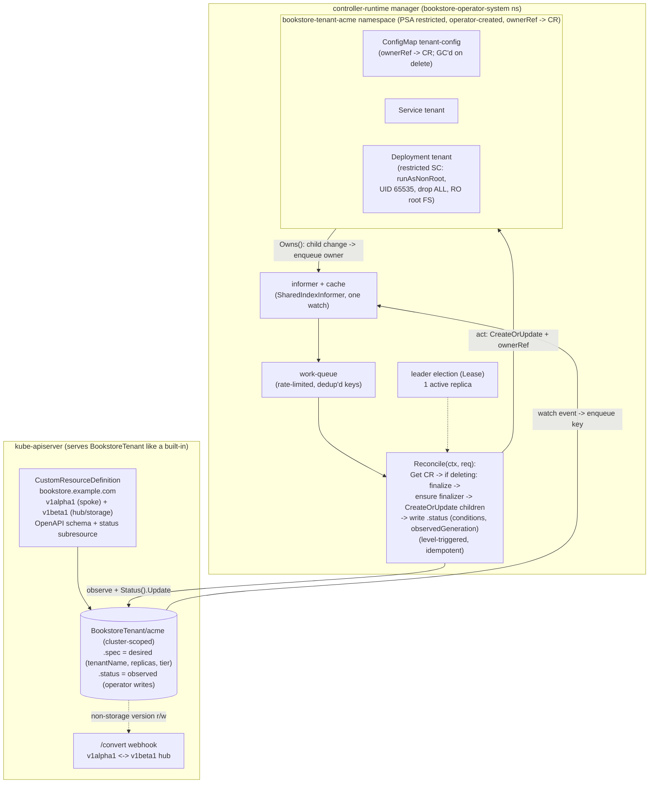

# 02 — Operator development

> [Part 08 ch.05](../08-day-2-operations/05-operators-and-crds.md) *consumed* an
> operator (CloudNativePG's `Cluster`); this chapter **builds one** with
> **Kubebuilder** — a real `BookstoreTenant` CRD
> (`bookstore.example.com`, `v1alpha1` spoke + `v1beta1` hub for the conversion
> story, cluster-scoped) whose controller reconciles a minimal
> **restricted-PSA** slice (Namespace + Deployment + Service + ConfigMap) into
> a per-tenant namespace: the full Kubebuilder layout (`PROJECT`, `api/`,
> `internal/controller/`, `config/`, `Makefile`), `make manifests generate`,
> the **reconcile loop** (level-triggered, idempotent, owner references for GC,
> `CreateOrUpdate`), **finalizers** (clean state GC can't), **status
> conditions + `.status.observedGeneration` + Events**, the
> **v1alpha1→v1beta1 conversion webhook** (hub/spoke), **envtest** unit tests,
> RBAC markers, and packaging (Helm/OLM overview) — real controller-runtime Go
> in [`examples/bookstore/operator/`](../examples/bookstore/operator/README.md),
> `go vet`-clean and passing its envtest suite, explicitly **contrasted** with
> "consuming an operator" so this deepens [Part 08
> ch.05](../08-day-2-operations/05-operators-and-crds.md) rather than repeating
> it.

**Estimated time:** ~60 min read · half-day hands-on
**Lab tier:** A (kind). Run the lab only against a cluster you own.
**Prerequisites:** [Part 08 ch.05](../08-day-2-operations/05-operators-and-crds.md) — consumer-side operator pattern this chapter deepens to producer side · [Part 11 ch.01](01-admission-webhooks.md) — webhook plumbing reused for the conversion webhook
**You'll know after this:** • lay out a Kubebuilder project (PROJECT, api/, internal/controller/, config/) · • write a level-triggered, idempotent reconcile loop with owner references · • use finalizers + status conditions + observedGeneration + Events correctly · • build a v1alpha1→v1beta1 conversion webhook (hub/spoke) · • write envtest unit tests against an embedded apiserver

<!-- tags: platform-engineering, operators, crds, day-2 -->

## Why this exists

[Part 08 ch.05](../08-day-2-operations/05-operators-and-crds.md) made the
operator pattern concrete from the **consumer** side: install CloudNativePG via
its chart, `kubectl apply` a `Cluster`, watch its controller do the DBA job. It
ended on a deliberately deferred thread:

> *"build a CRD/operator only when buying genuinely doesn't fit … the pattern
> (CRD + controller-runtime reconcile loop) is also how **you** encode **your**
> org's operational knowledge (a "TenantEnvironment" CRD)… treat your
> controller as production software."*

This chapter is that thread, executed. It is the **producer** side of the exact
same pattern, and the contrast is the point — stated up front so the two
chapters do not blur:

| | [Part 08 ch.05](../08-day-2-operations/05-operators-and-crds.md) — *consume* | **This chapter — *build*** |
|---|---|---|
| Artifact | someone else's CRD + controller (CNPG) | **your** CRD + controller (`BookstoreTenant`) |
| You write | a `Cluster` CR (YAML) | the **Go reconcile loop**, CRD schema, conversion, RBAC |
| Effort/risk | install + operate a mature operator | author + test + version + operate software you own |
| The lesson | build-vs-buy → **buy** failover/PITR | build-vs-buy → **build** only your *own* domain logic |

You build an operator when **no mature operator encodes your domain** — here, a
soft-multi-tenancy primitive: "give a tenant their own isolated, hardened slice
of the platform" (the [Part 08
ch.04](../08-day-2-operations/04-multi-tenancy-and-namespaces.md)
namespace+quota+RBAC stack, but **as a single declarative `kubectl apply`**
with a controller that keeps it true and cleans it up). That is org-specific;
nobody ships it. Build-vs-buy still **strongly favours buy** for the hard
stateful systems ([Part 08
ch.05](../08-day-2-operations/05-operators-and-crds.md)) — this chapter is the
*other* case, done with the same rigor a service gets. The reference is
*Kubernetes Patterns* ch.27 (Controller) + ch.28 (Operator), and the Kubebuilder
book.

## Mental model

**Kubebuilder scaffolds the [Part 08
ch.05](../08-day-2-operations/05-operators-and-crds.md) machinery for *your*
type: a CRD (the new API noun), a controller-runtime *manager* hosting your
reconcile loop, and the wiring (scheme, RBAC, webhooks, manifests). You fill in
exactly one function — `Reconcile` — plus the API types; the framework does
watches, caching, work-queues, leader election, and the webhook server.**

- **CRD = your API type; controller = the loop that makes it true** — identical
  to [Part 08 ch.05](../08-day-2-operations/05-operators-and-crds.md). What is
  *new* here: **you author the OpenAPI schema** (Go structs + `kubebuilder`
  markers → `make manifests`), **you write `Reconcile`**, and **you own the
  versioning**.
- **`Reconcile(ctx, req)` is the whole controller.** controller-runtime hands
  you a `NamespacedName` (namespace empty for this cluster-scoped CR); you
  `Get` the CR, drive the world toward `.spec`
  (idempotently, via `CreateOrUpdate`), write `.status`, and return
  `(Result, error)`. A returned error → exponential-backoff requeue;
  `Result{RequeueAfter: d}` → time-based requeue. The loop is **level-triggered**
  (always reconciles the *current* desired state from the informer cache, so a
  missed/duplicate event is harmless) and **must be idempotent** (reconciling
  an already-correct CR is a no-op).
- **Owner references = automatic GC; finalizers = the cleanup GC can't do.**
  Stamp each child with `SetControllerReference(cr, child, scheme)` and deleting
  the CR cascades to the children (the apiserver's GC, the [Part 00
  ch.06](../00-foundations/06-declarative-api-model.md) `ownerReferences`). A
  **finalizer** is a string on `.metadata.finalizers` that *blocks* actual
  deletion (the apiserver only sets `deletionTimestamp`) until your controller
  does pre-delete work GC cannot express, such as releasing an external
  resource or a billing record, then removes the finalizer. Owner scope
  matters: a namespaced owner can only own objects in its own namespace, while
  a cluster-scoped owner can own cluster-scoped objects and namespaced ones in
  any namespace. `BookstoreTenant` is cluster-scoped for that reason, since it
  owns a Namespace and the objects inside it.
- **`.status` is observed state, and `observedGeneration` is the freshness
  bit.** The controller writes `.status` (via the **status subresource**, so it
  never fights a user editing `.spec`): `Conditions` (`Ready`/`Degraded` via
  `meta.SetStatusCondition`), a coarse `phase`, and
  `.status.observedGeneration = .metadata.generation` so a client can tell
  "the controller has processed *this* spec" from a stale status. **Events**
  (`Recorder.Eventf(obj, related, type, reason, action, note)`, the
  `events.k8s.io` recorder) narrate *why* for `kubectl describe`.
- **Multiple API versions need conversion; hub-and-spoke makes it O(N).**
  Ship `v1alpha1` and `v1beta1`? Pick one **hub** (the storage version;
  here **`v1beta1`**); every other version is a **spoke** implementing
  `ConvertTo`/`ConvertFrom` *the hub*. The apiserver calls the operator's
  `/convert` endpoint on any read/write of a non-storage version and routes
  everything *through* the hub — so N versions need **N−1** conversions, not
  N². This mirrors the built-in API lifecycle from [Part 08
  ch.01](../08-day-2-operations/01-cluster-lifecycle.md).

The trap to keep in view (the [Part 08
ch.05](../08-day-2-operations/05-operators-and-crds.md) warning, from the
*inside*): **an operator you build is production software you now run** — a
Deployment with RBAC, a CRD with a version/conversion story, leader election,
bounded reconcile, tested idempotency. Kubebuilder removes the boilerplate, not
the responsibility. This chapter's operator is *deliberately tiny* (the
reconciled workload is a public `pause` image — the *machinery* is the lesson,
not the payload) precisely so the production-grade scaffolding is visible
without a distracting domain.

## Threats and controls

| Threat | Control in this chapter | Deeper |
|---|---|---|
| E8: the controller's own RBAC grant is wider than its reconcile loop, so a compromised operator acts anywhere the grant reaches | Markers grant only the verbs the loop calls, and the generated role is read before it ships ([RBAC](#3-rbac-the-markers-the-role-and-a-wide-marker)) | [Part 05 ch.01](../05-security/01-authn-authz-rbac.md) for RBAC; the namespace scope left over is 05.07 <!-- link-later: 05.07 --> |

The webhook threats (T5, E7, EP9) belong to [11.01](01-admission-webhooks.md).
The tenant Pod the operator emits holds the
[01.01 baseline](../01-core-workloads/01-pods.md#baseline).

## Diagrams

### Diagram A — the reconcile loop: watch → queue → reconcile(diff→act) → status (Mermaid)



### Diagram B — Kubebuilder project tree (ASCII)

```
 examples/bookstore/operator/  (Kubebuilder Go layout v4) ──────────────────
 ├── PROJECT                 project metadata (domain, group, versions, webhooks)
 ├── Makefile                manifests / generate / vet / test / docker-build / deploy
 │                           (pins controller-gen, kustomize, setup-envtest)
 ├── Dockerfile              distroless static nonroot  (== app/catalog pattern)
 ├── go.mod / go.sum         controller-runtime v0.25 + k8s.io v0.37 (K8s v1.37)
 ├── cmd/
 │   └── main.go             manager: scheme + controller + webhooks + leader-elect
 ├── api/
 │   ├── v1alpha1/           SPOKE
 │   │   ├── bookstoretenant_types.go        (size: s|m|l)
 │   │   ├── bookstoretenant_conversion.go   ConvertTo/From the v1beta1 hub
 │   │   ├── groupversion_info.go
 │   │   └── zz_generated.deepcopy.go        (make generate)
 │   └── v1beta1/            HUB + STORAGE
 │       ├── bookstoretenant_types.go        (tier: small|medium|large) + Hub()
 │       ├── groupversion_info.go
 │       └── zz_generated.deepcopy.go
 ├── internal/
 │   ├── controller/
 │   │   ├── bookstoretenant_controller.go   THE RECONCILE LOOP (+ finalizer,
 │   │   │                                   ownerRefs, CreateOrUpdate, status)
 │   │   ├── suite_test.go                   envtest harness (real apiserver+etcd)
 │   │   └── bookstoretenant_controller_test.go   behavioural tests
 │   └── webhook/v1/         (ch.01) mutating + validating Pod webhooks
 └── config/
     ├── crd/                the CRD (scope: Cluster, v1beta1 storage); patches/ add
     │                       the conversion webhook and CA injection
     ├── rbac/               ClusterRole from markers, leader-election Role, bindings, SA
     ├── manager/            restricted-compliant manager Deployment + own ns
     ├── webhook/            (ch.01) Mutating/ValidatingWebhookConfiguration
     ├── certmanager/        serving cert (cert-manager) for the webhooks
     ├── apf/                (ch.03) FlowSchema + PriorityLevelConfiguration
     ├── samples/            sample CR (v1beta1 + v1alpha1)
     └── default/            kustomize overlay (make deploy)

  ON DISK: this whole tree is NEW and PURELY ADDITIVE — it touches no
  canonical Bookstore manifest, no Helm chart, no Kustomize overlay, and no
  operators/cnpg-* file (Part 08 ch.05 is left exactly as it was).
```

## Hands-on with the Bookstore

**Assumed working directory: the guide repo root (`full-guide/`).** This
chapter authors the **new**
[`examples/bookstore/operator/`](../examples/bookstore/operator/README.md) tree
(shared with [ch.01](01-admission-webhooks.md)/[ch.03](03-api-priority-and-fairness.md)).
It does **not** modify any canonical Bookstore manifest, Helm chart, Kustomize
overlay, the `operators/cnpg-*` files, or any other `examples/bookstore/**`
file — purely additive, the Gateway-vs-Ingress / CloudNativePG precedent.

We will: (0) read the Kubebuilder layout and how it was scaffolded; (1) the API
types and `make manifests generate`; (2) build, **vet** and **envtest** the
controller (no cluster); (3) read the RBAC the markers generate, and what a
wide marker would grant; (4) install it on a kind cluster and watch a
`BookstoreTenant` reconcile, self-heal and finalize; (5) the
v1alpha1→v1beta1 **conversion webhook** in action; (6) the CRD-intrinsic
dry-run note; (7) packaging.

### 0. The Kubebuilder project (how it is laid out and scaffolded)

Kubebuilder is the SDK that scaffolds and wires a controller-runtime project.
The canonical scaffold (recorded in
[`PROJECT`](../examples/bookstore/operator/PROJECT)) is:

```sh
# (reference — the tree is already in the repo; this is HOW it is generated)
kubebuilder init --domain example.com --repo github.com/bookstore/operator
kubebuilder create api --group bookstore --version v1alpha1 --kind BookstoreTenant --resource --controller
kubebuilder create api --group bookstore --version v1beta1  --kind BookstoreTenant --resource           # 2nd version
kubebuilder create webhook --group bookstore --version v1alpha1 --kind BookstoreTenant --conversion --spoke v1alpha1   # conversion (hub=v1beta1)
kubebuilder create webhook --group core --version v1 --kind Pod --defaulting --programmatic-validation  # ch.01 Pod webhooks
```

The resulting layout is Diagram B. The two pieces *you* own are `api/` (the
types + conversion) and `internal/controller/` (the loop); everything else
(`cmd/main.go` wiring, `config/`, `Makefile`) is scaffold you tune. This guide
ships the tree pre-written (real, `go vet`+`docker build` clean) so it is
reviewable without running the generator.

### 1. The API types + `make manifests generate`

[`api/v1beta1/bookstoretenant_types.go`](../examples/bookstore/operator/api/v1beta1/bookstoretenant_types.go)
is the **hub/storage** version; `kubebuilder` markers drive both the CRD schema
and code-gen:

```go
// +kubebuilder:object:root=true
// +kubebuilder:subresource:status                 // the status SUBRESOURCE
// +kubebuilder:resource:scope=Cluster,shortName=btn
// +kubebuilder:storageversion                      // v1beta1 = etcd storage version
type BookstoreTenant struct { ... Spec ...; Status ... }

func (*BookstoreTenant) Hub() {}                    // marks v1beta1 the conversion HUB
```

`spec.tenantName` (`+kubebuilder:validation:Pattern=...`),
`spec.replicas` (`Minimum=0 Maximum=5 default=1` — bounded so a tenant CR can't
request an unbounded workload), `spec.tier` (`Enum=small;medium;large`).
[`api/v1alpha1`](../examples/bookstore/operator/api/v1alpha1/bookstoretenant_types.go)
is the **spoke** — same shape but `size: s|m|l` (renamed+remapped vs `tier`) so
the conversion has real work.

**`scope=Cluster` is deliberate.** The controller creates a cluster-scoped
tenant Namespace and namespaced children inside it, and Kubernetes only lets a
*cluster-scoped* owner own both ([Owners and
Dependents](https://kubernetes.io/docs/concepts/overview/working-with-objects/owners-dependents/)).
A namespaced `BookstoreTenant` cannot own the Namespace, nor children in a
namespace other than its own, so every reconcile would fail with
`cross-namespace owner references are disallowed`. Scope is a property of the
whole CRD (both versions), is **immutable** once the CRD is established, and
means tenants are created with cluster-level RBAC, which fits an object that
provisions a Namespace.

`make manifests generate` runs `controller-gen` to (re)produce the CRD/RBAC/
webhook YAML from the markers and the `zz_generated.deepcopy.go`:

```sh
cd examples/bookstore/operator
make manifests generate    # fetches PINNED controller-gen into ./bin, regenerates
                           #   config/crd/bookstore.example.com_bookstoretenants.yaml,
                           #   config/rbac/role.yaml, api/*/zz_generated.deepcopy.go
git status --porcelain config/ api/   # (should be unchanged — committed == generated)
cd ../../..
```

> **The committed CRD, RBAC role and deepcopy files are controller-gen output,
> so `make manifests generate` leaves them unchanged, and `go vet` runs on a
> machine without `controller-gen`.** The webhook manifests in `config/webhook/`
> are not generated: controller-gen cannot write their `namespaceSelector`,
> timeouts or cert-manager annotation, so the Makefile does not run it. The
> CRD's conversion stanza and CA injection live in `config/crd/patches/`, which
> kustomize applies after generation, so regenerating the schema keeps them.

### 2. Build, vet, and envtest the controller (no cluster needed)

The controller is real controller-runtime Go, built distroless exactly like
[`app/catalog`](../examples/bookstore/app/catalog/Dockerfile):

```sh
cd examples/bookstore/operator
go vet ./...                                   # passes clean
docker build -t bookstore/operator:dev .       # distroless static nonroot, base images pinned by digest
```

[`internal/controller/bookstoretenant_controller.go`](../examples/bookstore/operator/internal/controller/bookstoretenant_controller.go)
is the loop. Its shape (read the file alongside this):

```go
func (r *BookstoreTenantReconciler) Reconcile(ctx context.Context, req ctrl.Request) (ctrl.Result, error) {
    var tenant bookstorev1beta1.BookstoreTenant
    if err := r.Get(ctx, req.NamespacedName, &tenant); err != nil {
        return ctrl.Result{}, client.IgnoreNotFound(err)          // CR gone -> its Namespace + children GC'd; done
    }
    if !tenant.DeletionTimestamp.IsZero() {                        // being deleted:
        if controllerutil.ContainsFinalizer(&tenant, tenantFinalizer) {
            if err := r.finalizeTenant(ctx, &tenant); err != nil { return ctrl.Result{}, err }
            controllerutil.RemoveFinalizer(&tenant, tenantFinalizer)
            return ctrl.Result{}, r.Update(ctx, &tenant)           // release the object
        }
        return ctrl.Result{}, nil
    }
    if !controllerutil.ContainsFinalizer(&tenant, tenantFinalizer) {
        controllerutil.AddFinalizer(&tenant, tenantFinalizer)      // register BEFORE creating children
        return ctrl.Result{}, r.Update(ctx, &tenant)               // its watch event re-enqueues
    }
    // ACT: Namespace, then its children, each via CreateOrUpdate (idempotent)
    // + SetControllerReference (GC)
    nsName := "bookstore-tenant-" + tenant.Spec.TenantName
    // ... reconcileNamespace / ConfigMap / Service / Deployment (restricted SC) ...
    // STATUS — observed state back
    tenant.Status.ObservedGeneration = tenant.Generation
    meta.SetStatusCondition(&tenant.Status.Conditions, metav1.Condition{
        Type: "Ready", Status: metav1.ConditionTrue,
        ObservedGeneration: tenant.Generation, Reason: "Reconciled", Message: "...",
    })
    return ctrl.Result{}, r.Status().Update(ctx, &tenant)
}
```

The reconciled children are **restricted-PSA-compliant** (the Deployment sets
`runAsNonRoot`, UID 65535, `allowPrivilegeEscalation: false`, `drop: ["ALL"]`,
seccomp `RuntimeDefault`, read-only root FS) so they admit into the
`restricted` tenant namespace the controller itself labels — the [Part 05
ch.02](../05-security/02-pod-security.md) posture, now *emitted by your
controller* (exactly what [Part 08
ch.05](../08-day-2-operations/05-operators-and-crds.md) noted CNPG does for its
Postgres pods — here you write that code). RBAC is **least-privilege**, derived
from `+kubebuilder:rbac` markers on the reconciler (only the child kinds + the
CR/status/finalizers/events — no secrets, no wildcard).

**envtest** runs the controller against a *real* apiserver+etcd (no kubelets,
so no Pods actually run) — far more faithful than a fake client:

```sh
make test     # wraps: setup-envtest (PINNED) downloads apiserver+etcd;
              #   KUBEBUILDER_ASSETS=... go test ./... -coverprofile cover.out
```

The author's run fetched the 1.37.0 envtest binaries with `setup-envtest` and
ran the suite without a skip. Its verbose output ends like this:

```sh
KUBEBUILDER_ASSETS=<the setup-envtest directory for 1.37.0> \
  go test -count=1 -v ./internal/controller/ | grep -a -E '^(=== RUN|--- |PASS|FAIL|ok)'
```

<!-- gate: output -->
```text
=== RUN   TestControllers
--- PASS: TestControllers (6.93s)
PASS
# ...
```

[`bookstoretenant_controller_test.go`](../examples/bookstore/operator/internal/controller/bookstoretenant_controller_test.go)
asserts the load-bearing properties: a CR produces an **owner-referenced**
tenant Namespace and an **owner-referenced, restricted** child Deployment
(envtest runs no garbage collector, so it checks the `ownerReferences`, not
the cascade); the loop is **idempotent** (a second reconcile changes nothing,
child `generation` unchanged); `.status` carries `observedGeneration` + a
`Ready` condition.

> **envtest needs its binaries; absent them the suite *skips*, it does not
> fail.** `make test` provisions them via the pinned `setup-envtest`. On a
> machine with only the Go toolchain, `go vet ./...` (always run, always green)
> and `go test ./...` (suite skips with a clear message — see
> [`suite_test.go`](../examples/bookstore/operator/internal/controller/suite_test.go))
> are the reproducible checks; the chapter is honest that the *behavioural*
> assertions need the envtest control plane.

### 3. RBAC: the markers, the role and a wide marker

The markers are the operator's permissions, so a reviewer should read them
first. Each `+kubebuilder:rbac` line becomes rules in
`config/rbac/role.yaml`, and the operator holds exactly those rules. Each verb
is there because the reconcile path calls it:

- **Reads** come from the informer cache, which lists and watches every kind
  it caches. The CR and its child kinds get `get`, `list` and `watch`.
- **Writes** go through `CreateOrUpdate`, which calls `Update`. So `create` and
  `update` are granted, and `patch` is not.
- **Deletes** are not granted. The operator never deletes anything. The
  garbage collector removes the tenant Namespace and its children when the CR
  goes, using its own rights.
- **The finalizer** write needs `update` on `bookstoretenants/finalizers`. The
  `OwnerReferencesPermissionEnforcement` admission plugin checks that verb
  before it accepts a `blockOwnerDeletion` owner reference, so a cluster that
  enables the plugin needs it for the owner references this operator writes.
  The admission controllers reference describes the plugin:
  <https://kubernetes.io/docs/reference/access-authn-authz/admission-controllers/>.

Regenerate the role from the markers and read it:

```sh
cd examples/bookstore/operator
make manifests
cat config/rbac/role.yaml
```

<!-- gate: output -->
```text
---
apiVersion: rbac.authorization.k8s.io/v1
kind: ClusterRole
metadata:
  name: bookstore-operator-manager-role
rules:
- apiGroups:
  - ""
  resources:
  - configmaps
  - namespaces
  - services
  verbs:
  - create
  - get
  - list
  - update
  - watch
- apiGroups:
  - apps
  resources:
  - deployments
  verbs:
  - create
  - get
  - list
  - update
  - watch
- apiGroups:
  - bookstore.example.com
  resources:
  - bookstoretenants
  verbs:
  - get
  - list
  - update
  - watch
- apiGroups:
  - bookstore.example.com
  resources:
  - bookstoretenants/finalizers
  - bookstoretenants/status
  verbs:
  - update
- apiGroups:
  - events.k8s.io
  resources:
  - events
  verbs:
  - create
  - patch
```

Now replace the reconciler's markers with one that asks for everything. Do this
in a scratch copy, not in the tree. The marker to append is:

```go
// +kubebuilder:rbac:groups=*,resources=*,verbs=*
```

Run these commands from the repository root. They copy the operator's Go
sources into a scratch directory, delete the reconciler's RBAC markers in that
copy, append the wide marker, and run `controller-gen` on the copy only:

```sh
OP=$PWD/examples/bookstore/operator
rm -rf wide && mkdir -p wide/out
cp -R "$OP/api" "$OP/internal" "$OP/cmd" "$OP/hack" "$OP/go.mod" "$OP/go.sum" wide/
sed -i.bak '/+kubebuilder:rbac/d' wide/internal/controller/bookstoretenant_controller.go
printf '\n// +kubebuilder:rbac:groups=*,resources=*,verbs=*\n' >> wide/internal/controller/bookstoretenant_controller.go
cd wide && "$OP/bin/controller-gen" rbac:roleName=bookstore-operator-manager-role paths="./api/..." paths="./internal/..." output:rbac:artifacts:config=out && cat out/role.yaml
```

Regenerating the copy gives this ClusterRole. Then run `cd ..` to leave the
scratch directory:

<!-- gate: output -->
```text
---
apiVersion: rbac.authorization.k8s.io/v1
kind: ClusterRole
metadata:
  name: bookstore-operator-manager-role
rules:
- apiGroups:
  - '*'
  resources:
  - '*'
  verbs:
  - '*'
```

That one line grants every verb on every kind in every API group, Secrets and
RoleBindings included. The RBAC escalation check stops a principal from
creating or updating a binding to a role that holds permissions the principal
does not, unless the principal has the `bind` verb on that role
([RBAC: restrictions on role binding creation or update](https://kubernetes.io/docs/reference/access-authn-authz/rbac/#restrictions-on-role-binding-creation-or-update)).
A principal that holds `*` on `*` holds every permission, so the check passes
for any role, `cluster-admin` included. By that rule, the operator can bind any
subject to `cluster-admin`. This chapter does not run that escalation.

Narrow verbs do not narrow where a grant applies, though. A ClusterRole applies
in every namespace. Even the markers above leave a compromised operator able to
create a Deployment in `kube-system`. The lab checks three questions as the
operator's ServiceAccount:

```sh
kubectl auth can-i delete namespaces --as=system:serviceaccount:bookstore-operator-system:bookstore-operator-controller-manager
kubectl auth can-i get secrets -n kube-system --as=system:serviceaccount:bookstore-operator-system:bookstore-operator-controller-manager
kubectl auth can-i create deployments -n kube-system --as=system:serviceaccount:bookstore-operator-system:bookstore-operator-controller-manager
```

<!-- gate: output -->
```text
Warning: resource 'namespaces' is not namespace scoped
no
# ...
no
# ...
yes
```

Two more checks cover the `update` verb, which the printed role also grants on
Namespaces and ConfigMaps. An operator that can update a Namespace can remove
the Pod Security labels from it, which switches off the restricted floor from
[11.01](01-admission-webhooks.md) for that namespace. An operator that can
update a ConfigMap in `kube-system` can change configuration that cluster
components read, such as kube-proxy's.

```sh
kubectl auth can-i update namespaces --as=system:serviceaccount:bookstore-operator-system:bookstore-operator-controller-manager
kubectl auth can-i update configmaps -n kube-system --as=system:serviceaccount:bookstore-operator-system:bookstore-operator-controller-manager
```

<!-- gate: output -->

```text
Warning: resource 'namespaces' is not namespace scoped
yes
```

<!-- gate: output -->

```text
yes
```

The third answer is the residual grant to act on. The reconciler writes only
into namespaces it created, because their names are built from
`spec.tenantName`, but RBAC does not say so. Two controls would narrow it. A
namespaced Role and RoleBinding per tenant would replace the cluster-wide
Deployment and ConfigMap grants, at the cost of letting the operator create
RoleBindings, which is its own escalation path. A ValidatingAdmissionPolicy
could refuse the operator's writes outside `bookstore-tenant-*` names. Policy as
code is the subject of 05.07 <!-- link-later: 05.07 -->. This chapter keeps
the ClusterRole, because the reconciler must create the cluster-scoped
Namespace it owns, and no namespaced grant can do that.

### 4. Install it on a cluster: reconcile, self-heal, finalize

```sh
kind create cluster --name bookstore
cd examples/bookstore/operator
docker build -t bookstore/operator:dev .
cd ../../..
kind load docker-image bookstore/operator:dev --name bookstore

# Install the CRD, then deploy the operator: manager, RBAC, leader election and
# the webhook configurations. config/default also holds cert-manager objects,
# so cert-manager must be installed first (11.01 step 2).
make -C examples/bookstore/operator install         # kustomize build config/crd | kubectl apply
kubectl apply -k examples/bookstore/operator/config/default
kubectl -n bookstore-operator-system rollout status deploy/bookstore-operator-controller-manager

# Create a tenant (the sample). The CR is inert data until the controller acts.
kubectl apply -f examples/bookstore/operator/config/samples/bookstore_v1beta1_bookstoretenant.yaml
kubectl get bookstoretenant acme -o wide
#   NAME   TENANT   PHASE   NAMESPACE                AGE
#   acme   acme     Ready   bookstore-tenant-acme    10s
kubectl get ns bookstore-tenant-acme --show-labels    # pod-security.kubernetes.io/enforce=restricted
kubectl get deploy,svc,cm -n bookstore-tenant-acme     # the reconciled, restricted slice
kubectl get ns bookstore-tenant-acme -o jsonpath='{.metadata.ownerReferences[0].kind}'               # BookstoreTenant
kubectl get deploy tenant -n bookstore-tenant-acme -o jsonpath='{.metadata.ownerReferences[0].kind}'   # BookstoreTenant
```

`config/default` also applies the operator's own Deployment. It is an ordinary
workload and carries the baseline, with the one exception the baseline allows:
it keeps its ServiceAccount token, because it calls the API, and it has a
dedicated ServiceAccount
([01.01](../01-core-workloads/01-pods.md#baseline-service-account)).
Its webhook Secret is the only volume, mounted read-only:

```yaml
apiVersion: apps/v1
kind: Deployment
metadata:
  name: bookstore-operator-controller-manager
  namespace: bookstore-operator-system
  labels:
    app.kubernetes.io/name: bookstore-operator
    control-plane: controller-manager
spec:
  replicas: 1
  selector:
    matchLabels:
      control-plane: controller-manager
  template:
    metadata:
      labels:
        control-plane: controller-manager
    spec:
      serviceAccountName: bookstore-operator-controller-manager
      # The manager calls the API, so it needs its token. It has its own
      # ServiceAccount, which is the condition for keeping the token mounted.
      automountServiceAccountToken: true
      securityContext:
        runAsNonRoot: true
        runAsUser: 65532
        runAsGroup: 65532
        seccompProfile:
          type: RuntimeDefault
      containers:
        - name: manager
          image: bookstore/operator:dev
          imagePullPolicy: IfNotPresent
          args:
            - --leader-elect
            - --health-probe-bind-address=:8081
          ports:
            - name: webhook
              containerPort: 9443
              protocol: TCP
          livenessProbe:
            httpGet: { path: /healthz, port: 8081 }
            initialDelaySeconds: 15
            periodSeconds: 20
          readinessProbe:
            httpGet: { path: /readyz, port: 8081 }
            initialDelaySeconds: 5
            periodSeconds: 10
          resources:
            requests: { cpu: 10m, memory: 64Mi }
            limits: { cpu: 200m, memory: 128Mi }
          securityContext:
            allowPrivilegeEscalation: false
            readOnlyRootFilesystem: true
            runAsNonRoot: true
            capabilities:
              drop: ["ALL"]
            seccompProfile:
              type: RuntimeDefault
          volumeMounts:
            - name: webhook-certs
              mountPath: /tmp/k8s-webhook-server/serving-certs
              readOnly: true
      volumes:
        # cert-manager (or the documented self-signed flow) provides this
        # Secret; the controller-runtime webhook server reads its TLS cert from
        # the default path /tmp/k8s-webhook-server/serving-certs.
        - name: webhook-certs
          secret:
            secretName: bookstore-operator-webhook-cert
            optional: true
      terminationGracePeriodSeconds: 10
```

> **Shared clusters.** The webhook configurations intercept Pod creation in
> every namespace that their selectors do not exclude. Apply them only to a
> cluster you own.
>
> **No cert-manager? Use the self-signed flow in
> [11.01](01-admission-webhooks.md) for the same objects.** The lab cluster had
> no cert-manager. Its run created a self-signed serving certificate, stored it
> in the webhook Secret, put its CA in the CRD's `caBundle`, and applied the
> Service from `config/webhook/manifests.yaml` by itself. It did not apply the
> webhook configurations, for the shared-cluster reason above. Its transcript
> is `full-guide/examples/security-lab/evidence/11-02.txt`.

> **Installed an earlier, namespaced revision of this CRD?** `spec.scope` is
> immutable, so `make install` over it fails. Delete the old CRD first
> (`kubectl delete crd bookstoretenants.bookstore.example.com`, which deletes
> every `BookstoreTenant`), then install; see the [operator
> README](../examples/bookstore/operator/README.md).

**Check the reconcile.** The CR reports `Ready`, and its namespace carries
the `restricted` label and an owner reference to the CR:

```sh
kubectl get bookstoretenant acme -o jsonpath='{.status.phase}'; echo
```

<!-- gate: output -->
```text
Ready
```

```sh
kubectl get ns bookstore-tenant-acme -o jsonpath='{.metadata.labels.pod-security\.kubernetes\.io/enforce}'; echo
```

<!-- gate: output -->
```text
restricted
```

```sh
kubectl get ns bookstore-tenant-acme -o jsonpath='{.metadata.ownerReferences[0].kind}'; echo
```

<!-- gate: output -->
```text
BookstoreTenant
```

```sh
kubectl get deploy,svc,cm -n bookstore-tenant-acme -o name
```

<!-- gate: output -->
```text
deployment.apps/tenant
service/tenant
configmap/kube-root-ca.crt
configmap/tenant-config
```

The tenant Deployment carries the baseline. Its Pod takes no ServiceAccount
token, and it runs as UID 65535, the UID the pause image declares. Its owner
reference points at the CR:

```sh
kubectl get deploy tenant -n bookstore-tenant-acme -o jsonpath='{.metadata.ownerReferences[0].kind} {.spec.template.spec.automountServiceAccountToken} {.spec.template.spec.securityContext.runAsUser}'; echo
```

<!-- gate: output -->
```text
BookstoreTenant false 65535
```

**Generation and status.** `observedGeneration` equals `generation` once the
controller has processed the current spec:

```sh
kubectl get bookstoretenant acme -o jsonpath='{.metadata.generation} {.status.observedGeneration}'; echo
```

<!-- gate: output -->
```text
1 1
```

The Events narrate the same reconcile for `kubectl describe`. A cluster-scoped
object's events live in the `default` namespace, so filter them by name there:

```sh
kubectl get events -n default --field-selector involvedObject.name=acme -o custom-columns=REASON:.reason,TYPE:.type
```

<!-- gate: output -->
```text
REASON       TYPE
Reconciled   Normal
```

**Self-healing (level-triggered).** Delete a child. The `Owns()` watch
re-enqueues the CR, and the loop recreates the child. No special repair path
runs; the loop closes the gap
([Part 00 ch.06](../00-foundations/06-declarative-api-model.md)):

```sh
kubectl delete deploy tenant -n bookstore-tenant-acme
for i in $(seq 1 60); do kubectl get deploy tenant -n bookstore-tenant-acme >/dev/null 2>&1 && break; sleep 2; done
kubectl get deploy tenant -n bookstore-tenant-acme -o name
```

<!-- gate: output -->
```text
deployment.apps/tenant
```

**Bump the spec.** Editing `.spec` moves `generation` to 2. The status catches
up once the controller has reconciled the change:

```sh
kubectl patch bookstoretenant acme --type=merge -p '{"spec":{"replicas":3}}'
for i in $(seq 1 60); do [ "$(kubectl get bookstoretenant acme -o jsonpath='{.status.observedGeneration}')" = 2 ] && break; sleep 2; done
kubectl get bookstoretenant acme -o jsonpath='{.metadata.generation} {.status.observedGeneration}'; echo
```

<!-- gate: output -->
```text
2 2
```

```sh
kubectl get deploy tenant -n bookstore-tenant-acme -o jsonpath='{.spec.replicas}'; echo
```

<!-- gate: output -->
```text
3
```

**Delete: the finalizer holds the CR, then garbage collection takes the
namespace.** Scaling the controller to zero first stops the finalizer from
running, so the deletion stays pending. Do this only on a cluster you own. A
CR whose controller is gone stays `Terminating` until the controller returns.

```sh
kubectl -n bookstore-operator-system scale deploy/bookstore-operator-controller-manager --replicas=0
kubectl delete bookstoretenant acme --wait=false
kubectl get bookstoretenant acme -o jsonpath='{.metadata.deletionTimestamp} {.metadata.finalizers}'; echo
```

<!-- gate: output -->
```text
2026-10-31T05:32:17Z ["bookstore.example.com/tenant-finalizer"]
```

The CR is still there, and so are the children it owns, because the garbage
collector waits for the CR to go:

```sh
kubectl get deploy,cm -n bookstore-tenant-acme -o name
```

<!-- gate: output -->
```text
deployment.apps/tenant
configmap/kube-root-ca.crt
configmap/tenant-config
```

Scale the controller back up. It runs `finalizeTenant`, removes the finalizer,
and the garbage collector deletes the Namespace and everything in it:

```sh
kubectl -n bookstore-operator-system scale deploy/bookstore-operator-controller-manager --replicas=1
kubectl -n bookstore-operator-system rollout status deploy/bookstore-operator-controller-manager --timeout=300s
kubectl wait --for=delete bookstoretenant/acme --timeout=240s
kubectl wait --for=delete namespace/bookstore-tenant-acme --timeout=300s
```

<!-- gate: output -->
```text
deployment "bookstore-operator-controller-manager" successfully rolled out
```

The controller logs the finalizer run as `finalizing tenant` and then records a
`Finalized` event. Once the namespace is gone, `kubectl get ns
bookstore-tenant-acme` returns NotFound.


### 5. The conversion webhook: v1alpha1 ⇄ v1beta1 hub

> **Prerequisite: `/convert` must be served, over TLS the apiserver trusts.**
> `conversion.strategy: Webhook` makes the apiserver call the operator's
> `/convert` for every read or write of a non-storage version. Two things must
> hold. The manager registers the route, through the webhook builder call in
> `cmd/main.go`, and logs `Conversion webhook enabled` at startup. And the
> CRD's `caBundle` must trust the serving certificate. With cert-manager, the
> `cert-manager.io/inject-ca-from` annotation in `config/crd/patches/` fills it
> in. Without cert-manager, the self-signed flow in
> [11.01](01-admission-webhooks.md) sets it by hand.

```sh
kubectl -n bookstore-operator-system logs deploy/bookstore-operator-controller-manager --tail=300 | grep -E 'Conversion webhook'
```

On the lab, that grep returned one line, `Conversion webhook enabled`, for
the `v1beta1` kind. The manager logs it at startup, so a missing route shows
up here before any conversion is tried.

The CRD declares `conversion.strategy: Webhook` with `v1beta1` as storage;
[`api/v1alpha1/bookstoretenant_conversion.go`](../examples/bookstore/operator/api/v1alpha1/bookstoretenant_conversion.go)
implements the spoke side (`ConvertTo`/`ConvertFrom` map `size`⇄`tier`). Apply
the **same tenant in the old `v1alpha1` shape** and read it back. The apiserver
stores it as `v1beta1` and returns whichever version you ask for, through the
operator's `/convert` endpoint:

```sh
kubectl apply -f - <<'EOF'
apiVersion: bookstore.example.com/v1alpha1
kind: BookstoreTenant
metadata: { name: acme-legacy }
spec: { tenantName: acme-legacy, replicas: 2, size: m }     # v1alpha1: size=m
EOF
kubectl get bookstoretenant.v1beta1.bookstore.example.com acme-legacy -o jsonpath='{.spec.tier}'; echo
```

<!-- gate: output -->
```text
medium
```

```sh
kubectl get bookstoretenant.v1alpha1.bookstore.example.com acme-legacy -o jsonpath='{.spec.size}'; echo
kubectl get bookstoretenant.v1alpha1.bookstore.example.com acme-legacy -o jsonpath='{.spec.replicas}'; echo
kubectl delete bookstoretenant acme-legacy
```

<!-- gate: output -->
```text
m
```

<!-- gate: output -->
```text
2
```

That round-trip *is* the hub-and-spoke contract: one storage shape, N−1 spoke
conversions, the apiserver routing everything through the hub — the
controller-internals analog of the built-in API deprecation path ([Part 08
ch.01](../08-day-2-operations/01-cluster-lifecycle.md)).

### 6. The CRD-intrinsic dry-run (documented, like every prior CRD object)

`BookstoreTenant` is a CRD from *this* operator. On a cluster **without** the
CRD installed, a client dry-run of the sample fails. The lab run recorded this
with the CRD absent:

```sh
kubectl apply --dry-run=client -f examples/bookstore/operator/config/samples/bookstore_v1beta1_bookstoretenant.yaml
```

<!-- gate: output -->
```text
resource mapping not found for name: "acme" namespace: "" from "full-guide/examples/bookstore/operator/config/samples/bookstore_v1beta1_bookstoretenant.yaml": no matches for kind "BookstoreTenant" in version "bookstore.example.com/v1beta1"
ensure CRDs are installed first
resource mapping not found for name: "acme-legacy" namespace: "" from "full-guide/examples/bookstore/operator/config/samples/bookstore_v1beta1_bookstoretenant.yaml": no matches for kind "BookstoreTenant" in version "bookstore.example.com/v1alpha1"
ensure CRDs are installed first
```

That is **expected and correct** — the *exact* precedent of
[`18-postgres-snapshot.yaml`](../examples/bookstore/raw-manifests/18-postgres-snapshot.yaml),
`51-gateway.yaml`, `70-kyverno-policy.yaml`, the `argocd/` tree,
[`operators/cnpg-cluster.yaml`](../examples/bookstore/operators/cnpg-cluster.yaml),
and [`cloud/karpenter-nodepool.yaml`](../examples/bookstore/cloud/karpenter-nodepool.yaml).
The CRD itself is built-in `apiextensions.k8s.io/v1` and dry-runs/*applies*
clean; the sample CR and the webhook configs carry this **CRD/webhook-intrinsic**
note in their headers (and [ch.01](01-admission-webhooks.md) for the webhook
side). After `make install`, the sample applies and the controller reconciles
it.


### 7. Packaging the operator

The deployable unit = CRD + RBAC + the manager Deployment + (webhooks +
cert). Two common distributions:

```sh
# A) Kustomize (built-in; what this repo ships) — make deploy renders config/default
kubectl apply -k examples/bookstore/operator/config/default

# B) Helm chart — wrap the same objects so consumers pin a chart version and
#    tune via values (the Part 07 ch.01 packaging discipline, applied to an
#    operator). `kubebuilder edit --plugins=helm/v1-alpha` scaffolds it.
# C) OLM bundle — for OperatorHub / fleet lifecycle: a ClusterServiceVersion +
#    the CRD, managed by Operator Lifecycle Manager (Part 08 ch.05's "operator
#    for your operators"). Right when you SHIP an operator to many clusters.
```

Clean up:

```sh
kubectl delete -f examples/bookstore/operator/config/samples/bookstore_v1beta1_bookstoretenant.yaml --ignore-not-found
kubectl delete -k examples/bookstore/operator/config/default --ignore-not-found
make -C examples/bookstore/operator uninstall          # remove the CRD
kind delete cluster --name bookstore
```

## How it works under the hood

- **Kubebuilder = controller-runtime + code-gen + scaffold.** `kubebuilder` is
  not a runtime; it scaffolds a **controller-runtime** project and runs
  **`controller-gen`** (markers → CRD/RBAC/webhook YAML + deepcopy). At runtime
  the **manager** (`ctrl.NewManager`) owns the shared client/cache, the
  leader-election `Lease`, the webhook server, and the metrics/health servers;
  each controller registers via `SetupWithManager` (`For` its CRD, `Owns` its
  children). This is the *exact* informer→work-queue→`Reconcile` machinery
  [Part 08 ch.05](../08-day-2-operations/05-operators-and-crds.md) described —
  Kubebuilder just generates the wiring so you write only `Reconcile` + types.
- **`CreateOrUpdate` is how the loop stays idempotent + self-healing.**
  `controllerutil.CreateOrUpdate(ctx, client, obj, mutateFn)` GETs the object,
  runs `mutateFn` to set the desired fields, and CREATEs or PATCHes only if it
  differs. Reconciling an already-correct tenant touches nothing (the test
  asserts the child `generation` is unchanged on a second pass); a drifted or
  deleted child is repaired on the next pass — "heal" is not a special path,
  it's the same diff-and-converge ([Part 00
  ch.06](../00-foundations/06-declarative-api-model.md)).
- **Owner references vs finalizers — two different cleanups.**
  `SetControllerReference(cr, child, scheme)` writes an `ownerReference`
  (`controller: true`) so the apiserver's **garbage collector** deletes the
  child when the CR is deleted — automatic, but only for *Kubernetes objects
  the CR owns*, and only where **owner scope allows it**: a namespaced CR can
  own objects in its own namespace only (not a cluster-scoped Namespace, not
  another namespace), while a **cluster-scoped** CR can own both. That is why
  `BookstoreTenant` is cluster-scoped: the controller sets the reference on
  the tenant **Namespace** and on the ConfigMap/Service/Deployment inside it,
  so deleting the CR GC's the Namespace and everything in it. A **finalizer**
  blocks the CR's actual deletion (apiserver sets `deletionTimestamp`, GC
  waits) so the controller can do cleanup GC *can't*: external systems,
  ordered teardown. It **must be idempotent** (it can run more than once) and
  **must be removed** or the object is stuck `Terminating` forever (a classic
  operator bug). **This chapter's reference operator has no state outside the
  cluster, so its `finalizeTenant` only emits an Event**: it is the place where
  such teardown would go, and an operator with nothing to tear down should
  drop the finalizer (see the Production note below).
- **The status subresource keeps spec and status from fighting.**
  `+kubebuilder:subresource:status` makes `.status` a separate endpoint with
  its own RBAC; `r.Status().Update()` writes only status and does **not** bump
  `.metadata.generation` (only `.spec` changes do). So
  `.status.observedGeneration = .metadata.generation` is a reliable "the
  controller has reconciled *this* spec" signal — the basis of `kubectl wait
  --for=condition=Ready` and of GitOps health ([Part 07
  ch.04](../07-delivery/04-gitops-argocd.md)) on a custom resource.
  `meta.SetStatusCondition` maintains the standard `[]metav1.Condition`
  (transitions `lastTransitionTime` only on actual change); `Events` are the
  human-facing *why*.
- **Conversion is hub-and-spoke, served by the operator.** The CRD's
  `conversion.strategy: Webhook` points the apiserver at the operator's
  `/convert` (TLS, same cert machinery as [ch.01](01-admission-webhooks.md)).
  Registering **both** API versions on the manager's scheme, with the v1beta1
  `Hub()` and the v1alpha1 `ConvertTo`/`ConvertFrom`, gives controller-runtime
  the conversions: it converts spoke→hub→spoke automatically, so adding
  `v1`/`v2` later is N−1 more conversion funcs, not N². The scheme alone does
  not serve anything. A webhook builder for the hub registers the `/convert`
  route (`ctrl.NewWebhookManagedBy(mgr, &BookstoreTenant{}).Complete()` in
  `cmd/main.go`). Without that call the apiserver's conversion request gets a
  404, and every read or write of `v1alpha1` fails. The **storage version**
  (`+kubebuilder:storageversion`) is what etcd holds and what a `status`
  controller writes — picking it deliberately (and migrating it carefully) is
  the same discipline as a built-in API graduating
  alpha→beta→GA ([Part 08 ch.01](../08-day-2-operations/01-cluster-lifecycle.md)).
- **Leader election makes the controller HA without doing work twice.** The
  manager acquires a `coordination.k8s.io` `Lease`; with `--leader-elect` and
  ≥2 replicas exactly one is active, the rest stand by and take over on lease
  loss — the *same* mechanism the built-in controller-manager uses ([Part 00
  ch.04](../00-foundations/04-control-plane-deep-dive.md)), now for your
  controller. Reconcile must therefore tolerate being interrupted and resumed
  (level-triggered + idempotent makes that free).

## Production notes

> **In production: build an operator only when buying genuinely doesn't fit —
> and then run it like a service.** [Part 08
> ch.05](../08-day-2-operations/05-operators-and-crds.md)'s build-vs-buy stands:
> for hard stateful systems, **buy** a mature operator (years of encoded
> failure handling). Build for *your* org-specific domain (this chapter's
> tenant primitive) — and then apply the same rigor any production service
> gets: **leader election** for HA, **bounded reconcile** (small
> `RequeueAfter`, rate-limited work-queue, never an unbounded hot loop — see
> [ch.03](03-api-priority-and-fairness.md)), **tested idempotency** (envtest),
> **least-privilege RBAC** (section 3 shows the markers and what a wide one
> grants), and a versioned API.

> **In production: version the CRD deliberately and never break stored
> objects.** Add fields **optional with defaults**; never remove/repurpose a
> served field without a conversion. Graduate alpha→beta→GA like a built-in
> ([Part 08 ch.01](../08-day-2-operations/01-cluster-lifecycle.md)): a
> conversion **webhook** + a chosen **storage version** + (at scale) a
> `StorageVersionMigration` so old etcd objects are rewritten before you stop
> serving their version. A breaking CRD change is a cluster-wide data
> migration, not a code edit.

> **In production: finalizers are correctness-critical and a top operator
> footgun.** This reference operator's `finalizeTenant` only emits an Event,
> because owner-reference GC already covers everything it creates: the
> cluster-scoped `BookstoreTenant` owns the tenant **Namespace** and the
> objects inside it. A finalizer earns its place only for state GC cannot
> reach (an external system, a billing record, a cloud IAM user); with none,
> drop it, since it makes every CR deletion wait on your controller being up.
> A finalizer that errors forever, or that the controller forgets to remove,
> leaves every CR stuck `Terminating`, and GC only removes the tenant
> Namespace once the CR is actually gone, so it **stays too**. Make
> finalizer logic **idempotent**, **time-bounded**, and **fail-loud** (status
> `Degraded` + Event), have an operational escape (documented manual finalizer
> removal) for when the external system it cleans up is itself down, and
> **test the delete path in envtest**, not just the create path (envtest runs
> no garbage collector, so assert the `ownerReferences` GC acts on).

> **In production: package and distribute it like any platform component.**
> Ship CRDs separately from the controller (CRDs are cluster-scoped, shared,
> and upgrade independently — the [Part 07
> ch.01](../07-delivery/01-packaging-helm.md) `crds/` discipline), pin the
> operator's chart/bundle version, run it in its **own namespace** with
> monitoring on **the operator itself** (reconcile errors, work-queue depth,
> reconcile latency), and use **OLM** when you ship to many clusters. Operator
> upgrade ≠ the managed thing's upgrade — sequence and test both (the [Part 08
> ch.05](../08-day-2-operations/05-operators-and-crds.md) rule, now for *your*
> operator).

> **In production (managed — EKS/GKE/AKS):** your operator runs on worker nodes
> like any workload, but its CRDs are **cluster-scoped global state** on a
> control plane you don't fully own — coordinate CRD installs/upgrades with the
> platform team, watch apiserver **APF** ([ch.03](03-api-priority-and-fairness.md))
> so a busy controller doesn't trip the managed apiserver's limits, and prefer
> the conversion webhook (the managed apiserver calls it) over no-conversion
> multi-version CRDs.

## Quick Reference

```sh
# Scaffold (reference) / regenerate manifests + deepcopy
kubebuilder init --domain example.com --repo github.com/bookstore/operator
kubebuilder create api --group bookstore --version v1beta1 --kind BookstoreTenant --resource --controller
make -C examples/bookstore/operator manifests generate   # controller-gen (pinned)

# Build / vet / test (no cluster: vet always; envtest skips if assets absent)
cd examples/bookstore/operator && go vet ./... && docker build -t bookstore/operator:dev .
make test                                                # envtest (real apiserver+etcd)

# Install CRD, deploy operator, drive a tenant
make -C examples/bookstore/operator install              # kustomize build config/crd | kubectl apply
kubectl apply -k examples/bookstore/operator/config/default
kubectl apply -f examples/bookstore/operator/config/samples/bookstore_v1beta1_bookstoretenant.yaml
kubectl get bookstoretenant -o wide                      # PHASE / NAMESPACE (cluster-scoped: no -n)
kubectl get bookstoretenant acme -o jsonpath='{.metadata.generation} {.status.observedGeneration}'
kubectl describe bookstoretenant acme                    # conditions + Events (the "why")
kubectl explain bookstoretenant.spec --api-version=bookstore.example.com/v1beta1   # your CRD's schema
```

Minimal controller skeleton (the shape; full file in `internal/controller/`):

```go
func (r *R) Reconcile(ctx context.Context, req ctrl.Request) (ctrl.Result, error) {
    var cr v1beta1.BookstoreTenant
    if err := r.Get(ctx, req.NamespacedName, &cr); err != nil {
        return ctrl.Result{}, client.IgnoreNotFound(err)            // gone -> children GC'd
    }
    if !cr.DeletionTimestamp.IsZero() {                              // finalizer path
        if controllerutil.ContainsFinalizer(&cr, fin) {
            // finalizeTenant(ctx, &cr) does cleanup GC CAN'T: external state
            // only (the Namespace and children are owner-referenced, so GC
            // deletes them). Wrap errors with %w (consistent with the loop).
            if err := r.finalizeTenant(ctx, &cr); err != nil { return ctrl.Result{}, fmt.Errorf("finalize: %w", err) }
            controllerutil.RemoveFinalizer(&cr, fin)
            if err := r.Update(ctx, &cr); err != nil { return ctrl.Result{}, fmt.Errorf("remove finalizer: %w", err) }
        }
        return ctrl.Result{}, nil
    }
    if !controllerutil.ContainsFinalizer(&cr, fin) {
        controllerutil.AddFinalizer(&cr, fin)
        if err := r.Update(ctx, &cr); err != nil { return ctrl.Result{}, fmt.Errorf("add finalizer: %w", err) }
        return ctrl.Result{}, nil                                    // the Update re-enqueues it
    }
    // CreateOrUpdate children + SetControllerReference (ownerRef -> GC); restricted SC
    cr.Status.ObservedGeneration = cr.Generation
    meta.SetStatusCondition(&cr.Status.Conditions, metav1.Condition{Type: "Ready", Status: metav1.ConditionTrue, ObservedGeneration: cr.Generation, Reason: "Reconciled"})
    return ctrl.Result{}, r.Status().Update(ctx, &cr)
}
func (r *R) SetupWithManager(m ctrl.Manager) error {
    return ctrl.NewControllerManagedBy(m).For(&v1beta1.BookstoreTenant{}).
        Owns(&appsv1.Deployment{}).Owns(&corev1.Service{}).Owns(&corev1.ConfigMap{}).Complete(r)
}
```

Checklist:

- [ ] **Contrast clear:** [Part 08
      ch.05](../08-day-2-operations/05-operators-and-crds.md) *consumes* a
      mature operator; you *build* one only for your **own** domain logic
- [ ] `Reconcile` is **level-triggered + idempotent** (`CreateOrUpdate`); a
      second pass and a missed event are both no-ops (envtest asserts it)
- [ ] The tenant Namespace and its children carry **owner references** (GC,
      which needs a **cluster-scoped** owner here); a **finalizer** does the
      cleanup GC can't, is **idempotent**, and is always **removed**
- [ ] `.status` via the **subresource**: `Conditions` +
      **`observedGeneration` == `generation`** + **Events** for the "why"
- [ ] Multi-version CRD: one **hub/storage** version + **conversion webhook**;
      add fields optional-with-defaults; never break stored objects
- [ ] **Least-privilege RBAC** from `+kubebuilder:rbac` markers (reviewed);
      manager + reconciled workload **restricted-PSA-compliant**; own namespace
- [ ] **HA** via leader election; bounded reconcile (rate-limited queue, no hot
      loop — [ch.03](03-api-priority-and-fairness.md)); CRD shipped/versioned
      separately ([Part 07 ch.01](../07-delivery/01-packaging-helm.md))

## Test your understanding

> Try each before opening the answer drawer. The act of trying is the exercise; the answer is the check.

1. **Why must a reconcile loop be idempotent and level-triggered rather than edge-triggered?**
   <details><summary>Show answer</summary>

   The reconciler may be invoked multiple times for the same object (re-queue on error, periodic resync, restart) and may miss intermediate events (the controller was down, the watch dropped). Level-triggered means each Reconcile call looks at the current observed state and the desired state and converges — it does not depend on knowing *what changed*. Idempotent means re-running Reconcile with the same input produces the same effect (no duplicates, no extra resource creation, no flapping). Edge-triggered + non-idempotent loops produce ghost resources, race conditions, and incidents that vanish on restart.

   </details>

2. **You delete a `BookstoreTenant` and the namespace stays around. What probably happened, and how do finalizers fix it?**
   <details><summary>Show answer</summary>

   The namespace probably has no owner reference the garbage collector can follow. If the controller never set one, nothing cascades. If the `BookstoreTenant` CRD is *namespaced*, the controller cannot set a valid one: a namespaced owner cannot own a cluster-scoped Namespace, so the reference is rejected or ignored. The fix is a **cluster-scoped** `BookstoreTenant` whose controller calls `SetControllerReference` on the Namespace; when the tenant is deleted, the garbage collector then cascade-deletes the namespace and everything in it. Finalizers cover what the GC cannot reach: if your controller created external state (an S3 bucket, a cloud DNS record, a database), you need a *finalizer*. The finalizer is a string on the object's `metadata.finalizers`; the API marks the object `DeletionTimestamp` and blocks actual deletion until your controller has cleaned up the external state and removed its finalizer string. Without finalizers, the K8s GC deletes the resource but the external state leaks.

   </details>

3. **You added a new field `spec.replicas` to `v1beta1`. Existing `v1alpha1` objects in etcd don't have it. What conversion behavior do you need to guarantee, and what breaks if you don't?**
   <details><summary>Show answer</summary>

   The conversion webhook (or `apiextensions.x-kubernetes.io/conversion` strategy) must produce a `v1beta1` object with a sensible default (e.g. `replicas: 1`) when reading a `v1alpha1` object. Conversely, when reading a `v1beta1` object back through the `v1alpha1` API, the new field is dropped — and on next write through `v1alpha1`, you must not zero-out the field. The hub/spoke model with one *storage* version + N served versions and bidirectional conversion is the canonical pattern. If you skip this and bump the storage version directly, old controllers that still GET `v1alpha1` will silently corrupt state.

   </details>

4. **Your operator's reconciler hot-loops — `apiserver_request_total{verb="UPDATE",resource="bookstoretenants"}` shows 200/sec. What three things do you check?**
   <details><summary>Show answer</summary>

   (1) Are you writing back to the same object you're watching? Every Update triggers a new event which retriggers Reconcile — you need to compare desired vs current and only write if different. (2) Is `observedGeneration` being set correctly so you can detect "I already reconciled generation N"? (3) Is the rate-limited workqueue actually rate-limiting, or are you calling `Requeue: true` unconditionally? Fix: idempotent CreateOrUpdate with diff-and-patch, `observedGeneration == generation` guard, and never requeue without backoff. Also worth ensuring this hot loop hasn't tripped APF — see [ch.03](03-api-priority-and-fairness.md).

   </details>

5. **Hands-on: write a minimal `BookstoreTenant` CRD + controller that creates a Namespace named `tenant-<spec.name>`. Apply two `BookstoreTenant` CRs simultaneously. Now delete one. What guarantees do owner references give you?**
   <details><summary>What you should see</summary>

   With a **cluster-scoped** CRD, the Namespace's `ownerReferences` points at the BookstoreTenant CR. When the CR is deleted, the K8s garbage collector cascades the deletion to the Namespace, and from there to everything in the namespace (RoleBindings, Deployments, Services). If `ownerReferences` was missing, the Namespace becomes an orphan that must be deleted by name. Owner references give you cascade-delete for free *within the cluster*. External state still needs finalizers.

   </details>

6. **A teammate changes one marker to `verbs=*` so the operator "never fails
   with forbidden". What does the generated ClusterRole now grant, and which
   verbs does the reconcile path need?**
   <details><summary>Show answer</summary>

   The ClusterRole grants every verb on the resources in that marker. If the
   marker names `namespaces`, the operator can now delete any Namespace in the
   cluster, and the operator never needs to delete one, because the garbage
   collector does that with its own rights. The reconcile path needs `get`,
   `list` and `watch` (the cache), `create` and `update` on the children, and
   `update` on the status and finalizers subresources. A forbidden error is
   the RBAC working: it names the missing verb, and the fix is that verb, not a
   wildcard. Check the grant with
   `kubectl auth can-i ... --as=system:serviceaccount:<ns>:<sa>` and read
   `config/rbac/role.yaml` after each marker change.

   </details>

## Further reading

- **Ibryam & Huß, _Kubernetes Patterns_ 2e — *Controller* (ch.27) and
  *Operator* (ch.28)**: the reconcile loop (level-triggered, idempotent) and
  CRD + controller = operational knowledge as software — read from the
  *producer* side here (Part 08 ch.05 read it from the consumer side).
- **Rosso et al., _Production Kubernetes_, ch.11 — "Building Platform
  Services"**: operators as the building blocks of an internal platform — the
  build-vs-buy boundary, versioning, and operating an operator you ship.
- Official: the **Kubebuilder Book**
  <https://book.kubebuilder.io/> (project layout, markers, webhooks, envtest),
  CustomResourceDefinitions / versions & conversion
  <https://kubernetes.io/docs/tasks/extend-kubernetes/custom-resources/custom-resource-definition-versioning/>,
  and the operator pattern
  <https://kubernetes.io/docs/concepts/extend-kubernetes/operator/>, and the
  admission controllers reference, which describes
  `OwnerReferencesPermissionEnforcement`
  <https://kubernetes.io/docs/reference/access-authn-authz/admission-controllers/>.
